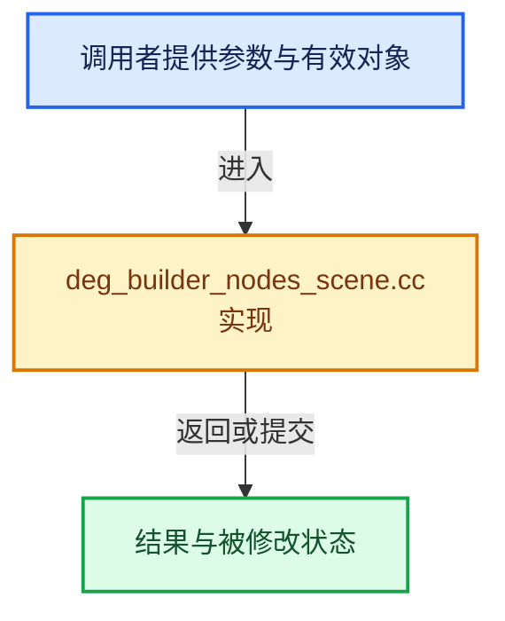

# 实现依赖专题：source/blender/depsgraph/intern/builder/deg_builder_nodes_scene.cc

[实现依赖导航](../../../README.md) · [符号索引](../../../../00-课程指南/02-源码与提交索引/符号依赖与实现索引.md)

本专题从正文实际调用进入，集中保存共享实现。函数有稳定锚点，可从调用处直接跳到对应完整函数；递归与互相调用通过回链组织。

## 本文件的实现关系





## 完整成员与函数实现

<a id="f-4102d1fc3efbfc9d"></a>

### `blender::deg::DepsgraphNodeBuilder::build_scene_parameters`

实现位置：[source/blender/depsgraph/intern/builder/deg_builder_nodes_scene.cc](../../../../../../../../source/blender/depsgraph/intern/builder/deg_builder_nodes_scene.cc) · L52—L66。

接口参数：

- `Scene *scene`

**教学注释版**

<!-- annotated:7f29bfd53ef017 -->

```cpp
void DepsgraphNodeBuilder::build_scene_parameters(Scene *scene)
{
  if (built_map_.check_is_built_and_tag(scene, BuilderMap::TAG_PARAMETERS)) {
    return;
  }
  build_parameters(&scene->id);
  build_idproperties(scene->id.properties);
  build_idproperties(scene->id.system_properties);

  add_operation_node(&scene->id, NodeType::SCENE, OperationCode::SCENE_EVAL);

  for (TimeMarker &marker : scene->markers) {
    build_idproperties(marker.prop);
  }
}
```

<details>
<summary>核对原始源码：source/blender/depsgraph/intern/builder/deg_builder_nodes_scene.cc · L52—L66</summary>

<!-- original:7f29bfd53ef017:source/blender/depsgraph/intern/builder/deg_builder_nodes_scene.cc:52:66 -->

```cpp
void DepsgraphNodeBuilder::build_scene_parameters(Scene *scene)
{
  if (built_map_.check_is_built_and_tag(scene, BuilderMap::TAG_PARAMETERS)) {
    return;
  }
  build_parameters(&scene->id);
  build_idproperties(scene->id.properties);
  build_idproperties(scene->id.system_properties);

  add_operation_node(&scene->id, NodeType::SCENE, OperationCode::SCENE_EVAL);

  for (TimeMarker &marker : scene->markers) {
    build_idproperties(marker.prop);
  }
}
```

</details>

**继续追踪实现**

- `built_map_.check_is_built_and_tag` → [调用协议](../../../../00-课程指南/01-路线与规范/模板宏与动态分派协议.md)：接收对象类型依赖auto、返回值或模板实例；不按同名猜测目标。调用位置L54。
- `build_parameters` → [blender::deg::DepsgraphRelationBuilder::build_parameters · L2238](../../../../11-Depsgraph与并行任务系统/04-关系构建器.md#f-a095a33b2fc26d07)；[blender::deg::DepsgraphNodeBuilder::build_parameters · L1468](../../../../11-Depsgraph与并行任务系统/03-节点构建器.md#f-c3ba3affce030f5d)。同名重载需按实参类型选择。
- `build_idproperties` → [blender::deg::DepsgraphRelationBuilder::build_idproperties · L635](../../../../11-Depsgraph与并行任务系统/04-关系构建器.md#f-098c28c24f9a599e)；[blender::deg::DepsgraphNodeBuilder::build_idproperties · L685](../../../../11-Depsgraph与并行任务系统/03-节点构建器.md#f-cff75bdb39624564)。同名重载需按实参类型选择。
- `add_operation_node` → [blender::deg::DepsgraphNodeBuilder::add_operation_node · L239](../../../../11-Depsgraph与并行任务系统/03-节点构建器.md#f-af4bc9beff6a8947)；[blender::deg::DepsgraphNodeBuilder::add_operation_node · L261](../../../../11-Depsgraph与并行任务系统/03-节点构建器.md#f-83c337cd1005cd03)；[blender::deg::DepsgraphNodeBuilder::add_operation_node · L273](../../../../11-Depsgraph与并行任务系统/03-节点构建器.md#f-acdc3fdc26d9ecc3)。同名重载需按实参类型选择。
