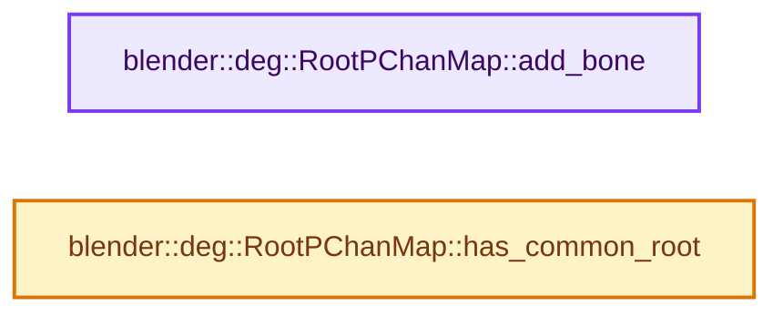
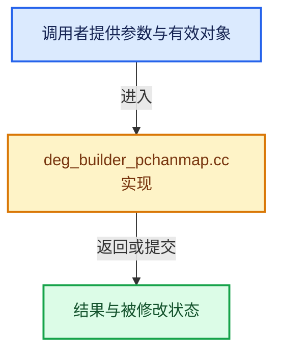

# 实现依赖专题：source/blender/depsgraph/intern/builder/deg_builder_pchanmap.cc

[实现依赖导航](../../../README.md) · [符号索引](../../../../00-课程指南/02-源码与提交索引/符号依赖与实现索引.md)

本专题从正文实际调用进入，集中保存共享实现。函数有稳定锚点，可从调用处直接跳到对应完整函数；递归与互相调用通过回链组织。

## 本文件的实现关系






## 完整成员与函数实现

<a id="f-45febaac8da310fe"></a>

### `blender::deg::RootPChanMap::add_bone`

实现位置：[source/blender/depsgraph/intern/builder/deg_builder_pchanmap.cc](../../../../../../../../source/blender/depsgraph/intern/builder/deg_builder_pchanmap.cc) · L27—L30。

接口参数：

- `const char *bone`
- `const char *root`

**教学注释版**

<!-- annotated:137496567345a4 -->

```cpp
void RootPChanMap::add_bone(const char *bone, const char *root)
{
  map_.lookup_or_add_default(bone).add(root);
}
```

<details>
<summary>核对原始源码：source/blender/depsgraph/intern/builder/deg_builder_pchanmap.cc · L27—L30</summary>

<!-- original:137496567345a4:source/blender/depsgraph/intern/builder/deg_builder_pchanmap.cc:27:30 -->

```cpp
void RootPChanMap::add_bone(const char *bone, const char *root)
{
  map_.lookup_or_add_default(bone).add(root);
}
```

</details>

**继续追踪实现**

- `map_.lookup_or_add_default(bone).add` → [调用协议](../../../../00-课程指南/01-路线与规范/模板宏与动态分派协议.md)：接收对象类型依赖auto、返回值或模板实例；不按同名猜测目标。调用位置L29。
- `map_.lookup_or_add_default` → [调用协议](../../../../00-课程指南/01-路线与规范/模板宏与动态分派协议.md)：接收对象类型依赖auto、返回值或模板实例；不按同名猜测目标。调用位置L29。

<a id="f-da7b201d3e3cf6c2"></a>

### `blender::deg::RootPChanMap::has_common_root`

实现位置：[source/blender/depsgraph/intern/builder/deg_builder_pchanmap.cc](../../../../../../../../source/blender/depsgraph/intern/builder/deg_builder_pchanmap.cc) · L32—L50。

接口参数：

- `const char *bone1`
- `const char *bone2`

**教学注释版**

<!-- annotated:da6b353df3f005 -->

```cpp
bool RootPChanMap::has_common_root(const char *bone1, const char *bone2) const
{
  const Set<StringRefNull> *bone1_roots = map_.lookup_ptr(bone1);
  const Set<StringRefNull> *bone2_roots = map_.lookup_ptr(bone2);

  if (bone1_roots == nullptr) {
    // fprintf("RootPChanMap: bone1 '%s' not found (%s => %s)\n", bone1, bone1, bone2);
    // print_debug();
    return false;
  }

  if (bone2_roots == nullptr) {
    // fprintf("RootPChanMap: bone2 '%s' not found (%s => %s)\n", bone2, bone1, bone2);
    // print_debug();
    return false;
  }

  return Set<StringRefNull>::Intersects(*bone1_roots, *bone2_roots);
}
```

<details>
<summary>核对原始源码：source/blender/depsgraph/intern/builder/deg_builder_pchanmap.cc · L32—L50</summary>

<!-- original:da6b353df3f005:source/blender/depsgraph/intern/builder/deg_builder_pchanmap.cc:32:50 -->

```cpp
bool RootPChanMap::has_common_root(const char *bone1, const char *bone2) const
{
  const Set<StringRefNull> *bone1_roots = map_.lookup_ptr(bone1);
  const Set<StringRefNull> *bone2_roots = map_.lookup_ptr(bone2);

  if (bone1_roots == nullptr) {
    // fprintf("RootPChanMap: bone1 '%s' not found (%s => %s)\n", bone1, bone1, bone2);
    // print_debug();
    return false;
  }

  if (bone2_roots == nullptr) {
    // fprintf("RootPChanMap: bone2 '%s' not found (%s => %s)\n", bone2, bone1, bone2);
    // print_debug();
    return false;
  }

  return Set<StringRefNull>::Intersects(*bone1_roots, *bone2_roots);
}
```

</details>

**结果出口**

- `return false;`
- `return Set<StringRefNull>::Intersects(*bone1_roots, *bone2_roots);`

**继续追踪实现**

- `map_.lookup_ptr` → [调用协议](../../../../00-课程指南/01-路线与规范/模板宏与动态分派协议.md)：接收对象类型依赖auto、返回值或模板实例；不按同名猜测目标。调用位置L34。
- `Set<StringRefNull>::Intersects` → [blender::Set::Intersects · L666](../../../../02-哈希表与关联数据结构/08-Set与集合语义.md#f-18d6f595c8e87bc5)。
