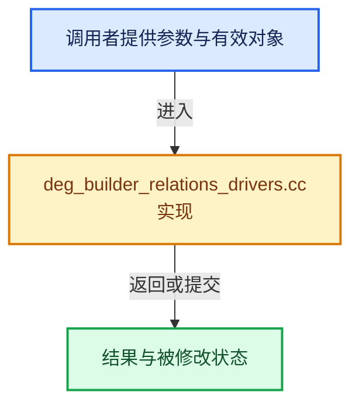

# 实现依赖专题：source/blender/depsgraph/intern/builder/deg_builder_relations_drivers.cc

[实现依赖导航](../../../README.md) · [符号索引](../../../../00-课程指南/02-源码与提交索引/符号依赖与实现索引.md)

本专题从正文实际调用进入，集中保存共享实现。函数有稳定锚点，可从调用处直接跳到对应完整函数；递归与互相调用通过回链组织。

## 本文件的实现关系





## 完整成员与函数实现

<a id="f-5aaf6bc3532b9248"></a>

### `blender::deg::data_path_maybe_shared`

实现位置：[source/blender/depsgraph/intern/builder/deg_builder_relations_drivers.cc](../../../../../../../../source/blender/depsgraph/intern/builder/deg_builder_relations_drivers.cc) · L245—L271。

接口参数：

- `const ID &id`
- `const StringRef data_path`

**教学注释版**

<!-- annotated:6a20ad25950317 -->

```cpp
bool data_path_maybe_shared(const ID &id, const StringRef data_path)
{
  /* As it is hard to generally detect implicit sharing, this is implemented as
   * a 'known to not share' list. */

  /* Allow concurrent writes to custom properties. #140706 shows that this
   * shouldn't be a problem in practice. */
  if (data_path.startswith("[\"") && data_path.endswith("\"]")) {
    return false;
  }

  if (GS(id.name) == ID_OB) {
    const Object &ob = *reinterpret_cast<const Object *>(&id);
    const bool is_thread_safe = (ob.type == OB_ARMATURE && data_path.startswith("pose.bones["));
    return !is_thread_safe;
  }

  /* Allow concurrent writes to shape-key values. #140706 shows that this
   * shouldn't be a problem in practice. */
  if (GS(id.name) == ID_KE) {
    const bool is_thread_safe = data_path.startswith("key_blocks[") &&
                                data_path.endswith("].value");
    return !is_thread_safe;
  }

  return true;
}
```

<details>
<summary>核对原始源码：source/blender/depsgraph/intern/builder/deg_builder_relations_drivers.cc · L245—L271</summary>

<!-- original:6a20ad25950317:source/blender/depsgraph/intern/builder/deg_builder_relations_drivers.cc:245:271 -->

```cpp
bool data_path_maybe_shared(const ID &id, const StringRef data_path)
{
  /* As it is hard to generally detect implicit sharing, this is implemented as
   * a 'known to not share' list. */

  /* Allow concurrent writes to custom properties. #140706 shows that this
   * shouldn't be a problem in practice. */
  if (data_path.startswith("[\"") && data_path.endswith("\"]")) {
    return false;
  }

  if (GS(id.name) == ID_OB) {
    const Object &ob = *reinterpret_cast<const Object *>(&id);
    const bool is_thread_safe = (ob.type == OB_ARMATURE && data_path.startswith("pose.bones["));
    return !is_thread_safe;
  }

  /* Allow concurrent writes to shape-key values. #140706 shows that this
   * shouldn't be a problem in practice. */
  if (GS(id.name) == ID_KE) {
    const bool is_thread_safe = data_path.startswith("key_blocks[") &&
                                data_path.endswith("].value");
    return !is_thread_safe;
  }

  return true;
}
```

</details>

**结果出口**

- `return false;`
- `return !is_thread_safe;`
- `return true;`

**继续追踪实现**

- `data_path.startswith` → [blender::StringRefBase::startswith · L269](../../../../01-基础容器与现代CPP/15-StringRef字符串视图.md#f-78237ccfe249bfa5)。
- `data_path.endswith` → [blender::StringRefBase::endswith · L285](../../../../01-基础容器与现代CPP/15-StringRef字符串视图.md#f-9b23dbdd3afc9dbb)。
- `GS` → [blender::GS · L410](../../../08-其他Blender模块/makesdna/DNA_ID.h.md#f-c3ff509f79f21b05)。
