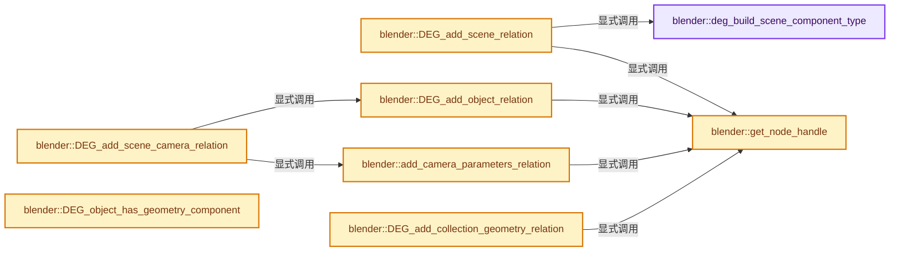

# 实现依赖专题：source/blender/depsgraph/intern/depsgraph_build.cc

[实现依赖导航](../../README.md) · [符号索引](../../../00-课程指南/02-源码与提交索引/符号依赖与实现索引.md)

本专题从正文实际调用进入，集中保存共享实现。函数有稳定锚点，可从调用处直接跳到对应完整函数；递归与互相调用通过回链组织。

## 本文件的实现关系




## 完整成员与函数实现

<a id="f-588e3a8f1f4b906e"></a>

### `blender::deg_build_scene_component_type`

实现位置：[source/blender/depsgraph/intern/depsgraph_build.cc](../../../../../../../source/blender/depsgraph/intern/depsgraph_build.cc) · L57—L70。

接口参数：

- `eDepsSceneComponentType component`

**教学注释版**

<!-- annotated:4857959cda57e8 -->

```cpp
static deg::NodeType deg_build_scene_component_type(eDepsSceneComponentType component)
{
  switch (component) {
    case DEG_SCENE_COMP_PARAMETERS:
      return deg::NodeType::PARAMETERS;
    case DEG_SCENE_COMP_ANIMATION:
      return deg::NodeType::ANIMATION;
    case DEG_SCENE_COMP_SEQUENCER:
      return deg::NodeType::SEQUENCER;
    case DEG_SCENE_COMP_COMPOSITOR:
      return deg::NodeType::COMPOSITOR;
  }
  return deg::NodeType::UNDEFINED;
}
```

<details>
<summary>核对原始源码：source/blender/depsgraph/intern/depsgraph_build.cc · L57—L70</summary>

<!-- original:4857959cda57e8:source/blender/depsgraph/intern/depsgraph_build.cc:57:70 -->

```cpp
static deg::NodeType deg_build_scene_component_type(eDepsSceneComponentType component)
{
  switch (component) {
    case DEG_SCENE_COMP_PARAMETERS:
      return deg::NodeType::PARAMETERS;
    case DEG_SCENE_COMP_ANIMATION:
      return deg::NodeType::ANIMATION;
    case DEG_SCENE_COMP_SEQUENCER:
      return deg::NodeType::SEQUENCER;
    case DEG_SCENE_COMP_COMPOSITOR:
      return deg::NodeType::COMPOSITOR;
  }
  return deg::NodeType::UNDEFINED;
}
```

</details>

**结果出口**

- `return deg::NodeType::PARAMETERS;`
- `return deg::NodeType::ANIMATION;`
- `return deg::NodeType::SEQUENCER;`
- `return deg::NodeType::COMPOSITOR;`
- `return deg::NodeType::UNDEFINED;`

**继续追踪实现**

本实现没有需要继续展开的显式调用；检查返回表达式、对象转换和调用者前置条件。

<a id="f-4bc3ed8a6f4f38e8"></a>

### `blender::get_node_handle`

实现位置：[source/blender/depsgraph/intern/depsgraph_build.cc](../../../../../../../source/blender/depsgraph/intern/depsgraph_build.cc) · L72—L75。

接口参数：

- `DepsNodeHandle *node_handle`

**教学注释版**

<!-- annotated:9b41cb4ce2631d -->

```cpp
static deg::DepsNodeHandle *get_node_handle(DepsNodeHandle *node_handle)
{
  return reinterpret_cast<deg::DepsNodeHandle *>(node_handle);
}
```

<details>
<summary>核对原始源码：source/blender/depsgraph/intern/depsgraph_build.cc · L72—L75</summary>

<!-- original:9b41cb4ce2631d:source/blender/depsgraph/intern/depsgraph_build.cc:72:75 -->

```cpp
static deg::DepsNodeHandle *get_node_handle(DepsNodeHandle *node_handle)
{
  return reinterpret_cast<deg::DepsNodeHandle *>(node_handle);
}
```

</details>

**结果出口**

- `return reinterpret_cast<deg::DepsNodeHandle *>(node_handle);`

**继续追踪实现**

本实现没有需要继续展开的显式调用；检查返回表达式、对象转换和调用者前置条件。

<a id="f-7f2ffb7e38b49509"></a>

### `blender::DEG_add_scene_relation`

实现位置：[source/blender/depsgraph/intern/depsgraph_build.cc](../../../../../../../source/blender/depsgraph/intern/depsgraph_build.cc) · L77—L86。

接口参数：

- `DepsNodeHandle *node_handle`
- `Scene *scene`
- `eDepsSceneComponentType component`
- `const char *description`

**教学注释版**

<!-- annotated:865cedf176b3f4 -->

```cpp
void DEG_add_scene_relation(DepsNodeHandle *node_handle,
                            Scene *scene,
                            eDepsSceneComponentType component,
                            const char *description)
{
  deg::NodeType type = deg_build_scene_component_type(component);
  deg::ComponentKey comp_key(&scene->id, type);
  deg::DepsNodeHandle *deg_node_handle = get_node_handle(node_handle);
  deg_node_handle->builder->add_node_handle_relation(comp_key, deg_node_handle, description);
}
```

<details>
<summary>核对原始源码：source/blender/depsgraph/intern/depsgraph_build.cc · L77—L86</summary>

<!-- original:865cedf176b3f4:source/blender/depsgraph/intern/depsgraph_build.cc:77:86 -->

```cpp
void DEG_add_scene_relation(DepsNodeHandle *node_handle,
                            Scene *scene,
                            eDepsSceneComponentType component,
                            const char *description)
{
  deg::NodeType type = deg_build_scene_component_type(component);
  deg::ComponentKey comp_key(&scene->id, type);
  deg::DepsNodeHandle *deg_node_handle = get_node_handle(node_handle);
  deg_node_handle->builder->add_node_handle_relation(comp_key, deg_node_handle, description);
}
```

</details>

**继续追踪实现**

- `deg_build_scene_component_type` → [blender::deg_build_scene_component_type · L57](depsgraph_build.cc.md#f-588e3a8f1f4b906e)。
- `get_node_handle` → [blender::get_node_handle · L72](depsgraph_build.cc.md#f-4bc3ed8a6f4f38e8)。
- `deg_node_handle->builder->add_node_handle_relation` → [调用协议](../../../00-课程指南/01-路线与规范/模板宏与动态分派协议.md)：接收对象类型依赖auto、返回值或模板实例；不按同名猜测目标。调用位置L85。

<a id="f-672e4c5fef9fd978"></a>

### `blender::add_camera_parameters_relation`

实现位置：[source/blender/depsgraph/intern/depsgraph_build.cc](../../../../../../../source/blender/depsgraph/intern/depsgraph_build.cc) · L88—L95。

接口参数：

- `DepsNodeHandle *node_handle`
- `Camera *camera`
- `const char *description`

**教学注释版**

<!-- annotated:7b4a27c596c2f3 -->

```cpp
static void add_camera_parameters_relation(DepsNodeHandle *node_handle,
                                           Camera *camera,
                                           const char *description)
{
  deg::DepsNodeHandle *deg_node_handle = get_node_handle(node_handle);
  deg::ComponentKey parameters_key(&camera->id, deg::NodeType::PARAMETERS);
  deg_node_handle->builder->add_node_handle_relation(parameters_key, deg_node_handle, description);
}
```

<details>
<summary>核对原始源码：source/blender/depsgraph/intern/depsgraph_build.cc · L88—L95</summary>

<!-- original:7b4a27c596c2f3:source/blender/depsgraph/intern/depsgraph_build.cc:88:95 -->

```cpp
static void add_camera_parameters_relation(DepsNodeHandle *node_handle,
                                           Camera *camera,
                                           const char *description)
{
  deg::DepsNodeHandle *deg_node_handle = get_node_handle(node_handle);
  deg::ComponentKey parameters_key(&camera->id, deg::NodeType::PARAMETERS);
  deg_node_handle->builder->add_node_handle_relation(parameters_key, deg_node_handle, description);
}
```

</details>

**继续追踪实现**

- `get_node_handle` → [blender::get_node_handle · L72](depsgraph_build.cc.md#f-4bc3ed8a6f4f38e8)。
- `deg_node_handle->builder->add_node_handle_relation` → [调用协议](../../../00-课程指南/01-路线与规范/模板宏与动态分派协议.md)：接收对象类型依赖auto、返回值或模板实例；不按同名猜测目标。调用位置L94。

<a id="f-bb41a91b31e0c1cb"></a>

### `blender::DEG_add_scene_camera_relation`

实现位置：[source/blender/depsgraph/intern/depsgraph_build.cc](../../../../../../../source/blender/depsgraph/intern/depsgraph_build.cc) · L97—L121。

接口参数：

- `DepsNodeHandle *node_handle`
- `Scene *scene`
- `eDepsObjectComponentType component`
- `const char *description`

**教学注释版**

<!-- annotated:47665eb321f045 -->

```cpp
void DEG_add_scene_camera_relation(DepsNodeHandle *node_handle,
                                   Scene *scene,
                                   eDepsObjectComponentType component,
                                   const char *description)
{
  if (scene->camera != nullptr) {
    DEG_add_object_relation(node_handle, scene->camera, component, description);
    if (scene->camera->type == OB_CAMERA) {
      add_camera_parameters_relation(
          node_handle, reinterpret_cast<Camera *>(scene->camera->data), description);
    }
  }

  /* Like DepsgraphNodeBuilder::build_scene_camera(), we also need to account for other cameras
   * referenced by markers. */
  for (TimeMarker &marker : scene->markers) {
    if (!ELEM(marker.camera, nullptr, scene->camera)) {
      DEG_add_object_relation(node_handle, marker.camera, component, description);
      if (marker.camera->type == OB_CAMERA) {
        add_camera_parameters_relation(
            node_handle, reinterpret_cast<Camera *>(marker.camera->data), description);
      }
    }
  }
}
```

<details>
<summary>核对原始源码：source/blender/depsgraph/intern/depsgraph_build.cc · L97—L121</summary>

<!-- original:47665eb321f045:source/blender/depsgraph/intern/depsgraph_build.cc:97:121 -->

```cpp
void DEG_add_scene_camera_relation(DepsNodeHandle *node_handle,
                                   Scene *scene,
                                   eDepsObjectComponentType component,
                                   const char *description)
{
  if (scene->camera != nullptr) {
    DEG_add_object_relation(node_handle, scene->camera, component, description);
    if (scene->camera->type == OB_CAMERA) {
      add_camera_parameters_relation(
          node_handle, reinterpret_cast<Camera *>(scene->camera->data), description);
    }
  }

  /* Like DepsgraphNodeBuilder::build_scene_camera(), we also need to account for other cameras
   * referenced by markers. */
  for (TimeMarker &marker : scene->markers) {
    if (!ELEM(marker.camera, nullptr, scene->camera)) {
      DEG_add_object_relation(node_handle, marker.camera, component, description);
      if (marker.camera->type == OB_CAMERA) {
        add_camera_parameters_relation(
            node_handle, reinterpret_cast<Camera *>(marker.camera->data), description);
      }
    }
  }
}
```

</details>

**继续追踪实现**

- `DEG_add_object_relation` → [blender::DEG_add_object_relation · L123](depsgraph_build.cc.md#f-f570cffae97e273c)。
- `add_camera_parameters_relation` → [blender::add_camera_parameters_relation · L88](depsgraph_build.cc.md#f-672e4c5fef9fd978)。
- `ELEM` → [ELEM · L88](../../07-Intern运行时与平台/ghost/intern/GHOST_utildefines.hh.md#m-d28724a15928)；[ELEM · L135](../../01-BLI基础库/BLI_utildefines.hh.md#m-d6572de7cae0)。宏定义由构建条件选择。

<a id="f-f570cffae97e273c"></a>

### `blender::DEG_add_object_relation`

实现位置：[source/blender/depsgraph/intern/depsgraph_build.cc](../../../../../../../source/blender/depsgraph/intern/depsgraph_build.cc) · L123—L132。

接口参数：

- `DepsNodeHandle *node_handle`
- `Object *object`
- `eDepsObjectComponentType component`
- `const char *description`

**教学注释版**

<!-- annotated:3c0facbcdc2420 -->

```cpp
void DEG_add_object_relation(DepsNodeHandle *node_handle,
                             Object *object,
                             eDepsObjectComponentType component,
                             const char *description)
{
  deg::NodeType type = deg::nodeTypeFromObjectComponent(component);
  deg::ComponentKey comp_key(&object->id, type);
  deg::DepsNodeHandle *deg_node_handle = get_node_handle(node_handle);
  deg_node_handle->builder->add_node_handle_relation(comp_key, deg_node_handle, description);
}
```

<details>
<summary>核对原始源码：source/blender/depsgraph/intern/depsgraph_build.cc · L123—L132</summary>

<!-- original:3c0facbcdc2420:source/blender/depsgraph/intern/depsgraph_build.cc:123:132 -->

```cpp
void DEG_add_object_relation(DepsNodeHandle *node_handle,
                             Object *object,
                             eDepsObjectComponentType component,
                             const char *description)
{
  deg::NodeType type = deg::nodeTypeFromObjectComponent(component);
  deg::ComponentKey comp_key(&object->id, type);
  deg::DepsNodeHandle *deg_node_handle = get_node_handle(node_handle);
  deg_node_handle->builder->add_node_handle_relation(comp_key, deg_node_handle, description);
}
```

</details>

**继续追踪实现**

- `deg::nodeTypeFromObjectComponent` → [blender::deg::nodeTypeFromObjectComponent · L179](node/deg_node.cc.md#f-936b7e29b13a72de)。
- `get_node_handle` → [blender::get_node_handle · L72](depsgraph_build.cc.md#f-4bc3ed8a6f4f38e8)。
- `deg_node_handle->builder->add_node_handle_relation` → [调用协议](../../../00-课程指南/01-路线与规范/模板宏与动态分派协议.md)：接收对象类型依赖auto、返回值或模板实例；不按同名猜测目标。调用位置L131。

<a id="f-90c525c04e91dcf7"></a>

### `blender::DEG_object_has_geometry_component`

实现位置：[source/blender/depsgraph/intern/depsgraph_build.cc](../../../../../../../source/blender/depsgraph/intern/depsgraph_build.cc) · L134—L137。

接口参数：

- `Object *object`

**教学注释版**

<!-- annotated:ac6c3136e3cc5a -->

```cpp
bool DEG_object_has_geometry_component(Object *object)
{
  return deg::geometry_tag_to_component(&object->id) == deg::NodeType::GEOMETRY;
}
```

<details>
<summary>核对原始源码：source/blender/depsgraph/intern/depsgraph_build.cc · L134—L137</summary>

<!-- original:ac6c3136e3cc5a:source/blender/depsgraph/intern/depsgraph_build.cc:134:137 -->

```cpp
bool DEG_object_has_geometry_component(Object *object)
{
  return deg::geometry_tag_to_component(&object->id) == deg::NodeType::GEOMETRY;
}
```

</details>

**结果出口**

- `return deg::geometry_tag_to_component(&object->id) == deg::NodeType::GEOMETRY;`

**继续追踪实现**

- `deg::geometry_tag_to_component` → [blender::deg::geometry_tag_to_component · L603](depsgraph_tag.cc.md#f-48376f5877ef38a3)。

<a id="f-df8183be0167db8e"></a>

### `blender::DEG_add_collection_geometry_relation`

实现位置：[source/blender/depsgraph/intern/depsgraph_build.cc](../../../../../../../source/blender/depsgraph/intern/depsgraph_build.cc) · L139—L147。

接口参数：

- `DepsNodeHandle *node_handle`
- `Collection *collection`
- `const char *description`

**教学注释版**

<!-- annotated:1238e091a24bb9 -->

```cpp
void DEG_add_collection_geometry_relation(DepsNodeHandle *node_handle,
                                          Collection *collection,
                                          const char *description)
{
  deg::OperationKey operation_key{
      &collection->id, deg::NodeType::GEOMETRY, deg::OperationCode::GEOMETRY_EVAL_DONE};
  deg::DepsNodeHandle *deg_node_handle = get_node_handle(node_handle);
  deg_node_handle->builder->add_node_handle_relation(operation_key, deg_node_handle, description);
}
```

<details>
<summary>核对原始源码：source/blender/depsgraph/intern/depsgraph_build.cc · L139—L147</summary>

<!-- original:1238e091a24bb9:source/blender/depsgraph/intern/depsgraph_build.cc:139:147 -->

```cpp
void DEG_add_collection_geometry_relation(DepsNodeHandle *node_handle,
                                          Collection *collection,
                                          const char *description)
{
  deg::OperationKey operation_key{
      &collection->id, deg::NodeType::GEOMETRY, deg::OperationCode::GEOMETRY_EVAL_DONE};
  deg::DepsNodeHandle *deg_node_handle = get_node_handle(node_handle);
  deg_node_handle->builder->add_node_handle_relation(operation_key, deg_node_handle, description);
}
```

</details>

**继续追踪实现**

- `get_node_handle` → [blender::get_node_handle · L72](depsgraph_build.cc.md#f-4bc3ed8a6f4f38e8)。
- `deg_node_handle->builder->add_node_handle_relation` → [调用协议](../../../00-课程指南/01-路线与规范/模板宏与动态分派协议.md)：接收对象类型依赖auto、返回值或模板实例；不按同名猜测目标。调用位置L146。

<a id="f-11a9f62d2d5e1229"></a>

### `blender::DEG_add_collection_geometry_customdata_mask`

实现位置：[source/blender/depsgraph/intern/depsgraph_build.cc](../../../../../../../source/blender/depsgraph/intern/depsgraph_build.cc) · L149—L160。

接口参数：

- `DepsNodeHandle *node_handle`
- `Collection *collection`
- `const CustomData_MeshMasks *masks`

**教学注释版**

<!-- annotated:2a6ae502ac971a -->

```cpp
void DEG_add_collection_geometry_customdata_mask(DepsNodeHandle *node_handle,
                                                 Collection *collection,
                                                 const CustomData_MeshMasks *masks)
{
  FOREACH_COLLECTION_OBJECT_RECURSIVE_BEGIN (collection, ob) {
    DEG_add_customdata_mask(node_handle, ob, masks);
    if (ob->type == OB_EMPTY && ob->instance_collection != nullptr) {
      DEG_add_collection_geometry_customdata_mask(node_handle, ob->instance_collection, masks);
    }
  }
  FOREACH_COLLECTION_OBJECT_RECURSIVE_END;
}
```

<details>
<summary>核对原始源码：source/blender/depsgraph/intern/depsgraph_build.cc · L149—L160</summary>

<!-- original:2a6ae502ac971a:source/blender/depsgraph/intern/depsgraph_build.cc:149:160 -->

```cpp
void DEG_add_collection_geometry_customdata_mask(DepsNodeHandle *node_handle,
                                                 Collection *collection,
                                                 const CustomData_MeshMasks *masks)
{
  FOREACH_COLLECTION_OBJECT_RECURSIVE_BEGIN (collection, ob) {
    DEG_add_customdata_mask(node_handle, ob, masks);
    if (ob->type == OB_EMPTY && ob->instance_collection != nullptr) {
      DEG_add_collection_geometry_customdata_mask(node_handle, ob->instance_collection, masks);
    }
  }
  FOREACH_COLLECTION_OBJECT_RECURSIVE_END;
}
```

</details>

**继续追踪实现**

- `DEG_add_customdata_mask` → [blender::DEG_add_customdata_mask · L259](depsgraph_build.cc.md#f-7ae1eb4c4326d38d)。
- `DEG_add_collection_geometry_customdata_mask` → [blender::DEG_add_collection_geometry_customdata_mask · L149](depsgraph_build.cc.md#f-11a9f62d2d5e1229)。

<a id="f-fb1caa918d5228d7"></a>

### `blender::DEG_add_node_tree_output_relation`

实现位置：[source/blender/depsgraph/intern/depsgraph_build.cc](../../../../../../../source/blender/depsgraph/intern/depsgraph_build.cc) · L162—L176。

接口参数：

- `DepsNodeHandle *node_handle`
- `bNodeTree *node_tree`
- `const char *description`

**教学注释版**

<!-- annotated:963935e4a3b256 -->

```cpp
void DEG_add_node_tree_output_relation(DepsNodeHandle *node_handle,
                                       bNodeTree *node_tree,
                                       const char *description)
{
  deg::OperationKey ntree_output_key(
      &node_tree->id, deg::NodeType::NTREE_OUTPUT, deg::OperationCode::NTREE_OUTPUT);
  deg::OperationKey ntree_preprocess_key(&node_tree->id,
                                         deg::NodeType::NTREE_GEOMETRY_PREPROCESS,
                                         deg::OperationCode::NTREE_GEOMETRY_PREPROCESS);
  deg::DepsNodeHandle *deg_node_handle = get_node_handle(node_handle);
  deg_node_handle->builder->add_node_handle_relation(
      ntree_output_key, deg_node_handle, description);
  deg_node_handle->builder->add_node_handle_relation(
      ntree_preprocess_key, deg_node_handle, description, deg::RELATION_FLAG_NO_FLUSH);
}
```

<details>
<summary>核对原始源码：source/blender/depsgraph/intern/depsgraph_build.cc · L162—L176</summary>

<!-- original:963935e4a3b256:source/blender/depsgraph/intern/depsgraph_build.cc:162:176 -->

```cpp
void DEG_add_node_tree_output_relation(DepsNodeHandle *node_handle,
                                       bNodeTree *node_tree,
                                       const char *description)
{
  deg::OperationKey ntree_output_key(
      &node_tree->id, deg::NodeType::NTREE_OUTPUT, deg::OperationCode::NTREE_OUTPUT);
  deg::OperationKey ntree_preprocess_key(&node_tree->id,
                                         deg::NodeType::NTREE_GEOMETRY_PREPROCESS,
                                         deg::OperationCode::NTREE_GEOMETRY_PREPROCESS);
  deg::DepsNodeHandle *deg_node_handle = get_node_handle(node_handle);
  deg_node_handle->builder->add_node_handle_relation(
      ntree_output_key, deg_node_handle, description);
  deg_node_handle->builder->add_node_handle_relation(
      ntree_preprocess_key, deg_node_handle, description, deg::RELATION_FLAG_NO_FLUSH);
}
```

</details>

**继续追踪实现**

- `get_node_handle` → [blender::get_node_handle · L72](depsgraph_build.cc.md#f-4bc3ed8a6f4f38e8)。
- `deg_node_handle->builder->add_node_handle_relation` → [调用协议](../../../00-课程指南/01-路线与规范/模板宏与动态分派协议.md)：接收对象类型依赖auto、返回值或模板实例；不按同名猜测目标。调用位置L172。

<a id="f-de7937773c563216"></a>

### `blender::DEG_add_object_cache_relation`

实现位置：[source/blender/depsgraph/intern/depsgraph_build.cc](../../../../../../../source/blender/depsgraph/intern/depsgraph_build.cc) · L178—L187。

接口参数：

- `DepsNodeHandle *node_handle`
- `CacheFile *cache_file`
- `eDepsObjectComponentType component`
- `const char *description`

**教学注释版**

<!-- annotated:159d89163e09d6 -->

```cpp
void DEG_add_object_cache_relation(DepsNodeHandle *node_handle,
                                   CacheFile *cache_file,
                                   eDepsObjectComponentType component,
                                   const char *description)
{
  deg::NodeType type = deg::nodeTypeFromObjectComponent(component);
  deg::ComponentKey comp_key(&cache_file->id, type);
  deg::DepsNodeHandle *deg_node_handle = get_node_handle(node_handle);
  deg_node_handle->builder->add_node_handle_relation(comp_key, deg_node_handle, description);
}
```

<details>
<summary>核对原始源码：source/blender/depsgraph/intern/depsgraph_build.cc · L178—L187</summary>

<!-- original:159d89163e09d6:source/blender/depsgraph/intern/depsgraph_build.cc:178:187 -->

```cpp
void DEG_add_object_cache_relation(DepsNodeHandle *node_handle,
                                   CacheFile *cache_file,
                                   eDepsObjectComponentType component,
                                   const char *description)
{
  deg::NodeType type = deg::nodeTypeFromObjectComponent(component);
  deg::ComponentKey comp_key(&cache_file->id, type);
  deg::DepsNodeHandle *deg_node_handle = get_node_handle(node_handle);
  deg_node_handle->builder->add_node_handle_relation(comp_key, deg_node_handle, description);
}
```

</details>

**继续追踪实现**

- `deg::nodeTypeFromObjectComponent` → [blender::deg::nodeTypeFromObjectComponent · L179](node/deg_node.cc.md#f-936b7e29b13a72de)。
- `get_node_handle` → [blender::get_node_handle · L72](depsgraph_build.cc.md#f-4bc3ed8a6f4f38e8)。
- `deg_node_handle->builder->add_node_handle_relation` → [调用协议](../../../00-课程指南/01-路线与规范/模板宏与动态分派协议.md)：接收对象类型依赖auto、返回值或模板实例；不按同名猜测目标。调用位置L186。

<a id="f-39e93b3cc8a9913c"></a>

### `blender::DEG_add_bone_relation`

实现位置：[source/blender/depsgraph/intern/depsgraph_build.cc](../../../../../../../source/blender/depsgraph/intern/depsgraph_build.cc) · L189—L199。

接口参数：

- `DepsNodeHandle *node_handle`
- `Object *object`
- `const char *bone_name`
- `eDepsObjectComponentType component`
- `const char *description`

**教学注释版**

<!-- annotated:5b48ad5cc0e59c -->

```cpp
void DEG_add_bone_relation(DepsNodeHandle *node_handle,
                           Object *object,
                           const char *bone_name,
                           eDepsObjectComponentType component,
                           const char *description)
{
  deg::NodeType type = deg::nodeTypeFromObjectComponent(component);
  deg::ComponentKey comp_key(&object->id, type, bone_name);
  deg::DepsNodeHandle *deg_node_handle = get_node_handle(node_handle);
  deg_node_handle->builder->add_node_handle_relation(comp_key, deg_node_handle, description);
}
```

<details>
<summary>核对原始源码：source/blender/depsgraph/intern/depsgraph_build.cc · L189—L199</summary>

<!-- original:5b48ad5cc0e59c:source/blender/depsgraph/intern/depsgraph_build.cc:189:199 -->

```cpp
void DEG_add_bone_relation(DepsNodeHandle *node_handle,
                           Object *object,
                           const char *bone_name,
                           eDepsObjectComponentType component,
                           const char *description)
{
  deg::NodeType type = deg::nodeTypeFromObjectComponent(component);
  deg::ComponentKey comp_key(&object->id, type, bone_name);
  deg::DepsNodeHandle *deg_node_handle = get_node_handle(node_handle);
  deg_node_handle->builder->add_node_handle_relation(comp_key, deg_node_handle, description);
}
```

</details>

**继续追踪实现**

- `deg::nodeTypeFromObjectComponent` → [blender::deg::nodeTypeFromObjectComponent · L179](node/deg_node.cc.md#f-936b7e29b13a72de)。
- `get_node_handle` → [blender::get_node_handle · L72](depsgraph_build.cc.md#f-4bc3ed8a6f4f38e8)。
- `deg_node_handle->builder->add_node_handle_relation` → [调用协议](../../../00-课程指南/01-路线与规范/模板宏与动态分派协议.md)：接收对象类型依赖auto、返回值或模板实例；不按同名猜测目标。调用位置L198。

<a id="f-2811f560a962bf95"></a>

### `blender::DEG_add_vfont_relation`

实现位置：[source/blender/depsgraph/intern/depsgraph_build.cc](../../../../../../../source/blender/depsgraph/intern/depsgraph_build.cc) · L201—L207。

接口参数：

- `DepsNodeHandle *handle`
- `VFont *vfont`
- `const char *description`

**教学注释版**

<!-- annotated:e5753469821faf -->

```cpp
void DEG_add_vfont_relation(DepsNodeHandle *handle, VFont *vfont, const char *description)
{
  deg::OperationKey operation_key(
      &vfont->id, deg::NodeType::PARAMETERS, deg::OperationCode::PARAMETERS_EXIT);
  deg::DepsNodeHandle *deg_node_handle = get_node_handle(handle);
  deg_node_handle->builder->add_node_handle_relation(operation_key, deg_node_handle, description);
}
```

<details>
<summary>核对原始源码：source/blender/depsgraph/intern/depsgraph_build.cc · L201—L207</summary>

<!-- original:e5753469821faf:source/blender/depsgraph/intern/depsgraph_build.cc:201:207 -->

```cpp
void DEG_add_vfont_relation(DepsNodeHandle *handle, VFont *vfont, const char *description)
{
  deg::OperationKey operation_key(
      &vfont->id, deg::NodeType::PARAMETERS, deg::OperationCode::PARAMETERS_EXIT);
  deg::DepsNodeHandle *deg_node_handle = get_node_handle(handle);
  deg_node_handle->builder->add_node_handle_relation(operation_key, deg_node_handle, description);
}
```

</details>

**继续追踪实现**

- `get_node_handle` → [blender::get_node_handle · L72](depsgraph_build.cc.md#f-4bc3ed8a6f4f38e8)。
- `deg_node_handle->builder->add_node_handle_relation` → [调用协议](../../../00-课程指南/01-路线与规范/模板宏与动态分派协议.md)：接收对象类型依赖auto、返回值或模板实例；不按同名猜测目标。调用位置L206。

<a id="f-09ca43c3666ab2b7"></a>

### `blender::DEG_add_object_pointcache_relation`

实现位置：[source/blender/depsgraph/intern/depsgraph_build.cc](../../../../../../../source/blender/depsgraph/intern/depsgraph_build.cc) · L209—L230。

接口参数：

- `DepsNodeHandle *node_handle`
- `Object *object`
- `eDepsObjectComponentType component`
- `const char *description`

**教学注释版**

<!-- annotated:638831fe2e802f -->

```cpp
void DEG_add_object_pointcache_relation(DepsNodeHandle *node_handle,
                                        Object *object,
                                        eDepsObjectComponentType component,
                                        const char *description)
{
  deg::NodeType type = deg::nodeTypeFromObjectComponent(component);
  deg::ComponentKey comp_key(&object->id, type);
  deg::DepsNodeHandle *deg_node_handle = get_node_handle(node_handle);
  deg::DepsgraphRelationBuilder *relation_builder = deg_node_handle->builder;
  /* Add relation from source to the node handle. */
  relation_builder->add_node_handle_relation(comp_key, deg_node_handle, description);
  /* Node deduct point cache component and connect source to it. */
  ID *id = DEG_get_id_from_handle(node_handle);
  deg::ComponentKey point_cache_key(id, deg::NodeType::POINT_CACHE);
  deg::Relation *rel = relation_builder->add_relation(comp_key, point_cache_key, "Point Cache");
  if (rel != nullptr) {
    rel->flag |= deg::RELATION_FLAG_FLUSH_USER_EDIT_ONLY;
  }
  else {
    fprintf(stderr, "Error in point cache relation from %s to ^%s.\n", object->id.name, id->name);
  }
}
```

<details>
<summary>核对原始源码：source/blender/depsgraph/intern/depsgraph_build.cc · L209—L230</summary>

<!-- original:638831fe2e802f:source/blender/depsgraph/intern/depsgraph_build.cc:209:230 -->

```cpp
void DEG_add_object_pointcache_relation(DepsNodeHandle *node_handle,
                                        Object *object,
                                        eDepsObjectComponentType component,
                                        const char *description)
{
  deg::NodeType type = deg::nodeTypeFromObjectComponent(component);
  deg::ComponentKey comp_key(&object->id, type);
  deg::DepsNodeHandle *deg_node_handle = get_node_handle(node_handle);
  deg::DepsgraphRelationBuilder *relation_builder = deg_node_handle->builder;
  /* Add relation from source to the node handle. */
  relation_builder->add_node_handle_relation(comp_key, deg_node_handle, description);
  /* Node deduct point cache component and connect source to it. */
  ID *id = DEG_get_id_from_handle(node_handle);
  deg::ComponentKey point_cache_key(id, deg::NodeType::POINT_CACHE);
  deg::Relation *rel = relation_builder->add_relation(comp_key, point_cache_key, "Point Cache");
  if (rel != nullptr) {
    rel->flag |= deg::RELATION_FLAG_FLUSH_USER_EDIT_ONLY;
  }
  else {
    fprintf(stderr, "Error in point cache relation from %s to ^%s.\n", object->id.name, id->name);
  }
}
```

</details>

**沿实际写入检查状态**

- `rel->flag |= deg::RELATION_FLAG_FLUSH_USER_EDIT_ONLY;`

**继续追踪实现**

- `deg::nodeTypeFromObjectComponent` → [blender::deg::nodeTypeFromObjectComponent · L179](node/deg_node.cc.md#f-936b7e29b13a72de)。
- `get_node_handle` → [blender::get_node_handle · L72](depsgraph_build.cc.md#f-4bc3ed8a6f4f38e8)。
- `relation_builder->add_node_handle_relation` → [blender::deg::DepsgraphRelationBuilder::add_node_handle_relation · L81](builder/deg_builder_relations_impl.h.md#f-3155e5998e3f40fb)；[blender::deg::DepsgraphRelationBuilder::add_node_handle_relation · L319](../../../11-Depsgraph与并行任务系统/04-关系构建器.md#f-7ca601bc392405e0)。同名重载需按实参类型选择。
- `DEG_get_id_from_handle` → [blender::DEG_get_id_from_handle · L267](depsgraph_build.cc.md#f-1d9a4113e9d5225f)。
- `relation_builder->add_relation` → [blender::deg::DepsgraphRelationBuilder::add_relation · L29](builder/deg_builder_relations_impl.h.md#f-9c9f4ea4be1f8780)；[blender::deg::DepsgraphRelationBuilder::add_relation · L66](builder/deg_builder_relations_impl.h.md#f-5b2ef1e631a55534)。同名重载需按实参类型选择。
- `fprintf` → [外部契约](https://eel.is/c++draft/)：这个边界按实际表达式及所属类型核对参数、返回值、寿命与失败行为。这里提供接口入口，不声称已解释该第三方版本的内部实现。

<a id="f-43ef8aa495db0d98"></a>

### `blender::DEG_add_generic_id_relation`

实现位置：[source/blender/depsgraph/intern/depsgraph_build.cc](../../../../../../../source/blender/depsgraph/intern/depsgraph_build.cc) · L232—L238。

接口参数：

- `DepsNodeHandle *node_handle`
- `ID *id`
- `const char *description`

**教学注释版**

<!-- annotated:6a8bd4f5f661c8 -->

```cpp
void DEG_add_generic_id_relation(DepsNodeHandle *node_handle, ID *id, const char *description)
{
  deg::OperationKey operation_key(
      id, deg::NodeType::GENERIC_DATABLOCK, deg::OperationCode::GENERIC_DATABLOCK_UPDATE);
  deg::DepsNodeHandle *deg_node_handle = get_node_handle(node_handle);
  deg_node_handle->builder->add_node_handle_relation(operation_key, deg_node_handle, description);
}
```

<details>
<summary>核对原始源码：source/blender/depsgraph/intern/depsgraph_build.cc · L232—L238</summary>

<!-- original:6a8bd4f5f661c8:source/blender/depsgraph/intern/depsgraph_build.cc:232:238 -->

```cpp
void DEG_add_generic_id_relation(DepsNodeHandle *node_handle, ID *id, const char *description)
{
  deg::OperationKey operation_key(
      id, deg::NodeType::GENERIC_DATABLOCK, deg::OperationCode::GENERIC_DATABLOCK_UPDATE);
  deg::DepsNodeHandle *deg_node_handle = get_node_handle(node_handle);
  deg_node_handle->builder->add_node_handle_relation(operation_key, deg_node_handle, description);
}
```

</details>

**继续追踪实现**

- `get_node_handle` → [blender::get_node_handle · L72](depsgraph_build.cc.md#f-4bc3ed8a6f4f38e8)。
- `deg_node_handle->builder->add_node_handle_relation` → [调用协议](../../../00-课程指南/01-路线与规范/模板宏与动态分派协议.md)：接收对象类型依赖auto、返回值或模板实例；不按同名猜测目标。调用位置L237。

<a id="f-47c32a354defa20d"></a>

### `blender::DEG_add_depends_on_transform_relation`

实现位置：[source/blender/depsgraph/intern/depsgraph_build.cc](../../../../../../../source/blender/depsgraph/intern/depsgraph_build.cc) · L240—L244。

接口参数：

- `DepsNodeHandle *node_handle`
- `const char *description`

**教学注释版**

<!-- annotated:300078fae792a8 -->

```cpp
void DEG_add_depends_on_transform_relation(DepsNodeHandle *node_handle, const char *description)
{
  deg::DepsNodeHandle *deg_node_handle = get_node_handle(node_handle);
  deg_node_handle->builder->add_depends_on_transform_relation(deg_node_handle, description);
}
```

<details>
<summary>核对原始源码：source/blender/depsgraph/intern/depsgraph_build.cc · L240—L244</summary>

<!-- original:300078fae792a8:source/blender/depsgraph/intern/depsgraph_build.cc:240:244 -->

```cpp
void DEG_add_depends_on_transform_relation(DepsNodeHandle *node_handle, const char *description)
{
  deg::DepsNodeHandle *deg_node_handle = get_node_handle(node_handle);
  deg_node_handle->builder->add_depends_on_transform_relation(deg_node_handle, description);
}
```

</details>

**继续追踪实现**

- `get_node_handle` → [blender::get_node_handle · L72](depsgraph_build.cc.md#f-4bc3ed8a6f4f38e8)。
- `deg_node_handle->builder->add_depends_on_transform_relation` → [调用协议](../../../00-课程指南/01-路线与规范/模板宏与动态分派协议.md)：接收对象类型依赖auto、返回值或模板实例；不按同名猜测目标。调用位置L243。

<a id="f-d68e9c73ded33dd2"></a>

### `blender::DEG_add_special_eval_flag`

实现位置：[source/blender/depsgraph/intern/depsgraph_build.cc](../../../../../../../source/blender/depsgraph/intern/depsgraph_build.cc) · L253—L257。

接口参数：

- `DepsNodeHandle *node_handle`
- `ID *id`
- `uint32_t flag`

**教学注释版**

<!-- annotated:f65daf58cb232b -->

```cpp
void DEG_add_special_eval_flag(DepsNodeHandle *node_handle, ID *id, uint32_t flag)
{
  deg::DepsNodeHandle *deg_node_handle = get_node_handle(node_handle);
  deg_node_handle->builder->add_special_eval_flag(id, flag);
}
```

<details>
<summary>核对原始源码：source/blender/depsgraph/intern/depsgraph_build.cc · L253—L257</summary>

<!-- original:f65daf58cb232b:source/blender/depsgraph/intern/depsgraph_build.cc:253:257 -->

```cpp
void DEG_add_special_eval_flag(DepsNodeHandle *node_handle, ID *id, uint32_t flag)
{
  deg::DepsNodeHandle *deg_node_handle = get_node_handle(node_handle);
  deg_node_handle->builder->add_special_eval_flag(id, flag);
}
```

</details>

**继续追踪实现**

- `get_node_handle` → [blender::get_node_handle · L72](depsgraph_build.cc.md#f-4bc3ed8a6f4f38e8)。
- `deg_node_handle->builder->add_special_eval_flag` → [调用协议](../../../00-课程指南/01-路线与规范/模板宏与动态分派协议.md)：接收对象类型依赖auto、返回值或模板实例；不按同名猜测目标。调用位置L256。

<a id="f-7ae1eb4c4326d38d"></a>

### `blender::DEG_add_customdata_mask`

实现位置：[source/blender/depsgraph/intern/depsgraph_build.cc](../../../../../../../source/blender/depsgraph/intern/depsgraph_build.cc) · L259—L265。

接口参数：

- `DepsNodeHandle *node_handle`
- `Object *object`
- `const CustomData_MeshMasks *masks`

**教学注释版**

<!-- annotated:6cdd9ab4f0ce5b -->

```cpp
void DEG_add_customdata_mask(DepsNodeHandle *node_handle,
                             Object *object,
                             const CustomData_MeshMasks *masks)
{
  deg::DepsNodeHandle *deg_node_handle = get_node_handle(node_handle);
  deg_node_handle->builder->add_customdata_mask(object, deg::DEGCustomDataMeshMasks(masks));
}
```

<details>
<summary>核对原始源码：source/blender/depsgraph/intern/depsgraph_build.cc · L259—L265</summary>

<!-- original:6cdd9ab4f0ce5b:source/blender/depsgraph/intern/depsgraph_build.cc:259:265 -->

```cpp
void DEG_add_customdata_mask(DepsNodeHandle *node_handle,
                             Object *object,
                             const CustomData_MeshMasks *masks)
{
  deg::DepsNodeHandle *deg_node_handle = get_node_handle(node_handle);
  deg_node_handle->builder->add_customdata_mask(object, deg::DEGCustomDataMeshMasks(masks));
}
```

</details>

**继续追踪实现**

- `get_node_handle` → [blender::get_node_handle · L72](depsgraph_build.cc.md#f-4bc3ed8a6f4f38e8)。
- `deg_node_handle->builder->add_customdata_mask` → [调用协议](../../../00-课程指南/01-路线与规范/模板宏与动态分派协议.md)：接收对象类型依赖auto、返回值或模板实例；不按同名猜测目标。调用位置L264。
- `deg::DEGCustomDataMeshMasks` → [blender::deg::DEGCustomDataMeshMasks::DEGCustomDataMeshMasks · L34](depsgraph_type.cc.md#f-fc8290099564dd1a)。

<a id="f-1d9a4113e9d5225f"></a>

### `blender::DEG_get_id_from_handle`

实现位置：[source/blender/depsgraph/intern/depsgraph_build.cc](../../../../../../../source/blender/depsgraph/intern/depsgraph_build.cc) · L267—L271。

接口参数：

- `DepsNodeHandle *node_handle`

**教学注释版**

<!-- annotated:6d059d6d5b2c0c -->

```cpp
ID *DEG_get_id_from_handle(DepsNodeHandle *node_handle)
{
  deg::DepsNodeHandle *deg_handle = get_node_handle(node_handle);
  return deg_handle->node->owner->owner->id_orig;
}
```

<details>
<summary>核对原始源码：source/blender/depsgraph/intern/depsgraph_build.cc · L267—L271</summary>

<!-- original:6d059d6d5b2c0c:source/blender/depsgraph/intern/depsgraph_build.cc:267:271 -->

```cpp
ID *DEG_get_id_from_handle(DepsNodeHandle *node_handle)
{
  deg::DepsNodeHandle *deg_handle = get_node_handle(node_handle);
  return deg_handle->node->owner->owner->id_orig;
}
```

</details>

**结果出口**

- `return deg_handle->node->owner->owner->id_orig;`

**继续追踪实现**

- `get_node_handle` → [blender::get_node_handle · L72](depsgraph_build.cc.md#f-4bc3ed8a6f4f38e8)。

<a id="f-066f295112ed2f4a"></a>

### `blender::DEG_get_graph_from_handle`

实现位置：[source/blender/depsgraph/intern/depsgraph_build.cc](../../../../../../../source/blender/depsgraph/intern/depsgraph_build.cc) · L273—L278。

接口参数：

- `DepsNodeHandle *node_handle`

**教学注释版**

<!-- annotated:a0c63d72622414 -->

```cpp
Depsgraph *DEG_get_graph_from_handle(DepsNodeHandle *node_handle)
{
  deg::DepsNodeHandle *deg_node_handle = get_node_handle(node_handle);
  deg::DepsgraphRelationBuilder *relation_builder = deg_node_handle->builder;
  return reinterpret_cast<Depsgraph *>(relation_builder->getGraph());
}
```

<details>
<summary>核对原始源码：source/blender/depsgraph/intern/depsgraph_build.cc · L273—L278</summary>

<!-- original:a0c63d72622414:source/blender/depsgraph/intern/depsgraph_build.cc:273:278 -->

```cpp
Depsgraph *DEG_get_graph_from_handle(DepsNodeHandle *node_handle)
{
  deg::DepsNodeHandle *deg_node_handle = get_node_handle(node_handle);
  deg::DepsgraphRelationBuilder *relation_builder = deg_node_handle->builder;
  return reinterpret_cast<Depsgraph *>(relation_builder->getGraph());
}
```

</details>

**结果出口**

- `return reinterpret_cast<Depsgraph *>(relation_builder->getGraph());`

**继续追踪实现**

- `get_node_handle` → [blender::get_node_handle · L72](depsgraph_build.cc.md#f-4bc3ed8a6f4f38e8)。
- `relation_builder->getGraph` → [blender::deg::DepsgraphRelationBuilder::getGraph · L510](../../../11-Depsgraph与并行任务系统/04-关系构建器.md#f-1dc3713b173691bc)。

<a id="f-8161f44a8a885849"></a>

### `blender::DEG_graph_build_from_view_layer`

实现位置：[source/blender/depsgraph/intern/depsgraph_build.cc](../../../../../../../source/blender/depsgraph/intern/depsgraph_build.cc) · L283—L287。

接口参数：

- `Depsgraph *graph`

**教学注释版**

<!-- annotated:7e49e56597752f -->

```cpp
void DEG_graph_build_from_view_layer(Depsgraph *graph)
{
  deg::ViewLayerBuilderPipeline builder(graph);
  // [讲解] builder.build：从点与可选子集建立索引和树节点。
  builder.build();
}
```

<details>
<summary>核对原始源码：source/blender/depsgraph/intern/depsgraph_build.cc · L283—L287</summary>

<!-- original:7e49e56597752f:source/blender/depsgraph/intern/depsgraph_build.cc:283:287 -->

```cpp
void DEG_graph_build_from_view_layer(Depsgraph *graph)
{
  deg::ViewLayerBuilderPipeline builder(graph);
  builder.build();
}
```

</details>

**继续追踪实现**

- `builder.build` → [blender::KDTreeNew<T>::build · L689](../../../12-空间数据结构与几何算法/06-筛选与子集查询.md#f-1fc07a1ede356a96)。

<a id="f-144b78d3b38e52e0"></a>

### `blender::DEG_graph_tag_relations_update`

实现位置：[source/blender/depsgraph/intern/depsgraph_build.cc](../../../../../../../source/blender/depsgraph/intern/depsgraph_build.cc) · L319—L338。

接口参数：

- `Depsgraph *graph`

**教学注释版**

<!-- annotated:1a997ab0e51b9b -->

```cpp
void DEG_graph_tag_relations_update(Depsgraph *graph)
{
  DEG_DEBUG_PRINTF(graph, TAG, "%s: Tagging relations for update.\n", __func__);
  deg::Depsgraph *deg_graph = reinterpret_cast<deg::Depsgraph *>(graph);
  deg_graph->need_update_relations = true;

  /* NOTE: When relations are updated, it's quite possible that we've got new bases in the scene.
   * This means, we need to re-create flat array of bases in view layer. */
  /* TODO(sergey): It is expected that bases manipulation tags scene for update to tag bases array
   * for re-creation. Once it is ensured to happen from all places this implicit tag can be
   * removed. */
  deg::IDNode *id_node = deg_graph->find_id_node(&deg_graph->scene->id);
  if (id_node != nullptr) {
    graph_id_tag_update(deg_graph->bmain,
                        deg_graph,
                        &deg_graph->scene->id,
                        ID_RECALC_BASE_FLAGS | ID_RECALC_HIERARCHY,
                        deg::DEG_UPDATE_SOURCE_RELATIONS);
  }
}
```

<details>
<summary>核对原始源码：source/blender/depsgraph/intern/depsgraph_build.cc · L319—L338</summary>

<!-- original:1a997ab0e51b9b:source/blender/depsgraph/intern/depsgraph_build.cc:319:338 -->

```cpp
void DEG_graph_tag_relations_update(Depsgraph *graph)
{
  DEG_DEBUG_PRINTF(graph, TAG, "%s: Tagging relations for update.\n", __func__);
  deg::Depsgraph *deg_graph = reinterpret_cast<deg::Depsgraph *>(graph);
  deg_graph->need_update_relations = true;

  /* NOTE: When relations are updated, it's quite possible that we've got new bases in the scene.
   * This means, we need to re-create flat array of bases in view layer. */
  /* TODO(sergey): It is expected that bases manipulation tags scene for update to tag bases array
   * for re-creation. Once it is ensured to happen from all places this implicit tag can be
   * removed. */
  deg::IDNode *id_node = deg_graph->find_id_node(&deg_graph->scene->id);
  if (id_node != nullptr) {
    graph_id_tag_update(deg_graph->bmain,
                        deg_graph,
                        &deg_graph->scene->id,
                        ID_RECALC_BASE_FLAGS | ID_RECALC_HIERARCHY,
                        deg::DEG_UPDATE_SOURCE_RELATIONS);
  }
}
```

</details>

**沿实际写入检查状态**

- `deg_graph->need_update_relations = true;`

**继续追踪实现**

- `DEG_DEBUG_PRINTF` → [DEG_DEBUG_PRINTF · L47](debug/deg_debug.h.md#m-ef590076cffe)。宏定义由构建条件选择。
- `deg_graph->find_id_node` → [blender::deg::Depsgraph::find_id_node · L102](depsgraph.cc.md#f-09bf92ea2c269980)。
- `graph_id_tag_update` → [blender::deg::graph_id_tag_update · L702](depsgraph_tag.cc.md#f-9b726d96d2ec3b9f)。

<a id="f-69595312f2edad41"></a>

### `blender::DEG_graph_relations_update`

实现位置：[source/blender/depsgraph/intern/depsgraph_build.cc](../../../../../../../source/blender/depsgraph/intern/depsgraph_build.cc) · L340—L348。

接口参数：

- `Depsgraph *graph`

**教学注释版**

<!-- annotated:41fc756641a73b -->

```cpp
void DEG_graph_relations_update(Depsgraph *graph)
{
  deg::Depsgraph *deg_graph = reinterpret_cast<deg::Depsgraph *>(graph);
  if (!deg_graph->need_update_relations) {
    /* Graph is up to date, nothing to do. */
    return;
  }
  DEG_graph_build_from_view_layer(graph);
}
```

<details>
<summary>核对原始源码：source/blender/depsgraph/intern/depsgraph_build.cc · L340—L348</summary>

<!-- original:41fc756641a73b:source/blender/depsgraph/intern/depsgraph_build.cc:340:348 -->

```cpp
void DEG_graph_relations_update(Depsgraph *graph)
{
  deg::Depsgraph *deg_graph = reinterpret_cast<deg::Depsgraph *>(graph);
  if (!deg_graph->need_update_relations) {
    /* Graph is up to date, nothing to do. */
    return;
  }
  DEG_graph_build_from_view_layer(graph);
}
```

</details>

**继续追踪实现**

- `DEG_graph_build_from_view_layer` → [blender::DEG_graph_build_from_view_layer · L283](depsgraph_build.cc.md#f-8161f44a8a885849)。

<a id="f-2910c78540652980"></a>

### `blender::DEG_relations_tag_update`

实现位置：[source/blender/depsgraph/intern/depsgraph_build.cc](../../../../../../../source/blender/depsgraph/intern/depsgraph_build.cc) · L350—L356。

接口参数：

- `Main *bmain`

**教学注释版**

<!-- annotated:372830dd37f467 -->

```cpp
void DEG_relations_tag_update(Main *bmain)
{
  DEG_GLOBAL_DEBUG_PRINTF(TAG, "%s: Tagging relations for update.\n", __func__);
  for (deg::Depsgraph *depsgraph : deg::get_all_registered_graphs(bmain)) {
    DEG_graph_tag_relations_update(reinterpret_cast<Depsgraph *>(depsgraph));
  }
}
```

<details>
<summary>核对原始源码：source/blender/depsgraph/intern/depsgraph_build.cc · L350—L356</summary>

<!-- original:372830dd37f467:source/blender/depsgraph/intern/depsgraph_build.cc:350:356 -->

```cpp
void DEG_relations_tag_update(Main *bmain)
{
  DEG_GLOBAL_DEBUG_PRINTF(TAG, "%s: Tagging relations for update.\n", __func__);
  for (deg::Depsgraph *depsgraph : deg::get_all_registered_graphs(bmain)) {
    DEG_graph_tag_relations_update(reinterpret_cast<Depsgraph *>(depsgraph));
  }
}
```

</details>

**继续追踪实现**

- `DEG_GLOBAL_DEBUG_PRINTF` → [DEG_GLOBAL_DEBUG_PRINTF · L55](debug/deg_debug.h.md#m-7c0b841d87dd)。宏定义由构建条件选择。
- `deg::get_all_registered_graphs` → [blender::deg::get_all_registered_graphs · L64](depsgraph_registry.cc.md#f-29cc0b072943db19)。
- `DEG_graph_tag_relations_update` → [blender::DEG_graph_tag_relations_update · L319](depsgraph_build.cc.md#f-144b78d3b38e52e0)。
