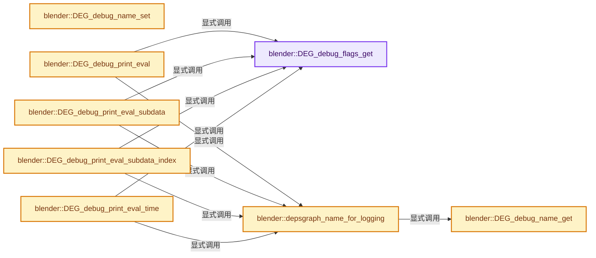

# 实现依赖专题：source/blender/depsgraph/intern/depsgraph_debug.cc

[实现依赖导航](../../README.md) · [符号索引](../../../00-课程指南/02-源码与提交索引/符号依赖与实现索引.md)

本专题从正文实际调用进入，集中保存共享实现。函数有稳定锚点，可从调用处直接跳到对应完整函数；递归与互相调用通过回链组织。

## 本文件的实现关系




## 完整成员与函数实现

<a id="f-f1b1fbe8f72084a2"></a>

### `blender::DEG_debug_flags_get`

实现位置：[source/blender/depsgraph/intern/depsgraph_debug.cc](../../../../../../../source/blender/depsgraph/intern/depsgraph_debug.cc) · L37—L41。

接口参数：

- `const Depsgraph *depsgraph`

**教学注释版**

<!-- annotated:d20fc333832ba7 -->

```cpp
int DEG_debug_flags_get(const Depsgraph *depsgraph)
{
  const deg::Depsgraph *deg_graph = reinterpret_cast<const deg::Depsgraph *>(depsgraph);
  return deg_graph->debug.flags;
}
```

<details>
<summary>核对原始源码：source/blender/depsgraph/intern/depsgraph_debug.cc · L37—L41</summary>

<!-- original:d20fc333832ba7:source/blender/depsgraph/intern/depsgraph_debug.cc:37:41 -->

```cpp
int DEG_debug_flags_get(const Depsgraph *depsgraph)
{
  const deg::Depsgraph *deg_graph = reinterpret_cast<const deg::Depsgraph *>(depsgraph);
  return deg_graph->debug.flags;
}
```

</details>

**结果出口**

- `return deg_graph->debug.flags;`

**继续追踪实现**

本实现没有需要继续展开的显式调用；检查返回表达式、对象转换和调用者前置条件。

<a id="f-3282e7f60ed22e0a"></a>

### `blender::DEG_debug_name_set`

实现位置：[source/blender/depsgraph/intern/depsgraph_debug.cc](../../../../../../../source/blender/depsgraph/intern/depsgraph_debug.cc) · L43—L47。

接口参数：

- `Depsgraph *depsgraph`
- `const char *name`

**教学注释版**

<!-- annotated:fc13393434c361 -->

```cpp
void DEG_debug_name_set(Depsgraph *depsgraph, const char *name)
{
  deg::Depsgraph *deg_graph = reinterpret_cast<deg::Depsgraph *>(depsgraph);
  deg_graph->debug.name = name;
}
```

<details>
<summary>核对原始源码：source/blender/depsgraph/intern/depsgraph_debug.cc · L43—L47</summary>

<!-- original:fc13393434c361:source/blender/depsgraph/intern/depsgraph_debug.cc:43:47 -->

```cpp
void DEG_debug_name_set(Depsgraph *depsgraph, const char *name)
{
  deg::Depsgraph *deg_graph = reinterpret_cast<deg::Depsgraph *>(depsgraph);
  deg_graph->debug.name = name;
}
```

</details>

**沿实际写入检查状态**

- `deg_graph->debug.name = name;`

**继续追踪实现**

本实现没有需要继续展开的显式调用；检查返回表达式、对象转换和调用者前置条件。

<a id="f-8a487fac6d4568c3"></a>

### `blender::DEG_debug_name_get`

实现位置：[source/blender/depsgraph/intern/depsgraph_debug.cc](../../../../../../../source/blender/depsgraph/intern/depsgraph_debug.cc) · L49—L53。

接口参数：

- `Depsgraph *depsgraph`

**教学注释版**

<!-- annotated:444057b73eb737 -->

```cpp
const char *DEG_debug_name_get(Depsgraph *depsgraph)
{
  const deg::Depsgraph *deg_graph = reinterpret_cast<const deg::Depsgraph *>(depsgraph);
  return deg_graph->debug.name.c_str();
}
```

<details>
<summary>核对原始源码：source/blender/depsgraph/intern/depsgraph_debug.cc · L49—L53</summary>

<!-- original:444057b73eb737:source/blender/depsgraph/intern/depsgraph_debug.cc:49:53 -->

```cpp
const char *DEG_debug_name_get(Depsgraph *depsgraph)
{
  const deg::Depsgraph *deg_graph = reinterpret_cast<const deg::Depsgraph *>(depsgraph);
  return deg_graph->debug.name.c_str();
}
```

</details>

**结果出口**

- `return deg_graph->debug.name.c_str();`

**继续追踪实现**

- `deg_graph->debug.name.c_str` → [调用协议](../../../00-课程指南/01-路线与规范/模板宏与动态分派协议.md)：接收对象类型依赖auto、返回值或模板实例；不按同名猜测目标。调用位置L52。

<a id="f-69b46593cb98ee03"></a>

### `blender::depsgraph_name_for_logging`

实现位置：[source/blender/depsgraph/intern/depsgraph_debug.cc](../../../../../../../source/blender/depsgraph/intern/depsgraph_debug.cc) · L226—L233。

接口参数：

- `Depsgraph *depsgraph`

**教学注释版**

<!-- annotated:2d273b4341cb03 -->

```cpp
static std::string depsgraph_name_for_logging(Depsgraph *depsgraph)
{
  const char *name = DEG_debug_name_get(depsgraph);
  if (name[0] == '\0') {
    return "";
  }
  return "[" + std::string(name) + "]: ";
}
```

<details>
<summary>核对原始源码：source/blender/depsgraph/intern/depsgraph_debug.cc · L226—L233</summary>

<!-- original:2d273b4341cb03:source/blender/depsgraph/intern/depsgraph_debug.cc:226:233 -->

```cpp
static std::string depsgraph_name_for_logging(Depsgraph *depsgraph)
{
  const char *name = DEG_debug_name_get(depsgraph);
  if (name[0] == '\0') {
    return "";
  }
  return "[" + std::string(name) + "]: ";
}
```

</details>

**结果出口**

- `return "";`
- `return "[" + std::string(name) + "]: ";`

**继续追踪实现**

- `DEG_debug_name_get` → [blender::DEG_debug_name_get · L49](depsgraph_debug.cc.md#f-8a487fac6d4568c3)。
- `std::string` → [外部契约](https://eel.is/c++draft/)：这个边界按实际表达式及所属类型核对参数、返回值、寿命与失败行为。这里提供接口入口，不声称已解释该第三方版本的内部实现。

<a id="f-f2c4ea506dd14a2f"></a>

### `blender::DEG_debug_print_eval`

实现位置：[source/blender/depsgraph/intern/depsgraph_debug.cc](../../../../../../../source/blender/depsgraph/intern/depsgraph_debug.cc) · L240—L257。

接口参数：

- `Depsgraph *depsgraph`
- `const char *function_name`
- `const char *object_name`
- `const void *object_address`

**教学注释版**

<!-- annotated:91de7f55ad2972 -->

```cpp
void DEG_debug_print_eval(Depsgraph *depsgraph,
                          const char *function_name,
                          const char *object_name,
                          const void *object_address)
{
  if ((DEG_debug_flags_get(depsgraph) & G_DEBUG_DEPSGRAPH_EVAL) == 0) {
    return;
  }
  fprintf(stdout,
          "%s%s on %s %s(%p)%s\n",
          depsgraph_name_for_logging(depsgraph).c_str(),
          function_name,
          object_name,
          deg::color_for_pointer(object_address).c_str(),
          object_address,
          deg::color_end().c_str());
  fflush(stdout);
}
```

<details>
<summary>核对原始源码：source/blender/depsgraph/intern/depsgraph_debug.cc · L240—L257</summary>

<!-- original:91de7f55ad2972:source/blender/depsgraph/intern/depsgraph_debug.cc:240:257 -->

```cpp
void DEG_debug_print_eval(Depsgraph *depsgraph,
                          const char *function_name,
                          const char *object_name,
                          const void *object_address)
{
  if ((DEG_debug_flags_get(depsgraph) & G_DEBUG_DEPSGRAPH_EVAL) == 0) {
    return;
  }
  fprintf(stdout,
          "%s%s on %s %s(%p)%s\n",
          depsgraph_name_for_logging(depsgraph).c_str(),
          function_name,
          object_name,
          deg::color_for_pointer(object_address).c_str(),
          object_address,
          deg::color_end().c_str());
  fflush(stdout);
}
```

</details>

**继续追踪实现**

- `DEG_debug_flags_get` → [blender::DEG_debug_flags_get · L37](depsgraph_debug.cc.md#f-f1b1fbe8f72084a2)。
- `fprintf` → [外部契约](https://eel.is/c++draft/)：这个边界按实际表达式及所属类型核对参数、返回值、寿命与失败行为。这里提供接口入口，不声称已解释该第三方版本的内部实现。
- `depsgraph_name_for_logging(depsgraph).c_str` → [调用协议](../../../00-课程指南/01-路线与规范/模板宏与动态分派协议.md)：接收对象类型依赖auto、返回值或模板实例；不按同名猜测目标。调用位置L250。
- `depsgraph_name_for_logging` → [blender::depsgraph_name_for_logging · L226](depsgraph_debug.cc.md#f-69b46593cb98ee03)。
- `deg::color_for_pointer(object_address).c_str` → [调用协议](../../../00-课程指南/01-路线与规范/模板宏与动态分派协议.md)：接收对象类型依赖auto、返回值或模板实例；不按同名猜测目标。调用位置L253。
- `deg::color_for_pointer` → [blender::deg::color_for_pointer · L61](debug/deg_debug.cc.md#f-87fb1d447f276c4a)。
- `deg::color_end().c_str` → [调用协议](../../../00-课程指南/01-路线与规范/模板宏与动态分派协议.md)：接收对象类型依赖auto、返回值或模板实例；不按同名猜测目标。调用位置L255。
- `deg::color_end` → [blender::deg::color_end · L73](debug/deg_debug.cc.md#f-94d53c2f95c8c4b3)。
- `fflush` → [调用协议](../../../00-课程指南/01-路线与规范/模板宏与动态分派协议.md)：函数指针、局部可调用对象或未展开的宏；必须结合调用者环境。调用位置L256。

<a id="f-3ce05a49d4f88798"></a>

### `blender::DEG_debug_print_eval_subdata`

实现位置：[source/blender/depsgraph/intern/depsgraph_debug.cc](../../../../../../../source/blender/depsgraph/intern/depsgraph_debug.cc) · L259—L284。

接口参数：

- `Depsgraph *depsgraph`
- `const char *function_name`
- `const char *object_name`
- `const void *object_address`
- `const char *subdata_comment`
- `const char *subdata_name`
- `const void *subdata_address`

**教学注释版**

<!-- annotated:20c81bf42e5d31 -->

```cpp
void DEG_debug_print_eval_subdata(Depsgraph *depsgraph,
                                  const char *function_name,
                                  const char *object_name,
                                  const void *object_address,
                                  const char *subdata_comment,
                                  const char *subdata_name,
                                  const void *subdata_address)
{
  if ((DEG_debug_flags_get(depsgraph) & G_DEBUG_DEPSGRAPH_EVAL) == 0) {
    return;
  }
  fprintf(stdout,
          "%s%s on %s %s(%p)%s %s %s %s(%p)%s\n",
          depsgraph_name_for_logging(depsgraph).c_str(),
          function_name,
          object_name,
          deg::color_for_pointer(object_address).c_str(),
          object_address,
          deg::color_end().c_str(),
          subdata_comment,
          subdata_name,
          deg::color_for_pointer(subdata_address).c_str(),
          subdata_address,
          deg::color_end().c_str());
  fflush(stdout);
}
```

<details>
<summary>核对原始源码：source/blender/depsgraph/intern/depsgraph_debug.cc · L259—L284</summary>

<!-- original:20c81bf42e5d31:source/blender/depsgraph/intern/depsgraph_debug.cc:259:284 -->

```cpp
void DEG_debug_print_eval_subdata(Depsgraph *depsgraph,
                                  const char *function_name,
                                  const char *object_name,
                                  const void *object_address,
                                  const char *subdata_comment,
                                  const char *subdata_name,
                                  const void *subdata_address)
{
  if ((DEG_debug_flags_get(depsgraph) & G_DEBUG_DEPSGRAPH_EVAL) == 0) {
    return;
  }
  fprintf(stdout,
          "%s%s on %s %s(%p)%s %s %s %s(%p)%s\n",
          depsgraph_name_for_logging(depsgraph).c_str(),
          function_name,
          object_name,
          deg::color_for_pointer(object_address).c_str(),
          object_address,
          deg::color_end().c_str(),
          subdata_comment,
          subdata_name,
          deg::color_for_pointer(subdata_address).c_str(),
          subdata_address,
          deg::color_end().c_str());
  fflush(stdout);
}
```

</details>

**继续追踪实现**

- `DEG_debug_flags_get` → [blender::DEG_debug_flags_get · L37](depsgraph_debug.cc.md#f-f1b1fbe8f72084a2)。
- `fprintf` → [外部契约](https://eel.is/c++draft/)：这个边界按实际表达式及所属类型核对参数、返回值、寿命与失败行为。这里提供接口入口，不声称已解释该第三方版本的内部实现。
- `depsgraph_name_for_logging(depsgraph).c_str` → [调用协议](../../../00-课程指南/01-路线与规范/模板宏与动态分派协议.md)：接收对象类型依赖auto、返回值或模板实例；不按同名猜测目标。调用位置L272。
- `depsgraph_name_for_logging` → [blender::depsgraph_name_for_logging · L226](depsgraph_debug.cc.md#f-69b46593cb98ee03)。
- `deg::color_for_pointer(object_address).c_str` → [调用协议](../../../00-课程指南/01-路线与规范/模板宏与动态分派协议.md)：接收对象类型依赖auto、返回值或模板实例；不按同名猜测目标。调用位置L275。
- `deg::color_for_pointer` → [blender::deg::color_for_pointer · L61](debug/deg_debug.cc.md#f-87fb1d447f276c4a)。
- `deg::color_end().c_str` → [调用协议](../../../00-课程指南/01-路线与规范/模板宏与动态分派协议.md)：接收对象类型依赖auto、返回值或模板实例；不按同名猜测目标。调用位置L277。
- `deg::color_end` → [blender::deg::color_end · L73](debug/deg_debug.cc.md#f-94d53c2f95c8c4b3)。
- `deg::color_for_pointer(subdata_address).c_str` → [调用协议](../../../00-课程指南/01-路线与规范/模板宏与动态分派协议.md)：接收对象类型依赖auto、返回值或模板实例；不按同名猜测目标。调用位置L280。
- `fflush` → [调用协议](../../../00-课程指南/01-路线与规范/模板宏与动态分派协议.md)：函数指针、局部可调用对象或未展开的宏；必须结合调用者环境。调用位置L283。

<a id="f-425082c1583389ae"></a>

### `blender::DEG_debug_print_eval_subdata_index`

实现位置：[source/blender/depsgraph/intern/depsgraph_debug.cc](../../../../../../../source/blender/depsgraph/intern/depsgraph_debug.cc) · L286—L313。

接口参数：

- `Depsgraph *depsgraph`
- `const char *function_name`
- `const char *object_name`
- `const void *object_address`
- `const char *subdata_comment`
- `const char *subdata_name`
- `const void *subdata_address`
- `const int subdata_index`

**教学注释版**

<!-- annotated:f1295a9a09d878 -->

```cpp
void DEG_debug_print_eval_subdata_index(Depsgraph *depsgraph,
                                        const char *function_name,
                                        const char *object_name,
                                        const void *object_address,
                                        const char *subdata_comment,
                                        const char *subdata_name,
                                        const void *subdata_address,
                                        const int subdata_index)
{
  if ((DEG_debug_flags_get(depsgraph) & G_DEBUG_DEPSGRAPH_EVAL) == 0) {
    return;
  }
  fprintf(stdout,
          "%s%s on %s %s(%p)%s %s %s[%d] %s(%p)%s\n",
          depsgraph_name_for_logging(depsgraph).c_str(),
          function_name,
          object_name,
          deg::color_for_pointer(object_address).c_str(),
          object_address,
          deg::color_end().c_str(),
          subdata_comment,
          subdata_name,
          subdata_index,
          deg::color_for_pointer(subdata_address).c_str(),
          subdata_address,
          deg::color_end().c_str());
  fflush(stdout);
}
```

<details>
<summary>核对原始源码：source/blender/depsgraph/intern/depsgraph_debug.cc · L286—L313</summary>

<!-- original:f1295a9a09d878:source/blender/depsgraph/intern/depsgraph_debug.cc:286:313 -->

```cpp
void DEG_debug_print_eval_subdata_index(Depsgraph *depsgraph,
                                        const char *function_name,
                                        const char *object_name,
                                        const void *object_address,
                                        const char *subdata_comment,
                                        const char *subdata_name,
                                        const void *subdata_address,
                                        const int subdata_index)
{
  if ((DEG_debug_flags_get(depsgraph) & G_DEBUG_DEPSGRAPH_EVAL) == 0) {
    return;
  }
  fprintf(stdout,
          "%s%s on %s %s(%p)%s %s %s[%d] %s(%p)%s\n",
          depsgraph_name_for_logging(depsgraph).c_str(),
          function_name,
          object_name,
          deg::color_for_pointer(object_address).c_str(),
          object_address,
          deg::color_end().c_str(),
          subdata_comment,
          subdata_name,
          subdata_index,
          deg::color_for_pointer(subdata_address).c_str(),
          subdata_address,
          deg::color_end().c_str());
  fflush(stdout);
}
```

</details>

**继续追踪实现**

- `DEG_debug_flags_get` → [blender::DEG_debug_flags_get · L37](depsgraph_debug.cc.md#f-f1b1fbe8f72084a2)。
- `fprintf` → [外部契约](https://eel.is/c++draft/)：这个边界按实际表达式及所属类型核对参数、返回值、寿命与失败行为。这里提供接口入口，不声称已解释该第三方版本的内部实现。
- `depsgraph_name_for_logging(depsgraph).c_str` → [调用协议](../../../00-课程指南/01-路线与规范/模板宏与动态分派协议.md)：接收对象类型依赖auto、返回值或模板实例；不按同名猜测目标。调用位置L300。
- `depsgraph_name_for_logging` → [blender::depsgraph_name_for_logging · L226](depsgraph_debug.cc.md#f-69b46593cb98ee03)。
- `deg::color_for_pointer(object_address).c_str` → [调用协议](../../../00-课程指南/01-路线与规范/模板宏与动态分派协议.md)：接收对象类型依赖auto、返回值或模板实例；不按同名猜测目标。调用位置L303。
- `deg::color_for_pointer` → [blender::deg::color_for_pointer · L61](debug/deg_debug.cc.md#f-87fb1d447f276c4a)。
- `deg::color_end().c_str` → [调用协议](../../../00-课程指南/01-路线与规范/模板宏与动态分派协议.md)：接收对象类型依赖auto、返回值或模板实例；不按同名猜测目标。调用位置L305。
- `deg::color_end` → [blender::deg::color_end · L73](debug/deg_debug.cc.md#f-94d53c2f95c8c4b3)。
- `deg::color_for_pointer(subdata_address).c_str` → [调用协议](../../../00-课程指南/01-路线与规范/模板宏与动态分派协议.md)：接收对象类型依赖auto、返回值或模板实例；不按同名猜测目标。调用位置L309。
- `fflush` → [调用协议](../../../00-课程指南/01-路线与规范/模板宏与动态分派协议.md)：函数指针、局部可调用对象或未展开的宏；必须结合调用者环境。调用位置L312。

<a id="f-924ae49e9b573bb1"></a>

### `blender::DEG_debug_print_eval_time`

实现位置：[source/blender/depsgraph/intern/depsgraph_debug.cc](../../../../../../../source/blender/depsgraph/intern/depsgraph_debug.cc) · L342—L361。

接口参数：

- `Depsgraph *depsgraph`
- `const char *function_name`
- `const char *object_name`
- `const void *object_address`
- `float time`

**教学注释版**

<!-- annotated:a62b983331f7b7 -->

```cpp
void DEG_debug_print_eval_time(Depsgraph *depsgraph,
                               const char *function_name,
                               const char *object_name,
                               const void *object_address,
                               float time)
{
  if ((DEG_debug_flags_get(depsgraph) & G_DEBUG_DEPSGRAPH_EVAL) == 0) {
    return;
  }
  fprintf(stdout,
          "%s%s on %s %s(%p)%s at time %f\n",
          depsgraph_name_for_logging(depsgraph).c_str(),
          function_name,
          object_name,
          deg::color_for_pointer(object_address).c_str(),
          object_address,
          deg::color_end().c_str(),
          time);
  fflush(stdout);
}
```

<details>
<summary>核对原始源码：source/blender/depsgraph/intern/depsgraph_debug.cc · L342—L361</summary>

<!-- original:a62b983331f7b7:source/blender/depsgraph/intern/depsgraph_debug.cc:342:361 -->

```cpp
void DEG_debug_print_eval_time(Depsgraph *depsgraph,
                               const char *function_name,
                               const char *object_name,
                               const void *object_address,
                               float time)
{
  if ((DEG_debug_flags_get(depsgraph) & G_DEBUG_DEPSGRAPH_EVAL) == 0) {
    return;
  }
  fprintf(stdout,
          "%s%s on %s %s(%p)%s at time %f\n",
          depsgraph_name_for_logging(depsgraph).c_str(),
          function_name,
          object_name,
          deg::color_for_pointer(object_address).c_str(),
          object_address,
          deg::color_end().c_str(),
          time);
  fflush(stdout);
}
```

</details>

**继续追踪实现**

- `DEG_debug_flags_get` → [blender::DEG_debug_flags_get · L37](depsgraph_debug.cc.md#f-f1b1fbe8f72084a2)。
- `fprintf` → [外部契约](https://eel.is/c++draft/)：这个边界按实际表达式及所属类型核对参数、返回值、寿命与失败行为。这里提供接口入口，不声称已解释该第三方版本的内部实现。
- `depsgraph_name_for_logging(depsgraph).c_str` → [调用协议](../../../00-课程指南/01-路线与规范/模板宏与动态分派协议.md)：接收对象类型依赖auto、返回值或模板实例；不按同名猜测目标。调用位置L353。
- `depsgraph_name_for_logging` → [blender::depsgraph_name_for_logging · L226](depsgraph_debug.cc.md#f-69b46593cb98ee03)。
- `deg::color_for_pointer(object_address).c_str` → [调用协议](../../../00-课程指南/01-路线与规范/模板宏与动态分派协议.md)：接收对象类型依赖auto、返回值或模板实例；不按同名猜测目标。调用位置L356。
- `deg::color_for_pointer` → [blender::deg::color_for_pointer · L61](debug/deg_debug.cc.md#f-87fb1d447f276c4a)。
- `deg::color_end().c_str` → [调用协议](../../../00-课程指南/01-路线与规范/模板宏与动态分派协议.md)：接收对象类型依赖auto、返回值或模板实例；不按同名猜测目标。调用位置L358。
- `deg::color_end` → [blender::deg::color_end · L73](debug/deg_debug.cc.md#f-94d53c2f95c8c4b3)。
- `fflush` → [调用协议](../../../00-课程指南/01-路线与规范/模板宏与动态分派协议.md)：函数指针、局部可调用对象或未展开的宏；必须结合调用者环境。调用位置L360。

<a id="f-1ef77681c95aaff5"></a>

### `blender::stringify_append_bit`

实现位置：[source/blender/depsgraph/intern/depsgraph_debug.cc](../../../../../../../source/blender/depsgraph/intern/depsgraph_debug.cc) · L363—L375。

接口参数：

- `const std::string &str`
- `IDRecalcFlag tag`

**教学注释版**

<!-- annotated:133e2ea4464eaa -->

```cpp
static std::string stringify_append_bit(const std::string &str, IDRecalcFlag tag)
{
  const char *tag_name = DEG_update_tag_as_string(tag);
  if (tag_name == nullptr) {
    return str;
  }
  std::string result = str;
  if (!result.empty()) {
    result += ", ";
  }
  result += tag_name;
  return result;
}
```

<details>
<summary>核对原始源码：source/blender/depsgraph/intern/depsgraph_debug.cc · L363—L375</summary>

<!-- original:133e2ea4464eaa:source/blender/depsgraph/intern/depsgraph_debug.cc:363:375 -->

```cpp
static std::string stringify_append_bit(const std::string &str, IDRecalcFlag tag)
{
  const char *tag_name = DEG_update_tag_as_string(tag);
  if (tag_name == nullptr) {
    return str;
  }
  std::string result = str;
  if (!result.empty()) {
    result += ", ";
  }
  result += tag_name;
  return result;
}
```

</details>

**沿实际写入检查状态**

- `result += ", ";`
- `result += tag_name;`

**结果出口**

- `return str;`
- `return result;`

**继续追踪实现**

- `DEG_update_tag_as_string` → [blender::DEG_update_tag_as_string · L767](depsgraph_tag.cc.md#f-810e52b6269ce821)。
- `result.empty` → [外部契约](https://eel.is/c++draft/)：这个边界按实际表达式及所属类型核对参数、返回值、寿命与失败行为。这里提供接口入口，不声称已解释该第三方版本的内部实现。

<a id="f-e94a910ebd96483b"></a>

### `blender::DEG_stringify_recalc_flags`

实现位置：[source/blender/depsgraph/intern/depsgraph_debug.cc](../../../../../../../source/blender/depsgraph/intern/depsgraph_debug.cc) · L377—L394。

接口参数：

- `uint flags`

**教学注释版**

<!-- annotated:8ed4fdef872268 -->

```cpp
std::string DEG_stringify_recalc_flags(uint flags)
{
  if (flags == 0) {
    return "NONE";
  }
  std::string result;
  uint current_flag = flags;
  /* Special cases to avoid ALL flags from being split into individual bits. */
  if ((current_flag & ID_RECALC_PSYS_ALL) == ID_RECALC_PSYS_ALL) {
    result = stringify_append_bit(result, ID_RECALC_PSYS_ALL);
  }
  /* Handle all the rest of the flags. */
  while (current_flag != 0) {
    IDRecalcFlag tag = IDRecalcFlag(1 << bitscan_forward_clear_uint(&current_flag));
    result = stringify_append_bit(result, tag);
  }
  return result;
}
```

<details>
<summary>核对原始源码：source/blender/depsgraph/intern/depsgraph_debug.cc · L377—L394</summary>

<!-- original:8ed4fdef872268:source/blender/depsgraph/intern/depsgraph_debug.cc:377:394 -->

```cpp
std::string DEG_stringify_recalc_flags(uint flags)
{
  if (flags == 0) {
    return "NONE";
  }
  std::string result;
  uint current_flag = flags;
  /* Special cases to avoid ALL flags from being split into individual bits. */
  if ((current_flag & ID_RECALC_PSYS_ALL) == ID_RECALC_PSYS_ALL) {
    result = stringify_append_bit(result, ID_RECALC_PSYS_ALL);
  }
  /* Handle all the rest of the flags. */
  while (current_flag != 0) {
    IDRecalcFlag tag = IDRecalcFlag(1 << bitscan_forward_clear_uint(&current_flag));
    result = stringify_append_bit(result, tag);
  }
  return result;
}
```

</details>

**沿实际写入检查状态**

- `result = stringify_append_bit(result, ID_RECALC_PSYS_ALL);`
- `result = stringify_append_bit(result, tag);`

**结果出口**

- `return "NONE";`
- `return result;`

**继续追踪实现**

- `stringify_append_bit` → [blender::stringify_append_bit · L363](depsgraph_debug.cc.md#f-1ef77681c95aaff5)。
- `IDRecalcFlag` → [blender::IDRecalcFlag](../../08-其他Blender模块/makesdna/DNA_ID.h.md#t-04b4f82320a9)。
- `bitscan_forward_clear_uint` → [blender::bitscan_forward_clear_uint · L49](../../01-BLI基础库/intern/math_bits_inline.cc.md#f-9efc4fc5d34159e0)。
