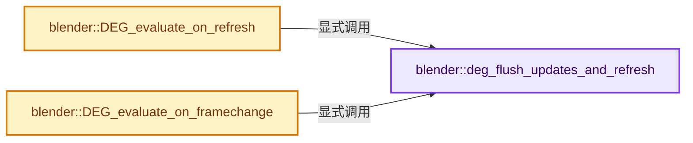
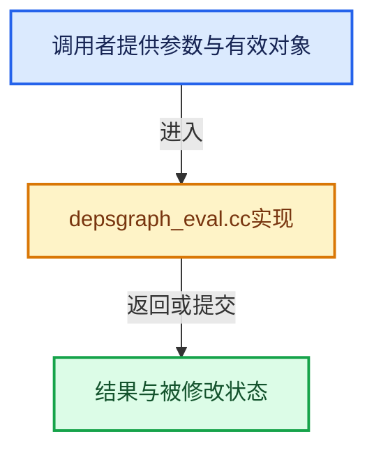

# 实现依赖专题：source/blender/depsgraph/intern/depsgraph_eval.cc

[实现依赖导航](../../README.md) · [符号索引](../../../00-课程指南/02-源码与提交索引/符号依赖与实现索引.md)

本专题从正文实际调用进入，集中保存共享实现。函数有稳定锚点，可从调用处直接跳到对应完整函数；递归与互相调用通过回链组织。

## 本文件的实现关系






## 完整成员与函数实现

<a id="f-1347425762b492a2"></a>

### `blender::deg_flush_updates_and_refresh`

实现位置：[source/blender/depsgraph/intern/depsgraph_eval.cc](../../../../../../../source/blender/depsgraph/intern/depsgraph_eval.cc) · L30—L53。

接口参数：

- `deg::Depsgraph *deg_graph`
- `const DepsgraphEvaluateSyncWriteback sync_writeback`

**教学注释版**

<!-- annotated:ec9739956b3860 -->

```cpp
static void deg_flush_updates_and_refresh(deg::Depsgraph *deg_graph,
                                          const DepsgraphEvaluateSyncWriteback sync_writeback)
{
  BLI_assert(!deg_graph->need_update_relations);

  /* Update the time on the cow scene. */
  if (deg_graph->scene_cow) {
    BKE_scene_frame_set(deg_graph->scene_cow, deg_graph->frame);
  }

  deg::graph_tag_ids_for_visible_update(deg_graph);
  deg::deg_graph_flush_updates(deg_graph);
  BLI_assert(deg_graph->sync_writeback_callbacks.is_empty());
  deg_graph->sync_writeback = sync_writeback;
  deg::deg_evaluate_on_refresh(deg_graph);

  if ((deg_graph->sync_writeback == DEG_EVALUATE_SYNC_WRITEBACK_YES) && deg_graph->is_active) {
    for (std::function<void()> &fn : deg_graph->sync_writeback_callbacks) {
      fn();
    }
  }
  deg_graph->sync_writeback = DEG_EVALUATE_SYNC_WRITEBACK_NO;
  deg_graph->sync_writeback_callbacks.clear();
}
```

<details>
<summary>核对原始源码：source/blender/depsgraph/intern/depsgraph_eval.cc · L30—L53</summary>

<!-- original:ec9739956b3860:source/blender/depsgraph/intern/depsgraph_eval.cc:30:53 -->

```cpp
static void deg_flush_updates_and_refresh(deg::Depsgraph *deg_graph,
                                          const DepsgraphEvaluateSyncWriteback sync_writeback)
{
  BLI_assert(!deg_graph->need_update_relations);

  /* Update the time on the cow scene. */
  if (deg_graph->scene_cow) {
    BKE_scene_frame_set(deg_graph->scene_cow, deg_graph->frame);
  }

  deg::graph_tag_ids_for_visible_update(deg_graph);
  deg::deg_graph_flush_updates(deg_graph);
  BLI_assert(deg_graph->sync_writeback_callbacks.is_empty());
  deg_graph->sync_writeback = sync_writeback;
  deg::deg_evaluate_on_refresh(deg_graph);

  if ((deg_graph->sync_writeback == DEG_EVALUATE_SYNC_WRITEBACK_YES) && deg_graph->is_active) {
    for (std::function<void()> &fn : deg_graph->sync_writeback_callbacks) {
      fn();
    }
  }
  deg_graph->sync_writeback = DEG_EVALUATE_SYNC_WRITEBACK_NO;
  deg_graph->sync_writeback_callbacks.clear();
}
```

</details>

**沿实际写入检查状态**

- `deg_graph->sync_writeback = sync_writeback;`
- `deg_graph->sync_writeback = DEG_EVALUATE_SYNC_WRITEBACK_NO;`

**继续追踪实现**

- `BLI_assert` → [BLI_assert · L48](../../01-BLI基础库/BLI_assert.hh.md#m-57a88495704d)；[BLI_assert · L63](../../01-BLI基础库/BLI_assert.hh.md#m-d07050020cb5)。宏定义由构建条件选择。
- `BKE_scene_frame_set` → [blender::BKE_scene_frame_set · L2610](../../02-BKE几何与数据/intern/scene.cc.md#f-6be529b23561f739)。
- `deg::graph_tag_ids_for_visible_update` → [blender::deg::graph_tag_ids_for_visible_update · L531](depsgraph_tag.cc.md#f-99d3d68112aa6cc3)。
- `deg::deg_graph_flush_updates` → [blender::deg::deg_graph_flush_updates · L308](../../../11-Depsgraph与并行任务系统/05-失效传播.md#f-459f7b4fd56db2ff)。
- `deg_graph->sync_writeback_callbacks.is_empty` → [调用协议](../../../00-课程指南/01-路线与规范/模板宏与动态分派协议.md)：接收对象类型依赖auto、返回值或模板实例；不按同名猜测目标。调用位置L42。
- `deg::deg_evaluate_on_refresh` → [blender::deg::deg_evaluate_on_refresh · L420](../../../11-Depsgraph与并行任务系统/06-可见性与求值调度.md#f-2b87a4f8f79cfb07)。
- `fn` → [blender::fn::multi_function::CallInstruction::fn · L390](../../../07-MultiFunction与批量执行/07-Procedure指令与控制流.md#f-572ebb7362882f77)。
- `deg_graph->sync_writeback_callbacks.clear` → [调用协议](../../../00-课程指南/01-路线与规范/模板宏与动态分派协议.md)：接收对象类型依赖auto、返回值或模板实例；不按同名猜测目标。调用位置L52。

<a id="f-3d603c2c11473772"></a>

### `blender::DEG_evaluate_on_refresh`

实现位置：[source/blender/depsgraph/intern/depsgraph_eval.cc](../../../../../../../source/blender/depsgraph/intern/depsgraph_eval.cc) · L55—L77。

接口参数：

- `Depsgraph *graph`
- `const DepsgraphEvaluateSyncWriteback sync_writeback`

**教学注释版**

<!-- annotated:05a38c81a1779f -->

```cpp
void DEG_evaluate_on_refresh(Depsgraph *graph, const DepsgraphEvaluateSyncWriteback sync_writeback)
{
  deg::Depsgraph *deg_graph = reinterpret_cast<deg::Depsgraph *>(graph);
  const Scene *scene = DEG_get_input_scene(graph);
  const float frame = BKE_scene_frame_get(scene);
  const float ctime = BKE_scene_ctime_get(scene);

  if (deg_graph->frame != frame || ctime != deg_graph->ctime) {
    deg_graph->tag_time_source();
    deg_graph->frame = frame;
    deg_graph->ctime = ctime;
  }
  else if (scene->id.recalc & ID_RECALC_FRAME_CHANGE) {
    /* Comparing depsgraph & scene frame fails in the case of undo,
     * since the undo state is stored before updates from the frame change have been applied.
     * In this case reading back the undo state will behave as if no updates on frame change
     * is needed as the #Depsgraph.ctime & frame will match the values in the input scene.
     * Use #ID_RECALC_FRAME_CHANGE to detect that recalculation is necessary. see: #66913. */
    deg_graph->tag_time_source();
  }

  deg_flush_updates_and_refresh(deg_graph, sync_writeback);
}
```

<details>
<summary>核对原始源码：source/blender/depsgraph/intern/depsgraph_eval.cc · L55—L77</summary>

<!-- original:05a38c81a1779f:source/blender/depsgraph/intern/depsgraph_eval.cc:55:77 -->

```cpp
void DEG_evaluate_on_refresh(Depsgraph *graph, const DepsgraphEvaluateSyncWriteback sync_writeback)
{
  deg::Depsgraph *deg_graph = reinterpret_cast<deg::Depsgraph *>(graph);
  const Scene *scene = DEG_get_input_scene(graph);
  const float frame = BKE_scene_frame_get(scene);
  const float ctime = BKE_scene_ctime_get(scene);

  if (deg_graph->frame != frame || ctime != deg_graph->ctime) {
    deg_graph->tag_time_source();
    deg_graph->frame = frame;
    deg_graph->ctime = ctime;
  }
  else if (scene->id.recalc & ID_RECALC_FRAME_CHANGE) {
    /* Comparing depsgraph & scene frame fails in the case of undo,
     * since the undo state is stored before updates from the frame change have been applied.
     * In this case reading back the undo state will behave as if no updates on frame change
     * is needed as the #Depsgraph.ctime & frame will match the values in the input scene.
     * Use #ID_RECALC_FRAME_CHANGE to detect that recalculation is necessary. see: #66913. */
    deg_graph->tag_time_source();
  }

  deg_flush_updates_and_refresh(deg_graph, sync_writeback);
}
```

</details>

**沿实际写入检查状态**

- `deg_graph->frame = frame;`
- `deg_graph->ctime = ctime;`

**继续追踪实现**

- `DEG_get_input_scene` → [blender::DEG_get_input_scene · L81](depsgraph_query.cc.md#f-674b6004195dc1ed)。
- `BKE_scene_frame_get` → [blender::BKE_scene_frame_get · L2605](../../02-BKE几何与数据/intern/scene.cc.md#f-f5a9b57ad7195b79)。
- `BKE_scene_ctime_get` → [blender::BKE_scene_ctime_get · L2591](../../02-BKE几何与数据/intern/scene.cc.md#f-5e28483f19a62bf5)。
- `deg_graph->tag_time_source` → [blender::deg::Depsgraph::tag_time_source · L97](depsgraph.cc.md#f-18fdd518be732fef)。
- `deg_flush_updates_and_refresh` → [blender::deg_flush_updates_and_refresh · L30](depsgraph_eval.cc.md#f-1347425762b492a2)。

<a id="f-76a97d2b0968d4a2"></a>

### `blender::DEG_evaluate_on_framechange`

实现位置：[source/blender/depsgraph/intern/depsgraph_eval.cc](../../../../../../../source/blender/depsgraph/intern/depsgraph_eval.cc) · L79—L90。

接口参数：

- `Depsgraph *graph`
- `float frame`
- `const DepsgraphEvaluateSyncWriteback sync_writeback`

**教学注释版**

<!-- annotated:a4b5831fd13a7f -->

```cpp
void DEG_evaluate_on_framechange(Depsgraph *graph,
                                 float frame,
                                 const DepsgraphEvaluateSyncWriteback sync_writeback)
{
  deg::Depsgraph *deg_graph = reinterpret_cast<deg::Depsgraph *>(graph);
  const Scene *scene = DEG_get_input_scene(graph);

  deg_graph->tag_time_source();
  deg_graph->frame = frame;
  deg_graph->ctime = BKE_scene_frame_to_ctime(scene, frame);
  deg_flush_updates_and_refresh(deg_graph, sync_writeback);
}
```

<details>
<summary>核对原始源码：source/blender/depsgraph/intern/depsgraph_eval.cc · L79—L90</summary>

<!-- original:a4b5831fd13a7f:source/blender/depsgraph/intern/depsgraph_eval.cc:79:90 -->

```cpp
void DEG_evaluate_on_framechange(Depsgraph *graph,
                                 float frame,
                                 const DepsgraphEvaluateSyncWriteback sync_writeback)
{
  deg::Depsgraph *deg_graph = reinterpret_cast<deg::Depsgraph *>(graph);
  const Scene *scene = DEG_get_input_scene(graph);

  deg_graph->tag_time_source();
  deg_graph->frame = frame;
  deg_graph->ctime = BKE_scene_frame_to_ctime(scene, frame);
  deg_flush_updates_and_refresh(deg_graph, sync_writeback);
}
```

</details>

**沿实际写入检查状态**

- `deg_graph->frame = frame;`
- `deg_graph->ctime = BKE_scene_frame_to_ctime(scene, frame);`

**继续追踪实现**

- `DEG_get_input_scene` → [blender::DEG_get_input_scene · L81](depsgraph_query.cc.md#f-674b6004195dc1ed)。
- `deg_graph->tag_time_source` → [blender::deg::Depsgraph::tag_time_source · L97](depsgraph.cc.md#f-18fdd518be732fef)。
- `BKE_scene_frame_to_ctime` → [blender::BKE_scene_frame_to_ctime · L2596](../../02-BKE几何与数据/intern/scene.cc.md#f-53108ac5f75b4753)。
- `deg_flush_updates_and_refresh` → [blender::deg_flush_updates_and_refresh · L30](depsgraph_eval.cc.md#f-1347425762b492a2)。
