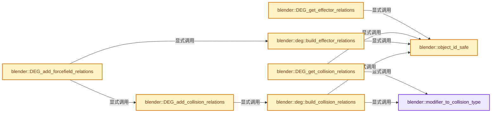

# 实现依赖专题：source/blender/depsgraph/intern/depsgraph_physics.cc

[实现依赖导航](../../README.md) · [符号索引](../../../00-课程指南/02-源码与提交索引/符号依赖与实现索引.md)

本专题从正文实际调用进入，集中保存共享实现。函数有稳定锚点，可从调用处直接跳到对应完整函数；递归与互相调用通过回链组织。

## 本文件的实现关系




## 完整成员与函数实现

<a id="f-73a92457433e89f9"></a>

### `blender::modifier_to_collision_type`

实现位置：[source/blender/depsgraph/intern/depsgraph_physics.cc](../../../../../../../source/blender/depsgraph/intern/depsgraph_physics.cc) · L36—L49。

接口参数：

- `uint modifier_type`

**教学注释版**

<!-- annotated:fa0a4fd719f9e8 -->

```cpp
static ePhysicsCollisionType modifier_to_collision_type(uint modifier_type)
{
  switch (modifier_type) {
    case eModifierType_Collision:
      return DEG_PHYSICS_COLLISION;
    case eModifierType_Fluid:
      return DEG_PHYSICS_SMOKE_COLLISION;
    case eModifierType_DynamicPaint:
      return DEG_PHYSICS_DYNAMIC_BRUSH;
  }

  BLI_assert_msg(0, "Unknown collision modifier type");
  return DEG_PHYSICS_COLLISION_NUM;
}
```

<details>
<summary>核对原始源码：source/blender/depsgraph/intern/depsgraph_physics.cc · L36—L49</summary>

<!-- original:fa0a4fd719f9e8:source/blender/depsgraph/intern/depsgraph_physics.cc:36:49 -->

```cpp
static ePhysicsCollisionType modifier_to_collision_type(uint modifier_type)
{
  switch (modifier_type) {
    case eModifierType_Collision:
      return DEG_PHYSICS_COLLISION;
    case eModifierType_Fluid:
      return DEG_PHYSICS_SMOKE_COLLISION;
    case eModifierType_DynamicPaint:
      return DEG_PHYSICS_DYNAMIC_BRUSH;
  }

  BLI_assert_msg(0, "Unknown collision modifier type");
  return DEG_PHYSICS_COLLISION_NUM;
}
```

</details>

**结果出口**

- `return DEG_PHYSICS_COLLISION;`
- `return DEG_PHYSICS_SMOKE_COLLISION;`
- `return DEG_PHYSICS_DYNAMIC_BRUSH;`
- `return DEG_PHYSICS_COLLISION_NUM;`

**继续追踪实现**

- `BLI_assert_msg` → [BLI_assert_msg · L55](../../01-BLI基础库/BLI_assert.hh.md#m-695eed20dceb)；[BLI_assert_msg · L64](../../01-BLI基础库/BLI_assert.hh.md#m-7de5563de4db)。宏定义由构建条件选择。

<a id="f-ebffb5769f66cd8e"></a>

### `blender::object_id_safe`

实现位置：[source/blender/depsgraph/intern/depsgraph_physics.cc](../../../../../../../source/blender/depsgraph/intern/depsgraph_physics.cc) · L53—L59。

接口参数：

- `T *object`

**教学注释版**

<!-- annotated:af22b01ddeed91 -->

```cpp
template<class T> static ID *object_id_safe(T *object)
{
  if (object == nullptr) {
    return nullptr;
  }
  return &object->id;
}
```

<details>
<summary>核对原始源码：source/blender/depsgraph/intern/depsgraph_physics.cc · L53—L59</summary>

<!-- original:af22b01ddeed91:source/blender/depsgraph/intern/depsgraph_physics.cc:53:59 -->

```cpp
template<class T> static ID *object_id_safe(T *object)
{
  if (object == nullptr) {
    return nullptr;
  }
  return &object->id;
}
```

</details>

**结果出口**

- `return nullptr;`
- `return &object->id;`

**继续追踪实现**

本实现没有需要继续展开的显式调用；检查返回表达式、对象转换和调用者前置条件。

<a id="f-af37b2f2a52301db"></a>

### `blender::DEG_get_effector_relations`

实现位置：[source/blender/depsgraph/intern/depsgraph_physics.cc](../../../../../../../source/blender/depsgraph/intern/depsgraph_physics.cc) · L61—L73。

接口参数：

- `const Depsgraph *graph`
- `Collection *collection`

**教学注释版**

<!-- annotated:993ecee35906cd -->

```cpp
ListBaseT<EffectorRelation> *DEG_get_effector_relations(const Depsgraph *graph,
                                                        Collection *collection)
{
  const deg::Depsgraph *deg_graph = reinterpret_cast<const deg::Depsgraph *>(graph);
  Map<const ID *, ListBaseT<EffectorRelation> *> *hash = deg_graph->physics_relations_effector;
  if (hash == nullptr) {
    return nullptr;
  }
  /* NOTE: nullptr is a valid lookup key here as it means that the relation is not bound to a
   * specific collection. */
  ID *collection_orig = DEG_get_original(object_id_safe(collection));
  // [讲解] hash->lookup_default：按键查找对应项。
  return hash->lookup_default(collection_orig, nullptr);
}
```

<details>
<summary>核对原始源码：source/blender/depsgraph/intern/depsgraph_physics.cc · L61—L73</summary>

<!-- original:993ecee35906cd:source/blender/depsgraph/intern/depsgraph_physics.cc:61:73 -->

```cpp
ListBaseT<EffectorRelation> *DEG_get_effector_relations(const Depsgraph *graph,
                                                        Collection *collection)
{
  const deg::Depsgraph *deg_graph = reinterpret_cast<const deg::Depsgraph *>(graph);
  Map<const ID *, ListBaseT<EffectorRelation> *> *hash = deg_graph->physics_relations_effector;
  if (hash == nullptr) {
    return nullptr;
  }
  /* NOTE: nullptr is a valid lookup key here as it means that the relation is not bound to a
   * specific collection. */
  ID *collection_orig = DEG_get_original(object_id_safe(collection));
  return hash->lookup_default(collection_orig, nullptr);
}
```

</details>

**结果出口**

- `return nullptr;`
- `return hash->lookup_default(collection_orig, nullptr);`

**继续追踪实现**

- `DEG_get_original` → [blender::DEG_get_original · L128](../DEG_depsgraph_query.hh.md#f-79782eab82a92d86)；[blender::DEG_get_original · L134](../DEG_depsgraph_query.hh.md#f-c032f06e9ef8f0cb)。同名重载需按实参类型选择。
- `object_id_safe` → [blender::object_id_safe · L53](depsgraph_physics.cc.md#f-ebffb5769f66cd8e)。
- `hash->lookup_default` → [blender::Map::lookup_default · L570](../../../02-哈希表与关联数据结构/05-Map插入与回调.md#f-40294aaf345f6a8b)。

<a id="f-c5f4d3d4d749c22b"></a>

### `blender::DEG_get_collision_relations`

实现位置：[source/blender/depsgraph/intern/depsgraph_physics.cc](../../../../../../../source/blender/depsgraph/intern/depsgraph_physics.cc) · L75—L90。

接口参数：

- `const Depsgraph *graph`
- `Collection *collection`
- `uint modifier_type`

**教学注释版**

<!-- annotated:ea2f96775d94e7 -->

```cpp
ListBaseT<CollisionRelation> *DEG_get_collision_relations(const Depsgraph *graph,
                                                          Collection *collection,
                                                          uint modifier_type)
{
  const deg::Depsgraph *deg_graph = reinterpret_cast<const deg::Depsgraph *>(graph);
  const ePhysicsCollisionType type = modifier_to_collision_type(modifier_type);
  Map<const ID *, ListBaseT<CollisionRelation> *> *hash =
      deg_graph->physics_relations_collision[type];
  if (hash == nullptr) {
    return nullptr;
  }
  /* NOTE: nullptr is a valid lookup key here as it means that the relation is not bound to a
   * specific collection. */
  ID *collection_orig = DEG_get_original(object_id_safe(collection));
  // [讲解] hash->lookup_default：按键查找对应项。
  return hash->lookup_default(collection_orig, nullptr);
}
```

<details>
<summary>核对原始源码：source/blender/depsgraph/intern/depsgraph_physics.cc · L75—L90</summary>

<!-- original:ea2f96775d94e7:source/blender/depsgraph/intern/depsgraph_physics.cc:75:90 -->

```cpp
ListBaseT<CollisionRelation> *DEG_get_collision_relations(const Depsgraph *graph,
                                                          Collection *collection,
                                                          uint modifier_type)
{
  const deg::Depsgraph *deg_graph = reinterpret_cast<const deg::Depsgraph *>(graph);
  const ePhysicsCollisionType type = modifier_to_collision_type(modifier_type);
  Map<const ID *, ListBaseT<CollisionRelation> *> *hash =
      deg_graph->physics_relations_collision[type];
  if (hash == nullptr) {
    return nullptr;
  }
  /* NOTE: nullptr is a valid lookup key here as it means that the relation is not bound to a
   * specific collection. */
  ID *collection_orig = DEG_get_original(object_id_safe(collection));
  return hash->lookup_default(collection_orig, nullptr);
}
```

</details>

**结果出口**

- `return nullptr;`
- `return hash->lookup_default(collection_orig, nullptr);`

**继续追踪实现**

- `modifier_to_collision_type` → [blender::modifier_to_collision_type · L36](depsgraph_physics.cc.md#f-73a92457433e89f9)。
- `DEG_get_original` → [blender::DEG_get_original · L128](../DEG_depsgraph_query.hh.md#f-79782eab82a92d86)；[blender::DEG_get_original · L134](../DEG_depsgraph_query.hh.md#f-c032f06e9ef8f0cb)。同名重载需按实参类型选择。
- `object_id_safe` → [blender::object_id_safe · L53](depsgraph_physics.cc.md#f-ebffb5769f66cd8e)。
- `hash->lookup_default` → [blender::Map::lookup_default · L570](../../../02-哈希表与关联数据结构/05-Map插入与回调.md#f-40294aaf345f6a8b)。

<a id="f-a8a23fb36db5feb5"></a>

### `blender::DEG_add_collision_relations`

实现位置：[source/blender/depsgraph/intern/depsgraph_physics.cc](../../../../../../../source/blender/depsgraph/intern/depsgraph_physics.cc) · L112—L201。

接口参数：

- `DepsNodeHandle *handle`
- `Object *object`
- `Collection *collection`
- `uint modifier_type`
- `DEG_CollobjFilterFunction filter_function`
- `const char *name`

**教学注释版**

<!-- annotated:9938248bff86a2 -->

```cpp
void DEG_add_collision_relations(DepsNodeHandle *handle,
                                 Object *object,
                                 Collection *collection,
                                 uint modifier_type,
                                 DEG_CollobjFilterFunction filter_function,
                                 const char *name)
{
  Depsgraph *depsgraph = DEG_get_graph_from_handle(handle);
  deg::Depsgraph *deg_graph = reinterpret_cast<deg::Depsgraph *>(depsgraph);
  ListBaseT<CollisionRelation> *relations = build_collision_relations(
      deg_graph, collection, modifier_type);

  /* Expand tag objects, matching: #BKE_object_modifier_update_subframe behavior. */

  /* NOTE: #eModifierType_Fluid should be included,
   * leave out for the purpose of validating the fix for dynamic paint only. */
  const bool use_recursive_parents = (modifier_type == eModifierType_DynamicPaint);

  Map<Object *, CollisionComponentFlag> *object_component_map = nullptr;
  if (use_recursive_parents) {
    object_component_map = MEM_new<Map<Object *, CollisionComponentFlag>>(__func__);
  }

  for (CollisionRelation &relation : *relations) {
    Object *ob1 = relation.ob;
    if (ob1 == object) {
      continue;
    }
    if (filter_function &&
        !filter_function(ob1, BKE_modifiers_findby_type(ob1, ModifierType(modifier_type))))
    {
      continue;
    }

    if (use_recursive_parents) {
      /* Add relations for `ob1` and other objects it references,
       * using `object_component_map` to avoid redundant calls.
       *
       * When #BKE_object_modifier_update_subframe is used by a modifier,
       * it's important the depsgraph tags objects this modifier uses.
       *
       * Without this, access to objects is not thread-safe, see: #142137.
       *
       * NOTE(@ideasman42): #BKE_object_modifier_update_subframe calls
       * #BKE_animsys_evaluate_animdata, depending on the object type.
       * Equivalent relations could be added here.
       * This was not done and there are no bug reports relating to this,
       * so leave as-is unless the current code is failing in a real world scenario. */

      BKE_object_modifier_update_subframe_only_callback(
          ob1,
          true,
          OBJECT_MODIFIER_UPDATE_SUBFRAME_RECURSION_DEFAULT,
          modifier_type,
          [&handle, &name, &object_component_map](Object *ob, const bool update_mesh) {
            CollisionComponentFlag &update_flag = object_component_map->lookup_or_add_default(ob);
            {
              constexpr CollisionComponentFlag test_flag = CollisionComponentFlag::Transform;
              if (!flag_is_set(update_flag, test_flag)) {
                update_flag |= test_flag;
                DEG_add_object_pointcache_relation(handle, ob, DEG_OB_COMP_TRANSFORM, name);
              }
            }
            if (update_mesh) {
              constexpr CollisionComponentFlag test_flag = CollisionComponentFlag::Geometry;
              if (!flag_is_set(update_flag, test_flag)) {
                update_flag |= test_flag;
                DEG_add_object_pointcache_relation(handle, ob, DEG_OB_COMP_GEOMETRY, name);
              }
            }
            if (ob->type == OB_ARMATURE) {
              constexpr CollisionComponentFlag test_flag = CollisionComponentFlag::EvalPose;
              if (!flag_is_set(update_flag, test_flag)) {
                update_flag |= test_flag;
                DEG_add_object_pointcache_relation(handle, ob, DEG_OB_COMP_EVAL_POSE, name);
              }
            }
          });

      continue;
    }

    DEG_add_object_pointcache_relation(handle, ob1, DEG_OB_COMP_TRANSFORM, name);
    DEG_add_object_pointcache_relation(handle, ob1, DEG_OB_COMP_GEOMETRY, name);
  }

  if (use_recursive_parents) {
    MEM_delete(object_component_map);
  }
}
```

<details>
<summary>核对原始源码：source/blender/depsgraph/intern/depsgraph_physics.cc · L112—L201</summary>

<!-- original:9938248bff86a2:source/blender/depsgraph/intern/depsgraph_physics.cc:112:201 -->

```cpp
void DEG_add_collision_relations(DepsNodeHandle *handle,
                                 Object *object,
                                 Collection *collection,
                                 uint modifier_type,
                                 DEG_CollobjFilterFunction filter_function,
                                 const char *name)
{
  Depsgraph *depsgraph = DEG_get_graph_from_handle(handle);
  deg::Depsgraph *deg_graph = reinterpret_cast<deg::Depsgraph *>(depsgraph);
  ListBaseT<CollisionRelation> *relations = build_collision_relations(
      deg_graph, collection, modifier_type);

  /* Expand tag objects, matching: #BKE_object_modifier_update_subframe behavior. */

  /* NOTE: #eModifierType_Fluid should be included,
   * leave out for the purpose of validating the fix for dynamic paint only. */
  const bool use_recursive_parents = (modifier_type == eModifierType_DynamicPaint);

  Map<Object *, CollisionComponentFlag> *object_component_map = nullptr;
  if (use_recursive_parents) {
    object_component_map = MEM_new<Map<Object *, CollisionComponentFlag>>(__func__);
  }

  for (CollisionRelation &relation : *relations) {
    Object *ob1 = relation.ob;
    if (ob1 == object) {
      continue;
    }
    if (filter_function &&
        !filter_function(ob1, BKE_modifiers_findby_type(ob1, ModifierType(modifier_type))))
    {
      continue;
    }

    if (use_recursive_parents) {
      /* Add relations for `ob1` and other objects it references,
       * using `object_component_map` to avoid redundant calls.
       *
       * When #BKE_object_modifier_update_subframe is used by a modifier,
       * it's important the depsgraph tags objects this modifier uses.
       *
       * Without this, access to objects is not thread-safe, see: #142137.
       *
       * NOTE(@ideasman42): #BKE_object_modifier_update_subframe calls
       * #BKE_animsys_evaluate_animdata, depending on the object type.
       * Equivalent relations could be added here.
       * This was not done and there are no bug reports relating to this,
       * so leave as-is unless the current code is failing in a real world scenario. */

      BKE_object_modifier_update_subframe_only_callback(
          ob1,
          true,
          OBJECT_MODIFIER_UPDATE_SUBFRAME_RECURSION_DEFAULT,
          modifier_type,
          [&handle, &name, &object_component_map](Object *ob, const bool update_mesh) {
            CollisionComponentFlag &update_flag = object_component_map->lookup_or_add_default(ob);
            {
              constexpr CollisionComponentFlag test_flag = CollisionComponentFlag::Transform;
              if (!flag_is_set(update_flag, test_flag)) {
                update_flag |= test_flag;
                DEG_add_object_pointcache_relation(handle, ob, DEG_OB_COMP_TRANSFORM, name);
              }
            }
            if (update_mesh) {
              constexpr CollisionComponentFlag test_flag = CollisionComponentFlag::Geometry;
              if (!flag_is_set(update_flag, test_flag)) {
                update_flag |= test_flag;
                DEG_add_object_pointcache_relation(handle, ob, DEG_OB_COMP_GEOMETRY, name);
              }
            }
            if (ob->type == OB_ARMATURE) {
              constexpr CollisionComponentFlag test_flag = CollisionComponentFlag::EvalPose;
              if (!flag_is_set(update_flag, test_flag)) {
                update_flag |= test_flag;
                DEG_add_object_pointcache_relation(handle, ob, DEG_OB_COMP_EVAL_POSE, name);
              }
            }
          });

      continue;
    }

    DEG_add_object_pointcache_relation(handle, ob1, DEG_OB_COMP_TRANSFORM, name);
    DEG_add_object_pointcache_relation(handle, ob1, DEG_OB_COMP_GEOMETRY, name);
  }

  if (use_recursive_parents) {
    MEM_delete(object_component_map);
  }
}
```

</details>

**沿实际写入检查状态**

- `object_component_map = MEM_new<Map<Object *, CollisionComponentFlag>>(__func__);`
- `update_flag |= test_flag;`

**继续追踪实现**

- `DEG_get_graph_from_handle` → [blender::DEG_get_graph_from_handle · L273](depsgraph_build.cc.md#f-066f295112ed2f4a)。
- `build_collision_relations` → [blender::deg::build_collision_relations · L272](depsgraph_physics.cc.md#f-4fe90f51e758f8ce)。
- `MEM_new<Map<Object *, CollisionComponentFlag>>` → [MEM_new · L351](../../07-Intern运行时与平台/guardedalloc/MEM_guardedalloc.h.md#f-115f9b6784f89912)。
- `filter_function` → [调用协议](../../../00-课程指南/01-路线与规范/模板宏与动态分派协议.md)：局部可调用对象，须结合其初始化与捕获环境。调用位置L141。
- `BKE_modifiers_findby_type` → [blender::BKE_modifiers_findby_type · L256](../../02-BKE几何与数据/intern/modifier.cc.md#f-9f6b6b9b4343d30f)。
- `ModifierType` → [blender::ModifierType](../../08-其他Blender模块/makesdna/DNA_modifier_types.h.md#t-319e36205f63)。
- `BKE_object_modifier_update_subframe_only_callback` → [blender::BKE_object_modifier_update_subframe_only_callback · L5610](../../02-BKE几何与数据/intern/object.cc.md#f-4cd1f6290ed1f9b5)。
- `object_component_map->lookup_or_add_default` → [blender::Map::lookup_or_add_default · L639](../../../02-哈希表与关联数据结构/05-Map插入与回调.md#f-e8d33f0bfe1f3153)；[blender::Map::lookup_or_add_default · L643](../../../02-哈希表与关联数据结构/05-Map插入与回调.md#f-d67ab6e12fd0a267)。同名重载需按实参类型选择。
- `flag_is_set` → [调用协议](../../../00-课程指南/01-路线与规范/模板宏与动态分派协议.md)：函数指针、局部可调用对象或未展开的宏；必须结合调用者环境。调用位置L170。
- `DEG_add_object_pointcache_relation` → [blender::DEG_add_object_pointcache_relation · L209](depsgraph_build.cc.md#f-09ca43c3666ab2b7)。
- `MEM_delete` → [MEM_delete · L400](../../07-Intern运行时与平台/guardedalloc/MEM_guardedalloc.h.md#f-9049ffdd1682887c)。

<a id="f-1a87e7be20724278"></a>

### `blender::DEG_add_forcefield_relations`

实现位置：[source/blender/depsgraph/intern/depsgraph_physics.cc](../../../../../../../source/blender/depsgraph/intern/depsgraph_physics.cc) · L203—L248。

接口参数：

- `DepsNodeHandle *handle`
- `Object *object`
- `EffectorWeights *effector_weights`
- `bool add_absorption`
- `int skip_forcefield`
- `const char *name`

**教学注释版**

<!-- annotated:d8fefd6883ab37 -->

```cpp
void DEG_add_forcefield_relations(DepsNodeHandle *handle,
                                  Object *object,
                                  EffectorWeights *effector_weights,
                                  bool add_absorption,
                                  int skip_forcefield,
                                  const char *name)
{
  Depsgraph *depsgraph = DEG_get_graph_from_handle(handle);
  deg::Depsgraph *deg_graph = reinterpret_cast<deg::Depsgraph *>(depsgraph);
  ListBaseT<EffectorRelation> *relations = build_effector_relations(deg_graph,
                                                                    effector_weights->group);
  for (EffectorRelation &relation : *relations) {
    if (relation.ob == object) {
      continue;
    }
    if (relation.pd->forcefield == skip_forcefield) {
      continue;
    }

    /* Relation to forcefield object, optionally including geometry.
     * Use special point cache relations for automatic cache clearing. */
    DEG_add_object_pointcache_relation(handle, relation.ob, DEG_OB_COMP_TRANSFORM, name);

    if (relation.psys || ELEM(relation.pd->shape, PFIELD_SHAPE_SURFACE, PFIELD_SHAPE_POINTS) ||
        relation.pd->forcefield == PFIELD_GUIDE)
    {
      /* TODO(sergey): Consider going more granular with more dedicated
       * particle system operation. */
      DEG_add_object_pointcache_relation(handle, relation.ob, DEG_OB_COMP_GEOMETRY, name);
    }

    /* Smoke flow relations. */
    if (relation.pd->forcefield == PFIELD_FLUIDFLOW && relation.pd->f_source != nullptr) {
      DEG_add_object_pointcache_relation(
          handle, relation.pd->f_source, DEG_OB_COMP_TRANSFORM, "Fluid Force Domain");
      DEG_add_object_pointcache_relation(
          handle, relation.pd->f_source, DEG_OB_COMP_GEOMETRY, "Fluid Force Domain");
    }

    /* Absorption forces need collision relation. */
    if (add_absorption && (relation.pd->flag & PFIELD_VISIBILITY)) {
      DEG_add_collision_relations(
          handle, object, nullptr, eModifierType_Collision, nullptr, "Force Absorption");
    }
  }
}
```

<details>
<summary>核对原始源码：source/blender/depsgraph/intern/depsgraph_physics.cc · L203—L248</summary>

<!-- original:d8fefd6883ab37:source/blender/depsgraph/intern/depsgraph_physics.cc:203:248 -->

```cpp
void DEG_add_forcefield_relations(DepsNodeHandle *handle,
                                  Object *object,
                                  EffectorWeights *effector_weights,
                                  bool add_absorption,
                                  int skip_forcefield,
                                  const char *name)
{
  Depsgraph *depsgraph = DEG_get_graph_from_handle(handle);
  deg::Depsgraph *deg_graph = reinterpret_cast<deg::Depsgraph *>(depsgraph);
  ListBaseT<EffectorRelation> *relations = build_effector_relations(deg_graph,
                                                                    effector_weights->group);
  for (EffectorRelation &relation : *relations) {
    if (relation.ob == object) {
      continue;
    }
    if (relation.pd->forcefield == skip_forcefield) {
      continue;
    }

    /* Relation to forcefield object, optionally including geometry.
     * Use special point cache relations for automatic cache clearing. */
    DEG_add_object_pointcache_relation(handle, relation.ob, DEG_OB_COMP_TRANSFORM, name);

    if (relation.psys || ELEM(relation.pd->shape, PFIELD_SHAPE_SURFACE, PFIELD_SHAPE_POINTS) ||
        relation.pd->forcefield == PFIELD_GUIDE)
    {
      /* TODO(sergey): Consider going more granular with more dedicated
       * particle system operation. */
      DEG_add_object_pointcache_relation(handle, relation.ob, DEG_OB_COMP_GEOMETRY, name);
    }

    /* Smoke flow relations. */
    if (relation.pd->forcefield == PFIELD_FLUIDFLOW && relation.pd->f_source != nullptr) {
      DEG_add_object_pointcache_relation(
          handle, relation.pd->f_source, DEG_OB_COMP_TRANSFORM, "Fluid Force Domain");
      DEG_add_object_pointcache_relation(
          handle, relation.pd->f_source, DEG_OB_COMP_GEOMETRY, "Fluid Force Domain");
    }

    /* Absorption forces need collision relation. */
    if (add_absorption && (relation.pd->flag & PFIELD_VISIBILITY)) {
      DEG_add_collision_relations(
          handle, object, nullptr, eModifierType_Collision, nullptr, "Force Absorption");
    }
  }
}
```

</details>

**继续追踪实现**

- `DEG_get_graph_from_handle` → [blender::DEG_get_graph_from_handle · L273](depsgraph_build.cc.md#f-066f295112ed2f4a)。
- `build_effector_relations` → [blender::deg::build_effector_relations · L254](depsgraph_physics.cc.md#f-a30c14fad67da117)。
- `DEG_add_object_pointcache_relation` → [blender::DEG_add_object_pointcache_relation · L209](depsgraph_build.cc.md#f-09ca43c3666ab2b7)。
- `ELEM` → [ELEM · L88](../../07-Intern运行时与平台/ghost/intern/GHOST_utildefines.hh.md#m-d28724a15928)；[ELEM · L135](../../01-BLI基础库/BLI_utildefines.hh.md#m-d6572de7cae0)。宏定义由构建条件选择。
- `DEG_add_collision_relations` → [blender::DEG_add_collision_relations · L112](depsgraph_physics.cc.md#f-a8a23fb36db5feb5)。

<a id="f-a30c14fad67da117"></a>

### `blender::deg::build_effector_relations`

实现位置：[source/blender/depsgraph/intern/depsgraph_physics.cc](../../../../../../../source/blender/depsgraph/intern/depsgraph_physics.cc) · L254—L270。

接口参数：

- `Depsgraph *graph`
- `Collection *collection`

**教学注释版**

<!-- annotated:a60a45bd496936 -->

```cpp
ListBaseT<EffectorRelation> *build_effector_relations(Depsgraph *graph, Collection *collection)
{
  Map<const ID *, ListBaseT<EffectorRelation> *> *hash = graph->physics_relations_effector;
  if (hash == nullptr) {
    graph->physics_relations_effector = new Map<const ID *, ListBaseT<EffectorRelation> *>();
    hash = graph->physics_relations_effector;
  }
  /* If collection is nullptr still use it as a key.
   * In this case the BKE_effector_relations_create() will create relates for all bases in the
   * view layer.
   */
  ID *collection_id = object_id_safe(collection);
  // [讲解] hash->lookup_or_add_cb：把查找与缺失时创建合成一次操作。
  return hash->lookup_or_add_cb(collection_id, [&]() {
    ::blender::Depsgraph *depsgraph = reinterpret_cast<::blender::Depsgraph *>(graph);
    return BKE_effector_relations_create(depsgraph, graph->scene, graph->view_layer, collection);
  });
}
```

<details>
<summary>核对原始源码：source/blender/depsgraph/intern/depsgraph_physics.cc · L254—L270</summary>

<!-- original:a60a45bd496936:source/blender/depsgraph/intern/depsgraph_physics.cc:254:270 -->

```cpp
ListBaseT<EffectorRelation> *build_effector_relations(Depsgraph *graph, Collection *collection)
{
  Map<const ID *, ListBaseT<EffectorRelation> *> *hash = graph->physics_relations_effector;
  if (hash == nullptr) {
    graph->physics_relations_effector = new Map<const ID *, ListBaseT<EffectorRelation> *>();
    hash = graph->physics_relations_effector;
  }
  /* If collection is nullptr still use it as a key.
   * In this case the BKE_effector_relations_create() will create relates for all bases in the
   * view layer.
   */
  ID *collection_id = object_id_safe(collection);
  return hash->lookup_or_add_cb(collection_id, [&]() {
    ::blender::Depsgraph *depsgraph = reinterpret_cast<::blender::Depsgraph *>(graph);
    return BKE_effector_relations_create(depsgraph, graph->scene, graph->view_layer, collection);
  });
}
```

</details>

**沿实际写入检查状态**

- `graph->physics_relations_effector = new Map<const ID *, ListBaseT<EffectorRelation> *>();`
- `hash = graph->physics_relations_effector;`

**结果出口**

- `return hash->lookup_or_add_cb(collection_id, [&]() {`
- `return BKE_effector_relations_create(depsgraph, graph->scene, graph->view_layer, collection);`

**继续追踪实现**

- `object_id_safe` → [blender::object_id_safe · L53](depsgraph_physics.cc.md#f-ebffb5769f66cd8e)。
- `hash->lookup_or_add_cb` → [blender::Map::lookup_or_add_cb · L619](../../../02-哈希表与关联数据结构/05-Map插入与回调.md#f-6e15bb75721c1170)；[blender::Map::lookup_or_add_cb · L624](../../../02-哈希表与关联数据结构/05-Map插入与回调.md#f-9685875870107c12)。同名重载需按实参类型选择。
- `BKE_effector_relations_create` → [blender::BKE_effector_relations_create · L208](../../02-BKE几何与数据/intern/effect.cc.md#f-1477df4db1885cac)。

<a id="f-4fe90f51e758f8ce"></a>

### `blender::deg::build_collision_relations`

实现位置：[source/blender/depsgraph/intern/depsgraph_physics.cc](../../../../../../../source/blender/depsgraph/intern/depsgraph_physics.cc) · L272—L292。

接口参数：

- `Depsgraph *graph`
- `Collection *collection`
- `uint modifier_type`

**教学注释版**

<!-- annotated:97241811396348 -->

```cpp
ListBaseT<CollisionRelation> *build_collision_relations(Depsgraph *graph,
                                                        Collection *collection,
                                                        uint modifier_type)
{
  const ePhysicsCollisionType type = modifier_to_collision_type(modifier_type);
  Map<const ID *, ListBaseT<CollisionRelation> *> *hash = graph->physics_relations_collision[type];
  if (hash == nullptr) {
    graph->physics_relations_collision[type] =
        new Map<const ID *, ListBaseT<CollisionRelation> *>();
    hash = graph->physics_relations_collision[type];
  }
  /* If collection is nullptr still use it as a key.
   * In this case the BKE_collision_relations_create() will create relates for all bases in the
   * view layer.
   */
  ID *collection_id = object_id_safe(collection);
  // [讲解] hash->lookup_or_add_cb：把查找与缺失时创建合成一次操作。
  return hash->lookup_or_add_cb(collection_id, [&]() {
    ::blender::Depsgraph *depsgraph = reinterpret_cast<::blender::Depsgraph *>(graph);
    return BKE_collision_relations_create(depsgraph, collection, modifier_type);
  });
}
```

<details>
<summary>核对原始源码：source/blender/depsgraph/intern/depsgraph_physics.cc · L272—L292</summary>

<!-- original:97241811396348:source/blender/depsgraph/intern/depsgraph_physics.cc:272:292 -->

```cpp
ListBaseT<CollisionRelation> *build_collision_relations(Depsgraph *graph,
                                                        Collection *collection,
                                                        uint modifier_type)
{
  const ePhysicsCollisionType type = modifier_to_collision_type(modifier_type);
  Map<const ID *, ListBaseT<CollisionRelation> *> *hash = graph->physics_relations_collision[type];
  if (hash == nullptr) {
    graph->physics_relations_collision[type] =
        new Map<const ID *, ListBaseT<CollisionRelation> *>();
    hash = graph->physics_relations_collision[type];
  }
  /* If collection is nullptr still use it as a key.
   * In this case the BKE_collision_relations_create() will create relates for all bases in the
   * view layer.
   */
  ID *collection_id = object_id_safe(collection);
  return hash->lookup_or_add_cb(collection_id, [&]() {
    ::blender::Depsgraph *depsgraph = reinterpret_cast<::blender::Depsgraph *>(graph);
    return BKE_collision_relations_create(depsgraph, collection, modifier_type);
  });
}
```

</details>

**沿实际写入检查状态**

- `graph->physics_relations_collision[type] =`
- `hash = graph->physics_relations_collision[type];`

**结果出口**

- `return hash->lookup_or_add_cb(collection_id, [&]() {`
- `return BKE_collision_relations_create(depsgraph, collection, modifier_type);`

**继续追踪实现**

- `modifier_to_collision_type` → [blender::modifier_to_collision_type · L36](depsgraph_physics.cc.md#f-73a92457433e89f9)。
- `object_id_safe` → [blender::object_id_safe · L53](depsgraph_physics.cc.md#f-ebffb5769f66cd8e)。
- `hash->lookup_or_add_cb` → [blender::Map::lookup_or_add_cb · L619](../../../02-哈希表与关联数据结构/05-Map插入与回调.md#f-6e15bb75721c1170)；[blender::Map::lookup_or_add_cb · L624](../../../02-哈希表与关联数据结构/05-Map插入与回调.md#f-9685875870107c12)。同名重载需按实参类型选择。
- `BKE_collision_relations_create` → [blender::BKE_collision_relations_create · L1253](../../02-BKE几何与数据/intern/collision.cc.md#f-f57ee82d928a3a49)。
