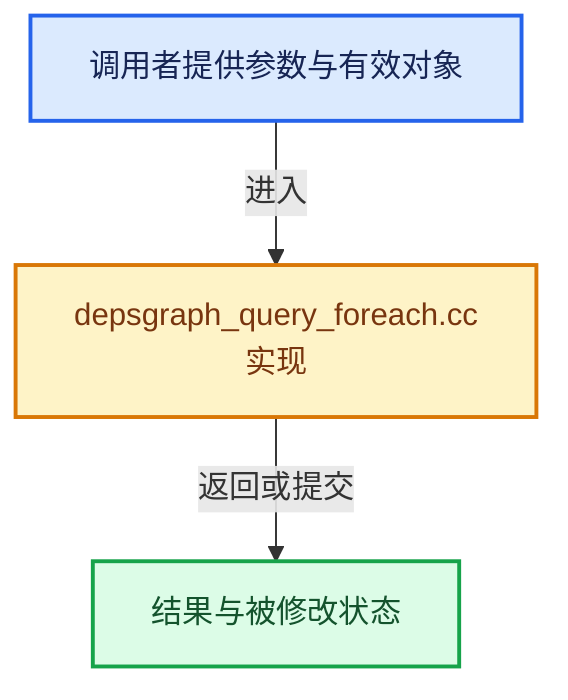

# 实现依赖专题：source/blender/depsgraph/intern/depsgraph_query_foreach.cc

[实现依赖导航](../../README.md) · [符号索引](../../../00-课程指南/02-源码与提交索引/符号依赖与实现索引.md)

本专题从正文实际调用进入，集中保存共享实现。函数有稳定锚点，可从调用处直接跳到对应完整函数；递归与互相调用通过回链组织。

## 本文件的实现关系





## 完整成员与函数实现

<a id="f-915f947f8bdc6497"></a>

### `blender::deg::deg_foreach_id`

实现位置：[source/blender/depsgraph/intern/depsgraph_query_foreach.cc](../../../../../../../source/blender/depsgraph/intern/depsgraph_query_foreach.cc) · L317—L322。

接口参数：

- `const Depsgraph *depsgraph`
- `DEGForeachIDCallback callback`

**教学注释版**

<!-- annotated:6d580557a3dfc0 -->

```cpp
void deg_foreach_id(const Depsgraph *depsgraph, DEGForeachIDCallback callback)
{
  for (const IDNode *id_node : depsgraph->id_nodes) {
    callback(id_node->id_orig);
  }
}
```

<details>
<summary>核对原始源码：source/blender/depsgraph/intern/depsgraph_query_foreach.cc · L317—L322</summary>

<!-- original:6d580557a3dfc0:source/blender/depsgraph/intern/depsgraph_query_foreach.cc:317:322 -->

```cpp
void deg_foreach_id(const Depsgraph *depsgraph, DEGForeachIDCallback callback)
{
  for (const IDNode *id_node : depsgraph->id_nodes) {
    callback(id_node->id_orig);
  }
}
```

</details>

**继续追踪实现**

- `callback` → [调用协议](../../../00-课程指南/01-路线与规范/模板宏与动态分派协议.md)：局部可调用对象，须结合其初始化与捕获环境。调用位置L320。

<a id="f-75639c0e775ae5fd"></a>

### `blender::DEG_foreach_ID`

实现位置：[source/blender/depsgraph/intern/depsgraph_query_foreach.cc](../../../../../../../source/blender/depsgraph/intern/depsgraph_query_foreach.cc) · L433—L436。

接口参数：

- `const Depsgraph *depsgraph`
- `DEGForeachIDCallback callback`

**教学注释版**

<!-- annotated:9904a394fc2942 -->

```cpp
void DEG_foreach_ID(const Depsgraph *depsgraph, DEGForeachIDCallback callback)
{
  deg::deg_foreach_id(reinterpret_cast<const deg::Depsgraph *>(depsgraph), callback);
}
```

<details>
<summary>核对原始源码：source/blender/depsgraph/intern/depsgraph_query_foreach.cc · L433—L436</summary>

<!-- original:9904a394fc2942:source/blender/depsgraph/intern/depsgraph_query_foreach.cc:433:436 -->

```cpp
void DEG_foreach_ID(const Depsgraph *depsgraph, DEGForeachIDCallback callback)
{
  deg::deg_foreach_id(reinterpret_cast<const deg::Depsgraph *>(depsgraph), callback);
}
```

</details>

**继续追踪实现**

- `deg::deg_foreach_id` → [blender::deg::deg_foreach_id · L317](depsgraph_query_foreach.cc.md#f-915f947f8bdc6497)。
