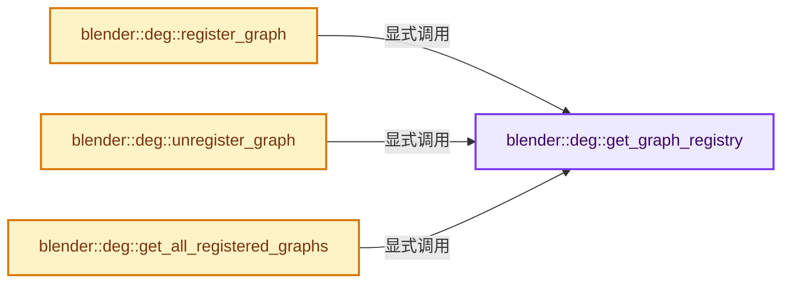
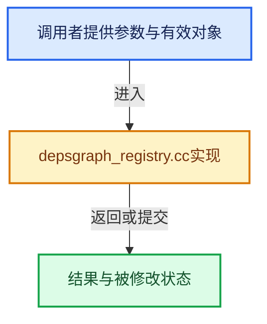

# 实现依赖专题：source/blender/depsgraph/intern/depsgraph_registry.cc

[实现依赖导航](../../README.md) · [符号索引](../../../00-课程指南/02-源码与提交索引/符号依赖与实现索引.md)

本专题从正文实际调用进入，集中保存共享实现。函数有稳定锚点，可从调用处直接跳到对应完整函数；递归与互相调用通过回链组织。

## 本文件的实现关系






## 完整成员与函数实现

<a id="f-23d6ce8723309033"></a>

### `blender::deg::get_graph_registry`

实现位置：[source/blender/depsgraph/intern/depsgraph_registry.cc](../../../../../../../source/blender/depsgraph/intern/depsgraph_registry.cc) · L32—L36。

**教学注释版**

<!-- annotated:2074aa8df4c44a -->

```cpp
static GraphRegistry &get_graph_registry()
{
  static GraphRegistry graph_registry;
  return graph_registry;
}
```

<details>
<summary>核对原始源码：source/blender/depsgraph/intern/depsgraph_registry.cc · L32—L36</summary>

<!-- original:2074aa8df4c44a:source/blender/depsgraph/intern/depsgraph_registry.cc:32:36 -->

```cpp
static GraphRegistry &get_graph_registry()
{
  static GraphRegistry graph_registry;
  return graph_registry;
}
```

</details>

**结果出口**

- `return graph_registry;`

**继续追踪实现**

本实现没有需要继续展开的显式调用；检查返回表达式、对象转换和调用者前置条件。

<a id="f-7deece53b9203735"></a>

### `blender::deg::register_graph`

实现位置：[source/blender/depsgraph/intern/depsgraph_registry.cc](../../../../../../../source/blender/depsgraph/intern/depsgraph_registry.cc) · L38—L47。

接口参数：

- `Depsgraph *depsgraph`

**教学注释版**

<!-- annotated:6ea921615f2fd7 -->

```cpp
void register_graph(Depsgraph *depsgraph)
{
  GraphRegistry &graph_registry = get_graph_registry();
  Main *bmain = depsgraph->bmain;

  std::lock_guard lock{graph_registry.mutex};
  graph_registry.map
      // [讲解] std::make_unique<VectorSet<Depsgraph *>>：创建独占拥有的对象，拥有关系可移动，get返回的借用指针不自动延长寿命。
      .lookup_or_add_cb(bmain, []() { return std::make_unique<VectorSet<Depsgraph *>>(); })
      ->add_new(depsgraph);
}
```

<details>
<summary>核对原始源码：source/blender/depsgraph/intern/depsgraph_registry.cc · L38—L47</summary>

<!-- original:6ea921615f2fd7:source/blender/depsgraph/intern/depsgraph_registry.cc:38:47 -->

```cpp
void register_graph(Depsgraph *depsgraph)
{
  GraphRegistry &graph_registry = get_graph_registry();
  Main *bmain = depsgraph->bmain;

  std::lock_guard lock{graph_registry.mutex};
  graph_registry.map
      .lookup_or_add_cb(bmain, []() { return std::make_unique<VectorSet<Depsgraph *>>(); })
      ->add_new(depsgraph);
}
```

</details>

**继续追踪实现**

- `get_graph_registry` → [blender::deg::get_graph_registry · L32](depsgraph_registry.cc.md#f-23d6ce8723309033)。
- `graph_registry.map .lookup_or_add_cb(bmain, []() { return std::make_unique<VectorSet<Depsgraph *>>(); }) ->add_new` → [调用协议](../../../00-课程指南/01-路线与规范/模板宏与动态分派协议.md)：接收对象类型依赖auto、返回值或模板实例；不按同名猜测目标。调用位置L44。
- `graph_registry.map .lookup_or_add_cb` → [调用协议](../../../00-课程指南/01-路线与规范/模板宏与动态分派协议.md)：接收对象类型依赖auto、返回值或模板实例；不按同名猜测目标。调用位置L44。
- `std::make_unique<VectorSet<Depsgraph *>>` → [外部契约](https://eel.is/c++draft/unique.ptr.create)：创建独占拥有的对象，拥有关系可移动，get返回的借用指针不自动延长寿命。

<a id="f-2156782104fe7b89"></a>

### `blender::deg::unregister_graph`

实现位置：[source/blender/depsgraph/intern/depsgraph_registry.cc](../../../../../../../source/blender/depsgraph/intern/depsgraph_registry.cc) · L49—L62。

接口参数：

- `Depsgraph *depsgraph`

**教学注释版**

<!-- annotated:429aa0ab810d28 -->

```cpp
void unregister_graph(Depsgraph *depsgraph)
{
  Main *bmain = depsgraph->bmain;
  GraphRegistry &graph_registry = get_graph_registry();

  std::lock_guard lock{graph_registry.mutex};
  GraphSetPtr &graphs = graph_registry.map.lookup(bmain);
  graphs->remove(depsgraph);

  /* If this was the last depsgraph associated with the main, remove the main entry as well. */
  if (graphs->is_empty()) {
    graph_registry.map.remove(bmain);
  }
}
```

<details>
<summary>核对原始源码：source/blender/depsgraph/intern/depsgraph_registry.cc · L49—L62</summary>

<!-- original:429aa0ab810d28:source/blender/depsgraph/intern/depsgraph_registry.cc:49:62 -->

```cpp
void unregister_graph(Depsgraph *depsgraph)
{
  Main *bmain = depsgraph->bmain;
  GraphRegistry &graph_registry = get_graph_registry();

  std::lock_guard lock{graph_registry.mutex};
  GraphSetPtr &graphs = graph_registry.map.lookup(bmain);
  graphs->remove(depsgraph);

  /* If this was the last depsgraph associated with the main, remove the main entry as well. */
  if (graphs->is_empty()) {
    graph_registry.map.remove(bmain);
  }
}
```

</details>

**继续追踪实现**

- `get_graph_registry` → [blender::deg::get_graph_registry · L32](depsgraph_registry.cc.md#f-23d6ce8723309033)。
- `graph_registry.map.lookup` → [调用协议](../../../00-课程指南/01-路线与规范/模板宏与动态分派协议.md)：接收对象类型依赖auto、返回值或模板实例；不按同名猜测目标。调用位置L55。
- `graphs->remove` → [调用协议](../../../00-课程指南/01-路线与规范/模板宏与动态分派协议.md)：由接收对象具体类型或运行时策略提供实现。调用位置L56。
- `graphs->is_empty` → [调用协议](../../../00-课程指南/01-路线与规范/模板宏与动态分派协议.md)：由接收对象具体类型或运行时策略提供实现。调用位置L59。
- `graph_registry.map.remove` → [调用协议](../../../00-课程指南/01-路线与规范/模板宏与动态分派协议.md)：接收对象类型依赖auto、返回值或模板实例；不按同名猜测目标。调用位置L60。

<a id="f-29cc0b072943db19"></a>

### `blender::deg::get_all_registered_graphs`

实现位置：[source/blender/depsgraph/intern/depsgraph_registry.cc](../../../../../../../source/blender/depsgraph/intern/depsgraph_registry.cc) · L64—L73。

接口参数：

- `Main *bmain`

**教学注释版**

<!-- annotated:56158e9cc96634 -->

```cpp
Span<Depsgraph *> get_all_registered_graphs(Main *bmain)
{
  GraphRegistry &graph_registry = get_graph_registry();
  std::lock_guard lock{graph_registry.mutex};
  GraphSetPtr *graphs = graph_registry.map.lookup_ptr(bmain);
  if (graphs) {
    return **graphs;
  }
  return {};
}
```

<details>
<summary>核对原始源码：source/blender/depsgraph/intern/depsgraph_registry.cc · L64—L73</summary>

<!-- original:56158e9cc96634:source/blender/depsgraph/intern/depsgraph_registry.cc:64:73 -->

```cpp
Span<Depsgraph *> get_all_registered_graphs(Main *bmain)
{
  GraphRegistry &graph_registry = get_graph_registry();
  std::lock_guard lock{graph_registry.mutex};
  GraphSetPtr *graphs = graph_registry.map.lookup_ptr(bmain);
  if (graphs) {
    return **graphs;
  }
  return {};
}
```

</details>

**结果出口**

- `return **graphs;`
- `return {};`

**继续追踪实现**

- `get_graph_registry` → [blender::deg::get_graph_registry · L32](depsgraph_registry.cc.md#f-23d6ce8723309033)。
- `graph_registry.map.lookup_ptr` → [调用协议](../../../00-课程指南/01-路线与规范/模板宏与动态分派协议.md)：接收对象类型依赖auto、返回值或模板实例；不按同名猜测目标。调用位置L68。
