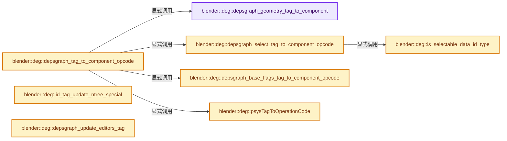
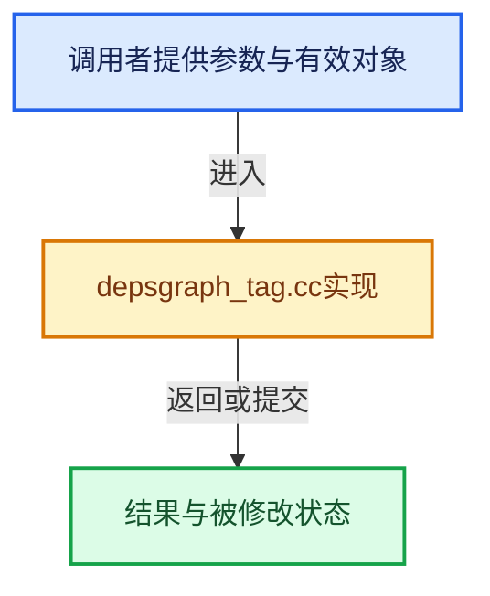

# 实现依赖专题：source/blender/depsgraph/intern/depsgraph_tag.cc

[实现依赖导航](../../README.md) · [符号索引](../../../00-课程指南/02-源码与提交索引/符号依赖与实现索引.md)

本专题从正文实际调用进入，集中保存共享实现。函数有稳定锚点，可从调用处直接跳到对应完整函数；递归与互相调用通过回链组织。

## 本文件的实现关系






## 完整成员与函数实现

<a id="f-19db0ed19c162016"></a>

### `blender::deg::depsgraph_geometry_tag_to_component`

实现位置：[source/blender/depsgraph/intern/depsgraph_tag.cc](../../../../../../../source/blender/depsgraph/intern/depsgraph_tag.cc) · L62—L68。

接口参数：

- `const ID *id`
- `NodeType *component_type`

**教学注释版**

<!-- annotated:d2277d9f17d74c -->

```cpp
void depsgraph_geometry_tag_to_component(const ID *id, NodeType *component_type)
{
  const NodeType result = geometry_tag_to_component(id);
  if (result != NodeType::UNDEFINED) {
    *component_type = result;
  }
}
```

<details>
<summary>核对原始源码：source/blender/depsgraph/intern/depsgraph_tag.cc · L62—L68</summary>

<!-- original:d2277d9f17d74c:source/blender/depsgraph/intern/depsgraph_tag.cc:62:68 -->

```cpp
void depsgraph_geometry_tag_to_component(const ID *id, NodeType *component_type)
{
  const NodeType result = geometry_tag_to_component(id);
  if (result != NodeType::UNDEFINED) {
    *component_type = result;
  }
}
```

</details>

**继续追踪实现**

- `geometry_tag_to_component` → [blender::deg::geometry_tag_to_component · L603](depsgraph_tag.cc.md#f-48376f5877ef38a3)。

<a id="f-7933d39e7fdef863"></a>

### `blender::deg::is_selectable_data_id_type`

实现位置：[source/blender/depsgraph/intern/depsgraph_tag.cc](../../../../../../../source/blender/depsgraph/intern/depsgraph_tag.cc) · L70—L73。

接口参数：

- `const ID_Type id_type`

**教学注释版**

<!-- annotated:4d9b20a882c9ec -->

```cpp
bool is_selectable_data_id_type(const ID_Type id_type)
{
  return ELEM(id_type, ID_ME, ID_CU_LEGACY, ID_MB, ID_LT, ID_GD_LEGACY, ID_CV, ID_PT, ID_VO);
}
```

<details>
<summary>核对原始源码：source/blender/depsgraph/intern/depsgraph_tag.cc · L70—L73</summary>

<!-- original:4d9b20a882c9ec:source/blender/depsgraph/intern/depsgraph_tag.cc:70:73 -->

```cpp
bool is_selectable_data_id_type(const ID_Type id_type)
{
  return ELEM(id_type, ID_ME, ID_CU_LEGACY, ID_MB, ID_LT, ID_GD_LEGACY, ID_CV, ID_PT, ID_VO);
}
```

</details>

**结果出口**

- `return ELEM(id_type, ID_ME, ID_CU_LEGACY, ID_MB, ID_LT, ID_GD_LEGACY, ID_CV, ID_PT, ID_VO);`

**继续追踪实现**

- `ELEM` → [ELEM · L88](../../07-Intern运行时与平台/ghost/intern/GHOST_utildefines.hh.md#m-d28724a15928)；[ELEM · L135](../../01-BLI基础库/BLI_utildefines.hh.md#m-d6572de7cae0)。宏定义由构建条件选择。

<a id="f-a272c1569c6539f0"></a>

### `blender::deg::depsgraph_select_tag_to_component_opcode`

实现位置：[source/blender/depsgraph/intern/depsgraph_tag.cc](../../../../../../../source/blender/depsgraph/intern/depsgraph_tag.cc) · L75—L104。

接口参数：

- `const ID *id`
- `NodeType *component_type`
- `OperationCode *operation_code`

**教学注释版**

<!-- annotated:e321a986f94eb3 -->

```cpp
void depsgraph_select_tag_to_component_opcode(const ID *id,
                                              NodeType *component_type,
                                              OperationCode *operation_code)
{
  const ID_Type id_type = GS(id->name);
  if (id_type == ID_SCE) {
    /* We need to flush base flags to all objects in a scene since we
     * don't know which ones changed. However, we don't want to update
     * the whole scene, so pick up some operation which will do as less
     * as possible.
     *
     * TODO(sergey): We can introduce explicit exit operation which
     * does nothing and which is only used to cascade flush down the
     * road. */
    *component_type = NodeType::LAYER_COLLECTIONS;
    *operation_code = OperationCode::VIEW_LAYER_EVAL;
  }
  else if (id_type == ID_OB) {
    *component_type = NodeType::OBJECT_FROM_LAYER;
    *operation_code = OperationCode::OBJECT_FROM_LAYER_ENTRY;
  }
  else if (is_selectable_data_id_type(id_type)) {
    *component_type = NodeType::BATCH_CACHE;
    *operation_code = OperationCode::GEOMETRY_SELECT_UPDATE;
  }
  else {
    *component_type = NodeType::COPY_ON_EVAL;
    *operation_code = OperationCode::COPY_ON_EVAL;
  }
}
```

<details>
<summary>核对原始源码：source/blender/depsgraph/intern/depsgraph_tag.cc · L75—L104</summary>

<!-- original:e321a986f94eb3:source/blender/depsgraph/intern/depsgraph_tag.cc:75:104 -->

```cpp
void depsgraph_select_tag_to_component_opcode(const ID *id,
                                              NodeType *component_type,
                                              OperationCode *operation_code)
{
  const ID_Type id_type = GS(id->name);
  if (id_type == ID_SCE) {
    /* We need to flush base flags to all objects in a scene since we
     * don't know which ones changed. However, we don't want to update
     * the whole scene, so pick up some operation which will do as less
     * as possible.
     *
     * TODO(sergey): We can introduce explicit exit operation which
     * does nothing and which is only used to cascade flush down the
     * road. */
    *component_type = NodeType::LAYER_COLLECTIONS;
    *operation_code = OperationCode::VIEW_LAYER_EVAL;
  }
  else if (id_type == ID_OB) {
    *component_type = NodeType::OBJECT_FROM_LAYER;
    *operation_code = OperationCode::OBJECT_FROM_LAYER_ENTRY;
  }
  else if (is_selectable_data_id_type(id_type)) {
    *component_type = NodeType::BATCH_CACHE;
    *operation_code = OperationCode::GEOMETRY_SELECT_UPDATE;
  }
  else {
    *component_type = NodeType::COPY_ON_EVAL;
    *operation_code = OperationCode::COPY_ON_EVAL;
  }
}
```

</details>

**继续追踪实现**

- `GS` → [blender::GS · L410](../../08-其他Blender模块/makesdna/DNA_ID.h.md#f-c3ff509f79f21b05)。
- `is_selectable_data_id_type` → [blender::deg::is_selectable_data_id_type · L70](depsgraph_tag.cc.md#f-7933d39e7fdef863)。

<a id="f-b3821ce18d425d27"></a>

### `blender::deg::depsgraph_base_flags_tag_to_component_opcode`

实现位置：[source/blender/depsgraph/intern/depsgraph_tag.cc](../../../../../../../source/blender/depsgraph/intern/depsgraph_tag.cc) · L106—L119。

接口参数：

- `const ID *id`
- `NodeType *component_type`
- `OperationCode *operation_code`

**教学注释版**

<!-- annotated:90ad8376cce2d4 -->

```cpp
void depsgraph_base_flags_tag_to_component_opcode(const ID *id,
                                                  NodeType *component_type,
                                                  OperationCode *operation_code)
{
  const ID_Type id_type = GS(id->name);
  if (id_type == ID_SCE) {
    *component_type = NodeType::LAYER_COLLECTIONS;
    *operation_code = OperationCode::VIEW_LAYER_EVAL;
  }
  else if (id_type == ID_OB) {
    *component_type = NodeType::OBJECT_FROM_LAYER;
    *operation_code = OperationCode::OBJECT_BASE_FLAGS;
  }
}
```

<details>
<summary>核对原始源码：source/blender/depsgraph/intern/depsgraph_tag.cc · L106—L119</summary>

<!-- original:90ad8376cce2d4:source/blender/depsgraph/intern/depsgraph_tag.cc:106:119 -->

```cpp
void depsgraph_base_flags_tag_to_component_opcode(const ID *id,
                                                  NodeType *component_type,
                                                  OperationCode *operation_code)
{
  const ID_Type id_type = GS(id->name);
  if (id_type == ID_SCE) {
    *component_type = NodeType::LAYER_COLLECTIONS;
    *operation_code = OperationCode::VIEW_LAYER_EVAL;
  }
  else if (id_type == ID_OB) {
    *component_type = NodeType::OBJECT_FROM_LAYER;
    *operation_code = OperationCode::OBJECT_BASE_FLAGS;
  }
}
```

</details>

**继续追踪实现**

- `GS` → [blender::GS · L410](../../08-其他Blender模块/makesdna/DNA_ID.h.md#f-c3ff509f79f21b05)。

<a id="f-2638d02d7fc3bfd6"></a>

### `blender::deg::psysTagToOperationCode`

实现位置：[source/blender/depsgraph/intern/depsgraph_tag.cc](../../../../../../../source/blender/depsgraph/intern/depsgraph_tag.cc) · L121—L127。

接口参数：

- `IDRecalcFlag tag`

**教学注释版**

<!-- annotated:7f3d11e466a4ce -->

```cpp
OperationCode psysTagToOperationCode(IDRecalcFlag tag)
{
  if (tag == ID_RECALC_PSYS_RESET) {
    return OperationCode::PARTICLE_SETTINGS_RESET;
  }
  return OperationCode::OPERATION;
}
```

<details>
<summary>核对原始源码：source/blender/depsgraph/intern/depsgraph_tag.cc · L121—L127</summary>

<!-- original:7f3d11e466a4ce:source/blender/depsgraph/intern/depsgraph_tag.cc:121:127 -->

```cpp
OperationCode psysTagToOperationCode(IDRecalcFlag tag)
{
  if (tag == ID_RECALC_PSYS_RESET) {
    return OperationCode::PARTICLE_SETTINGS_RESET;
  }
  return OperationCode::OPERATION;
}
```

</details>

**结果出口**

- `return OperationCode::PARTICLE_SETTINGS_RESET;`
- `return OperationCode::OPERATION;`

**继续追踪实现**

本实现没有需要继续展开的显式调用；检查返回表达式、对象转换和调用者前置条件。

<a id="f-6c314bb7c66cd17c"></a>

### `blender::deg::depsgraph_tag_to_component_opcode`

实现位置：[source/blender/depsgraph/intern/depsgraph_tag.cc](../../../../../../../source/blender/depsgraph/intern/depsgraph_tag.cc) · L129—L235。

接口参数：

- `const ID *id`
- `IDRecalcFlag tag`
- `NodeType *component_type`
- `OperationCode *operation_code`

**教学注释版**

<!-- annotated:a0975f79d30832 -->

```cpp
void depsgraph_tag_to_component_opcode(const ID *id,
                                       IDRecalcFlag tag,
                                       NodeType *component_type,
                                       OperationCode *operation_code)
{
  const ID_Type id_type = GS(id->name);
  *component_type = NodeType::UNDEFINED;
  *operation_code = OperationCode::OPERATION;
  /* Special case for now, in the future we should get rid of this. */
  if (tag == 0) {
    *component_type = NodeType::ID_REF;
    *operation_code = OperationCode::OPERATION;
    return;
  }
  switch (tag) {
    case ID_RECALC_TRANSFORM:
      *component_type = NodeType::TRANSFORM;
      break;
    case ID_RECALC_GEOMETRY:
      depsgraph_geometry_tag_to_component(id, component_type);
      break;
    case ID_RECALC_ANIMATION:
      *component_type = NodeType::ANIMATION;
      break;
    case ID_RECALC_PSYS_REDO:
    case ID_RECALC_PSYS_RESET:
    case ID_RECALC_PSYS_CHILD:
    case ID_RECALC_PSYS_PHYS:
      if (id_type == ID_PA) {
        /* NOTES:
         * - For particle settings node we need to use different
         *   component. Will be nice to get this unified with object,
         *   but we can survive for now with single exception here.
         *   Particles needs reconsideration anyway, */
        *component_type = NodeType::PARTICLE_SETTINGS;
        *operation_code = psysTagToOperationCode(tag);
      }
      else {
        *component_type = NodeType::PARTICLE_SYSTEM;
      }
      break;
    case ID_RECALC_SYNC_TO_EVAL:
      *component_type = NodeType::COPY_ON_EVAL;
      break;
    case ID_RECALC_SHADING:
      *component_type = NodeType::SHADING;
      break;
    case ID_RECALC_SELECT:
      depsgraph_select_tag_to_component_opcode(id, component_type, operation_code);
      break;
    case ID_RECALC_BASE_FLAGS:
      depsgraph_base_flags_tag_to_component_opcode(id, component_type, operation_code);
      break;
    case ID_RECALC_POINT_CACHE:
      *component_type = NodeType::POINT_CACHE;
      break;
    case ID_RECALC_EDITORS:
      /* There is no such node in depsgraph, this tag is to be handled
       * separately. */
      break;
    case ID_RECALC_SEQUENCER_STRIPS:
      *component_type = NodeType::SEQUENCER;
      break;
    case ID_RECALC_FRAME_CHANGE:
    case ID_RECALC_AUDIO_FPS:
    case ID_RECALC_AUDIO_VOLUME:
    case ID_RECALC_AUDIO_MUTE:
    case ID_RECALC_AUDIO_LISTENER:
    case ID_RECALC_AUDIO:
      *component_type = NodeType::AUDIO;
      break;
    case ID_RECALC_PARAMETERS:
      *component_type = NodeType::PARAMETERS;
      break;
    case ID_RECALC_SOURCE:
      *component_type = NodeType::PARAMETERS;
      break;
    case ID_RECALC_GEOMETRY_ALL_MODES:
    case ID_RECALC_ALL:
    case ID_RECALC_PSYS_ALL:
      BLI_assert_msg(0, "Should not happen");
      break;
    case ID_RECALC_TAG_FOR_UNDO:
      break; /* Must be ignored by depsgraph. */
    case ID_RECALC_NTREE_OUTPUT:
      *component_type = NodeType::NTREE_OUTPUT;
      *operation_code = OperationCode::NTREE_OUTPUT;
      break;
    case ID_RECALC_HIERARCHY:
      *component_type = NodeType::HIERARCHY;
      *operation_code = OperationCode::HIERARCHY;
      break;
    case ID_RECALC_COMPOSITOR:
      *component_type = NodeType::COMPOSITOR;
      *operation_code = OperationCode::COMPOSITOR_EVAL;
      break;

    case ID_RECALC_PROVISION_28:
    case ID_RECALC_PROVISION_29:
    case ID_RECALC_PROVISION_30:
    case ID_RECALC_PROVISION_31:
      /* Silently ignore.
       * The bits might be passed here from ID_RECALC_ALL. This is not a code-mistake, but just the
       * way how the recalc flags are handled. */
      break;
  }
}
```

<details>
<summary>核对原始源码：source/blender/depsgraph/intern/depsgraph_tag.cc · L129—L235</summary>

<!-- original:a0975f79d30832:source/blender/depsgraph/intern/depsgraph_tag.cc:129:235 -->

```cpp
void depsgraph_tag_to_component_opcode(const ID *id,
                                       IDRecalcFlag tag,
                                       NodeType *component_type,
                                       OperationCode *operation_code)
{
  const ID_Type id_type = GS(id->name);
  *component_type = NodeType::UNDEFINED;
  *operation_code = OperationCode::OPERATION;
  /* Special case for now, in the future we should get rid of this. */
  if (tag == 0) {
    *component_type = NodeType::ID_REF;
    *operation_code = OperationCode::OPERATION;
    return;
  }
  switch (tag) {
    case ID_RECALC_TRANSFORM:
      *component_type = NodeType::TRANSFORM;
      break;
    case ID_RECALC_GEOMETRY:
      depsgraph_geometry_tag_to_component(id, component_type);
      break;
    case ID_RECALC_ANIMATION:
      *component_type = NodeType::ANIMATION;
      break;
    case ID_RECALC_PSYS_REDO:
    case ID_RECALC_PSYS_RESET:
    case ID_RECALC_PSYS_CHILD:
    case ID_RECALC_PSYS_PHYS:
      if (id_type == ID_PA) {
        /* NOTES:
         * - For particle settings node we need to use different
         *   component. Will be nice to get this unified with object,
         *   but we can survive for now with single exception here.
         *   Particles needs reconsideration anyway, */
        *component_type = NodeType::PARTICLE_SETTINGS;
        *operation_code = psysTagToOperationCode(tag);
      }
      else {
        *component_type = NodeType::PARTICLE_SYSTEM;
      }
      break;
    case ID_RECALC_SYNC_TO_EVAL:
      *component_type = NodeType::COPY_ON_EVAL;
      break;
    case ID_RECALC_SHADING:
      *component_type = NodeType::SHADING;
      break;
    case ID_RECALC_SELECT:
      depsgraph_select_tag_to_component_opcode(id, component_type, operation_code);
      break;
    case ID_RECALC_BASE_FLAGS:
      depsgraph_base_flags_tag_to_component_opcode(id, component_type, operation_code);
      break;
    case ID_RECALC_POINT_CACHE:
      *component_type = NodeType::POINT_CACHE;
      break;
    case ID_RECALC_EDITORS:
      /* There is no such node in depsgraph, this tag is to be handled
       * separately. */
      break;
    case ID_RECALC_SEQUENCER_STRIPS:
      *component_type = NodeType::SEQUENCER;
      break;
    case ID_RECALC_FRAME_CHANGE:
    case ID_RECALC_AUDIO_FPS:
    case ID_RECALC_AUDIO_VOLUME:
    case ID_RECALC_AUDIO_MUTE:
    case ID_RECALC_AUDIO_LISTENER:
    case ID_RECALC_AUDIO:
      *component_type = NodeType::AUDIO;
      break;
    case ID_RECALC_PARAMETERS:
      *component_type = NodeType::PARAMETERS;
      break;
    case ID_RECALC_SOURCE:
      *component_type = NodeType::PARAMETERS;
      break;
    case ID_RECALC_GEOMETRY_ALL_MODES:
    case ID_RECALC_ALL:
    case ID_RECALC_PSYS_ALL:
      BLI_assert_msg(0, "Should not happen");
      break;
    case ID_RECALC_TAG_FOR_UNDO:
      break; /* Must be ignored by depsgraph. */
    case ID_RECALC_NTREE_OUTPUT:
      *component_type = NodeType::NTREE_OUTPUT;
      *operation_code = OperationCode::NTREE_OUTPUT;
      break;
    case ID_RECALC_HIERARCHY:
      *component_type = NodeType::HIERARCHY;
      *operation_code = OperationCode::HIERARCHY;
      break;
    case ID_RECALC_COMPOSITOR:
      *component_type = NodeType::COMPOSITOR;
      *operation_code = OperationCode::COMPOSITOR_EVAL;
      break;

    case ID_RECALC_PROVISION_28:
    case ID_RECALC_PROVISION_29:
    case ID_RECALC_PROVISION_30:
    case ID_RECALC_PROVISION_31:
      /* Silently ignore.
       * The bits might be passed here from ID_RECALC_ALL. This is not a code-mistake, but just the
       * way how the recalc flags are handled. */
      break;
  }
}
```

</details>

**继续追踪实现**

- `GS` → [blender::GS · L410](../../08-其他Blender模块/makesdna/DNA_ID.h.md#f-c3ff509f79f21b05)。
- `depsgraph_geometry_tag_to_component` → [blender::deg::depsgraph_geometry_tag_to_component · L62](depsgraph_tag.cc.md#f-19db0ed19c162016)。
- `psysTagToOperationCode` → [blender::deg::psysTagToOperationCode · L121](depsgraph_tag.cc.md#f-2638d02d7fc3bfd6)。
- `depsgraph_select_tag_to_component_opcode` → [blender::deg::depsgraph_select_tag_to_component_opcode · L75](depsgraph_tag.cc.md#f-a272c1569c6539f0)。
- `depsgraph_base_flags_tag_to_component_opcode` → [blender::deg::depsgraph_base_flags_tag_to_component_opcode · L106](depsgraph_tag.cc.md#f-b3821ce18d425d27)。
- `BLI_assert_msg` → [BLI_assert_msg · L55](../../01-BLI基础库/BLI_assert.hh.md#m-695eed20dceb)；[BLI_assert_msg · L64](../../01-BLI基础库/BLI_assert.hh.md#m-7de5563de4db)。宏定义由构建条件选择。

<a id="f-32f28a2002f1df58"></a>

### `blender::deg::id_tag_update_ntree_special`

实现位置：[source/blender/depsgraph/intern/depsgraph_tag.cc](../../../../../../../source/blender/depsgraph/intern/depsgraph_tag.cc) · L237—L245。

接口参数：

- `Main *bmain`
- `Depsgraph *graph`
- `ID *id`
- `uint flags`
- `eUpdateSource update_source`

**教学注释版**

<!-- annotated:03b02d8a82147b -->

```cpp
void id_tag_update_ntree_special(
    Main *bmain, Depsgraph *graph, ID *id, uint flags, eUpdateSource update_source)
{
  bNodeTree *ntree = bke::node_tree_from_id(id);
  if (ntree == nullptr) {
    return;
  }
  graph_id_tag_update(bmain, graph, &ntree->id, flags, update_source);
}
```

<details>
<summary>核对原始源码：source/blender/depsgraph/intern/depsgraph_tag.cc · L237—L245</summary>

<!-- original:03b02d8a82147b:source/blender/depsgraph/intern/depsgraph_tag.cc:237:245 -->

```cpp
void id_tag_update_ntree_special(
    Main *bmain, Depsgraph *graph, ID *id, uint flags, eUpdateSource update_source)
{
  bNodeTree *ntree = bke::node_tree_from_id(id);
  if (ntree == nullptr) {
    return;
  }
  graph_id_tag_update(bmain, graph, &ntree->id, flags, update_source);
}
```

</details>

**继续追踪实现**

- `bke::node_tree_from_id` → [blender::bke::node_tree_from_id · L5337](../../02-BKE几何与数据/intern/node.cc.md#f-9bb7511df53d8493)。
- `graph_id_tag_update` → [blender::deg::graph_id_tag_update · L702](depsgraph_tag.cc.md#f-9b726d96d2ec3b9f)。

<a id="f-d776f06686cb8203"></a>

### `blender::deg::depsgraph_update_editors_tag`

实现位置：[source/blender/depsgraph/intern/depsgraph_tag.cc](../../../../../../../source/blender/depsgraph/intern/depsgraph_tag.cc) · L247—L258。

接口参数：

- `Main *bmain`
- `Depsgraph *graph`
- `ID *id`

**教学注释版**

<!-- annotated:56a34e4b90afac -->

```cpp
void depsgraph_update_editors_tag(Main *bmain, Depsgraph *graph, ID *id)
{
  /* NOTE: We handle this immediately, without delaying anything, to be
   * sure we don't cause threading issues with OpenGL. */
  /* TODO(sergey): Make sure this works for evaluated data-blocks as well. */
  DEGEditorUpdateContext update_ctx = {nullptr};
  update_ctx.bmain = bmain;
  update_ctx.depsgraph = reinterpret_cast<::blender::Depsgraph *>(graph);
  update_ctx.scene = graph->scene;
  update_ctx.view_layer = graph->view_layer;
  deg_editors_id_update(&update_ctx, id);
}
```

<details>
<summary>核对原始源码：source/blender/depsgraph/intern/depsgraph_tag.cc · L247—L258</summary>

<!-- original:56a34e4b90afac:source/blender/depsgraph/intern/depsgraph_tag.cc:247:258 -->

```cpp
void depsgraph_update_editors_tag(Main *bmain, Depsgraph *graph, ID *id)
{
  /* NOTE: We handle this immediately, without delaying anything, to be
   * sure we don't cause threading issues with OpenGL. */
  /* TODO(sergey): Make sure this works for evaluated data-blocks as well. */
  DEGEditorUpdateContext update_ctx = {nullptr};
  update_ctx.bmain = bmain;
  update_ctx.depsgraph = reinterpret_cast<::blender::Depsgraph *>(graph);
  update_ctx.scene = graph->scene;
  update_ctx.view_layer = graph->view_layer;
  deg_editors_id_update(&update_ctx, id);
}
```

</details>

**沿实际写入检查状态**

- `update_ctx.bmain = bmain;`
- `update_ctx.depsgraph = reinterpret_cast<::blender::Depsgraph *>(graph);`
- `update_ctx.scene = graph->scene;`
- `update_ctx.view_layer = graph->view_layer;`

**继续追踪实现**

- `deg_editors_id_update` → [blender::deg::deg_editors_id_update · L20](depsgraph_update.cc.md#f-70718d1cdd03c14d)。

<a id="f-f5a3bb567868c0f8"></a>

### `blender::deg::depsgraph_id_tag_copy_on_write`

实现位置：[source/blender/depsgraph/intern/depsgraph_tag.cc](../../../../../../../source/blender/depsgraph/intern/depsgraph_tag.cc) · L260—L268。

接口参数：

- `Depsgraph *graph`
- `IDNode *id_node`
- `eUpdateSource update_source`

**教学注释版**

<!-- annotated:d45756f37ae824 -->

```cpp
void depsgraph_id_tag_copy_on_write(Depsgraph *graph, IDNode *id_node, eUpdateSource update_source)
{
  ComponentNode *cow_comp = id_node->find_component(NodeType::COPY_ON_EVAL);
  if (cow_comp == nullptr) {
    BLI_assert(!deg_eval_copy_is_needed(GS(id_node->id_orig->name)));
    return;
  }
  cow_comp->tag_update(graph, update_source);
}
```

<details>
<summary>核对原始源码：source/blender/depsgraph/intern/depsgraph_tag.cc · L260—L268</summary>

<!-- original:d45756f37ae824:source/blender/depsgraph/intern/depsgraph_tag.cc:260:268 -->

```cpp
void depsgraph_id_tag_copy_on_write(Depsgraph *graph, IDNode *id_node, eUpdateSource update_source)
{
  ComponentNode *cow_comp = id_node->find_component(NodeType::COPY_ON_EVAL);
  if (cow_comp == nullptr) {
    BLI_assert(!deg_eval_copy_is_needed(GS(id_node->id_orig->name)));
    return;
  }
  cow_comp->tag_update(graph, update_source);
}
```

</details>

**继续追踪实现**

- `id_node->find_component` → [blender::deg::IDNode::find_component · L133](node/deg_node_id.cc.md#f-9982102eca14b6b6)。
- `BLI_assert` → [BLI_assert · L48](../../01-BLI基础库/BLI_assert.hh.md#m-57a88495704d)；[BLI_assert · L63](../../01-BLI基础库/BLI_assert.hh.md#m-d07050020cb5)。宏定义由构建条件选择。
- `deg_eval_copy_is_needed` → [blender::deg::deg_eval_copy_is_needed · L1045](eval/deg_eval_copy_on_write.cc.md#f-389a000d46ec5ac9)；[blender::deg::deg_eval_copy_is_needed · L1051](eval/deg_eval_copy_on_write.cc.md#f-9fd78a9e9f3f8c4c)。同名重载需按实参类型选择。
- `GS` → [blender::GS · L410](../../08-其他Blender模块/makesdna/DNA_ID.h.md#f-c3ff509f79f21b05)。
- `cow_comp->tag_update` → [blender::deg::ComponentNode::tag_update · L189](node/deg_node_component.cc.md#f-a03efcb923f32e69)。

<a id="f-9bea66aa8e75735b"></a>

### `blender::deg::depsgraph_tag_component`

实现位置：[source/blender/depsgraph/intern/depsgraph_tag.cc](../../../../../../../source/blender/depsgraph/intern/depsgraph_tag.cc) · L270—L303。

接口参数：

- `Depsgraph *graph`
- `IDNode *id_node`
- `NodeType component_type`
- `OperationCode operation_code`
- `eUpdateSource update_source`

**教学注释版**

<!-- annotated:5b8c95114520c7 -->

```cpp
void depsgraph_tag_component(Depsgraph *graph,
                             IDNode *id_node,
                             NodeType component_type,
                             OperationCode operation_code,
                             eUpdateSource update_source)
{
  ComponentNode *component_node = id_node->find_component(component_type);
  /* NOTE: Animation component might not be existing yet (which happens when adding new driver or
   * adding a new keyframe), so the required copy-on-evaluation tag needs to be taken care
   * explicitly here. */
  if (component_node == nullptr) {
    if (component_type == NodeType::ANIMATION) {
      id_node->is_cow_explicitly_tagged = true;
      depsgraph_id_tag_copy_on_write(graph, id_node, update_source);
    }
    return;
  }
  if (operation_code == OperationCode::OPERATION) {
    component_node->tag_update(graph, update_source);
  }
  else {
    OperationNode *operation_node = component_node->find_operation(operation_code);
    if (operation_node != nullptr) {
      operation_node->tag_update(graph, update_source);
    }
  }
  /* If component depends on copy-on-evaluation, tag it as well. */
  if (component_node->need_tag_cow_before_update(IDRecalcFlag(id_node->id_cow->recalc))) {
    depsgraph_id_tag_copy_on_write(graph, id_node, update_source);
  }
  if (component_type == NodeType::COPY_ON_EVAL) {
    id_node->is_cow_explicitly_tagged = true;
  }
}
```

<details>
<summary>核对原始源码：source/blender/depsgraph/intern/depsgraph_tag.cc · L270—L303</summary>

<!-- original:5b8c95114520c7:source/blender/depsgraph/intern/depsgraph_tag.cc:270:303 -->

```cpp
void depsgraph_tag_component(Depsgraph *graph,
                             IDNode *id_node,
                             NodeType component_type,
                             OperationCode operation_code,
                             eUpdateSource update_source)
{
  ComponentNode *component_node = id_node->find_component(component_type);
  /* NOTE: Animation component might not be existing yet (which happens when adding new driver or
   * adding a new keyframe), so the required copy-on-evaluation tag needs to be taken care
   * explicitly here. */
  if (component_node == nullptr) {
    if (component_type == NodeType::ANIMATION) {
      id_node->is_cow_explicitly_tagged = true;
      depsgraph_id_tag_copy_on_write(graph, id_node, update_source);
    }
    return;
  }
  if (operation_code == OperationCode::OPERATION) {
    component_node->tag_update(graph, update_source);
  }
  else {
    OperationNode *operation_node = component_node->find_operation(operation_code);
    if (operation_node != nullptr) {
      operation_node->tag_update(graph, update_source);
    }
  }
  /* If component depends on copy-on-evaluation, tag it as well. */
  if (component_node->need_tag_cow_before_update(IDRecalcFlag(id_node->id_cow->recalc))) {
    depsgraph_id_tag_copy_on_write(graph, id_node, update_source);
  }
  if (component_type == NodeType::COPY_ON_EVAL) {
    id_node->is_cow_explicitly_tagged = true;
  }
}
```

</details>

**沿实际写入检查状态**

- `id_node->is_cow_explicitly_tagged = true;`

**继续追踪实现**

- `id_node->find_component` → [blender::deg::IDNode::find_component · L133](node/deg_node_id.cc.md#f-9982102eca14b6b6)。
- `depsgraph_id_tag_copy_on_write` → [blender::deg::depsgraph_id_tag_copy_on_write · L260](depsgraph_tag.cc.md#f-f5a3bb567868c0f8)。
- `component_node->tag_update` → [blender::deg::ComponentNode::tag_update · L189](node/deg_node_component.cc.md#f-a03efcb923f32e69)。
- `component_node->find_operation` → [blender::deg::ComponentNode::find_operation · L68](node/deg_node_component.cc.md#f-172b1268e9ce9e59)；[blender::deg::ComponentNode::find_operation · L87](node/deg_node_component.cc.md#f-3fcfe180a922223a)。同名重载需按实参类型选择。
- `operation_node->tag_update` → [blender::deg::OperationNode::tag_update · L232](node/deg_node_operation.cc.md#f-e43f9db647ce0809)。
- `component_node->need_tag_cow_before_update` → [blender::deg::ComponentNode::need_tag_cow_before_update · L139](../../../11-Depsgraph与并行任务系统/02-ID组件与操作节点.md#f-2520cb4a769c9ec6)。
- `IDRecalcFlag` → [blender::IDRecalcFlag](../../08-其他Blender模块/makesdna/DNA_ID.h.md#t-04b4f82320a9)。

<a id="f-5e1c204686f76016"></a>

### `blender::deg::deg_graph_id_tag_legacy_compat`

实现位置：[source/blender/depsgraph/intern/depsgraph_tag.cc](../../../../../../../source/blender/depsgraph/intern/depsgraph_tag.cc) · L310—L360。

接口参数：

- `Main *bmain`
- `Depsgraph *depsgraph`
- `ID *id`
- `IDRecalcFlag tag`
- `eUpdateSource update_source`

**教学注释版**

<!-- annotated:18fb3d676130ea -->

```cpp
void deg_graph_id_tag_legacy_compat(
    Main *bmain, Depsgraph *depsgraph, ID *id, IDRecalcFlag tag, eUpdateSource update_source)
{
  if (ELEM(tag, ID_RECALC_GEOMETRY, 0)) {
    switch (GS(id->name)) {
      case ID_OB: {
        Object *object = id_cast<Object *>(id);
        ID *data_id = object->data;
        if (data_id != nullptr) {
          graph_id_tag_update(bmain, depsgraph, data_id, 0, update_source);
        }
        break;
      }
      /* TODO(sergey): Shape keys are annoying, maybe we should find a
       * way to chain geometry evaluation to them, so we don't need extra
       * tagging here. */
      case ID_ME: {
        Mesh *mesh = id_cast<Mesh *>(id);
        if (mesh->key != nullptr) {
          ID *key_id = &mesh->key->id;
          if (key_id != nullptr) {
            graph_id_tag_update(bmain, depsgraph, key_id, 0, update_source);
          }
        }
        break;
      }
      case ID_LT: {
        Lattice *lattice = id_cast<Lattice *>(id);
        if (lattice->key != nullptr) {
          ID *key_id = &lattice->key->id;
          if (key_id != nullptr) {
            graph_id_tag_update(bmain, depsgraph, key_id, 0, update_source);
          }
        }
        break;
      }
      case ID_CU_LEGACY: {
        Curve *curve = id_cast<Curve *>(id);
        if (curve->key != nullptr) {
          ID *key_id = &curve->key->id;
          if (key_id != nullptr) {
            graph_id_tag_update(bmain, depsgraph, key_id, 0, update_source);
          }
        }
        break;
      }
      default:
        break;
    }
  }
}
```

<details>
<summary>核对原始源码：source/blender/depsgraph/intern/depsgraph_tag.cc · L310—L360</summary>

<!-- original:18fb3d676130ea:source/blender/depsgraph/intern/depsgraph_tag.cc:310:360 -->

```cpp
void deg_graph_id_tag_legacy_compat(
    Main *bmain, Depsgraph *depsgraph, ID *id, IDRecalcFlag tag, eUpdateSource update_source)
{
  if (ELEM(tag, ID_RECALC_GEOMETRY, 0)) {
    switch (GS(id->name)) {
      case ID_OB: {
        Object *object = id_cast<Object *>(id);
        ID *data_id = object->data;
        if (data_id != nullptr) {
          graph_id_tag_update(bmain, depsgraph, data_id, 0, update_source);
        }
        break;
      }
      /* TODO(sergey): Shape keys are annoying, maybe we should find a
       * way to chain geometry evaluation to them, so we don't need extra
       * tagging here. */
      case ID_ME: {
        Mesh *mesh = id_cast<Mesh *>(id);
        if (mesh->key != nullptr) {
          ID *key_id = &mesh->key->id;
          if (key_id != nullptr) {
            graph_id_tag_update(bmain, depsgraph, key_id, 0, update_source);
          }
        }
        break;
      }
      case ID_LT: {
        Lattice *lattice = id_cast<Lattice *>(id);
        if (lattice->key != nullptr) {
          ID *key_id = &lattice->key->id;
          if (key_id != nullptr) {
            graph_id_tag_update(bmain, depsgraph, key_id, 0, update_source);
          }
        }
        break;
      }
      case ID_CU_LEGACY: {
        Curve *curve = id_cast<Curve *>(id);
        if (curve->key != nullptr) {
          ID *key_id = &curve->key->id;
          if (key_id != nullptr) {
            graph_id_tag_update(bmain, depsgraph, key_id, 0, update_source);
          }
        }
        break;
      }
      default:
        break;
    }
  }
}
```

</details>

**继续追踪实现**

- `ELEM` → [ELEM · L88](../../07-Intern运行时与平台/ghost/intern/GHOST_utildefines.hh.md#m-d28724a15928)；[ELEM · L135](../../01-BLI基础库/BLI_utildefines.hh.md#m-d6572de7cae0)。宏定义由构建条件选择。
- `GS` → [blender::GS · L410](../../08-其他Blender模块/makesdna/DNA_ID.h.md#f-c3ff509f79f21b05)。
- `id_cast<Object *>` → [blender::id_cast · L1417](../../08-其他Blender模块/makesdna/DNA_ID.h.md#f-6c8ac6412850ac5a)。
- `graph_id_tag_update` → [blender::deg::graph_id_tag_update · L702](depsgraph_tag.cc.md#f-9b726d96d2ec3b9f)。
- `id_cast<Mesh *>` → [blender::id_cast · L1417](../../08-其他Blender模块/makesdna/DNA_ID.h.md#f-6c8ac6412850ac5a)。
- `id_cast<Lattice *>` → [blender::id_cast · L1417](../../08-其他Blender模块/makesdna/DNA_ID.h.md#f-6c8ac6412850ac5a)。
- `id_cast<Curve *>` → [blender::id_cast · L1417](../../08-其他Blender模块/makesdna/DNA_ID.h.md#f-6c8ac6412850ac5a)。

<a id="f-6c8c5ee0e424be22"></a>

### `blender::deg::graph_id_tag_update_single_flag`

实现位置：[source/blender/depsgraph/intern/depsgraph_tag.cc](../../../../../../../source/blender/depsgraph/intern/depsgraph_tag.cc) · L362—L405。

接口参数：

- `Main *bmain`
- `Depsgraph *graph`
- `ID *id`
- `IDNode *id_node`
- `IDRecalcFlag tag`
- `eUpdateSource update_source`

**教学注释版**

<!-- annotated:bfe41e7b5eace0 -->

```cpp
void graph_id_tag_update_single_flag(Main *bmain,
                                     Depsgraph *graph,
                                     ID *id,
                                     IDNode *id_node,
                                     IDRecalcFlag tag,
                                     eUpdateSource update_source)
{
  if (tag == ID_RECALC_EDITORS) {
    if (graph != nullptr && graph->is_active) {
      depsgraph_update_editors_tag(bmain, graph, id);
    }
    return;
  }
  /* Get description of what is to be tagged. */
  NodeType component_type;
  OperationCode operation_code;
  depsgraph_tag_to_component_opcode(id, tag, &component_type, &operation_code);
  /* Check whether we've got something to tag. */
  if (component_type == NodeType::UNDEFINED) {
    /* Given ID does not support tag. */
    /* TODO(sergey): Shall we raise some panic here? */
    return;
  }
  /* Some sanity checks before moving forward. */
  if (id_node == nullptr) {
    /* Happens when object is tagged for update and not yet in the
     * dependency graph (but will be after relations update). */
    return;
  }
  /* Tag ID recalc flag. */
  DepsNodeFactory *factory = type_get_factory(component_type);
  BLI_assert(factory != nullptr);
  id_node->id_cow->recalc |= factory->id_recalc_tag();
  /* Tag corresponding dependency graph operation for update. */
  if (component_type == NodeType::ID_REF) {
    id_node->tag_update(graph, update_source);
  }
  else {
    depsgraph_tag_component(graph, id_node, component_type, operation_code, update_source);
  }
  /* TODO(sergey): Get rid of this once all areas are using proper data ID
   * for tagging. */
  deg_graph_id_tag_legacy_compat(bmain, graph, id, tag, update_source);
}
```

<details>
<summary>核对原始源码：source/blender/depsgraph/intern/depsgraph_tag.cc · L362—L405</summary>

<!-- original:bfe41e7b5eace0:source/blender/depsgraph/intern/depsgraph_tag.cc:362:405 -->

```cpp
void graph_id_tag_update_single_flag(Main *bmain,
                                     Depsgraph *graph,
                                     ID *id,
                                     IDNode *id_node,
                                     IDRecalcFlag tag,
                                     eUpdateSource update_source)
{
  if (tag == ID_RECALC_EDITORS) {
    if (graph != nullptr && graph->is_active) {
      depsgraph_update_editors_tag(bmain, graph, id);
    }
    return;
  }
  /* Get description of what is to be tagged. */
  NodeType component_type;
  OperationCode operation_code;
  depsgraph_tag_to_component_opcode(id, tag, &component_type, &operation_code);
  /* Check whether we've got something to tag. */
  if (component_type == NodeType::UNDEFINED) {
    /* Given ID does not support tag. */
    /* TODO(sergey): Shall we raise some panic here? */
    return;
  }
  /* Some sanity checks before moving forward. */
  if (id_node == nullptr) {
    /* Happens when object is tagged for update and not yet in the
     * dependency graph (but will be after relations update). */
    return;
  }
  /* Tag ID recalc flag. */
  DepsNodeFactory *factory = type_get_factory(component_type);
  BLI_assert(factory != nullptr);
  id_node->id_cow->recalc |= factory->id_recalc_tag();
  /* Tag corresponding dependency graph operation for update. */
  if (component_type == NodeType::ID_REF) {
    id_node->tag_update(graph, update_source);
  }
  else {
    depsgraph_tag_component(graph, id_node, component_type, operation_code, update_source);
  }
  /* TODO(sergey): Get rid of this once all areas are using proper data ID
   * for tagging. */
  deg_graph_id_tag_legacy_compat(bmain, graph, id, tag, update_source);
}
```

</details>

**沿实际写入检查状态**

- `id_node->id_cow->recalc |= factory->id_recalc_tag();`

**继续追踪实现**

- `depsgraph_update_editors_tag` → [blender::deg::depsgraph_update_editors_tag · L247](depsgraph_tag.cc.md#f-d776f06686cb8203)。
- `depsgraph_tag_to_component_opcode` → [blender::deg::depsgraph_tag_to_component_opcode · L129](depsgraph_tag.cc.md#f-6c314bb7c66cd17c)。
- `type_get_factory` → [blender::deg::type_get_factory · L23](node/deg_node_factory.cc.md#f-5af7c2ca11c54f63)。
- `BLI_assert` → [BLI_assert · L48](../../01-BLI基础库/BLI_assert.hh.md#m-57a88495704d)；[BLI_assert · L63](../../01-BLI基础库/BLI_assert.hh.md#m-d07050020cb5)。宏定义由构建条件选择。
- `factory->id_recalc_tag` → [blender::deg::DepsNodeFactoryImpl<ModeObjectType>::id_recalc_tag · L29](node/deg_node_factory_impl.hh.md#f-150f0311c1d40232)。
- `id_node->tag_update` → [blender::deg::IDNode::tag_update · L155](node/deg_node_id.cc.md#f-3f6509b49502a17c)。
- `depsgraph_tag_component` → [blender::deg::depsgraph_tag_component · L270](depsgraph_tag.cc.md#f-9bea66aa8e75735b)。
- `deg_graph_id_tag_legacy_compat` → [blender::deg::deg_graph_id_tag_legacy_compat · L310](depsgraph_tag.cc.md#f-5e1c204686f76016)。

<a id="f-b7992b098a882601"></a>

### `blender::deg::stringify_update_bitfield`

实现位置：[source/blender/depsgraph/intern/depsgraph_tag.cc](../../../../../../../source/blender/depsgraph/intern/depsgraph_tag.cc) · L407—L413。

接口参数：

- `uint flags`

**教学注释版**

<!-- annotated:bcf23500a16fcd -->

```cpp
std::string stringify_update_bitfield(uint flags)
{
  if (flags == 0) {
    return "LEGACY_0";
  }
  return DEG_stringify_recalc_flags(flags);
}
```

<details>
<summary>核对原始源码：source/blender/depsgraph/intern/depsgraph_tag.cc · L407—L413</summary>

<!-- original:bcf23500a16fcd:source/blender/depsgraph/intern/depsgraph_tag.cc:407:413 -->

```cpp
std::string stringify_update_bitfield(uint flags)
{
  if (flags == 0) {
    return "LEGACY_0";
  }
  return DEG_stringify_recalc_flags(flags);
}
```

</details>

**结果出口**

- `return "LEGACY_0";`
- `return DEG_stringify_recalc_flags(flags);`

**继续追踪实现**

- `DEG_stringify_recalc_flags` → [blender::DEG_stringify_recalc_flags · L377](depsgraph_debug.cc.md#f-e94a910ebd96483b)。

<a id="f-22f9497131ddd8f3"></a>

### `blender::deg::update_source_as_string`

实现位置：[source/blender/depsgraph/intern/depsgraph_tag.cc](../../../../../../../source/blender/depsgraph/intern/depsgraph_tag.cc) · L415—L431。

接口参数：

- `eUpdateSource source`

**教学注释版**

<!-- annotated:472140d14f1bf9 -->

```cpp
const char *update_source_as_string(eUpdateSource source)
{
  switch (source) {
    case DEG_UPDATE_SOURCE_TIME:
      return "TIME";
    case DEG_UPDATE_SOURCE_USER_EDIT:
      return "USER_EDIT";
    case DEG_UPDATE_SOURCE_RELATIONS:
      return "RELATIONS";
    case DEG_UPDATE_SOURCE_VISIBILITY:
      return "VISIBILITY";
    case DEG_UPDATE_SOURCE_SIDE_EFFECT_REQUEST:
      return "SIDE_EFFECT_REQUEST";
  }
  BLI_assert_msg(0, "Should never happen.");
  return "UNKNOWN";
}
```

<details>
<summary>核对原始源码：source/blender/depsgraph/intern/depsgraph_tag.cc · L415—L431</summary>

<!-- original:472140d14f1bf9:source/blender/depsgraph/intern/depsgraph_tag.cc:415:431 -->

```cpp
const char *update_source_as_string(eUpdateSource source)
{
  switch (source) {
    case DEG_UPDATE_SOURCE_TIME:
      return "TIME";
    case DEG_UPDATE_SOURCE_USER_EDIT:
      return "USER_EDIT";
    case DEG_UPDATE_SOURCE_RELATIONS:
      return "RELATIONS";
    case DEG_UPDATE_SOURCE_VISIBILITY:
      return "VISIBILITY";
    case DEG_UPDATE_SOURCE_SIDE_EFFECT_REQUEST:
      return "SIDE_EFFECT_REQUEST";
  }
  BLI_assert_msg(0, "Should never happen.");
  return "UNKNOWN";
}
```

</details>

**结果出口**

- `return "TIME";`
- `return "USER_EDIT";`
- `return "RELATIONS";`
- `return "VISIBILITY";`
- `return "SIDE_EFFECT_REQUEST";`
- `return "UNKNOWN";`

**继续追踪实现**

- `BLI_assert_msg` → [BLI_assert_msg · L55](../../01-BLI基础库/BLI_assert.hh.md#m-695eed20dceb)；[BLI_assert_msg · L64](../../01-BLI基础库/BLI_assert.hh.md#m-7de5563de4db)。宏定义由构建条件选择。

<a id="f-0d3529a04bbb030d"></a>

### `blender::deg::deg_recalc_flags_for_legacy_zero`

实现位置：[source/blender/depsgraph/intern/depsgraph_tag.cc](../../../../../../../source/blender/depsgraph/intern/depsgraph_tag.cc) · L433—L439。

**教学注释版**

<!-- annotated:78848ef37f75fd -->

```cpp
int deg_recalc_flags_for_legacy_zero()
{
  const uint ID_RECALC_PROVISION_ALL = (ID_RECALC_PROVISION_28 | ID_RECALC_PROVISION_29 |
                                        ID_RECALC_PROVISION_30 | ID_RECALC_PROVISION_31);
  return ID_RECALC_ALL & ~(ID_RECALC_PSYS_ALL | ID_RECALC_ANIMATION | ID_RECALC_FRAME_CHANGE |
                           ID_RECALC_SOURCE | ID_RECALC_EDITORS | ID_RECALC_PROVISION_ALL);
}
```

<details>
<summary>核对原始源码：source/blender/depsgraph/intern/depsgraph_tag.cc · L433—L439</summary>

<!-- original:78848ef37f75fd:source/blender/depsgraph/intern/depsgraph_tag.cc:433:439 -->

```cpp
int deg_recalc_flags_for_legacy_zero()
{
  const uint ID_RECALC_PROVISION_ALL = (ID_RECALC_PROVISION_28 | ID_RECALC_PROVISION_29 |
                                        ID_RECALC_PROVISION_30 | ID_RECALC_PROVISION_31);
  return ID_RECALC_ALL & ~(ID_RECALC_PSYS_ALL | ID_RECALC_ANIMATION | ID_RECALC_FRAME_CHANGE |
                           ID_RECALC_SOURCE | ID_RECALC_EDITORS | ID_RECALC_PROVISION_ALL);
}
```

</details>

**结果出口**

- `return ID_RECALC_ALL & ~(ID_RECALC_PSYS_ALL | ID_RECALC_ANIMATION | ID_RECALC_FRAME_CHANGE |`

**继续追踪实现**

本实现没有需要继续展开的显式调用；检查返回表达式、对象转换和调用者前置条件。

<a id="f-ed46d631ee413a7e"></a>

### `blender::deg::deg_recalc_flags_effective`

实现位置：[source/blender/depsgraph/intern/depsgraph_tag.cc](../../../../../../../source/blender/depsgraph/intern/depsgraph_tag.cc) · L441—L452。

接口参数：

- `Depsgraph *graph`
- `uint flags`

**教学注释版**

<!-- annotated:2036726bf54742 -->

```cpp
int deg_recalc_flags_effective(Depsgraph *graph, uint flags)
{
  if (graph != nullptr) {
    if (!graph->is_active) {
      return 0;
    }
  }
  if (flags == 0) {
    return deg_recalc_flags_for_legacy_zero();
  }
  return flags;
}
```

<details>
<summary>核对原始源码：source/blender/depsgraph/intern/depsgraph_tag.cc · L441—L452</summary>

<!-- original:2036726bf54742:source/blender/depsgraph/intern/depsgraph_tag.cc:441:452 -->

```cpp
int deg_recalc_flags_effective(Depsgraph *graph, uint flags)
{
  if (graph != nullptr) {
    if (!graph->is_active) {
      return 0;
    }
  }
  if (flags == 0) {
    return deg_recalc_flags_for_legacy_zero();
  }
  return flags;
}
```

</details>

**结果出口**

- `return 0;`
- `return deg_recalc_flags_for_legacy_zero();`
- `return flags;`

**继续追踪实现**

- `deg_recalc_flags_for_legacy_zero` → [blender::deg::deg_recalc_flags_for_legacy_zero · L433](depsgraph_tag.cc.md#f-0d3529a04bbb030d)。

<a id="f-e32421fe2c702ff6"></a>

### `blender::deg::deg_graph_node_tag_zero`

实现位置：[source/blender/depsgraph/intern/depsgraph_tag.cc](../../../../../../../source/blender/depsgraph/intern/depsgraph_tag.cc) · L459—L482。

接口参数：

- `Main *bmain`
- `Depsgraph *graph`
- `IDNode *id_node`
- `eUpdateSource update_source`

**教学注释版**

<!-- annotated:c77057899a3b87 -->

```cpp
void deg_graph_node_tag_zero(Main *bmain,
                             Depsgraph *graph,
                             IDNode *id_node,
                             eUpdateSource update_source)
{
  if (id_node == nullptr) {
    return;
  }
  ID *id = id_node->id_orig;
  /* TODO(sergey): Which recalc flags to set here? */
  id_node->id_cow->recalc |= deg_recalc_flags_for_legacy_zero();

  for (ComponentNode *comp_node : id_node->components.values()) {
    if (comp_node->type == NodeType::ANIMATION) {
      continue;
    }
    if (comp_node->type == NodeType::COPY_ON_EVAL) {
      id_node->is_cow_explicitly_tagged = true;
    }

    comp_node->tag_update(graph, update_source);
  }
  deg_graph_id_tag_legacy_compat(bmain, graph, id, IDRecalcFlag(0), update_source);
}
```

<details>
<summary>核对原始源码：source/blender/depsgraph/intern/depsgraph_tag.cc · L459—L482</summary>

<!-- original:c77057899a3b87:source/blender/depsgraph/intern/depsgraph_tag.cc:459:482 -->

```cpp
void deg_graph_node_tag_zero(Main *bmain,
                             Depsgraph *graph,
                             IDNode *id_node,
                             eUpdateSource update_source)
{
  if (id_node == nullptr) {
    return;
  }
  ID *id = id_node->id_orig;
  /* TODO(sergey): Which recalc flags to set here? */
  id_node->id_cow->recalc |= deg_recalc_flags_for_legacy_zero();

  for (ComponentNode *comp_node : id_node->components.values()) {
    if (comp_node->type == NodeType::ANIMATION) {
      continue;
    }
    if (comp_node->type == NodeType::COPY_ON_EVAL) {
      id_node->is_cow_explicitly_tagged = true;
    }

    comp_node->tag_update(graph, update_source);
  }
  deg_graph_id_tag_legacy_compat(bmain, graph, id, IDRecalcFlag(0), update_source);
}
```

</details>

**沿实际写入检查状态**

- `id_node->id_cow->recalc |= deg_recalc_flags_for_legacy_zero();`
- `id_node->is_cow_explicitly_tagged = true;`

**继续追踪实现**

- `deg_recalc_flags_for_legacy_zero` → [blender::deg::deg_recalc_flags_for_legacy_zero · L433](depsgraph_tag.cc.md#f-0d3529a04bbb030d)。
- `id_node->components.values` → [调用协议](../../../00-课程指南/01-路线与规范/模板宏与动态分派协议.md)：接收对象类型依赖auto、返回值或模板实例；不按同名猜测目标。调用位置L471。
- `comp_node->tag_update` → [调用协议](../../../00-课程指南/01-路线与规范/模板宏与动态分派协议.md)：接收对象类型依赖auto、返回值或模板实例；不按同名猜测目标。调用位置L479。
- `deg_graph_id_tag_legacy_compat` → [blender::deg::deg_graph_id_tag_legacy_compat · L310](depsgraph_tag.cc.md#f-5e1c204686f76016)。
- `IDRecalcFlag` → [blender::IDRecalcFlag](../../08-其他Blender模块/makesdna/DNA_ID.h.md#t-04b4f82320a9)。

<a id="f-fd9b1eb35eadbfe8"></a>

### `blender::deg::deg_graph_tag_parameters_if_needed`

实现位置：[source/blender/depsgraph/intern/depsgraph_tag.cc](../../../../../../../source/blender/depsgraph/intern/depsgraph_tag.cc) · L489—L521。

接口参数：

- `Main *bmain`
- `Depsgraph *graph`
- `ID *id`
- `IDNode *id_node`
- `const uint flags`
- `const eUpdateSource update_source`

**教学注释版**

<!-- annotated:c985628eb2bd22 -->

```cpp
void deg_graph_tag_parameters_if_needed(Main *bmain,
                                        Depsgraph *graph,
                                        ID *id,
                                        IDNode *id_node,
                                        const uint flags,
                                        const eUpdateSource update_source)
{
  if (flags == 0) {
    /* Tagging for 0 flags is handled in deg_graph_node_tag_zero(), and parameters are handled
     * there as well. */
    return;
  }

  if (flags & ID_RECALC_PARAMETERS) {
    /* Parameters are already tagged for update explicitly, no need to run extra logic here. */
    return;
  }

  /* Clear flags which are known to not affect parameters usable by drivers. */
  const uint clean_flags = flags &
                           ~(ID_RECALC_SYNC_TO_EVAL | ID_RECALC_SELECT | ID_RECALC_BASE_FLAGS |
                             ID_RECALC_SHADING |
                             /* While drivers may use the current-frame, this value is assigned
                              * explicitly and doesn't require the scene to be copied again. */
                             ID_RECALC_FRAME_CHANGE);

  if (clean_flags == 0) {
    /* Changes are limited to only things which are not usable by drivers. */
    return;
  }

  graph_id_tag_update_single_flag(bmain, graph, id, id_node, ID_RECALC_PARAMETERS, update_source);
}
```

<details>
<summary>核对原始源码：source/blender/depsgraph/intern/depsgraph_tag.cc · L489—L521</summary>

<!-- original:c985628eb2bd22:source/blender/depsgraph/intern/depsgraph_tag.cc:489:521 -->

```cpp
void deg_graph_tag_parameters_if_needed(Main *bmain,
                                        Depsgraph *graph,
                                        ID *id,
                                        IDNode *id_node,
                                        const uint flags,
                                        const eUpdateSource update_source)
{
  if (flags == 0) {
    /* Tagging for 0 flags is handled in deg_graph_node_tag_zero(), and parameters are handled
     * there as well. */
    return;
  }

  if (flags & ID_RECALC_PARAMETERS) {
    /* Parameters are already tagged for update explicitly, no need to run extra logic here. */
    return;
  }

  /* Clear flags which are known to not affect parameters usable by drivers. */
  const uint clean_flags = flags &
                           ~(ID_RECALC_SYNC_TO_EVAL | ID_RECALC_SELECT | ID_RECALC_BASE_FLAGS |
                             ID_RECALC_SHADING |
                             /* While drivers may use the current-frame, this value is assigned
                              * explicitly and doesn't require the scene to be copied again. */
                             ID_RECALC_FRAME_CHANGE);

  if (clean_flags == 0) {
    /* Changes are limited to only things which are not usable by drivers. */
    return;
  }

  graph_id_tag_update_single_flag(bmain, graph, id, id_node, ID_RECALC_PARAMETERS, update_source);
}
```

</details>

**继续追踪实现**

- `graph_id_tag_update_single_flag` → [blender::deg::graph_id_tag_update_single_flag · L362](depsgraph_tag.cc.md#f-6c8c5ee0e424be22)。

<a id="f-99d3d68112aa6cc3"></a>

### `blender::deg::graph_tag_ids_for_visible_update`

实现位置：[source/blender/depsgraph/intern/depsgraph_tag.cc](../../../../../../../source/blender/depsgraph/intern/depsgraph_tag.cc) · L531—L601。

接口参数：

- `Depsgraph *graph`

**教学注释版**

<!-- annotated:54e0a4fef446be -->

```cpp
void graph_tag_ids_for_visible_update(Depsgraph *graph)
{
  if (!graph->need_tag_id_on_graph_visibility_update) {
    return;
  }

  const bool do_time = graph->need_tag_id_on_graph_visibility_time_update;
  Main *bmain = graph->bmain;

  /* NOTE: It is possible to have this function called with `do_time=false` first and later (prior
   * to evaluation though) with `do_time=true`. This means early output checks should be aware of
   * this. */
  for (deg::IDNode *id_node : graph->id_nodes) {
    const ID_Type id_type = GS(id_node->id_orig->name);

    if (!id_node->visible_components_mask) {
      /* ID has no components which affects anything visible.
       * No need bother with it to tag or anything. */
      continue;
    }
    uint flags = 0;
    if (!deg::deg_eval_copy_is_expanded(id_node->id_cow)) {
      flags |= ID_RECALC_SYNC_TO_EVAL;
      if (do_time) {
        if (BKE_animdata_from_id(id_node->id_orig) != nullptr) {
          flags |= ID_RECALC_ANIMATION;
        }
      }
    }
    else {
      if (id_node->visible_components_mask == id_node->previously_visible_components_mask) {
        /* The ID was already visible and evaluated, all the subsequent
         * updates and tags are to be done explicitly. */
        continue;
      }
    }
    /* We only tag components which needs an update. Tagging everything is
     * not a good idea because that might reset particles cache (or any
     * other type of cache).
     *
     * TODO(sergey): Need to generalize this somehow. */
    if (id_type == ID_OB) {
      flags |= ID_RECALC_TRANSFORM | ID_RECALC_GEOMETRY;
    }
    /* For non-copy-on-eval datablocks like images, there is no need to update when
     * they just got added to the depsgraph and there is no flag indicating
     * a specific change that was made to them. Unlike evaluated datablocks which
     * have just been copied.
     * This helps preserve cached image draw data for the compositor. */
    if (ID_TYPE_USE_COPY_ON_EVAL(id_type) || flags != 0) {
      graph_id_tag_update(bmain, graph, id_node->id_orig, flags, DEG_UPDATE_SOURCE_VISIBILITY);
    }
    if (id_type == ID_SCE) {
      /* Make sure collection properties are up to date. */
      id_node->tag_update(graph, DEG_UPDATE_SOURCE_VISIBILITY);
    }
    /* Now when ID is updated to the new visibility state, prevent it from
     * being re-tagged again. Simplest way to do so is to pretend that it
     * was already updated by the "previous" dependency graph.
     *
     * NOTE: Even if the on_visible_update() is called from the state when
     * dependency graph is tagged for relations update, it will be fine:
     * since dependency graph builder re-schedules entry tags, all the
     * tags we request from here will be applied in the updated state of
     * dependency graph. */
    id_node->previously_visible_components_mask = id_node->visible_components_mask;
  }

  graph->need_tag_id_on_graph_visibility_update = false;
  graph->need_tag_id_on_graph_visibility_time_update = false;
}
```

<details>
<summary>核对原始源码：source/blender/depsgraph/intern/depsgraph_tag.cc · L531—L601</summary>

<!-- original:54e0a4fef446be:source/blender/depsgraph/intern/depsgraph_tag.cc:531:601 -->

```cpp
void graph_tag_ids_for_visible_update(Depsgraph *graph)
{
  if (!graph->need_tag_id_on_graph_visibility_update) {
    return;
  }

  const bool do_time = graph->need_tag_id_on_graph_visibility_time_update;
  Main *bmain = graph->bmain;

  /* NOTE: It is possible to have this function called with `do_time=false` first and later (prior
   * to evaluation though) with `do_time=true`. This means early output checks should be aware of
   * this. */
  for (deg::IDNode *id_node : graph->id_nodes) {
    const ID_Type id_type = GS(id_node->id_orig->name);

    if (!id_node->visible_components_mask) {
      /* ID has no components which affects anything visible.
       * No need bother with it to tag or anything. */
      continue;
    }
    uint flags = 0;
    if (!deg::deg_eval_copy_is_expanded(id_node->id_cow)) {
      flags |= ID_RECALC_SYNC_TO_EVAL;
      if (do_time) {
        if (BKE_animdata_from_id(id_node->id_orig) != nullptr) {
          flags |= ID_RECALC_ANIMATION;
        }
      }
    }
    else {
      if (id_node->visible_components_mask == id_node->previously_visible_components_mask) {
        /* The ID was already visible and evaluated, all the subsequent
         * updates and tags are to be done explicitly. */
        continue;
      }
    }
    /* We only tag components which needs an update. Tagging everything is
     * not a good idea because that might reset particles cache (or any
     * other type of cache).
     *
     * TODO(sergey): Need to generalize this somehow. */
    if (id_type == ID_OB) {
      flags |= ID_RECALC_TRANSFORM | ID_RECALC_GEOMETRY;
    }
    /* For non-copy-on-eval datablocks like images, there is no need to update when
     * they just got added to the depsgraph and there is no flag indicating
     * a specific change that was made to them. Unlike evaluated datablocks which
     * have just been copied.
     * This helps preserve cached image draw data for the compositor. */
    if (ID_TYPE_USE_COPY_ON_EVAL(id_type) || flags != 0) {
      graph_id_tag_update(bmain, graph, id_node->id_orig, flags, DEG_UPDATE_SOURCE_VISIBILITY);
    }
    if (id_type == ID_SCE) {
      /* Make sure collection properties are up to date. */
      id_node->tag_update(graph, DEG_UPDATE_SOURCE_VISIBILITY);
    }
    /* Now when ID is updated to the new visibility state, prevent it from
     * being re-tagged again. Simplest way to do so is to pretend that it
     * was already updated by the "previous" dependency graph.
     *
     * NOTE: Even if the on_visible_update() is called from the state when
     * dependency graph is tagged for relations update, it will be fine:
     * since dependency graph builder re-schedules entry tags, all the
     * tags we request from here will be applied in the updated state of
     * dependency graph. */
    id_node->previously_visible_components_mask = id_node->visible_components_mask;
  }

  graph->need_tag_id_on_graph_visibility_update = false;
  graph->need_tag_id_on_graph_visibility_time_update = false;
}
```

</details>

**沿实际写入检查状态**

- `flags |= ID_RECALC_SYNC_TO_EVAL;`
- `flags |= ID_RECALC_ANIMATION;`
- `flags |= ID_RECALC_TRANSFORM | ID_RECALC_GEOMETRY;`
- `id_node->previously_visible_components_mask = id_node->visible_components_mask;`
- `graph->need_tag_id_on_graph_visibility_update = false;`
- `graph->need_tag_id_on_graph_visibility_time_update = false;`

**继续追踪实现**

- `GS` → [blender::GS · L410](../../08-其他Blender模块/makesdna/DNA_ID.h.md#f-c3ff509f79f21b05)。
- `deg::deg_eval_copy_is_expanded` → [blender::deg::deg_eval_copy_is_expanded · L1040](eval/deg_eval_copy_on_write.cc.md#f-1e059be54ffbb837)。
- `BKE_animdata_from_id` → [blender::BKE_animdata_from_id · L93](../../02-BKE几何与数据/intern/anim_data.cc.md#f-354e5421ff0a6c96)。
- `ID_TYPE_USE_COPY_ON_EVAL` → [ID_TYPE_USE_COPY_ON_EVAL · L746](../../08-其他Blender模块/makesdna/DNA_ID.h.md#m-ce4ea395bbec)。宏定义由构建条件选择。
- `graph_id_tag_update` → [blender::deg::graph_id_tag_update · L702](depsgraph_tag.cc.md#f-9b726d96d2ec3b9f)。
- `id_node->tag_update` → [调用协议](../../../00-课程指南/01-路线与规范/模板宏与动态分派协议.md)：接收对象类型依赖auto、返回值或模板实例；不按同名猜测目标。调用位置L585。

<a id="f-48376f5877ef38a3"></a>

### `blender::deg::geometry_tag_to_component`

实现位置：[source/blender/depsgraph/intern/depsgraph_tag.cc](../../../../../../../source/blender/depsgraph/intern/depsgraph_tag.cc) · L603—L662。

接口参数：

- `const ID *id`

**教学注释版**

<!-- annotated:346dfb3b89cbce -->

```cpp
NodeType geometry_tag_to_component(const ID *id)
{
  const ID_Type id_type = GS(id->name);
  switch (id_type) {
    case ID_OB: {
      const Object *object = id_cast<Object *>(const_cast<ID *>(id));
      switch (object->type) {
        /* Empties don't contain original geometry, but can have evaluated geometry if there are
         * modifiers. */
        case OB_EMPTY: {
          if (!BLI_listbase_is_empty(&object->modifiers)) {
            return NodeType::GEOMETRY;
          }
          break;
        }
        case OB_MESH:
        case OB_CURVES_LEGACY:
        case OB_SURF:
        case OB_FONT:
        case OB_LATTICE:
        case OB_MBALL:
        case OB_CURVES:
        case OB_POINTCLOUD:
        case OB_VOLUME:
        case OB_GREASE_PENCIL:
          return NodeType::GEOMETRY;
        case OB_ARMATURE:
          return NodeType::EVAL_POSE;
          /* TODO(sergey): More cases here? */
        default:
          break;
      }
      break;
    }
    case ID_ME:
    case ID_CU_LEGACY:
    case ID_LT:
    case ID_MB:
    case ID_CV:
    case ID_PT:
    case ID_VO:
    case ID_GR:
      return NodeType::GEOMETRY;
    case ID_PA: /* Particles */
      return NodeType::UNDEFINED;
    case ID_LP:
      return NodeType::PARAMETERS;
    case ID_GD_LEGACY:
      return NodeType::GEOMETRY;
    case ID_PAL: /* Palettes */
      return NodeType::PARAMETERS;
    case ID_MSK:
      return NodeType::PARAMETERS;
    case ID_GP:
      return NodeType::GEOMETRY;
    default:
      break;
  }
  return NodeType::UNDEFINED;
}
```

<details>
<summary>核对原始源码：source/blender/depsgraph/intern/depsgraph_tag.cc · L603—L662</summary>

<!-- original:346dfb3b89cbce:source/blender/depsgraph/intern/depsgraph_tag.cc:603:662 -->

```cpp
NodeType geometry_tag_to_component(const ID *id)
{
  const ID_Type id_type = GS(id->name);
  switch (id_type) {
    case ID_OB: {
      const Object *object = id_cast<Object *>(const_cast<ID *>(id));
      switch (object->type) {
        /* Empties don't contain original geometry, but can have evaluated geometry if there are
         * modifiers. */
        case OB_EMPTY: {
          if (!BLI_listbase_is_empty(&object->modifiers)) {
            return NodeType::GEOMETRY;
          }
          break;
        }
        case OB_MESH:
        case OB_CURVES_LEGACY:
        case OB_SURF:
        case OB_FONT:
        case OB_LATTICE:
        case OB_MBALL:
        case OB_CURVES:
        case OB_POINTCLOUD:
        case OB_VOLUME:
        case OB_GREASE_PENCIL:
          return NodeType::GEOMETRY;
        case OB_ARMATURE:
          return NodeType::EVAL_POSE;
          /* TODO(sergey): More cases here? */
        default:
          break;
      }
      break;
    }
    case ID_ME:
    case ID_CU_LEGACY:
    case ID_LT:
    case ID_MB:
    case ID_CV:
    case ID_PT:
    case ID_VO:
    case ID_GR:
      return NodeType::GEOMETRY;
    case ID_PA: /* Particles */
      return NodeType::UNDEFINED;
    case ID_LP:
      return NodeType::PARAMETERS;
    case ID_GD_LEGACY:
      return NodeType::GEOMETRY;
    case ID_PAL: /* Palettes */
      return NodeType::PARAMETERS;
    case ID_MSK:
      return NodeType::PARAMETERS;
    case ID_GP:
      return NodeType::GEOMETRY;
    default:
      break;
  }
  return NodeType::UNDEFINED;
}
```

</details>

**结果出口**

- `return NodeType::GEOMETRY;`
- `return NodeType::EVAL_POSE;`
- `return NodeType::UNDEFINED;`
- `return NodeType::PARAMETERS;`

**继续追踪实现**

- `GS` → [blender::GS · L410](../../08-其他Blender模块/makesdna/DNA_ID.h.md#f-c3ff509f79f21b05)。
- `id_cast<Object *>` → [blender::id_cast · L1417](../../08-其他Blender模块/makesdna/DNA_ID.h.md#f-6c8ac6412850ac5a)。
- `BLI_listbase_is_empty` → [blender::BLI_listbase_is_empty · L302](../../01-BLI基础库/BLI_listbase.hh.md#f-b225ef49078904fd)。

<a id="f-ba87635e32c8535a"></a>

### `blender::deg::id_tag_update`

实现位置：[source/blender/depsgraph/intern/depsgraph_tag.cc](../../../../../../../source/blender/depsgraph/intern/depsgraph_tag.cc) · L664—L678。

接口参数：

- `Main *bmain`
- `ID *id`
- `uint flags`
- `eUpdateSource update_source`

**教学注释版**

<!-- annotated:c6b5a7221317bf -->

```cpp
void id_tag_update(Main *bmain, ID *id, uint flags, eUpdateSource update_source)
{
  graph_id_tag_update(bmain, nullptr, id, flags, update_source);
  for (deg::Depsgraph *depsgraph : deg::get_all_registered_graphs(bmain)) {
    graph_id_tag_update(bmain, depsgraph, id, flags, update_source);
  }

  if (update_source & DEG_UPDATE_SOURCE_USER_EDIT) {
    BKE_lib_override_id_tag_on_deg_tag_from_user(id);
  }

  /* Accumulate all tags for an ID between two undo steps, so they can be
   * replayed for undo. */
  id->recalc_after_undo_push |= deg_recalc_flags_effective(nullptr, flags);
}
```

<details>
<summary>核对原始源码：source/blender/depsgraph/intern/depsgraph_tag.cc · L664—L678</summary>

<!-- original:c6b5a7221317bf:source/blender/depsgraph/intern/depsgraph_tag.cc:664:678 -->

```cpp
void id_tag_update(Main *bmain, ID *id, uint flags, eUpdateSource update_source)
{
  graph_id_tag_update(bmain, nullptr, id, flags, update_source);
  for (deg::Depsgraph *depsgraph : deg::get_all_registered_graphs(bmain)) {
    graph_id_tag_update(bmain, depsgraph, id, flags, update_source);
  }

  if (update_source & DEG_UPDATE_SOURCE_USER_EDIT) {
    BKE_lib_override_id_tag_on_deg_tag_from_user(id);
  }

  /* Accumulate all tags for an ID between two undo steps, so they can be
   * replayed for undo. */
  id->recalc_after_undo_push |= deg_recalc_flags_effective(nullptr, flags);
}
```

</details>

**沿实际写入检查状态**

- `id->recalc_after_undo_push |= deg_recalc_flags_effective(nullptr, flags);`

**继续追踪实现**

- `graph_id_tag_update` → [blender::deg::graph_id_tag_update · L702](depsgraph_tag.cc.md#f-9b726d96d2ec3b9f)。
- `deg::get_all_registered_graphs` → [blender::deg::get_all_registered_graphs · L64](depsgraph_registry.cc.md#f-29cc0b072943db19)。
- `BKE_lib_override_id_tag_on_deg_tag_from_user` → [blender::BKE_lib_override_id_tag_on_deg_tag_from_user · L449](../../02-BKE几何与数据/intern/lib_override.cc.md#f-a196e65e3dad04c0)。
- `deg_recalc_flags_effective` → [blender::deg::deg_recalc_flags_effective · L441](depsgraph_tag.cc.md#f-ed46d631ee413a7e)。

<a id="f-3e592c2ab4c1afeb"></a>

### `blender::deg::set_id_update_count`

实现位置：[source/blender/depsgraph/intern/depsgraph_tag.cc](../../../../../../../source/blender/depsgraph/intern/depsgraph_tag.cc) · L693—L700。

接口参数：

- `ID *id`

**教学注释版**

<!-- annotated:1a30de54ec1b1b -->

```cpp
static void set_id_update_count(ID *id)
{
  if (GS(id->name) == ID_IM) {
    Image *image = reinterpret_cast<Image *>(id);
    static std::atomic<uint64_t> global_image_update_count = 0;
    image->runtime->update_count = global_image_update_count.fetch_add(1) + 1;
  }
}
```

<details>
<summary>核对原始源码：source/blender/depsgraph/intern/depsgraph_tag.cc · L693—L700</summary>

<!-- original:1a30de54ec1b1b:source/blender/depsgraph/intern/depsgraph_tag.cc:693:700 -->

```cpp
static void set_id_update_count(ID *id)
{
  if (GS(id->name) == ID_IM) {
    Image *image = reinterpret_cast<Image *>(id);
    static std::atomic<uint64_t> global_image_update_count = 0;
    image->runtime->update_count = global_image_update_count.fetch_add(1) + 1;
  }
}
```

</details>

**沿实际写入检查状态**

- `image->runtime->update_count = global_image_update_count.fetch_add(1) + 1;`

**继续追踪实现**

- `GS` → [blender::GS · L410](../../08-其他Blender模块/makesdna/DNA_ID.h.md#f-c3ff509f79f21b05)。
- `global_image_update_count.fetch_add` → [外部契约](https://eel.is/c++draft/)：这个边界按实际表达式及所属类型核对参数、返回值、寿命与失败行为。这里提供接口入口，不声称已解释该第三方版本的内部实现。

<a id="f-9b726d96d2ec3b9f"></a>

### `blender::deg::graph_id_tag_update`

实现位置：[source/blender/depsgraph/intern/depsgraph_tag.cc](../../../../../../../source/blender/depsgraph/intern/depsgraph_tag.cc) · L702—L763。

接口参数：

- `Main *bmain`
- `Depsgraph *graph`
- `ID *id`
- `uint flags`
- `eUpdateSource update_source`

**教学注释版**

<!-- annotated:66c34356e8db3a -->

```cpp
void graph_id_tag_update(
    Main *bmain, Depsgraph *graph, ID *id, uint flags, eUpdateSource update_source)
{
  const int debug_flags = (graph != nullptr) ?
                              DEG_debug_flags_get(
                                  reinterpret_cast<::blender::Depsgraph *>(graph)) :
                              G.debug;
  if (graph != nullptr && graph->is_evaluating) {
    if (debug_flags & G_DEBUG_DEPSGRAPH_TAG) {
      printf("ID tagged for update during dependency graph evaluation.\n");
    }
    return;
  }
  if (debug_flags & G_DEBUG_DEPSGRAPH_TAG) {
    printf("%s: id=%s flags=%s source=%s\n",
           __func__,
           id->name,
           stringify_update_bitfield(flags).c_str(),
           update_source_as_string(update_source));
  }

  set_id_update_count(id);

  IDNode *id_node = (graph != nullptr) ? graph->find_id_node(id) : nullptr;
  if (graph != nullptr) {
    DEG_graph_id_type_tag(reinterpret_cast<::blender::Depsgraph *>(graph), GS(id->name));
  }
  if (flags == 0) {
    deg_graph_node_tag_zero(bmain, graph, id_node, update_source);
  }
  /* Store original flag in the ID.
   * Allows to have more granularity than a node-factory based flags. */
  if (id_node != nullptr) {
    id_node->id_cow->recalc |= flags;
  }
  /* When ID is tagged for update based on an user edits store the recalc flags in the original ID.
   * This way IDs in the undo steps will have this flag preserved, making it possible to restore
   * all needed tags when new dependency graph is created on redo.
   * This is the only way to ensure modifications to animation data (such as keyframes i.e.)
   * properly triggers animation update for the newly constructed dependency graph on redo (while
   * usually newly created dependency graph skips animation update to avoid loss of unkeyed
   * changes). */
  if (update_source == DEG_UPDATE_SOURCE_USER_EDIT) {
    id->recalc |= deg_recalc_flags_effective(graph, flags);
  }
  uint current_flag = flags;
  while (current_flag != 0) {
    IDRecalcFlag tag = IDRecalcFlag(1 << bitscan_forward_clear_uint(&current_flag));
    graph_id_tag_update_single_flag(bmain, graph, id, id_node, tag, update_source);
  }
  /* Special case for nested node tree data-blocks. */
  id_tag_update_ntree_special(bmain, graph, id, flags, update_source);
  /* Direct update tags means that something outside of simulated/cached
   * physics did change and that cache is to be invalidated.
   * This is only needed if data changes. If it's just a drawing, we keep the
   * point cache. */
  if (update_source == DEG_UPDATE_SOURCE_USER_EDIT && flags != ID_RECALC_SHADING) {
    graph_id_tag_update_single_flag(
        bmain, graph, id, id_node, ID_RECALC_POINT_CACHE, update_source);
  }
  deg_graph_tag_parameters_if_needed(bmain, graph, id, id_node, flags, update_source);
}
```

<details>
<summary>核对原始源码：source/blender/depsgraph/intern/depsgraph_tag.cc · L702—L763</summary>

<!-- original:66c34356e8db3a:source/blender/depsgraph/intern/depsgraph_tag.cc:702:763 -->

```cpp
void graph_id_tag_update(
    Main *bmain, Depsgraph *graph, ID *id, uint flags, eUpdateSource update_source)
{
  const int debug_flags = (graph != nullptr) ?
                              DEG_debug_flags_get(
                                  reinterpret_cast<::blender::Depsgraph *>(graph)) :
                              G.debug;
  if (graph != nullptr && graph->is_evaluating) {
    if (debug_flags & G_DEBUG_DEPSGRAPH_TAG) {
      printf("ID tagged for update during dependency graph evaluation.\n");
    }
    return;
  }
  if (debug_flags & G_DEBUG_DEPSGRAPH_TAG) {
    printf("%s: id=%s flags=%s source=%s\n",
           __func__,
           id->name,
           stringify_update_bitfield(flags).c_str(),
           update_source_as_string(update_source));
  }

  set_id_update_count(id);

  IDNode *id_node = (graph != nullptr) ? graph->find_id_node(id) : nullptr;
  if (graph != nullptr) {
    DEG_graph_id_type_tag(reinterpret_cast<::blender::Depsgraph *>(graph), GS(id->name));
  }
  if (flags == 0) {
    deg_graph_node_tag_zero(bmain, graph, id_node, update_source);
  }
  /* Store original flag in the ID.
   * Allows to have more granularity than a node-factory based flags. */
  if (id_node != nullptr) {
    id_node->id_cow->recalc |= flags;
  }
  /* When ID is tagged for update based on an user edits store the recalc flags in the original ID.
   * This way IDs in the undo steps will have this flag preserved, making it possible to restore
   * all needed tags when new dependency graph is created on redo.
   * This is the only way to ensure modifications to animation data (such as keyframes i.e.)
   * properly triggers animation update for the newly constructed dependency graph on redo (while
   * usually newly created dependency graph skips animation update to avoid loss of unkeyed
   * changes). */
  if (update_source == DEG_UPDATE_SOURCE_USER_EDIT) {
    id->recalc |= deg_recalc_flags_effective(graph, flags);
  }
  uint current_flag = flags;
  while (current_flag != 0) {
    IDRecalcFlag tag = IDRecalcFlag(1 << bitscan_forward_clear_uint(&current_flag));
    graph_id_tag_update_single_flag(bmain, graph, id, id_node, tag, update_source);
  }
  /* Special case for nested node tree data-blocks. */
  id_tag_update_ntree_special(bmain, graph, id, flags, update_source);
  /* Direct update tags means that something outside of simulated/cached
   * physics did change and that cache is to be invalidated.
   * This is only needed if data changes. If it's just a drawing, we keep the
   * point cache. */
  if (update_source == DEG_UPDATE_SOURCE_USER_EDIT && flags != ID_RECALC_SHADING) {
    graph_id_tag_update_single_flag(
        bmain, graph, id, id_node, ID_RECALC_POINT_CACHE, update_source);
  }
  deg_graph_tag_parameters_if_needed(bmain, graph, id, id_node, flags, update_source);
}
```

</details>

**沿实际写入检查状态**

- `id_node->id_cow->recalc |= flags;`
- `id->recalc |= deg_recalc_flags_effective(graph, flags);`

**继续追踪实现**

- `DEG_debug_flags_get` → [blender::DEG_debug_flags_get · L37](depsgraph_debug.cc.md#f-f1b1fbe8f72084a2)。
- `printf` → [外部契约](https://eel.is/c++draft/)：这个边界按实际表达式及所属类型核对参数、返回值、寿命与失败行为。这里提供接口入口，不声称已解释该第三方版本的内部实现。
- `stringify_update_bitfield(flags).c_str` → [调用协议](../../../00-课程指南/01-路线与规范/模板宏与动态分派协议.md)：接收对象类型依赖auto、返回值或模板实例；不按同名猜测目标。调用位置L719。
- `stringify_update_bitfield` → [blender::deg::stringify_update_bitfield · L407](depsgraph_tag.cc.md#f-b7992b098a882601)。
- `update_source_as_string` → [blender::deg::update_source_as_string · L415](depsgraph_tag.cc.md#f-22f9497131ddd8f3)。
- `set_id_update_count` → [blender::deg::set_id_update_count · L693](depsgraph_tag.cc.md#f-3e592c2ab4c1afeb)。
- `graph->find_id_node` → [blender::deg::Depsgraph::find_id_node · L102](depsgraph.cc.md#f-09bf92ea2c269980)。
- `DEG_graph_id_type_tag` → [blender::DEG_graph_id_type_tag · L886](depsgraph_tag.cc.md#f-c6fa23250da27ba5)。
- `GS` → [blender::GS · L410](../../08-其他Blender模块/makesdna/DNA_ID.h.md#f-c3ff509f79f21b05)。
- `deg_graph_node_tag_zero` → [blender::deg::deg_graph_node_tag_zero · L459](depsgraph_tag.cc.md#f-e32421fe2c702ff6)。
- `deg_recalc_flags_effective` → [blender::deg::deg_recalc_flags_effective · L441](depsgraph_tag.cc.md#f-ed46d631ee413a7e)。
- `IDRecalcFlag` → [blender::IDRecalcFlag](../../08-其他Blender模块/makesdna/DNA_ID.h.md#t-04b4f82320a9)。
- `bitscan_forward_clear_uint` → [blender::bitscan_forward_clear_uint · L49](../../01-BLI基础库/intern/math_bits_inline.cc.md#f-9efc4fc5d34159e0)。
- `graph_id_tag_update_single_flag` → [blender::deg::graph_id_tag_update_single_flag · L362](depsgraph_tag.cc.md#f-6c8c5ee0e424be22)。
- `id_tag_update_ntree_special` → [blender::deg::id_tag_update_ntree_special · L237](depsgraph_tag.cc.md#f-32f28a2002f1df58)。
- `deg_graph_tag_parameters_if_needed` → [blender::deg::deg_graph_tag_parameters_if_needed · L489](depsgraph_tag.cc.md#f-fd9b1eb35eadbfe8)。

<a id="f-810e52b6269ce821"></a>

### `blender::DEG_update_tag_as_string`

实现位置：[source/blender/depsgraph/intern/depsgraph_tag.cc](../../../../../../../source/blender/depsgraph/intern/depsgraph_tag.cc) · L767—L840。

接口参数：

- `IDRecalcFlag flag`

**教学注释版**

<!-- annotated:1a0ba5e294e898 -->

```cpp
const char *DEG_update_tag_as_string(IDRecalcFlag flag)
{
  switch (flag) {
    case ID_RECALC_TRANSFORM:
      return "TRANSFORM";
    case ID_RECALC_GEOMETRY:
      return "GEOMETRY";
    case ID_RECALC_GEOMETRY_ALL_MODES:
      return "GEOMETRY_ALL_MODES";
    case ID_RECALC_ANIMATION:
      return "ANIMATION";
    case ID_RECALC_PSYS_REDO:
      return "PSYS_REDO";
    case ID_RECALC_PSYS_RESET:
      return "PSYS_RESET";
    case ID_RECALC_PSYS_CHILD:
      return "PSYS_CHILD";
    case ID_RECALC_PSYS_PHYS:
      return "PSYS_PHYS";
    case ID_RECALC_PSYS_ALL:
      return "PSYS_ALL";
    case ID_RECALC_SYNC_TO_EVAL:
      return "COPY_ON_EVAL";
    case ID_RECALC_SHADING:
      return "SHADING";
    case ID_RECALC_SELECT:
      return "SELECT";
    case ID_RECALC_BASE_FLAGS:
      return "BASE_FLAGS";
    case ID_RECALC_POINT_CACHE:
      return "POINT_CACHE";
    case ID_RECALC_EDITORS:
      return "EDITORS";
    case ID_RECALC_SEQUENCER_STRIPS:
      return "SEQUENCER_STRIPS";
    case ID_RECALC_FRAME_CHANGE:
      return "FRAME_CHANGE";
    case ID_RECALC_AUDIO_FPS:
      return "AUDIO_FPS";
    case ID_RECALC_AUDIO_VOLUME:
      return "AUDIO_VOLUME";
    case ID_RECALC_AUDIO_MUTE:
      return "AUDIO_MUTE";
    case ID_RECALC_AUDIO_LISTENER:
      return "AUDIO_LISTENER";
    case ID_RECALC_AUDIO:
      return "AUDIO";
    case ID_RECALC_PARAMETERS:
      return "PARAMETERS";
    case ID_RECALC_SOURCE:
      return "SOURCE";
    case ID_RECALC_ALL:
      return "ALL";
    case ID_RECALC_TAG_FOR_UNDO:
      return "TAG_FOR_UNDO";
    case ID_RECALC_NTREE_OUTPUT:
      return "ID_RECALC_NTREE_OUTPUT";
    case ID_RECALC_HIERARCHY:
      return "ID_RECALC_HIERARCHY";
    case ID_RECALC_COMPOSITOR:
      return "ID_RECALC_COMPOSITOR";

    case ID_RECALC_PROVISION_28:
    case ID_RECALC_PROVISION_29:
    case ID_RECALC_PROVISION_30:
    case ID_RECALC_PROVISION_31:
      /* Silently return nullptr, indicating that there is no string representation.
       *
       * This is needed due to the way how logging for ID_RECALC_ALL works: it iterates over all
       * bits and converts then to string. */
      return nullptr;
  }
  return nullptr;
}
```

<details>
<summary>核对原始源码：source/blender/depsgraph/intern/depsgraph_tag.cc · L767—L840</summary>

<!-- original:1a0ba5e294e898:source/blender/depsgraph/intern/depsgraph_tag.cc:767:840 -->

```cpp
const char *DEG_update_tag_as_string(IDRecalcFlag flag)
{
  switch (flag) {
    case ID_RECALC_TRANSFORM:
      return "TRANSFORM";
    case ID_RECALC_GEOMETRY:
      return "GEOMETRY";
    case ID_RECALC_GEOMETRY_ALL_MODES:
      return "GEOMETRY_ALL_MODES";
    case ID_RECALC_ANIMATION:
      return "ANIMATION";
    case ID_RECALC_PSYS_REDO:
      return "PSYS_REDO";
    case ID_RECALC_PSYS_RESET:
      return "PSYS_RESET";
    case ID_RECALC_PSYS_CHILD:
      return "PSYS_CHILD";
    case ID_RECALC_PSYS_PHYS:
      return "PSYS_PHYS";
    case ID_RECALC_PSYS_ALL:
      return "PSYS_ALL";
    case ID_RECALC_SYNC_TO_EVAL:
      return "COPY_ON_EVAL";
    case ID_RECALC_SHADING:
      return "SHADING";
    case ID_RECALC_SELECT:
      return "SELECT";
    case ID_RECALC_BASE_FLAGS:
      return "BASE_FLAGS";
    case ID_RECALC_POINT_CACHE:
      return "POINT_CACHE";
    case ID_RECALC_EDITORS:
      return "EDITORS";
    case ID_RECALC_SEQUENCER_STRIPS:
      return "SEQUENCER_STRIPS";
    case ID_RECALC_FRAME_CHANGE:
      return "FRAME_CHANGE";
    case ID_RECALC_AUDIO_FPS:
      return "AUDIO_FPS";
    case ID_RECALC_AUDIO_VOLUME:
      return "AUDIO_VOLUME";
    case ID_RECALC_AUDIO_MUTE:
      return "AUDIO_MUTE";
    case ID_RECALC_AUDIO_LISTENER:
      return "AUDIO_LISTENER";
    case ID_RECALC_AUDIO:
      return "AUDIO";
    case ID_RECALC_PARAMETERS:
      return "PARAMETERS";
    case ID_RECALC_SOURCE:
      return "SOURCE";
    case ID_RECALC_ALL:
      return "ALL";
    case ID_RECALC_TAG_FOR_UNDO:
      return "TAG_FOR_UNDO";
    case ID_RECALC_NTREE_OUTPUT:
      return "ID_RECALC_NTREE_OUTPUT";
    case ID_RECALC_HIERARCHY:
      return "ID_RECALC_HIERARCHY";
    case ID_RECALC_COMPOSITOR:
      return "ID_RECALC_COMPOSITOR";

    case ID_RECALC_PROVISION_28:
    case ID_RECALC_PROVISION_29:
    case ID_RECALC_PROVISION_30:
    case ID_RECALC_PROVISION_31:
      /* Silently return nullptr, indicating that there is no string representation.
       *
       * This is needed due to the way how logging for ID_RECALC_ALL works: it iterates over all
       * bits and converts then to string. */
      return nullptr;
  }
  return nullptr;
}
```

</details>

**结果出口**

- `return "TRANSFORM";`
- `return "GEOMETRY";`
- `return "GEOMETRY_ALL_MODES";`
- `return "ANIMATION";`
- `return "PSYS_REDO";`
- `return "PSYS_RESET";`
- `return "PSYS_CHILD";`
- `return "PSYS_PHYS";`
- `return "PSYS_ALL";`
- `return "COPY_ON_EVAL";`
- `return "SHADING";`
- `return "SELECT";`
- `return "BASE_FLAGS";`
- `return "POINT_CACHE";`
- `return "EDITORS";`
- `return "SEQUENCER_STRIPS";`
- `return "FRAME_CHANGE";`
- `return "AUDIO_FPS";`
- `return "AUDIO_VOLUME";`
- `return "AUDIO_MUTE";`
- `return "AUDIO_LISTENER";`
- `return "AUDIO";`
- `return "PARAMETERS";`
- `return "SOURCE";`
- `return "ALL";`
- `return "TAG_FOR_UNDO";`
- `return "ID_RECALC_NTREE_OUTPUT";`
- `return "ID_RECALC_HIERARCHY";`
- `return "ID_RECALC_COMPOSITOR";`
- `return nullptr;`

**继续追踪实现**

本实现没有需要继续展开的显式调用；检查返回表达式、对象转换和调用者前置条件。

<a id="f-62d2949dd168bb81"></a>

### `blender::DEG_id_tag_update`

实现位置：[source/blender/depsgraph/intern/depsgraph_tag.cc](../../../../../../../source/blender/depsgraph/intern/depsgraph_tag.cc) · L844—L847。

接口参数：

- `ID *id`
- `uint flags`

**教学注释版**

<!-- annotated:8f32f92283ad0c -->

```cpp
void DEG_id_tag_update(ID *id, uint flags)
{
  DEG_id_tag_update_ex(G.main, id, flags);
}
```

<details>
<summary>核对原始源码：source/blender/depsgraph/intern/depsgraph_tag.cc · L844—L847</summary>

<!-- original:8f32f92283ad0c:source/blender/depsgraph/intern/depsgraph_tag.cc:844:847 -->

```cpp
void DEG_id_tag_update(ID *id, uint flags)
{
  DEG_id_tag_update_ex(G.main, id, flags);
}
```

</details>

**继续追踪实现**

- `DEG_id_tag_update_ex` → [blender::DEG_id_tag_update_ex · L849](depsgraph_tag.cc.md#f-6396e6eeab36fb34)。

<a id="f-6396e6eeab36fb34"></a>

### `blender::DEG_id_tag_update_ex`

实现位置：[source/blender/depsgraph/intern/depsgraph_tag.cc](../../../../../../../source/blender/depsgraph/intern/depsgraph_tag.cc) · L849—L856。

接口参数：

- `Main *bmain`
- `ID *id`
- `uint flags`

**教学注释版**

<!-- annotated:943ffc91767e4c -->

```cpp
void DEG_id_tag_update_ex(Main *bmain, ID *id, uint flags)
{
  if (id == nullptr) {
    /* Ideally should not happen, but old depsgraph allowed this. */
    return;
  }
  deg::id_tag_update(bmain, id, flags, deg::DEG_UPDATE_SOURCE_USER_EDIT);
}
```

<details>
<summary>核对原始源码：source/blender/depsgraph/intern/depsgraph_tag.cc · L849—L856</summary>

<!-- original:943ffc91767e4c:source/blender/depsgraph/intern/depsgraph_tag.cc:849:856 -->

```cpp
void DEG_id_tag_update_ex(Main *bmain, ID *id, uint flags)
{
  if (id == nullptr) {
    /* Ideally should not happen, but old depsgraph allowed this. */
    return;
  }
  deg::id_tag_update(bmain, id, flags, deg::DEG_UPDATE_SOURCE_USER_EDIT);
}
```

</details>

**继续追踪实现**

- `deg::id_tag_update` → [blender::deg::id_tag_update · L664](depsgraph_tag.cc.md#f-ba87635e32c8535a)。

<a id="f-c6fa23250da27ba5"></a>

### `blender::DEG_graph_id_type_tag`

实现位置：[source/blender/depsgraph/intern/depsgraph_tag.cc](../../../../../../../source/blender/depsgraph/intern/depsgraph_tag.cc) · L886—L900。

接口参数：

- `Depsgraph *depsgraph`
- `short id_type`

**教学注释版**

<!-- annotated:b1e5c1b14ca0e2 -->

```cpp
void DEG_graph_id_type_tag(Depsgraph *depsgraph, short id_type)
{
  if (id_type == ID_NT) {
    /* Stupid workaround so parent data-blocks of nested node-tree get looped
     * over when we loop over tagged data-block types. */
    DEG_graph_id_type_tag(depsgraph, ID_MA);
    DEG_graph_id_type_tag(depsgraph, ID_TE);
    DEG_graph_id_type_tag(depsgraph, ID_LA);
    DEG_graph_id_type_tag(depsgraph, ID_WO);
    DEG_graph_id_type_tag(depsgraph, ID_SCE);
  }
  const int id_type_index = BKE_idtype_idcode_to_index(id_type);
  deg::Depsgraph *deg_graph = reinterpret_cast<deg::Depsgraph *>(depsgraph);
  deg_graph->id_type_updated[id_type_index] = 1;
}
```

<details>
<summary>核对原始源码：source/blender/depsgraph/intern/depsgraph_tag.cc · L886—L900</summary>

<!-- original:b1e5c1b14ca0e2:source/blender/depsgraph/intern/depsgraph_tag.cc:886:900 -->

```cpp
void DEG_graph_id_type_tag(Depsgraph *depsgraph, short id_type)
{
  if (id_type == ID_NT) {
    /* Stupid workaround so parent data-blocks of nested node-tree get looped
     * over when we loop over tagged data-block types. */
    DEG_graph_id_type_tag(depsgraph, ID_MA);
    DEG_graph_id_type_tag(depsgraph, ID_TE);
    DEG_graph_id_type_tag(depsgraph, ID_LA);
    DEG_graph_id_type_tag(depsgraph, ID_WO);
    DEG_graph_id_type_tag(depsgraph, ID_SCE);
  }
  const int id_type_index = BKE_idtype_idcode_to_index(id_type);
  deg::Depsgraph *deg_graph = reinterpret_cast<deg::Depsgraph *>(depsgraph);
  deg_graph->id_type_updated[id_type_index] = 1;
}
```

</details>

**沿实际写入检查状态**

- `deg_graph->id_type_updated[id_type_index] = 1;`

**继续追踪实现**

- `DEG_graph_id_type_tag` → [blender::DEG_graph_id_type_tag · L886](depsgraph_tag.cc.md#f-c6fa23250da27ba5)。
- `BKE_idtype_idcode_to_index` → [blender::BKE_idtype_idcode_to_index · L338](../../02-BKE几何与数据/intern/idtype.cc.md#f-ec4756d10e8e5ef0)。

<a id="f-37c26cb6466fa25d"></a>

### `blender::DEG_id_type_tag`

实现位置：[source/blender/depsgraph/intern/depsgraph_tag.cc](../../../../../../../source/blender/depsgraph/intern/depsgraph_tag.cc) · L902—L907。

接口参数：

- `Main *bmain`
- `short id_type`

**教学注释版**

<!-- annotated:1704cce6341819 -->

```cpp
void DEG_id_type_tag(Main *bmain, short id_type)
{
  for (deg::Depsgraph *depsgraph : deg::get_all_registered_graphs(bmain)) {
    DEG_graph_id_type_tag(reinterpret_cast<Depsgraph *>(depsgraph), id_type);
  }
}
```

<details>
<summary>核对原始源码：source/blender/depsgraph/intern/depsgraph_tag.cc · L902—L907</summary>

<!-- original:1704cce6341819:source/blender/depsgraph/intern/depsgraph_tag.cc:902:907 -->

```cpp
void DEG_id_type_tag(Main *bmain, short id_type)
{
  for (deg::Depsgraph *depsgraph : deg::get_all_registered_graphs(bmain)) {
    DEG_graph_id_type_tag(reinterpret_cast<Depsgraph *>(depsgraph), id_type);
  }
}
```

</details>

**继续追踪实现**

- `deg::get_all_registered_graphs` → [blender::deg::get_all_registered_graphs · L64](depsgraph_registry.cc.md#f-29cc0b072943db19)。
- `DEG_graph_id_type_tag` → [blender::DEG_graph_id_type_tag · L886](depsgraph_tag.cc.md#f-c6fa23250da27ba5)。

<a id="f-2d2225cabd63e7e0"></a>

### `blender::DEG_enable_editors_update`

实现位置：[source/blender/depsgraph/intern/depsgraph_tag.cc](../../../../../../../source/blender/depsgraph/intern/depsgraph_tag.cc) · L922—L926。

接口参数：

- `Depsgraph *depsgraph`

**教学注释版**

<!-- annotated:f45300572077f2 -->

```cpp
void DEG_enable_editors_update(Depsgraph *depsgraph)
{
  deg::Depsgraph *graph = reinterpret_cast<deg::Depsgraph *>(depsgraph);
  graph->use_editors_update = true;
}
```

<details>
<summary>核对原始源码：source/blender/depsgraph/intern/depsgraph_tag.cc · L922—L926</summary>

<!-- original:f45300572077f2:source/blender/depsgraph/intern/depsgraph_tag.cc:922:926 -->

```cpp
void DEG_enable_editors_update(Depsgraph *depsgraph)
{
  deg::Depsgraph *graph = reinterpret_cast<deg::Depsgraph *>(depsgraph);
  graph->use_editors_update = true;
}
```

</details>

**沿实际写入检查状态**

- `graph->use_editors_update = true;`

**继续追踪实现**

本实现没有需要继续展开的显式调用；检查返回表达式、对象转换和调用者前置条件。

<a id="f-12d8938cb6c0028e"></a>

### `blender::DEG_editors_update`

实现位置：[source/blender/depsgraph/intern/depsgraph_tag.cc](../../../../../../../source/blender/depsgraph/intern/depsgraph_tag.cc) · L928—L946。

接口参数：

- `Depsgraph *depsgraph`
- `bool time`

**教学注释版**

<!-- annotated:becf517a7c8b1e -->

```cpp
void DEG_editors_update(Depsgraph *depsgraph, bool time)
{
  deg::Depsgraph *graph = reinterpret_cast<deg::Depsgraph *>(depsgraph);
  if (!graph->use_editors_update) {
    return;
  }

  Scene *scene = DEG_get_input_scene(depsgraph);
  ViewLayer *view_layer = DEG_get_input_view_layer(depsgraph);
  Main *bmain = DEG_get_bmain(depsgraph);
  bool updated = time || DEG_id_type_any_updated(depsgraph);

  DEGEditorUpdateContext update_ctx = {nullptr};
  update_ctx.bmain = bmain;
  update_ctx.depsgraph = depsgraph;
  update_ctx.scene = scene;
  update_ctx.view_layer = view_layer;
  deg::deg_editors_scene_update(&update_ctx, updated);
}
```

<details>
<summary>核对原始源码：source/blender/depsgraph/intern/depsgraph_tag.cc · L928—L946</summary>

<!-- original:becf517a7c8b1e:source/blender/depsgraph/intern/depsgraph_tag.cc:928:946 -->

```cpp
void DEG_editors_update(Depsgraph *depsgraph, bool time)
{
  deg::Depsgraph *graph = reinterpret_cast<deg::Depsgraph *>(depsgraph);
  if (!graph->use_editors_update) {
    return;
  }

  Scene *scene = DEG_get_input_scene(depsgraph);
  ViewLayer *view_layer = DEG_get_input_view_layer(depsgraph);
  Main *bmain = DEG_get_bmain(depsgraph);
  bool updated = time || DEG_id_type_any_updated(depsgraph);

  DEGEditorUpdateContext update_ctx = {nullptr};
  update_ctx.bmain = bmain;
  update_ctx.depsgraph = depsgraph;
  update_ctx.scene = scene;
  update_ctx.view_layer = view_layer;
  deg::deg_editors_scene_update(&update_ctx, updated);
}
```

</details>

**沿实际写入检查状态**

- `update_ctx.bmain = bmain;`
- `update_ctx.depsgraph = depsgraph;`
- `update_ctx.scene = scene;`
- `update_ctx.view_layer = view_layer;`

**继续追踪实现**

- `DEG_get_input_scene` → [blender::DEG_get_input_scene · L81](depsgraph_query.cc.md#f-674b6004195dc1ed)。
- `DEG_get_input_view_layer` → [blender::DEG_get_input_view_layer · L87](depsgraph_query.cc.md#f-ee9cdeb518197b8c)。
- `DEG_get_bmain` → [blender::DEG_get_bmain · L93](depsgraph_query.cc.md#f-9dfed3e433db8080)。
- `DEG_id_type_any_updated` → [blender::DEG_id_type_any_updated · L117](depsgraph_query.cc.md#f-f222717e000db539)。
- `deg::deg_editors_scene_update` → [blender::deg::deg_editors_scene_update · L27](depsgraph_update.cc.md#f-74a81e507351f146)。

<a id="f-4c9ae01d6c9d2f41"></a>

### `blender::deg_graph_clear_id_recalc_flags`

实现位置：[source/blender/depsgraph/intern/depsgraph_tag.cc](../../../../../../../source/blender/depsgraph/intern/depsgraph_tag.cc) · L948—L957。

接口参数：

- `ID *id`

**教学注释版**

<!-- annotated:004c54586e0e50 -->

```cpp
static void deg_graph_clear_id_recalc_flags(ID *id)
{
  id->recalc &= ~ID_RECALC_ALL;
  bNodeTree *ntree = bke::node_tree_from_id(id);
  /* Clear embedded node trees too. */
  if (ntree) {
    ntree->id.recalc &= ~ID_RECALC_ALL;
  }
  /* XXX And what about scene's master collection here? */
}
```

<details>
<summary>核对原始源码：source/blender/depsgraph/intern/depsgraph_tag.cc · L948—L957</summary>

<!-- original:004c54586e0e50:source/blender/depsgraph/intern/depsgraph_tag.cc:948:957 -->

```cpp
static void deg_graph_clear_id_recalc_flags(ID *id)
{
  id->recalc &= ~ID_RECALC_ALL;
  bNodeTree *ntree = bke::node_tree_from_id(id);
  /* Clear embedded node trees too. */
  if (ntree) {
    ntree->id.recalc &= ~ID_RECALC_ALL;
  }
  /* XXX And what about scene's master collection here? */
}
```

</details>

**沿实际写入检查状态**

- `id->recalc &= ~ID_RECALC_ALL;`
- `ntree->id.recalc &= ~ID_RECALC_ALL;`

**继续追踪实现**

- `bke::node_tree_from_id` → [blender::bke::node_tree_from_id · L5337](../../02-BKE几何与数据/intern/node.cc.md#f-9bb7511df53d8493)。

<a id="f-cbdf7f439484ba56"></a>

### `blender::DEG_ids_clear_recalc`

实现位置：[source/blender/depsgraph/intern/depsgraph_tag.cc](../../../../../../../source/blender/depsgraph/intern/depsgraph_tag.cc) · L959—L994。

接口参数：

- `Depsgraph *depsgraph`
- `const bool backup`

**教学注释版**

<!-- annotated:c5383405e34936 -->

```cpp
void DEG_ids_clear_recalc(Depsgraph *depsgraph, const bool backup)
{
  deg::Depsgraph *deg_graph = reinterpret_cast<deg::Depsgraph *>(depsgraph);
  /* TODO(sergey): Re-implement POST_UPDATE_HANDLER_WORKAROUND using entry_tags
   * and id_tags storage from the new dependency graph. */
  if (!DEG_id_type_any_updated(depsgraph)) {
    return;
  }
  /* Go over all ID nodes, clearing tags. */
  for (deg::IDNode *id_node : deg_graph->id_nodes) {
    if (backup) {
      id_node->id_cow_recalc_backup |= id_node->id_cow->recalc;
    }
    /* TODO: we clear original ID recalc flags here, but this may not work
     * correctly when there are multiple depsgraph with others still using
     * the recalc flag. */
    id_node->is_user_modified = false;
    id_node->is_cow_explicitly_tagged = false;
    for (deg::ComponentNode *component_node : id_node->components.values()) {
      component_node->is_user_modified = false;
    }
    deg_graph_clear_id_recalc_flags(id_node->id_cow);
    if (deg_graph->is_active) {
      deg_graph_clear_id_recalc_flags(id_node->id_orig);
    }
  }

  if (backup) {
    for (const int64_t i : IndexRange(INDEX_ID_MAX)) {
      if (deg_graph->id_type_updated[i] != 0) {
        deg_graph->id_type_updated_backup[i] = 1;
      }
    }
  }
  // [讲解] memset：填充字节，不调用T构造函数，也不保证任意类型的全零表示是合法或期望值。
  memset(deg_graph->id_type_updated, 0, sizeof(deg_graph->id_type_updated));
}
```

<details>
<summary>核对原始源码：source/blender/depsgraph/intern/depsgraph_tag.cc · L959—L994</summary>

<!-- original:c5383405e34936:source/blender/depsgraph/intern/depsgraph_tag.cc:959:994 -->

```cpp
void DEG_ids_clear_recalc(Depsgraph *depsgraph, const bool backup)
{
  deg::Depsgraph *deg_graph = reinterpret_cast<deg::Depsgraph *>(depsgraph);
  /* TODO(sergey): Re-implement POST_UPDATE_HANDLER_WORKAROUND using entry_tags
   * and id_tags storage from the new dependency graph. */
  if (!DEG_id_type_any_updated(depsgraph)) {
    return;
  }
  /* Go over all ID nodes, clearing tags. */
  for (deg::IDNode *id_node : deg_graph->id_nodes) {
    if (backup) {
      id_node->id_cow_recalc_backup |= id_node->id_cow->recalc;
    }
    /* TODO: we clear original ID recalc flags here, but this may not work
     * correctly when there are multiple depsgraph with others still using
     * the recalc flag. */
    id_node->is_user_modified = false;
    id_node->is_cow_explicitly_tagged = false;
    for (deg::ComponentNode *component_node : id_node->components.values()) {
      component_node->is_user_modified = false;
    }
    deg_graph_clear_id_recalc_flags(id_node->id_cow);
    if (deg_graph->is_active) {
      deg_graph_clear_id_recalc_flags(id_node->id_orig);
    }
  }

  if (backup) {
    for (const int64_t i : IndexRange(INDEX_ID_MAX)) {
      if (deg_graph->id_type_updated[i] != 0) {
        deg_graph->id_type_updated_backup[i] = 1;
      }
    }
  }
  memset(deg_graph->id_type_updated, 0, sizeof(deg_graph->id_type_updated));
}
```

</details>

**沿实际写入检查状态**

- `id_node->id_cow_recalc_backup |= id_node->id_cow->recalc;`
- `id_node->is_user_modified = false;`
- `id_node->is_cow_explicitly_tagged = false;`
- `component_node->is_user_modified = false;`
- `deg_graph->id_type_updated_backup[i] = 1;`

**继续追踪实现**

- `DEG_id_type_any_updated` → [blender::DEG_id_type_any_updated · L117](depsgraph_query.cc.md#f-f222717e000db539)。
- `id_node->components.values` → [调用协议](../../../00-课程指南/01-路线与规范/模板宏与动态分派协议.md)：接收对象类型依赖auto、返回值或模板实例；不按同名猜测目标。调用位置L977。
- `deg_graph_clear_id_recalc_flags` → [blender::deg_graph_clear_id_recalc_flags · L948](depsgraph_tag.cc.md#f-4c9ae01d6c9d2f41)。
- `IndexRange` → [blender::IndexRange](../../01-BLI基础库/BLI_index_range.hh.md#t-caa3466d6776)；[blender::gpu::shader::parser::IndexRange](../../08-其他Blender模块/gpu/shader_tool/utils.hh.md#t-82d2bd4ea71c)；[blender::IndexRange](../../08-其他Blender模块/makesdna/DNA_node_types.h.md#t-0448cc889d39)。
- `memset` → [外部契约](https://eel.is/c++draft/cstring.syn)：填充字节，不调用T构造函数，也不保证任意类型的全零表示是合法或期望值。

<a id="f-1b5f6b5ef298b7f0"></a>

### `blender::DEG_ids_restore_recalc`

实现位置：[source/blender/depsgraph/intern/depsgraph_tag.cc](../../../../../../../source/blender/depsgraph/intern/depsgraph_tag.cc) · L996—L1011。

接口参数：

- `Depsgraph *depsgraph`

**教学注释版**

<!-- annotated:38633b75d0cdf9 -->

```cpp
void DEG_ids_restore_recalc(Depsgraph *depsgraph)
{
  deg::Depsgraph *deg_graph = reinterpret_cast<deg::Depsgraph *>(depsgraph);

  for (deg::IDNode *id_node : deg_graph->id_nodes) {
    id_node->id_cow->recalc |= id_node->id_cow_recalc_backup;
    id_node->id_cow_recalc_backup = 0;
  }

  for (const int64_t i : IndexRange(INDEX_ID_MAX)) {
    if (deg_graph->id_type_updated_backup[i] != 0) {
      deg_graph->id_type_updated[i] = 1;
    }
  }
  // [讲解] memset：填充字节，不调用T构造函数，也不保证任意类型的全零表示是合法或期望值。
  memset(deg_graph->id_type_updated_backup, 0, sizeof(deg_graph->id_type_updated_backup));
}
```

<details>
<summary>核对原始源码：source/blender/depsgraph/intern/depsgraph_tag.cc · L996—L1011</summary>

<!-- original:38633b75d0cdf9:source/blender/depsgraph/intern/depsgraph_tag.cc:996:1011 -->

```cpp
void DEG_ids_restore_recalc(Depsgraph *depsgraph)
{
  deg::Depsgraph *deg_graph = reinterpret_cast<deg::Depsgraph *>(depsgraph);

  for (deg::IDNode *id_node : deg_graph->id_nodes) {
    id_node->id_cow->recalc |= id_node->id_cow_recalc_backup;
    id_node->id_cow_recalc_backup = 0;
  }

  for (const int64_t i : IndexRange(INDEX_ID_MAX)) {
    if (deg_graph->id_type_updated_backup[i] != 0) {
      deg_graph->id_type_updated[i] = 1;
    }
  }
  memset(deg_graph->id_type_updated_backup, 0, sizeof(deg_graph->id_type_updated_backup));
}
```

</details>

**沿实际写入检查状态**

- `id_node->id_cow->recalc |= id_node->id_cow_recalc_backup;`
- `id_node->id_cow_recalc_backup = 0;`
- `deg_graph->id_type_updated[i] = 1;`

**继续追踪实现**

- `IndexRange` → [blender::IndexRange](../../01-BLI基础库/BLI_index_range.hh.md#t-caa3466d6776)；[blender::gpu::shader::parser::IndexRange](../../08-其他Blender模块/gpu/shader_tool/utils.hh.md#t-82d2bd4ea71c)；[blender::IndexRange](../../08-其他Blender模块/makesdna/DNA_node_types.h.md#t-0448cc889d39)。
- `memset` → [外部契约](https://eel.is/c++draft/cstring.syn)：填充字节，不调用T构造函数，也不保证任意类型的全零表示是合法或期望值。
