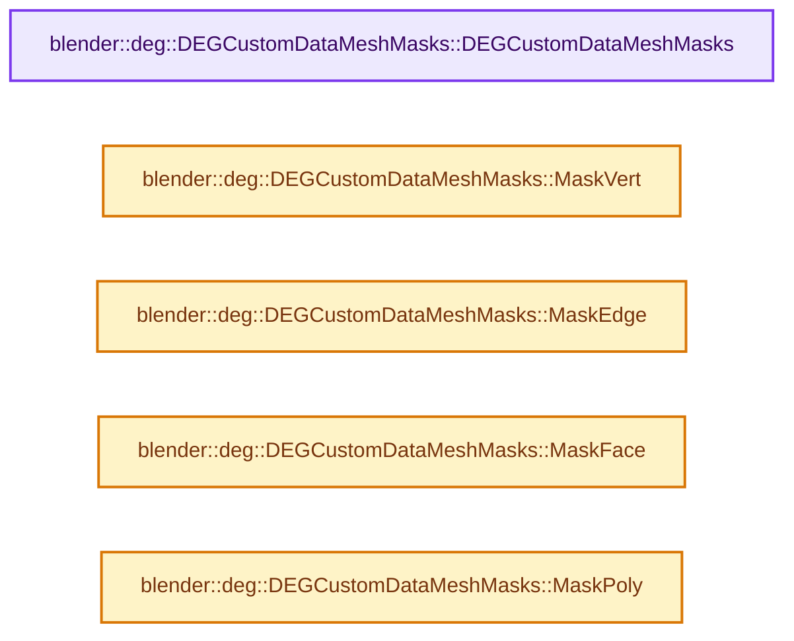

# 实现依赖专题：source/blender/depsgraph/intern/depsgraph_type.hh

[实现依赖导航](../../README.md) · [符号索引](../../../00-课程指南/02-源码与提交索引/符号依赖与实现索引.md)

本专题从正文实际调用进入，集中保存共享实现。函数有稳定锚点，可从调用处直接跳到对应完整函数；递归与互相调用通过回链组织。

## 本文件的实现关系




## 完整成员与函数实现

<a id="f-0f4a9b8509d55c32"></a>

### `blender::deg::DEGCustomDataMeshMasks::DEGCustomDataMeshMasks`

实现位置：[source/blender/depsgraph/intern/depsgraph_type.hh](../../../../../../../source/blender/depsgraph/intern/depsgraph_type.hh) · L58—L60。

**教学注释版**

<!-- annotated:86fcf88ddb59a7 -->

```cpp
  DEGCustomDataMeshMasks() : vert_mask(0), edge_mask(0), face_mask(0), loop_mask(0), poly_mask(0)
  {
  }
```

<details>
<summary>核对原始源码：source/blender/depsgraph/intern/depsgraph_type.hh · L58—L60</summary>

<!-- original:86fcf88ddb59a7:source/blender/depsgraph/intern/depsgraph_type.hh:58:60 -->

```cpp
  DEGCustomDataMeshMasks() : vert_mask(0), edge_mask(0), face_mask(0), loop_mask(0), poly_mask(0)
  {
  }
```

</details>

**继续追踪实现**

本实现没有需要继续展开的显式调用；检查返回表达式、对象转换和调用者前置条件。

<a id="f-289bf024dafc7a55"></a>

### `blender::deg::DEGCustomDataMeshMasks::MaskVert`

实现位置：[source/blender/depsgraph/intern/depsgraph_type.hh](../../../../../../../source/blender/depsgraph/intern/depsgraph_type.hh) · L97—L102。

接口参数：

- `const uint64_t vert_mask`

**教学注释版**

<!-- annotated:f461cb22845ce1 -->

```cpp
  static DEGCustomDataMeshMasks MaskVert(const uint64_t vert_mask)
  {
    DEGCustomDataMeshMasks result;
    result.vert_mask = vert_mask;
    return result;
  }
```

<details>
<summary>核对原始源码：source/blender/depsgraph/intern/depsgraph_type.hh · L97—L102</summary>

<!-- original:f461cb22845ce1:source/blender/depsgraph/intern/depsgraph_type.hh:97:102 -->

```cpp
  static DEGCustomDataMeshMasks MaskVert(const uint64_t vert_mask)
  {
    DEGCustomDataMeshMasks result;
    result.vert_mask = vert_mask;
    return result;
  }
```

</details>

**沿实际写入检查状态**

- `result.vert_mask = vert_mask;`

**结果出口**

- `return result;`

**继续追踪实现**

本实现没有需要继续展开的显式调用；检查返回表达式、对象转换和调用者前置条件。

<a id="f-35cf4fd80b3fc00d"></a>

### `blender::deg::DEGCustomDataMeshMasks::MaskEdge`

实现位置：[source/blender/depsgraph/intern/depsgraph_type.hh](../../../../../../../source/blender/depsgraph/intern/depsgraph_type.hh) · L104—L109。

接口参数：

- `const uint64_t edge_mask`

**教学注释版**

<!-- annotated:da5f2c6cfc046a -->

```cpp
  static DEGCustomDataMeshMasks MaskEdge(const uint64_t edge_mask)
  {
    DEGCustomDataMeshMasks result;
    result.edge_mask = edge_mask;
    return result;
  }
```

<details>
<summary>核对原始源码：source/blender/depsgraph/intern/depsgraph_type.hh · L104—L109</summary>

<!-- original:da5f2c6cfc046a:source/blender/depsgraph/intern/depsgraph_type.hh:104:109 -->

```cpp
  static DEGCustomDataMeshMasks MaskEdge(const uint64_t edge_mask)
  {
    DEGCustomDataMeshMasks result;
    result.edge_mask = edge_mask;
    return result;
  }
```

</details>

**沿实际写入检查状态**

- `result.edge_mask = edge_mask;`

**结果出口**

- `return result;`

**继续追踪实现**

本实现没有需要继续展开的显式调用；检查返回表达式、对象转换和调用者前置条件。

<a id="f-43a8a6165e499ee1"></a>

### `blender::deg::DEGCustomDataMeshMasks::MaskFace`

实现位置：[source/blender/depsgraph/intern/depsgraph_type.hh](../../../../../../../source/blender/depsgraph/intern/depsgraph_type.hh) · L111—L116。

接口参数：

- `const uint64_t face_mask`

**教学注释版**

<!-- annotated:9d67af19ee9093 -->

```cpp
  static DEGCustomDataMeshMasks MaskFace(const uint64_t face_mask)
  {
    DEGCustomDataMeshMasks result;
    result.face_mask = face_mask;
    return result;
  }
```

<details>
<summary>核对原始源码：source/blender/depsgraph/intern/depsgraph_type.hh · L111—L116</summary>

<!-- original:9d67af19ee9093:source/blender/depsgraph/intern/depsgraph_type.hh:111:116 -->

```cpp
  static DEGCustomDataMeshMasks MaskFace(const uint64_t face_mask)
  {
    DEGCustomDataMeshMasks result;
    result.face_mask = face_mask;
    return result;
  }
```

</details>

**沿实际写入检查状态**

- `result.face_mask = face_mask;`

**结果出口**

- `return result;`

**继续追踪实现**

本实现没有需要继续展开的显式调用；检查返回表达式、对象转换和调用者前置条件。

<a id="f-c0988d0f056b5895"></a>

### `blender::deg::DEGCustomDataMeshMasks::MaskPoly`

实现位置：[source/blender/depsgraph/intern/depsgraph_type.hh](../../../../../../../source/blender/depsgraph/intern/depsgraph_type.hh) · L125—L130。

接口参数：

- `const uint64_t poly_mask`

**教学注释版**

<!-- annotated:27ad686e6e12e9 -->

```cpp
  static DEGCustomDataMeshMasks MaskPoly(const uint64_t poly_mask)
  {
    DEGCustomDataMeshMasks result;
    result.poly_mask = poly_mask;
    return result;
  }
```

<details>
<summary>核对原始源码：source/blender/depsgraph/intern/depsgraph_type.hh · L125—L130</summary>

<!-- original:27ad686e6e12e9:source/blender/depsgraph/intern/depsgraph_type.hh:125:130 -->

```cpp
  static DEGCustomDataMeshMasks MaskPoly(const uint64_t poly_mask)
  {
    DEGCustomDataMeshMasks result;
    result.poly_mask = poly_mask;
    return result;
  }
```

</details>

**沿实际写入检查状态**

- `result.poly_mask = poly_mask;`

**结果出口**

- `return result;`

**继续追踪实现**

本实现没有需要继续展开的显式调用；检查返回表达式、对象转换和调用者前置条件。
