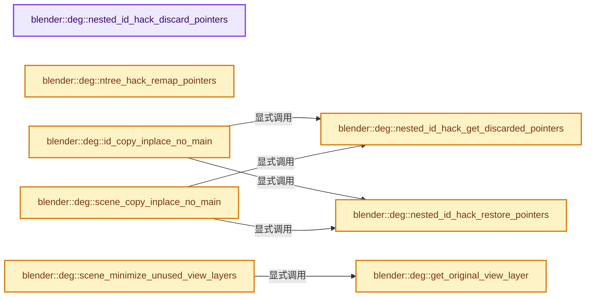
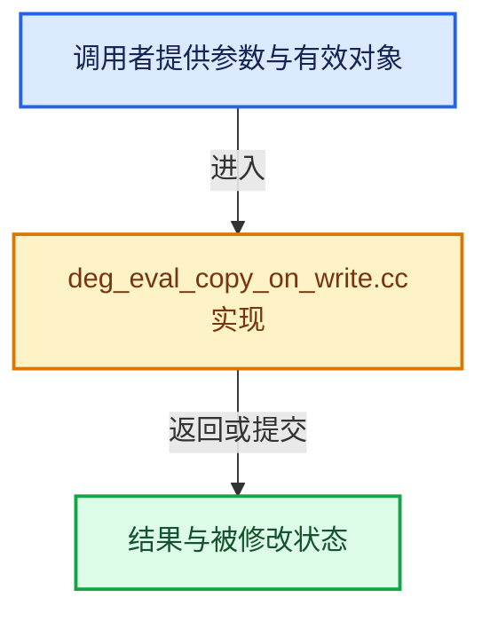

# 实现依赖专题：source/blender/depsgraph/intern/eval/deg_eval_copy_on_write.cc

[实现依赖导航](../../../README.md) · [符号索引](../../../../00-课程指南/02-源码与提交索引/符号依赖与实现索引.md)

本专题从正文实际调用进入，集中保存共享实现。函数有稳定锚点，可从调用处直接跳到对应完整函数；递归与互相调用通过回链组织。

## 本文件的实现关系






## 完整成员与函数实现

<a id="f-af87952e3d4ea44b"></a>

### `blender::deg::nested_id_hack_discard_pointers`

实现位置：[source/blender/depsgraph/intern/eval/deg_eval_copy_on_write.cc](../../../../../../../../source/blender/depsgraph/intern/eval/deg_eval_copy_on_write.cc) · L100—L139。

接口参数：

- `ID *id_cow`

**教学注释版**

<!-- annotated:708760bb9ff6d1 -->

```cpp
void nested_id_hack_discard_pointers(ID *id_cow)
{
  switch (GS(id_cow->name)) {
#  define SPECIAL_CASE(id_type, dna_type, field) \
    case id_type: { \
      ((dna_type *)id_cow)->field = nullptr; \
      break; \
    }

    SPECIAL_CASE(ID_LS, FreestyleLineStyle, nodetree)
    SPECIAL_CASE(ID_LA, Light, nodetree)
    SPECIAL_CASE(ID_MA, Material, nodetree)
    SPECIAL_CASE(ID_TE, Tex, nodetree)
    SPECIAL_CASE(ID_WO, World, nodetree)

    SPECIAL_CASE(ID_CU_LEGACY, Curve, key)
    SPECIAL_CASE(ID_LT, Lattice, key)
    SPECIAL_CASE(ID_ME, Mesh, key)

    case ID_SCE: {
      Scene *scene_cow = id_cast<Scene *>(id_cow);
      /* Tool settings pointer is shared with the original scene. */
      scene_cow->toolsettings = nullptr;
      break;
    }

    case ID_OB: {
      /* Clear the ParticleSettings pointer to prevent doubly-freeing it. */
      Object *ob = id_cast<Object *>(id_cow);
      for (ParticleSystem &psys : ob->particlesystem) {
        psys.part = nullptr;
      }
      break;
    }
#  undef SPECIAL_CASE

    default:
      break;
  }
}
```

<details>
<summary>核对原始源码：source/blender/depsgraph/intern/eval/deg_eval_copy_on_write.cc · L100—L139</summary>

<!-- original:708760bb9ff6d1:source/blender/depsgraph/intern/eval/deg_eval_copy_on_write.cc:100:139 -->

```cpp
void nested_id_hack_discard_pointers(ID *id_cow)
{
  switch (GS(id_cow->name)) {
#  define SPECIAL_CASE(id_type, dna_type, field) \
    case id_type: { \
      ((dna_type *)id_cow)->field = nullptr; \
      break; \
    }

    SPECIAL_CASE(ID_LS, FreestyleLineStyle, nodetree)
    SPECIAL_CASE(ID_LA, Light, nodetree)
    SPECIAL_CASE(ID_MA, Material, nodetree)
    SPECIAL_CASE(ID_TE, Tex, nodetree)
    SPECIAL_CASE(ID_WO, World, nodetree)

    SPECIAL_CASE(ID_CU_LEGACY, Curve, key)
    SPECIAL_CASE(ID_LT, Lattice, key)
    SPECIAL_CASE(ID_ME, Mesh, key)

    case ID_SCE: {
      Scene *scene_cow = id_cast<Scene *>(id_cow);
      /* Tool settings pointer is shared with the original scene. */
      scene_cow->toolsettings = nullptr;
      break;
    }

    case ID_OB: {
      /* Clear the ParticleSettings pointer to prevent doubly-freeing it. */
      Object *ob = id_cast<Object *>(id_cow);
      for (ParticleSystem &psys : ob->particlesystem) {
        psys.part = nullptr;
      }
      break;
    }
#  undef SPECIAL_CASE

    default:
      break;
  }
}
```

</details>

**沿实际写入检查状态**

- `scene_cow->toolsettings = nullptr;`
- `psys.part = nullptr;`

**继续追踪实现**

- `GS` → [blender::GS · L410](../../../08-其他Blender模块/makesdna/DNA_ID.h.md#f-c3ff509f79f21b05)。
- `SPECIAL_CASE` → [调用协议](../../../../00-课程指南/01-路线与规范/模板宏与动态分派协议.md)：函数指针、局部可调用对象或未展开的宏；必须结合调用者环境。调用位置L109。
- `id_cast<Scene *>` → [blender::id_cast · L1417](../../../08-其他Blender模块/makesdna/DNA_ID.h.md#f-6c8ac6412850ac5a)。
- `id_cast<Object *>` → [blender::id_cast · L1417](../../../08-其他Blender模块/makesdna/DNA_ID.h.md#f-6c8ac6412850ac5a)。

<a id="f-52fbc449cd98a010"></a>

### `blender::deg::nested_id_hack_get_discarded_pointers`

实现位置：[source/blender/depsgraph/intern/eval/deg_eval_copy_on_write.cc](../../../../../../../../source/blender/depsgraph/intern/eval/deg_eval_copy_on_write.cc) · L144—L178。

接口参数：

- `void *storage`
- `const ID *id`

**教学注释版**

<!-- annotated:9375c5d3d796bb -->

```cpp
const ID *nested_id_hack_get_discarded_pointers(void *storage, const ID *id)
{
  switch (GS(id->name)) {
#  define SPECIAL_CASE(id_type, dna_type, field, variable) \
    case id_type: { \
      dna_type *data = static_cast<dna_type *>(storage); \
      *data = dna::shallow_copy(*(dna_type *)id); \
      data->field = nullptr; \
      return &data->id; \
    }

    SPECIAL_CASE(ID_LS, FreestyleLineStyle, nodetree, linestyle)
    SPECIAL_CASE(ID_LA, Light, nodetree, lamp)
    SPECIAL_CASE(ID_MA, Material, nodetree, material)
    SPECIAL_CASE(ID_TE, Tex, nodetree, tex)
    SPECIAL_CASE(ID_WO, World, nodetree, world)

    SPECIAL_CASE(ID_CU_LEGACY, Curve, key, curve)
    SPECIAL_CASE(ID_LT, Lattice, key, lattice)
    SPECIAL_CASE(ID_ME, Mesh, key, mesh)

    case ID_SCE: {
      Scene *scene = static_cast<Scene *>(storage);
      *scene = dna::shallow_copy(*id_cast<Scene *>(const_cast<ID *>(id)));
      scene->toolsettings = nullptr;
      return &scene->id;
    }

#  undef SPECIAL_CASE

    default:
      break;
  }
  return id;
}
```

<details>
<summary>核对原始源码：source/blender/depsgraph/intern/eval/deg_eval_copy_on_write.cc · L144—L178</summary>

<!-- original:9375c5d3d796bb:source/blender/depsgraph/intern/eval/deg_eval_copy_on_write.cc:144:178 -->

```cpp
const ID *nested_id_hack_get_discarded_pointers(void *storage, const ID *id)
{
  switch (GS(id->name)) {
#  define SPECIAL_CASE(id_type, dna_type, field, variable) \
    case id_type: { \
      dna_type *data = static_cast<dna_type *>(storage); \
      *data = dna::shallow_copy(*(dna_type *)id); \
      data->field = nullptr; \
      return &data->id; \
    }

    SPECIAL_CASE(ID_LS, FreestyleLineStyle, nodetree, linestyle)
    SPECIAL_CASE(ID_LA, Light, nodetree, lamp)
    SPECIAL_CASE(ID_MA, Material, nodetree, material)
    SPECIAL_CASE(ID_TE, Tex, nodetree, tex)
    SPECIAL_CASE(ID_WO, World, nodetree, world)

    SPECIAL_CASE(ID_CU_LEGACY, Curve, key, curve)
    SPECIAL_CASE(ID_LT, Lattice, key, lattice)
    SPECIAL_CASE(ID_ME, Mesh, key, mesh)

    case ID_SCE: {
      Scene *scene = static_cast<Scene *>(storage);
      *scene = dna::shallow_copy(*id_cast<Scene *>(const_cast<ID *>(id)));
      scene->toolsettings = nullptr;
      return &scene->id;
    }

#  undef SPECIAL_CASE

    default:
      break;
  }
  return id;
}
```

</details>

**沿实际写入检查状态**

- `data->field = nullptr; \`
- `scene->toolsettings = nullptr;`

**结果出口**

- `return &data->id; \`
- `return &scene->id;`
- `return id;`

**继续追踪实现**

- `GS` → [blender::GS · L410](../../../08-其他Blender模块/makesdna/DNA_ID.h.md#f-c3ff509f79f21b05)。
- `SPECIAL_CASE` → [调用协议](../../../../00-课程指南/01-路线与规范/模板宏与动态分派协议.md)：函数指针、局部可调用对象或未展开的宏；必须结合调用者环境。调用位置L155。
- `dna::shallow_copy` → [blender::dna::shallow_copy · L146](../../../08-其他Blender模块/makesdna/DNA_defs.h.md#f-84b6eda95a1c994c)。
- `id_cast<Scene *>` → [blender::id_cast · L1417](../../../08-其他Blender模块/makesdna/DNA_ID.h.md#f-6c8ac6412850ac5a)。

<a id="f-68a5f51c0decb65b"></a>

### `blender::deg::nested_id_hack_restore_pointers`

实现位置：[source/blender/depsgraph/intern/eval/deg_eval_copy_on_write.cc](../../../../../../../../source/blender/depsgraph/intern/eval/deg_eval_copy_on_write.cc) · L181—L207。

接口参数：

- `const ID *old_id`
- `ID *new_id`

**教学注释版**

<!-- annotated:79562b45fb700a -->

```cpp
void nested_id_hack_restore_pointers(const ID *old_id, ID *new_id)
{
  if (new_id == nullptr) {
    return;
  }
  switch (GS(old_id->name)) {
#  define SPECIAL_CASE(id_type, dna_type, field) \
    case id_type: { \
      ((dna_type *)(new_id))->field = ((dna_type *)(old_id))->field; \
      break; \
    }

    SPECIAL_CASE(ID_LS, FreestyleLineStyle, nodetree)
    SPECIAL_CASE(ID_LA, Light, nodetree)
    SPECIAL_CASE(ID_MA, Material, nodetree)
    SPECIAL_CASE(ID_TE, Tex, nodetree)
    SPECIAL_CASE(ID_WO, World, nodetree)

    SPECIAL_CASE(ID_CU_LEGACY, Curve, key)
    SPECIAL_CASE(ID_LT, Lattice, key)
    SPECIAL_CASE(ID_ME, Mesh, key)

#  undef SPECIAL_CASE
    default:
      break;
  }
}
```

<details>
<summary>核对原始源码：source/blender/depsgraph/intern/eval/deg_eval_copy_on_write.cc · L181—L207</summary>

<!-- original:79562b45fb700a:source/blender/depsgraph/intern/eval/deg_eval_copy_on_write.cc:181:207 -->

```cpp
void nested_id_hack_restore_pointers(const ID *old_id, ID *new_id)
{
  if (new_id == nullptr) {
    return;
  }
  switch (GS(old_id->name)) {
#  define SPECIAL_CASE(id_type, dna_type, field) \
    case id_type: { \
      ((dna_type *)(new_id))->field = ((dna_type *)(old_id))->field; \
      break; \
    }

    SPECIAL_CASE(ID_LS, FreestyleLineStyle, nodetree)
    SPECIAL_CASE(ID_LA, Light, nodetree)
    SPECIAL_CASE(ID_MA, Material, nodetree)
    SPECIAL_CASE(ID_TE, Tex, nodetree)
    SPECIAL_CASE(ID_WO, World, nodetree)

    SPECIAL_CASE(ID_CU_LEGACY, Curve, key)
    SPECIAL_CASE(ID_LT, Lattice, key)
    SPECIAL_CASE(ID_ME, Mesh, key)

#  undef SPECIAL_CASE
    default:
      break;
  }
}
```

</details>

**继续追踪实现**

- `GS` → [blender::GS · L410](../../../08-其他Blender模块/makesdna/DNA_ID.h.md#f-c3ff509f79f21b05)。
- `SPECIAL_CASE` → [调用协议](../../../../00-课程指南/01-路线与规范/模板宏与动态分派协议.md)：函数指针、局部可调用对象或未展开的宏；必须结合调用者环境。调用位置L193。

<a id="f-7954b37a86021094"></a>

### `blender::deg::ntree_hack_remap_pointers`

实现位置：[source/blender/depsgraph/intern/eval/deg_eval_copy_on_write.cc](../../../../../../../../source/blender/depsgraph/intern/eval/deg_eval_copy_on_write.cc) · L210—L243。

接口参数：

- `const Depsgraph *depsgraph`
- `ID *id_cow`

**教学注释版**

<!-- annotated:d6bff7a7d86308 -->

```cpp
void ntree_hack_remap_pointers(const Depsgraph *depsgraph, ID *id_cow)
{
  switch (GS(id_cow->name)) {
#  define SPECIAL_CASE(id_type, dna_type, field, field_type) \
    case id_type: { \
      dna_type *data = (dna_type *)id_cow; \
      if (data->field != nullptr) { \
        ID *ntree_id_cow = depsgraph->get_cow_id(&data->field->id); \
        if (ntree_id_cow != nullptr) { \
          DEG_COW_PRINT("    Remapping datablock for %s: id_orig=%p id_cow=%p\n", \
                        data->field->id.name, \
                        data->field, \
                        ntree_id_cow); \
          data->field = (field_type *)ntree_id_cow; \
        } \
      } \
      break; \
    }

    SPECIAL_CASE(ID_LS, FreestyleLineStyle, nodetree, bNodeTree)
    SPECIAL_CASE(ID_LA, Light, nodetree, bNodeTree)
    SPECIAL_CASE(ID_MA, Material, nodetree, bNodeTree)
    SPECIAL_CASE(ID_TE, Tex, nodetree, bNodeTree)
    SPECIAL_CASE(ID_WO, World, nodetree, bNodeTree)

    SPECIAL_CASE(ID_CU_LEGACY, Curve, key, Key)
    SPECIAL_CASE(ID_LT, Lattice, key, Key)
    SPECIAL_CASE(ID_ME, Mesh, key, Key)

#  undef SPECIAL_CASE
    default:
      break;
  }
}
```

<details>
<summary>核对原始源码：source/blender/depsgraph/intern/eval/deg_eval_copy_on_write.cc · L210—L243</summary>

<!-- original:d6bff7a7d86308:source/blender/depsgraph/intern/eval/deg_eval_copy_on_write.cc:210:243 -->

```cpp
void ntree_hack_remap_pointers(const Depsgraph *depsgraph, ID *id_cow)
{
  switch (GS(id_cow->name)) {
#  define SPECIAL_CASE(id_type, dna_type, field, field_type) \
    case id_type: { \
      dna_type *data = (dna_type *)id_cow; \
      if (data->field != nullptr) { \
        ID *ntree_id_cow = depsgraph->get_cow_id(&data->field->id); \
        if (ntree_id_cow != nullptr) { \
          DEG_COW_PRINT("    Remapping datablock for %s: id_orig=%p id_cow=%p\n", \
                        data->field->id.name, \
                        data->field, \
                        ntree_id_cow); \
          data->field = (field_type *)ntree_id_cow; \
        } \
      } \
      break; \
    }

    SPECIAL_CASE(ID_LS, FreestyleLineStyle, nodetree, bNodeTree)
    SPECIAL_CASE(ID_LA, Light, nodetree, bNodeTree)
    SPECIAL_CASE(ID_MA, Material, nodetree, bNodeTree)
    SPECIAL_CASE(ID_TE, Tex, nodetree, bNodeTree)
    SPECIAL_CASE(ID_WO, World, nodetree, bNodeTree)

    SPECIAL_CASE(ID_CU_LEGACY, Curve, key, Key)
    SPECIAL_CASE(ID_LT, Lattice, key, Key)
    SPECIAL_CASE(ID_ME, Mesh, key, Key)

#  undef SPECIAL_CASE
    default:
      break;
  }
}
```

</details>

**沿实际写入检查状态**

- `data->field = (field_type *)ntree_id_cow; \`

**继续追踪实现**

- `GS` → [blender::GS · L410](../../../08-其他Blender模块/makesdna/DNA_ID.h.md#f-c3ff509f79f21b05)。
- `SPECIAL_CASE` → [调用协议](../../../../00-课程指南/01-路线与规范/模板宏与动态分派协议.md)：函数指针、局部可调用对象或未展开的宏；必须结合调用者环境。调用位置L229。

<a id="f-3bc65672838459b5"></a>

### `blender::deg::id_copy_inplace_no_main`

实现位置：[source/blender/depsgraph/intern/eval/deg_eval_copy_on_write.cc](../../../../../../../../source/blender/depsgraph/intern/eval/deg_eval_copy_on_write.cc) · L252—L282。

接口参数：

- `const ID *id`
- `ID *newid`

**教学注释版**

<!-- annotated:e2012683589cef -->

```cpp
bool id_copy_inplace_no_main(const ID *id, ID *newid)
{
  const ID *id_for_copy = id;

  if (G.debug & G_DEBUG_DEPSGRAPH_UID) {
    const ID_Type id_type = GS(id_for_copy->name);
    if (id_type == ID_OB) {
      const Object *object = reinterpret_cast<const Object *>(id_for_copy);
      BKE_object_check_uids_unique_and_report(object);
    }
  }

#ifdef NESTED_ID_NASTY_WORKAROUND
  uint8_t id_hack_storage[NestedIDHackTempStorage];
  id_for_copy = nested_id_hack_get_discarded_pointers(&id_hack_storage, id);
#endif

  bool result = (BKE_id_copy_ex(nullptr,
                                const_cast<ID *>(id_for_copy),
                                &newid,
                                (LIB_ID_COPY_LOCALIZE | LIB_ID_CREATE_NO_ALLOCATE |
                                 LIB_ID_COPY_SET_COPIED_ON_WRITE)) != nullptr);

#ifdef NESTED_ID_NASTY_WORKAROUND
  if (result) {
    nested_id_hack_restore_pointers(id, newid);
  }
#endif

  return result;
}
```

<details>
<summary>核对原始源码：source/blender/depsgraph/intern/eval/deg_eval_copy_on_write.cc · L252—L282</summary>

<!-- original:e2012683589cef:source/blender/depsgraph/intern/eval/deg_eval_copy_on_write.cc:252:282 -->

```cpp
bool id_copy_inplace_no_main(const ID *id, ID *newid)
{
  const ID *id_for_copy = id;

  if (G.debug & G_DEBUG_DEPSGRAPH_UID) {
    const ID_Type id_type = GS(id_for_copy->name);
    if (id_type == ID_OB) {
      const Object *object = reinterpret_cast<const Object *>(id_for_copy);
      BKE_object_check_uids_unique_and_report(object);
    }
  }

#ifdef NESTED_ID_NASTY_WORKAROUND
  uint8_t id_hack_storage[NestedIDHackTempStorage];
  id_for_copy = nested_id_hack_get_discarded_pointers(&id_hack_storage, id);
#endif

  bool result = (BKE_id_copy_ex(nullptr,
                                const_cast<ID *>(id_for_copy),
                                &newid,
                                (LIB_ID_COPY_LOCALIZE | LIB_ID_CREATE_NO_ALLOCATE |
                                 LIB_ID_COPY_SET_COPIED_ON_WRITE)) != nullptr);

#ifdef NESTED_ID_NASTY_WORKAROUND
  if (result) {
    nested_id_hack_restore_pointers(id, newid);
  }
#endif

  return result;
}
```

</details>

**沿实际写入检查状态**

- `id_for_copy = nested_id_hack_get_discarded_pointers(&id_hack_storage, id);`

**结果出口**

- `return result;`

**继续追踪实现**

- `GS` → [blender::GS · L410](../../../08-其他Blender模块/makesdna/DNA_ID.h.md#f-c3ff509f79f21b05)。
- `BKE_object_check_uids_unique_and_report` → [blender::BKE_object_check_uids_unique_and_report · L5728](../../../02-BKE几何与数据/intern/object.cc.md#f-b5fb4650cb715e4a)。
- `nested_id_hack_get_discarded_pointers` → [blender::deg::nested_id_hack_get_discarded_pointers · L144](deg_eval_copy_on_write.cc.md#f-52fbc449cd98a010)。
- `BKE_id_copy_ex` → [blender::BKE_id_copy_ex · L851](../../../02-BKE几何与数据/intern/lib_id.cc.md#f-24272170c95f49fb)。
- `nested_id_hack_restore_pointers` → [blender::deg::nested_id_hack_restore_pointers · L181](deg_eval_copy_on_write.cc.md#f-68a5f51c0decb65b)。

<a id="f-be2a1975f9a71637"></a>

### `blender::deg::scene_copy_inplace_no_main`

实现位置：[source/blender/depsgraph/intern/eval/deg_eval_copy_on_write.cc](../../../../../../../../source/blender/depsgraph/intern/eval/deg_eval_copy_on_write.cc) · L286—L312。

接口参数：

- `const Scene *scene`
- `Scene *new_scene`

**教学注释版**

<!-- annotated:6a09d0a4a9f163 -->

```cpp
bool scene_copy_inplace_no_main(const Scene *scene, Scene *new_scene)
{

  if (G.debug & G_DEBUG_DEPSGRAPH_UID) {
    seq::relations_check_uids_unique_and_report(scene);
  }

#ifdef NESTED_ID_NASTY_WORKAROUND
  uint8_t id_hack_storage[NestedIDHackTempStorage];
  const ID *id_for_copy = nested_id_hack_get_discarded_pointers(&id_hack_storage, &scene->id);
#else
  const ID *id_for_copy = &scene->id;
#endif
  bool result = (BKE_id_copy_ex(nullptr,
                                id_for_copy,
                                reinterpret_cast<ID **>(&new_scene),
                                (LIB_ID_COPY_LOCALIZE | LIB_ID_CREATE_NO_ALLOCATE |
                                 LIB_ID_COPY_SET_COPIED_ON_WRITE)) != nullptr);

#ifdef NESTED_ID_NASTY_WORKAROUND
  if (result) {
    nested_id_hack_restore_pointers(&scene->id, &new_scene->id);
  }
#endif

  return result;
}
```

<details>
<summary>核对原始源码：source/blender/depsgraph/intern/eval/deg_eval_copy_on_write.cc · L286—L312</summary>

<!-- original:6a09d0a4a9f163:source/blender/depsgraph/intern/eval/deg_eval_copy_on_write.cc:286:312 -->

```cpp
bool scene_copy_inplace_no_main(const Scene *scene, Scene *new_scene)
{

  if (G.debug & G_DEBUG_DEPSGRAPH_UID) {
    seq::relations_check_uids_unique_and_report(scene);
  }

#ifdef NESTED_ID_NASTY_WORKAROUND
  uint8_t id_hack_storage[NestedIDHackTempStorage];
  const ID *id_for_copy = nested_id_hack_get_discarded_pointers(&id_hack_storage, &scene->id);
#else
  const ID *id_for_copy = &scene->id;
#endif
  bool result = (BKE_id_copy_ex(nullptr,
                                id_for_copy,
                                reinterpret_cast<ID **>(&new_scene),
                                (LIB_ID_COPY_LOCALIZE | LIB_ID_CREATE_NO_ALLOCATE |
                                 LIB_ID_COPY_SET_COPIED_ON_WRITE)) != nullptr);

#ifdef NESTED_ID_NASTY_WORKAROUND
  if (result) {
    nested_id_hack_restore_pointers(&scene->id, &new_scene->id);
  }
#endif

  return result;
}
```

</details>

**结果出口**

- `return result;`

**继续追踪实现**

- `seq::relations_check_uids_unique_and_report` → [blender::seq::relations_check_uids_unique_and_report · L431](../../../08-其他Blender模块/sequencer/intern/strip_relations.cc.md#f-768d08a98bcb2f14)。
- `nested_id_hack_get_discarded_pointers` → [blender::deg::nested_id_hack_get_discarded_pointers · L144](deg_eval_copy_on_write.cc.md#f-52fbc449cd98a010)。
- `BKE_id_copy_ex` → [blender::BKE_id_copy_ex · L851](../../../02-BKE几何与数据/intern/lib_id.cc.md#f-24272170c95f49fb)。
- `nested_id_hack_restore_pointers` → [blender::deg::nested_id_hack_restore_pointers · L181](deg_eval_copy_on_write.cc.md#f-68a5f51c0decb65b)。

<a id="f-3f0c289f482c758c"></a>

### `blender::deg::get_original_view_layer`

实现位置：[source/blender/depsgraph/intern/eval/deg_eval_copy_on_write.cc](../../../../../../../../source/blender/depsgraph/intern/eval/deg_eval_copy_on_write.cc) · L317—L333。

接口参数：

- `const Depsgraph *depsgraph`
- `const IDNode *id_node`

**教学注释版**

<!-- annotated:1bb6403840623e -->

```cpp
ViewLayer *get_original_view_layer(const Depsgraph *depsgraph, const IDNode *id_node)
{
  if (id_node->linked_state == DEG_ID_LINKED_DIRECTLY) {
    return depsgraph->view_layer;
  }
  if (id_node->linked_state == DEG_ID_LINKED_VIA_SET) {
    Scene *scene_orig = reinterpret_cast<Scene *>(id_node->id_orig);
    return BKE_view_layer_default_render(scene_orig);
  }
  /* Is possible to have scene linked indirectly (i.e. via the driver) which
   * we need to support. Currently there are issues somewhere else, which
   * makes testing hard. This is a reported problem, so will eventually be
   * properly fixed.
   *
   * TODO(sergey): Support indirectly linked scene. */
  return nullptr;
}
```

<details>
<summary>核对原始源码：source/blender/depsgraph/intern/eval/deg_eval_copy_on_write.cc · L317—L333</summary>

<!-- original:1bb6403840623e:source/blender/depsgraph/intern/eval/deg_eval_copy_on_write.cc:317:333 -->

```cpp
ViewLayer *get_original_view_layer(const Depsgraph *depsgraph, const IDNode *id_node)
{
  if (id_node->linked_state == DEG_ID_LINKED_DIRECTLY) {
    return depsgraph->view_layer;
  }
  if (id_node->linked_state == DEG_ID_LINKED_VIA_SET) {
    Scene *scene_orig = reinterpret_cast<Scene *>(id_node->id_orig);
    return BKE_view_layer_default_render(scene_orig);
  }
  /* Is possible to have scene linked indirectly (i.e. via the driver) which
   * we need to support. Currently there are issues somewhere else, which
   * makes testing hard. This is a reported problem, so will eventually be
   * properly fixed.
   *
   * TODO(sergey): Support indirectly linked scene. */
  return nullptr;
}
```

</details>

**结果出口**

- `return depsgraph->view_layer;`
- `return BKE_view_layer_default_render(scene_orig);`
- `return nullptr;`

**继续追踪实现**

- `BKE_view_layer_default_render` → [blender::BKE_view_layer_default_render · L138](../../../02-BKE几何与数据/intern/layer.cc.md#f-0b2725adbb12f328)。

<a id="f-33a2a427d0c38ebe"></a>

### `blender::deg::scene_minimize_unused_view_layers`

实现位置：[source/blender/depsgraph/intern/eval/deg_eval_copy_on_write.cc](../../../../../../../../source/blender/depsgraph/intern/eval/deg_eval_copy_on_write.cc) · L336—L381。

接口参数：

- `const Depsgraph *depsgraph`
- `const IDNode *id_node`
- `Scene *scene_cow`

**教学注释版**

<!-- annotated:fdbc5661666ce5 -->

```cpp
void scene_minimize_unused_view_layers(const Depsgraph *depsgraph,
                                       const IDNode *id_node,
                                       Scene *scene_cow)
{
  if (depsgraph->is_render_pipeline_depsgraph) {
    /* If the dependency graph is used for post-processing (such as compositor) we do need to
     * have access to its view layer names so can not remove any view layers.
     * On a more positive side we can remove all the bases from all the view layers.
     *
     * NOTE: Need to clear pointers which might be pointing to original on freed (due to being
     * unused) data.
     *
     * NOTE: Need to keep view layers for all scenes, even indirect ones. This is because of
     * render layer node possibly pointing to another scene. */
    for (ViewLayer &view_layer : scene_cow->view_layers) {
      BKE_view_layer_free_object_content(&view_layer);
    }
    return;
  }

  const ViewLayer *view_layer_input = get_original_view_layer(depsgraph, id_node);
  ViewLayer *view_layer_eval = nullptr;
  /* Find evaluated view layer. At the same time we free memory used by
   * all other of the view layers. */
  for (ViewLayer *view_layer_cow = reinterpret_cast<ViewLayer *>(scene_cow->view_layers.first_),
                 *view_layer_next;
       view_layer_cow != nullptr;
       view_layer_cow = view_layer_next)
  {
    view_layer_next = view_layer_cow->next;
    if (view_layer_input != nullptr && STREQ(view_layer_input->name, view_layer_cow->name)) {
      view_layer_eval = view_layer_cow;
    }
    else {
      BKE_view_layer_free_object_content(view_layer_cow);
    }
  }

  /* Make evaluated view layer the first one in the evaluated scene (if it exists). This is for
   * legacy sake, as this used to remove all other view layers, automatically making the evaluated
   * one the first. Some other code may still assume it is. */
  if (view_layer_eval != nullptr) {
    BLI_listbase_swaplinks(
        &scene_cow->view_layers, scene_cow->view_layers.first_, view_layer_eval);
  }
}
```

<details>
<summary>核对原始源码：source/blender/depsgraph/intern/eval/deg_eval_copy_on_write.cc · L336—L381</summary>

<!-- original:fdbc5661666ce5:source/blender/depsgraph/intern/eval/deg_eval_copy_on_write.cc:336:381 -->

```cpp
void scene_minimize_unused_view_layers(const Depsgraph *depsgraph,
                                       const IDNode *id_node,
                                       Scene *scene_cow)
{
  if (depsgraph->is_render_pipeline_depsgraph) {
    /* If the dependency graph is used for post-processing (such as compositor) we do need to
     * have access to its view layer names so can not remove any view layers.
     * On a more positive side we can remove all the bases from all the view layers.
     *
     * NOTE: Need to clear pointers which might be pointing to original on freed (due to being
     * unused) data.
     *
     * NOTE: Need to keep view layers for all scenes, even indirect ones. This is because of
     * render layer node possibly pointing to another scene. */
    for (ViewLayer &view_layer : scene_cow->view_layers) {
      BKE_view_layer_free_object_content(&view_layer);
    }
    return;
  }

  const ViewLayer *view_layer_input = get_original_view_layer(depsgraph, id_node);
  ViewLayer *view_layer_eval = nullptr;
  /* Find evaluated view layer. At the same time we free memory used by
   * all other of the view layers. */
  for (ViewLayer *view_layer_cow = reinterpret_cast<ViewLayer *>(scene_cow->view_layers.first_),
                 *view_layer_next;
       view_layer_cow != nullptr;
       view_layer_cow = view_layer_next)
  {
    view_layer_next = view_layer_cow->next;
    if (view_layer_input != nullptr && STREQ(view_layer_input->name, view_layer_cow->name)) {
      view_layer_eval = view_layer_cow;
    }
    else {
      BKE_view_layer_free_object_content(view_layer_cow);
    }
  }

  /* Make evaluated view layer the first one in the evaluated scene (if it exists). This is for
   * legacy sake, as this used to remove all other view layers, automatically making the evaluated
   * one the first. Some other code may still assume it is. */
  if (view_layer_eval != nullptr) {
    BLI_listbase_swaplinks(
        &scene_cow->view_layers, scene_cow->view_layers.first_, view_layer_eval);
  }
}
```

</details>

**沿实际写入检查状态**

- `view_layer_cow = view_layer_next)`
- `view_layer_next = view_layer_cow->next;`
- `view_layer_eval = view_layer_cow;`

**继续追踪实现**

- `BKE_view_layer_free_object_content` → [blender::BKE_view_layer_free_object_content · L289](../../../02-BKE几何与数据/intern/layer.cc.md#f-25531992163338e2)。
- `get_original_view_layer` → [blender::deg::get_original_view_layer · L317](deg_eval_copy_on_write.cc.md#f-3f0c289f482c758c)。
- `STREQ` → [STREQ · L112](../../../07-Intern运行时与平台/ghost/intern/GHOST_utildefines.hh.md#m-9549fb6aafd2)；[STREQ · L451](../../../01-BLI基础库/BLI_utildefines.hh.md#m-c7b745bcfad2)；[STREQ · L55](../../../07-Intern运行时与平台/clog/clog.cc.md#m-96e78f386894)。宏定义由构建条件选择。
- `BLI_listbase_swaplinks` → [blender::BLI_listbase_swaplinks · L171](../../../01-BLI基础库/intern/listbase.cc.md#f-7603d3f980be3243)。

<a id="f-2dba78b5a9c0f84f"></a>

### `blender::deg::scene_remove_all_bases`

实现位置：[source/blender/depsgraph/intern/eval/deg_eval_copy_on_write.cc](../../../../../../../../source/blender/depsgraph/intern/eval/deg_eval_copy_on_write.cc) · L383—L388。

接口参数：

- `Scene *scene_cow`

**教学注释版**

<!-- annotated:c547b72cd095b5 -->

```cpp
void scene_remove_all_bases(Scene *scene_cow)
{
  for (ViewLayer &view_layer : scene_cow->view_layers) {
    view_layer.object_bases.free_no_destruct();
  }
}
```

<details>
<summary>核对原始源码：source/blender/depsgraph/intern/eval/deg_eval_copy_on_write.cc · L383—L388</summary>

<!-- original:c547b72cd095b5:source/blender/depsgraph/intern/eval/deg_eval_copy_on_write.cc:383:388 -->

```cpp
void scene_remove_all_bases(Scene *scene_cow)
{
  for (ViewLayer &view_layer : scene_cow->view_layers) {
    view_layer.object_bases.free_no_destruct();
  }
}
```

</details>

**继续追踪实现**

- `view_layer.object_bases.free_no_destruct` → [调用协议](../../../../00-课程指南/01-路线与规范/模板宏与动态分派协议.md)：接收对象类型依赖auto、返回值或模板实例；不按同名猜测目标。调用位置L386。

<a id="f-c5dd78f84eece5c0"></a>

### `blender::deg::view_layer_remove_disabled_bases`

实现位置：[source/blender/depsgraph/intern/eval/deg_eval_copy_on_write.cc](../../../../../../../../source/blender/depsgraph/intern/eval/deg_eval_copy_on_write.cc) · L392—L425。

接口参数：

- `const Depsgraph *depsgraph`
- `const Scene *scene`
- `ViewLayer *view_layer`

**教学注释版**

<!-- annotated:50613216715ff2 -->

```cpp
void view_layer_remove_disabled_bases(const Depsgraph *depsgraph,
                                      const Scene *scene,
                                      ViewLayer *view_layer)
{
  if (view_layer == nullptr) {
    return;
  }
  ListBaseT<Base> enabled_bases = {nullptr, nullptr};
  BKE_view_layer_synced_ensure(*depsgraph->bmain, scene, view_layer);
  for (Base &base : BKE_view_layer_object_bases_get(view_layer)->items_mutable()) {
    /* TODO(sergey): Would be cool to optimize this somehow, or make it so
     * builder tags bases.
     *
     * NOTE: The idea of using id's tag and check whether its copied ot not
     * is not reliable, since object might be indirectly linked into the
     * graph.
     *
     * NOTE: We are using original base since the object which evaluated base
     * points to is not yet copied. This is dangerous access from evaluated
     * domain to original one, but this is how the entire copy-on-evaluation works:
     * it does need to access original for an initial copy. */
    const bool is_object_enabled = deg_check_base_in_depsgraph(depsgraph, &base);
    if (is_object_enabled) {
      BLI_addtail(&enabled_bases, &base);
    }
    else {
      if (&base == view_layer->basact) {
        view_layer->basact = nullptr;
      }
      MEM_delete(&base);
    }
  }
  view_layer->object_bases = enabled_bases;
}
```

<details>
<summary>核对原始源码：source/blender/depsgraph/intern/eval/deg_eval_copy_on_write.cc · L392—L425</summary>

<!-- original:50613216715ff2:source/blender/depsgraph/intern/eval/deg_eval_copy_on_write.cc:392:425 -->

```cpp
void view_layer_remove_disabled_bases(const Depsgraph *depsgraph,
                                      const Scene *scene,
                                      ViewLayer *view_layer)
{
  if (view_layer == nullptr) {
    return;
  }
  ListBaseT<Base> enabled_bases = {nullptr, nullptr};
  BKE_view_layer_synced_ensure(*depsgraph->bmain, scene, view_layer);
  for (Base &base : BKE_view_layer_object_bases_get(view_layer)->items_mutable()) {
    /* TODO(sergey): Would be cool to optimize this somehow, or make it so
     * builder tags bases.
     *
     * NOTE: The idea of using id's tag and check whether its copied ot not
     * is not reliable, since object might be indirectly linked into the
     * graph.
     *
     * NOTE: We are using original base since the object which evaluated base
     * points to is not yet copied. This is dangerous access from evaluated
     * domain to original one, but this is how the entire copy-on-evaluation works:
     * it does need to access original for an initial copy. */
    const bool is_object_enabled = deg_check_base_in_depsgraph(depsgraph, &base);
    if (is_object_enabled) {
      BLI_addtail(&enabled_bases, &base);
    }
    else {
      if (&base == view_layer->basact) {
        view_layer->basact = nullptr;
      }
      MEM_delete(&base);
    }
  }
  view_layer->object_bases = enabled_bases;
}
```

</details>

**沿实际写入检查状态**

- `view_layer->basact = nullptr;`
- `view_layer->object_bases = enabled_bases;`

**继续追踪实现**

- `BKE_view_layer_synced_ensure` → [blender::BKE_view_layer_synced_ensure · L1035](../../../02-BKE几何与数据/intern/layer.cc.md#f-602c088654ebcb63)。
- `BKE_view_layer_object_bases_get(view_layer)->items_mutable` → [调用协议](../../../../00-课程指南/01-路线与规范/模板宏与动态分派协议.md)：接收对象类型依赖auto、返回值或模板实例；不按同名猜测目标。调用位置L401。
- `BKE_view_layer_object_bases_get` → [blender::BKE_view_layer_object_bases_get · L202](../../../02-BKE几何与数据/intern/layer_utils.cc.md#f-f7b3adc8941172e4)。
- `deg_check_base_in_depsgraph` → [blender::deg::deg_check_base_in_depsgraph · L48](../builder/deg_builder.cc.md#f-42443915b354a207)。
- `BLI_addtail` → [blender::BLI_addtail · L118](../../../01-BLI基础库/intern/listbase.cc.md#f-4fb027713fa3115b)。
- `MEM_delete` → [MEM_delete · L400](../../../07-Intern运行时与平台/guardedalloc/MEM_guardedalloc.h.md#f-9049ffdd1682887c)。

<a id="f-1a3f788dee118b64"></a>

### `blender::deg::view_layer_update_orig_base_pointers`

实现位置：[source/blender/depsgraph/intern/eval/deg_eval_copy_on_write.cc](../../../../../../../../source/blender/depsgraph/intern/eval/deg_eval_copy_on_write.cc) · L427—L439。

接口参数：

- `const ViewLayer *view_layer_orig`
- `ViewLayer *view_layer_eval`

**教学注释版**

<!-- annotated:12aa8eea0c582c -->

```cpp
void view_layer_update_orig_base_pointers(const ViewLayer *view_layer_orig,
                                          ViewLayer *view_layer_eval)
{
  if (view_layer_orig == nullptr || view_layer_eval == nullptr) {
    /* Happens when scene is only used for parameters or compositor/sequencer. */
    return;
  }
  Base *base_orig = reinterpret_cast<Base *>(view_layer_orig->object_bases.first_);
  for (Base &base_eval : view_layer_eval->object_bases) {
    base_eval.base_orig = base_orig;
    base_orig = base_orig->next;
  }
}
```

<details>
<summary>核对原始源码：source/blender/depsgraph/intern/eval/deg_eval_copy_on_write.cc · L427—L439</summary>

<!-- original:12aa8eea0c582c:source/blender/depsgraph/intern/eval/deg_eval_copy_on_write.cc:427:439 -->

```cpp
void view_layer_update_orig_base_pointers(const ViewLayer *view_layer_orig,
                                          ViewLayer *view_layer_eval)
{
  if (view_layer_orig == nullptr || view_layer_eval == nullptr) {
    /* Happens when scene is only used for parameters or compositor/sequencer. */
    return;
  }
  Base *base_orig = reinterpret_cast<Base *>(view_layer_orig->object_bases.first_);
  for (Base &base_eval : view_layer_eval->object_bases) {
    base_eval.base_orig = base_orig;
    base_orig = base_orig->next;
  }
}
```

</details>

**沿实际写入检查状态**

- `base_eval.base_orig = base_orig;`
- `base_orig = base_orig->next;`

**继续追踪实现**

本实现没有需要继续展开的显式调用；检查返回表达式、对象转换和调用者前置条件。

<a id="f-3e7374d62b465961"></a>

### `blender::deg::scene_setup_view_layers_before_remap`

实现位置：[source/blender/depsgraph/intern/eval/deg_eval_copy_on_write.cc](../../../../../../../../source/blender/depsgraph/intern/eval/deg_eval_copy_on_write.cc) · L441—L451。

接口参数：

- `const Depsgraph *depsgraph`
- `const IDNode *id_node`
- `Scene *scene_cow`

**教学注释版**

<!-- annotated:84de71abfe3604 -->

```cpp
void scene_setup_view_layers_before_remap(const Depsgraph *depsgraph,
                                          const IDNode *id_node,
                                          Scene *scene_cow)
{
  scene_minimize_unused_view_layers(depsgraph, id_node, scene_cow);
  /* If dependency graph is used for post-processing we don't need any bases and can free of them.
   * Do it before re-mapping to make that process faster. */
  if (depsgraph->is_render_pipeline_depsgraph) {
    scene_remove_all_bases(scene_cow);
  }
}
```

<details>
<summary>核对原始源码：source/blender/depsgraph/intern/eval/deg_eval_copy_on_write.cc · L441—L451</summary>

<!-- original:84de71abfe3604:source/blender/depsgraph/intern/eval/deg_eval_copy_on_write.cc:441:451 -->

```cpp
void scene_setup_view_layers_before_remap(const Depsgraph *depsgraph,
                                          const IDNode *id_node,
                                          Scene *scene_cow)
{
  scene_minimize_unused_view_layers(depsgraph, id_node, scene_cow);
  /* If dependency graph is used for post-processing we don't need any bases and can free of them.
   * Do it before re-mapping to make that process faster. */
  if (depsgraph->is_render_pipeline_depsgraph) {
    scene_remove_all_bases(scene_cow);
  }
}
```

</details>

**继续追踪实现**

- `scene_minimize_unused_view_layers` → [blender::deg::scene_minimize_unused_view_layers · L336](deg_eval_copy_on_write.cc.md#f-33a2a427d0c38ebe)。
- `scene_remove_all_bases` → [blender::deg::scene_remove_all_bases · L383](deg_eval_copy_on_write.cc.md#f-2dba78b5a9c0f84f)。

<a id="f-6acf3da2bdc2d391"></a>

### `blender::deg::scene_setup_view_layers_after_remap`

实现位置：[source/blender/depsgraph/intern/eval/deg_eval_copy_on_write.cc](../../../../../../../../source/blender/depsgraph/intern/eval/deg_eval_copy_on_write.cc) · L453—L464。

接口参数：

- `const Depsgraph *depsgraph`
- `const IDNode *id_node`
- `Scene *scene_cow`

**教学注释版**

<!-- annotated:19edf7d8510d94 -->

```cpp
void scene_setup_view_layers_after_remap(const Depsgraph *depsgraph,
                                         const IDNode *id_node,
                                         Scene *scene_cow)
{
  const ViewLayer *view_layer_orig = get_original_view_layer(depsgraph, id_node);
  ViewLayer *view_layer_eval = reinterpret_cast<ViewLayer *>(scene_cow->view_layers.first_);
  view_layer_update_orig_base_pointers(view_layer_orig, view_layer_eval);
  view_layer_remove_disabled_bases(depsgraph, scene_cow, view_layer_eval);
  /* TODO(sergey): Remove objects from collections as well.
   * Not a HUGE deal for now, nobody is looking into those CURRENTLY.
   * Still not an excuse to have those. */
}
```

<details>
<summary>核对原始源码：source/blender/depsgraph/intern/eval/deg_eval_copy_on_write.cc · L453—L464</summary>

<!-- original:19edf7d8510d94:source/blender/depsgraph/intern/eval/deg_eval_copy_on_write.cc:453:464 -->

```cpp
void scene_setup_view_layers_after_remap(const Depsgraph *depsgraph,
                                         const IDNode *id_node,
                                         Scene *scene_cow)
{
  const ViewLayer *view_layer_orig = get_original_view_layer(depsgraph, id_node);
  ViewLayer *view_layer_eval = reinterpret_cast<ViewLayer *>(scene_cow->view_layers.first_);
  view_layer_update_orig_base_pointers(view_layer_orig, view_layer_eval);
  view_layer_remove_disabled_bases(depsgraph, scene_cow, view_layer_eval);
  /* TODO(sergey): Remove objects from collections as well.
   * Not a HUGE deal for now, nobody is looking into those CURRENTLY.
   * Still not an excuse to have those. */
}
```

</details>

**继续追踪实现**

- `get_original_view_layer` → [blender::deg::get_original_view_layer · L317](deg_eval_copy_on_write.cc.md#f-3f0c289f482c758c)。
- `view_layer_update_orig_base_pointers` → [blender::deg::view_layer_update_orig_base_pointers · L427](deg_eval_copy_on_write.cc.md#f-1a3f788dee118b64)。
- `view_layer_remove_disabled_bases` → [blender::deg::view_layer_remove_disabled_bases · L392](deg_eval_copy_on_write.cc.md#f-c5dd78f84eece5c0)。

<a id="f-2eb03e3ad3359ff4"></a>

### `blender::deg::check_datablock_expanded`

实现位置：[source/blender/depsgraph/intern/eval/deg_eval_copy_on_write.cc](../../../../../../../../source/blender/depsgraph/intern/eval/deg_eval_copy_on_write.cc) · L467—L470。

接口参数：

- `const ID *id_cow`

**教学注释版**

<!-- annotated:e5dbb4fef0b3a0 -->

```cpp
inline bool check_datablock_expanded(const ID *id_cow)
{
  return (id_cow->name[0] != '\0');
}
```

<details>
<summary>核对原始源码：source/blender/depsgraph/intern/eval/deg_eval_copy_on_write.cc · L467—L470</summary>

<!-- original:e5dbb4fef0b3a0:source/blender/depsgraph/intern/eval/deg_eval_copy_on_write.cc:467:470 -->

```cpp
inline bool check_datablock_expanded(const ID *id_cow)
{
  return (id_cow->name[0] != '\0');
}
```

</details>

**结果出口**

- `return (id_cow->name[0] != '\0');`

**继续追踪实现**

本实现没有需要继续展开的显式调用；检查返回表达式、对象转换和调用者前置条件。

<a id="f-8a1b9b0d2d2ab4bc"></a>

### `blender::deg::update_armature_edit_mode_pointers`

实现位置：[source/blender/depsgraph/intern/eval/deg_eval_copy_on_write.cc](../../../../../../../../source/blender/depsgraph/intern/eval/deg_eval_copy_on_write.cc) · L503—L511。

接口参数：

- `const Depsgraph *`
- `const ID *id_orig`
- `ID *id_cow`

**教学注释版**

<!-- annotated:b71026ea38d8f7 -->

```cpp
void update_armature_edit_mode_pointers(const Depsgraph * /*depsgraph*/,
                                        const ID *id_orig,
                                        ID *id_cow)
{
  const bArmature *armature_orig = id_cast<const bArmature *>(id_orig);
  bArmature *armature_cow = id_cast<bArmature *>(id_cow);
  armature_cow->edbo = armature_orig->edbo;
  armature_cow->act_edbone = armature_orig->act_edbone;
}
```

<details>
<summary>核对原始源码：source/blender/depsgraph/intern/eval/deg_eval_copy_on_write.cc · L503—L511</summary>

<!-- original:b71026ea38d8f7:source/blender/depsgraph/intern/eval/deg_eval_copy_on_write.cc:503:511 -->

```cpp
void update_armature_edit_mode_pointers(const Depsgraph * /*depsgraph*/,
                                        const ID *id_orig,
                                        ID *id_cow)
{
  const bArmature *armature_orig = id_cast<const bArmature *>(id_orig);
  bArmature *armature_cow = id_cast<bArmature *>(id_cow);
  armature_cow->edbo = armature_orig->edbo;
  armature_cow->act_edbone = armature_orig->act_edbone;
}
```

</details>

**沿实际写入检查状态**

- `armature_cow->edbo = armature_orig->edbo;`
- `armature_cow->act_edbone = armature_orig->act_edbone;`

**继续追踪实现**

- `id_cast<const bArmature *>` → [blender::id_cast · L1417](../../../08-其他Blender模块/makesdna/DNA_ID.h.md#f-6c8ac6412850ac5a)。
- `id_cast<bArmature *>` → [blender::id_cast · L1417](../../../08-其他Blender模块/makesdna/DNA_ID.h.md#f-6c8ac6412850ac5a)。

<a id="f-f1d3e332656ed88b"></a>

### `blender::deg::update_curve_edit_mode_pointers`

实现位置：[source/blender/depsgraph/intern/eval/deg_eval_copy_on_write.cc](../../../../../../../../source/blender/depsgraph/intern/eval/deg_eval_copy_on_write.cc) · L513—L521。

接口参数：

- `const Depsgraph *`
- `const ID *id_orig`
- `ID *id_cow`

**教学注释版**

<!-- annotated:c39ff0aeb9f756 -->

```cpp
void update_curve_edit_mode_pointers(const Depsgraph * /*depsgraph*/,
                                     const ID *id_orig,
                                     ID *id_cow)
{
  const Curve *curve_orig = id_cast<const Curve *>(id_orig);
  Curve *curve_cow = id_cast<Curve *>(id_cow);
  curve_cow->editnurb = curve_orig->editnurb;
  curve_cow->editfont = curve_orig->editfont;
}
```

<details>
<summary>核对原始源码：source/blender/depsgraph/intern/eval/deg_eval_copy_on_write.cc · L513—L521</summary>

<!-- original:c39ff0aeb9f756:source/blender/depsgraph/intern/eval/deg_eval_copy_on_write.cc:513:521 -->

```cpp
void update_curve_edit_mode_pointers(const Depsgraph * /*depsgraph*/,
                                     const ID *id_orig,
                                     ID *id_cow)
{
  const Curve *curve_orig = id_cast<const Curve *>(id_orig);
  Curve *curve_cow = id_cast<Curve *>(id_cow);
  curve_cow->editnurb = curve_orig->editnurb;
  curve_cow->editfont = curve_orig->editfont;
}
```

</details>

**沿实际写入检查状态**

- `curve_cow->editnurb = curve_orig->editnurb;`
- `curve_cow->editfont = curve_orig->editfont;`

**继续追踪实现**

- `id_cast<const Curve *>` → [blender::id_cast · L1417](../../../08-其他Blender模块/makesdna/DNA_ID.h.md#f-6c8ac6412850ac5a)。
- `id_cast<Curve *>` → [blender::id_cast · L1417](../../../08-其他Blender模块/makesdna/DNA_ID.h.md#f-6c8ac6412850ac5a)。

<a id="f-d263200306340db2"></a>

### `blender::deg::update_mball_edit_mode_pointers`

实现位置：[source/blender/depsgraph/intern/eval/deg_eval_copy_on_write.cc](../../../../../../../../source/blender/depsgraph/intern/eval/deg_eval_copy_on_write.cc) · L523—L530。

接口参数：

- `const Depsgraph *`
- `const ID *id_orig`
- `ID *id_cow`

**教学注释版**

<!-- annotated:066960a94bd004 -->

```cpp
void update_mball_edit_mode_pointers(const Depsgraph * /*depsgraph*/,
                                     const ID *id_orig,
                                     ID *id_cow)
{
  const MetaBall *mball_orig = id_cast<const MetaBall *>(id_orig);
  MetaBall *mball_cow = id_cast<MetaBall *>(id_cow);
  mball_cow->editelems = mball_orig->editelems;
}
```

<details>
<summary>核对原始源码：source/blender/depsgraph/intern/eval/deg_eval_copy_on_write.cc · L523—L530</summary>

<!-- original:066960a94bd004:source/blender/depsgraph/intern/eval/deg_eval_copy_on_write.cc:523:530 -->

```cpp
void update_mball_edit_mode_pointers(const Depsgraph * /*depsgraph*/,
                                     const ID *id_orig,
                                     ID *id_cow)
{
  const MetaBall *mball_orig = id_cast<const MetaBall *>(id_orig);
  MetaBall *mball_cow = id_cast<MetaBall *>(id_cow);
  mball_cow->editelems = mball_orig->editelems;
}
```

</details>

**沿实际写入检查状态**

- `mball_cow->editelems = mball_orig->editelems;`

**继续追踪实现**

- `id_cast<const MetaBall *>` → [blender::id_cast · L1417](../../../08-其他Blender模块/makesdna/DNA_ID.h.md#f-6c8ac6412850ac5a)。
- `id_cast<MetaBall *>` → [blender::id_cast · L1417](../../../08-其他Blender模块/makesdna/DNA_ID.h.md#f-6c8ac6412850ac5a)。

<a id="f-3cfa81bee79c8c0c"></a>

### `blender::deg::update_lattice_edit_mode_pointers`

实现位置：[source/blender/depsgraph/intern/eval/deg_eval_copy_on_write.cc](../../../../../../../../source/blender/depsgraph/intern/eval/deg_eval_copy_on_write.cc) · L532—L539。

接口参数：

- `const Depsgraph *`
- `const ID *id_orig`
- `ID *id_cow`

**教学注释版**

<!-- annotated:60ca0bd0121761 -->

```cpp
void update_lattice_edit_mode_pointers(const Depsgraph * /*depsgraph*/,
                                       const ID *id_orig,
                                       ID *id_cow)
{
  const Lattice *lt_orig = id_cast<const Lattice *>(id_orig);
  Lattice *lt_cow = id_cast<Lattice *>(id_cow);
  lt_cow->editlatt = lt_orig->editlatt;
}
```

<details>
<summary>核对原始源码：source/blender/depsgraph/intern/eval/deg_eval_copy_on_write.cc · L532—L539</summary>

<!-- original:60ca0bd0121761:source/blender/depsgraph/intern/eval/deg_eval_copy_on_write.cc:532:539 -->

```cpp
void update_lattice_edit_mode_pointers(const Depsgraph * /*depsgraph*/,
                                       const ID *id_orig,
                                       ID *id_cow)
{
  const Lattice *lt_orig = id_cast<const Lattice *>(id_orig);
  Lattice *lt_cow = id_cast<Lattice *>(id_cow);
  lt_cow->editlatt = lt_orig->editlatt;
}
```

</details>

**沿实际写入检查状态**

- `lt_cow->editlatt = lt_orig->editlatt;`

**继续追踪实现**

- `id_cast<const Lattice *>` → [blender::id_cast · L1417](../../../08-其他Blender模块/makesdna/DNA_ID.h.md#f-6c8ac6412850ac5a)。
- `id_cast<Lattice *>` → [blender::id_cast · L1417](../../../08-其他Blender模块/makesdna/DNA_ID.h.md#f-6c8ac6412850ac5a)。

<a id="f-0cee89762ce4840c"></a>

### `blender::deg::update_mesh_edit_mode_pointers`

实现位置：[source/blender/depsgraph/intern/eval/deg_eval_copy_on_write.cc](../../../../../../../../source/blender/depsgraph/intern/eval/deg_eval_copy_on_write.cc) · L541—L549。

接口参数：

- `const ID *id_orig`
- `ID *id_cow`

**教学注释版**

<!-- annotated:b5642180e4d5ea -->

```cpp
void update_mesh_edit_mode_pointers(const ID *id_orig, ID *id_cow)
{
  const Mesh *mesh_orig = id_cast<const Mesh *>(id_orig);
  Mesh *mesh_cow = id_cast<Mesh *>(id_cow);
  if (mesh_orig->runtime->edit_mesh == nullptr) {
    return;
  }
  mesh_cow->runtime->edit_mesh = mesh_orig->runtime->edit_mesh;
}
```

<details>
<summary>核对原始源码：source/blender/depsgraph/intern/eval/deg_eval_copy_on_write.cc · L541—L549</summary>

<!-- original:b5642180e4d5ea:source/blender/depsgraph/intern/eval/deg_eval_copy_on_write.cc:541:549 -->

```cpp
void update_mesh_edit_mode_pointers(const ID *id_orig, ID *id_cow)
{
  const Mesh *mesh_orig = id_cast<const Mesh *>(id_orig);
  Mesh *mesh_cow = id_cast<Mesh *>(id_cow);
  if (mesh_orig->runtime->edit_mesh == nullptr) {
    return;
  }
  mesh_cow->runtime->edit_mesh = mesh_orig->runtime->edit_mesh;
}
```

</details>

**沿实际写入检查状态**

- `mesh_cow->runtime->edit_mesh = mesh_orig->runtime->edit_mesh;`

**继续追踪实现**

- `id_cast<const Mesh *>` → [blender::id_cast · L1417](../../../08-其他Blender模块/makesdna/DNA_ID.h.md#f-6c8ac6412850ac5a)。
- `id_cast<Mesh *>` → [blender::id_cast · L1417](../../../08-其他Blender模块/makesdna/DNA_ID.h.md#f-6c8ac6412850ac5a)。

<a id="f-e8e7ea859008ff8f"></a>

### `blender::deg::update_edit_mode_pointers`

实现位置：[source/blender/depsgraph/intern/eval/deg_eval_copy_on_write.cc](../../../../../../../../source/blender/depsgraph/intern/eval/deg_eval_copy_on_write.cc) · L553—L575。

接口参数：

- `const Depsgraph *depsgraph`
- `const ID *id_orig`
- `ID *id_cow`

**教学注释版**

<!-- annotated:a80a1680d8db2a -->

```cpp
void update_edit_mode_pointers(const Depsgraph *depsgraph, const ID *id_orig, ID *id_cow)
{
  const ID_Type type = GS(id_orig->name);
  switch (type) {
    case ID_AR:
      update_armature_edit_mode_pointers(depsgraph, id_orig, id_cow);
      break;
    case ID_ME:
      update_mesh_edit_mode_pointers(id_orig, id_cow);
      break;
    case ID_CU_LEGACY:
      update_curve_edit_mode_pointers(depsgraph, id_orig, id_cow);
      break;
    case ID_MB:
      update_mball_edit_mode_pointers(depsgraph, id_orig, id_cow);
      break;
    case ID_LT:
      update_lattice_edit_mode_pointers(depsgraph, id_orig, id_cow);
      break;
    default:
      break;
  }
}
```

<details>
<summary>核对原始源码：source/blender/depsgraph/intern/eval/deg_eval_copy_on_write.cc · L553—L575</summary>

<!-- original:a80a1680d8db2a:source/blender/depsgraph/intern/eval/deg_eval_copy_on_write.cc:553:575 -->

```cpp
void update_edit_mode_pointers(const Depsgraph *depsgraph, const ID *id_orig, ID *id_cow)
{
  const ID_Type type = GS(id_orig->name);
  switch (type) {
    case ID_AR:
      update_armature_edit_mode_pointers(depsgraph, id_orig, id_cow);
      break;
    case ID_ME:
      update_mesh_edit_mode_pointers(id_orig, id_cow);
      break;
    case ID_CU_LEGACY:
      update_curve_edit_mode_pointers(depsgraph, id_orig, id_cow);
      break;
    case ID_MB:
      update_mball_edit_mode_pointers(depsgraph, id_orig, id_cow);
      break;
    case ID_LT:
      update_lattice_edit_mode_pointers(depsgraph, id_orig, id_cow);
      break;
    default:
      break;
  }
}
```

</details>

**继续追踪实现**

- `GS` → [blender::GS · L410](../../../08-其他Blender模块/makesdna/DNA_ID.h.md#f-c3ff509f79f21b05)。
- `update_armature_edit_mode_pointers` → [blender::deg::update_armature_edit_mode_pointers · L503](deg_eval_copy_on_write.cc.md#f-8a1b9b0d2d2ab4bc)。
- `update_mesh_edit_mode_pointers` → [blender::deg::update_mesh_edit_mode_pointers · L541](deg_eval_copy_on_write.cc.md#f-0cee89762ce4840c)。
- `update_curve_edit_mode_pointers` → [blender::deg::update_curve_edit_mode_pointers · L513](deg_eval_copy_on_write.cc.md#f-f1d3e332656ed88b)。
- `update_mball_edit_mode_pointers` → [blender::deg::update_mball_edit_mode_pointers · L523](deg_eval_copy_on_write.cc.md#f-d263200306340db2)。
- `update_lattice_edit_mode_pointers` → [blender::deg::update_lattice_edit_mode_pointers · L532](deg_eval_copy_on_write.cc.md#f-3cfa81bee79c8c0c)。

<a id="f-896c8ef46d1ce1ce"></a>

### `blender::deg::update_list_orig_pointers`

实现位置：[source/blender/depsgraph/intern/eval/deg_eval_copy_on_write.cc](../../../../../../../../source/blender/depsgraph/intern/eval/deg_eval_copy_on_write.cc) · L577—L595。

接口参数：

- `const ListBaseT<T> *listbase_orig`
- `ListBaseT<T> *listbase`
- `T *T::*orig_field`

**教学注释版**

<!-- annotated:881be0f0f13ff6 -->

```cpp
template<typename T>
void update_list_orig_pointers(const ListBaseT<T> *listbase_orig,
                               ListBaseT<T> *listbase,
                               T *T::*orig_field)
{
  T *element_orig = reinterpret_cast<T *>(listbase_orig->first_);
  T *element_cow = reinterpret_cast<T *>(listbase->first_);

  /* Both lists should have the same number of elements, so the check on
   * `element_cow` is just to prevent a crash if this is not the case. */
  while (element_orig != nullptr && element_cow != nullptr) {
    element_cow->*orig_field = element_orig;
    element_cow = element_cow->next;
    element_orig = element_orig->next;
  }

  BLI_assert_msg(element_orig == nullptr && element_cow == nullptr,
                 "list of pointers of different sizes, unable to reliably set orig pointer");
}
```

<details>
<summary>核对原始源码：source/blender/depsgraph/intern/eval/deg_eval_copy_on_write.cc · L577—L595</summary>

<!-- original:881be0f0f13ff6:source/blender/depsgraph/intern/eval/deg_eval_copy_on_write.cc:577:595 -->

```cpp
template<typename T>
void update_list_orig_pointers(const ListBaseT<T> *listbase_orig,
                               ListBaseT<T> *listbase,
                               T *T::*orig_field)
{
  T *element_orig = reinterpret_cast<T *>(listbase_orig->first_);
  T *element_cow = reinterpret_cast<T *>(listbase->first_);

  /* Both lists should have the same number of elements, so the check on
   * `element_cow` is just to prevent a crash if this is not the case. */
  while (element_orig != nullptr && element_cow != nullptr) {
    element_cow->*orig_field = element_orig;
    element_cow = element_cow->next;
    element_orig = element_orig->next;
  }

  BLI_assert_msg(element_orig == nullptr && element_cow == nullptr,
                 "list of pointers of different sizes, unable to reliably set orig pointer");
}
```

</details>

**沿实际写入检查状态**

- `element_cow = element_cow->next;`
- `element_orig = element_orig->next;`

**继续追踪实现**

- `BLI_assert_msg` → [BLI_assert_msg · L55](../../../01-BLI基础库/BLI_assert.hh.md#m-695eed20dceb)；[BLI_assert_msg · L64](../../../01-BLI基础库/BLI_assert.hh.md#m-7de5563de4db)。宏定义由构建条件选择。

<a id="f-bf365f5b3904c15f"></a>

### `blender::deg::update_particle_system_orig_pointers`

实现位置：[source/blender/depsgraph/intern/eval/deg_eval_copy_on_write.cc](../../../../../../../../source/blender/depsgraph/intern/eval/deg_eval_copy_on_write.cc) · L597—L601。

接口参数：

- `const Object *object_orig`
- `Object *object_cow`

**教学注释版**

<!-- annotated:235a3cbf6ddc36 -->

```cpp
void update_particle_system_orig_pointers(const Object *object_orig, Object *object_cow)
{
  update_list_orig_pointers(
      &object_orig->particlesystem, &object_cow->particlesystem, &ParticleSystem::orig_psys);
}
```

<details>
<summary>核对原始源码：source/blender/depsgraph/intern/eval/deg_eval_copy_on_write.cc · L597—L601</summary>

<!-- original:235a3cbf6ddc36:source/blender/depsgraph/intern/eval/deg_eval_copy_on_write.cc:597:601 -->

```cpp
void update_particle_system_orig_pointers(const Object *object_orig, Object *object_cow)
{
  update_list_orig_pointers(
      &object_orig->particlesystem, &object_cow->particlesystem, &ParticleSystem::orig_psys);
}
```

</details>

**继续追踪实现**

- `update_list_orig_pointers` → [blender::deg::update_list_orig_pointers · L577](deg_eval_copy_on_write.cc.md#f-896c8ef46d1ce1ce)。

<a id="f-6db2ccc6ad3db304"></a>

### `blender::deg::set_particle_system_modifiers_loaded`

实现位置：[source/blender/depsgraph/intern/eval/deg_eval_copy_on_write.cc](../../../../../../../../source/blender/depsgraph/intern/eval/deg_eval_copy_on_write.cc) · L603—L612。

接口参数：

- `Object *object_cow`

**教学注释版**

<!-- annotated:99881d7226c02e -->

```cpp
void set_particle_system_modifiers_loaded(Object *object_cow)
{
  for (ModifierData &md : object_cow->modifiers) {
    if (md.type != eModifierType_ParticleSystem) {
      continue;
    }
    ParticleSystemModifierData *psmd = reinterpret_cast<ParticleSystemModifierData *>(&md);
    psmd->flag |= eParticleSystemFlag_file_loaded;
  }
}
```

<details>
<summary>核对原始源码：source/blender/depsgraph/intern/eval/deg_eval_copy_on_write.cc · L603—L612</summary>

<!-- original:99881d7226c02e:source/blender/depsgraph/intern/eval/deg_eval_copy_on_write.cc:603:612 -->

```cpp
void set_particle_system_modifiers_loaded(Object *object_cow)
{
  for (ModifierData &md : object_cow->modifiers) {
    if (md.type != eModifierType_ParticleSystem) {
      continue;
    }
    ParticleSystemModifierData *psmd = reinterpret_cast<ParticleSystemModifierData *>(&md);
    psmd->flag |= eParticleSystemFlag_file_loaded;
  }
}
```

</details>

**沿实际写入检查状态**

- `psmd->flag |= eParticleSystemFlag_file_loaded;`

**继续追踪实现**

本实现没有需要继续展开的显式调用；检查返回表达式、对象转换和调用者前置条件。

<a id="f-9ec6cb67086da7a1"></a>

### `blender::deg::reset_particle_system_edit_eval`

实现位置：[source/blender/depsgraph/intern/eval/deg_eval_copy_on_write.cc](../../../../../../../../source/blender/depsgraph/intern/eval/deg_eval_copy_on_write.cc) · L614—L628。

接口参数：

- `const Depsgraph *depsgraph`
- `Object *object_cow`

**教学注释版**

<!-- annotated:681d7ae626fc98 -->

```cpp
void reset_particle_system_edit_eval(const Depsgraph *depsgraph, Object *object_cow)
{
  /* Inactive (and render) dependency graphs are living in their own little bubble, should not care
   * about edit mode at all. */
  if (!DEG_is_active(reinterpret_cast<const ::blender::Depsgraph *>(depsgraph))) {
    return;
  }
  for (ParticleSystem &psys : object_cow->particlesystem) {
    ParticleSystem *orig_psys = psys.orig_psys;
    if (orig_psys->edit != nullptr) {
      orig_psys->edit->psys_eval = nullptr;
      orig_psys->edit->psmd_eval = nullptr;
    }
  }
}
```

<details>
<summary>核对原始源码：source/blender/depsgraph/intern/eval/deg_eval_copy_on_write.cc · L614—L628</summary>

<!-- original:681d7ae626fc98:source/blender/depsgraph/intern/eval/deg_eval_copy_on_write.cc:614:628 -->

```cpp
void reset_particle_system_edit_eval(const Depsgraph *depsgraph, Object *object_cow)
{
  /* Inactive (and render) dependency graphs are living in their own little bubble, should not care
   * about edit mode at all. */
  if (!DEG_is_active(reinterpret_cast<const ::blender::Depsgraph *>(depsgraph))) {
    return;
  }
  for (ParticleSystem &psys : object_cow->particlesystem) {
    ParticleSystem *orig_psys = psys.orig_psys;
    if (orig_psys->edit != nullptr) {
      orig_psys->edit->psys_eval = nullptr;
      orig_psys->edit->psmd_eval = nullptr;
    }
  }
}
```

</details>

**沿实际写入检查状态**

- `orig_psys->edit->psys_eval = nullptr;`
- `orig_psys->edit->psmd_eval = nullptr;`

**继续追踪实现**

- `DEG_is_active` → [blender::DEG_is_active · L324](../depsgraph.cc.md#f-d561ff15ce03c64a)。

<a id="f-6d8f798cbcbf12d0"></a>

### `blender::deg::update_particles_after_copy`

实现位置：[source/blender/depsgraph/intern/eval/deg_eval_copy_on_write.cc](../../../../../../../../source/blender/depsgraph/intern/eval/deg_eval_copy_on_write.cc) · L630—L637。

接口参数：

- `const Depsgraph *depsgraph`
- `const Object *object_orig`
- `Object *object_cow`

**教学注释版**

<!-- annotated:a812ebe48057ae -->

```cpp
void update_particles_after_copy(const Depsgraph *depsgraph,
                                 const Object *object_orig,
                                 Object *object_cow)
{
  update_particle_system_orig_pointers(object_orig, object_cow);
  set_particle_system_modifiers_loaded(object_cow);
  reset_particle_system_edit_eval(depsgraph, object_cow);
}
```

<details>
<summary>核对原始源码：source/blender/depsgraph/intern/eval/deg_eval_copy_on_write.cc · L630—L637</summary>

<!-- original:a812ebe48057ae:source/blender/depsgraph/intern/eval/deg_eval_copy_on_write.cc:630:637 -->

```cpp
void update_particles_after_copy(const Depsgraph *depsgraph,
                                 const Object *object_orig,
                                 Object *object_cow)
{
  update_particle_system_orig_pointers(object_orig, object_cow);
  set_particle_system_modifiers_loaded(object_cow);
  reset_particle_system_edit_eval(depsgraph, object_cow);
}
```

</details>

**继续追踪实现**

- `update_particle_system_orig_pointers` → [blender::deg::update_particle_system_orig_pointers · L597](deg_eval_copy_on_write.cc.md#f-bf365f5b3904c15f)。
- `set_particle_system_modifiers_loaded` → [blender::deg::set_particle_system_modifiers_loaded · L603](deg_eval_copy_on_write.cc.md#f-6db2ccc6ad3db304)。
- `reset_particle_system_edit_eval` → [blender::deg::reset_particle_system_edit_eval · L614](deg_eval_copy_on_write.cc.md#f-9ec6cb67086da7a1)。

<a id="f-169167efaf408866"></a>

### `blender::deg::update_pose_orig_pointers`

实现位置：[source/blender/depsgraph/intern/eval/deg_eval_copy_on_write.cc](../../../../../../../../source/blender/depsgraph/intern/eval/deg_eval_copy_on_write.cc) · L639—L642。

接口参数：

- `const bPose *pose_orig`
- `bPose *pose_cow`

**教学注释版**

<!-- annotated:f8aa45e1e1177b -->

```cpp
void update_pose_orig_pointers(const bPose *pose_orig, bPose *pose_cow)
{
  update_list_orig_pointers(&pose_orig->chanbase, &pose_cow->chanbase, &bPoseChannel::orig_pchan);
}
```

<details>
<summary>核对原始源码：source/blender/depsgraph/intern/eval/deg_eval_copy_on_write.cc · L639—L642</summary>

<!-- original:f8aa45e1e1177b:source/blender/depsgraph/intern/eval/deg_eval_copy_on_write.cc:639:642 -->

```cpp
void update_pose_orig_pointers(const bPose *pose_orig, bPose *pose_cow)
{
  update_list_orig_pointers(&pose_orig->chanbase, &pose_cow->chanbase, &bPoseChannel::orig_pchan);
}
```

</details>

**继续追踪实现**

- `update_list_orig_pointers` → [blender::deg::update_list_orig_pointers · L577](deg_eval_copy_on_write.cc.md#f-896c8ef46d1ce1ce)。

<a id="f-6ee27540c9c10d71"></a>

### `blender::deg::update_nla_strips_orig_pointers`

实现位置：[source/blender/depsgraph/intern/eval/deg_eval_copy_on_write.cc](../../../../../../../../source/blender/depsgraph/intern/eval/deg_eval_copy_on_write.cc) · L644—L655。

接口参数：

- `const ListBaseT<NlaStrip> *strips_orig`
- `ListBaseT<NlaStrip> *strips_cow`

**教学注释版**

<!-- annotated:3f81e6888ed723 -->

```cpp
void update_nla_strips_orig_pointers(const ListBaseT<NlaStrip> *strips_orig,
                                     ListBaseT<NlaStrip> *strips_cow)
{
  NlaStrip *strip_orig = reinterpret_cast<NlaStrip *>(strips_orig->first_);
  NlaStrip *strip_cow = reinterpret_cast<NlaStrip *>(strips_cow->first_);
  while (strip_orig != nullptr) {
    strip_cow->orig_strip = strip_orig;
    update_nla_strips_orig_pointers(&strip_orig->strips, &strip_cow->strips);
    strip_cow = strip_cow->next;
    strip_orig = strip_orig->next;
  }
}
```

<details>
<summary>核对原始源码：source/blender/depsgraph/intern/eval/deg_eval_copy_on_write.cc · L644—L655</summary>

<!-- original:3f81e6888ed723:source/blender/depsgraph/intern/eval/deg_eval_copy_on_write.cc:644:655 -->

```cpp
void update_nla_strips_orig_pointers(const ListBaseT<NlaStrip> *strips_orig,
                                     ListBaseT<NlaStrip> *strips_cow)
{
  NlaStrip *strip_orig = reinterpret_cast<NlaStrip *>(strips_orig->first_);
  NlaStrip *strip_cow = reinterpret_cast<NlaStrip *>(strips_cow->first_);
  while (strip_orig != nullptr) {
    strip_cow->orig_strip = strip_orig;
    update_nla_strips_orig_pointers(&strip_orig->strips, &strip_cow->strips);
    strip_cow = strip_cow->next;
    strip_orig = strip_orig->next;
  }
}
```

</details>

**沿实际写入检查状态**

- `strip_cow->orig_strip = strip_orig;`
- `strip_cow = strip_cow->next;`
- `strip_orig = strip_orig->next;`

**继续追踪实现**

- `update_nla_strips_orig_pointers` → [blender::deg::update_nla_strips_orig_pointers · L644](deg_eval_copy_on_write.cc.md#f-6ee27540c9c10d71)。

<a id="f-c874ee9cffade59e"></a>

### `blender::deg::update_nla_tracks_orig_pointers`

实现位置：[source/blender/depsgraph/intern/eval/deg_eval_copy_on_write.cc](../../../../../../../../source/blender/depsgraph/intern/eval/deg_eval_copy_on_write.cc) · L657—L667。

接口参数：

- `const ListBaseT<NlaTrack> *tracks_orig`
- `ListBaseT<NlaTrack> *tracks_cow`

**教学注释版**

<!-- annotated:40c9c552953d83 -->

```cpp
void update_nla_tracks_orig_pointers(const ListBaseT<NlaTrack> *tracks_orig,
                                     ListBaseT<NlaTrack> *tracks_cow)
{
  NlaTrack *track_orig = reinterpret_cast<NlaTrack *>(tracks_orig->first_);
  NlaTrack *track_cow = reinterpret_cast<NlaTrack *>(tracks_cow->first_);
  while (track_orig != nullptr) {
    update_nla_strips_orig_pointers(&track_orig->strips, &track_cow->strips);
    track_cow = track_cow->next;
    track_orig = track_orig->next;
  }
}
```

<details>
<summary>核对原始源码：source/blender/depsgraph/intern/eval/deg_eval_copy_on_write.cc · L657—L667</summary>

<!-- original:40c9c552953d83:source/blender/depsgraph/intern/eval/deg_eval_copy_on_write.cc:657:667 -->

```cpp
void update_nla_tracks_orig_pointers(const ListBaseT<NlaTrack> *tracks_orig,
                                     ListBaseT<NlaTrack> *tracks_cow)
{
  NlaTrack *track_orig = reinterpret_cast<NlaTrack *>(tracks_orig->first_);
  NlaTrack *track_cow = reinterpret_cast<NlaTrack *>(tracks_cow->first_);
  while (track_orig != nullptr) {
    update_nla_strips_orig_pointers(&track_orig->strips, &track_cow->strips);
    track_cow = track_cow->next;
    track_orig = track_orig->next;
  }
}
```

</details>

**沿实际写入检查状态**

- `track_cow = track_cow->next;`
- `track_orig = track_orig->next;`

**继续追踪实现**

- `update_nla_strips_orig_pointers` → [blender::deg::update_nla_strips_orig_pointers · L644](deg_eval_copy_on_write.cc.md#f-6ee27540c9c10d71)。

<a id="f-9cde0dae20cdebf4"></a>

### `blender::deg::update_animation_data_after_copy`

实现位置：[source/blender/depsgraph/intern/eval/deg_eval_copy_on_write.cc](../../../../../../../../source/blender/depsgraph/intern/eval/deg_eval_copy_on_write.cc) · L669—L682。

接口参数：

- `const ID *id_orig`
- `ID *id_cow`

**教学注释版**

<!-- annotated:b333936095fd2a -->

```cpp
void update_animation_data_after_copy(const ID *id_orig, ID *id_cow)
{
  const AnimData *anim_data_orig = BKE_animdata_from_id(const_cast<ID *>(id_orig));
  if (anim_data_orig == nullptr) {
    return;
  }
  AnimData *anim_data_cow = BKE_animdata_from_id(id_cow);
  BLI_assert(anim_data_cow != nullptr);
  update_nla_tracks_orig_pointers(&anim_data_orig->nla_tracks, &anim_data_cow->nla_tracks);
  /* If the driver count on the evaluated ID is different, we will get a crash when trying to
   * evaluate the drivers because it will read an FCurve out of Array bounds. See #158665. */
  BLI_assert(BLI_listbase_count(&anim_data_orig->drivers) ==
             BLI_listbase_count(&anim_data_cow->drivers));
}
```

<details>
<summary>核对原始源码：source/blender/depsgraph/intern/eval/deg_eval_copy_on_write.cc · L669—L682</summary>

<!-- original:b333936095fd2a:source/blender/depsgraph/intern/eval/deg_eval_copy_on_write.cc:669:682 -->

```cpp
void update_animation_data_after_copy(const ID *id_orig, ID *id_cow)
{
  const AnimData *anim_data_orig = BKE_animdata_from_id(const_cast<ID *>(id_orig));
  if (anim_data_orig == nullptr) {
    return;
  }
  AnimData *anim_data_cow = BKE_animdata_from_id(id_cow);
  BLI_assert(anim_data_cow != nullptr);
  update_nla_tracks_orig_pointers(&anim_data_orig->nla_tracks, &anim_data_cow->nla_tracks);
  /* If the driver count on the evaluated ID is different, we will get a crash when trying to
   * evaluate the drivers because it will read an FCurve out of Array bounds. See #158665. */
  BLI_assert(BLI_listbase_count(&anim_data_orig->drivers) ==
             BLI_listbase_count(&anim_data_cow->drivers));
}
```

</details>

**继续追踪实现**

- `BKE_animdata_from_id` → [blender::BKE_animdata_from_id · L93](../../../02-BKE几何与数据/intern/anim_data.cc.md#f-354e5421ff0a6c96)。
- `BLI_assert` → [BLI_assert · L48](../../../01-BLI基础库/BLI_assert.hh.md#m-57a88495704d)；[BLI_assert · L63](../../../01-BLI基础库/BLI_assert.hh.md#m-d07050020cb5)。宏定义由构建条件选择。
- `update_nla_tracks_orig_pointers` → [blender::deg::update_nla_tracks_orig_pointers · L657](deg_eval_copy_on_write.cc.md#f-c874ee9cffade59e)。
- `BLI_listbase_count` → [blender::BLI_listbase_count · L531](../../../01-BLI基础库/intern/listbase.cc.md#f-da3c4037e01d7006)。

<a id="f-794e90830043cf4b"></a>

### `blender::deg::update_id_after_copy`

实现位置：[source/blender/depsgraph/intern/eval/deg_eval_copy_on_write.cc](../../../../../../../../source/blender/depsgraph/intern/eval/deg_eval_copy_on_write.cc) · L688—L726。

接口参数：

- `const Depsgraph *depsgraph`
- `const IDNode *id_node`
- `const ID *id_orig`
- `ID *id_cow`

**教学注释版**

<!-- annotated:327ca937361428 -->

```cpp
void update_id_after_copy(const Depsgraph *depsgraph,
                          const IDNode *id_node,
                          const ID *id_orig,
                          ID *id_cow)
{
  const ID_Type type = GS(id_orig->name);
  update_animation_data_after_copy(id_orig, id_cow);
  switch (type) {
    case ID_OB: {
      /* Ensure we don't drag someone's else derived mesh to the
       * new copy of the object. */
      Object *object_cow = id_cast<Object *>(id_cow);
      const Object *object_orig = id_cast<const Object *>(id_orig);
      object_cow->mode = object_orig->mode;
      object_cow->runtime->sculpt_session = object_orig->runtime->sculpt_session;
      object_cow->runtime->data_orig = object_cow->data;
      if (object_cow->type == OB_ARMATURE) {
        const bArmature *armature_orig = id_cast<bArmature *>(object_orig->data);
        if (armature_orig->edbo == nullptr) {
          update_pose_orig_pointers(object_orig->pose, object_cow->pose);
        }
        BKE_pose_pchan_index_rebuild(object_cow->pose);
      }
      update_particles_after_copy(depsgraph, object_orig, object_cow);
      break;
    }
    case ID_SCE: {
      Scene *scene_cow = id_cast<Scene *>(id_cow);
      const Scene *scene_orig = id_cast<const Scene *>(id_orig);
      scene_cow->toolsettings = scene_orig->toolsettings;
      scene_setup_view_layers_after_remap(depsgraph, id_node, reinterpret_cast<Scene *>(id_cow));
      break;
    }
    default:
      break;
  }
  update_edit_mode_pointers(depsgraph, id_orig, id_cow);
  BKE_animsys_update_driver_array(id_cow);
}
```

<details>
<summary>核对原始源码：source/blender/depsgraph/intern/eval/deg_eval_copy_on_write.cc · L688—L726</summary>

<!-- original:327ca937361428:source/blender/depsgraph/intern/eval/deg_eval_copy_on_write.cc:688:726 -->

```cpp
void update_id_after_copy(const Depsgraph *depsgraph,
                          const IDNode *id_node,
                          const ID *id_orig,
                          ID *id_cow)
{
  const ID_Type type = GS(id_orig->name);
  update_animation_data_after_copy(id_orig, id_cow);
  switch (type) {
    case ID_OB: {
      /* Ensure we don't drag someone's else derived mesh to the
       * new copy of the object. */
      Object *object_cow = id_cast<Object *>(id_cow);
      const Object *object_orig = id_cast<const Object *>(id_orig);
      object_cow->mode = object_orig->mode;
      object_cow->runtime->sculpt_session = object_orig->runtime->sculpt_session;
      object_cow->runtime->data_orig = object_cow->data;
      if (object_cow->type == OB_ARMATURE) {
        const bArmature *armature_orig = id_cast<bArmature *>(object_orig->data);
        if (armature_orig->edbo == nullptr) {
          update_pose_orig_pointers(object_orig->pose, object_cow->pose);
        }
        BKE_pose_pchan_index_rebuild(object_cow->pose);
      }
      update_particles_after_copy(depsgraph, object_orig, object_cow);
      break;
    }
    case ID_SCE: {
      Scene *scene_cow = id_cast<Scene *>(id_cow);
      const Scene *scene_orig = id_cast<const Scene *>(id_orig);
      scene_cow->toolsettings = scene_orig->toolsettings;
      scene_setup_view_layers_after_remap(depsgraph, id_node, reinterpret_cast<Scene *>(id_cow));
      break;
    }
    default:
      break;
  }
  update_edit_mode_pointers(depsgraph, id_orig, id_cow);
  BKE_animsys_update_driver_array(id_cow);
}
```

</details>

**沿实际写入检查状态**

- `object_cow->mode = object_orig->mode;`
- `object_cow->runtime->sculpt_session = object_orig->runtime->sculpt_session;`
- `object_cow->runtime->data_orig = object_cow->data;`
- `scene_cow->toolsettings = scene_orig->toolsettings;`

**继续追踪实现**

- `GS` → [blender::GS · L410](../../../08-其他Blender模块/makesdna/DNA_ID.h.md#f-c3ff509f79f21b05)。
- `update_animation_data_after_copy` → [blender::deg::update_animation_data_after_copy · L669](deg_eval_copy_on_write.cc.md#f-9cde0dae20cdebf4)。
- `id_cast<Object *>` → [blender::id_cast · L1417](../../../08-其他Blender模块/makesdna/DNA_ID.h.md#f-6c8ac6412850ac5a)。
- `id_cast<const Object *>` → [blender::id_cast · L1417](../../../08-其他Blender模块/makesdna/DNA_ID.h.md#f-6c8ac6412850ac5a)。
- `id_cast<bArmature *>` → [blender::id_cast · L1417](../../../08-其他Blender模块/makesdna/DNA_ID.h.md#f-6c8ac6412850ac5a)。
- `update_pose_orig_pointers` → [blender::deg::update_pose_orig_pointers · L639](deg_eval_copy_on_write.cc.md#f-169167efaf408866)。
- `BKE_pose_pchan_index_rebuild` → [blender::BKE_pose_pchan_index_rebuild · L797](../../../02-BKE几何与数据/intern/armature_update.cc.md#f-60710b362beb1e27)。
- `update_particles_after_copy` → [blender::deg::update_particles_after_copy · L630](deg_eval_copy_on_write.cc.md#f-6d8f798cbcbf12d0)。
- `id_cast<Scene *>` → [blender::id_cast · L1417](../../../08-其他Blender模块/makesdna/DNA_ID.h.md#f-6c8ac6412850ac5a)。
- `id_cast<const Scene *>` → [blender::id_cast · L1417](../../../08-其他Blender模块/makesdna/DNA_ID.h.md#f-6c8ac6412850ac5a)。
- `scene_setup_view_layers_after_remap` → [blender::deg::scene_setup_view_layers_after_remap · L453](deg_eval_copy_on_write.cc.md#f-6acf3da2bdc2d391)。
- `update_edit_mode_pointers` → [blender::deg::update_edit_mode_pointers · L553](deg_eval_copy_on_write.cc.md#f-e8e7ea859008ff8f)。
- `BKE_animsys_update_driver_array` → [blender::BKE_animsys_update_driver_array · L3791](../../../02-BKE几何与数据/intern/anim_sys.cc.md#f-41d9c481005f99a6)。

<a id="f-a0036aa9c96c3e34"></a>

### `blender::deg::deg_expand_eval_copy_datablock`

实现位置：[source/blender/depsgraph/intern/eval/deg_eval_copy_on_write.cc](../../../../../../../../source/blender/depsgraph/intern/eval/deg_eval_copy_on_write.cc) · L748—L841。

接口参数：

- `const Depsgraph *depsgraph`
- `const IDNode *id_node`

**教学注释版**

<!-- annotated:361cbc5518cbeb -->

```cpp
ID *deg_expand_eval_copy_datablock(const Depsgraph *depsgraph, const IDNode *id_node)
{
  const ID *id_orig = id_node->id_orig;
  ID *id_cow = id_node->id_cow;
  const int id_cow_recalc = id_cow->recalc;

  /* No need to expand such datablocks, their copied ID is same as original
   * one already. */
  if (!deg_eval_copy_is_needed(id_orig)) {
    return id_cow;
  }

  DEG_COW_PRINT(
      "Expanding datablock for %s: id_orig=%p id_cow=%p\n", id_orig->name, id_orig, id_cow);

  /* Sanity checks.
   *
   * At this point, `id_cow` is essentially considered as a (partially dirty) allocated buffer (it
   * has been freed, but not fully cleared, as a result of calling #deg_free_eval_copy_datablock on
   * it). It is not expected to have any valid sub-data, not even a valid `ID::runtime` pointer.
   */
  BLI_assert(check_datablock_expanded(id_cow) == false);
  BLI_assert(id_cow->py_instance == nullptr);
  BLI_assert(id_cow->runtime == nullptr);

  /* Copy data from original ID to a copied version. */
  /* TODO(sergey): We do some trickery with temp bmain and extra ID pointer
   * just to be able to use existing API. Ideally we need to replace this with
   * in-place copy from existing datablock to a prepared memory.
   *
   * NOTE: We don't use BKE_main_{new,free} because:
   * - We don't want heap-allocations here.
   * - We don't want bmain's content to be freed when main is freed. */
  bool done = false;
  /* First we handle special cases which are not covered by BKE_id_copy() yet.
   * or cases where we want to do something smarter than simple datablock
   * copy. */
  const ID_Type id_type = GS(id_orig->name);
  switch (id_type) {
    case ID_SCE: {
      done = scene_copy_inplace_no_main(id_cast<Scene *>(const_cast<ID *>(id_orig)),
                                        reinterpret_cast<Scene *>(id_cow));
      if (done) {
        /* NOTE: This is important to do before remap, because this
         * function will make it so less IDs are to be remapped. */
        scene_setup_view_layers_before_remap(depsgraph, id_node, id_cast<Scene *>(id_cow));
      }
      break;
    }
    case ID_ME: {
      /* TODO(sergey): Ideally we want to handle meshes in a special
       * manner here to avoid initial copy of all the geometry arrays. */
      break;
    }
    default:
      break;
  }
  if (!done) {
    done = id_copy_inplace_no_main(id_orig, id_cow);
  }
  if (!done) {
    BLI_assert_msg(0, "No idea how to perform evaluated copy on datablock");
  }
  /* Update pointers to nested ID datablocks. */
  DEG_COW_PRINT(
      "  Remapping ID links for %s: id_orig=%p id_cow=%p\n", id_orig->name, id_orig, id_cow);

#ifdef NESTED_ID_NASTY_WORKAROUND
  ntree_hack_remap_pointers(depsgraph, id_cow);
#endif
  /* Do it now, so remapping will understand that possibly remapped self ID
   * is not to be remapped again. */
  deg_tag_eval_copy_id(const_cast<Depsgraph &>(*depsgraph), id_cow, id_orig);
  /* Perform remapping of the nodes. */
  RemapCallbackUserData user_data = {nullptr};
  user_data.depsgraph = depsgraph;
  /* About IDWALK flags:
   *  - #IDWALK_IGNORE_EMBEDDED_ID: In depsgraph embedded IDs are handled (mostly) as regular IDs,
   *    and processed on their own, not as part of their owner ID (the owner ID's pointer to its
   *    embedded data is set to null before actual copying, in #id_copy_inplace_no_main).
   *  - #IDWALK_IGNORE_MISSING_OWNER_ID is necessary for the same reason: when directly processing
   *    an embedded ID here, its owner is unknown, and its internal owner ID pointer is not yet
   *    remapped, so it is currently 'invalid'. */
  BKE_library_foreach_ID_link(nullptr,
                              id_cow,
                              foreach_libblock_remap_callback,
                              static_cast<void *>(&user_data),
                              IDWALK_IGNORE_EMBEDDED_ID | IDWALK_IGNORE_MISSING_OWNER_ID);
  /* Correct or tweak some pointers which are not taken care by foreach
   * from above. */
  update_id_after_copy(depsgraph, id_node, id_orig, id_cow);
  id_cow->recalc = id_cow_recalc;
  return id_cow;
}
```

<details>
<summary>核对原始源码：source/blender/depsgraph/intern/eval/deg_eval_copy_on_write.cc · L748—L841</summary>

<!-- original:361cbc5518cbeb:source/blender/depsgraph/intern/eval/deg_eval_copy_on_write.cc:748:841 -->

```cpp
ID *deg_expand_eval_copy_datablock(const Depsgraph *depsgraph, const IDNode *id_node)
{
  const ID *id_orig = id_node->id_orig;
  ID *id_cow = id_node->id_cow;
  const int id_cow_recalc = id_cow->recalc;

  /* No need to expand such datablocks, their copied ID is same as original
   * one already. */
  if (!deg_eval_copy_is_needed(id_orig)) {
    return id_cow;
  }

  DEG_COW_PRINT(
      "Expanding datablock for %s: id_orig=%p id_cow=%p\n", id_orig->name, id_orig, id_cow);

  /* Sanity checks.
   *
   * At this point, `id_cow` is essentially considered as a (partially dirty) allocated buffer (it
   * has been freed, but not fully cleared, as a result of calling #deg_free_eval_copy_datablock on
   * it). It is not expected to have any valid sub-data, not even a valid `ID::runtime` pointer.
   */
  BLI_assert(check_datablock_expanded(id_cow) == false);
  BLI_assert(id_cow->py_instance == nullptr);
  BLI_assert(id_cow->runtime == nullptr);

  /* Copy data from original ID to a copied version. */
  /* TODO(sergey): We do some trickery with temp bmain and extra ID pointer
   * just to be able to use existing API. Ideally we need to replace this with
   * in-place copy from existing datablock to a prepared memory.
   *
   * NOTE: We don't use BKE_main_{new,free} because:
   * - We don't want heap-allocations here.
   * - We don't want bmain's content to be freed when main is freed. */
  bool done = false;
  /* First we handle special cases which are not covered by BKE_id_copy() yet.
   * or cases where we want to do something smarter than simple datablock
   * copy. */
  const ID_Type id_type = GS(id_orig->name);
  switch (id_type) {
    case ID_SCE: {
      done = scene_copy_inplace_no_main(id_cast<Scene *>(const_cast<ID *>(id_orig)),
                                        reinterpret_cast<Scene *>(id_cow));
      if (done) {
        /* NOTE: This is important to do before remap, because this
         * function will make it so less IDs are to be remapped. */
        scene_setup_view_layers_before_remap(depsgraph, id_node, id_cast<Scene *>(id_cow));
      }
      break;
    }
    case ID_ME: {
      /* TODO(sergey): Ideally we want to handle meshes in a special
       * manner here to avoid initial copy of all the geometry arrays. */
      break;
    }
    default:
      break;
  }
  if (!done) {
    done = id_copy_inplace_no_main(id_orig, id_cow);
  }
  if (!done) {
    BLI_assert_msg(0, "No idea how to perform evaluated copy on datablock");
  }
  /* Update pointers to nested ID datablocks. */
  DEG_COW_PRINT(
      "  Remapping ID links for %s: id_orig=%p id_cow=%p\n", id_orig->name, id_orig, id_cow);

#ifdef NESTED_ID_NASTY_WORKAROUND
  ntree_hack_remap_pointers(depsgraph, id_cow);
#endif
  /* Do it now, so remapping will understand that possibly remapped self ID
   * is not to be remapped again. */
  deg_tag_eval_copy_id(const_cast<Depsgraph &>(*depsgraph), id_cow, id_orig);
  /* Perform remapping of the nodes. */
  RemapCallbackUserData user_data = {nullptr};
  user_data.depsgraph = depsgraph;
  /* About IDWALK flags:
   *  - #IDWALK_IGNORE_EMBEDDED_ID: In depsgraph embedded IDs are handled (mostly) as regular IDs,
   *    and processed on their own, not as part of their owner ID (the owner ID's pointer to its
   *    embedded data is set to null before actual copying, in #id_copy_inplace_no_main).
   *  - #IDWALK_IGNORE_MISSING_OWNER_ID is necessary for the same reason: when directly processing
   *    an embedded ID here, its owner is unknown, and its internal owner ID pointer is not yet
   *    remapped, so it is currently 'invalid'. */
  BKE_library_foreach_ID_link(nullptr,
                              id_cow,
                              foreach_libblock_remap_callback,
                              static_cast<void *>(&user_data),
                              IDWALK_IGNORE_EMBEDDED_ID | IDWALK_IGNORE_MISSING_OWNER_ID);
  /* Correct or tweak some pointers which are not taken care by foreach
   * from above. */
  update_id_after_copy(depsgraph, id_node, id_orig, id_cow);
  id_cow->recalc = id_cow_recalc;
  return id_cow;
}
```

</details>

**沿实际写入检查状态**

- `done = scene_copy_inplace_no_main(id_cast<Scene *>(const_cast<ID *>(id_orig)),`
- `done = id_copy_inplace_no_main(id_orig, id_cow);`
- `user_data.depsgraph = depsgraph;`
- `id_cow->recalc = id_cow_recalc;`

**结果出口**

- `return id_cow;`

**继续追踪实现**

- `deg_eval_copy_is_needed` → [blender::deg::deg_eval_copy_is_needed · L1045](deg_eval_copy_on_write.cc.md#f-389a000d46ec5ac9)；[blender::deg::deg_eval_copy_is_needed · L1051](deg_eval_copy_on_write.cc.md#f-9fd78a9e9f3f8c4c)。同名重载需按实参类型选择。
- `DEG_COW_PRINT` → [DEG_COW_PRINT · L27](deg_eval_copy_on_write.h.md#m-91cd816d7108)；[DEG_COW_PRINT · L29](deg_eval_copy_on_write.h.md#m-ea948508e9f3)。宏定义由构建条件选择。
- `BLI_assert` → [BLI_assert · L48](../../../01-BLI基础库/BLI_assert.hh.md#m-57a88495704d)；[BLI_assert · L63](../../../01-BLI基础库/BLI_assert.hh.md#m-d07050020cb5)。宏定义由构建条件选择。
- `check_datablock_expanded` → [blender::deg::check_datablock_expanded · L467](deg_eval_copy_on_write.cc.md#f-2eb03e3ad3359ff4)。
- `GS` → [blender::GS · L410](../../../08-其他Blender模块/makesdna/DNA_ID.h.md#f-c3ff509f79f21b05)。
- `scene_copy_inplace_no_main` → [blender::deg::scene_copy_inplace_no_main · L286](deg_eval_copy_on_write.cc.md#f-be2a1975f9a71637)。
- `id_cast<Scene *>` → [blender::id_cast · L1417](../../../08-其他Blender模块/makesdna/DNA_ID.h.md#f-6c8ac6412850ac5a)。
- `scene_setup_view_layers_before_remap` → [blender::deg::scene_setup_view_layers_before_remap · L441](deg_eval_copy_on_write.cc.md#f-3e7374d62b465961)。
- `id_copy_inplace_no_main` → [blender::deg::id_copy_inplace_no_main · L252](deg_eval_copy_on_write.cc.md#f-3bc65672838459b5)。
- `BLI_assert_msg` → [BLI_assert_msg · L55](../../../01-BLI基础库/BLI_assert.hh.md#m-695eed20dceb)；[BLI_assert_msg · L64](../../../01-BLI基础库/BLI_assert.hh.md#m-7de5563de4db)。宏定义由构建条件选择。
- `ntree_hack_remap_pointers` → [blender::deg::ntree_hack_remap_pointers · L210](deg_eval_copy_on_write.cc.md#f-7954b37a86021094)。
- `deg_tag_eval_copy_id` → [blender::deg::deg_tag_eval_copy_id · L1029](deg_eval_copy_on_write.cc.md#f-ea1d864209485548)。
- `BKE_library_foreach_ID_link` → [blender::BKE_library_foreach_ID_link · L449](../../../02-BKE几何与数据/intern/lib_query.cc.md#f-a52fd9a0ee74a026)。
- `update_id_after_copy` → [blender::deg::update_id_after_copy · L688](deg_eval_copy_on_write.cc.md#f-794e90830043cf4b)。

<a id="f-eba626390ed3568a"></a>

### `blender::deg::deg_update_eval_copy_datablock`

实现位置：[source/blender/depsgraph/intern/eval/deg_eval_copy_on_write.cc](../../../../../../../../source/blender/depsgraph/intern/eval/deg_eval_copy_on_write.cc) · L845—L884。

接口参数：

- `const Depsgraph *depsgraph`
- `const IDNode *id_node`

**教学注释版**

<!-- annotated:ce16dcd1422664 -->

```cpp
ID *deg_update_eval_copy_datablock(const Depsgraph *depsgraph, const IDNode *id_node)
{
  const ID *id_orig = id_node->id_orig;
  ID *id_cow = id_node->id_cow;
  /* Similar to expansion, no need to do anything here. */
  if (!deg_eval_copy_is_needed(id_orig)) {
    return id_cow;
  }

  /* When updating object data in edit-mode, don't request copy-on-eval update since this will
   * duplicate all object data which is unnecessary when the edit-mode data is used for calculating
   * modifiers.
   *
   * TODO: Investigate modes besides edit-mode. */
  if (check_datablock_expanded(id_cow) && !id_node->is_cow_explicitly_tagged) {
    const ID_Type id_type = GS(id_orig->name);
    /* Pass nullptr as the object is only needed for Curves which do not have edit mode pointers.
     */
    if (OB_DATA_SUPPORT_EDITMODE(id_type) && BKE_object_data_is_in_editmode(nullptr, id_orig)) {
      /* Make sure pointers in the edit mode data are updated in the copy.
       * This allows depsgraph to pick up changes made in another context after it has been
       * evaluated. Consider the following scenario:
       *
       *  - ObjectA in SceneA is using Mesh.
       *  - ObjectB in SceneB is using Mesh (same exact datablock).
       *  - Depsgraph of SceneA is evaluated.
       *  - Depsgraph of SceneB is evaluated.
       *  - User enters edit mode of ObjectA in SceneA. */
      update_edit_mode_pointers(depsgraph, id_orig, id_cow);
      return id_cow;
    }
  }

  RuntimeBackup backup(depsgraph);
  backup.init_from_id(id_cow);
  deg_free_eval_copy_datablock(id_cow);
  deg_expand_eval_copy_datablock(depsgraph, id_node);
  backup.restore_to_id(id_cow);
  return id_cow;
}
```

<details>
<summary>核对原始源码：source/blender/depsgraph/intern/eval/deg_eval_copy_on_write.cc · L845—L884</summary>

<!-- original:ce16dcd1422664:source/blender/depsgraph/intern/eval/deg_eval_copy_on_write.cc:845:884 -->

```cpp
ID *deg_update_eval_copy_datablock(const Depsgraph *depsgraph, const IDNode *id_node)
{
  const ID *id_orig = id_node->id_orig;
  ID *id_cow = id_node->id_cow;
  /* Similar to expansion, no need to do anything here. */
  if (!deg_eval_copy_is_needed(id_orig)) {
    return id_cow;
  }

  /* When updating object data in edit-mode, don't request copy-on-eval update since this will
   * duplicate all object data which is unnecessary when the edit-mode data is used for calculating
   * modifiers.
   *
   * TODO: Investigate modes besides edit-mode. */
  if (check_datablock_expanded(id_cow) && !id_node->is_cow_explicitly_tagged) {
    const ID_Type id_type = GS(id_orig->name);
    /* Pass nullptr as the object is only needed for Curves which do not have edit mode pointers.
     */
    if (OB_DATA_SUPPORT_EDITMODE(id_type) && BKE_object_data_is_in_editmode(nullptr, id_orig)) {
      /* Make sure pointers in the edit mode data are updated in the copy.
       * This allows depsgraph to pick up changes made in another context after it has been
       * evaluated. Consider the following scenario:
       *
       *  - ObjectA in SceneA is using Mesh.
       *  - ObjectB in SceneB is using Mesh (same exact datablock).
       *  - Depsgraph of SceneA is evaluated.
       *  - Depsgraph of SceneB is evaluated.
       *  - User enters edit mode of ObjectA in SceneA. */
      update_edit_mode_pointers(depsgraph, id_orig, id_cow);
      return id_cow;
    }
  }

  RuntimeBackup backup(depsgraph);
  backup.init_from_id(id_cow);
  deg_free_eval_copy_datablock(id_cow);
  deg_expand_eval_copy_datablock(depsgraph, id_node);
  backup.restore_to_id(id_cow);
  return id_cow;
}
```

</details>

**结果出口**

- `return id_cow;`

**继续追踪实现**

- `deg_eval_copy_is_needed` → [blender::deg::deg_eval_copy_is_needed · L1045](deg_eval_copy_on_write.cc.md#f-389a000d46ec5ac9)；[blender::deg::deg_eval_copy_is_needed · L1051](deg_eval_copy_on_write.cc.md#f-9fd78a9e9f3f8c4c)。同名重载需按实参类型选择。
- `check_datablock_expanded` → [blender::deg::check_datablock_expanded · L467](deg_eval_copy_on_write.cc.md#f-2eb03e3ad3359ff4)。
- `GS` → [blender::GS · L410](../../../08-其他Blender模块/makesdna/DNA_ID.h.md#f-c3ff509f79f21b05)。
- `OB_DATA_SUPPORT_EDITMODE` → [OB_DATA_SUPPORT_EDITMODE · L753](../../../08-其他Blender模块/makesdna/DNA_object_types.h.md#m-568216539b9e)。宏定义由构建条件选择。
- `BKE_object_data_is_in_editmode` → [blender::BKE_object_data_is_in_editmode · L1932](../../../02-BKE几何与数据/intern/object.cc.md#f-44b525ac74ad9099)。
- `update_edit_mode_pointers` → [blender::deg::update_edit_mode_pointers · L553](deg_eval_copy_on_write.cc.md#f-e8e7ea859008ff8f)。
- `backup.init_from_id` → [blender::deg::RuntimeBackup::init_from_id · L29](deg_eval_runtime_backup.cc.md#f-8bbf68e5b3b03711)。
- `deg_free_eval_copy_datablock` → [blender::deg::deg_free_eval_copy_datablock · L967](deg_eval_copy_on_write.cc.md#f-bd09e14117095a04)。
- `deg_expand_eval_copy_datablock` → [blender::deg::deg_expand_eval_copy_datablock · L748](deg_eval_copy_on_write.cc.md#f-a0036aa9c96c3e34)。
- `backup.restore_to_id` → [blender::deg::RuntimeBackup::restore_to_id · L64](deg_eval_runtime_backup.cc.md#f-98db55913f312016)。

<a id="f-415c969b23d469ad"></a>

### `blender::deg::deg_update_eval_copy_datablock`

实现位置：[source/blender/depsgraph/intern/eval/deg_eval_copy_on_write.cc](../../../../../../../../source/blender/depsgraph/intern/eval/deg_eval_copy_on_write.cc) · L886—L893。

接口参数：

- `const Depsgraph *depsgraph`
- `ID *id_orig`

**教学注释版**

<!-- annotated:40899ff984ca2f -->

```cpp
ID *deg_update_eval_copy_datablock(const Depsgraph *depsgraph, ID *id_orig)
{
  /* NOTE: Depsgraph is supposed to have ID node already. */

  IDNode *id_node = depsgraph->find_id_node(id_orig);
  BLI_assert(id_node != nullptr);
  return deg_update_eval_copy_datablock(depsgraph, id_node);
}
```

<details>
<summary>核对原始源码：source/blender/depsgraph/intern/eval/deg_eval_copy_on_write.cc · L886—L893</summary>

<!-- original:40899ff984ca2f:source/blender/depsgraph/intern/eval/deg_eval_copy_on_write.cc:886:893 -->

```cpp
ID *deg_update_eval_copy_datablock(const Depsgraph *depsgraph, ID *id_orig)
{
  /* NOTE: Depsgraph is supposed to have ID node already. */

  IDNode *id_node = depsgraph->find_id_node(id_orig);
  BLI_assert(id_node != nullptr);
  return deg_update_eval_copy_datablock(depsgraph, id_node);
}
```

</details>

**结果出口**

- `return deg_update_eval_copy_datablock(depsgraph, id_node);`

**继续追踪实现**

- `depsgraph->find_id_node` → [blender::deg::Depsgraph::find_id_node · L102](../depsgraph.cc.md#f-09bf92ea2c269980)。
- `BLI_assert` → [BLI_assert · L48](../../../01-BLI基础库/BLI_assert.hh.md#m-57a88495704d)；[BLI_assert · L63](../../../01-BLI基础库/BLI_assert.hh.md#m-d07050020cb5)。宏定义由构建条件选择。
- `deg_update_eval_copy_datablock` → [blender::deg::deg_update_eval_copy_datablock · L845](deg_eval_copy_on_write.cc.md#f-eba626390ed3568a)；[blender::deg::deg_update_eval_copy_datablock · L886](deg_eval_copy_on_write.cc.md#f-415c969b23d469ad)。同名重载需按实参类型选择。

<a id="f-9f59979b8b5f1ec4"></a>

### `blender::deg::discard_armature_edit_mode_pointers`

实现位置：[source/blender/depsgraph/intern/eval/deg_eval_copy_on_write.cc](../../../../../../../../source/blender/depsgraph/intern/eval/deg_eval_copy_on_write.cc) · L897—L901。

接口参数：

- `ID *id_cow`

**教学注释版**

<!-- annotated:7359d5e8d37955 -->

```cpp
void discard_armature_edit_mode_pointers(ID *id_cow)
{
  bArmature *armature_cow = id_cast<bArmature *>(id_cow);
  armature_cow->edbo = nullptr;
}
```

<details>
<summary>核对原始源码：source/blender/depsgraph/intern/eval/deg_eval_copy_on_write.cc · L897—L901</summary>

<!-- original:7359d5e8d37955:source/blender/depsgraph/intern/eval/deg_eval_copy_on_write.cc:897:901 -->

```cpp
void discard_armature_edit_mode_pointers(ID *id_cow)
{
  bArmature *armature_cow = id_cast<bArmature *>(id_cow);
  armature_cow->edbo = nullptr;
}
```

</details>

**沿实际写入检查状态**

- `armature_cow->edbo = nullptr;`

**继续追踪实现**

- `id_cast<bArmature *>` → [blender::id_cast · L1417](../../../08-其他Blender模块/makesdna/DNA_ID.h.md#f-6c8ac6412850ac5a)。

<a id="f-0681f08f07808366"></a>

### `blender::deg::discard_curve_edit_mode_pointers`

实现位置：[source/blender/depsgraph/intern/eval/deg_eval_copy_on_write.cc](../../../../../../../../source/blender/depsgraph/intern/eval/deg_eval_copy_on_write.cc) · L903—L908。

接口参数：

- `ID *id_cow`

**教学注释版**

<!-- annotated:ce173d6e3cb3c9 -->

```cpp
void discard_curve_edit_mode_pointers(ID *id_cow)
{
  Curve *curve_cow = id_cast<Curve *>(id_cow);
  curve_cow->editnurb = nullptr;
  curve_cow->editfont = nullptr;
}
```

<details>
<summary>核对原始源码：source/blender/depsgraph/intern/eval/deg_eval_copy_on_write.cc · L903—L908</summary>

<!-- original:ce173d6e3cb3c9:source/blender/depsgraph/intern/eval/deg_eval_copy_on_write.cc:903:908 -->

```cpp
void discard_curve_edit_mode_pointers(ID *id_cow)
{
  Curve *curve_cow = id_cast<Curve *>(id_cow);
  curve_cow->editnurb = nullptr;
  curve_cow->editfont = nullptr;
}
```

</details>

**沿实际写入检查状态**

- `curve_cow->editnurb = nullptr;`
- `curve_cow->editfont = nullptr;`

**继续追踪实现**

- `id_cast<Curve *>` → [blender::id_cast · L1417](../../../08-其他Blender模块/makesdna/DNA_ID.h.md#f-6c8ac6412850ac5a)。

<a id="f-34aabcdac487886a"></a>

### `blender::deg::discard_mball_edit_mode_pointers`

实现位置：[source/blender/depsgraph/intern/eval/deg_eval_copy_on_write.cc](../../../../../../../../source/blender/depsgraph/intern/eval/deg_eval_copy_on_write.cc) · L910—L914。

接口参数：

- `ID *id_cow`

**教学注释版**

<!-- annotated:e29f8e1eeb6ae9 -->

```cpp
void discard_mball_edit_mode_pointers(ID *id_cow)
{
  MetaBall *mball_cow = id_cast<MetaBall *>(id_cow);
  mball_cow->editelems = nullptr;
}
```

<details>
<summary>核对原始源码：source/blender/depsgraph/intern/eval/deg_eval_copy_on_write.cc · L910—L914</summary>

<!-- original:e29f8e1eeb6ae9:source/blender/depsgraph/intern/eval/deg_eval_copy_on_write.cc:910:914 -->

```cpp
void discard_mball_edit_mode_pointers(ID *id_cow)
{
  MetaBall *mball_cow = id_cast<MetaBall *>(id_cow);
  mball_cow->editelems = nullptr;
}
```

</details>

**沿实际写入检查状态**

- `mball_cow->editelems = nullptr;`

**继续追踪实现**

- `id_cast<MetaBall *>` → [blender::id_cast · L1417](../../../08-其他Blender模块/makesdna/DNA_ID.h.md#f-6c8ac6412850ac5a)。

<a id="f-30f0ba09f5fdaccb"></a>

### `blender::deg::discard_lattice_edit_mode_pointers`

实现位置：[source/blender/depsgraph/intern/eval/deg_eval_copy_on_write.cc](../../../../../../../../source/blender/depsgraph/intern/eval/deg_eval_copy_on_write.cc) · L916—L920。

接口参数：

- `ID *id_cow`

**教学注释版**

<!-- annotated:c5b59d6c01f772 -->

```cpp
void discard_lattice_edit_mode_pointers(ID *id_cow)
{
  Lattice *lt_cow = id_cast<Lattice *>(id_cow);
  lt_cow->editlatt = nullptr;
}
```

<details>
<summary>核对原始源码：source/blender/depsgraph/intern/eval/deg_eval_copy_on_write.cc · L916—L920</summary>

<!-- original:c5b59d6c01f772:source/blender/depsgraph/intern/eval/deg_eval_copy_on_write.cc:916:920 -->

```cpp
void discard_lattice_edit_mode_pointers(ID *id_cow)
{
  Lattice *lt_cow = id_cast<Lattice *>(id_cow);
  lt_cow->editlatt = nullptr;
}
```

</details>

**沿实际写入检查状态**

- `lt_cow->editlatt = nullptr;`

**继续追踪实现**

- `id_cast<Lattice *>` → [blender::id_cast · L1417](../../../08-其他Blender模块/makesdna/DNA_ID.h.md#f-6c8ac6412850ac5a)。

<a id="f-766d228d2e973696"></a>

### `blender::deg::discard_mesh_edit_mode_pointers`

实现位置：[source/blender/depsgraph/intern/eval/deg_eval_copy_on_write.cc](../../../../../../../../source/blender/depsgraph/intern/eval/deg_eval_copy_on_write.cc) · L922—L926。

接口参数：

- `ID *id_cow`

**教学注释版**

<!-- annotated:eeb9bee758f817 -->

```cpp
void discard_mesh_edit_mode_pointers(ID *id_cow)
{
  Mesh *mesh_cow = id_cast<Mesh *>(id_cow);
  mesh_cow->runtime->edit_mesh = nullptr;
}
```

<details>
<summary>核对原始源码：source/blender/depsgraph/intern/eval/deg_eval_copy_on_write.cc · L922—L926</summary>

<!-- original:eeb9bee758f817:source/blender/depsgraph/intern/eval/deg_eval_copy_on_write.cc:922:926 -->

```cpp
void discard_mesh_edit_mode_pointers(ID *id_cow)
{
  Mesh *mesh_cow = id_cast<Mesh *>(id_cow);
  mesh_cow->runtime->edit_mesh = nullptr;
}
```

</details>

**沿实际写入检查状态**

- `mesh_cow->runtime->edit_mesh = nullptr;`

**继续追踪实现**

- `id_cast<Mesh *>` → [blender::id_cast · L1417](../../../08-其他Blender模块/makesdna/DNA_ID.h.md#f-6c8ac6412850ac5a)。

<a id="f-7c505b143f39d613"></a>

### `blender::deg::discard_scene_pointers`

实现位置：[source/blender/depsgraph/intern/eval/deg_eval_copy_on_write.cc](../../../../../../../../source/blender/depsgraph/intern/eval/deg_eval_copy_on_write.cc) · L928—L932。

接口参数：

- `ID *id_cow`

**教学注释版**

<!-- annotated:74fdff07597d1f -->

```cpp
void discard_scene_pointers(ID *id_cow)
{
  Scene *scene_cow = id_cast<Scene *>(id_cow);
  scene_cow->toolsettings = nullptr;
}
```

<details>
<summary>核对原始源码：source/blender/depsgraph/intern/eval/deg_eval_copy_on_write.cc · L928—L932</summary>

<!-- original:74fdff07597d1f:source/blender/depsgraph/intern/eval/deg_eval_copy_on_write.cc:928:932 -->

```cpp
void discard_scene_pointers(ID *id_cow)
{
  Scene *scene_cow = id_cast<Scene *>(id_cow);
  scene_cow->toolsettings = nullptr;
}
```

</details>

**沿实际写入检查状态**

- `scene_cow->toolsettings = nullptr;`

**继续追踪实现**

- `id_cast<Scene *>` → [blender::id_cast · L1417](../../../08-其他Blender模块/makesdna/DNA_ID.h.md#f-6c8ac6412850ac5a)。

<a id="f-be76aa23707f2765"></a>

### `blender::deg::discard_edit_mode_pointers`

实现位置：[source/blender/depsgraph/intern/eval/deg_eval_copy_on_write.cc](../../../../../../../../source/blender/depsgraph/intern/eval/deg_eval_copy_on_write.cc) · L936—L963。

接口参数：

- `ID *id_cow`

**教学注释版**

<!-- annotated:2d7840bcca2452 -->

```cpp
void discard_edit_mode_pointers(ID *id_cow)
{
  const ID_Type type = GS(id_cow->name);
  switch (type) {
    case ID_AR:
      discard_armature_edit_mode_pointers(id_cow);
      break;
    case ID_ME:
      discard_mesh_edit_mode_pointers(id_cow);
      break;
    case ID_CU_LEGACY:
      discard_curve_edit_mode_pointers(id_cow);
      break;
    case ID_MB:
      discard_mball_edit_mode_pointers(id_cow);
      break;
    case ID_LT:
      discard_lattice_edit_mode_pointers(id_cow);
      break;
    case ID_SCE:
      /* Not really edit mode but still needs to run before
       * BKE_libblock_free_datablock() */
      discard_scene_pointers(id_cow);
      break;
    default:
      break;
  }
}
```

<details>
<summary>核对原始源码：source/blender/depsgraph/intern/eval/deg_eval_copy_on_write.cc · L936—L963</summary>

<!-- original:2d7840bcca2452:source/blender/depsgraph/intern/eval/deg_eval_copy_on_write.cc:936:963 -->

```cpp
void discard_edit_mode_pointers(ID *id_cow)
{
  const ID_Type type = GS(id_cow->name);
  switch (type) {
    case ID_AR:
      discard_armature_edit_mode_pointers(id_cow);
      break;
    case ID_ME:
      discard_mesh_edit_mode_pointers(id_cow);
      break;
    case ID_CU_LEGACY:
      discard_curve_edit_mode_pointers(id_cow);
      break;
    case ID_MB:
      discard_mball_edit_mode_pointers(id_cow);
      break;
    case ID_LT:
      discard_lattice_edit_mode_pointers(id_cow);
      break;
    case ID_SCE:
      /* Not really edit mode but still needs to run before
       * BKE_libblock_free_datablock() */
      discard_scene_pointers(id_cow);
      break;
    default:
      break;
  }
}
```

</details>

**继续追踪实现**

- `GS` → [blender::GS · L410](../../../08-其他Blender模块/makesdna/DNA_ID.h.md#f-c3ff509f79f21b05)。
- `discard_armature_edit_mode_pointers` → [blender::deg::discard_armature_edit_mode_pointers · L897](deg_eval_copy_on_write.cc.md#f-9f59979b8b5f1ec4)。
- `discard_mesh_edit_mode_pointers` → [blender::deg::discard_mesh_edit_mode_pointers · L922](deg_eval_copy_on_write.cc.md#f-766d228d2e973696)。
- `discard_curve_edit_mode_pointers` → [blender::deg::discard_curve_edit_mode_pointers · L903](deg_eval_copy_on_write.cc.md#f-0681f08f07808366)。
- `discard_mball_edit_mode_pointers` → [blender::deg::discard_mball_edit_mode_pointers · L910](deg_eval_copy_on_write.cc.md#f-34aabcdac487886a)。
- `discard_lattice_edit_mode_pointers` → [blender::deg::discard_lattice_edit_mode_pointers · L916](deg_eval_copy_on_write.cc.md#f-30f0ba09f5fdaccb)。
- `discard_scene_pointers` → [blender::deg::discard_scene_pointers · L928](deg_eval_copy_on_write.cc.md#f-7c505b143f39d613)。

<a id="f-bd09e14117095a04"></a>

### `blender::deg::deg_free_eval_copy_datablock`

实现位置：[source/blender/depsgraph/intern/eval/deg_eval_copy_on_write.cc](../../../../../../../../source/blender/depsgraph/intern/eval/deg_eval_copy_on_write.cc) · L967—L1003。

接口参数：

- `ID *id_cow`

**教学注释版**

<!-- annotated:a47af3c97d66ac -->

```cpp
void deg_free_eval_copy_datablock(ID *id_cow)
{
  /* Free content of the evaluated data-block.
   * Notes:
   * - Does not recurse into nested ID data-blocks.
   * - Does not free data-block itself.
   */

  if (!check_datablock_expanded(id_cow)) {
    /* Actual content was never copied on top of evaluated data-block, we have
     * nothing to free. */
    return;
  }
  const ID_Type type = GS(id_cow->name);
#ifdef NESTED_ID_NASTY_WORKAROUND
  nested_id_hack_discard_pointers(id_cow);
#endif
  switch (type) {
    case ID_OB: {
      /* TODO(sergey): This workaround is only to prevent free derived
       * caches from modifying object->data. This is currently happening
       * due to mesh/curve data-block bound-box tagging dirty. */
      Object *ob_cow = id_cast<Object *>(id_cow);
      ob_cow->data = nullptr;
      ob_cow->runtime->sculpt_session = nullptr;
      break;
    }
    default:
      break;
  }
  discard_edit_mode_pointers(id_cow);
  BKE_libblock_free_data_py(id_cow);
  BKE_libblock_free_datablock(id_cow, 0);
  BKE_libblock_free_data(id_cow, false);
  /* Signal datablock as not being expanded. */
  id_cow->name[0] = '\0';
}
```

<details>
<summary>核对原始源码：source/blender/depsgraph/intern/eval/deg_eval_copy_on_write.cc · L967—L1003</summary>

<!-- original:a47af3c97d66ac:source/blender/depsgraph/intern/eval/deg_eval_copy_on_write.cc:967:1003 -->

```cpp
void deg_free_eval_copy_datablock(ID *id_cow)
{
  /* Free content of the evaluated data-block.
   * Notes:
   * - Does not recurse into nested ID data-blocks.
   * - Does not free data-block itself.
   */

  if (!check_datablock_expanded(id_cow)) {
    /* Actual content was never copied on top of evaluated data-block, we have
     * nothing to free. */
    return;
  }
  const ID_Type type = GS(id_cow->name);
#ifdef NESTED_ID_NASTY_WORKAROUND
  nested_id_hack_discard_pointers(id_cow);
#endif
  switch (type) {
    case ID_OB: {
      /* TODO(sergey): This workaround is only to prevent free derived
       * caches from modifying object->data. This is currently happening
       * due to mesh/curve data-block bound-box tagging dirty. */
      Object *ob_cow = id_cast<Object *>(id_cow);
      ob_cow->data = nullptr;
      ob_cow->runtime->sculpt_session = nullptr;
      break;
    }
    default:
      break;
  }
  discard_edit_mode_pointers(id_cow);
  BKE_libblock_free_data_py(id_cow);
  BKE_libblock_free_datablock(id_cow, 0);
  BKE_libblock_free_data(id_cow, false);
  /* Signal datablock as not being expanded. */
  id_cow->name[0] = '\0';
}
```

</details>

**沿实际写入检查状态**

- `ob_cow->data = nullptr;`
- `ob_cow->runtime->sculpt_session = nullptr;`
- `id_cow->name[0] = '\0';`

**继续追踪实现**

- `check_datablock_expanded` → [blender::deg::check_datablock_expanded · L467](deg_eval_copy_on_write.cc.md#f-2eb03e3ad3359ff4)。
- `GS` → [blender::GS · L410](../../../08-其他Blender模块/makesdna/DNA_ID.h.md#f-c3ff509f79f21b05)。
- `nested_id_hack_discard_pointers` → [blender::deg::nested_id_hack_discard_pointers · L100](deg_eval_copy_on_write.cc.md#f-af87952e3d4ea44b)。
- `id_cast<Object *>` → [blender::id_cast · L1417](../../../08-其他Blender模块/makesdna/DNA_ID.h.md#f-6c8ac6412850ac5a)。
- `discard_edit_mode_pointers` → [blender::deg::discard_edit_mode_pointers · L936](deg_eval_copy_on_write.cc.md#f-be76aa23707f2765)。
- `BKE_libblock_free_data_py` → [blender::BKE_libblock_free_data_py · L439](../../../02-BKE几何与数据/intern/lib_id_delete.cc.md#f-eccca779ad62c378)。
- `BKE_libblock_free_datablock` → [blender::BKE_libblock_free_datablock · L80](../../../02-BKE几何与数据/intern/lib_id_delete.cc.md#f-841dff48dde58c7f)。
- `BKE_libblock_free_data` → [blender::BKE_libblock_free_data · L51](../../../02-BKE几何与数据/intern/lib_id_delete.cc.md#f-46dd6f10f77b69a6)。

<a id="f-4d3d354b59dea8fd"></a>

### `blender::deg::deg_create_eval_copy`

实现位置：[source/blender/depsgraph/intern/eval/deg_eval_copy_on_write.cc](../../../../../../../../source/blender/depsgraph/intern/eval/deg_eval_copy_on_write.cc) · L1005—L1015。

接口参数：

- `blender::Depsgraph *graph`
- `const IDNode *id_node`

**教学注释版**

<!-- annotated:668d46e4ff062d -->

```cpp
void deg_create_eval_copy(blender::Depsgraph *graph, const IDNode *id_node)
{
  const Depsgraph *depsgraph = reinterpret_cast<const Depsgraph *>(graph);
  DEG_debug_print_eval(graph, __func__, id_node->id_orig->name, id_node->id_cow);
  if (id_node->id_orig == &depsgraph->scene->id) {
    /* NOTE: This is handled by eval_ctx setup routines, which
     * ensures scene and view layer pointers are valid. */
    return;
  }
  deg_update_eval_copy_datablock(depsgraph, id_node);
}
```

<details>
<summary>核对原始源码：source/blender/depsgraph/intern/eval/deg_eval_copy_on_write.cc · L1005—L1015</summary>

<!-- original:668d46e4ff062d:source/blender/depsgraph/intern/eval/deg_eval_copy_on_write.cc:1005:1015 -->

```cpp
void deg_create_eval_copy(blender::Depsgraph *graph, const IDNode *id_node)
{
  const Depsgraph *depsgraph = reinterpret_cast<const Depsgraph *>(graph);
  DEG_debug_print_eval(graph, __func__, id_node->id_orig->name, id_node->id_cow);
  if (id_node->id_orig == &depsgraph->scene->id) {
    /* NOTE: This is handled by eval_ctx setup routines, which
     * ensures scene and view layer pointers are valid. */
    return;
  }
  deg_update_eval_copy_datablock(depsgraph, id_node);
}
```

</details>

**继续追踪实现**

- `DEG_debug_print_eval` → [blender::DEG_debug_print_eval · L240](../depsgraph_debug.cc.md#f-f2c4ea506dd14a2f)。
- `deg_update_eval_copy_datablock` → [blender::deg::deg_update_eval_copy_datablock · L845](deg_eval_copy_on_write.cc.md#f-eba626390ed3568a)；[blender::deg::deg_update_eval_copy_datablock · L886](deg_eval_copy_on_write.cc.md#f-415c969b23d469ad)。同名重载需按实参类型选择。

<a id="f-7771cf469dcad16c"></a>

### `blender::deg::deg_validate_eval_copy_datablock`

实现位置：[source/blender/depsgraph/intern/eval/deg_eval_copy_on_write.cc](../../../../../../../../source/blender/depsgraph/intern/eval/deg_eval_copy_on_write.cc) · L1017—L1027。

接口参数：

- `ID *id_cow`

**教学注释版**

<!-- annotated:de01a22b2c20e9 -->

```cpp
bool deg_validate_eval_copy_datablock(ID *id_cow)
{
  if (id_cow == nullptr) {
    return false;
  }
  ValidateData data;
  data.is_valid = true;
  BKE_library_foreach_ID_link(
      nullptr, id_cow, foreach_libblock_validate_callback, &data, IDWALK_NOP);
  return data.is_valid;
}
```

<details>
<summary>核对原始源码：source/blender/depsgraph/intern/eval/deg_eval_copy_on_write.cc · L1017—L1027</summary>

<!-- original:de01a22b2c20e9:source/blender/depsgraph/intern/eval/deg_eval_copy_on_write.cc:1017:1027 -->

```cpp
bool deg_validate_eval_copy_datablock(ID *id_cow)
{
  if (id_cow == nullptr) {
    return false;
  }
  ValidateData data;
  data.is_valid = true;
  BKE_library_foreach_ID_link(
      nullptr, id_cow, foreach_libblock_validate_callback, &data, IDWALK_NOP);
  return data.is_valid;
}
```

</details>

**沿实际写入检查状态**

- `data.is_valid = true;`

**结果出口**

- `return false;`
- `return data.is_valid;`

**继续追踪实现**

- `BKE_library_foreach_ID_link` → [blender::BKE_library_foreach_ID_link · L449](../../../02-BKE几何与数据/intern/lib_query.cc.md#f-a52fd9a0ee74a026)。

<a id="f-ea1d864209485548"></a>

### `blender::deg::deg_tag_eval_copy_id`

实现位置：[source/blender/depsgraph/intern/eval/deg_eval_copy_on_write.cc](../../../../../../../../source/blender/depsgraph/intern/eval/deg_eval_copy_on_write.cc) · L1029—L1038。

接口参数：

- `deg::Depsgraph &depsgraph`
- `ID *id_cow`
- `const ID *id_orig`

**教学注释版**

<!-- annotated:a3d2d7f01f01c0 -->

```cpp
void deg_tag_eval_copy_id(deg::Depsgraph &depsgraph, ID *id_cow, const ID *id_orig)
{
  BLI_assert(id_cow != id_orig);
  BLI_assert((id_orig->tag & ID_TAG_COPIED_ON_EVAL) == 0);
  id_cow->tag |= ID_TAG_COPIED_ON_EVAL;
  /* This ID is no longer localized, is a self-sustaining copy now. */
  id_cow->tag &= ~ID_TAG_LOCALIZED;
  id_cow->orig_id = const_cast<ID *>(id_orig);
  id_cow->runtime->depsgraph = &reinterpret_cast<::blender::Depsgraph &>(depsgraph);
}
```

<details>
<summary>核对原始源码：source/blender/depsgraph/intern/eval/deg_eval_copy_on_write.cc · L1029—L1038</summary>

<!-- original:a3d2d7f01f01c0:source/blender/depsgraph/intern/eval/deg_eval_copy_on_write.cc:1029:1038 -->

```cpp
void deg_tag_eval_copy_id(deg::Depsgraph &depsgraph, ID *id_cow, const ID *id_orig)
{
  BLI_assert(id_cow != id_orig);
  BLI_assert((id_orig->tag & ID_TAG_COPIED_ON_EVAL) == 0);
  id_cow->tag |= ID_TAG_COPIED_ON_EVAL;
  /* This ID is no longer localized, is a self-sustaining copy now. */
  id_cow->tag &= ~ID_TAG_LOCALIZED;
  id_cow->orig_id = const_cast<ID *>(id_orig);
  id_cow->runtime->depsgraph = &reinterpret_cast<::blender::Depsgraph &>(depsgraph);
}
```

</details>

**沿实际写入检查状态**

- `id_cow->tag |= ID_TAG_COPIED_ON_EVAL;`
- `id_cow->tag &= ~ID_TAG_LOCALIZED;`
- `id_cow->orig_id = const_cast<ID *>(id_orig);`
- `id_cow->runtime->depsgraph = &reinterpret_cast<::blender::Depsgraph &>(depsgraph);`

**继续追踪实现**

- `BLI_assert` → [BLI_assert · L48](../../../01-BLI基础库/BLI_assert.hh.md#m-57a88495704d)；[BLI_assert · L63](../../../01-BLI基础库/BLI_assert.hh.md#m-d07050020cb5)。宏定义由构建条件选择。

<a id="f-1e059be54ffbb837"></a>

### `blender::deg::deg_eval_copy_is_expanded`

实现位置：[source/blender/depsgraph/intern/eval/deg_eval_copy_on_write.cc](../../../../../../../../source/blender/depsgraph/intern/eval/deg_eval_copy_on_write.cc) · L1040—L1043。

接口参数：

- `const ID *id_cow`

**教学注释版**

<!-- annotated:acf32324a21899 -->

```cpp
bool deg_eval_copy_is_expanded(const ID *id_cow)
{
  return check_datablock_expanded(id_cow);
}
```

<details>
<summary>核对原始源码：source/blender/depsgraph/intern/eval/deg_eval_copy_on_write.cc · L1040—L1043</summary>

<!-- original:acf32324a21899:source/blender/depsgraph/intern/eval/deg_eval_copy_on_write.cc:1040:1043 -->

```cpp
bool deg_eval_copy_is_expanded(const ID *id_cow)
{
  return check_datablock_expanded(id_cow);
}
```

</details>

**结果出口**

- `return check_datablock_expanded(id_cow);`

**继续追踪实现**

- `check_datablock_expanded` → [blender::deg::check_datablock_expanded · L467](deg_eval_copy_on_write.cc.md#f-2eb03e3ad3359ff4)。

<a id="f-389a000d46ec5ac9"></a>

### `blender::deg::deg_eval_copy_is_needed`

实现位置：[source/blender/depsgraph/intern/eval/deg_eval_copy_on_write.cc](../../../../../../../../source/blender/depsgraph/intern/eval/deg_eval_copy_on_write.cc) · L1045—L1049。

接口参数：

- `const ID *id_orig`

**教学注释版**

<!-- annotated:f3097a43c7a171 -->

```cpp
bool deg_eval_copy_is_needed(const ID *id_orig)
{
  const ID_Type id_type = GS(id_orig->name);
  return deg_eval_copy_is_needed(id_type);
}
```

<details>
<summary>核对原始源码：source/blender/depsgraph/intern/eval/deg_eval_copy_on_write.cc · L1045—L1049</summary>

<!-- original:f3097a43c7a171:source/blender/depsgraph/intern/eval/deg_eval_copy_on_write.cc:1045:1049 -->

```cpp
bool deg_eval_copy_is_needed(const ID *id_orig)
{
  const ID_Type id_type = GS(id_orig->name);
  return deg_eval_copy_is_needed(id_type);
}
```

</details>

**结果出口**

- `return deg_eval_copy_is_needed(id_type);`

**继续追踪实现**

- `GS` → [blender::GS · L410](../../../08-其他Blender模块/makesdna/DNA_ID.h.md#f-c3ff509f79f21b05)。
- `deg_eval_copy_is_needed` → [blender::deg::deg_eval_copy_is_needed · L1045](deg_eval_copy_on_write.cc.md#f-389a000d46ec5ac9)；[blender::deg::deg_eval_copy_is_needed · L1051](deg_eval_copy_on_write.cc.md#f-9fd78a9e9f3f8c4c)。同名重载需按实参类型选择。

<a id="f-9fd78a9e9f3f8c4c"></a>

### `blender::deg::deg_eval_copy_is_needed`

实现位置：[source/blender/depsgraph/intern/eval/deg_eval_copy_on_write.cc](../../../../../../../../source/blender/depsgraph/intern/eval/deg_eval_copy_on_write.cc) · L1051—L1054。

接口参数：

- `const ID_Type id_type`

**教学注释版**

<!-- annotated:97390b08a53d96 -->

```cpp
bool deg_eval_copy_is_needed(const ID_Type id_type)
{
  return ID_TYPE_USE_COPY_ON_EVAL(id_type);
}
```

<details>
<summary>核对原始源码：source/blender/depsgraph/intern/eval/deg_eval_copy_on_write.cc · L1051—L1054</summary>

<!-- original:97390b08a53d96:source/blender/depsgraph/intern/eval/deg_eval_copy_on_write.cc:1051:1054 -->

```cpp
bool deg_eval_copy_is_needed(const ID_Type id_type)
{
  return ID_TYPE_USE_COPY_ON_EVAL(id_type);
}
```

</details>

**结果出口**

- `return ID_TYPE_USE_COPY_ON_EVAL(id_type);`

**继续追踪实现**

- `ID_TYPE_USE_COPY_ON_EVAL` → [ID_TYPE_USE_COPY_ON_EVAL · L746](../../../08-其他Blender模块/makesdna/DNA_ID.h.md#m-ce4ea395bbec)。宏定义由构建条件选择。
