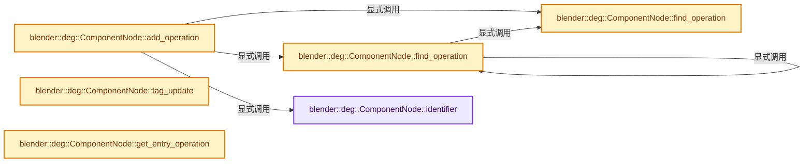
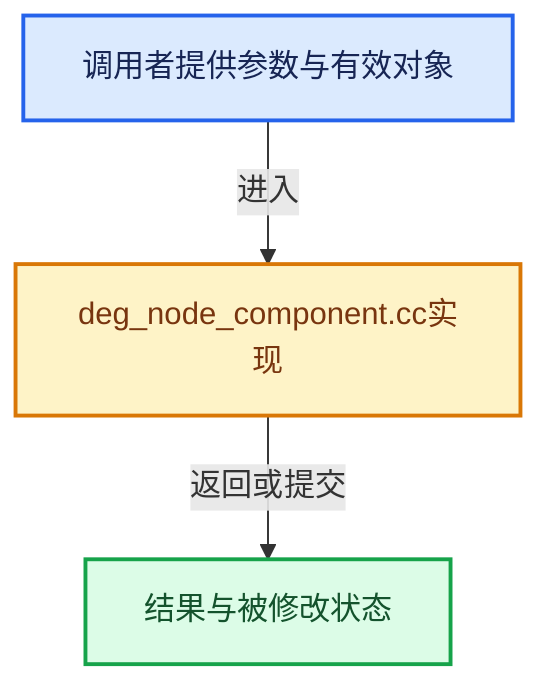

# 实现依赖专题：source/blender/depsgraph/intern/node/deg_node_component.cc

[实现依赖导航](../../../README.md) · [符号索引](../../../../00-课程指南/02-源码与提交索引/符号依赖与实现索引.md)

本专题从正文实际调用进入，集中保存共享实现。函数有稳定锚点，可从调用处直接跳到对应完整函数；递归与互相调用通过回链组织。

## 本文件的实现关系






## 完整成员与函数实现

<a id="f-0671c1ff831ad3c7"></a>

### `blender::deg::ComponentNode::identifier`

实现位置：[source/blender/depsgraph/intern/node/deg_node_component.cc](../../../../../../../../source/blender/depsgraph/intern/node/deg_node_component.cc) · L59—L66。

**教学注释版**

<!-- annotated:b9e7d8c43a0e73 -->

```cpp
std::string ComponentNode::identifier() const
{
  const std::string type_name = type_get_factory(type)->type_name();
  const std::string name_part = name[0] ? (std::string(" '") + name + "'") : "";

  return "[" + type_name + "]" + name_part + " : " +
         "(affects_visible_id: " + (affects_visible_id ? "true" : "false") + ")";
}
```

<details>
<summary>核对原始源码：source/blender/depsgraph/intern/node/deg_node_component.cc · L59—L66</summary>

<!-- original:b9e7d8c43a0e73:source/blender/depsgraph/intern/node/deg_node_component.cc:59:66 -->

```cpp
std::string ComponentNode::identifier() const
{
  const std::string type_name = type_get_factory(type)->type_name();
  const std::string name_part = name[0] ? (std::string(" '") + name + "'") : "";

  return "[" + type_name + "]" + name_part + " : " +
         "(affects_visible_id: " + (affects_visible_id ? "true" : "false") + ")";
}
```

</details>

**结果出口**

- `return "[" + type_name + "]" + name_part + " : " +`

**继续追踪实现**

- `type_get_factory(type)->type_name` → [调用协议](../../../../00-课程指南/01-路线与规范/模板宏与动态分派协议.md)：接收对象类型依赖auto、返回值或模板实例；不按同名猜测目标。调用位置L61。
- `type_get_factory` → [blender::deg::type_get_factory · L23](deg_node_factory.cc.md#f-5af7c2ca11c54f63)。
- `std::string` → [外部契约](https://eel.is/c++draft/)：这个边界按实际表达式及所属类型核对参数、返回值、寿命与失败行为。这里提供接口入口，不声称已解释该第三方版本的内部实现。

<a id="f-172b1268e9ce9e59"></a>

### `blender::deg::ComponentNode::find_operation`

实现位置：[source/blender/depsgraph/intern/node/deg_node_component.cc](../../../../../../../../source/blender/depsgraph/intern/node/deg_node_component.cc) · L68—L85。

接口参数：

- `OperationIDKey key`

**教学注释版**

<!-- annotated:c81c3bf5de7227 -->

```cpp
OperationNode *ComponentNode::find_operation(OperationIDKey key) const
{
  OperationNode *node = nullptr;
  if (operations_map != nullptr) {
    node = operations_map->lookup_default(key, nullptr);
  }
  else {
    for (OperationNode *op_node : operations) {
      if (op_node->opcode == key.opcode && op_node->name_tag == key.name_tag &&
          op_node->name == key.name)
      {
        node = op_node;
        break;
      }
    }
  }
  return node;
}
```

<details>
<summary>核对原始源码：source/blender/depsgraph/intern/node/deg_node_component.cc · L68—L85</summary>

<!-- original:c81c3bf5de7227:source/blender/depsgraph/intern/node/deg_node_component.cc:68:85 -->

```cpp
OperationNode *ComponentNode::find_operation(OperationIDKey key) const
{
  OperationNode *node = nullptr;
  if (operations_map != nullptr) {
    node = operations_map->lookup_default(key, nullptr);
  }
  else {
    for (OperationNode *op_node : operations) {
      if (op_node->opcode == key.opcode && op_node->name_tag == key.name_tag &&
          op_node->name == key.name)
      {
        node = op_node;
        break;
      }
    }
  }
  return node;
}
```

</details>

**沿实际写入检查状态**

- `node = operations_map->lookup_default(key, nullptr);`
- `node = op_node;`

**结果出口**

- `return node;`

**继续追踪实现**

- `operations_map->lookup_default` → [调用协议](../../../../00-课程指南/01-路线与规范/模板宏与动态分派协议.md)：接收对象类型依赖auto、返回值或模板实例；不按同名猜测目标。调用位置L72。

<a id="f-3fcfe180a922223a"></a>

### `blender::deg::ComponentNode::find_operation`

实现位置：[source/blender/depsgraph/intern/node/deg_node_component.cc](../../../../../../../../source/blender/depsgraph/intern/node/deg_node_component.cc) · L87—L93。

接口参数：

- `OperationCode opcode`
- `const StringRef name`
- `int name_tag`

**教学注释版**

<!-- annotated:6252c3ebda7d26 -->

```cpp
OperationNode *ComponentNode::find_operation(OperationCode opcode,
                                             const StringRef name,
                                             int name_tag) const
{
  OperationIDKey key(opcode, name, name_tag);
  return find_operation(key);
}
```

<details>
<summary>核对原始源码：source/blender/depsgraph/intern/node/deg_node_component.cc · L87—L93</summary>

<!-- original:6252c3ebda7d26:source/blender/depsgraph/intern/node/deg_node_component.cc:87:93 -->

```cpp
OperationNode *ComponentNode::find_operation(OperationCode opcode,
                                             const StringRef name,
                                             int name_tag) const
{
  OperationIDKey key(opcode, name, name_tag);
  return find_operation(key);
}
```

</details>

**结果出口**

- `return find_operation(key);`

**继续追踪实现**

- `find_operation` → [blender::deg::ComponentNode::find_operation · L68](deg_node_component.cc.md#f-172b1268e9ce9e59)；[blender::deg::ComponentNode::find_operation · L87](deg_node_component.cc.md#f-3fcfe180a922223a)。同名重载需按实参类型选择。

<a id="f-b0f9b47913d4786c"></a>

### `blender::deg::ComponentNode::add_operation`

实现位置：[source/blender/depsgraph/intern/node/deg_node_component.cc](../../../../../../../../source/blender/depsgraph/intern/node/deg_node_component.cc) · L128—L161。

接口参数：

- `const DepsEvalOperationCb &op`
- `OperationCode opcode`
- `const StringRef name`
- `int name_tag`

**教学注释版**

<!-- annotated:647b9942dddf20 -->

```cpp
OperationNode *ComponentNode::add_operation(const DepsEvalOperationCb &op,
                                            OperationCode opcode,
                                            const StringRef name,
                                            int name_tag)
{
  OperationNode *op_node = find_operation(opcode, name, name_tag);
  if (!op_node) {
    DepsNodeFactory *factory = type_get_factory(NodeType::OPERATION);
    op_node = static_cast<OperationNode *>(factory->create_node(this->owner->id_orig, "", name));

    /* register opnode in this component's operation set */
    OperationIDKey key(opcode, op_node->name, name_tag);
    operations_map->add(key, op_node);

    /* Set back-link. */
    op_node->owner = this;
  }
  else {
    fprintf(stderr,
            "add_operation: Operation already exists - %s has %s at %p\n",
            this->identifier().c_str(),
            op_node->identifier().c_str(),
            op_node);
    BLI_assert_msg(0, "Should not happen!");
  }

  /* attach extra data */
  op_node->evaluate = op;
  op_node->opcode = opcode;
  op_node->name = name;
  op_node->name_tag = name_tag;

  return op_node;
}
```

<details>
<summary>核对原始源码：source/blender/depsgraph/intern/node/deg_node_component.cc · L128—L161</summary>

<!-- original:647b9942dddf20:source/blender/depsgraph/intern/node/deg_node_component.cc:128:161 -->

```cpp
OperationNode *ComponentNode::add_operation(const DepsEvalOperationCb &op,
                                            OperationCode opcode,
                                            const StringRef name,
                                            int name_tag)
{
  OperationNode *op_node = find_operation(opcode, name, name_tag);
  if (!op_node) {
    DepsNodeFactory *factory = type_get_factory(NodeType::OPERATION);
    op_node = static_cast<OperationNode *>(factory->create_node(this->owner->id_orig, "", name));

    /* register opnode in this component's operation set */
    OperationIDKey key(opcode, op_node->name, name_tag);
    operations_map->add(key, op_node);

    /* Set back-link. */
    op_node->owner = this;
  }
  else {
    fprintf(stderr,
            "add_operation: Operation already exists - %s has %s at %p\n",
            this->identifier().c_str(),
            op_node->identifier().c_str(),
            op_node);
    BLI_assert_msg(0, "Should not happen!");
  }

  /* attach extra data */
  op_node->evaluate = op;
  op_node->opcode = opcode;
  op_node->name = name;
  op_node->name_tag = name_tag;

  return op_node;
}
```

</details>

**沿实际写入检查状态**

- `op_node = static_cast<OperationNode *>(factory->create_node(this->owner->id_orig, "", name));`
- `op_node->owner = this;`
- `op_node->evaluate = op;`
- `op_node->opcode = opcode;`
- `op_node->name = name;`
- `op_node->name_tag = name_tag;`

**结果出口**

- `return op_node;`

**继续追踪实现**

- `find_operation` → [blender::deg::ComponentNode::find_operation · L68](deg_node_component.cc.md#f-172b1268e9ce9e59)；[blender::deg::ComponentNode::find_operation · L87](deg_node_component.cc.md#f-3fcfe180a922223a)。同名重载需按实参类型选择。
- `type_get_factory` → [blender::deg::type_get_factory · L23](deg_node_factory.cc.md#f-5af7c2ca11c54f63)。
- `factory->create_node` → [blender::deg::DepsNodeFactoryImpl<ModeObjectType>::create_node · L34](deg_node_factory_impl.hh.md#f-dbf39120cc6cbb9b)。
- `operations_map->add` → [调用协议](../../../../00-课程指南/01-路线与规范/模板宏与动态分派协议.md)：接收对象类型依赖auto、返回值或模板实例；不按同名猜测目标。调用位置L140。
- `fprintf` → [外部契约](https://eel.is/c++draft/)：这个边界按实际表达式及所属类型核对参数、返回值、寿命与失败行为。这里提供接口入口，不声称已解释该第三方版本的内部实现。
- `this->identifier().c_str` → [调用协议](../../../../00-课程指南/01-路线与规范/模板宏与动态分派协议.md)：接收对象类型依赖auto、返回值或模板实例；不按同名猜测目标。调用位置L148。
- `this->identifier` → [blender::deg::ComponentNode::identifier · L59](deg_node_component.cc.md#f-0671c1ff831ad3c7)。
- `op_node->identifier().c_str` → [调用协议](../../../../00-课程指南/01-路线与规范/模板宏与动态分派协议.md)：接收对象类型依赖auto、返回值或模板实例；不按同名猜测目标。调用位置L149。
- `op_node->identifier` → [blender::deg::OperationNode::identifier · L218](deg_node_operation.cc.md#f-d43672cfd145ec54)。
- `BLI_assert_msg` → [BLI_assert_msg · L55](../../../01-BLI基础库/BLI_assert.hh.md#m-695eed20dceb)；[BLI_assert_msg · L64](../../../01-BLI基础库/BLI_assert.hh.md#m-7de5563de4db)。宏定义由构建条件选择。

<a id="f-a03efcb923f32e69"></a>

### `blender::deg::ComponentNode::tag_update`

实现位置：[source/blender/depsgraph/intern/node/deg_node_component.cc](../../../../../../../../source/blender/depsgraph/intern/node/deg_node_component.cc) · L189—L203。

接口参数：

- `Depsgraph *graph`
- `eUpdateSource source`

**教学注释版**

<!-- annotated:92b072e60663ca -->

```cpp
void ComponentNode::tag_update(Depsgraph *graph, eUpdateSource source)
{
  /* Note that the node might already be tagged for an update due invisible state of the node
   * during previous dependency evaluation. Here the node gets re-tagged, so we need to give
   * the evaluated clues that evaluation needs to happen again. */
  for (OperationNode *op_node : operations) {
    op_node->tag_update(graph, source);
  }
  /* It is possible that tag happens before finalization. */
  if (operations_map != nullptr) {
    for (OperationNode *op_node : operations_map->values()) {
      op_node->tag_update(graph, source);
    }
  }
}
```

<details>
<summary>核对原始源码：source/blender/depsgraph/intern/node/deg_node_component.cc · L189—L203</summary>

<!-- original:92b072e60663ca:source/blender/depsgraph/intern/node/deg_node_component.cc:189:203 -->

```cpp
void ComponentNode::tag_update(Depsgraph *graph, eUpdateSource source)
{
  /* Note that the node might already be tagged for an update due invisible state of the node
   * during previous dependency evaluation. Here the node gets re-tagged, so we need to give
   * the evaluated clues that evaluation needs to happen again. */
  for (OperationNode *op_node : operations) {
    op_node->tag_update(graph, source);
  }
  /* It is possible that tag happens before finalization. */
  if (operations_map != nullptr) {
    for (OperationNode *op_node : operations_map->values()) {
      op_node->tag_update(graph, source);
    }
  }
}
```

</details>

**继续追踪实现**

- `op_node->tag_update` → [调用协议](../../../../00-课程指南/01-路线与规范/模板宏与动态分派协议.md)：接收对象类型依赖auto、返回值或模板实例；不按同名猜测目标。调用位置L195。
- `operations_map->values` → [调用协议](../../../../00-课程指南/01-路线与规范/模板宏与动态分派协议.md)：接收对象类型依赖auto、返回值或模板实例；不按同名猜测目标。调用位置L199。

<a id="f-1d3e2b785b1fccd5"></a>

### `blender::deg::ComponentNode::get_entry_operation`

实现位置：[source/blender/depsgraph/intern/node/deg_node_component.cc](../../../../../../../../source/blender/depsgraph/intern/node/deg_node_component.cc) · L205—L224。

**教学注释版**

<!-- annotated:f69c7300fb323c -->

```cpp
OperationNode *ComponentNode::get_entry_operation()
{
  if (entry_operation) {
    return entry_operation;
  }
  if (operations_map != nullptr && operations_map->size() == 1) {
    OperationNode *op_node = nullptr;
    /* TODO(sergey): This is somewhat slow. */
    for (OperationNode *tmp : operations_map->values()) {
      op_node = tmp;
    }
    /* Cache for the subsequent usage. */
    entry_operation = op_node;
    return op_node;
  }
  if (operations.size() == 1) {
    return operations[0];
  }
  return nullptr;
}
```

<details>
<summary>核对原始源码：source/blender/depsgraph/intern/node/deg_node_component.cc · L205—L224</summary>

<!-- original:f69c7300fb323c:source/blender/depsgraph/intern/node/deg_node_component.cc:205:224 -->

```cpp
OperationNode *ComponentNode::get_entry_operation()
{
  if (entry_operation) {
    return entry_operation;
  }
  if (operations_map != nullptr && operations_map->size() == 1) {
    OperationNode *op_node = nullptr;
    /* TODO(sergey): This is somewhat slow. */
    for (OperationNode *tmp : operations_map->values()) {
      op_node = tmp;
    }
    /* Cache for the subsequent usage. */
    entry_operation = op_node;
    return op_node;
  }
  if (operations.size() == 1) {
    return operations[0];
  }
  return nullptr;
}
```

</details>

**沿实际写入检查状态**

- `op_node = tmp;`
- `entry_operation = op_node;`

**结果出口**

- `return entry_operation;`
- `return op_node;`
- `return operations[0];`
- `return nullptr;`

**继续追踪实现**

- `operations_map->size` → [调用协议](../../../../00-课程指南/01-路线与规范/模板宏与动态分派协议.md)：接收对象类型依赖auto、返回值或模板实例；不按同名猜测目标。调用位置L210。
- `operations_map->values` → [调用协议](../../../../00-课程指南/01-路线与规范/模板宏与动态分派协议.md)：接收对象类型依赖auto、返回值或模板实例；不按同名猜测目标。调用位置L213。
- `operations.size` → [调用协议](../../../../00-课程指南/01-路线与规范/模板宏与动态分派协议.md)：接收对象类型依赖auto、返回值或模板实例；不按同名猜测目标。调用位置L220。
