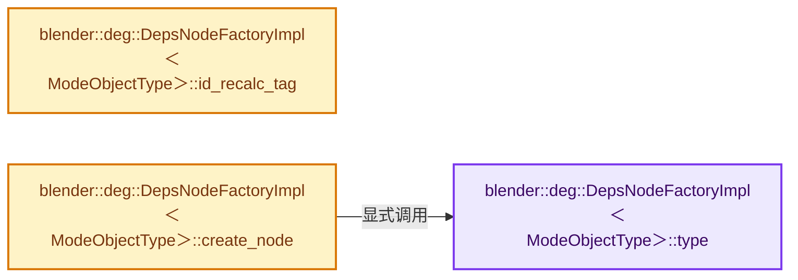
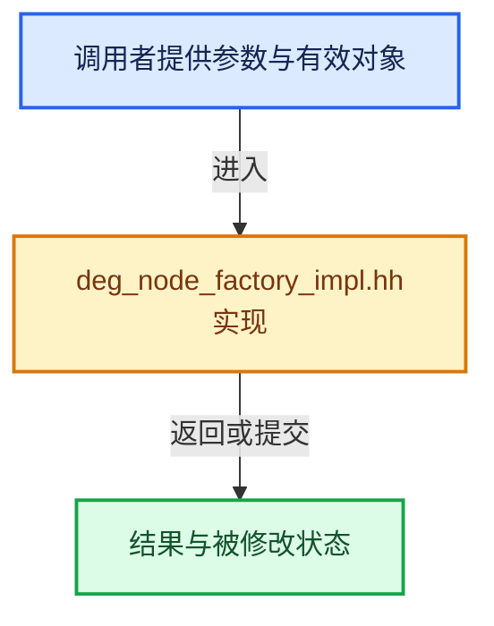

# 实现依赖专题：source/blender/depsgraph/intern/node/deg_node_factory_impl.hh

[实现依赖导航](../../../README.md) · [符号索引](../../../../00-课程指南/02-源码与提交索引/符号依赖与实现索引.md)

本专题从正文实际调用进入，集中保存共享实现。函数有稳定锚点，可从调用处直接跳到对应完整函数；递归与互相调用通过回链组织。

## 本文件的实现关系






## 完整成员与函数实现

<a id="f-05dd7d049c4d2af9"></a>

### `blender::deg::DepsNodeFactoryImpl<ModeObjectType>::type`

实现位置：[source/blender/depsgraph/intern/node/deg_node_factory_impl.hh](../../../../../../../../source/blender/depsgraph/intern/node/deg_node_factory_impl.hh) · L19—L22。

**教学注释版**

<!-- annotated:05318d13278eaf -->

```cpp
template<class ModeObjectType> NodeType DepsNodeFactoryImpl<ModeObjectType>::type() const
{
  return ModeObjectType::typeinfo.type;
}
```

<details>
<summary>核对原始源码：source/blender/depsgraph/intern/node/deg_node_factory_impl.hh · L19—L22</summary>

<!-- original:05318d13278eaf:source/blender/depsgraph/intern/node/deg_node_factory_impl.hh:19:22 -->

```cpp
template<class ModeObjectType> NodeType DepsNodeFactoryImpl<ModeObjectType>::type() const
{
  return ModeObjectType::typeinfo.type;
}
```

</details>

**结果出口**

- `return ModeObjectType::typeinfo.type;`

**继续追踪实现**

本实现没有需要继续展开的显式调用；检查返回表达式、对象转换和调用者前置条件。

<a id="f-150f0311c1d40232"></a>

### `blender::deg::DepsNodeFactoryImpl<ModeObjectType>::id_recalc_tag`

实现位置：[source/blender/depsgraph/intern/node/deg_node_factory_impl.hh](../../../../../../../../source/blender/depsgraph/intern/node/deg_node_factory_impl.hh) · L29—L32。

**教学注释版**

<!-- annotated:91e66dffabd156 -->

```cpp
template<class ModeObjectType> int DepsNodeFactoryImpl<ModeObjectType>::id_recalc_tag() const
{
  return ModeObjectType::typeinfo.id_recalc_tag;
}
```

<details>
<summary>核对原始源码：source/blender/depsgraph/intern/node/deg_node_factory_impl.hh · L29—L32</summary>

<!-- original:91e66dffabd156:source/blender/depsgraph/intern/node/deg_node_factory_impl.hh:29:32 -->

```cpp
template<class ModeObjectType> int DepsNodeFactoryImpl<ModeObjectType>::id_recalc_tag() const
{
  return ModeObjectType::typeinfo.id_recalc_tag;
}
```

</details>

**结果出口**

- `return ModeObjectType::typeinfo.id_recalc_tag;`

**继续追踪实现**

本实现没有需要继续展开的显式调用；检查返回表达式、对象转换和调用者前置条件。

<a id="f-dbf39120cc6cbb9b"></a>

### `blender::deg::DepsNodeFactoryImpl<ModeObjectType>::create_node`

实现位置：[source/blender/depsgraph/intern/node/deg_node_factory_impl.hh](../../../../../../../../source/blender/depsgraph/intern/node/deg_node_factory_impl.hh) · L34—L44。

接口参数：

- `const ID *id`
- `const char *subdata`
- `const StringRef name`

**教学注释版**

<!-- annotated:c8b17e1eb8b7eb -->

```cpp
template<class ModeObjectType>
Node *DepsNodeFactoryImpl<ModeObjectType>::create_node(const ID *id,
                                                       const char *subdata,
                                                       const StringRef name) const
{
  Node *node = new ModeObjectType();
  node->type = type();
  node->name = name;
  node->init(id, subdata);
  return node;
}
```

<details>
<summary>核对原始源码：source/blender/depsgraph/intern/node/deg_node_factory_impl.hh · L34—L44</summary>

<!-- original:c8b17e1eb8b7eb:source/blender/depsgraph/intern/node/deg_node_factory_impl.hh:34:44 -->

```cpp
template<class ModeObjectType>
Node *DepsNodeFactoryImpl<ModeObjectType>::create_node(const ID *id,
                                                       const char *subdata,
                                                       const StringRef name) const
{
  Node *node = new ModeObjectType();
  node->type = type();
  node->name = name;
  node->init(id, subdata);
  return node;
}
```

</details>

**沿实际写入检查状态**

- `node->type = type();`
- `node->name = name;`

**结果出口**

- `return node;`

**继续追踪实现**

- `type` → [blender::deg::DepsNodeFactoryImpl<ModeObjectType>::type · L19](deg_node_factory_impl.hh.md#f-05dd7d049c4d2af9)。
- `node->init` → [blender::deg::Node::init · L205](deg_node.hh.md#f-96ab30ad27861756)。
