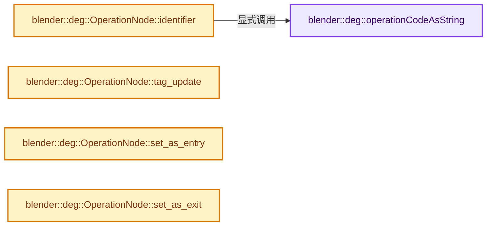
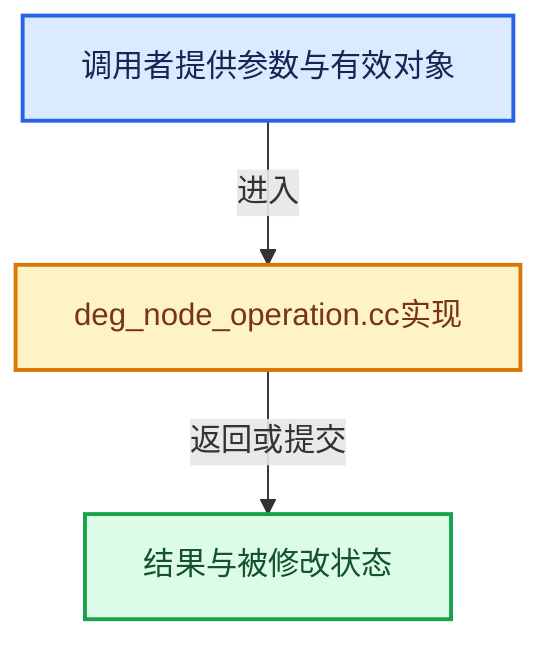

# 实现依赖专题：source/blender/depsgraph/intern/node/deg_node_operation.cc

[实现依赖导航](../../../README.md) · [符号索引](../../../../00-课程指南/02-源码与提交索引/符号依赖与实现索引.md)

本专题从正文实际调用进入，集中保存共享实现。函数有稳定锚点，可从调用处直接跳到对应完整函数；递归与互相调用通过回链组织。

## 本文件的实现关系






## 完整成员与函数实现

<a id="f-68fb68ebe4b00b3c"></a>

### `blender::deg::operationCodeAsString`

实现位置：[source/blender/depsgraph/intern/node/deg_node_operation.cc](../../../../../../../../source/blender/depsgraph/intern/node/deg_node_operation.cc) · L18—L214。

接口参数：

- `OperationCode opcode`

**教学注释版**

<!-- annotated:12781bbaaaceaa -->

```cpp
const char *operationCodeAsString(OperationCode opcode)
{
  switch (opcode) {
    /* Generic Operations. */
    case OperationCode::OPERATION:
      return "OPERATION";
    case OperationCode::ID_PROPERTY:
      return "ID_PROPERTY";
    case OperationCode::PARAMETERS_ENTRY:
      return "PARAMETERS_ENTRY";
    case OperationCode::PARAMETERS_EVAL:
      return "PARAMETERS_EVAL";
    case OperationCode::PARAMETERS_EXIT:
      return "PARAMETERS_EXIT";
    case OperationCode::VISIBILITY:
      return "VISIBILITY";
    /* Hierarchy. */
    case OperationCode::HIERARCHY:
      return "HIERARCHY";
    /* Animation, Drivers, etc. */
    case OperationCode::ANIMATION_ENTRY:
      return "ANIMATION_ENTRY";
    case OperationCode::ANIMATION_EVAL:
      return "ANIMATION_EVAL";
    case OperationCode::ANIMATION_EXIT:
      return "ANIMATION_EXIT";
    case OperationCode::DRIVER:
      return "DRIVER";
    case OperationCode::DRIVER_UNSHARE:
      return "DRIVER_UNSHARE";
    /* Scene related. */
    case OperationCode::SCENE_EVAL:
      return "SCENE_EVAL";
    case OperationCode::AUDIO_ENTRY:
      return "AUDIO_ENTRY";
    case OperationCode::AUDIO_VOLUME:
      return "AUDIO_VOLUME";
    /* Object related. */
    case OperationCode::OBJECT_FROM_LAYER_ENTRY:
      return "OBJECT_FROM_LAYER_ENTRY";
    case OperationCode::OBJECT_BASE_FLAGS:
      return "OBJECT_BASE_FLAGS";
    case OperationCode::OBJECT_FROM_LAYER_EXIT:
      return "OBJECT_FROM_LAYER_EXIT";
    case OperationCode::DIMENSIONS:
      return "DIMENSIONS";
    /* Transform. */
    case OperationCode::TRANSFORM_INIT:
      return "TRANSFORM_INIT";
    case OperationCode::TRANSFORM_LOCAL:
      return "TRANSFORM_LOCAL";
    case OperationCode::TRANSFORM_PARENT:
      return "TRANSFORM_PARENT";
    case OperationCode::TRANSFORM_CONSTRAINTS:
      return "TRANSFORM_CONSTRAINTS";
    case OperationCode::TRANSFORM_FINAL:
      return "TRANSFORM_FINAL";
    case OperationCode::TRANSFORM_EVAL:
      return "TRANSFORM_EVAL";
    case OperationCode::TRANSFORM_SIMULATION_INIT:
      return "TRANSFORM_SIMULATION_INIT";
    /* Rigid body. */
    case OperationCode::RIGIDBODY_REBUILD:
      return "RIGIDBODY_REBUILD";
    case OperationCode::RIGIDBODY_SIM:
      return "RIGIDBODY_SIM";
    case OperationCode::RIGIDBODY_TRANSFORM_COPY:
      return "RIGIDBODY_TRANSFORM_COPY";
    /* Geometry. */
    case OperationCode::GEOMETRY_EVAL_INIT:
      return "GEOMETRY_EVAL_INIT";
    case OperationCode::MODIFIER:
      return "MODIFIER";
    case OperationCode::GEOMETRY_EVAL:
      return "GEOMETRY_EVAL";
    case OperationCode::GEOMETRY_EVAL_DONE:
      return "GEOMETRY_EVAL_DONE";
    case OperationCode::GEOMETRY_SHAPEKEY:
      return "GEOMETRY_SHAPEKEY";
    /* Object data. */
    case OperationCode::LIGHT_PROBE_EVAL:
      return "LIGHT_PROBE_EVAL";
    case OperationCode::SPEAKER_EVAL:
      return "SPEAKER_EVAL";
    case OperationCode::SOUND_EVAL:
      return "SOUND_EVAL";
    case OperationCode::ARMATURE_EVAL:
      return "ARMATURE_EVAL";
    /* Pose. */
    case OperationCode::POSE_INIT:
      return "POSE_INIT";
    case OperationCode::POSE_INIT_IK:
      return "POSE_INIT_IK";
    case OperationCode::POSE_CLEANUP:
      return "POSE_CLEANUP";
    case OperationCode::POSE_DONE:
      return "POSE_DONE";
    case OperationCode::POSE_IK_SOLVER:
      return "POSE_IK_SOLVER";
    case OperationCode::POSE_SPLINE_IK_SOLVER:
      return "POSE_SPLINE_IK_SOLVER";
    /* Bone. */
    case OperationCode::BONE_LOCAL:
      return "BONE_LOCAL";
    case OperationCode::BONE_POSE_PARENT:
      return "BONE_POSE_PARENT";
    case OperationCode::BONE_CONSTRAINTS:
      return "BONE_CONSTRAINTS";
    case OperationCode::BONE_READY:
      return "BONE_READY";
    case OperationCode::BONE_DONE:
      return "BONE_DONE";
    case OperationCode::BONE_SEGMENTS:
      return "BONE_SEGMENTS";
    case OperationCode::BONE_VISIBILITY:
      return "BONE_VISIBILITY";
    /* Particle System. */
    case OperationCode::PARTICLE_SYSTEM_INIT:
      return "PARTICLE_SYSTEM_INIT";
    case OperationCode::PARTICLE_SYSTEM_EVAL:
      return "PARTICLE_SYSTEM_EVAL";
    case OperationCode::PARTICLE_SYSTEM_DONE:
      return "PARTICLE_SYSTEM_DONE";
    /* Particles Settings. */
    case OperationCode::PARTICLE_SETTINGS_INIT:
      return "PARTICLE_SETTINGS_INIT";
    case OperationCode::PARTICLE_SETTINGS_EVAL:
      return "PARTICLE_SETTINGS_EVAL";
    case OperationCode::PARTICLE_SETTINGS_RESET:
      return "PARTICLE_SETTINGS_RESET";
    /* Point Cache. */
    case OperationCode::POINT_CACHE_RESET:
      return "POINT_CACHE_RESET";
    /* File cache. */
    case OperationCode::FILE_CACHE_UPDATE:
      return "FILE_CACHE_UPDATE";
    /* Batch cache. */
    case OperationCode::GEOMETRY_SELECT_UPDATE:
      return "GEOMETRY_SELECT_UPDATE";
    /* Masks. */
    case OperationCode::MASK_ANIMATION:
      return "MASK_ANIMATION";
    case OperationCode::MASK_EVAL:
      return "MASK_EVAL";
    /* Collections. */
    case OperationCode::VIEW_LAYER_EVAL:
      return "VIEW_LAYER_EVAL";
    /* Copy on eval. */
    case OperationCode::COPY_ON_EVAL:
      return "COPY_ON_EVAL";
    /* Shading. */
    case OperationCode::SHADING:
      return "SHADING";
    case OperationCode::SHADING_DONE:
      return "SHADING_DONE";
    case OperationCode::MATERIAL_UPDATE:
      return "MATERIAL_UPDATE";
    case OperationCode::LIGHT_UPDATE:
      return "LIGHT_UPDATE";
    case OperationCode::WORLD_UPDATE:
      return "WORLD_UPDATE";
    /* Light linking. */
    case OperationCode::LIGHT_LINKING_UPDATE:
      return "LIGHT_LINKING_UPDATE";
    /* Node Tree. */
    case OperationCode::NTREE_OUTPUT:
      return "NTREE_OUTPUT";
    case OperationCode::NTREE_GEOMETRY_PREPROCESS:
      return "NTREE_GEOMETRY_PREPROCESS";
    /* Movie clip. */
    case OperationCode::MOVIECLIP_EVAL:
      return "MOVIECLIP_EVAL";
    /* Image. */
    case OperationCode::IMAGE_ANIMATION:
      return "IMAGE_ANIMATION";
    /* Synchronization. */
    case OperationCode::SYNCHRONIZE_TO_ORIGINAL:
      return "SYNCHRONIZE_TO_ORIGINAL";
    /* Generic datablock. */
    case OperationCode::GENERIC_DATABLOCK_UPDATE:
      return "GENERIC_DATABLOCK_UPDATE";
    /* Sequencer. */
    case OperationCode::SEQUENCES_EVAL:
      return "SEQUENCES_EVAL";
    case OperationCode::COMPOSITOR_EVAL:
      return "COMPOSITOR_EVAL";
    /* instancing. */
    case OperationCode::INSTANCER:
      return "INSTANCER";
    case OperationCode::INSTANCE:
      return "INSTANCE";
    case OperationCode::INSTANCE_GEOMETRY:
      return "INSTANCE_GEOMETRY";
  }
  BLI_assert_msg(0, "Unhandled operation code, should never happen.");
  return "UNKNOWN";
}
```

<details>
<summary>核对原始源码：source/blender/depsgraph/intern/node/deg_node_operation.cc · L18—L214</summary>

<!-- original:12781bbaaaceaa:source/blender/depsgraph/intern/node/deg_node_operation.cc:18:214 -->

```cpp
const char *operationCodeAsString(OperationCode opcode)
{
  switch (opcode) {
    /* Generic Operations. */
    case OperationCode::OPERATION:
      return "OPERATION";
    case OperationCode::ID_PROPERTY:
      return "ID_PROPERTY";
    case OperationCode::PARAMETERS_ENTRY:
      return "PARAMETERS_ENTRY";
    case OperationCode::PARAMETERS_EVAL:
      return "PARAMETERS_EVAL";
    case OperationCode::PARAMETERS_EXIT:
      return "PARAMETERS_EXIT";
    case OperationCode::VISIBILITY:
      return "VISIBILITY";
    /* Hierarchy. */
    case OperationCode::HIERARCHY:
      return "HIERARCHY";
    /* Animation, Drivers, etc. */
    case OperationCode::ANIMATION_ENTRY:
      return "ANIMATION_ENTRY";
    case OperationCode::ANIMATION_EVAL:
      return "ANIMATION_EVAL";
    case OperationCode::ANIMATION_EXIT:
      return "ANIMATION_EXIT";
    case OperationCode::DRIVER:
      return "DRIVER";
    case OperationCode::DRIVER_UNSHARE:
      return "DRIVER_UNSHARE";
    /* Scene related. */
    case OperationCode::SCENE_EVAL:
      return "SCENE_EVAL";
    case OperationCode::AUDIO_ENTRY:
      return "AUDIO_ENTRY";
    case OperationCode::AUDIO_VOLUME:
      return "AUDIO_VOLUME";
    /* Object related. */
    case OperationCode::OBJECT_FROM_LAYER_ENTRY:
      return "OBJECT_FROM_LAYER_ENTRY";
    case OperationCode::OBJECT_BASE_FLAGS:
      return "OBJECT_BASE_FLAGS";
    case OperationCode::OBJECT_FROM_LAYER_EXIT:
      return "OBJECT_FROM_LAYER_EXIT";
    case OperationCode::DIMENSIONS:
      return "DIMENSIONS";
    /* Transform. */
    case OperationCode::TRANSFORM_INIT:
      return "TRANSFORM_INIT";
    case OperationCode::TRANSFORM_LOCAL:
      return "TRANSFORM_LOCAL";
    case OperationCode::TRANSFORM_PARENT:
      return "TRANSFORM_PARENT";
    case OperationCode::TRANSFORM_CONSTRAINTS:
      return "TRANSFORM_CONSTRAINTS";
    case OperationCode::TRANSFORM_FINAL:
      return "TRANSFORM_FINAL";
    case OperationCode::TRANSFORM_EVAL:
      return "TRANSFORM_EVAL";
    case OperationCode::TRANSFORM_SIMULATION_INIT:
      return "TRANSFORM_SIMULATION_INIT";
    /* Rigid body. */
    case OperationCode::RIGIDBODY_REBUILD:
      return "RIGIDBODY_REBUILD";
    case OperationCode::RIGIDBODY_SIM:
      return "RIGIDBODY_SIM";
    case OperationCode::RIGIDBODY_TRANSFORM_COPY:
      return "RIGIDBODY_TRANSFORM_COPY";
    /* Geometry. */
    case OperationCode::GEOMETRY_EVAL_INIT:
      return "GEOMETRY_EVAL_INIT";
    case OperationCode::MODIFIER:
      return "MODIFIER";
    case OperationCode::GEOMETRY_EVAL:
      return "GEOMETRY_EVAL";
    case OperationCode::GEOMETRY_EVAL_DONE:
      return "GEOMETRY_EVAL_DONE";
    case OperationCode::GEOMETRY_SHAPEKEY:
      return "GEOMETRY_SHAPEKEY";
    /* Object data. */
    case OperationCode::LIGHT_PROBE_EVAL:
      return "LIGHT_PROBE_EVAL";
    case OperationCode::SPEAKER_EVAL:
      return "SPEAKER_EVAL";
    case OperationCode::SOUND_EVAL:
      return "SOUND_EVAL";
    case OperationCode::ARMATURE_EVAL:
      return "ARMATURE_EVAL";
    /* Pose. */
    case OperationCode::POSE_INIT:
      return "POSE_INIT";
    case OperationCode::POSE_INIT_IK:
      return "POSE_INIT_IK";
    case OperationCode::POSE_CLEANUP:
      return "POSE_CLEANUP";
    case OperationCode::POSE_DONE:
      return "POSE_DONE";
    case OperationCode::POSE_IK_SOLVER:
      return "POSE_IK_SOLVER";
    case OperationCode::POSE_SPLINE_IK_SOLVER:
      return "POSE_SPLINE_IK_SOLVER";
    /* Bone. */
    case OperationCode::BONE_LOCAL:
      return "BONE_LOCAL";
    case OperationCode::BONE_POSE_PARENT:
      return "BONE_POSE_PARENT";
    case OperationCode::BONE_CONSTRAINTS:
      return "BONE_CONSTRAINTS";
    case OperationCode::BONE_READY:
      return "BONE_READY";
    case OperationCode::BONE_DONE:
      return "BONE_DONE";
    case OperationCode::BONE_SEGMENTS:
      return "BONE_SEGMENTS";
    case OperationCode::BONE_VISIBILITY:
      return "BONE_VISIBILITY";
    /* Particle System. */
    case OperationCode::PARTICLE_SYSTEM_INIT:
      return "PARTICLE_SYSTEM_INIT";
    case OperationCode::PARTICLE_SYSTEM_EVAL:
      return "PARTICLE_SYSTEM_EVAL";
    case OperationCode::PARTICLE_SYSTEM_DONE:
      return "PARTICLE_SYSTEM_DONE";
    /* Particles Settings. */
    case OperationCode::PARTICLE_SETTINGS_INIT:
      return "PARTICLE_SETTINGS_INIT";
    case OperationCode::PARTICLE_SETTINGS_EVAL:
      return "PARTICLE_SETTINGS_EVAL";
    case OperationCode::PARTICLE_SETTINGS_RESET:
      return "PARTICLE_SETTINGS_RESET";
    /* Point Cache. */
    case OperationCode::POINT_CACHE_RESET:
      return "POINT_CACHE_RESET";
    /* File cache. */
    case OperationCode::FILE_CACHE_UPDATE:
      return "FILE_CACHE_UPDATE";
    /* Batch cache. */
    case OperationCode::GEOMETRY_SELECT_UPDATE:
      return "GEOMETRY_SELECT_UPDATE";
    /* Masks. */
    case OperationCode::MASK_ANIMATION:
      return "MASK_ANIMATION";
    case OperationCode::MASK_EVAL:
      return "MASK_EVAL";
    /* Collections. */
    case OperationCode::VIEW_LAYER_EVAL:
      return "VIEW_LAYER_EVAL";
    /* Copy on eval. */
    case OperationCode::COPY_ON_EVAL:
      return "COPY_ON_EVAL";
    /* Shading. */
    case OperationCode::SHADING:
      return "SHADING";
    case OperationCode::SHADING_DONE:
      return "SHADING_DONE";
    case OperationCode::MATERIAL_UPDATE:
      return "MATERIAL_UPDATE";
    case OperationCode::LIGHT_UPDATE:
      return "LIGHT_UPDATE";
    case OperationCode::WORLD_UPDATE:
      return "WORLD_UPDATE";
    /* Light linking. */
    case OperationCode::LIGHT_LINKING_UPDATE:
      return "LIGHT_LINKING_UPDATE";
    /* Node Tree. */
    case OperationCode::NTREE_OUTPUT:
      return "NTREE_OUTPUT";
    case OperationCode::NTREE_GEOMETRY_PREPROCESS:
      return "NTREE_GEOMETRY_PREPROCESS";
    /* Movie clip. */
    case OperationCode::MOVIECLIP_EVAL:
      return "MOVIECLIP_EVAL";
    /* Image. */
    case OperationCode::IMAGE_ANIMATION:
      return "IMAGE_ANIMATION";
    /* Synchronization. */
    case OperationCode::SYNCHRONIZE_TO_ORIGINAL:
      return "SYNCHRONIZE_TO_ORIGINAL";
    /* Generic datablock. */
    case OperationCode::GENERIC_DATABLOCK_UPDATE:
      return "GENERIC_DATABLOCK_UPDATE";
    /* Sequencer. */
    case OperationCode::SEQUENCES_EVAL:
      return "SEQUENCES_EVAL";
    case OperationCode::COMPOSITOR_EVAL:
      return "COMPOSITOR_EVAL";
    /* instancing. */
    case OperationCode::INSTANCER:
      return "INSTANCER";
    case OperationCode::INSTANCE:
      return "INSTANCE";
    case OperationCode::INSTANCE_GEOMETRY:
      return "INSTANCE_GEOMETRY";
  }
  BLI_assert_msg(0, "Unhandled operation code, should never happen.");
  return "UNKNOWN";
}
```

</details>

**结果出口**

- `return "OPERATION";`
- `return "ID_PROPERTY";`
- `return "PARAMETERS_ENTRY";`
- `return "PARAMETERS_EVAL";`
- `return "PARAMETERS_EXIT";`
- `return "VISIBILITY";`
- `return "HIERARCHY";`
- `return "ANIMATION_ENTRY";`
- `return "ANIMATION_EVAL";`
- `return "ANIMATION_EXIT";`
- `return "DRIVER";`
- `return "DRIVER_UNSHARE";`
- `return "SCENE_EVAL";`
- `return "AUDIO_ENTRY";`
- `return "AUDIO_VOLUME";`
- `return "OBJECT_FROM_LAYER_ENTRY";`
- `return "OBJECT_BASE_FLAGS";`
- `return "OBJECT_FROM_LAYER_EXIT";`
- `return "DIMENSIONS";`
- `return "TRANSFORM_INIT";`
- `return "TRANSFORM_LOCAL";`
- `return "TRANSFORM_PARENT";`
- `return "TRANSFORM_CONSTRAINTS";`
- `return "TRANSFORM_FINAL";`
- `return "TRANSFORM_EVAL";`
- `return "TRANSFORM_SIMULATION_INIT";`
- `return "RIGIDBODY_REBUILD";`
- `return "RIGIDBODY_SIM";`
- `return "RIGIDBODY_TRANSFORM_COPY";`
- `return "GEOMETRY_EVAL_INIT";`
- `return "MODIFIER";`
- `return "GEOMETRY_EVAL";`
- `return "GEOMETRY_EVAL_DONE";`
- `return "GEOMETRY_SHAPEKEY";`
- `return "LIGHT_PROBE_EVAL";`
- `return "SPEAKER_EVAL";`
- `return "SOUND_EVAL";`
- `return "ARMATURE_EVAL";`
- `return "POSE_INIT";`
- `return "POSE_INIT_IK";`
- `return "POSE_CLEANUP";`
- `return "POSE_DONE";`
- `return "POSE_IK_SOLVER";`
- `return "POSE_SPLINE_IK_SOLVER";`
- `return "BONE_LOCAL";`
- `return "BONE_POSE_PARENT";`
- `return "BONE_CONSTRAINTS";`
- `return "BONE_READY";`
- `return "BONE_DONE";`
- `return "BONE_SEGMENTS";`
- `return "BONE_VISIBILITY";`
- `return "PARTICLE_SYSTEM_INIT";`
- `return "PARTICLE_SYSTEM_EVAL";`
- `return "PARTICLE_SYSTEM_DONE";`
- `return "PARTICLE_SETTINGS_INIT";`
- `return "PARTICLE_SETTINGS_EVAL";`
- `return "PARTICLE_SETTINGS_RESET";`
- `return "POINT_CACHE_RESET";`
- `return "FILE_CACHE_UPDATE";`
- `return "GEOMETRY_SELECT_UPDATE";`
- `return "MASK_ANIMATION";`
- `return "MASK_EVAL";`
- `return "VIEW_LAYER_EVAL";`
- `return "COPY_ON_EVAL";`
- `return "SHADING";`
- `return "SHADING_DONE";`
- `return "MATERIAL_UPDATE";`
- `return "LIGHT_UPDATE";`
- `return "WORLD_UPDATE";`
- `return "LIGHT_LINKING_UPDATE";`
- `return "NTREE_OUTPUT";`
- `return "NTREE_GEOMETRY_PREPROCESS";`
- `return "MOVIECLIP_EVAL";`
- `return "IMAGE_ANIMATION";`
- `return "SYNCHRONIZE_TO_ORIGINAL";`
- `return "GENERIC_DATABLOCK_UPDATE";`
- `return "SEQUENCES_EVAL";`
- `return "COMPOSITOR_EVAL";`
- `return "INSTANCER";`
- `return "INSTANCE";`
- `return "INSTANCE_GEOMETRY";`
- `return "UNKNOWN";`

**继续追踪实现**

- `BLI_assert_msg` → [BLI_assert_msg · L55](../../../01-BLI基础库/BLI_assert.hh.md#m-695eed20dceb)；[BLI_assert_msg · L64](../../../01-BLI基础库/BLI_assert.hh.md#m-7de5563de4db)。宏定义由构建条件选择。

<a id="f-d43672cfd145ec54"></a>

### `blender::deg::OperationNode::identifier`

实现位置：[source/blender/depsgraph/intern/node/deg_node_operation.cc](../../../../../../../../source/blender/depsgraph/intern/node/deg_node_operation.cc) · L218—L221。

**教学注释版**

<!-- annotated:38b8dcb0df52ae -->

```cpp
std::string OperationNode::identifier() const
{
  return std::string(operationCodeAsString(opcode)) + "(" + name + ")";
}
```

<details>
<summary>核对原始源码：source/blender/depsgraph/intern/node/deg_node_operation.cc · L218—L221</summary>

<!-- original:38b8dcb0df52ae:source/blender/depsgraph/intern/node/deg_node_operation.cc:218:221 -->

```cpp
std::string OperationNode::identifier() const
{
  return std::string(operationCodeAsString(opcode)) + "(" + name + ")";
}
```

</details>

**结果出口**

- `return std::string(operationCodeAsString(opcode)) + "(" + name + ")";`

**继续追踪实现**

- `std::string` → [外部契约](https://eel.is/c++draft/)：这个边界按实际表达式及所属类型核对参数、返回值、寿命与失败行为。这里提供接口入口，不声称已解释该第三方版本的内部实现。
- `operationCodeAsString` → [blender::deg::operationCodeAsString · L18](deg_node_operation.cc.md#f-68fb68ebe4b00b3c)。

<a id="f-e43f9db647ce0809"></a>

### `blender::deg::OperationNode::tag_update`

实现位置：[source/blender/depsgraph/intern/node/deg_node_operation.cc](../../../../../../../../source/blender/depsgraph/intern/node/deg_node_operation.cc) · L232—L264。

接口参数：

- `Depsgraph *graph`
- `eUpdateSource source`

**教学注释版**

<!-- annotated:963d8b8dfaff6d -->

```cpp
void OperationNode::tag_update(Depsgraph *graph, eUpdateSource source)
{
  /* Ensure that there is an entry tag for this update.
   *
   * Note that the node might already be tagged for an update due invisible state of the node
   * during previous dependency evaluation. Here the node gets re-tagged, so we need to give
   * the evaluated clues that evaluation needs to happen again. */
  graph->add_entry_tag(this);

  /* Enforce dynamic visibility code-path update.
   * This ensures visibility flags are consistently propagated throughout the dependency graph when
   * there is no animated visibility in the graph.
   *
   * For example this ensures that graph is updated properly when manually toggling non-animated
   * modifier visibility. */
  if (opcode == OperationCode::VISIBILITY) {
    graph->need_update_nodes_visibility = true;
  }

  /* Tag for update, but also note that this was the source of an update. */
  flag |= (DEPSOP_FLAG_NEEDS_UPDATE | DEPSOP_FLAG_DIRECTLY_MODIFIED);
  switch (source) {
    case DEG_UPDATE_SOURCE_TIME:
    case DEG_UPDATE_SOURCE_RELATIONS:
    case DEG_UPDATE_SOURCE_VISIBILITY:
    case DEG_UPDATE_SOURCE_SIDE_EFFECT_REQUEST:
      /* Currently nothing. */
      break;
    case DEG_UPDATE_SOURCE_USER_EDIT:
      flag |= DEPSOP_FLAG_USER_MODIFIED;
      break;
  }
}
```

<details>
<summary>核对原始源码：source/blender/depsgraph/intern/node/deg_node_operation.cc · L232—L264</summary>

<!-- original:963d8b8dfaff6d:source/blender/depsgraph/intern/node/deg_node_operation.cc:232:264 -->

```cpp
void OperationNode::tag_update(Depsgraph *graph, eUpdateSource source)
{
  /* Ensure that there is an entry tag for this update.
   *
   * Note that the node might already be tagged for an update due invisible state of the node
   * during previous dependency evaluation. Here the node gets re-tagged, so we need to give
   * the evaluated clues that evaluation needs to happen again. */
  graph->add_entry_tag(this);

  /* Enforce dynamic visibility code-path update.
   * This ensures visibility flags are consistently propagated throughout the dependency graph when
   * there is no animated visibility in the graph.
   *
   * For example this ensures that graph is updated properly when manually toggling non-animated
   * modifier visibility. */
  if (opcode == OperationCode::VISIBILITY) {
    graph->need_update_nodes_visibility = true;
  }

  /* Tag for update, but also note that this was the source of an update. */
  flag |= (DEPSOP_FLAG_NEEDS_UPDATE | DEPSOP_FLAG_DIRECTLY_MODIFIED);
  switch (source) {
    case DEG_UPDATE_SOURCE_TIME:
    case DEG_UPDATE_SOURCE_RELATIONS:
    case DEG_UPDATE_SOURCE_VISIBILITY:
    case DEG_UPDATE_SOURCE_SIDE_EFFECT_REQUEST:
      /* Currently nothing. */
      break;
    case DEG_UPDATE_SOURCE_USER_EDIT:
      flag |= DEPSOP_FLAG_USER_MODIFIED;
      break;
  }
}
```

</details>

**沿实际写入检查状态**

- `graph->need_update_nodes_visibility = true;`
- `flag |= (DEPSOP_FLAG_NEEDS_UPDATE | DEPSOP_FLAG_DIRECTLY_MODIFIED);`
- `flag |= DEPSOP_FLAG_USER_MODIFIED;`

**继续追踪实现**

- `graph->add_entry_tag` → [blender::deg::Depsgraph::add_entry_tag · L225](../depsgraph.cc.md#f-c15e0426db180972)。

<a id="f-409e4d2b4b6601dd"></a>

### `blender::deg::OperationNode::set_as_entry`

实现位置：[source/blender/depsgraph/intern/node/deg_node_operation.cc](../../../../../../../../source/blender/depsgraph/intern/node/deg_node_operation.cc) · L266—L270。

**教学注释版**

<!-- annotated:0d2814d40625be -->

```cpp
void OperationNode::set_as_entry()
{
  BLI_assert(owner != nullptr);
  owner->set_entry_operation(this);
}
```

<details>
<summary>核对原始源码：source/blender/depsgraph/intern/node/deg_node_operation.cc · L266—L270</summary>

<!-- original:0d2814d40625be:source/blender/depsgraph/intern/node/deg_node_operation.cc:266:270 -->

```cpp
void OperationNode::set_as_entry()
{
  BLI_assert(owner != nullptr);
  owner->set_entry_operation(this);
}
```

</details>

**继续追踪实现**

- `BLI_assert` → [BLI_assert · L48](../../../01-BLI基础库/BLI_assert.hh.md#m-57a88495704d)；[BLI_assert · L63](../../../01-BLI基础库/BLI_assert.hh.md#m-d07050020cb5)。宏定义由构建条件选择。
- `owner->set_entry_operation` → [调用协议](../../../../00-课程指南/01-路线与规范/模板宏与动态分派协议.md)：接收对象类型依赖auto、返回值或模板实例；不按同名猜测目标。调用位置L269。

<a id="f-81d218c564f287d5"></a>

### `blender::deg::OperationNode::set_as_exit`

实现位置：[source/blender/depsgraph/intern/node/deg_node_operation.cc](../../../../../../../../source/blender/depsgraph/intern/node/deg_node_operation.cc) · L272—L276。

**教学注释版**

<!-- annotated:a922d23b81bd9c -->

```cpp
void OperationNode::set_as_exit()
{
  BLI_assert(owner != nullptr);
  owner->set_exit_operation(this);
}
```

<details>
<summary>核对原始源码：source/blender/depsgraph/intern/node/deg_node_operation.cc · L272—L276</summary>

<!-- original:a922d23b81bd9c:source/blender/depsgraph/intern/node/deg_node_operation.cc:272:276 -->

```cpp
void OperationNode::set_as_exit()
{
  BLI_assert(owner != nullptr);
  owner->set_exit_operation(this);
}
```

</details>

**继续追踪实现**

- `BLI_assert` → [BLI_assert · L48](../../../01-BLI基础库/BLI_assert.hh.md#m-57a88495704d)；[BLI_assert · L63](../../../01-BLI基础库/BLI_assert.hh.md#m-d07050020cb5)。宏定义由构建条件选择。
- `owner->set_exit_operation` → [调用协议](../../../../00-课程指南/01-路线与规范/模板宏与动态分派协议.md)：接收对象类型依赖auto、返回值或模板实例；不按同名猜测目标。调用位置L275。
