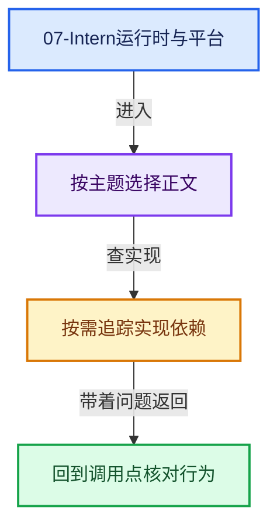
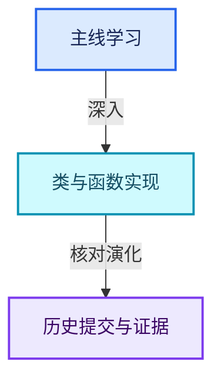

# 07-Intern运行时与平台

[实现依赖总导航](../README.md)

## atomic/intern

- [atomic_ops_ext.h](atomic/intern/atomic_ops_ext.h.md)
- [atomic_ops_msvc.h](atomic/intern/atomic_ops_msvc.h.md)
- [atomic_ops_unix.h](atomic/intern/atomic_ops_unix.h.md)

## clog

- [CLG_log.h](clog/CLG_log.h.md)
- [clog.cc](clog/clog.cc.md)

## cycles/app

- [cycles_standalone.cpp](cycles/app/cycles_standalone.cpp.md)
- [cycles_xml.h](cycles/app/cycles_xml.h.md)

## cycles/blender

- [id_map.h](cycles/blender/id_map.h.md)
- [python.cpp](cycles/blender/python.cpp.md)
- [session.cpp](cycles/blender/session.cpp.md)
- [util.h](cycles/blender/util.h.md)

## cycles/bvh

- [binning.cpp](cycles/bvh/binning.cpp.md)

## cycles/device

- [queue.h](cycles/device/queue.h.md)

## cycles/graph

- [node.cpp](cycles/graph/node.cpp.md)
- [node_type.cpp](cycles/graph/node_type.cpp.md)
- [node_type.h](cycles/graph/node_type.h.md)

## cycles/hydra

- [render_buffer.cpp](cycles/hydra/render_buffer.cpp.md)

## cycles/kernel/device/cuda

- [compat.h](cycles/kernel/device/cuda/compat.h.md)

## cycles/kernel/device/hip

- [compat.h](cycles/kernel/device/hip/compat.h.md)

## cycles/kernel/device/metal

- [compat.h](cycles/kernel/device/metal/compat.h.md)

## cycles/kernel/device/oneapi

- [compat.h](cycles/kernel/device/oneapi/compat.h.md)

## cycles/kernel/integrator

- [guiding.h](cycles/kernel/integrator/guiding.h.md)

## cycles/kernel/osl/shaders

- [node_math.h](cycles/kernel/osl/shaders/node_math.h.md)
- [node_noise.h](cycles/kernel/osl/shaders/node_noise.h.md)
- [node_radial_tiling_shared.h](cycles/kernel/osl/shaders/node_radial_tiling_shared.h.md)

## cycles/kernel/svm

- [radial_tiling_shared.h](cycles/kernel/svm/radial_tiling_shared.h.md)

## cycles/scene

- [attribute.cpp](cycles/scene/attribute.cpp.md)
- [geometry.cpp](cycles/scene/geometry.cpp.md)
- [geometry.h](cycles/scene/geometry.h.md)
- [hair.h](cycles/scene/hair.h.md)
- [image_cache.cpp](cycles/scene/image_cache.cpp.md)
- [image_cache.h](cycles/scene/image_cache.h.md)
- [mesh.cpp](cycles/scene/mesh.cpp.md)
- [mesh.h](cycles/scene/mesh.h.md)
- [pass.cpp](cycles/scene/pass.cpp.md)
- [pointcloud.cpp](cycles/scene/pointcloud.cpp.md)
- [shader_nodes.h](cycles/scene/shader_nodes.h.md)

## cycles/session

- [display_driver.cpp](cycles/session/display_driver.cpp.md)

## cycles/subd

- [osd.cpp](cycles/subd/osd.cpp.md)
- [patch.cpp](cycles/subd/patch.cpp.md)
- [split.cpp](cycles/subd/split.cpp.md)
- [subpatch.h](cycles/subd/subpatch.h.md)

## cycles/test

- [util_half_test.h](cycles/test/util_half_test.h.md)

## cycles/util

- [aligned_malloc.cpp](cycles/util/aligned_malloc.cpp.md)
- [array.h](cycles/util/array.h.md)
- [defines.h](cycles/util/defines.h.md)
- [guarded_allocator.cpp](cycles/util/guarded_allocator.cpp.md)
- [guarded_allocator.h](cycles/util/guarded_allocator.h.md)
- [math_base.h](cycles/util/math_base.h.md)
- [math_dual.h](cycles/util/math_dual.h.md)
- [math_fast.h](cycles/util/math_fast.h.md)
- [math_float2.h](cycles/util/math_float2.h.md)
- [math_float3.h](cycles/util/math_float3.h.md)
- [math_float4.h](cycles/util/math_float4.h.md)
- [math_float8.h](cycles/util/math_float8.h.md)
- [math_int3.h](cycles/util/math_int3.h.md)
- [math_int4.h](cycles/util/math_int4.h.md)
- [math_int8.h](cycles/util/math_int8.h.md)
- [math_quaternion.h](cycles/util/math_quaternion.h.md)
- [path.cpp](cycles/util/path.cpp.md)
- [simd.h](cycles/util/simd.h.md)
- [transform.h](cycles/util/transform.h.md)
- [types_dual.h](cycles/util/types_dual.h.md)
- [types_float2.h](cycles/util/types_float2.h.md)
- [types_float3.h](cycles/util/types_float3.h.md)
- [types_float3x3.h](cycles/util/types_float3x3.h.md)
- [types_float4.h](cycles/util/types_float4.h.md)
- [types_float8.h](cycles/util/types_float8.h.md)
- [types_int3.h](cycles/util/types_int3.h.md)
- [types_int4.h](cycles/util/types_int4.h.md)
- [types_int8.h](cycles/util/types_int8.h.md)
- [types_quaternion.h](cycles/util/types_quaternion.h.md)
- [types_uchar4.h](cycles/util/types_uchar4.h.md)
- [types_uint2.h](cycles/util/types_uint2.h.md)
- [types_uint3.h](cycles/util/types_uint3.h.md)
- [types_uint4.h](cycles/util/types_uint4.h.md)
- [unique_ptr_vector.h](cycles/util/unique_ptr_vector.h.md)

## dbus_dynload/intern

- [dbus_dynload_utils.h](dbus_dynload/intern/dbus_dynload_utils.h.md)

## dualcon/intern

- [dualcon_c_api.cpp](dualcon/intern/dualcon_c_api.cpp.md)
- [octree.cpp](dualcon/intern/octree.cpp.md)
- [octree.h](dualcon/intern/octree.h.md)
- [Projections.cpp](dualcon/intern/Projections.cpp.md)
- [Queue.h](dualcon/intern/Queue.h.md)

## eigen/intern

- [eigenvalues.cc](eigen/intern/eigenvalues.cc.md)
- [linear_solver.cc](eigen/intern/linear_solver.cc.md)
- [matrix.cc](eigen/intern/matrix.cc.md)
- [svd.cc](eigen/intern/svd.cc.md)

## ghost

- [GHOST_IWindow.hh](ghost/GHOST_IWindow.hh.md)
- [GHOST_Rect.hh](ghost/GHOST_Rect.hh.md)
- [GHOST_Types.hh](ghost/GHOST_Types.hh.md)

## ghost/intern

- [GHOST_Debug.hh](ghost/intern/GHOST_Debug.hh.md)
- [GHOST_ImeWin32.cc](ghost/intern/GHOST_ImeWin32.cc.md)
- [GHOST_ISystem.cc](ghost/intern/GHOST_ISystem.cc.md)
- [GHOST_ISystemPaths.cc](ghost/intern/GHOST_ISystemPaths.cc.md)
- [GHOST_NDOFManager.cc](ghost/intern/GHOST_NDOFManager.cc.md)
- [GHOST_System.cc](ghost/intern/GHOST_System.cc.md)
- [GHOST_SystemWayland.cc](ghost/intern/GHOST_SystemWayland.cc.md)
- [GHOST_utildefines.hh](ghost/intern/GHOST_utildefines.hh.md)
- [GHOST_Window.cc](ghost/intern/GHOST_Window.cc.md)
- [GHOST_Window.hh](ghost/intern/GHOST_Window.hh.md)
- [GHOST_WindowSDL.cc](ghost/intern/GHOST_WindowSDL.cc.md)
- [GHOST_WindowWayland.cc](ghost/intern/GHOST_WindowWayland.cc.md)
- [GHOST_WindowWin32.cc](ghost/intern/GHOST_WindowWin32.cc.md)
- [GHOST_WindowX11.cc](ghost/intern/GHOST_WindowX11.cc.md)
- [GHOST_XrException.hh](ghost/intern/GHOST_XrException.hh.md)

## guardedalloc

- [MEM_guardedalloc.h](guardedalloc/MEM_guardedalloc.h.md)
- [MEM_safe_multiply.h](guardedalloc/MEM_safe_multiply.h.md)

## guardedalloc/intern

- [leak_detector.cc](guardedalloc/intern/leak_detector.cc.md)
- [mallocn.cc](guardedalloc/intern/mallocn.cc.md)
- [mallocn_guarded_impl.cc](guardedalloc/intern/mallocn_guarded_impl.cc.md)
- [mallocn_inline.hh](guardedalloc/intern/mallocn_inline.hh.md)
- [mallocn_intern.hh](guardedalloc/intern/mallocn_intern.hh.md)
- [mallocn_lockfree_impl.cc](guardedalloc/intern/mallocn_lockfree_impl.cc.md)
- [memory_usage.cc](guardedalloc/intern/memory_usage.cc.md)

## iksolver/intern

- [IK_Math.h](iksolver/intern/IK_Math.h.md)

## itasc

- [Object.hpp](itasc/Object.hpp.md)

## itasc/kdl

- [frames.hpp](itasc/kdl/frames.hpp.md)

## itasc/kdl/utilities

- [rall2d.h](itasc/kdl/utilities/rall2d.h.md)
- [traits.h](itasc/kdl/utilities/traits.h.md)

## libmv/intern

- [camera_intrinsics.cc](libmv/intern/camera_intrinsics.cc.md)
- [homography.cc](libmv/intern/homography.cc.md)
- [stub.cc](libmv/intern/stub.cc.md)
- [utildefines.h](libmv/intern/utildefines.h.md)

## libmv/libmv/autotrack

- [marker.h](libmv/libmv/autotrack/marker.h.md)

## libmv/libmv/multiview

- [conditioning.cc](libmv/libmv/multiview/conditioning.cc.md)
- [homography.cc](libmv/libmv/multiview/homography.cc.md)
- [homography_parameterization.h](libmv/libmv/multiview/homography_parameterization.h.md)
- [projection.cc](libmv/libmv/multiview/projection.cc.md)
- [projection.h](libmv/libmv/multiview/projection.h.md)

## libmv/libmv/numeric

- [dogleg.h](libmv/libmv/numeric/dogleg.h.md)
- [levenberg_marquardt.h](libmv/libmv/numeric/levenberg_marquardt.h.md)
- [numeric.cc](libmv/libmv/numeric/numeric.cc.md)
- [numeric.h](libmv/libmv/numeric/numeric.h.md)

## libmv/libmv/simple_pipeline

- [camera_intrinsics.cc](libmv/libmv/simple_pipeline/camera_intrinsics.cc.md)
- [camera_intrinsics.h](libmv/libmv/simple_pipeline/camera_intrinsics.h.md)
- [camera_intrinsics_impl.h](libmv/libmv/simple_pipeline/camera_intrinsics_impl.h.md)

## mantaflow/intern

- [manta_fluid_API.cpp](mantaflow/intern/manta_fluid_API.cpp.md)
- [MANTA_main.h](mantaflow/intern/MANTA_main.h.md)

## memutil

- [MEM_alloc_string_storage.hh](memutil/MEM_alloc_string_storage.hh.md)
- [MEM_CacheLimiter.h](memutil/MEM_CacheLimiter.h.md)

## memutil/intern

- [MEM_alloc_string_storage.cc](memutil/intern/MEM_alloc_string_storage.cc.md)
- [MEM_CacheLimiterC-Api.cpp](memutil/intern/MEM_CacheLimiterC-Api.cpp.md)

## mikktspace

- [mikk_atomic_hash_set.hh](mikktspace/mikk_atomic_hash_set.hh.md)
- [mikk_float3.hh](mikktspace/mikk_float3.hh.md)
- [mikk_util.hh](mikktspace/mikk_util.hh.md)
- [mikktspace.hh](mikktspace/mikktspace.hh.md)

## opensubdiv

- [opensubdiv_capi_type.hh](opensubdiv/opensubdiv_capi_type.hh.md)
- [opensubdiv_topology_refiner.hh](opensubdiv/opensubdiv_topology_refiner.hh.md)

## opensubdiv/internal/base

- [type_convert.cc](opensubdiv/internal/base/type_convert.cc.md)

## opensubdiv/internal/evaluator

- [evaluator_cache_impl.cc](opensubdiv/internal/evaluator/evaluator_cache_impl.cc.md)
- [evaluator_capi.cc](opensubdiv/internal/evaluator/evaluator_capi.cc.md)
- [evaluator_impl.cc](opensubdiv/internal/evaluator/evaluator_impl.cc.md)
- [gpu_patch_table.cc](opensubdiv/internal/evaluator/gpu_patch_table.cc.md)
- [gpu_patch_table.hh](opensubdiv/internal/evaluator/gpu_patch_table.hh.md)

## opensubdiv/internal/topology

- [topology_refiner_factory.cc](opensubdiv/internal/topology/topology_refiner_factory.cc.md)

## opensubdiv/stub

- [opensubdiv_evaluator_stub.cc](opensubdiv/stub/opensubdiv_evaluator_stub.cc.md)

## profile

- [PRF_profile.hh](profile/PRF_profile.hh.md)

## rigidbody

- [rb_bullet_api.cpp](rigidbody/rb_bullet_api.cpp.md)

## sky/source

- [sky_math.h](sky/source/sky_math.h.md)

## utfconv

- [utf_winfunc.cc](utfconv/utf_winfunc.cc.md)
- [utfconv.cc](utfconv/utfconv.cc.md)
- [utfconv.hh](utfconv/utfconv.hh.md)

## wayland_dynload/extern

- [wayland_dynload_client.h](wayland_dynload/extern/wayland_dynload_client.h.md)

## wayland_dynload/intern

- [wayland_dynload_client.c](wayland_dynload/intern/wayland_dynload_client.c.md)
- [wayland_dynload_cursor.c](wayland_dynload/intern/wayland_dynload_cursor.c.md)
- [wayland_dynload_egl.c](wayland_dynload/intern/wayland_dynload_egl.c.md)
- [wayland_dynload_utils.h](wayland_dynload/intern/wayland_dynload_utils.h.md)

