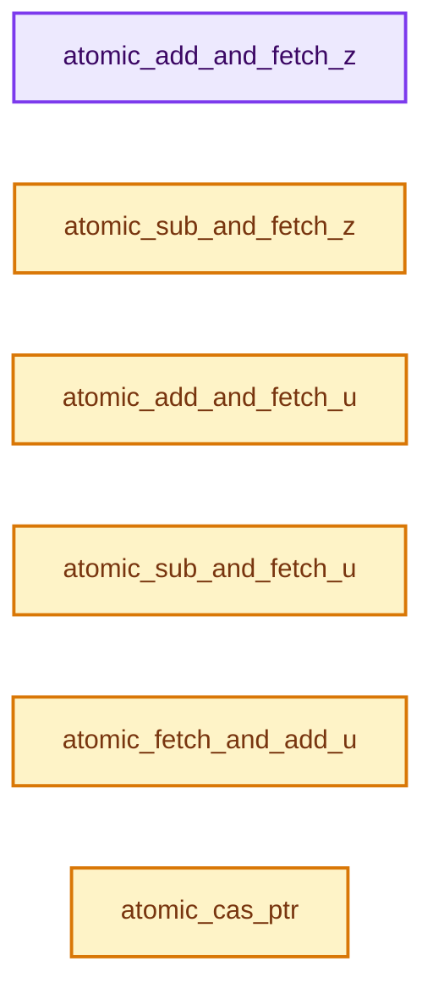

# 实现依赖专题：intern/atomic/intern/atomic_ops_ext.h

[实现依赖导航](../../../README.md) · [符号索引](../../../../00-课程指南/02-源码与提交索引/符号依赖与实现索引.md)

本专题从正文实际调用进入，集中保存共享实现。函数有稳定锚点，可从调用处直接跳到对应完整函数；递归与互相调用通过回链组织。

## 本文件的实现关系




## 完整成员与函数实现

<a id="f-9fbfc0f4f649e839"></a>

### `atomic_add_and_fetch_z`

实现位置：[intern/atomic/intern/atomic_ops_ext.h](../../../../../../../../intern/atomic/intern/atomic_ops_ext.h) · L58—L65。

接口参数：

- `size_t *p`
- `size_t x`

**教学注释版**

<!-- annotated:f5beb92bbc6c98 -->

```cpp
ATOMIC_INLINE size_t atomic_add_and_fetch_z(size_t *p, size_t x)
{
#if (LG_SIZEOF_PTR == 8)
  return (size_t)atomic_add_and_fetch_uint64((uint64_t *)p, (uint64_t)x);
#elif (LG_SIZEOF_PTR == 4)
  return (size_t)atomic_add_and_fetch_uint32((uint32_t *)p, (uint32_t)x);
#endif
}
```

<details>
<summary>核对原始源码：intern/atomic/intern/atomic_ops_ext.h · L58—L65</summary>

<!-- original:f5beb92bbc6c98:intern/atomic/intern/atomic_ops_ext.h:58:65 -->

```cpp
ATOMIC_INLINE size_t atomic_add_and_fetch_z(size_t *p, size_t x)
{
#if (LG_SIZEOF_PTR == 8)
  return (size_t)atomic_add_and_fetch_uint64((uint64_t *)p, (uint64_t)x);
#elif (LG_SIZEOF_PTR == 4)
  return (size_t)atomic_add_and_fetch_uint32((uint32_t *)p, (uint32_t)x);
#endif
}
```

</details>

**结果出口**

- `return (size_t)atomic_add_and_fetch_uint64((uint64_t *)p, (uint64_t)x);`
- `return (size_t)atomic_add_and_fetch_uint32((uint32_t *)p, (uint32_t)x);`

**继续追踪实现**

- `atomic_add_and_fetch_uint64` → [atomic_add_and_fetch_uint64 · L201](atomic_ops_unix.h.md#f-0e7c802ba1d56748)；[atomic_add_and_fetch_uint64 · L293](atomic_ops_unix.h.md#f-0ebba2fb24e8e989)；[atomic_add_and_fetch_uint64 · L63](atomic_ops_msvc.h.md#f-ee2943926eb39bf4)。同名重载需按实参类型选择。
- `atomic_add_and_fetch_uint32` → [atomic_add_and_fetch_uint32 · L405](atomic_ops_unix.h.md#f-ccc6c873ba01b33f)；[atomic_add_and_fetch_uint32 · L459](atomic_ops_unix.h.md#f-d0997e43fa9ccc74)；[atomic_add_and_fetch_uint32 · L137](atomic_ops_msvc.h.md#f-12392044c659d919)。同名重载需按实参类型选择。

<a id="f-a4e285627c757bd9"></a>

### `atomic_sub_and_fetch_z`

实现位置：[intern/atomic/intern/atomic_ops_ext.h](../../../../../../../../intern/atomic/intern/atomic_ops_ext.h) · L67—L74。

接口参数：

- `size_t *p`
- `size_t x`

**教学注释版**

<!-- annotated:4abcd8ea462b66 -->

```cpp
ATOMIC_INLINE size_t atomic_sub_and_fetch_z(size_t *p, size_t x)
{
#if (LG_SIZEOF_PTR == 8)
  return (size_t)atomic_add_and_fetch_uint64((uint64_t *)p, (uint64_t)-((int64_t)x));
#elif (LG_SIZEOF_PTR == 4)
  return (size_t)atomic_add_and_fetch_uint32((uint32_t *)p, (uint32_t)-((int32_t)x));
#endif
}
```

<details>
<summary>核对原始源码：intern/atomic/intern/atomic_ops_ext.h · L67—L74</summary>

<!-- original:4abcd8ea462b66:intern/atomic/intern/atomic_ops_ext.h:67:74 -->

```cpp
ATOMIC_INLINE size_t atomic_sub_and_fetch_z(size_t *p, size_t x)
{
#if (LG_SIZEOF_PTR == 8)
  return (size_t)atomic_add_and_fetch_uint64((uint64_t *)p, (uint64_t)-((int64_t)x));
#elif (LG_SIZEOF_PTR == 4)
  return (size_t)atomic_add_and_fetch_uint32((uint32_t *)p, (uint32_t)-((int32_t)x));
#endif
}
```

</details>

**结果出口**

- `return (size_t)atomic_add_and_fetch_uint64((uint64_t *)p, (uint64_t)-((int64_t)x));`
- `return (size_t)atomic_add_and_fetch_uint32((uint32_t *)p, (uint32_t)-((int32_t)x));`

**继续追踪实现**

- `atomic_add_and_fetch_uint64` → [atomic_add_and_fetch_uint64 · L201](atomic_ops_unix.h.md#f-0e7c802ba1d56748)；[atomic_add_and_fetch_uint64 · L293](atomic_ops_unix.h.md#f-0ebba2fb24e8e989)；[atomic_add_and_fetch_uint64 · L63](atomic_ops_msvc.h.md#f-ee2943926eb39bf4)。同名重载需按实参类型选择。
- `atomic_add_and_fetch_uint32` → [atomic_add_and_fetch_uint32 · L405](atomic_ops_unix.h.md#f-ccc6c873ba01b33f)；[atomic_add_and_fetch_uint32 · L459](atomic_ops_unix.h.md#f-d0997e43fa9ccc74)；[atomic_add_and_fetch_uint32 · L137](atomic_ops_msvc.h.md#f-12392044c659d919)。同名重载需按实参类型选择。

<a id="f-c5c7b5e130dd3f41"></a>

### `atomic_add_and_fetch_u`

实现位置：[intern/atomic/intern/atomic_ops_ext.h](../../../../../../../../intern/atomic/intern/atomic_ops_ext.h) · L137—L144。

接口参数：

- `unsigned int *p`
- `unsigned int x`

**教学注释版**

<!-- annotated:f307f486c1c970 -->

```cpp
ATOMIC_INLINE unsigned int atomic_add_and_fetch_u(unsigned int *p, unsigned int x)
{
#if (LG_SIZEOF_INT == 8)
  return (unsigned int)atomic_add_and_fetch_uint64((uint64_t *)p, (uint64_t)x);
#elif (LG_SIZEOF_INT == 4)
  return (unsigned int)atomic_add_and_fetch_uint32((uint32_t *)p, (uint32_t)x);
#endif
}
```

<details>
<summary>核对原始源码：intern/atomic/intern/atomic_ops_ext.h · L137—L144</summary>

<!-- original:f307f486c1c970:intern/atomic/intern/atomic_ops_ext.h:137:144 -->

```cpp
ATOMIC_INLINE unsigned int atomic_add_and_fetch_u(unsigned int *p, unsigned int x)
{
#if (LG_SIZEOF_INT == 8)
  return (unsigned int)atomic_add_and_fetch_uint64((uint64_t *)p, (uint64_t)x);
#elif (LG_SIZEOF_INT == 4)
  return (unsigned int)atomic_add_and_fetch_uint32((uint32_t *)p, (uint32_t)x);
#endif
}
```

</details>

**结果出口**

- `return (unsigned int)atomic_add_and_fetch_uint64((uint64_t *)p, (uint64_t)x);`
- `return (unsigned int)atomic_add_and_fetch_uint32((uint32_t *)p, (uint32_t)x);`

**继续追踪实现**

- `atomic_add_and_fetch_uint64` → [atomic_add_and_fetch_uint64 · L201](atomic_ops_unix.h.md#f-0e7c802ba1d56748)；[atomic_add_and_fetch_uint64 · L293](atomic_ops_unix.h.md#f-0ebba2fb24e8e989)；[atomic_add_and_fetch_uint64 · L63](atomic_ops_msvc.h.md#f-ee2943926eb39bf4)。同名重载需按实参类型选择。
- `atomic_add_and_fetch_uint32` → [atomic_add_and_fetch_uint32 · L405](atomic_ops_unix.h.md#f-ccc6c873ba01b33f)；[atomic_add_and_fetch_uint32 · L459](atomic_ops_unix.h.md#f-d0997e43fa9ccc74)；[atomic_add_and_fetch_uint32 · L137](atomic_ops_msvc.h.md#f-12392044c659d919)。同名重载需按实参类型选择。

<a id="f-b124689f7b317d03"></a>

### `atomic_sub_and_fetch_u`

实现位置：[intern/atomic/intern/atomic_ops_ext.h](../../../../../../../../intern/atomic/intern/atomic_ops_ext.h) · L146—L153。

接口参数：

- `unsigned int *p`
- `unsigned int x`

**教学注释版**

<!-- annotated:165cfb26b393ee -->

```cpp
ATOMIC_INLINE unsigned int atomic_sub_and_fetch_u(unsigned int *p, unsigned int x)
{
#if (LG_SIZEOF_INT == 8)
  return (unsigned int)atomic_add_and_fetch_uint64((uint64_t *)p, (uint64_t)-((int64_t)x));
#elif (LG_SIZEOF_INT == 4)
  return (unsigned int)atomic_add_and_fetch_uint32((uint32_t *)p, (uint32_t)-((int32_t)x));
#endif
}
```

<details>
<summary>核对原始源码：intern/atomic/intern/atomic_ops_ext.h · L146—L153</summary>

<!-- original:165cfb26b393ee:intern/atomic/intern/atomic_ops_ext.h:146:153 -->

```cpp
ATOMIC_INLINE unsigned int atomic_sub_and_fetch_u(unsigned int *p, unsigned int x)
{
#if (LG_SIZEOF_INT == 8)
  return (unsigned int)atomic_add_and_fetch_uint64((uint64_t *)p, (uint64_t)-((int64_t)x));
#elif (LG_SIZEOF_INT == 4)
  return (unsigned int)atomic_add_and_fetch_uint32((uint32_t *)p, (uint32_t)-((int32_t)x));
#endif
}
```

</details>

**结果出口**

- `return (unsigned int)atomic_add_and_fetch_uint64((uint64_t *)p, (uint64_t)-((int64_t)x));`
- `return (unsigned int)atomic_add_and_fetch_uint32((uint32_t *)p, (uint32_t)-((int32_t)x));`

**继续追踪实现**

- `atomic_add_and_fetch_uint64` → [atomic_add_and_fetch_uint64 · L201](atomic_ops_unix.h.md#f-0e7c802ba1d56748)；[atomic_add_and_fetch_uint64 · L293](atomic_ops_unix.h.md#f-0ebba2fb24e8e989)；[atomic_add_and_fetch_uint64 · L63](atomic_ops_msvc.h.md#f-ee2943926eb39bf4)。同名重载需按实参类型选择。
- `atomic_add_and_fetch_uint32` → [atomic_add_and_fetch_uint32 · L405](atomic_ops_unix.h.md#f-ccc6c873ba01b33f)；[atomic_add_and_fetch_uint32 · L459](atomic_ops_unix.h.md#f-d0997e43fa9ccc74)；[atomic_add_and_fetch_uint32 · L137](atomic_ops_msvc.h.md#f-12392044c659d919)。同名重载需按实参类型选择。

<a id="f-91b4f2c7355f5f6d"></a>

### `atomic_fetch_and_add_u`

实现位置：[intern/atomic/intern/atomic_ops_ext.h](../../../../../../../../intern/atomic/intern/atomic_ops_ext.h) · L155—L162。

接口参数：

- `unsigned int *p`
- `unsigned int x`

**教学注释版**

<!-- annotated:193d9eaf025568 -->

```cpp
ATOMIC_INLINE unsigned int atomic_fetch_and_add_u(unsigned int *p, unsigned int x)
{
#if (LG_SIZEOF_INT == 8)
  return (unsigned int)atomic_fetch_and_add_uint64((uint64_t *)p, (uint64_t)x);
#elif (LG_SIZEOF_INT == 4)
  return (unsigned int)atomic_fetch_and_add_uint32((uint32_t *)p, (uint32_t)x);
#endif
}
```

<details>
<summary>核对原始源码：intern/atomic/intern/atomic_ops_ext.h · L155—L162</summary>

<!-- original:193d9eaf025568:intern/atomic/intern/atomic_ops_ext.h:155:162 -->

```cpp
ATOMIC_INLINE unsigned int atomic_fetch_and_add_u(unsigned int *p, unsigned int x)
{
#if (LG_SIZEOF_INT == 8)
  return (unsigned int)atomic_fetch_and_add_uint64((uint64_t *)p, (uint64_t)x);
#elif (LG_SIZEOF_INT == 4)
  return (unsigned int)atomic_fetch_and_add_uint32((uint32_t *)p, (uint32_t)x);
#endif
}
```

</details>

**结果出口**

- `return (unsigned int)atomic_fetch_and_add_uint64((uint64_t *)p, (uint64_t)x);`
- `return (unsigned int)atomic_fetch_and_add_uint32((uint32_t *)p, (uint32_t)x);`

**继续追踪实现**

- `atomic_fetch_and_add_uint64` → [atomic_fetch_and_add_uint64 · L211](atomic_ops_unix.h.md#f-16832c42d56d141c)；[atomic_fetch_and_add_uint64 · L274](atomic_ops_unix.h.md#f-fd4cb2ba2297a3de)；[atomic_fetch_and_add_uint64 · L88](atomic_ops_msvc.h.md#f-8c32fca2fe056bf5)。同名重载需按实参类型选择。
- `atomic_fetch_and_add_uint32` → [atomic_fetch_and_add_uint32 · L561](atomic_ops_unix.h.md#f-c6b141643197ec85)；[atomic_fetch_and_add_uint32 · L162](atomic_ops_msvc.h.md#f-da60c016920ae657)。同名重载需按实参类型选择。

<a id="f-ee2a2811444a3927"></a>

### `atomic_cas_ptr`

实现位置：[intern/atomic/intern/atomic_ops_ext.h](../../../../../../../../intern/atomic/intern/atomic_ops_ext.h) · L197—L204。

接口参数：

- `void **v`
- `void *old`
- `void *_new`

**教学注释版**

<!-- annotated:c823bf2d452667 -->

```cpp
ATOMIC_INLINE void *atomic_cas_ptr(void **v, void *old, void *_new)
{
#if (LG_SIZEOF_PTR == 8)
  return (void *)atomic_cas_uint64((uint64_t *)v, *(uint64_t *)&old, *(uint64_t *)&_new);
#elif (LG_SIZEOF_PTR == 4)
  return (void *)atomic_cas_uint32((uint32_t *)v, *(uint32_t *)&old, *(uint32_t *)&_new);
#endif
}
```

<details>
<summary>核对原始源码：intern/atomic/intern/atomic_ops_ext.h · L197—L204</summary>

<!-- original:c823bf2d452667:intern/atomic/intern/atomic_ops_ext.h:197:204 -->

```cpp
ATOMIC_INLINE void *atomic_cas_ptr(void **v, void *old, void *_new)
{
#if (LG_SIZEOF_PTR == 8)
  return (void *)atomic_cas_uint64((uint64_t *)v, *(uint64_t *)&old, *(uint64_t *)&_new);
#elif (LG_SIZEOF_PTR == 4)
  return (void *)atomic_cas_uint32((uint32_t *)v, *(uint32_t *)&old, *(uint32_t *)&_new);
#endif
}
```

</details>

**结果出口**

- `return (void *)atomic_cas_uint64((uint64_t *)v, *(uint64_t *)&old, *(uint64_t *)&_new);`
- `return (void *)atomic_cas_uint32((uint32_t *)v, *(uint32_t *)&old, *(uint32_t *)&_new);`

**继续追踪实现**

- `atomic_cas_uint64` → [atomic_cas_uint64 · L221](atomic_ops_unix.h.md#f-5055945524b7f9e8)；[atomic_cas_uint64 · L303](atomic_ops_unix.h.md#f-9e680e75b617d344)；[atomic_cas_uint64 · L73](atomic_ops_msvc.h.md#f-91eeb5b8651726a3)。同名重载需按实参类型选择。
- `atomic_cas_uint32` → [atomic_cas_uint32 · L415](atomic_ops_unix.h.md#f-2d4a8cf29e810e05)；[atomic_cas_uint32 · L479](atomic_ops_unix.h.md#f-0eed41bd101d8ade)；[atomic_cas_uint32 · L147](atomic_ops_msvc.h.md#f-3a3791fc8812a6bc)。同名重载需按实参类型选择。
