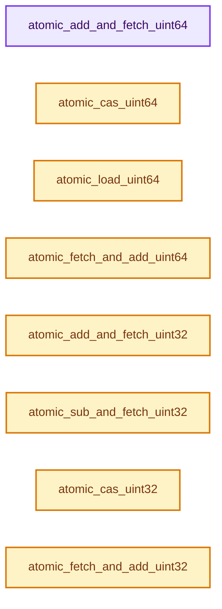

# 实现依赖专题：intern/atomic/intern/atomic_ops_msvc.h

[实现依赖导航](../../../README.md) · [符号索引](../../../../00-课程指南/02-源码与提交索引/符号依赖与实现索引.md)

本专题从正文实际调用进入，集中保存共享实现。函数有稳定锚点，可从调用处直接跳到对应完整函数；递归与互相调用通过回链组织。

## 本文件的实现关系




<a id="m-abccecb9494c"></a>

## 宏 `__atomic_impl_load_generic`

<!-- annotated:fdcbd62feba023 -->

```cpp
#define __atomic_impl_load_generic(v) (MemoryBarrier(), *(v))
#define __atomic_impl_store_generic(p, v) \
```

<details>
<summary>核对原始源码：intern/atomic/intern/atomic_ops_msvc.h · L54—L55</summary>

<!-- original:fdcbd62feba023:intern/atomic/intern/atomic_ops_msvc.h:54:55 -->

```cpp
#define __atomic_impl_load_generic(v) (MemoryBarrier(), *(v))
#define __atomic_impl_store_generic(p, v) \
```

</details>

宏在预处理阶段展开，参数替换、重复求值和条件编译应直接从该定义检查。与普通函数不同，宏不会自动提供参数类型检查；构建配置选择哪个定义需结合外围条件。

## 完整成员与函数实现

<a id="f-ee2943926eb39bf4"></a>

### `atomic_add_and_fetch_uint64`

实现位置：[intern/atomic/intern/atomic_ops_msvc.h](../../../../../../../../intern/atomic/intern/atomic_ops_msvc.h) · L63—L66。

接口参数：

- `uint64_t *p`
- `uint64_t x`

**教学注释版**

<!-- annotated:d461ef5d1e8996 -->

```cpp
ATOMIC_INLINE uint64_t atomic_add_and_fetch_uint64(uint64_t *p, uint64_t x)
{
  return InterlockedExchangeAdd64((int64_t *)p, (int64_t)x) + x;
}
```

<details>
<summary>核对原始源码：intern/atomic/intern/atomic_ops_msvc.h · L63—L66</summary>

<!-- original:d461ef5d1e8996:intern/atomic/intern/atomic_ops_msvc.h:63:66 -->

```cpp
ATOMIC_INLINE uint64_t atomic_add_and_fetch_uint64(uint64_t *p, uint64_t x)
{
  return InterlockedExchangeAdd64((int64_t *)p, (int64_t)x) + x;
}
```

</details>

**结果出口**

- `return InterlockedExchangeAdd64((int64_t *)p, (int64_t)x) + x;`

**继续追踪实现**

- `InterlockedExchangeAdd64` → [调用协议](../../../../00-课程指南/01-路线与规范/模板宏与动态分派协议.md)：函数指针、局部可调用对象或未展开的宏；必须结合调用者环境。调用位置L65。

<a id="f-91eeb5b8651726a3"></a>

### `atomic_cas_uint64`

实现位置：[intern/atomic/intern/atomic_ops_msvc.h](../../../../../../../../intern/atomic/intern/atomic_ops_msvc.h) · L73—L76。

接口参数：

- `uint64_t *v`
- `uint64_t old`
- `uint64_t _new`

**教学注释版**

<!-- annotated:7f5cbd3c2b2059 -->

```cpp
ATOMIC_INLINE uint64_t atomic_cas_uint64(uint64_t *v, uint64_t old, uint64_t _new)
{
  return InterlockedCompareExchange64((int64_t *)v, _new, old);
}
```

<details>
<summary>核对原始源码：intern/atomic/intern/atomic_ops_msvc.h · L73—L76</summary>

<!-- original:7f5cbd3c2b2059:intern/atomic/intern/atomic_ops_msvc.h:73:76 -->

```cpp
ATOMIC_INLINE uint64_t atomic_cas_uint64(uint64_t *v, uint64_t old, uint64_t _new)
{
  return InterlockedCompareExchange64((int64_t *)v, _new, old);
}
```

</details>

**结果出口**

- `return InterlockedCompareExchange64((int64_t *)v, _new, old);`

**继续追踪实现**

- `InterlockedCompareExchange64` → [调用协议](../../../../00-课程指南/01-路线与规范/模板宏与动态分派协议.md)：函数指针、局部可调用对象或未展开的宏；必须结合调用者环境。调用位置L75。

<a id="f-b8df0cc91e7c983d"></a>

### `atomic_load_uint64`

实现位置：[intern/atomic/intern/atomic_ops_msvc.h](../../../../../../../../intern/atomic/intern/atomic_ops_msvc.h) · L78—L81。

接口参数：

- `const uint64_t *v`

**教学注释版**

<!-- annotated:5450b8c6bab4ab -->

```cpp
ATOMIC_INLINE uint64_t atomic_load_uint64(const uint64_t *v)
{
  return __atomic_impl_load_generic(v);
}
```

<details>
<summary>核对原始源码：intern/atomic/intern/atomic_ops_msvc.h · L78—L81</summary>

<!-- original:5450b8c6bab4ab:intern/atomic/intern/atomic_ops_msvc.h:78:81 -->

```cpp
ATOMIC_INLINE uint64_t atomic_load_uint64(const uint64_t *v)
{
  return __atomic_impl_load_generic(v);
}
```

</details>

**结果出口**

- `return __atomic_impl_load_generic(v);`

**继续追踪实现**

- `__atomic_impl_load_generic` → [__atomic_impl_load_generic · L54](atomic_ops_msvc.h.md#m-abccecb9494c)。宏定义由构建条件选择。

<a id="f-8c32fca2fe056bf5"></a>

### `atomic_fetch_and_add_uint64`

实现位置：[intern/atomic/intern/atomic_ops_msvc.h](../../../../../../../../intern/atomic/intern/atomic_ops_msvc.h) · L88—L91。

接口参数：

- `uint64_t *p`
- `uint64_t x`

**教学注释版**

<!-- annotated:5991f4549b4c4f -->

```cpp
ATOMIC_INLINE uint64_t atomic_fetch_and_add_uint64(uint64_t *p, uint64_t x)
{
  return InterlockedExchangeAdd64((int64_t *)p, (int64_t)x);
}
```

<details>
<summary>核对原始源码：intern/atomic/intern/atomic_ops_msvc.h · L88—L91</summary>

<!-- original:5991f4549b4c4f:intern/atomic/intern/atomic_ops_msvc.h:88:91 -->

```cpp
ATOMIC_INLINE uint64_t atomic_fetch_and_add_uint64(uint64_t *p, uint64_t x)
{
  return InterlockedExchangeAdd64((int64_t *)p, (int64_t)x);
}
```

</details>

**结果出口**

- `return InterlockedExchangeAdd64((int64_t *)p, (int64_t)x);`

**继续追踪实现**

- `InterlockedExchangeAdd64` → [调用协议](../../../../00-课程指南/01-路线与规范/模板宏与动态分派协议.md)：函数指针、局部可调用对象或未展开的宏；必须结合调用者环境。调用位置L90。

<a id="f-12392044c659d919"></a>

### `atomic_add_and_fetch_uint32`

实现位置：[intern/atomic/intern/atomic_ops_msvc.h](../../../../../../../../intern/atomic/intern/atomic_ops_msvc.h) · L137—L140。

接口参数：

- `uint32_t *p`
- `uint32_t x`

**教学注释版**

<!-- annotated:2f562b97c4085e -->

```cpp
ATOMIC_INLINE uint32_t atomic_add_and_fetch_uint32(uint32_t *p, uint32_t x)
{
  return InterlockedExchangeAdd(p, x) + x;
}
```

<details>
<summary>核对原始源码：intern/atomic/intern/atomic_ops_msvc.h · L137—L140</summary>

<!-- original:2f562b97c4085e:intern/atomic/intern/atomic_ops_msvc.h:137:140 -->

```cpp
ATOMIC_INLINE uint32_t atomic_add_and_fetch_uint32(uint32_t *p, uint32_t x)
{
  return InterlockedExchangeAdd(p, x) + x;
}
```

</details>

**结果出口**

- `return InterlockedExchangeAdd(p, x) + x;`

**继续追踪实现**

- `InterlockedExchangeAdd` → [调用协议](../../../../00-课程指南/01-路线与规范/模板宏与动态分派协议.md)：函数指针、局部可调用对象或未展开的宏；必须结合调用者环境。调用位置L139。

<a id="f-4b20d18e04ff9a8f"></a>

### `atomic_sub_and_fetch_uint32`

实现位置：[intern/atomic/intern/atomic_ops_msvc.h](../../../../../../../../intern/atomic/intern/atomic_ops_msvc.h) · L142—L145。

接口参数：

- `uint32_t *p`
- `uint32_t x`

**教学注释版**

<!-- annotated:72cebf33782a54 -->

```cpp
ATOMIC_INLINE uint32_t atomic_sub_and_fetch_uint32(uint32_t *p, uint32_t x)
{
  return InterlockedExchangeAdd(p, -((int32_t)x)) - x;
}
```

<details>
<summary>核对原始源码：intern/atomic/intern/atomic_ops_msvc.h · L142—L145</summary>

<!-- original:72cebf33782a54:intern/atomic/intern/atomic_ops_msvc.h:142:145 -->

```cpp
ATOMIC_INLINE uint32_t atomic_sub_and_fetch_uint32(uint32_t *p, uint32_t x)
{
  return InterlockedExchangeAdd(p, -((int32_t)x)) - x;
}
```

</details>

**结果出口**

- `return InterlockedExchangeAdd(p, -((int32_t)x)) - x;`

**继续追踪实现**

- `InterlockedExchangeAdd` → [调用协议](../../../../00-课程指南/01-路线与规范/模板宏与动态分派协议.md)：函数指针、局部可调用对象或未展开的宏；必须结合调用者环境。调用位置L144。

<a id="f-3a3791fc8812a6bc"></a>

### `atomic_cas_uint32`

实现位置：[intern/atomic/intern/atomic_ops_msvc.h](../../../../../../../../intern/atomic/intern/atomic_ops_msvc.h) · L147—L150。

接口参数：

- `uint32_t *v`
- `uint32_t old`
- `uint32_t _new`

**教学注释版**

<!-- annotated:70d290d7797ecd -->

```cpp
ATOMIC_INLINE uint32_t atomic_cas_uint32(uint32_t *v, uint32_t old, uint32_t _new)
{
  return InterlockedCompareExchange((long *)v, _new, old);
}
```

<details>
<summary>核对原始源码：intern/atomic/intern/atomic_ops_msvc.h · L147—L150</summary>

<!-- original:70d290d7797ecd:intern/atomic/intern/atomic_ops_msvc.h:147:150 -->

```cpp
ATOMIC_INLINE uint32_t atomic_cas_uint32(uint32_t *v, uint32_t old, uint32_t _new)
{
  return InterlockedCompareExchange((long *)v, _new, old);
}
```

</details>

**结果出口**

- `return InterlockedCompareExchange((long *)v, _new, old);`

**继续追踪实现**

- `InterlockedCompareExchange` → [调用协议](../../../../00-课程指南/01-路线与规范/模板宏与动态分派协议.md)：函数指针、局部可调用对象或未展开的宏；必须结合调用者环境。调用位置L149。

<a id="f-da60c016920ae657"></a>

### `atomic_fetch_and_add_uint32`

实现位置：[intern/atomic/intern/atomic_ops_msvc.h](../../../../../../../../intern/atomic/intern/atomic_ops_msvc.h) · L162—L165。

接口参数：

- `uint32_t *p`
- `uint32_t x`

**教学注释版**

<!-- annotated:aaae8f547391cf -->

```cpp
ATOMIC_INLINE uint32_t atomic_fetch_and_add_uint32(uint32_t *p, uint32_t x)
{
  return InterlockedExchangeAdd(p, x);
}
```

<details>
<summary>核对原始源码：intern/atomic/intern/atomic_ops_msvc.h · L162—L165</summary>

<!-- original:aaae8f547391cf:intern/atomic/intern/atomic_ops_msvc.h:162:165 -->

```cpp
ATOMIC_INLINE uint32_t atomic_fetch_and_add_uint32(uint32_t *p, uint32_t x)
{
  return InterlockedExchangeAdd(p, x);
}
```

</details>

**结果出口**

- `return InterlockedExchangeAdd(p, x);`

**继续追踪实现**

- `InterlockedExchangeAdd` → [调用协议](../../../../00-课程指南/01-路线与规范/模板宏与动态分派协议.md)：函数指针、局部可调用对象或未展开的宏；必须结合调用者环境。调用位置L164。

<a id="f-ad0d6431f7ff3567"></a>

### `atomic_add_and_fetch_int32`

实现位置：[intern/atomic/intern/atomic_ops_msvc.h](../../../../../../../../intern/atomic/intern/atomic_ops_msvc.h) · L178—L181。

接口参数：

- `int32_t *p`
- `int32_t x`

**教学注释版**

<!-- annotated:4d110c5b1aaf18 -->

```cpp
ATOMIC_INLINE int32_t atomic_add_and_fetch_int32(int32_t *p, int32_t x)
{
  return InterlockedExchangeAdd((long *)p, x) + x;
}
```

<details>
<summary>核对原始源码：intern/atomic/intern/atomic_ops_msvc.h · L178—L181</summary>

<!-- original:4d110c5b1aaf18:intern/atomic/intern/atomic_ops_msvc.h:178:181 -->

```cpp
ATOMIC_INLINE int32_t atomic_add_and_fetch_int32(int32_t *p, int32_t x)
{
  return InterlockedExchangeAdd((long *)p, x) + x;
}
```

</details>

**结果出口**

- `return InterlockedExchangeAdd((long *)p, x) + x;`

**继续追踪实现**

- `InterlockedExchangeAdd` → [调用协议](../../../../00-课程指南/01-路线与规范/模板宏与动态分派协议.md)：函数指针、局部可调用对象或未展开的宏；必须结合调用者环境。调用位置L180。

<a id="f-b5406bc92bea67f3"></a>

### `atomic_sub_and_fetch_int32`

实现位置：[intern/atomic/intern/atomic_ops_msvc.h](../../../../../../../../intern/atomic/intern/atomic_ops_msvc.h) · L183—L186。

接口参数：

- `int32_t *p`
- `int32_t x`

**教学注释版**

<!-- annotated:61627434789c9a -->

```cpp
ATOMIC_INLINE int32_t atomic_sub_and_fetch_int32(int32_t *p, int32_t x)
{
  return InterlockedExchangeAdd((long *)p, -x) - x;
}
```

<details>
<summary>核对原始源码：intern/atomic/intern/atomic_ops_msvc.h · L183—L186</summary>

<!-- original:61627434789c9a:intern/atomic/intern/atomic_ops_msvc.h:183:186 -->

```cpp
ATOMIC_INLINE int32_t atomic_sub_and_fetch_int32(int32_t *p, int32_t x)
{
  return InterlockedExchangeAdd((long *)p, -x) - x;
}
```

</details>

**结果出口**

- `return InterlockedExchangeAdd((long *)p, -x) - x;`

**继续追踪实现**

- `InterlockedExchangeAdd` → [调用协议](../../../../00-课程指南/01-路线与规范/模板宏与动态分派协议.md)：函数指针、局部可调用对象或未展开的宏；必须结合调用者环境。调用位置L185。

<a id="f-400452dd8fb4584c"></a>

### `atomic_load_int32`

实现位置：[intern/atomic/intern/atomic_ops_msvc.h](../../../../../../../../intern/atomic/intern/atomic_ops_msvc.h) · L193—L196。

接口参数：

- `const int32_t *v`

**教学注释版**

<!-- annotated:d3d3d0ab58f51e -->

```cpp
ATOMIC_INLINE int32_t atomic_load_int32(const int32_t *v)
{
  return __atomic_impl_load_generic(v);
}
```

<details>
<summary>核对原始源码：intern/atomic/intern/atomic_ops_msvc.h · L193—L196</summary>

<!-- original:d3d3d0ab58f51e:intern/atomic/intern/atomic_ops_msvc.h:193:196 -->

```cpp
ATOMIC_INLINE int32_t atomic_load_int32(const int32_t *v)
{
  return __atomic_impl_load_generic(v);
}
```

</details>

**结果出口**

- `return __atomic_impl_load_generic(v);`

**继续追踪实现**

- `__atomic_impl_load_generic` → [__atomic_impl_load_generic · L54](atomic_ops_msvc.h.md#m-abccecb9494c)。宏定义由构建条件选择。

<a id="f-5f44e7646667f0e3"></a>

### `atomic_fetch_and_add_int32`

实现位置：[intern/atomic/intern/atomic_ops_msvc.h](../../../../../../../../intern/atomic/intern/atomic_ops_msvc.h) · L203—L206。

接口参数：

- `int32_t *p`
- `int32_t x`

**教学注释版**

<!-- annotated:1c5945f295ba9d -->

```cpp
ATOMIC_INLINE int32_t atomic_fetch_and_add_int32(int32_t *p, int32_t x)
{
  return InterlockedExchangeAdd((long *)p, x);
}
```

<details>
<summary>核对原始源码：intern/atomic/intern/atomic_ops_msvc.h · L203—L206</summary>

<!-- original:1c5945f295ba9d:intern/atomic/intern/atomic_ops_msvc.h:203:206 -->

```cpp
ATOMIC_INLINE int32_t atomic_fetch_and_add_int32(int32_t *p, int32_t x)
{
  return InterlockedExchangeAdd((long *)p, x);
}
```

</details>

**结果出口**

- `return InterlockedExchangeAdd((long *)p, x);`

**继续追踪实现**

- `InterlockedExchangeAdd` → [调用协议](../../../../00-课程指南/01-路线与规范/模板宏与动态分派协议.md)：函数指针、局部可调用对象或未展开的宏；必须结合调用者环境。调用位置L205。

<a id="f-dc78f7729f3b81c2"></a>

### `atomic_fetch_and_or_uint8`

实现位置：[intern/atomic/intern/atomic_ops_msvc.h](../../../../../../../../intern/atomic/intern/atomic_ops_msvc.h) · L247—L254。

接口参数：

- `uint8_t *p`
- `uint8_t b`

**教学注释版**

<!-- annotated:533127cb50f17c -->

```cpp
ATOMIC_INLINE uint8_t atomic_fetch_and_or_uint8(uint8_t *p, uint8_t b)
{
#if (LG_SIZEOF_PTR == 8 || LG_SIZEOF_INT == 8)
  return InterlockedOr8((char *)p, (char)b);
#else
  return _InterlockedOr8((char *)p, (char)b);
#endif
}
```

<details>
<summary>核对原始源码：intern/atomic/intern/atomic_ops_msvc.h · L247—L254</summary>

<!-- original:533127cb50f17c:intern/atomic/intern/atomic_ops_msvc.h:247:254 -->

```cpp
ATOMIC_INLINE uint8_t atomic_fetch_and_or_uint8(uint8_t *p, uint8_t b)
{
#if (LG_SIZEOF_PTR == 8 || LG_SIZEOF_INT == 8)
  return InterlockedOr8((char *)p, (char)b);
#else
  return _InterlockedOr8((char *)p, (char)b);
#endif
}
```

</details>

**结果出口**

- `return InterlockedOr8((char *)p, (char)b);`
- `return _InterlockedOr8((char *)p, (char)b);`

**继续追踪实现**

- `InterlockedOr8` → [调用协议](../../../../00-课程指南/01-路线与规范/模板宏与动态分派协议.md)：函数指针、局部可调用对象或未展开的宏；必须结合调用者环境。调用位置L250。
- `_InterlockedOr8` → [调用协议](../../../../00-课程指南/01-路线与规范/模板宏与动态分派协议.md)：函数指针、局部可调用对象或未展开的宏；必须结合调用者环境。调用位置L252。
