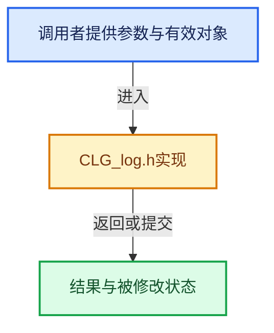

# 实现依赖专题：intern/clog/CLG_log.h

[实现依赖导航](../../README.md) · [符号索引](../../../00-课程指南/02-源码与提交索引/符号依赖与实现索引.md)

本专题从正文实际调用进入，集中保存共享实现。函数有稳定锚点，可从调用处直接跳到对应完整函数；递归与互相调用通过回链组织。

## 本文件的实现关系





<a id="m-27348fec3943"></a>

## 宏 `CLOG_CHECK`

<!-- annotated:c03b9e98451004 -->

```cpp
#define CLOG_CHECK(clg_ref, verbose_level, ...) \
  ((void)CLOG_ENSURE(clg_ref), ((clg_ref)->type->level >= verbose_level))

```

<details>
<summary>核对原始源码：intern/clog/CLG_log.h · L147—L149</summary>

<!-- original:c03b9e98451004:intern/clog/CLG_log.h:147:149 -->

```cpp
#define CLOG_CHECK(clg_ref, verbose_level, ...) \
  ((void)CLOG_ENSURE(clg_ref), ((clg_ref)->type->level >= verbose_level))

```

</details>

宏在预处理阶段展开，参数替换、重复求值和条件编译应直接从该定义检查。与普通函数不同，宏不会自动提供参数类型检查；构建配置选择哪个定义需结合外围条件。

<a id="m-27d8408e382a"></a>

## 宏 `CLOG_AT_LEVEL`

<!-- annotated:68154af871daca -->

```cpp
#define CLOG_AT_LEVEL(clg_ref, verbose_level, ...) \
  { \
    const CLG_LogType *_lg_ty = CLOG_ENSURE(clg_ref); \
    if (_lg_ty->level >= verbose_level) { \
      CLG_logf(_lg_ty, verbose_level, __FILE__ ":" STRINGIFY(__LINE__), __func__, __VA_ARGS__); \
    } \
  } \
  ((void)0)

```

<details>
<summary>核对原始源码：intern/clog/CLG_log.h · L150—L158</summary>

<!-- original:68154af871daca:intern/clog/CLG_log.h:150:158 -->

```cpp
#define CLOG_AT_LEVEL(clg_ref, verbose_level, ...) \
  { \
    const CLG_LogType *_lg_ty = CLOG_ENSURE(clg_ref); \
    if (_lg_ty->level >= verbose_level) { \
      CLG_logf(_lg_ty, verbose_level, __FILE__ ":" STRINGIFY(__LINE__), __func__, __VA_ARGS__); \
    } \
  } \
  ((void)0)

```

</details>

宏在预处理阶段展开，参数替换、重复求值和条件编译应直接从该定义检查。与普通函数不同，宏不会自动提供参数类型检查；构建配置选择哪个定义需结合外围条件。

<a id="m-e99b34853919"></a>

## 宏 `CLOG_AT_LEVEL_NOCHECK`

<!-- annotated:2a90053df58546 -->

```cpp
#define CLOG_AT_LEVEL_NOCHECK(clg_ref, verbose_level, ...) \
  { \
    const CLG_LogType *_lg_ty = CLOG_ENSURE(clg_ref); \
    if (!CLG_quiet_get() || _lg_ty->level >= verbose_level) { \
      CLG_logf(_lg_ty, verbose_level, __FILE__ ":" STRINGIFY(__LINE__), __func__, __VA_ARGS__); \
    } \
  } \
  ((void)0)

```

<details>
<summary>核对原始源码：intern/clog/CLG_log.h · L159—L167</summary>

<!-- original:2a90053df58546:intern/clog/CLG_log.h:159:167 -->

```cpp
#define CLOG_AT_LEVEL_NOCHECK(clg_ref, verbose_level, ...) \
  { \
    const CLG_LogType *_lg_ty = CLOG_ENSURE(clg_ref); \
    if (!CLG_quiet_get() || _lg_ty->level >= verbose_level) { \
      CLG_logf(_lg_ty, verbose_level, __FILE__ ":" STRINGIFY(__LINE__), __func__, __VA_ARGS__); \
    } \
  } \
  ((void)0)

```

</details>

宏在预处理阶段展开，参数替换、重复求值和条件编译应直接从该定义检查。与普通函数不同，宏不会自动提供参数类型检查；构建配置选择哪个定义需结合外围条件。

<a id="m-5006776e053a"></a>

## 宏 `CLOG_FATAL`

<!-- annotated:4d2fac9a40ee37 -->

```cpp
#define CLOG_FATAL(clg_ref, ...) CLOG_AT_LEVEL(clg_ref, CLG_LEVEL_FATAL, __VA_ARGS__)
#define CLOG_ERROR(clg_ref, ...) CLOG_AT_LEVEL(clg_ref, CLG_LEVEL_ERROR, __VA_ARGS__)
```

<details>
<summary>核对原始源码：intern/clog/CLG_log.h · L187—L188</summary>

<!-- original:4d2fac9a40ee37:intern/clog/CLG_log.h:187:188 -->

```cpp
#define CLOG_FATAL(clg_ref, ...) CLOG_AT_LEVEL(clg_ref, CLG_LEVEL_FATAL, __VA_ARGS__)
#define CLOG_ERROR(clg_ref, ...) CLOG_AT_LEVEL(clg_ref, CLG_LEVEL_ERROR, __VA_ARGS__)
```

</details>

宏在预处理阶段展开，参数替换、重复求值和条件编译应直接从该定义检查。与普通函数不同，宏不会自动提供参数类型检查；构建配置选择哪个定义需结合外围条件。

<a id="m-081575cdc8d0"></a>

## 宏 `CLOG_ERROR`

<!-- annotated:5d6c04476e5aca -->

```cpp
#define CLOG_ERROR(clg_ref, ...) CLOG_AT_LEVEL(clg_ref, CLG_LEVEL_ERROR, __VA_ARGS__)
#define CLOG_WARN(clg_ref, ...) CLOG_AT_LEVEL(clg_ref, CLG_LEVEL_WARN, __VA_ARGS__)
```

<details>
<summary>核对原始源码：intern/clog/CLG_log.h · L188—L189</summary>

<!-- original:5d6c04476e5aca:intern/clog/CLG_log.h:188:189 -->

```cpp
#define CLOG_ERROR(clg_ref, ...) CLOG_AT_LEVEL(clg_ref, CLG_LEVEL_ERROR, __VA_ARGS__)
#define CLOG_WARN(clg_ref, ...) CLOG_AT_LEVEL(clg_ref, CLG_LEVEL_WARN, __VA_ARGS__)
```

</details>

宏在预处理阶段展开，参数替换、重复求值和条件编译应直接从该定义检查。与普通函数不同，宏不会自动提供参数类型检查；构建配置选择哪个定义需结合外围条件。

<a id="m-9da21a06cdbe"></a>

## 宏 `CLOG_WARN`

<!-- annotated:846d5232ea00d2 -->

```cpp
#define CLOG_WARN(clg_ref, ...) CLOG_AT_LEVEL(clg_ref, CLG_LEVEL_WARN, __VA_ARGS__)
#define CLOG_INFO(clg_ref, ...) CLOG_AT_LEVEL(clg_ref, CLG_LEVEL_INFO, __VA_ARGS__)
```

<details>
<summary>核对原始源码：intern/clog/CLG_log.h · L189—L190</summary>

<!-- original:846d5232ea00d2:intern/clog/CLG_log.h:189:190 -->

```cpp
#define CLOG_WARN(clg_ref, ...) CLOG_AT_LEVEL(clg_ref, CLG_LEVEL_WARN, __VA_ARGS__)
#define CLOG_INFO(clg_ref, ...) CLOG_AT_LEVEL(clg_ref, CLG_LEVEL_INFO, __VA_ARGS__)
```

</details>

宏在预处理阶段展开，参数替换、重复求值和条件编译应直接从该定义检查。与普通函数不同，宏不会自动提供参数类型检查；构建配置选择哪个定义需结合外围条件。

<a id="m-f8b5efdfcc0f"></a>

## 宏 `CLOG_INFO`

<!-- annotated:ba4bff01437943 -->

```cpp
#define CLOG_INFO(clg_ref, ...) CLOG_AT_LEVEL(clg_ref, CLG_LEVEL_INFO, __VA_ARGS__)
#define CLOG_DEBUG(clg_ref, ...) CLOG_AT_LEVEL(clg_ref, CLG_LEVEL_DEBUG, __VA_ARGS__)
```

<details>
<summary>核对原始源码：intern/clog/CLG_log.h · L190—L191</summary>

<!-- original:ba4bff01437943:intern/clog/CLG_log.h:190:191 -->

```cpp
#define CLOG_INFO(clg_ref, ...) CLOG_AT_LEVEL(clg_ref, CLG_LEVEL_INFO, __VA_ARGS__)
#define CLOG_DEBUG(clg_ref, ...) CLOG_AT_LEVEL(clg_ref, CLG_LEVEL_DEBUG, __VA_ARGS__)
```

</details>

宏在预处理阶段展开，参数替换、重复求值和条件编译应直接从该定义检查。与普通函数不同，宏不会自动提供参数类型检查；构建配置选择哪个定义需结合外围条件。

<a id="m-e062f5f17675"></a>

## 宏 `CLOG_DEBUG`

<!-- annotated:afb5d7407dbb19 -->

```cpp
#define CLOG_DEBUG(clg_ref, ...) CLOG_AT_LEVEL(clg_ref, CLG_LEVEL_DEBUG, __VA_ARGS__)
#define CLOG_TRACE(clg_ref, ...) CLOG_AT_LEVEL(clg_ref, CLG_LEVEL_TRACE, __VA_ARGS__)
```

<details>
<summary>核对原始源码：intern/clog/CLG_log.h · L191—L192</summary>

<!-- original:afb5d7407dbb19:intern/clog/CLG_log.h:191:192 -->

```cpp
#define CLOG_DEBUG(clg_ref, ...) CLOG_AT_LEVEL(clg_ref, CLG_LEVEL_DEBUG, __VA_ARGS__)
#define CLOG_TRACE(clg_ref, ...) CLOG_AT_LEVEL(clg_ref, CLG_LEVEL_TRACE, __VA_ARGS__)
```

</details>

宏在预处理阶段展开，参数替换、重复求值和条件编译应直接从该定义检查。与普通函数不同，宏不会自动提供参数类型检查；构建配置选择哪个定义需结合外围条件。

<a id="m-46273bee5728"></a>

## 宏 `CLOG_TRACE`

<!-- annotated:ef63fbf538b140 -->

```cpp
#define CLOG_TRACE(clg_ref, ...) CLOG_AT_LEVEL(clg_ref, CLG_LEVEL_TRACE, __VA_ARGS__)

```

<details>
<summary>核对原始源码：intern/clog/CLG_log.h · L192—L193</summary>

<!-- original:ef63fbf538b140:intern/clog/CLG_log.h:192:193 -->

```cpp
#define CLOG_TRACE(clg_ref, ...) CLOG_AT_LEVEL(clg_ref, CLG_LEVEL_TRACE, __VA_ARGS__)

```

</details>

宏在预处理阶段展开，参数替换、重复求值和条件编译应直接从该定义检查。与普通函数不同，宏不会自动提供参数类型检查；构建配置选择哪个定义需结合外围条件。

<a id="m-dcd74e148724"></a>

## 宏 `CLOG_STR_ERROR`

<!-- annotated:fd0b23b6afea57 -->

```cpp
#define CLOG_STR_ERROR(clg_ref, str) CLOG_STR_AT_LEVEL(clg_ref, CLG_LEVEL_ERROR, str)
#define CLOG_STR_WARN(clg_ref, str) CLOG_STR_AT_LEVEL(clg_ref, CLG_LEVEL_WARN, str)
```

<details>
<summary>核对原始源码：intern/clog/CLG_log.h · L196—L197</summary>

<!-- original:fd0b23b6afea57:intern/clog/CLG_log.h:196:197 -->

```cpp
#define CLOG_STR_ERROR(clg_ref, str) CLOG_STR_AT_LEVEL(clg_ref, CLG_LEVEL_ERROR, str)
#define CLOG_STR_WARN(clg_ref, str) CLOG_STR_AT_LEVEL(clg_ref, CLG_LEVEL_WARN, str)
```

</details>

宏在预处理阶段展开，参数替换、重复求值和条件编译应直接从该定义检查。与普通函数不同，宏不会自动提供参数类型检查；构建配置选择哪个定义需结合外围条件。

<a id="m-b5afc8a6dde4"></a>

## 宏 `CLOG_STR_WARN`

<!-- annotated:dfce9c6c1792cb -->

```cpp
#define CLOG_STR_WARN(clg_ref, str) CLOG_STR_AT_LEVEL(clg_ref, CLG_LEVEL_WARN, str)
#define CLOG_STR_INFO(clg_ref, str) CLOG_STR_AT_LEVEL(clg_ref, CLG_LEVEL_INFO, str)
```

<details>
<summary>核对原始源码：intern/clog/CLG_log.h · L197—L198</summary>

<!-- original:dfce9c6c1792cb:intern/clog/CLG_log.h:197:198 -->

```cpp
#define CLOG_STR_WARN(clg_ref, str) CLOG_STR_AT_LEVEL(clg_ref, CLG_LEVEL_WARN, str)
#define CLOG_STR_INFO(clg_ref, str) CLOG_STR_AT_LEVEL(clg_ref, CLG_LEVEL_INFO, str)
```

</details>

宏在预处理阶段展开，参数替换、重复求值和条件编译应直接从该定义检查。与普通函数不同，宏不会自动提供参数类型检查；构建配置选择哪个定义需结合外围条件。

<a id="m-232b8c944d3a"></a>

## 宏 `CLOG_STR_DEBUG`

<!-- annotated:5dfb1a8e52973d -->

```cpp
#define CLOG_STR_DEBUG(clg_ref, str) CLOG_STR_AT_LEVEL(clg_ref, CLG_LEVEL_DEBUG, str)
#define CLOG_STR_TRACE(clg_ref, str) CLOG_STR_AT_LEVEL(clg_ref, CLG_LEVEL_TRACE, str)
```

<details>
<summary>核对原始源码：intern/clog/CLG_log.h · L199—L200</summary>

<!-- original:5dfb1a8e52973d:intern/clog/CLG_log.h:199:200 -->

```cpp
#define CLOG_STR_DEBUG(clg_ref, str) CLOG_STR_AT_LEVEL(clg_ref, CLG_LEVEL_DEBUG, str)
#define CLOG_STR_TRACE(clg_ref, str) CLOG_STR_AT_LEVEL(clg_ref, CLG_LEVEL_TRACE, str)
```

</details>

宏在预处理阶段展开，参数替换、重复求值和条件编译应直接从该定义检查。与普通函数不同，宏不会自动提供参数类型检查；构建配置选择哪个定义需结合外围条件。

<a id="m-0ee99c46381d"></a>

## 宏 `CLOG_INFO_NOCHECK`

<!-- annotated:98cf89aeecacef -->

```cpp
#define CLOG_INFO_NOCHECK(clg_ref, format, ...) \
  CLOG_AT_LEVEL_NOCHECK(clg_ref, CLG_LEVEL_INFO, format, __VA_ARGS__)
#define CLOG_STR_INFO_NOCHECK(clg_ref, str) CLOG_STR_AT_LEVEL_NOCHECK(clg_ref, CLG_LEVEL_INFO, str)
```

<details>
<summary>核对原始源码：intern/clog/CLG_log.h · L204—L206</summary>

<!-- original:98cf89aeecacef:intern/clog/CLG_log.h:204:206 -->

```cpp
#define CLOG_INFO_NOCHECK(clg_ref, format, ...) \
  CLOG_AT_LEVEL_NOCHECK(clg_ref, CLG_LEVEL_INFO, format, __VA_ARGS__)
#define CLOG_STR_INFO_NOCHECK(clg_ref, str) CLOG_STR_AT_LEVEL_NOCHECK(clg_ref, CLG_LEVEL_INFO, str)
```

</details>

宏在预处理阶段展开，参数替换、重复求值和条件编译应直接从该定义检查。与普通函数不同，宏不会自动提供参数类型检查；构建配置选择哪个定义需结合外围条件。

<a id="m-600de2db61cc"></a>

## 宏 `CLOG_STR_INFO_NOCHECK`

<!-- annotated:dd9555a02c58c4 -->

```cpp
#define CLOG_STR_INFO_NOCHECK(clg_ref, str) CLOG_STR_AT_LEVEL_NOCHECK(clg_ref, CLG_LEVEL_INFO, str)
```

<details>
<summary>核对原始源码：intern/clog/CLG_log.h · L206—L207</summary>

<!-- original:dd9555a02c58c4:intern/clog/CLG_log.h:206:207 -->

```cpp
#define CLOG_STR_INFO_NOCHECK(clg_ref, str) CLOG_STR_AT_LEVEL_NOCHECK(clg_ref, CLG_LEVEL_INFO, str)
```

</details>

宏在预处理阶段展开，参数替换、重复求值和条件编译应直接从该定义检查。与普通函数不同，宏不会自动提供参数类型检查；构建配置选择哪个定义需结合外围条件。

## 完整成员与函数实现
