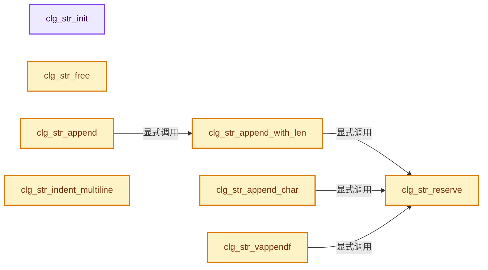
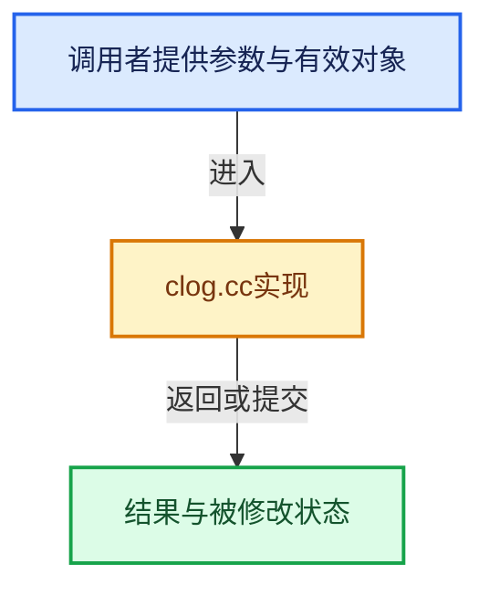

# 实现依赖专题：intern/clog/clog.cc

[实现依赖导航](../../README.md) · [符号索引](../../../00-课程指南/02-源码与提交索引/符号依赖与实现索引.md)

本专题从正文实际调用进入，集中保存共享实现。函数有稳定锚点，可从调用处直接跳到对应完整函数；递归与互相调用通过回链组织。

## 本文件的实现关系






<a id="m-96e78f386894"></a>

## 宏 `STREQ`

<!-- annotated:0efa4210666c5c -->

```cpp
#define STREQ(a, b) (strcmp(a, b) == 0)
#define STREQLEN(a, b, n) (strncmp(a, b, n) == 0)
```

<details>
<summary>核对原始源码：intern/clog/clog.cc · L55—L56</summary>

<!-- original:0efa4210666c5c:intern/clog/clog.cc:55:56 -->

```cpp
#define STREQ(a, b) (strcmp(a, b) == 0)
#define STREQLEN(a, b, n) (strncmp(a, b, n) == 0)
```

</details>

宏在预处理阶段展开，参数替换、重复求值和条件编译应直接从该定义检查。与普通函数不同，宏不会自动提供参数类型检查；构建配置选择哪个定义需结合外围条件。

<a id="m-c4a18b1393b9"></a>

## 宏 `STREQLEN`

<!-- annotated:7129d66a23cecf -->

```cpp
#define STREQLEN(a, b, n) (strncmp(a, b, n) == 0)

```

<details>
<summary>核对原始源码：intern/clog/clog.cc · L56—L57</summary>

<!-- original:7129d66a23cecf:intern/clog/clog.cc:56:57 -->

```cpp
#define STREQLEN(a, b, n) (strncmp(a, b, n) == 0)

```

</details>

宏在预处理阶段展开，参数替换、重复求值和条件编译应直接从该定义检查。与普通函数不同，宏不会自动提供参数类型检查；构建配置选择哪个定义需结合外围条件。

## 完整成员与函数实现

<a id="f-885ea89a9d4e0c81"></a>

### `clg_str_init`

实现位置：[intern/clog/clog.cc](../../../../../../../intern/clog/clog.cc) · L141—L147。

接口参数：

- `CLogStringBuf *cstr`
- `char *buf_stack`
- `uint buf_stack_len`

**教学注释版**

<!-- annotated:34daead17abb6d -->

```cpp
static void clg_str_init(CLogStringBuf *cstr, char *buf_stack, uint buf_stack_len)
{
  cstr->data = buf_stack;
  cstr->len_alloc = buf_stack_len;
  cstr->len = 0;
  cstr->is_alloc = false;
}
```

<details>
<summary>核对原始源码：intern/clog/clog.cc · L141—L147</summary>

<!-- original:34daead17abb6d:intern/clog/clog.cc:141:147 -->

```cpp
static void clg_str_init(CLogStringBuf *cstr, char *buf_stack, uint buf_stack_len)
{
  cstr->data = buf_stack;
  cstr->len_alloc = buf_stack_len;
  cstr->len = 0;
  cstr->is_alloc = false;
}
```

</details>

**沿实际写入检查状态**

- `cstr->data = buf_stack;`
- `cstr->len_alloc = buf_stack_len;`
- `cstr->len = 0;`
- `cstr->is_alloc = false;`

**继续追踪实现**

本实现没有需要继续展开的显式调用；检查返回表达式、对象转换和调用者前置条件。

<a id="f-890cd95619319a1c"></a>

### `clg_str_free`

实现位置：[intern/clog/clog.cc](../../../../../../../intern/clog/clog.cc) · L149—L154。

接口参数：

- `CLogStringBuf *cstr`

**教学注释版**

<!-- annotated:de31d0f9e69c9e -->

```cpp
static void clg_str_free(CLogStringBuf *cstr)
{
  if (cstr->is_alloc) {
    MEM_delete(cstr->data);
  }
}
```

<details>
<summary>核对原始源码：intern/clog/clog.cc · L149—L154</summary>

<!-- original:de31d0f9e69c9e:intern/clog/clog.cc:149:154 -->

```cpp
static void clg_str_free(CLogStringBuf *cstr)
{
  if (cstr->is_alloc) {
    MEM_delete(cstr->data);
  }
}
```

</details>

**继续追踪实现**

- `MEM_delete` → [MEM_delete · L400](../guardedalloc/MEM_guardedalloc.h.md#f-9049ffdd1682887c)。

<a id="f-78d72bace8092971"></a>

### `clg_str_reserve`

实现位置：[intern/clog/clog.cc](../../../../../../../intern/clog/clog.cc) · L156—L173。

接口参数：

- `CLogStringBuf *cstr`
- `const uint len`

**教学注释版**

<!-- annotated:ee2249381a561e -->

```cpp
static void clg_str_reserve(CLogStringBuf *cstr, const uint len)
{
  if (len > cstr->len_alloc) {
    cstr->len_alloc *= 2;
    // [讲解] std::max：按比较关系选取较大值。本讲解中的增长公式同时满足最低请求和几何增长；若保存返回引用，还需注意实参寿命。
    cstr->len_alloc = std::max(len, cstr->len_alloc);

    if (cstr->is_alloc) {
      cstr->data = static_cast<char *>(MEM_realloc_uninitialized(cstr->data, cstr->len_alloc));
    }
    else {
      /* Copy the static buffer. */
      char *data = MEM_new_array_uninitialized<char>(cstr->len_alloc, __func__);
      // [讲解] memcpy：复制字节，源与目标不应重叠。类型生命周期、对齐和可复制表示须由调用者证明，不是任意对象的复制构造。
      memcpy(data, cstr->data, cstr->len);
      cstr->data = data;
      cstr->is_alloc = true;
    }
  }
}
```

<details>
<summary>核对原始源码：intern/clog/clog.cc · L156—L173</summary>

<!-- original:ee2249381a561e:intern/clog/clog.cc:156:173 -->

```cpp
static void clg_str_reserve(CLogStringBuf *cstr, const uint len)
{
  if (len > cstr->len_alloc) {
    cstr->len_alloc *= 2;
    cstr->len_alloc = std::max(len, cstr->len_alloc);

    if (cstr->is_alloc) {
      cstr->data = static_cast<char *>(MEM_realloc_uninitialized(cstr->data, cstr->len_alloc));
    }
    else {
      /* Copy the static buffer. */
      char *data = MEM_new_array_uninitialized<char>(cstr->len_alloc, __func__);
      memcpy(data, cstr->data, cstr->len);
      cstr->data = data;
      cstr->is_alloc = true;
    }
  }
}
```

</details>

**沿实际写入检查状态**

- `cstr->len_alloc *= 2;`
- `cstr->len_alloc = std::max(len, cstr->len_alloc);`
- `cstr->data = static_cast<char *>(MEM_realloc_uninitialized(cstr->data, cstr->len_alloc));`
- `cstr->data = data;`
- `cstr->is_alloc = true;`

**继续追踪实现**

- `std::max` → [外部契约](https://eel.is/c++draft/alg.min.max)：按比较关系选取较大值。本讲解中的增长公式同时满足最低请求和几何增长；若保存返回引用，还需注意实参寿命。
- `MEM_realloc_uninitialized` → [MEM_realloc_uninitialized · L118](../guardedalloc/MEM_guardedalloc.h.md#m-813b7cd3fcff)。宏定义由构建条件选择。
- `MEM_new_array_uninitialized<char>` → [MEM_new_array_uninitialized · L608](../guardedalloc/MEM_guardedalloc.h.md#f-b7103eae8eb57b05)；[MEM_new_array_uninitialized · L129](../guardedalloc/intern/mallocn.cc.md#f-bf6ef4ddcfb6e5df)。同名重载需按实参类型选择。
- `memcpy` → [外部契约](https://eel.is/c++draft/cstring.syn)：复制字节，源与目标不应重叠。类型生命周期、对齐和可复制表示须由调用者证明，不是任意对象的复制构造。

<a id="f-f98a6792002e26e5"></a>

### `clg_str_append_with_len`

实现位置：[intern/clog/clog.cc](../../../../../../../intern/clog/clog.cc) · L175—L185。

接口参数：

- `CLogStringBuf *cstr`
- `const char *str`
- `const uint len`

**教学注释版**

<!-- annotated:a2a59bec0638aa -->

```cpp
static void clg_str_append_with_len(CLogStringBuf *cstr, const char *str, const uint len)
{
  uint len_next = cstr->len + len;
  clg_str_reserve(cstr, len_next);
  char *str_dst = cstr->data + cstr->len;
  // [讲解] memcpy：复制字节，源与目标不应重叠。类型生命周期、对齐和可复制表示须由调用者证明，不是任意对象的复制构造。
  memcpy(str_dst, str, len);
#if 0 /* no need. */
  str_dst[len] = '\0';
#endif
  cstr->len = len_next;
}
```

<details>
<summary>核对原始源码：intern/clog/clog.cc · L175—L185</summary>

<!-- original:a2a59bec0638aa:intern/clog/clog.cc:175:185 -->

```cpp
static void clg_str_append_with_len(CLogStringBuf *cstr, const char *str, const uint len)
{
  uint len_next = cstr->len + len;
  clg_str_reserve(cstr, len_next);
  char *str_dst = cstr->data + cstr->len;
  memcpy(str_dst, str, len);
#if 0 /* no need. */
  str_dst[len] = '\0';
#endif
  cstr->len = len_next;
}
```

</details>

**沿实际写入检查状态**

- `str_dst[len] = '\0';`
- `cstr->len = len_next;`

**继续追踪实现**

- `clg_str_reserve` → [clg_str_reserve · L156](clog.cc.md#f-78d72bace8092971)。
- `memcpy` → [外部契约](https://eel.is/c++draft/cstring.syn)：复制字节，源与目标不应重叠。类型生命周期、对齐和可复制表示须由调用者证明，不是任意对象的复制构造。

<a id="f-c71ad61df0cc8c9e"></a>

### `clg_str_append`

实现位置：[intern/clog/clog.cc](../../../../../../../intern/clog/clog.cc) · L187—L190。

接口参数：

- `CLogStringBuf *cstr`
- `const char *str`

**教学注释版**

<!-- annotated:e2dbc74c587c5d -->

```cpp
static void clg_str_append(CLogStringBuf *cstr, const char *str)
{
  clg_str_append_with_len(cstr, str, strlen(str));
}
```

<details>
<summary>核对原始源码：intern/clog/clog.cc · L187—L190</summary>

<!-- original:e2dbc74c587c5d:intern/clog/clog.cc:187:190 -->

```cpp
static void clg_str_append(CLogStringBuf *cstr, const char *str)
{
  clg_str_append_with_len(cstr, str, strlen(str));
}
```

</details>

**继续追踪实现**

- `clg_str_append_with_len` → [clg_str_append_with_len · L175](clog.cc.md#f-f98a6792002e26e5)。
- `strlen` → [外部契约](https://eel.is/c++draft/)：这个边界按实际表达式及所属类型核对参数、返回值、寿命与失败行为。这里提供接口入口，不声称已解释该第三方版本的内部实现。

<a id="f-d359caf77a588cd5"></a>

### `clg_str_append_char`

实现位置：[intern/clog/clog.cc](../../../../../../../intern/clog/clog.cc) · L192—L202。

接口参数：

- `CLogStringBuf *cstr`
- `const char c`
- `const uint len`

**教学注释版**

<!-- annotated:c31900e2fea2be -->

```cpp
static void clg_str_append_char(CLogStringBuf *cstr, const char c, const uint len)
{
  uint len_next = cstr->len + len;
  clg_str_reserve(cstr, len_next);
  char *str_dst = cstr->data + cstr->len;
  // [讲解] memset：填充字节，不调用T构造函数，也不保证任意类型的全零表示是合法或期望值。
  memset(str_dst, c, len);
#if 0 /* no need. */
  str_dst[len] = '\0';
#endif
  cstr->len = len_next;
}
```

<details>
<summary>核对原始源码：intern/clog/clog.cc · L192—L202</summary>

<!-- original:c31900e2fea2be:intern/clog/clog.cc:192:202 -->

```cpp
static void clg_str_append_char(CLogStringBuf *cstr, const char c, const uint len)
{
  uint len_next = cstr->len + len;
  clg_str_reserve(cstr, len_next);
  char *str_dst = cstr->data + cstr->len;
  memset(str_dst, c, len);
#if 0 /* no need. */
  str_dst[len] = '\0';
#endif
  cstr->len = len_next;
}
```

</details>

**沿实际写入检查状态**

- `str_dst[len] = '\0';`
- `cstr->len = len_next;`

**继续追踪实现**

- `clg_str_reserve` → [clg_str_reserve · L156](clog.cc.md#f-78d72bace8092971)。
- `memset` → [外部契约](https://eel.is/c++draft/cstring.syn)：填充字节，不调用T构造函数，也不保证任意类型的全零表示是合法或期望值。

<a id="f-964ba4e9b4d6ae78"></a>

### `clg_str_vappendf`

实现位置：[intern/clog/clog.cc](../../../../../../../intern/clog/clog.cc) · L205—L239。

接口参数：

- `CLogStringBuf *cstr`
- `const char *format`
- `va_list args`

**教学注释版**

<!-- annotated:a420875831c346 -->

```cpp
static void clg_str_vappendf(CLogStringBuf *cstr, const char *format, va_list args)
{
  /* Use limit because windows may use '-1' for a formatting error. */
  const uint len_max = 65535;
  uint len_avail = cstr->len_alloc - cstr->len;
  while (true) {
    va_list args_cpy;
    va_copy(args_cpy, args);
    int retval = vsnprintf(cstr->data + cstr->len, len_avail, format, args_cpy);
    va_end(args_cpy);

    if (retval < 0) {
      /* Some encoding error happened, not much we can do here, besides skipping/canceling this
       * message. */
      break;
    }

    if ((uint)retval <= len_avail) {
      /* Copy was successful. */
      cstr->len += (uint)retval;
      break;
    }

    /* `vsnprintf` was not successful, due to lack of allocated space, `retval` contains expected
     * length of the formatted string, use it to allocate required amount of memory. */
    uint len_alloc = cstr->len + (uint)retval;
    if (len_alloc >= len_max) {
      /* Safe upper-limit, just in case... */
      break;
    }

    clg_str_reserve(cstr, len_alloc);
    len_avail = cstr->len_alloc - cstr->len;
  }
}
```

<details>
<summary>核对原始源码：intern/clog/clog.cc · L205—L239</summary>

<!-- original:a420875831c346:intern/clog/clog.cc:205:239 -->

```cpp
static void clg_str_vappendf(CLogStringBuf *cstr, const char *format, va_list args)
{
  /* Use limit because windows may use '-1' for a formatting error. */
  const uint len_max = 65535;
  uint len_avail = cstr->len_alloc - cstr->len;
  while (true) {
    va_list args_cpy;
    va_copy(args_cpy, args);
    int retval = vsnprintf(cstr->data + cstr->len, len_avail, format, args_cpy);
    va_end(args_cpy);

    if (retval < 0) {
      /* Some encoding error happened, not much we can do here, besides skipping/canceling this
       * message. */
      break;
    }

    if ((uint)retval <= len_avail) {
      /* Copy was successful. */
      cstr->len += (uint)retval;
      break;
    }

    /* `vsnprintf` was not successful, due to lack of allocated space, `retval` contains expected
     * length of the formatted string, use it to allocate required amount of memory. */
    uint len_alloc = cstr->len + (uint)retval;
    if (len_alloc >= len_max) {
      /* Safe upper-limit, just in case... */
      break;
    }

    clg_str_reserve(cstr, len_alloc);
    len_avail = cstr->len_alloc - cstr->len;
  }
}
```

</details>

**沿实际写入检查状态**

- `cstr->len += (uint)retval;`
- `len_avail = cstr->len_alloc - cstr->len;`

**继续追踪实现**

- `va_copy` → [调用协议](../../../00-课程指南/01-路线与规范/模板宏与动态分派协议.md)：函数指针、局部可调用对象或未展开的宏；必须结合调用者环境。调用位置L212。
- `vsnprintf` → [外部契约](https://eel.is/c++draft/)：这个边界按实际表达式及所属类型核对参数、返回值、寿命与失败行为。这里提供接口入口，不声称已解释该第三方版本的内部实现。
- `va_end` → [调用协议](../../../00-课程指南/01-路线与规范/模板宏与动态分派协议.md)：函数指针、局部可调用对象或未展开的宏；必须结合调用者环境。调用位置L214。
- `clg_str_reserve` → [clg_str_reserve · L156](clog.cc.md#f-78d72bace8092971)。

<a id="f-3e210dada9fd9e99"></a>

### `clg_str_indent_multiline`

实现位置：[intern/clog/clog.cc](../../../../../../../intern/clog/clog.cc) · L241—L279。

接口参数：

- `CLogStringBuf *cstr`
- `const uint indent_len`

**教学注释版**

<!-- annotated:79d331ba02a276 -->

```cpp
static void clg_str_indent_multiline(CLogStringBuf *cstr, const uint indent_len)
{
  /* If there are multiple lines, indent them the same as the first line for readability. */
  if (indent_len < 2) {
    return;
  }

  uint num_newlines = 0;
  for (uint i = 0; i < cstr->len; i++) {
    if (cstr->data[i] == '\n') {
      num_newlines++;
    }
  }
  if (num_newlines == 0) {
    return;
  }

  const char *old_data = cstr->data;
  const uint old_len = cstr->len;
  const bool old_is_alloc = cstr->is_alloc;

  cstr->len_alloc = cstr->len + (num_newlines * indent_len);
  cstr->len = 0;
  cstr->data = MEM_new_array_uninitialized<char>(cstr->len_alloc, __func__);
  cstr->is_alloc = true;

  for (uint i = 0; i < old_len; i++) {
    cstr->data[cstr->len++] = old_data[i];
    if (old_data[i] == '\n') {
      // [讲解] memset：填充字节，不调用T构造函数，也不保证任意类型的全零表示是合法或期望值。
      memset(cstr->data + cstr->len, ' ', indent_len);
      cstr->data[cstr->len + indent_len - 2] = '|';
      cstr->len += indent_len;
    }
  }

  if (old_is_alloc) {
    MEM_delete(old_data);
  }
}
```

<details>
<summary>核对原始源码：intern/clog/clog.cc · L241—L279</summary>

<!-- original:79d331ba02a276:intern/clog/clog.cc:241:279 -->

```cpp
static void clg_str_indent_multiline(CLogStringBuf *cstr, const uint indent_len)
{
  /* If there are multiple lines, indent them the same as the first line for readability. */
  if (indent_len < 2) {
    return;
  }

  uint num_newlines = 0;
  for (uint i = 0; i < cstr->len; i++) {
    if (cstr->data[i] == '\n') {
      num_newlines++;
    }
  }
  if (num_newlines == 0) {
    return;
  }

  const char *old_data = cstr->data;
  const uint old_len = cstr->len;
  const bool old_is_alloc = cstr->is_alloc;

  cstr->len_alloc = cstr->len + (num_newlines * indent_len);
  cstr->len = 0;
  cstr->data = MEM_new_array_uninitialized<char>(cstr->len_alloc, __func__);
  cstr->is_alloc = true;

  for (uint i = 0; i < old_len; i++) {
    cstr->data[cstr->len++] = old_data[i];
    if (old_data[i] == '\n') {
      memset(cstr->data + cstr->len, ' ', indent_len);
      cstr->data[cstr->len + indent_len - 2] = '|';
      cstr->len += indent_len;
    }
  }

  if (old_is_alloc) {
    MEM_delete(old_data);
  }
}
```

</details>

**沿实际写入检查状态**

- `cstr->len_alloc = cstr->len + (num_newlines * indent_len);`
- `cstr->len = 0;`
- `cstr->data = MEM_new_array_uninitialized<char>(cstr->len_alloc, __func__);`
- `cstr->is_alloc = true;`
- `cstr->len += indent_len;`

**继续追踪实现**

- `MEM_new_array_uninitialized<char>` → [MEM_new_array_uninitialized · L608](../guardedalloc/MEM_guardedalloc.h.md#f-b7103eae8eb57b05)；[MEM_new_array_uninitialized · L129](../guardedalloc/intern/mallocn.cc.md#f-bf6ef4ddcfb6e5df)。同名重载需按实参类型选择。
- `memset` → [外部契约](https://eel.is/c++draft/cstring.syn)：填充字节，不调用T构造函数，也不保证任意类型的全零表示是合法或期望值。
- `MEM_delete` → [MEM_delete · L400](../guardedalloc/MEM_guardedalloc.h.md#f-9049ffdd1682887c)。

<a id="f-fd38c3fee49df7e0"></a>

### `clg_level_as_text`

实现位置：[intern/clog/clog.cc](../../../../../../../intern/clog/clog.cc) · L318—L336。

接口参数：

- `enum CLG_Level level`

**教学注释版**

<!-- annotated:1185f93448e7cf -->

```cpp
static const char *clg_level_as_text(enum CLG_Level level)
{
  switch (level) {
    case CLG_LEVEL_FATAL:
      return "FATAL";
    case CLG_LEVEL_ERROR:
      return "ERROR";
    case CLG_LEVEL_WARN:
      return "WARNING";
    case CLG_LEVEL_INFO:
      return "INFO";
    case CLG_LEVEL_DEBUG:
      return "DEBUG";
    case CLG_LEVEL_TRACE:
      return "TRACE";
  }

  return "INVALID_LEVEL";
}
```

<details>
<summary>核对原始源码：intern/clog/clog.cc · L318—L336</summary>

<!-- original:1185f93448e7cf:intern/clog/clog.cc:318:336 -->

```cpp
static const char *clg_level_as_text(enum CLG_Level level)
{
  switch (level) {
    case CLG_LEVEL_FATAL:
      return "FATAL";
    case CLG_LEVEL_ERROR:
      return "ERROR";
    case CLG_LEVEL_WARN:
      return "WARNING";
    case CLG_LEVEL_INFO:
      return "INFO";
    case CLG_LEVEL_DEBUG:
      return "DEBUG";
    case CLG_LEVEL_TRACE:
      return "TRACE";
  }

  return "INVALID_LEVEL";
}
```

</details>

**结果出口**

- `return "FATAL";`
- `return "ERROR";`
- `return "WARNING";`
- `return "INFO";`
- `return "DEBUG";`
- `return "TRACE";`
- `return "INVALID_LEVEL";`

**继续追踪实现**

本实现没有需要继续展开的显式调用；检查返回表达式、对象转换和调用者前置条件。

<a id="f-cb04e038a486c8ad"></a>

### `clg_level_to_color`

实现位置：[intern/clog/clog.cc](../../../../../../../intern/clog/clog.cc) · L338—L354。

接口参数：

- `enum CLG_Level level`

**教学注释版**

<!-- annotated:ca831d34a06cfe -->

```cpp
static enum eCLogColor clg_level_to_color(enum CLG_Level level)
{
  switch (level) {
    case CLG_LEVEL_FATAL:
    case CLG_LEVEL_ERROR:
      return COLOR_RED;
    case CLG_LEVEL_WARN:
      return COLOR_YELLOW;
    case CLG_LEVEL_INFO:
    case CLG_LEVEL_DEBUG:
    case CLG_LEVEL_TRACE:
      return COLOR_DEFAULT;
  }
  /* should never get here. */
  // [讲解] assert：检查开发者预期条件，配置可能关闭；不承担完整输入处理或自动修复。
  assert(false);
  return COLOR_DEFAULT;
}
```

<details>
<summary>核对原始源码：intern/clog/clog.cc · L338—L354</summary>

<!-- original:ca831d34a06cfe:intern/clog/clog.cc:338:354 -->

```cpp
static enum eCLogColor clg_level_to_color(enum CLG_Level level)
{
  switch (level) {
    case CLG_LEVEL_FATAL:
    case CLG_LEVEL_ERROR:
      return COLOR_RED;
    case CLG_LEVEL_WARN:
      return COLOR_YELLOW;
    case CLG_LEVEL_INFO:
    case CLG_LEVEL_DEBUG:
    case CLG_LEVEL_TRACE:
      return COLOR_DEFAULT;
  }
  /* should never get here. */
  assert(false);
  return COLOR_DEFAULT;
}
```

</details>

**结果出口**

- `return COLOR_RED;`
- `return COLOR_YELLOW;`
- `return COLOR_DEFAULT;`

**继续追踪实现**

- `assert` → [外部契约](https://eel.is/c++draft/assertions)：检查开发者预期条件，配置可能关闭；不承担完整输入处理或自动修复。

<a id="f-6202ca619c7c68ba"></a>

### `clg_ctx_filter_check`

实现位置：[intern/clog/clog.cc](../../../../../../../intern/clog/clog.cc) · L368—L409。

接口参数：

- `CLogContext *ctx`
- `const char *identifier`

**教学注释版**

<!-- annotated:66c8cfba1dd6a2 -->

```cpp
static bool clg_ctx_filter_check(CLogContext *ctx, const char *identifier)
{
  if (ctx->filters[0] == nullptr && ctx->filters[1] == nullptr &&
      ctx->default_type.level >= CLG_LEVEL_INFO)
  {
    /* No filters but level specified? Match everything. */
    return true;
  }

  const size_t identifier_len = strlen(identifier);
  for (uint i = 0; i < 2; i++) {
    const CLG_IDFilter *flt = ctx->filters[i];
    while (flt != nullptr) {
      const size_t len = strlen(flt->match);
      if (STREQ(flt->match, "*") ||
          ((len <= identifier_len) && (STREQLEN(identifier, flt->match, len))))
      {
        return (bool)i;
      }
      if (flt->match[0] == '*' && flt->match[len - 1] == '*') {
        char *match = MEM_new_array_zeroed<char>(len - 1, __func__);
        // [讲解] memcpy：复制字节，源与目标不应重叠。类型生命周期、对齐和可复制表示须由调用者证明，不是任意对象的复制构造。
        memcpy(match, flt->match + 1, len - 2);
        const bool success = (strstr(identifier, match) != nullptr);
        MEM_delete(match);
        if (success) {
          return (bool)i;
        }
      }
      else if ((len >= 2) && (STREQLEN(".*", &flt->match[len - 2], 2))) {
        /* `foo.*` and `foo.bar.*` support kept for backwards compatibility.
         * `foo` and `foo.bar` now do the same thing. */
        if (((identifier_len == len - 2) && STREQLEN(identifier, flt->match, len - 2)) ||
            ((identifier_len >= len - 1) && STREQLEN(identifier, flt->match, len - 1)))
        {
          return (bool)i;
        }
      }
      flt = flt->next;
    }
  }
  return false;
}
```

<details>
<summary>核对原始源码：intern/clog/clog.cc · L368—L409</summary>

<!-- original:66c8cfba1dd6a2:intern/clog/clog.cc:368:409 -->

```cpp
static bool clg_ctx_filter_check(CLogContext *ctx, const char *identifier)
{
  if (ctx->filters[0] == nullptr && ctx->filters[1] == nullptr &&
      ctx->default_type.level >= CLG_LEVEL_INFO)
  {
    /* No filters but level specified? Match everything. */
    return true;
  }

  const size_t identifier_len = strlen(identifier);
  for (uint i = 0; i < 2; i++) {
    const CLG_IDFilter *flt = ctx->filters[i];
    while (flt != nullptr) {
      const size_t len = strlen(flt->match);
      if (STREQ(flt->match, "*") ||
          ((len <= identifier_len) && (STREQLEN(identifier, flt->match, len))))
      {
        return (bool)i;
      }
      if (flt->match[0] == '*' && flt->match[len - 1] == '*') {
        char *match = MEM_new_array_zeroed<char>(len - 1, __func__);
        memcpy(match, flt->match + 1, len - 2);
        const bool success = (strstr(identifier, match) != nullptr);
        MEM_delete(match);
        if (success) {
          return (bool)i;
        }
      }
      else if ((len >= 2) && (STREQLEN(".*", &flt->match[len - 2], 2))) {
        /* `foo.*` and `foo.bar.*` support kept for backwards compatibility.
         * `foo` and `foo.bar` now do the same thing. */
        if (((identifier_len == len - 2) && STREQLEN(identifier, flt->match, len - 2)) ||
            ((identifier_len >= len - 1) && STREQLEN(identifier, flt->match, len - 1)))
        {
          return (bool)i;
        }
      }
      flt = flt->next;
    }
  }
  return false;
}
```

</details>

**沿实际写入检查状态**

- `flt = flt->next;`

**结果出口**

- `return true;`
- `return (bool)i;`
- `return false;`

**继续追踪实现**

- `strlen` → [外部契约](https://eel.is/c++draft/)：这个边界按实际表达式及所属类型核对参数、返回值、寿命与失败行为。这里提供接口入口，不声称已解释该第三方版本的内部实现。
- `STREQ` → [STREQ · L55](clog.cc.md#m-96e78f386894)。宏定义由构建条件选择。
- `STREQLEN` → [STREQLEN · L56](clog.cc.md#m-c4a18b1393b9)。宏定义由构建条件选择。
- `MEM_new_array_zeroed<char>` → [MEM_new_array_zeroed · L566](../guardedalloc/MEM_guardedalloc.h.md#f-3a0cf63fb5216500)；[MEM_new_array_zeroed · L119](../guardedalloc/intern/mallocn.cc.md#f-6825557da566fdbe)。同名重载需按实参类型选择。
- `memcpy` → [外部契约](https://eel.is/c++draft/cstring.syn)：复制字节，源与目标不应重叠。类型生命周期、对齐和可复制表示须由调用者证明，不是任意对象的复制构造。
- `strstr` → [调用协议](../../../00-课程指南/01-路线与规范/模板宏与动态分派协议.md)：函数指针、局部可调用对象或未展开的宏；必须结合调用者环境。调用位置L390。
- `MEM_delete` → [MEM_delete · L400](../guardedalloc/MEM_guardedalloc.h.md#f-9049ffdd1682887c)。

<a id="f-bf63b8f91cd8517b"></a>

### `clg_ctx_type_find_by_name`

实现位置：[intern/clog/clog.cc](../../../../../../../intern/clog/clog.cc) · L415—L423。

接口参数：

- `CLogContext *ctx`
- `const char *identifier`

**教学注释版**

<!-- annotated:20b894445a26a9 -->

```cpp
static CLG_LogType *clg_ctx_type_find_by_name(CLogContext *ctx, const char *identifier)
{
  for (CLG_LogType *ty = ctx->types; ty; ty = ty->next) {
    if (STREQ(identifier, ty->identifier)) {
      return ty;
    }
  }
  return nullptr;
}
```

<details>
<summary>核对原始源码：intern/clog/clog.cc · L415—L423</summary>

<!-- original:20b894445a26a9:intern/clog/clog.cc:415:423 -->

```cpp
static CLG_LogType *clg_ctx_type_find_by_name(CLogContext *ctx, const char *identifier)
{
  for (CLG_LogType *ty = ctx->types; ty; ty = ty->next) {
    if (STREQ(identifier, ty->identifier)) {
      return ty;
    }
  }
  return nullptr;
}
```

</details>

**结果出口**

- `return ty;`
- `return nullptr;`

**继续追踪实现**

- `STREQ` → [STREQ · L55](clog.cc.md#m-96e78f386894)。宏定义由构建条件选择。

<a id="f-f348b183acfd2fb6"></a>

### `clg_ctx_type_register`

实现位置：[intern/clog/clog.cc](../../../../../../../intern/clog/clog.cc) · L425—L442。

接口参数：

- `CLogContext *ctx`
- `const char *identifier`

**教学注释版**

<!-- annotated:f649d81132a8d7 -->

```cpp
static CLG_LogType *clg_ctx_type_register(CLogContext *ctx, const char *identifier)
{
  // [讲解] assert：检查开发者预期条件，配置可能关闭；不承担完整输入处理或自动修复。
  assert(clg_ctx_type_find_by_name(ctx, identifier) == nullptr);
  CLG_LogType *ty = MEM_new_zeroed<CLG_LogType>(__func__);
  ty->next = ctx->types;
  ctx->types = ty;
  strncpy(ty->identifier, identifier, sizeof(ty->identifier) - 1);
  ty->ctx = ctx;

  if (clg_ctx_filter_check(ctx, ty->identifier)) {
    ty->level = ctx->default_type.level;
  }
  else {
    // [讲解] std::min：按比较关系选取较小值；截断范围时还需先满足非负和可表示范围，min本身不会证明边界安全。
    ty->level = std::min(ctx->default_type.level, CLG_LEVEL_WARN);
  }

  return ty;
}
```

<details>
<summary>核对原始源码：intern/clog/clog.cc · L425—L442</summary>

<!-- original:f649d81132a8d7:intern/clog/clog.cc:425:442 -->

```cpp
static CLG_LogType *clg_ctx_type_register(CLogContext *ctx, const char *identifier)
{
  assert(clg_ctx_type_find_by_name(ctx, identifier) == nullptr);
  CLG_LogType *ty = MEM_new_zeroed<CLG_LogType>(__func__);
  ty->next = ctx->types;
  ctx->types = ty;
  strncpy(ty->identifier, identifier, sizeof(ty->identifier) - 1);
  ty->ctx = ctx;

  if (clg_ctx_filter_check(ctx, ty->identifier)) {
    ty->level = ctx->default_type.level;
  }
  else {
    ty->level = std::min(ctx->default_type.level, CLG_LEVEL_WARN);
  }

  return ty;
}
```

</details>

**沿实际写入检查状态**

- `ty->next = ctx->types;`
- `ctx->types = ty;`
- `ty->ctx = ctx;`
- `ty->level = ctx->default_type.level;`
- `ty->level = std::min(ctx->default_type.level, CLG_LEVEL_WARN);`

**结果出口**

- `return ty;`

**继续追踪实现**

- `assert` → [外部契约](https://eel.is/c++draft/assertions)：检查开发者预期条件，配置可能关闭；不承担完整输入处理或自动修复。
- `clg_ctx_type_find_by_name` → [clg_ctx_type_find_by_name · L415](clog.cc.md#f-bf63b8f91cd8517b)。
- `MEM_new_zeroed<CLG_LogType>` → [MEM_new_zeroed · L550](../guardedalloc/MEM_guardedalloc.h.md#f-eeb1e2a7f57dd231)；[MEM_new_zeroed · L114](../guardedalloc/intern/mallocn.cc.md#f-e04cf01c64c8b180)。同名重载需按实参类型选择。
- `strncpy` → [外部契约](https://eel.is/c++draft/)：这个边界按实际表达式及所属类型核对参数、返回值、寿命与失败行为。这里提供接口入口，不声称已解释该第三方版本的内部实现。
- `clg_ctx_filter_check` → [clg_ctx_filter_check · L368](clog.cc.md#f-6202ca619c7c68ba)。
- `std::min` → [外部契约](https://eel.is/c++draft/alg.min.max)：按比较关系选取较小值；截断范围时还需先满足非负和可表示范围，min本身不会证明边界安全。

<a id="f-a0f57aa6ee90138d"></a>

### `clg_ctx_error_action`

实现位置：[intern/clog/clog.cc](../../../../../../../intern/clog/clog.cc) · L444—L449。

接口参数：

- `CLogContext *ctx`

**教学注释版**

<!-- annotated:788b875b447f39 -->

```cpp
static void clg_ctx_error_action(CLogContext *ctx)
{
  if (ctx->callbacks.error_fn != nullptr) {
    ctx->callbacks.error_fn(ctx->output_file);
  }
}
```

<details>
<summary>核对原始源码：intern/clog/clog.cc · L444—L449</summary>

<!-- original:788b875b447f39:intern/clog/clog.cc:444:449 -->

```cpp
static void clg_ctx_error_action(CLogContext *ctx)
{
  if (ctx->callbacks.error_fn != nullptr) {
    ctx->callbacks.error_fn(ctx->output_file);
  }
}
```

</details>

**继续追踪实现**

- `ctx->callbacks.error_fn` → [调用协议](../../../00-课程指南/01-路线与规范/模板宏与动态分派协议.md)：接收对象类型依赖auto、返回值或模板实例；不按同名猜测目标。调用位置L447。

<a id="f-b078a1d8ef702199"></a>

### `clg_ctx_fatal_action`

实现位置：[intern/clog/clog.cc](../../../../../../../intern/clog/clog.cc) · L451—L458。

接口参数：

- `CLogContext *ctx`

**教学注释版**

<!-- annotated:9bc8fff7fe93e0 -->

```cpp
static void clg_ctx_fatal_action(CLogContext *ctx)
{
  if (ctx->callbacks.fatal_fn != nullptr) {
    ctx->callbacks.fatal_fn(ctx->output_file);
  }
  fflush(ctx->output_file);
  // [讲解] abort：终止进程，不是可供调用者catch的普通C++异常恢复路径。
  abort();
}
```

<details>
<summary>核对原始源码：intern/clog/clog.cc · L451—L458</summary>

<!-- original:9bc8fff7fe93e0:intern/clog/clog.cc:451:458 -->

```cpp
static void clg_ctx_fatal_action(CLogContext *ctx)
{
  if (ctx->callbacks.fatal_fn != nullptr) {
    ctx->callbacks.fatal_fn(ctx->output_file);
  }
  fflush(ctx->output_file);
  abort();
}
```

</details>

**继续追踪实现**

- `ctx->callbacks.fatal_fn` → [调用协议](../../../00-课程指南/01-路线与规范/模板宏与动态分派协议.md)：接收对象类型依赖auto、返回值或模板实例；不按同名猜测目标。调用位置L454。
- `fflush` → [调用协议](../../../00-课程指南/01-路线与规范/模板宏与动态分派协议.md)：函数指针、局部可调用对象或未展开的宏；必须结合调用者环境。调用位置L456。
- `abort` → [外部契约](https://eel.is/c++draft/support.start.term)：终止进程，不是可供调用者catch的普通C++异常恢复路径。

<a id="f-1e6bc2778041b696"></a>

### `clg_ctx_backtrace`

实现位置：[intern/clog/clog.cc](../../../../../../../intern/clog/clog.cc) · L460—L467。

接口参数：

- `CLogContext *ctx`

**教学注释版**

<!-- annotated:47a2dc16ebab01 -->

```cpp
static void clg_ctx_backtrace(CLogContext *ctx)
{
  /* NOTE: we avoid writing to 'FILE', for back-trace we make an exception,
   * if necessary we could have a version of the callback that writes to file
   * descriptor all at once. */
  ctx->callbacks.backtrace_fn(ctx->output_file);
  fflush(ctx->output_file);
}
```

<details>
<summary>核对原始源码：intern/clog/clog.cc · L460—L467</summary>

<!-- original:47a2dc16ebab01:intern/clog/clog.cc:460:467 -->

```cpp
static void clg_ctx_backtrace(CLogContext *ctx)
{
  /* NOTE: we avoid writing to 'FILE', for back-trace we make an exception,
   * if necessary we could have a version of the callback that writes to file
   * descriptor all at once. */
  ctx->callbacks.backtrace_fn(ctx->output_file);
  fflush(ctx->output_file);
}
```

</details>

**继续追踪实现**

- `ctx->callbacks.backtrace_fn` → [调用协议](../../../00-课程指南/01-路线与规范/模板宏与动态分派协议.md)：接收对象类型依赖auto、返回值或模板实例；不按同名猜测目标。调用位置L465。
- `fflush` → [调用协议](../../../00-课程指南/01-路线与规范/模板宏与动态分派协议.md)：函数指针、局部可调用对象或未展开的宏；必须结合调用者环境。调用位置L466。

<a id="f-04f52eb4c02f123e"></a>

### `clg_timestamp_ticks_get`

实现位置：[intern/clog/clog.cc](../../../../../../../intern/clog/clog.cc) · L469—L480。

**教学注释版**

<!-- annotated:53c3af7230b028 -->

```cpp
static uint64_t clg_timestamp_ticks_get()
{
  uint64_t tick;
#if defined(_MSC_VER)
  tick = GetTickCount64();
#else
  struct timeval tv;
  gettimeofday(&tv, nullptr);
  tick = tv.tv_sec * 1000 + tv.tv_usec / 1000;
#endif
  return tick;
}
```

<details>
<summary>核对原始源码：intern/clog/clog.cc · L469—L480</summary>

<!-- original:53c3af7230b028:intern/clog/clog.cc:469:480 -->

```cpp
static uint64_t clg_timestamp_ticks_get()
{
  uint64_t tick;
#if defined(_MSC_VER)
  tick = GetTickCount64();
#else
  struct timeval tv;
  gettimeofday(&tv, nullptr);
  tick = tv.tv_sec * 1000 + tv.tv_usec / 1000;
#endif
  return tick;
}
```

</details>

**沿实际写入检查状态**

- `tick = GetTickCount64();`
- `tick = tv.tv_sec * 1000 + tv.tv_usec / 1000;`

**结果出口**

- `return tick;`

**继续追踪实现**

- `GetTickCount64` → [调用协议](../../../00-课程指南/01-路线与规范/模板宏与动态分派协议.md)：函数指针、局部可调用对象或未展开的宏；必须结合调用者环境。调用位置L473。
- `gettimeofday` → [调用协议](../../../00-课程指南/01-路线与规范/模板宏与动态分派协议.md)：函数指针、局部可调用对象或未展开的宏；必须结合调用者环境。调用位置L476。

<a id="f-6875200b85d96dd9"></a>

### `write_timestamp`

实现位置：[intern/clog/clog.cc](../../../../../../../intern/clog/clog.cc) · L488—L503。

接口参数：

- `CLogStringBuf *cstr`
- `const uint64_t timestamp_tick_start`

**教学注释版**

<!-- annotated:71866df32c1920 -->

```cpp
static void write_timestamp(CLogStringBuf *cstr, const uint64_t timestamp_tick_start)
{
  char timestamp_str[128];
  const uint64_t timestamp = clg_timestamp_ticks_get() - timestamp_tick_start;
  const int h = int(timestamp / (1000 * 60 * 60));
  const int m = int((timestamp / (1000 * 60)) % 60);
  const int s = int((timestamp / 1000) % 60);
  const int r = int(timestamp % 1000);

  const uint timestamp_len =
      (h > 0) ?
          snprintf(timestamp_str, sizeof(timestamp_str), "%.2d:%.2d:%.2d.%.3d  ", h, m, s, r) :
          snprintf(timestamp_str, sizeof(timestamp_str), "%.2d:%.2d.%.3d  ", m, s, r);

  clg_str_append_with_len(cstr, timestamp_str, timestamp_len);
}
```

<details>
<summary>核对原始源码：intern/clog/clog.cc · L488—L503</summary>

<!-- original:71866df32c1920:intern/clog/clog.cc:488:503 -->

```cpp
static void write_timestamp(CLogStringBuf *cstr, const uint64_t timestamp_tick_start)
{
  char timestamp_str[128];
  const uint64_t timestamp = clg_timestamp_ticks_get() - timestamp_tick_start;
  const int h = int(timestamp / (1000 * 60 * 60));
  const int m = int((timestamp / (1000 * 60)) % 60);
  const int s = int((timestamp / 1000) % 60);
  const int r = int(timestamp % 1000);

  const uint timestamp_len =
      (h > 0) ?
          snprintf(timestamp_str, sizeof(timestamp_str), "%.2d:%.2d:%.2d.%.3d  ", h, m, s, r) :
          snprintf(timestamp_str, sizeof(timestamp_str), "%.2d:%.2d.%.3d  ", m, s, r);

  clg_str_append_with_len(cstr, timestamp_str, timestamp_len);
}
```

</details>

**继续追踪实现**

- `clg_timestamp_ticks_get` → [clg_timestamp_ticks_get · L469](clog.cc.md#f-04f52eb4c02f123e)。
- `snprintf` → [外部契约](https://eel.is/c++draft/)：这个边界按实际表达式及所属类型核对参数、返回值、寿命与失败行为。这里提供接口入口，不声称已解释该第三方版本的内部实现。
- `clg_str_append_with_len` → [clg_str_append_with_len · L175](clog.cc.md#f-f98a6792002e26e5)。

<a id="f-f92dcc7d2dfef479"></a>

### `write_memory`

实现位置：[intern/clog/clog.cc](../../../../../../../intern/clog/clog.cc) · L505—L516。

接口参数：

- `CLogStringBuf *cstr`

**教学注释版**

<!-- annotated:01293e3fcb96f4 -->

```cpp
static void write_memory(CLogStringBuf *cstr)
{
  const uint64_t mem_in_use = MEM_get_memory_in_use() / (1024 * 1024);
  char memory_str[128];
  const uint len = snprintf(memory_str, sizeof(memory_str), "%dM", (int)mem_in_use);

  clg_str_append_with_len(cstr, memory_str, len);

  const uint memory_align_width = 5;
  const uint num_spaces = (len < memory_align_width) ? memory_align_width - len : 0;
  clg_str_append_char(cstr, ' ', num_spaces + 2);
}
```

<details>
<summary>核对原始源码：intern/clog/clog.cc · L505—L516</summary>

<!-- original:01293e3fcb96f4:intern/clog/clog.cc:505:516 -->

```cpp
static void write_memory(CLogStringBuf *cstr)
{
  const uint64_t mem_in_use = MEM_get_memory_in_use() / (1024 * 1024);
  char memory_str[128];
  const uint len = snprintf(memory_str, sizeof(memory_str), "%dM", (int)mem_in_use);

  clg_str_append_with_len(cstr, memory_str, len);

  const uint memory_align_width = 5;
  const uint num_spaces = (len < memory_align_width) ? memory_align_width - len : 0;
  clg_str_append_char(cstr, ' ', num_spaces + 2);
}
```

</details>

**继续追踪实现**

- `MEM_get_memory_in_use` → [调用协议](../../../00-课程指南/01-路线与规范/模板宏与动态分派协议.md)：函数指针、局部可调用对象或未展开的宏；必须结合调用者环境。调用位置L507。
- `snprintf` → [外部契约](https://eel.is/c++draft/)：这个边界按实际表达式及所属类型核对参数、返回值、寿命与失败行为。这里提供接口入口，不声称已解释该第三方版本的内部实现。
- `clg_str_append_with_len` → [clg_str_append_with_len · L175](clog.cc.md#f-f98a6792002e26e5)。
- `clg_str_append_char` → [clg_str_append_char · L192](clog.cc.md#f-d359caf77a588cd5)。

<a id="f-241f31462e80260a"></a>

### `write_level`

实现位置：[intern/clog/clog.cc](../../../../../../../intern/clog/clog.cc) · L518—L535。

接口参数：

- `CLogStringBuf *cstr`
- `enum CLG_Level level`
- `bool use_color`

**教学注释版**

<!-- annotated:7e0e4e8e57b81e -->

```cpp
static void write_level(CLogStringBuf *cstr, enum CLG_Level level, bool use_color)
{
  if (level >= CLG_LEVEL_INFO) {
    return;
  }

  if (use_color) {
    enum eCLogColor color = clg_level_to_color(level);
    clg_str_append(cstr, clg_color_table[color]);
    clg_str_append(cstr, clg_level_as_text(level));
    clg_str_append(cstr, clg_color_table[COLOR_RESET]);
  }
  else {
    clg_str_append(cstr, clg_level_as_text(level));
  }

  clg_str_append(cstr, " ");
}
```

<details>
<summary>核对原始源码：intern/clog/clog.cc · L518—L535</summary>

<!-- original:7e0e4e8e57b81e:intern/clog/clog.cc:518:535 -->

```cpp
static void write_level(CLogStringBuf *cstr, enum CLG_Level level, bool use_color)
{
  if (level >= CLG_LEVEL_INFO) {
    return;
  }

  if (use_color) {
    enum eCLogColor color = clg_level_to_color(level);
    clg_str_append(cstr, clg_color_table[color]);
    clg_str_append(cstr, clg_level_as_text(level));
    clg_str_append(cstr, clg_color_table[COLOR_RESET]);
  }
  else {
    clg_str_append(cstr, clg_level_as_text(level));
  }

  clg_str_append(cstr, " ");
}
```

</details>

**继续追踪实现**

- `clg_level_to_color` → [clg_level_to_color · L338](clog.cc.md#f-cb04e038a486c8ad)。
- `clg_str_append` → [clg_str_append · L187](clog.cc.md#f-c71ad61df0cc8c9e)。
- `clg_level_as_text` → [clg_level_as_text · L318](clog.cc.md#f-fd38c3fee49df7e0)。

<a id="f-f0dadbcfb589f1e6"></a>

### `write_type`

实现位置：[intern/clog/clog.cc](../../../../../../../intern/clog/clog.cc) · L537—L545。

接口参数：

- `CLogStringBuf *cstr`
- `const CLG_LogType *lg`

**教学注释版**

<!-- annotated:b7b572e808f4a9 -->

```cpp
static void write_type(CLogStringBuf *cstr, const CLG_LogType *lg)
{
  const uint len = strlen(lg->identifier);
  clg_str_append_with_len(cstr, lg->identifier, len);

  const uint type_align_width = 16;
  const uint num_spaces = (len < type_align_width) ? type_align_width - len : 0;
  clg_str_append_char(cstr, ' ', num_spaces + 1);
}
```

<details>
<summary>核对原始源码：intern/clog/clog.cc · L537—L545</summary>

<!-- original:b7b572e808f4a9:intern/clog/clog.cc:537:545 -->

```cpp
static void write_type(CLogStringBuf *cstr, const CLG_LogType *lg)
{
  const uint len = strlen(lg->identifier);
  clg_str_append_with_len(cstr, lg->identifier, len);

  const uint type_align_width = 16;
  const uint num_spaces = (len < type_align_width) ? type_align_width - len : 0;
  clg_str_append_char(cstr, ' ', num_spaces + 1);
}
```

</details>

**继续追踪实现**

- `strlen` → [外部契约](https://eel.is/c++draft/)：这个边界按实际表达式及所属类型核对参数、返回值、寿命与失败行为。这里提供接口入口，不声称已解释该第三方版本的内部实现。
- `clg_str_append_with_len` → [clg_str_append_with_len · L175](clog.cc.md#f-f98a6792002e26e5)。
- `clg_str_append_char` → [clg_str_append_char · L192](clog.cc.md#f-d359caf77a588cd5)。

<a id="f-b0f60105f694013b"></a>

### `write_file_line_fn`

实现位置：[intern/clog/clog.cc](../../../../../../../intern/clog/clog.cc) · L547—L577。

接口参数：

- `CLogStringBuf *cstr`
- `const char *file_line`
- `const char *fn`
- `const bool use_basename`
- `const bool use_color`

**教学注释版**

<!-- annotated:f08128309b6baa -->

```cpp
static void write_file_line_fn(CLogStringBuf *cstr,
                               const char *file_line,
                               const char *fn,
                               const bool use_basename,
                               const bool use_color)
{
  if (use_color) {
    clg_str_append(cstr, clg_color_table[COLOR_DIM]);
  }

  uint file_line_len = strlen(file_line);
  if (use_basename) {
    uint file_line_offset = file_line_len;
    while (file_line_offset-- > 0) {
      if (file_line[file_line_offset] == PATHSEP_CHAR) {
        file_line_offset++;
        break;
      }
    }
    file_line += file_line_offset;
    file_line_len -= file_line_offset;
  }
  clg_str_append_with_len(cstr, file_line, file_line_len);

  clg_str_append(cstr, " ");
  clg_str_append(cstr, fn);

  if (use_color) {
    clg_str_append(cstr, clg_color_table[COLOR_RESET]);
  }
}
```

<details>
<summary>核对原始源码：intern/clog/clog.cc · L547—L577</summary>

<!-- original:f08128309b6baa:intern/clog/clog.cc:547:577 -->

```cpp
static void write_file_line_fn(CLogStringBuf *cstr,
                               const char *file_line,
                               const char *fn,
                               const bool use_basename,
                               const bool use_color)
{
  if (use_color) {
    clg_str_append(cstr, clg_color_table[COLOR_DIM]);
  }

  uint file_line_len = strlen(file_line);
  if (use_basename) {
    uint file_line_offset = file_line_len;
    while (file_line_offset-- > 0) {
      if (file_line[file_line_offset] == PATHSEP_CHAR) {
        file_line_offset++;
        break;
      }
    }
    file_line += file_line_offset;
    file_line_len -= file_line_offset;
  }
  clg_str_append_with_len(cstr, file_line, file_line_len);

  clg_str_append(cstr, " ");
  clg_str_append(cstr, fn);

  if (use_color) {
    clg_str_append(cstr, clg_color_table[COLOR_RESET]);
  }
}
```

</details>

**沿实际写入检查状态**

- `file_line += file_line_offset;`
- `file_line_len -= file_line_offset;`

**继续追踪实现**

- `clg_str_append` → [clg_str_append · L187](clog.cc.md#f-c71ad61df0cc8c9e)。
- `strlen` → [外部契约](https://eel.is/c++draft/)：这个边界按实际表达式及所属类型核对参数、返回值、寿命与失败行为。这里提供接口入口，不声称已解释该第三方版本的内部实现。
- `clg_str_append_with_len` → [clg_str_append_with_len · L175](clog.cc.md#f-f98a6792002e26e5)。

<a id="f-4db269a18e13b4cf"></a>

### `CLG_logf`

实现位置：[intern/clog/clog.cc](../../../../../../../intern/clog/clog.cc) · L633—L695。

接口参数：

- `const CLG_LogType *lg`
- `enum CLG_Level level`
- `const char *file_line`
- `const char *fn`
- `const char *format`

**教学注释版**

<!-- annotated:dfbffc0dd71e58 -->

```cpp
void CLG_logf(const CLG_LogType *lg,
              enum CLG_Level level,
              const char *file_line,
              const char *fn,
              const char *format,
              ...)
{
  CLogStringBuf cstr;
  char cstr_stack_buf[CLOG_BUF_LEN_INIT];
  clg_str_init(&cstr, cstr_stack_buf, sizeof(cstr_stack_buf));

  if (lg->ctx->use_timestamp) {
    write_timestamp(&cstr, lg->ctx->timestamp_tick_start);
  }
  if (lg->ctx->use_memory) {
    write_memory(&cstr);
  }
  write_type(&cstr, lg);

  clg_str_append(&cstr, "| ");

  const uint64_t multiline_indent_len = cstr.len;

  write_level(&cstr, level, lg->ctx->use_color);

  {
    va_list ap;
    va_start(ap, format);
    clg_str_vappendf(&cstr, format, ap);
    va_end(ap);
  }

  if (lg->ctx->use_source) {
    clg_str_append(&cstr, "\n");
    write_file_line_fn(&cstr, file_line, fn, lg->ctx->use_basename, lg->ctx->use_color);
  }

  clg_str_indent_multiline(&cstr, multiline_indent_len);

  clg_str_append(&cstr, "\n");

  /* Output could be optional. */
  {
    /* Mutex to avoid garbled output with threads and multi line output. */
    std::scoped_lock lock(LOG_MUTEX);
    int bytes_written = write(lg->ctx->output, cstr.data, cstr.len);
    (void)bytes_written;
  }

  clg_str_free(&cstr);

  if (lg->ctx->callbacks.backtrace_fn) {
    clg_ctx_backtrace(lg->ctx);
  }

  if (level == CLG_LEVEL_ERROR) {
    clg_ctx_error_action(lg->ctx);
  }

  if (level == CLG_LEVEL_FATAL) {
    clg_ctx_fatal_action(lg->ctx);
  }
}
```

<details>
<summary>核对原始源码：intern/clog/clog.cc · L633—L695</summary>

<!-- original:dfbffc0dd71e58:intern/clog/clog.cc:633:695 -->

```cpp
void CLG_logf(const CLG_LogType *lg,
              enum CLG_Level level,
              const char *file_line,
              const char *fn,
              const char *format,
              ...)
{
  CLogStringBuf cstr;
  char cstr_stack_buf[CLOG_BUF_LEN_INIT];
  clg_str_init(&cstr, cstr_stack_buf, sizeof(cstr_stack_buf));

  if (lg->ctx->use_timestamp) {
    write_timestamp(&cstr, lg->ctx->timestamp_tick_start);
  }
  if (lg->ctx->use_memory) {
    write_memory(&cstr);
  }
  write_type(&cstr, lg);

  clg_str_append(&cstr, "| ");

  const uint64_t multiline_indent_len = cstr.len;

  write_level(&cstr, level, lg->ctx->use_color);

  {
    va_list ap;
    va_start(ap, format);
    clg_str_vappendf(&cstr, format, ap);
    va_end(ap);
  }

  if (lg->ctx->use_source) {
    clg_str_append(&cstr, "\n");
    write_file_line_fn(&cstr, file_line, fn, lg->ctx->use_basename, lg->ctx->use_color);
  }

  clg_str_indent_multiline(&cstr, multiline_indent_len);

  clg_str_append(&cstr, "\n");

  /* Output could be optional. */
  {
    /* Mutex to avoid garbled output with threads and multi line output. */
    std::scoped_lock lock(LOG_MUTEX);
    int bytes_written = write(lg->ctx->output, cstr.data, cstr.len);
    (void)bytes_written;
  }

  clg_str_free(&cstr);

  if (lg->ctx->callbacks.backtrace_fn) {
    clg_ctx_backtrace(lg->ctx);
  }

  if (level == CLG_LEVEL_ERROR) {
    clg_ctx_error_action(lg->ctx);
  }

  if (level == CLG_LEVEL_FATAL) {
    clg_ctx_fatal_action(lg->ctx);
  }
}
```

</details>

**继续追踪实现**

- `clg_str_init` → [clg_str_init · L141](clog.cc.md#f-885ea89a9d4e0c81)。
- `write_timestamp` → [write_timestamp · L488](clog.cc.md#f-6875200b85d96dd9)。
- `write_memory` → [write_memory · L505](clog.cc.md#f-f92dcc7d2dfef479)。
- `write_type` → [write_type · L537](clog.cc.md#f-f0dadbcfb589f1e6)。
- `clg_str_append` → [clg_str_append · L187](clog.cc.md#f-c71ad61df0cc8c9e)。
- `write_level` → [write_level · L518](clog.cc.md#f-241f31462e80260a)。
- `va_start` → [调用协议](../../../00-课程指南/01-路线与规范/模板宏与动态分派协议.md)：函数指针、局部可调用对象或未展开的宏；必须结合调用者环境。调用位置L660。
- `clg_str_vappendf` → [clg_str_vappendf · L205](clog.cc.md#f-964ba4e9b4d6ae78)。
- `va_end` → [调用协议](../../../00-课程指南/01-路线与规范/模板宏与动态分派协议.md)：函数指针、局部可调用对象或未展开的宏；必须结合调用者环境。调用位置L662。
- `write_file_line_fn` → [write_file_line_fn · L547](clog.cc.md#f-b0f60105f694013b)。
- `clg_str_indent_multiline` → [clg_str_indent_multiline · L241](clog.cc.md#f-3e210dada9fd9e99)。
- `write` → [调用协议](../../../00-课程指南/01-路线与规范/模板宏与动态分派协议.md)：函数指针、局部可调用对象或未展开的宏；必须结合调用者环境。调用位置L678。
- `clg_str_free` → [clg_str_free · L149](clog.cc.md#f-890cd95619319a1c)。
- `clg_ctx_backtrace` → [clg_ctx_backtrace · L460](clog.cc.md#f-1e6bc2778041b696)。
- `clg_ctx_error_action` → [clg_ctx_error_action · L444](clog.cc.md#f-a0f57aa6ee90138d)。
- `clg_ctx_fatal_action` → [clg_ctx_fatal_action · L451](clog.cc.md#f-b078a1d8ef702199)。

<a id="f-1cca101bc2509d7a"></a>

### `CLG_log_raw`

实现位置：[intern/clog/clog.cc](../../../../../../../intern/clog/clog.cc) · L697—L702。

接口参数：

- `const CLG_LogType *lg`
- `const char *message`

**教学注释版**

<!-- annotated:b19fcefa23cc94 -->

```cpp
void CLG_log_raw(const CLG_LogType *lg, const char *message)
{
  /* Write raw text without any formatting. */
  int bytes_written = write(lg->ctx->output, message, strlen(message));
  (void)bytes_written;
}
```

<details>
<summary>核对原始源码：intern/clog/clog.cc · L697—L702</summary>

<!-- original:b19fcefa23cc94:intern/clog/clog.cc:697:702 -->

```cpp
void CLG_log_raw(const CLG_LogType *lg, const char *message)
{
  /* Write raw text without any formatting. */
  int bytes_written = write(lg->ctx->output, message, strlen(message));
  (void)bytes_written;
}
```

</details>

**继续追踪实现**

- `write` → [调用协议](../../../00-课程指南/01-路线与规范/模板宏与动态分派协议.md)：函数指针、局部可调用对象或未展开的宏；必须结合调用者环境。调用位置L700。
- `strlen` → [外部契约](https://eel.is/c++draft/)：这个边界按实际表达式及所属类型核对参数、返回值、寿命与失败行为。这里提供接口入口，不声称已解释该第三方版本的内部实现。

<a id="f-451ecbba942b2a2a"></a>

### `CLG_quiet_get`

实现位置：[intern/clog/clog.cc](../../../../../../../intern/clog/clog.cc) · L942—L945。

**教学注释版**

<!-- annotated:231ba8a08ea2eb -->

```cpp
bool CLG_quiet_get()
{
  return g_quiet;
}
```

<details>
<summary>核对原始源码：intern/clog/clog.cc · L942—L945</summary>

<!-- original:231ba8a08ea2eb:intern/clog/clog.cc:942:945 -->

```cpp
bool CLG_quiet_get()
{
  return g_quiet;
}
```

</details>

**结果出口**

- `return g_quiet;`

**继续追踪实现**

本实现没有需要继续展开的显式调用；检查返回表达式、对象转换和调用者前置条件。

<a id="f-f56fd1f30164e465"></a>

### `CLG_logref_init`

实现位置：[intern/clog/clog.cc](../../../../../../../intern/clog/clog.cc) · L981—L1006。

接口参数：

- `CLG_LogRef *clg_ref`

**教学注释版**

<!-- annotated:47a65b70029f1a -->

```cpp
void CLG_logref_init(CLG_LogRef *clg_ref)
{
  if (g_ctx == nullptr) {
    fprintf(stderr, "CLG logging used without initialization, aborting.\n");
    // [讲解] abort：终止进程，不是可供调用者catch的普通C++异常恢复路径。
    abort();
  }

#ifdef WITH_CLOG_PTHREADS
  /* Only runs once when initializing a static type in most cases. */
  pthread_mutex_lock(&g_ctx->types_lock);
#endif
  if (clg_ref->type == nullptr) {
    CLG_LogType *clg_ty = clg_ctx_type_find_by_name(g_ctx, clg_ref->identifier);
    if (clg_ty == nullptr) {
      clg_ty = clg_ctx_type_register(g_ctx, clg_ref->identifier);
    }
#ifdef WITH_CLOG_PTHREADS
    atomic_cas_ptr((void **)&clg_ref->type, clg_ref->type, clg_ty);
#else
    clg_ref->type = clg_ty;
#endif
  }
#ifdef WITH_CLOG_PTHREADS
  pthread_mutex_unlock(&g_ctx->types_lock);
#endif
}
```

<details>
<summary>核对原始源码：intern/clog/clog.cc · L981—L1006</summary>

<!-- original:47a65b70029f1a:intern/clog/clog.cc:981:1006 -->

```cpp
void CLG_logref_init(CLG_LogRef *clg_ref)
{
  if (g_ctx == nullptr) {
    fprintf(stderr, "CLG logging used without initialization, aborting.\n");
    abort();
  }

#ifdef WITH_CLOG_PTHREADS
  /* Only runs once when initializing a static type in most cases. */
  pthread_mutex_lock(&g_ctx->types_lock);
#endif
  if (clg_ref->type == nullptr) {
    CLG_LogType *clg_ty = clg_ctx_type_find_by_name(g_ctx, clg_ref->identifier);
    if (clg_ty == nullptr) {
      clg_ty = clg_ctx_type_register(g_ctx, clg_ref->identifier);
    }
#ifdef WITH_CLOG_PTHREADS
    atomic_cas_ptr((void **)&clg_ref->type, clg_ref->type, clg_ty);
#else
    clg_ref->type = clg_ty;
#endif
  }
#ifdef WITH_CLOG_PTHREADS
  pthread_mutex_unlock(&g_ctx->types_lock);
#endif
}
```

</details>

**沿实际写入检查状态**

- `clg_ty = clg_ctx_type_register(g_ctx, clg_ref->identifier);`
- `clg_ref->type = clg_ty;`

**继续追踪实现**

- `fprintf` → [外部契约](https://eel.is/c++draft/)：这个边界按实际表达式及所属类型核对参数、返回值、寿命与失败行为。这里提供接口入口，不声称已解释该第三方版本的内部实现。
- `abort` → [外部契约](https://eel.is/c++draft/support.start.term)：终止进程，不是可供调用者catch的普通C++异常恢复路径。
- `pthread_mutex_lock` → [调用协议](../../../00-课程指南/01-路线与规范/模板宏与动态分派协议.md)：函数指针、局部可调用对象或未展开的宏；必须结合调用者环境。调用位置L990。
- `clg_ctx_type_find_by_name` → [clg_ctx_type_find_by_name · L415](clog.cc.md#f-bf63b8f91cd8517b)。
- `clg_ctx_type_register` → [clg_ctx_type_register · L425](clog.cc.md#f-f348b183acfd2fb6)。
- `atomic_cas_ptr` → [atomic_cas_ptr · L197](../atomic/intern/atomic_ops_ext.h.md#f-ee2a2811444a3927)。
- `pthread_mutex_unlock` → [调用协议](../../../00-课程指南/01-路线与规范/模板宏与动态分派协议.md)：函数指针、局部可调用对象或未展开的宏；必须结合调用者环境。调用位置L1004。

<a id="f-16f8ad68274ec35b"></a>

### `CLG_color_support_get`

实现位置：[intern/clog/clog.cc](../../../../../../../intern/clog/clog.cc) · L1008—L1014。

接口参数：

- `CLG_LogRef *clg_ref`

**教学注释版**

<!-- annotated:875ff9bb863f49 -->

```cpp
int CLG_color_support_get(CLG_LogRef *clg_ref)
{
  if (clg_ref->type == nullptr) {
    CLG_logref_init(clg_ref);
  }
  return clg_ref->type->ctx->use_color;
}
```

<details>
<summary>核对原始源码：intern/clog/clog.cc · L1008—L1014</summary>

<!-- original:875ff9bb863f49:intern/clog/clog.cc:1008:1014 -->

```cpp
int CLG_color_support_get(CLG_LogRef *clg_ref)
{
  if (clg_ref->type == nullptr) {
    CLG_logref_init(clg_ref);
  }
  return clg_ref->type->ctx->use_color;
}
```

</details>

**结果出口**

- `return clg_ref->type->ctx->use_color;`

**继续追踪实现**

- `CLG_logref_init` → [CLG_logref_init · L981](clog.cc.md#f-f56fd1f30164e465)。
