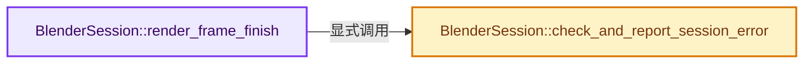
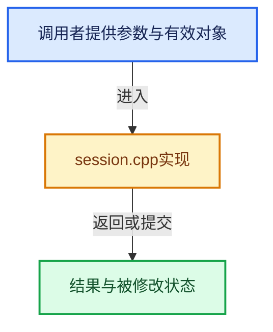

# 实现依赖专题：intern/cycles/blender/session.cpp

[实现依赖导航](../../../README.md) · [符号索引](../../../../00-课程指南/02-源码与提交索引/符号依赖与实现索引.md)

本专题从正文实际调用进入，集中保存共享实现。函数有稳定锚点，可从调用处直接跳到对应完整函数；递归与互相调用通过回链组织。

## 本文件的实现关系






## 完整成员与函数实现

<a id="f-e8467c21cc604d2d"></a>

### `BlenderSession::render_frame_finish`

实现位置：[intern/cycles/blender/session.cpp](../../../../../../../../intern/cycles/blender/session.cpp) · L478—L521。

**教学注释版**

<!-- annotated:59286b9322d229 -->

```cpp
void BlenderSession::render_frame_finish()
{
  /* Processing of all layers and views is done. Clear the strings so that we can communicate
   * progress about reading files and denoising them. */
  b_rlay_name = "";
  b_rview_name = "";

  if ((b_render->mode & blender::R_PERSISTENT_DATA) == 0) {
    /* Free the sync object so that it can properly dereference nodes from the scene graph before
     * the graph is freed. */
    sync.reset();

    session->device_free();
  }

  for (const string_view filename : full_buffer_files_) {
    session->process_full_buffer_from_disk(filename);
    if (check_and_report_session_error()) {
      break;
    }
  }

  for (const string_view filename : full_buffer_files_) {
    path_remove(filename);
  }

  /* Clear output driver. */
  session->set_output_driver(nullptr);
  session->full_buffer_written_cb = nullptr;

  /* The display driver is the source of drawing context for both drawing and possible graphics
   * interoperability objects in the path trace. Once the frame is finished the OpenGL context
   * might be freed form Blender side. Need to ensure that all GPU resources are freed prior to
   * that point.
   * Ideally would only do this when OpenGL context is actually destroyed, but there is no way to
   * know when this happens (at least in the code at the time when this comment was written).
   * The penalty of re-creating resources on every frame is unlikely to be noticed. */
  display_driver_ = nullptr;
  session->set_display_driver(nullptr);

  /* All the files are handled.
   * Clear the list so that this session can be re-used by Persistent Data. */
  full_buffer_files_.clear();
}
```

<details>
<summary>核对原始源码：intern/cycles/blender/session.cpp · L478—L521</summary>

<!-- original:59286b9322d229:intern/cycles/blender/session.cpp:478:521 -->

```cpp
void BlenderSession::render_frame_finish()
{
  /* Processing of all layers and views is done. Clear the strings so that we can communicate
   * progress about reading files and denoising them. */
  b_rlay_name = "";
  b_rview_name = "";

  if ((b_render->mode & blender::R_PERSISTENT_DATA) == 0) {
    /* Free the sync object so that it can properly dereference nodes from the scene graph before
     * the graph is freed. */
    sync.reset();

    session->device_free();
  }

  for (const string_view filename : full_buffer_files_) {
    session->process_full_buffer_from_disk(filename);
    if (check_and_report_session_error()) {
      break;
    }
  }

  for (const string_view filename : full_buffer_files_) {
    path_remove(filename);
  }

  /* Clear output driver. */
  session->set_output_driver(nullptr);
  session->full_buffer_written_cb = nullptr;

  /* The display driver is the source of drawing context for both drawing and possible graphics
   * interoperability objects in the path trace. Once the frame is finished the OpenGL context
   * might be freed form Blender side. Need to ensure that all GPU resources are freed prior to
   * that point.
   * Ideally would only do this when OpenGL context is actually destroyed, but there is no way to
   * know when this happens (at least in the code at the time when this comment was written).
   * The penalty of re-creating resources on every frame is unlikely to be noticed. */
  display_driver_ = nullptr;
  session->set_display_driver(nullptr);

  /* All the files are handled.
   * Clear the list so that this session can be re-used by Persistent Data. */
  full_buffer_files_.clear();
}
```

</details>

**沿实际写入检查状态**

- `b_rlay_name = "";`
- `b_rview_name = "";`
- `session->full_buffer_written_cb = nullptr;`
- `display_driver_ = nullptr;`

**继续追踪实现**

- `sync.reset` → [调用协议](../../../../00-课程指南/01-路线与规范/模板宏与动态分派协议.md)：接收对象类型依赖auto、返回值或模板实例；不按同名猜测目标。调用位置L488。
- `session->device_free` → [调用协议](../../../../00-课程指南/01-路线与规范/模板宏与动态分派协议.md)：接收对象类型依赖auto、返回值或模板实例；不按同名猜测目标。调用位置L490。
- `session->process_full_buffer_from_disk` → [调用协议](../../../../00-课程指南/01-路线与规范/模板宏与动态分派协议.md)：接收对象类型依赖auto、返回值或模板实例；不按同名猜测目标。调用位置L494。
- `check_and_report_session_error` → [BlenderSession::check_and_report_session_error · L1046](session.cpp.md#f-e1ef30d4ca18f6c1)。
- `path_remove` → [path_remove · L825](../util/path.cpp.md#f-4a2f92d956f46315)。
- `session->set_output_driver` → [调用协议](../../../../00-课程指南/01-路线与规范/模板宏与动态分派协议.md)：接收对象类型依赖auto、返回值或模板实例；不按同名猜测目标。调用位置L505。
- `session->set_display_driver` → [调用协议](../../../../00-课程指南/01-路线与规范/模板宏与动态分派协议.md)：接收对象类型依赖auto、返回值或模板实例；不按同名猜测目标。调用位置L516。
- `full_buffer_files_.clear` → [调用协议](../../../../00-课程指南/01-路线与规范/模板宏与动态分派协议.md)：接收对象类型依赖auto、返回值或模板实例；不按同名猜测目标。调用位置L520。

<a id="f-e1ef30d4ca18f6c1"></a>

### `BlenderSession::check_and_report_session_error`

实现位置：[intern/cycles/blender/session.cpp](../../../../../../../../intern/cycles/blender/session.cpp) · L1046—L1064。

**教学注释版**

<!-- annotated:adc995787653c5 -->

```cpp
bool BlenderSession::check_and_report_session_error()
{
  if (!session->progress.get_error()) {
    return false;
  }

  const string error = session->progress.get_error_message();
  if (error != last_error) {
    /* TODO(sergey): Currently C++ RNA API doesn't let us to use mnemonic name for the variable.
     * Would be nice to have this figured out.
     *
     * For until then, 1 << 5 means RPT_ERROR. */
    RE_engine_report(&b_engine, 1 << 5, error.c_str());
    RE_engine_set_error_message(&b_engine, error.c_str());
    last_error = error;
  }

  return true;
}
```

<details>
<summary>核对原始源码：intern/cycles/blender/session.cpp · L1046—L1064</summary>

<!-- original:adc995787653c5:intern/cycles/blender/session.cpp:1046:1064 -->

```cpp
bool BlenderSession::check_and_report_session_error()
{
  if (!session->progress.get_error()) {
    return false;
  }

  const string error = session->progress.get_error_message();
  if (error != last_error) {
    /* TODO(sergey): Currently C++ RNA API doesn't let us to use mnemonic name for the variable.
     * Would be nice to have this figured out.
     *
     * For until then, 1 << 5 means RPT_ERROR. */
    RE_engine_report(&b_engine, 1 << 5, error.c_str());
    RE_engine_set_error_message(&b_engine, error.c_str());
    last_error = error;
  }

  return true;
}
```

</details>

**沿实际写入检查状态**

- `last_error = error;`

**结果出口**

- `return false;`
- `return true;`

**继续追踪实现**

- `session->progress.get_error` → [调用协议](../../../../00-课程指南/01-路线与规范/模板宏与动态分派协议.md)：接收对象类型依赖auto、返回值或模板实例；不按同名猜测目标。调用位置L1048。
- `session->progress.get_error_message` → [调用协议](../../../../00-课程指南/01-路线与规范/模板宏与动态分派协议.md)：接收对象类型依赖auto、返回值或模板实例；不按同名猜测目标。调用位置L1052。
- `RE_engine_report` → [blender::RE_engine_report · L542](../../../08-其他Blender模块/render/intern/engine.cc.md#f-43129d896b6336ff)。
- `error.c_str` → [调用协议](../../../../00-课程指南/01-路线与规范/模板宏与动态分派协议.md)：由接收对象具体类型或运行时策略提供实现。调用位置L1058。
- `RE_engine_set_error_message` → [blender::RE_engine_set_error_message · L554](../../../08-其他Blender模块/render/intern/engine.cc.md#f-c4eddc952e8741a1)。
