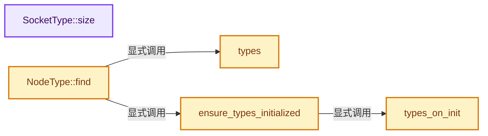
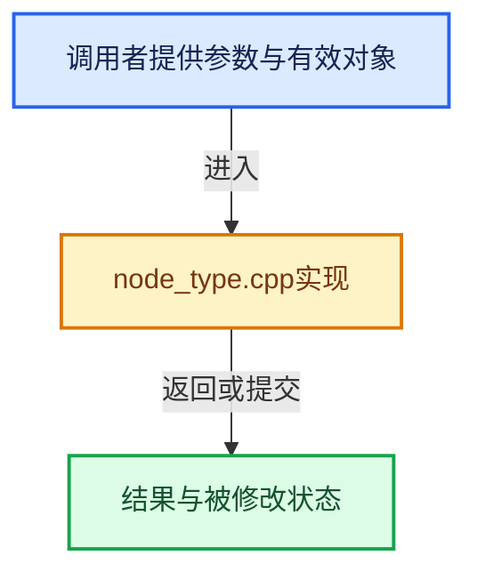

# 实现依赖专题：intern/cycles/graph/node_type.cpp

[实现依赖导航](../../../README.md) · [符号索引](../../../../00-课程指南/02-源码与提交索引/符号依赖与实现索引.md)

本专题从正文实际调用进入，集中保存共享实现。函数有稳定锚点，可从调用处直接跳到对应完整函数；递归与互相调用通过回链组织。

## 本文件的实现关系






## 完整成员与函数实现

<a id="f-07d22bce254c9492"></a>

### `SocketType::size`

实现位置：[intern/cycles/graph/node_type.cpp](../../../../../../../../intern/cycles/graph/node_type.cpp) · L30—L91。

接口参数：

- `Type type`
- `bool packed`

**教学注释版**

<!-- annotated:ea38c6ef9f6129 -->

```cpp
size_t SocketType::size(Type type, bool packed)
{
  switch (type) {
    case UNDEFINED:
    case NUM_TYPES:
      return 0;

    case BOOLEAN:
      return sizeof(bool);
    case FLOAT:
      return sizeof(float);
    case INT:
      return sizeof(int);
    case UINT:
      return sizeof(uint);
    case UINT64:
      return sizeof(uint64_t);
    case COLOR:
    case VECTOR:
    case POINT:
    case NORMAL:
      return (packed) ? sizeof(packed_float3) : sizeof(float3);
    case POINT2:
      return sizeof(float2);
    case CLOSURE:
      return 0;
    case STRING:
      return sizeof(ustring);
    case ENUM:
      return sizeof(int);
    case TRANSFORM:
      return sizeof(Transform);
    case NODE:
      return sizeof(void *);

    case BOOLEAN_ARRAY:
      return sizeof(array<bool>);
    case FLOAT_ARRAY:
      return sizeof(array<float>);
    case INT_ARRAY:
      return sizeof(array<int>);
    case COLOR_ARRAY:
      return sizeof(array<packed_float3>);
    case VECTOR_ARRAY:
      return sizeof(array<packed_float3>);
    case POINT_ARRAY:
      return sizeof(array<packed_float3>);
    case NORMAL_ARRAY:
      return sizeof(array<packed_float3>);
    case POINT2_ARRAY:
      return sizeof(array<float2>);
    case STRING_ARRAY:
      return sizeof(array<ustring>);
    case TRANSFORM_ARRAY:
      return sizeof(array<Transform>);
    case NODE_ARRAY:
      return sizeof(array<void *>);
  }

  // [讲解] assert：检查开发者预期条件，配置可能关闭；不承担完整输入处理或自动修复。
  assert(0);
  return 0;
}
```

<details>
<summary>核对原始源码：intern/cycles/graph/node_type.cpp · L30—L91</summary>

<!-- original:ea38c6ef9f6129:intern/cycles/graph/node_type.cpp:30:91 -->

```cpp
size_t SocketType::size(Type type, bool packed)
{
  switch (type) {
    case UNDEFINED:
    case NUM_TYPES:
      return 0;

    case BOOLEAN:
      return sizeof(bool);
    case FLOAT:
      return sizeof(float);
    case INT:
      return sizeof(int);
    case UINT:
      return sizeof(uint);
    case UINT64:
      return sizeof(uint64_t);
    case COLOR:
    case VECTOR:
    case POINT:
    case NORMAL:
      return (packed) ? sizeof(packed_float3) : sizeof(float3);
    case POINT2:
      return sizeof(float2);
    case CLOSURE:
      return 0;
    case STRING:
      return sizeof(ustring);
    case ENUM:
      return sizeof(int);
    case TRANSFORM:
      return sizeof(Transform);
    case NODE:
      return sizeof(void *);

    case BOOLEAN_ARRAY:
      return sizeof(array<bool>);
    case FLOAT_ARRAY:
      return sizeof(array<float>);
    case INT_ARRAY:
      return sizeof(array<int>);
    case COLOR_ARRAY:
      return sizeof(array<packed_float3>);
    case VECTOR_ARRAY:
      return sizeof(array<packed_float3>);
    case POINT_ARRAY:
      return sizeof(array<packed_float3>);
    case NORMAL_ARRAY:
      return sizeof(array<packed_float3>);
    case POINT2_ARRAY:
      return sizeof(array<float2>);
    case STRING_ARRAY:
      return sizeof(array<ustring>);
    case TRANSFORM_ARRAY:
      return sizeof(array<Transform>);
    case NODE_ARRAY:
      return sizeof(array<void *>);
  }

  assert(0);
  return 0;
}
```

</details>

**结果出口**

- `return 0;`
- `return sizeof(bool);`
- `return sizeof(float);`
- `return sizeof(int);`
- `return sizeof(uint);`
- `return sizeof(uint64_t);`
- `return (packed) ? sizeof(packed_float3) : sizeof(float3);`
- `return sizeof(float2);`
- `return sizeof(ustring);`
- `return sizeof(Transform);`
- `return sizeof(void *);`
- `return sizeof(array<bool>);`
- `return sizeof(array<float>);`
- `return sizeof(array<int>);`
- `return sizeof(array<packed_float3>);`
- `return sizeof(array<float2>);`
- `return sizeof(array<ustring>);`
- `return sizeof(array<Transform>);`
- `return sizeof(array<void *>);`

**继续追踪实现**

- `assert` → [外部契约](https://eel.is/c++draft/assertions)：检查开发者预期条件，配置可能关闭；不承担完整输入处理或自动修复。

<a id="f-a4527f914204a1f6"></a>

### `types`

实现位置：[intern/cycles/graph/node_type.cpp](../../../../../../../../intern/cycles/graph/node_type.cpp) · L227—L231。

**教学注释版**

<!-- annotated:121d2d7c60c1c3 -->

```cpp
static unordered_map<ustring, NodeType> &types()
{
  static unordered_map<ustring, NodeType> _types;
  return _types;
}
```

<details>
<summary>核对原始源码：intern/cycles/graph/node_type.cpp · L227—L231</summary>

<!-- original:121d2d7c60c1c3:intern/cycles/graph/node_type.cpp:227:231 -->

```cpp
static unordered_map<ustring, NodeType> &types()
{
  static unordered_map<ustring, NodeType> _types;
  return _types;
}
```

</details>

**结果出口**

- `return _types;`

**继续追踪实现**

本实现没有需要继续展开的显式调用；检查返回表达式、对象转换和调用者前置条件。

<a id="f-6ccb204d56de5422"></a>

### `types_on_init`

实现位置：[intern/cycles/graph/node_type.cpp](../../../../../../../../intern/cycles/graph/node_type.cpp) · L239—L243。

**教学注释版**

<!-- annotated:f7bf4891ff8e7e -->

```cpp
static std::vector<const NodeType *(*)()> &types_on_init()
{
  static std::vector<const NodeType *(*)()> _types_on_init;
  return _types_on_init;
}
```

<details>
<summary>核对原始源码：intern/cycles/graph/node_type.cpp · L239—L243</summary>

<!-- original:f7bf4891ff8e7e:intern/cycles/graph/node_type.cpp:239:243 -->

```cpp
static std::vector<const NodeType *(*)()> &types_on_init()
{
  static std::vector<const NodeType *(*)()> _types_on_init;
  return _types_on_init;
}
```

</details>

**结果出口**

- `return _types_on_init;`

**继续追踪实现**

本实现没有需要继续展开的显式调用；检查返回表达式、对象转换和调用者前置条件。

<a id="f-d3609798a90e03ff"></a>

### `ensure_types_initialized`

实现位置：[intern/cycles/graph/node_type.cpp](../../../../../../../../intern/cycles/graph/node_type.cpp) · L245—L252。

**教学注释版**

<!-- annotated:39068fbb040dc3 -->

```cpp
static void ensure_types_initialized()
{
  thread_scoped_lock lock(types_on_init_mutex());
  for (const auto &init_func : types_on_init()) {
    init_func();
  }
  types_on_init().clear();
}
```

<details>
<summary>核对原始源码：intern/cycles/graph/node_type.cpp · L245—L252</summary>

<!-- original:39068fbb040dc3:intern/cycles/graph/node_type.cpp:245:252 -->

```cpp
static void ensure_types_initialized()
{
  thread_scoped_lock lock(types_on_init_mutex());
  for (const auto &init_func : types_on_init()) {
    init_func();
  }
  types_on_init().clear();
}
```

</details>

**继续追踪实现**

- `types_on_init` → [types_on_init · L239](node_type.cpp.md#f-6ccb204d56de5422)。
- `init_func` → [init_func · L119](../blender/python.cpp.md#f-43e4140ed932d867)。
- `types_on_init().clear` → [调用协议](../../../../00-课程指南/01-路线与规范/模板宏与动态分派协议.md)：接收对象类型依赖auto、返回值或模板实例；不按同名猜测目标。调用位置L251。

<a id="f-d36e072b702c2243"></a>

### `NodeType::find`

实现位置：[intern/cycles/graph/node_type.cpp](../../../../../../../../intern/cycles/graph/node_type.cpp) · L282—L289。

接口参数：

- `ustring name`

**教学注释版**

<!-- annotated:263f70de37d963 -->

```cpp
const NodeType *NodeType::find(ustring name)
{
  ensure_types_initialized();

  thread_scoped_lock lock(types_mutex());
  const unordered_map<ustring, NodeType>::iterator it = types().find(name);
  return (it == types().end()) ? nullptr : &it->second;
}
```

<details>
<summary>核对原始源码：intern/cycles/graph/node_type.cpp · L282—L289</summary>

<!-- original:263f70de37d963:intern/cycles/graph/node_type.cpp:282:289 -->

```cpp
const NodeType *NodeType::find(ustring name)
{
  ensure_types_initialized();

  thread_scoped_lock lock(types_mutex());
  const unordered_map<ustring, NodeType>::iterator it = types().find(name);
  return (it == types().end()) ? nullptr : &it->second;
}
```

</details>

**结果出口**

- `return (it == types().end()) ? nullptr : &it->second;`

**继续追踪实现**

- `ensure_types_initialized` → [ensure_types_initialized · L245](node_type.cpp.md#f-d3609798a90e03ff)。
- `types().find` → [调用协议](../../../../00-课程指南/01-路线与规范/模板宏与动态分派协议.md)：接收对象类型依赖auto、返回值或模板实例；不按同名猜测目标。调用位置L287。
- `types` → [types · L227](node_type.cpp.md#f-a4527f914204a1f6)。
- `types().end` → [调用协议](../../../../00-课程指南/01-路线与规范/模板宏与动态分派协议.md)：接收对象类型依赖auto、返回值或模板实例；不按同名猜测目标。调用位置L288。
