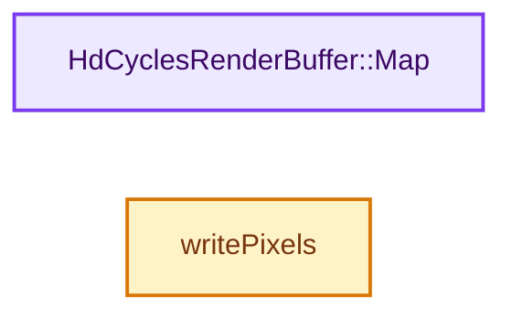
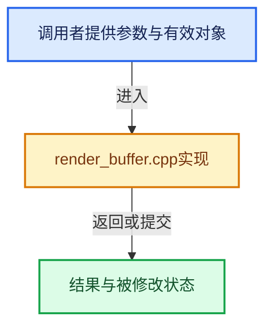

# 实现依赖专题：intern/cycles/hydra/render_buffer.cpp

[实现依赖导航](../../../README.md) · [符号索引](../../../../00-课程指南/02-源码与提交索引/符号依赖与实现索引.md)

本专题从正文实际调用进入，集中保存共享实现。函数有稳定锚点，可从调用处直接跳到对应完整函数；递归与互相调用通过回链组织。

## 本文件的实现关系






## 完整成员与函数实现

<a id="f-612f36a470bea05f"></a>

### `HdCyclesRenderBuffer::Map`

实现位置：[intern/cycles/hydra/render_buffer.cpp](../../../../../../../../intern/cycles/hydra/render_buffer.cpp) · L70—L84。

**教学注释版**

<!-- annotated:f3838766e9a243 -->

```cpp
void *HdCyclesRenderBuffer::Map()
{
  // Mapping is not implemented when a resource is set
  if (!_resource.IsEmpty()) {
    return nullptr;
  }

  if (_data.size() != _dataSize) {
    _data.resize(_dataSize);
  }

  ++_mapped;

  return _data.data();
}
```

<details>
<summary>核对原始源码：intern/cycles/hydra/render_buffer.cpp · L70—L84</summary>

<!-- original:f3838766e9a243:intern/cycles/hydra/render_buffer.cpp:70:84 -->

```cpp
void *HdCyclesRenderBuffer::Map()
{
  // Mapping is not implemented when a resource is set
  if (!_resource.IsEmpty()) {
    return nullptr;
  }

  if (_data.size() != _dataSize) {
    _data.resize(_dataSize);
  }

  ++_mapped;

  return _data.data();
}
```

</details>

**结果出口**

- `return nullptr;`
- `return _data.data();`

**继续追踪实现**

- `_resource.IsEmpty` → [调用协议](../../../../00-课程指南/01-路线与规范/模板宏与动态分派协议.md)：接收对象类型依赖auto、返回值或模板实例；不按同名猜测目标。调用位置L73。
- `_data.size` → [调用协议](../../../../00-课程指南/01-路线与规范/模板宏与动态分派协议.md)：接收对象类型依赖auto、返回值或模板实例；不按同名猜测目标。调用位置L77。
- `_data.resize` → [调用协议](../../../../00-课程指南/01-路线与规范/模板宏与动态分派协议.md)：接收对象类型依赖auto、返回值或模板实例；不按同名猜测目标。调用位置L78。
- `_data.data` → [调用协议](../../../../00-课程指南/01-路线与规范/模板宏与动态分派协议.md)：接收对象类型依赖auto、返回值或模板实例；不按同名猜测目标。调用位置L83。

<a id="f-5899c2d3287c8046"></a>

### `writePixels`

实现位置：[intern/cycles/hydra/render_buffer.cpp](../../../../../../../../intern/cycles/hydra/render_buffer.cpp) · L160—L181。

接口参数：

- `const SrcT *srcPtr`
- `const GfVec2i &srcSize`
- `const int srcChannelCount`
- `DstT *dstPtr`
- `const GfVec2i &dstSize`
- `const int dstChannelCount`
- `const Convertor &convertor = {}`

**教学注释版**

<!-- annotated:0ace395c795ac1 -->

```cpp
template<typename SrcT, typename DstT, typename Convertor = SimpleConversion>
void writePixels(const SrcT *srcPtr,
                 const GfVec2i &srcSize,
                 const int srcChannelCount,
                 DstT *dstPtr,
                 const GfVec2i &dstSize,
                 const int dstChannelCount,
                 const Convertor &convertor = {})
{
  const auto writeSize = GfVec2i(GfMin(srcSize[0], dstSize[0]), GfMin(srcSize[1], dstSize[1]));
  const auto writeChannelCount = GfMin(srcChannelCount, dstChannelCount);

  for (int y = 0; y < writeSize[1]; ++y) {
    for (int x = 0; x < writeSize[0]; ++x) {
      for (int c = 0; c < writeChannelCount; ++c) {
        dstPtr[x * dstChannelCount + c] = convertor.convert(srcPtr[x * srcChannelCount + c]);
      }
    }
    srcPtr += srcSize[0] * srcChannelCount;
    dstPtr += dstSize[0] * dstChannelCount;
  }
}
```

<details>
<summary>核对原始源码：intern/cycles/hydra/render_buffer.cpp · L160—L181</summary>

<!-- original:0ace395c795ac1:intern/cycles/hydra/render_buffer.cpp:160:181 -->

```cpp
template<typename SrcT, typename DstT, typename Convertor = SimpleConversion>
void writePixels(const SrcT *srcPtr,
                 const GfVec2i &srcSize,
                 const int srcChannelCount,
                 DstT *dstPtr,
                 const GfVec2i &dstSize,
                 const int dstChannelCount,
                 const Convertor &convertor = {})
{
  const auto writeSize = GfVec2i(GfMin(srcSize[0], dstSize[0]), GfMin(srcSize[1], dstSize[1]));
  const auto writeChannelCount = GfMin(srcChannelCount, dstChannelCount);

  for (int y = 0; y < writeSize[1]; ++y) {
    for (int x = 0; x < writeSize[0]; ++x) {
      for (int c = 0; c < writeChannelCount; ++c) {
        dstPtr[x * dstChannelCount + c] = convertor.convert(srcPtr[x * srcChannelCount + c]);
      }
    }
    srcPtr += srcSize[0] * srcChannelCount;
    dstPtr += dstSize[0] * dstChannelCount;
  }
}
```

</details>

**沿实际写入检查状态**

- `srcPtr += srcSize[0] * srcChannelCount;`
- `dstPtr += dstSize[0] * dstChannelCount;`

**继续追踪实现**

- `GfVec2i` → [调用协议](../../../../00-课程指南/01-路线与规范/模板宏与动态分派协议.md)：函数指针、局部可调用对象或未展开的宏；必须结合调用者环境。调用位置L169。
- `GfMin` → [调用协议](../../../../00-课程指南/01-路线与规范/模板宏与动态分派协议.md)：函数指针、局部可调用对象或未展开的宏；必须结合调用者环境。调用位置L169。
- `convertor.convert` → [调用协议](../../../../00-课程指南/01-路线与规范/模板宏与动态分派协议.md)：接收对象类型依赖auto、返回值或模板实例；不按同名猜测目标。调用位置L175。
