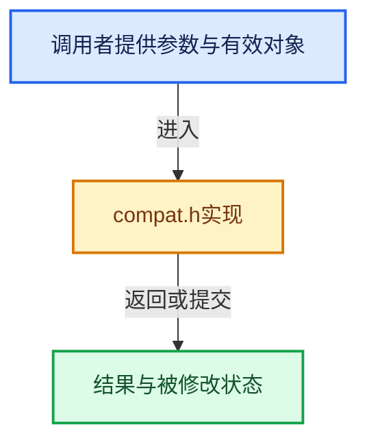

# 实现依赖专题：intern/cycles/kernel/device/cuda/compat.h

[实现依赖导航](../../../../../README.md) · [符号索引](../../../../../../00-课程指南/02-源码与提交索引/符号依赖与实现索引.md)

本专题从正文实际调用进入，集中保存共享实现。函数有稳定锚点，可从调用处直接跳到对应完整函数；递归与互相调用通过回链组织。

## 本文件的实现关系





<a id="m-7721be419a49"></a>

## 宏 `cosf`

<!-- annotated:1ed777fe7b2dfc -->

```cpp
#define cosf(x) __cosf(((float)(x)))
#define sinf(x) __sinf(((float)(x)))
```

<details>
<summary>核对原始源码：intern/cycles/kernel/device/cuda/compat.h · L91—L92</summary>

<!-- original:1ed777fe7b2dfc:intern/cycles/kernel/device/cuda/compat.h:91:92 -->

```cpp
#define cosf(x) __cosf(((float)(x)))
#define sinf(x) __sinf(((float)(x)))
```

</details>

宏在预处理阶段展开，参数替换、重复求值和条件编译应直接从该定义检查。与普通函数不同，宏不会自动提供参数类型检查；构建配置选择哪个定义需结合外围条件。

<a id="m-e63872738f13"></a>

## 宏 `sinf`

<!-- annotated:e387e1872fa2fa -->

```cpp
#define sinf(x) __sinf(((float)(x)))
#define powf(x, y) __powf(((float)(x)), ((float)(y)))
```

<details>
<summary>核对原始源码：intern/cycles/kernel/device/cuda/compat.h · L92—L93</summary>

<!-- original:e387e1872fa2fa:intern/cycles/kernel/device/cuda/compat.h:92:93 -->

```cpp
#define sinf(x) __sinf(((float)(x)))
#define powf(x, y) __powf(((float)(x)), ((float)(y)))
```

</details>

宏在预处理阶段展开，参数替换、重复求值和条件编译应直接从该定义检查。与普通函数不同，宏不会自动提供参数类型检查；构建配置选择哪个定义需结合外围条件。

<a id="m-64340c9f6eb3"></a>

## 宏 `powf`

<!-- annotated:821064f6367ed5 -->

```cpp
#define powf(x, y) __powf(((float)(x)), ((float)(y)))
#define tanf(x) __tanf(((float)(x)))
```

<details>
<summary>核对原始源码：intern/cycles/kernel/device/cuda/compat.h · L93—L94</summary>

<!-- original:821064f6367ed5:intern/cycles/kernel/device/cuda/compat.h:93:94 -->

```cpp
#define powf(x, y) __powf(((float)(x)), ((float)(y)))
#define tanf(x) __tanf(((float)(x)))
```

</details>

宏在预处理阶段展开，参数替换、重复求值和条件编译应直接从该定义检查。与普通函数不同，宏不会自动提供参数类型检查；构建配置选择哪个定义需结合外围条件。

<a id="m-789daa70cab8"></a>

## 宏 `tanf`

<!-- annotated:56bf047c08ed2d -->

```cpp
#define tanf(x) __tanf(((float)(x)))
#define logf(x) __logf(((float)(x)))
```

<details>
<summary>核对原始源码：intern/cycles/kernel/device/cuda/compat.h · L94—L95</summary>

<!-- original:56bf047c08ed2d:intern/cycles/kernel/device/cuda/compat.h:94:95 -->

```cpp
#define tanf(x) __tanf(((float)(x)))
#define logf(x) __logf(((float)(x)))
```

</details>

宏在预处理阶段展开，参数替换、重复求值和条件编译应直接从该定义检查。与普通函数不同，宏不会自动提供参数类型检查；构建配置选择哪个定义需结合外围条件。

<a id="m-3a440f80084c"></a>

## 宏 `logf`

<!-- annotated:6a9e9f05f4ff68 -->

```cpp
#define logf(x) __logf(((float)(x)))
#define expf(x) __expf(((float)(x)))
```

<details>
<summary>核对原始源码：intern/cycles/kernel/device/cuda/compat.h · L95—L96</summary>

<!-- original:6a9e9f05f4ff68:intern/cycles/kernel/device/cuda/compat.h:95:96 -->

```cpp
#define logf(x) __logf(((float)(x)))
#define expf(x) __expf(((float)(x)))
```

</details>

宏在预处理阶段展开，参数替换、重复求值和条件编译应直接从该定义检查。与普通函数不同，宏不会自动提供参数类型检查；构建配置选择哪个定义需结合外围条件。

<a id="m-2f79e4fe4305"></a>

## 宏 `expf`

<!-- annotated:71ffc5d4f0cc32 -->

```cpp
#define expf(x) __expf(((float)(x)))

```

<details>
<summary>核对原始源码：intern/cycles/kernel/device/cuda/compat.h · L96—L97</summary>

<!-- original:71ffc5d4f0cc32:intern/cycles/kernel/device/cuda/compat.h:96:97 -->

```cpp
#define expf(x) __expf(((float)(x)))

```

</details>

宏在预处理阶段展开，参数替换、重复求值和条件编译应直接从该定义检查。与普通函数不同，宏不会自动提供参数类型检查；构建配置选择哪个定义需结合外围条件。

## 完整成员与函数实现
