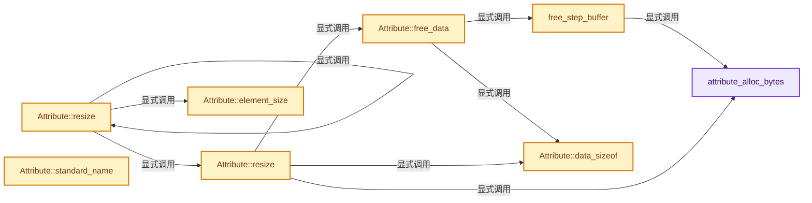
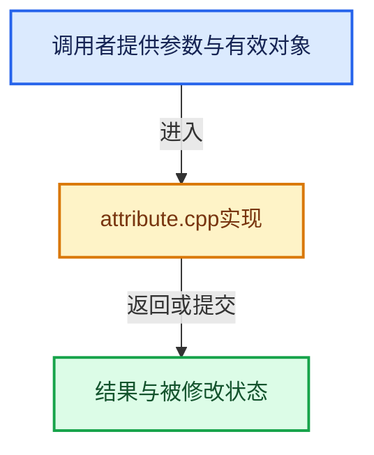

# 实现依赖专题：intern/cycles/scene/attribute.cpp

[实现依赖导航](../../../README.md) · [符号索引](../../../../00-课程指南/02-源码与提交索引/符号依赖与实现索引.md)

本专题从正文实际调用进入，集中保存共享实现。函数有稳定锚点，可从调用处直接跳到对应完整函数；递归与互相调用通过回链组织。

## 本文件的实现关系






## 完整成员与函数实现

<a id="f-08647c3d06e7de48"></a>

### `attribute_alloc_bytes`

实现位置：[intern/cycles/scene/attribute.cpp](../../../../../../../../intern/cycles/scene/attribute.cpp) · L66—L72。

接口参数：

- `const size_t element_size`
- `const size_t size`

**教学注释版**

<!-- annotated:f0e562772e3d27 -->

```cpp
static size_t attribute_alloc_bytes(const size_t element_size, const size_t size)
{
  /* rtcSetSharedGeometryBuffer is documented as requiring 4 bytes past the
   * end of a float3 for 16-byte SSE loads, so we add that for all attributes. */
  static constexpr size_t ATTRIBUTE_BUFFER_PADDING = 4;
  return element_size * size + ATTRIBUTE_BUFFER_PADDING;
}
```

<details>
<summary>核对原始源码：intern/cycles/scene/attribute.cpp · L66—L72</summary>

<!-- original:f0e562772e3d27:intern/cycles/scene/attribute.cpp:66:72 -->

```cpp
static size_t attribute_alloc_bytes(const size_t element_size, const size_t size)
{
  /* rtcSetSharedGeometryBuffer is documented as requiring 4 bytes past the
   * end of a float3 for 16-byte SSE loads, so we add that for all attributes. */
  static constexpr size_t ATTRIBUTE_BUFFER_PADDING = 4;
  return element_size * size + ATTRIBUTE_BUFFER_PADDING;
}
```

</details>

**结果出口**

- `return element_size * size + ATTRIBUTE_BUFFER_PADDING;`

**继续追踪实现**

本实现没有需要继续展开的显式调用；检查返回表达式、对象转换和调用者前置条件。

<a id="f-633dfb8f2a1c6428"></a>

### `free_step_buffer`

实现位置：[intern/cycles/scene/attribute.cpp](../../../../../../../../intern/cycles/scene/attribute.cpp) · L74—L95。

接口参数：

- `Attribute::Buffer &buf`
- `const AttributeElement element`
- `const size_t data_sizeof`
- `const size_t size`

**教学注释版**

<!-- annotated:4e4ed6a69b7ba3 -->

```cpp
static void free_step_buffer(Attribute::Buffer &buf,
                             const AttributeElement element,
                             const size_t data_sizeof,
                             const size_t size)
{
  if (element & ATTR_ELEMENT_VOXEL) {
    if (buf.data) {
      auto *image = static_cast<ImageHandle *>(const_cast<void *>(buf.data));
      image->~ImageHandle();
      GuardedAllocator<ImageHandle>().deallocate(image, 1);
    }
  }
  else if (buf.sharing_info) {
    g_implicit_sharing_user_remove_fn(buf.sharing_info);
  }
  else if (buf.data) {
    GuardedAllocator<char>().deallocate(static_cast<char *>(const_cast<void *>(buf.data)),
                                        attribute_alloc_bytes(data_sizeof, size));
  }
  buf.data = nullptr;
  buf.sharing_info = nullptr;
}
```

<details>
<summary>核对原始源码：intern/cycles/scene/attribute.cpp · L74—L95</summary>

<!-- original:4e4ed6a69b7ba3:intern/cycles/scene/attribute.cpp:74:95 -->

```cpp
static void free_step_buffer(Attribute::Buffer &buf,
                             const AttributeElement element,
                             const size_t data_sizeof,
                             const size_t size)
{
  if (element & ATTR_ELEMENT_VOXEL) {
    if (buf.data) {
      auto *image = static_cast<ImageHandle *>(const_cast<void *>(buf.data));
      image->~ImageHandle();
      GuardedAllocator<ImageHandle>().deallocate(image, 1);
    }
  }
  else if (buf.sharing_info) {
    g_implicit_sharing_user_remove_fn(buf.sharing_info);
  }
  else if (buf.data) {
    GuardedAllocator<char>().deallocate(static_cast<char *>(const_cast<void *>(buf.data)),
                                        attribute_alloc_bytes(data_sizeof, size));
  }
  buf.data = nullptr;
  buf.sharing_info = nullptr;
}
```

</details>

**沿实际写入检查状态**

- `buf.data = nullptr;`
- `buf.sharing_info = nullptr;`

**继续追踪实现**

- `image->~ImageHandle` → [调用协议](../../../../00-课程指南/01-路线与规范/模板宏与动态分派协议.md)：接收对象类型依赖auto、返回值或模板实例；不按同名猜测目标。调用位置L82。
- `GuardedAllocator<ImageHandle>().deallocate` → [调用协议](../../../../00-课程指南/01-路线与规范/模板宏与动态分派协议.md)：接收对象类型依赖auto、返回值或模板实例；不按同名猜测目标。调用位置L83。
- `GuardedAllocator<ImageHandle>` → [GuardedAllocator::GuardedAllocator · L33](../util/guarded_allocator.h.md#f-51d47bec28a5a3d7)；[GuardedAllocator::GuardedAllocator · L34](../util/guarded_allocator.h.md#f-273011bbcaf915f8)；[GuardedAllocator::GuardedAllocator · L94](../util/guarded_allocator.h.md#f-b240687baf719161)。同名重载需按实参类型选择。
- `g_implicit_sharing_user_remove_fn` → [调用协议](../../../../00-课程指南/01-路线与规范/模板宏与动态分派协议.md)：函数指针、局部可调用对象或未展开的宏；必须结合调用者环境。调用位置L87。
- `GuardedAllocator<char>().deallocate` → [调用协议](../../../../00-课程指南/01-路线与规范/模板宏与动态分派协议.md)：接收对象类型依赖auto、返回值或模板实例；不按同名猜测目标。调用位置L90。
- `GuardedAllocator<char>` → [GuardedAllocator::GuardedAllocator · L33](../util/guarded_allocator.h.md#f-51d47bec28a5a3d7)；[GuardedAllocator::GuardedAllocator · L34](../util/guarded_allocator.h.md#f-273011bbcaf915f8)；[GuardedAllocator::GuardedAllocator · L94](../util/guarded_allocator.h.md#f-b240687baf719161)。同名重载需按实参类型选择。
- `attribute_alloc_bytes` → [attribute_alloc_bytes · L66](attribute.cpp.md#f-08647c3d06e7de48)。

<a id="f-feffebdeef28753a"></a>

### `Attribute::free_data`

实现位置：[intern/cycles/scene/attribute.cpp](../../../../../../../../intern/cycles/scene/attribute.cpp) · L107—L115。

**教学注释版**

<!-- annotated:4bdb6421d3f380 -->

```cpp
void Attribute::free_data()
{
  const size_t element_size = data_sizeof();
  free_step_buffer(center, element, element_size, size);
  for (Buffer &buf : motion) {
    free_step_buffer(buf, element, element_size, size);
  }
  motion.clear();
}
```

<details>
<summary>核对原始源码：intern/cycles/scene/attribute.cpp · L107—L115</summary>

<!-- original:4bdb6421d3f380:intern/cycles/scene/attribute.cpp:107:115 -->

```cpp
void Attribute::free_data()
{
  const size_t element_size = data_sizeof();
  free_step_buffer(center, element, element_size, size);
  for (Buffer &buf : motion) {
    free_step_buffer(buf, element, element_size, size);
  }
  motion.clear();
}
```

</details>

**继续追踪实现**

- `data_sizeof` → [Attribute::data_sizeof · L325](attribute.cpp.md#f-ffb5d77787f0d431)。
- `free_step_buffer` → [free_step_buffer · L74](attribute.cpp.md#f-633dfb8f2a1c6428)。
- `motion.clear` → [调用协议](../../../../00-课程指南/01-路线与规范/模板宏与动态分派协议.md)：接收对象类型依赖auto、返回值或模板实例；不按同名猜测目标。调用位置L114。

<a id="f-62b6dd96d32875c0"></a>

### `Attribute::resize`

实现位置：[intern/cycles/scene/attribute.cpp](../../../../../../../../intern/cycles/scene/attribute.cpp) · L122—L127。

接口参数：

- `Geometry *geom`
- `AttributePrimitive prim`

**教学注释版**

<!-- annotated:84d5ea291be3e9 -->

```cpp
void Attribute::resize(Geometry *geom, AttributePrimitive prim)
{
  if (!(element & ATTR_ELEMENT_VOXEL)) {
    resize(Attribute::element_size(geom, element, prim));
  }
}
```

<details>
<summary>核对原始源码：intern/cycles/scene/attribute.cpp · L122—L127</summary>

<!-- original:84d5ea291be3e9:intern/cycles/scene/attribute.cpp:122:127 -->

```cpp
void Attribute::resize(Geometry *geom, AttributePrimitive prim)
{
  if (!(element & ATTR_ELEMENT_VOXEL)) {
    resize(Attribute::element_size(geom, element, prim));
  }
}
```

</details>

**继续追踪实现**

- `resize` → [Attribute::resize · L122](attribute.cpp.md#f-62b6dd96d32875c0)；[Attribute::resize · L129](attribute.cpp.md#f-048dccdac3da2b83)；[AttributeSet::resize · L1117](attribute.cpp.md#f-4bccc92203def333)。同名重载需按实参类型选择。
- `Attribute::element_size` → [Attribute::element_size · L362](attribute.cpp.md#f-766f1697730fe815)。

<a id="f-048dccdac3da2b83"></a>

### `Attribute::resize`

实现位置：[intern/cycles/scene/attribute.cpp](../../../../../../../../intern/cycles/scene/attribute.cpp) · L129—L161。

接口参数：

- `const size_t num_elements`

**教学注释版**

<!-- annotated:1d5c566b22744a -->

```cpp
void Attribute::resize(const size_t num_elements)
{
  if (element & ATTR_ELEMENT_VOXEL) {
    return;
  }
  if (num_elements == size_t(size)) {
    return;
  }
  const size_t element_size = data_sizeof();
  // [讲解] std::min：按比较关系选取较小值；截断范围时还需先满足非负和可表示范围，min本身不会证明边界安全。
  const size_t copy_elems = std::min(num_elements, size_t(size));
  const size_t alloc_bytes = attribute_alloc_bytes(element_size, num_elements);

  /* Allocate and copy center step. */
  Buffer new_center;
  new_center.data = GuardedAllocator<char>().allocate(alloc_bytes);
  if (center.data) {
    // [讲解] memcpy：复制字节，源与目标不应重叠。类型生命周期、对齐和可复制表示须由调用者证明，不是任意对象的复制构造。
    memcpy(const_cast<void *>(new_center.data), center.data, copy_elems * element_size);
  }

  /* Allocate and copy motion steps. */
  vector<Buffer> new_motion(motion.size());
  for (size_t i = 0; i < motion.size(); i++) {
    new_motion[i].data = GuardedAllocator<char>().allocate(alloc_bytes);
    if (motion[i].data) {
      memcpy(const_cast<void *>(new_motion[i].data), motion[i].data, copy_elems * element_size);
    }
  }

  free_data();
  center = new_center;
  // [讲解] std::move：把表达式转换成可供移动重载选择的值类别；不保证真的移动，不结束源对象寿命，对const值可能选择复制。
  motion = std::move(new_motion);
  size = num_elements;
}
```

<details>
<summary>核对原始源码：intern/cycles/scene/attribute.cpp · L129—L161</summary>

<!-- original:1d5c566b22744a:intern/cycles/scene/attribute.cpp:129:161 -->

```cpp
void Attribute::resize(const size_t num_elements)
{
  if (element & ATTR_ELEMENT_VOXEL) {
    return;
  }
  if (num_elements == size_t(size)) {
    return;
  }
  const size_t element_size = data_sizeof();
  const size_t copy_elems = std::min(num_elements, size_t(size));
  const size_t alloc_bytes = attribute_alloc_bytes(element_size, num_elements);

  /* Allocate and copy center step. */
  Buffer new_center;
  new_center.data = GuardedAllocator<char>().allocate(alloc_bytes);
  if (center.data) {
    memcpy(const_cast<void *>(new_center.data), center.data, copy_elems * element_size);
  }

  /* Allocate and copy motion steps. */
  vector<Buffer> new_motion(motion.size());
  for (size_t i = 0; i < motion.size(); i++) {
    new_motion[i].data = GuardedAllocator<char>().allocate(alloc_bytes);
    if (motion[i].data) {
      memcpy(const_cast<void *>(new_motion[i].data), motion[i].data, copy_elems * element_size);
    }
  }

  free_data();
  center = new_center;
  motion = std::move(new_motion);
  size = num_elements;
}
```

</details>

**沿实际写入检查状态**

- `new_center.data = GuardedAllocator<char>().allocate(alloc_bytes);`
- `new_motion[i].data = GuardedAllocator<char>().allocate(alloc_bytes);`
- `center = new_center;`
- `motion = std::move(new_motion);`
- `size = num_elements;`

**继续追踪实现**

- `data_sizeof` → [Attribute::data_sizeof · L325](attribute.cpp.md#f-ffb5d77787f0d431)。
- `std::min` → [外部契约](https://eel.is/c++draft/alg.min.max)：按比较关系选取较小值；截断范围时还需先满足非负和可表示范围，min本身不会证明边界安全。
- `attribute_alloc_bytes` → [attribute_alloc_bytes · L66](attribute.cpp.md#f-08647c3d06e7de48)。
- `GuardedAllocator<char>().allocate` → [调用协议](../../../../00-课程指南/01-路线与规范/模板宏与动态分派协议.md)：接收对象类型依赖auto、返回值或模板实例；不按同名猜测目标。调用位置L143。
- `GuardedAllocator<char>` → [GuardedAllocator::GuardedAllocator · L33](../util/guarded_allocator.h.md#f-51d47bec28a5a3d7)；[GuardedAllocator::GuardedAllocator · L34](../util/guarded_allocator.h.md#f-273011bbcaf915f8)；[GuardedAllocator::GuardedAllocator · L94](../util/guarded_allocator.h.md#f-b240687baf719161)。同名重载需按实参类型选择。
- `memcpy` → [外部契约](https://eel.is/c++draft/cstring.syn)：复制字节，源与目标不应重叠。类型生命周期、对齐和可复制表示须由调用者证明，不是任意对象的复制构造。
- `motion.size` → [调用协议](../../../../00-课程指南/01-路线与规范/模板宏与动态分派协议.md)：接收对象类型依赖auto、返回值或模板实例；不按同名猜测目标。调用位置L149。
- `free_data` → [Attribute::free_data · L107](attribute.cpp.md#f-feffebdeef28753a)。
- `std::move` → [外部契约](https://eel.is/c++draft/utility.forward)：把表达式转换成可供移动重载选择的值类别；不保证真的移动，不结束源对象寿命，对const值可能选择复制。

<a id="f-ffb5d77787f0d431"></a>

### `Attribute::data_sizeof`

实现位置：[intern/cycles/scene/attribute.cpp](../../../../../../../../intern/cycles/scene/attribute.cpp) · L325—L360。

**教学注释版**

<!-- annotated:8fb8e3c8096c95 -->

```cpp
size_t Attribute::data_sizeof() const
{
  if (element & ATTR_ELEMENT_VOXEL) {
    return sizeof(ImageHandle);
  }
  if (element & ATTR_ELEMENT_IS_BYTE) {
    return sizeof(uchar4);
  }
  if (element & ATTR_ELEMENT_IS_NORMAL) {
    return sizeof(packed_normal);
  }
  if (type == TypeFloat) {
    return sizeof(float);
  }
  if (type == TypeFloat2) {
    return sizeof(float2);
  }
  if (type == TypeMatrix) {
    return sizeof(Transform);
    // The float3 type is not interchangeable with float4
    // as it is now a packed type.
  }
  if (type == TypeFloat4) {
    return sizeof(float4);
  }
  if (type == TypeRGBA) {
    return sizeof(float4);
  }
  if (type == TypeQuaternion) {
    return sizeof(Quaternion);
  }
  if (type == TypePackedSphericalHarmonicsRest) {
    return sizeof(PackedSphericalHarmonicsRest);
  }
  return sizeof(packed_float3);
}
```

<details>
<summary>核对原始源码：intern/cycles/scene/attribute.cpp · L325—L360</summary>

<!-- original:8fb8e3c8096c95:intern/cycles/scene/attribute.cpp:325:360 -->

```cpp
size_t Attribute::data_sizeof() const
{
  if (element & ATTR_ELEMENT_VOXEL) {
    return sizeof(ImageHandle);
  }
  if (element & ATTR_ELEMENT_IS_BYTE) {
    return sizeof(uchar4);
  }
  if (element & ATTR_ELEMENT_IS_NORMAL) {
    return sizeof(packed_normal);
  }
  if (type == TypeFloat) {
    return sizeof(float);
  }
  if (type == TypeFloat2) {
    return sizeof(float2);
  }
  if (type == TypeMatrix) {
    return sizeof(Transform);
    // The float3 type is not interchangeable with float4
    // as it is now a packed type.
  }
  if (type == TypeFloat4) {
    return sizeof(float4);
  }
  if (type == TypeRGBA) {
    return sizeof(float4);
  }
  if (type == TypeQuaternion) {
    return sizeof(Quaternion);
  }
  if (type == TypePackedSphericalHarmonicsRest) {
    return sizeof(PackedSphericalHarmonicsRest);
  }
  return sizeof(packed_float3);
}
```

</details>

**结果出口**

- `return sizeof(ImageHandle);`
- `return sizeof(uchar4);`
- `return sizeof(packed_normal);`
- `return sizeof(float);`
- `return sizeof(float2);`
- `return sizeof(Transform);`
- `return sizeof(float4);`
- `return sizeof(Quaternion);`
- `return sizeof(PackedSphericalHarmonicsRest);`
- `return sizeof(packed_float3);`

**继续追踪实现**

本实现没有需要继续展开的显式调用；检查返回表达式、对象转换和调用者前置条件。

<a id="f-766f1697730fe815"></a>

### `Attribute::element_size`

实现位置：[intern/cycles/scene/attribute.cpp](../../../../../../../../intern/cycles/scene/attribute.cpp) · L362—L433。

接口参数：

- `Geometry *geom`
- `const AttributeElement element`
- `AttributePrimitive prim`

**教学注释版**

<!-- annotated:827005279bbccc -->

```cpp
size_t Attribute::element_size(Geometry *geom,
                               const AttributeElement element,
                               AttributePrimitive prim)
{
  size_t size = 0;

  switch (element) {
    case ATTR_ELEMENT_OBJECT:
    case ATTR_ELEMENT_MESH:
    case ATTR_ELEMENT_VOXEL:
      size = 1;
      break;
    case ATTR_ELEMENT_VERTEX:
    case ATTR_ELEMENT_VERTEX_NORMAL:
      if (geom->is_mesh() || geom->is_volume()) {
        Mesh *mesh = static_cast<Mesh *>(geom);
        if (prim == ATTR_PRIM_SUBD) {
          size = mesh->get_num_subd_base_verts();
        }
        else {
          size = mesh->num_verts();
        }
      }
      else if (geom->is_pointcloud()) {
        PointCloud *pointcloud = static_cast<PointCloud *>(geom);
        size = pointcloud->num_points();
      }
      break;

    case ATTR_ELEMENT_FACE:
      if (geom->is_mesh() || geom->is_volume()) {
        Mesh *mesh = static_cast<Mesh *>(geom);
        if (prim == ATTR_PRIM_SUBD) {
          size = mesh->get_num_subd_faces();
        }
        else {
          size = mesh->num_triangles();
        }
      }
      break;
    case ATTR_ELEMENT_CORNER:
    case ATTR_ELEMENT_CORNER_BYTE:
    case ATTR_ELEMENT_CORNER_NORMAL:
      if (geom->is_mesh()) {
        Mesh *mesh = static_cast<Mesh *>(geom);
        if (prim == ATTR_PRIM_SUBD) {
          size = mesh->get_subd_face_corners().size();
        }
        else {
          size = mesh->num_triangles() * 3;
        }
      }
      break;
    case ATTR_ELEMENT_CURVE:
      if (geom->is_hair()) {
        Hair *hair = static_cast<Hair *>(geom);
        size = hair->num_curves();
      }
      break;
    case ATTR_ELEMENT_CURVE_KEY:
    case ATTR_ELEMENT_CURVE_KEY_NORMAL:
      if (geom->is_hair()) {
        Hair *hair = static_cast<Hair *>(geom);
        size = hair->num_keys();
      }
      break;
    default:
      break;
  }

  return size;
}
```

<details>
<summary>核对原始源码：intern/cycles/scene/attribute.cpp · L362—L433</summary>

<!-- original:827005279bbccc:intern/cycles/scene/attribute.cpp:362:433 -->

```cpp
size_t Attribute::element_size(Geometry *geom,
                               const AttributeElement element,
                               AttributePrimitive prim)
{
  size_t size = 0;

  switch (element) {
    case ATTR_ELEMENT_OBJECT:
    case ATTR_ELEMENT_MESH:
    case ATTR_ELEMENT_VOXEL:
      size = 1;
      break;
    case ATTR_ELEMENT_VERTEX:
    case ATTR_ELEMENT_VERTEX_NORMAL:
      if (geom->is_mesh() || geom->is_volume()) {
        Mesh *mesh = static_cast<Mesh *>(geom);
        if (prim == ATTR_PRIM_SUBD) {
          size = mesh->get_num_subd_base_verts();
        }
        else {
          size = mesh->num_verts();
        }
      }
      else if (geom->is_pointcloud()) {
        PointCloud *pointcloud = static_cast<PointCloud *>(geom);
        size = pointcloud->num_points();
      }
      break;

    case ATTR_ELEMENT_FACE:
      if (geom->is_mesh() || geom->is_volume()) {
        Mesh *mesh = static_cast<Mesh *>(geom);
        if (prim == ATTR_PRIM_SUBD) {
          size = mesh->get_num_subd_faces();
        }
        else {
          size = mesh->num_triangles();
        }
      }
      break;
    case ATTR_ELEMENT_CORNER:
    case ATTR_ELEMENT_CORNER_BYTE:
    case ATTR_ELEMENT_CORNER_NORMAL:
      if (geom->is_mesh()) {
        Mesh *mesh = static_cast<Mesh *>(geom);
        if (prim == ATTR_PRIM_SUBD) {
          size = mesh->get_subd_face_corners().size();
        }
        else {
          size = mesh->num_triangles() * 3;
        }
      }
      break;
    case ATTR_ELEMENT_CURVE:
      if (geom->is_hair()) {
        Hair *hair = static_cast<Hair *>(geom);
        size = hair->num_curves();
      }
      break;
    case ATTR_ELEMENT_CURVE_KEY:
    case ATTR_ELEMENT_CURVE_KEY_NORMAL:
      if (geom->is_hair()) {
        Hair *hair = static_cast<Hair *>(geom);
        size = hair->num_keys();
      }
      break;
    default:
      break;
  }

  return size;
}
```

</details>

**沿实际写入检查状态**

- `size = 1;`
- `size = mesh->get_num_subd_base_verts();`
- `size = mesh->num_verts();`
- `size = pointcloud->num_points();`
- `size = mesh->get_num_subd_faces();`
- `size = mesh->num_triangles();`
- `size = mesh->get_subd_face_corners().size();`
- `size = mesh->num_triangles() * 3;`
- `size = hair->num_curves();`
- `size = hair->num_keys();`

**结果出口**

- `return size;`

**继续追踪实现**

- `geom->is_mesh` → [Geometry::is_mesh · L193](geometry.h.md#f-557fa18e5076dd17)。
- `geom->is_volume` → [Geometry::is_volume · L208](geometry.h.md#f-dddd66240adf1428)。
- `mesh->get_num_subd_base_verts` → [Mesh::get_num_subd_base_verts · L229](mesh.h.md#f-8c187dcb42872438)。
- `mesh->num_verts` → [Mesh::num_verts · L252](mesh.cpp.md#f-4950d7d4da0a10f0)。
- `geom->is_pointcloud` → [Geometry::is_pointcloud · L203](geometry.h.md#f-2a0008c1a77ddd16)。
- `pointcloud->num_points` → [调用协议](../../../../00-课程指南/01-路线与规范/模板宏与动态分派协议.md)：由接收对象具体类型或运行时策略提供实现。调用位置L387。
- `mesh->get_num_subd_faces` → [Mesh::get_num_subd_faces · L221](mesh.h.md#f-5e96bd2d6676470c)。
- `mesh->num_triangles` → [Mesh::num_triangles · L73](mesh.h.md#f-8df4e39fd91aefc6)。
- `mesh->get_subd_face_corners().size` → [调用协议](../../../../00-课程指南/01-路线与规范/模板宏与动态分派协议.md)：接收对象类型依赖auto、返回值或模板实例；不按同名猜测目标。调用位置L408。
- `mesh->get_subd_face_corners` → [调用协议](../../../../00-课程指南/01-路线与规范/模板宏与动态分派协议.md)：由接收对象具体类型或运行时策略提供实现。调用位置L408。
- `geom->is_hair` → [Geometry::is_hair · L198](geometry.h.md#f-072a1a935bf3dff3)。
- `hair->num_curves` → [Hair::num_curves · L109](hair.h.md#f-a455c05fa0a51d91)。
- `hair->num_keys` → [Hair::num_keys · L103](hair.h.md#f-3cbdc35b82b7f035)。

<a id="f-df3c77ba8f127aa7"></a>

### `Attribute::standard_name`

实现位置：[intern/cycles/scene/attribute.cpp](../../../../../../../../intern/cycles/scene/attribute.cpp) · L465—L552。

接口参数：

- `AttributeStandard std`

**教学注释版**

<!-- annotated:ce282757cda4c9 -->

```cpp
const char *Attribute::standard_name(AttributeStandard std)
{
  switch (std) {
    case ATTR_STD_POSITION:
      return "P";
    case ATTR_STD_RADIUS:
      return "radius";
    case ATTR_STD_VERTEX_NORMAL:
    case ATTR_STD_CORNER_NORMAL:
      return "N";
    case ATTR_STD_UV:
      return "uv";
    case ATTR_STD_GENERATED:
      return "generated";
    case ATTR_STD_GENERATED_TRANSFORM:
      return "generated_transform";
    case ATTR_STD_UV_TANGENT:
      return "tangent";
    case ATTR_STD_UV_TANGENT_SIGN:
      return "tangent_sign";
    case ATTR_STD_UV_TANGENT_UNDISPLACED:
      return "undisplaced_tangent";
    case ATTR_STD_UV_TANGENT_SIGN_UNDISPLACED:
      return "undisplaced_tangent_sign";
    case ATTR_STD_VERTEX_COLOR:
      return "vertex_color";
    case ATTR_STD_POSITION_UNDEFORMED:
      return "undeformed";
    case ATTR_STD_POSITION_UNDISPLACED:
      return "undisplaced";
    case ATTR_STD_NORMAL_UNDISPLACED:
      return "undisplaced_N";
    case ATTR_STD_PARTICLE:
      return "particle";
    case ATTR_STD_CURVE_INTERCEPT:
      return "curve_intercept";
    case ATTR_STD_CURVE_LENGTH:
      return "curve_length";
    case ATTR_STD_CURVE_RANDOM:
      return "curve_random";
    case ATTR_STD_POINT_RANDOM:
      return "point_random";
    case ATTR_STD_PTEX_FACE_ID:
      return "ptex_face_id";
    case ATTR_STD_PTEX_UV:
      return "ptex_uv";
    case ATTR_STD_VOLUME_DENSITY:
      return "density";
    case ATTR_STD_VOLUME_COLOR:
      return "color";
    case ATTR_STD_VOLUME_FLAME:
      return "flame";
    case ATTR_STD_VOLUME_HEAT:
      return "heat";
    case ATTR_STD_VOLUME_TEMPERATURE:
      return "temperature";
    case ATTR_STD_VOLUME_VELOCITY:
      return "velocity";
    case ATTR_STD_VOLUME_VELOCITY_X:
      return "velocity_x";
    case ATTR_STD_VOLUME_VELOCITY_Y:
      return "velocity_y";
    case ATTR_STD_VOLUME_VELOCITY_Z:
      return "velocity_z";
    case ATTR_STD_POINTINESS:
      return "pointiness";
    case ATTR_STD_RANDOM_PER_ISLAND:
      return "random_per_island";
    case ATTR_STD_SHADOW_TRANSPARENCY:
      return "shadow_transparency";
    case ATTR_STD_GSPLAT_RADIANCE_BASE:
      return "radiance:base";
    case ATTR_STD_GSPLAT_RADIANCE_SPHERICAL_HARMONICS_REST:
      return "radiance:sh";
    case ATTR_STD_GSPLAT_RADIANCE:
      return "radiance";
    case ATTR_STD_GSPLAT_SCALE:
      return "scale";
    case ATTR_STD_GSPLAT_ROTATION:
      return "rotation";
    case ATTR_STD_NOT_FOUND:
    case ATTR_STD_NONE:
    case ATTR_STD_NUM:
      return "";
  }

  return "";
}
```

<details>
<summary>核对原始源码：intern/cycles/scene/attribute.cpp · L465—L552</summary>

<!-- original:ce282757cda4c9:intern/cycles/scene/attribute.cpp:465:552 -->

```cpp
const char *Attribute::standard_name(AttributeStandard std)
{
  switch (std) {
    case ATTR_STD_POSITION:
      return "P";
    case ATTR_STD_RADIUS:
      return "radius";
    case ATTR_STD_VERTEX_NORMAL:
    case ATTR_STD_CORNER_NORMAL:
      return "N";
    case ATTR_STD_UV:
      return "uv";
    case ATTR_STD_GENERATED:
      return "generated";
    case ATTR_STD_GENERATED_TRANSFORM:
      return "generated_transform";
    case ATTR_STD_UV_TANGENT:
      return "tangent";
    case ATTR_STD_UV_TANGENT_SIGN:
      return "tangent_sign";
    case ATTR_STD_UV_TANGENT_UNDISPLACED:
      return "undisplaced_tangent";
    case ATTR_STD_UV_TANGENT_SIGN_UNDISPLACED:
      return "undisplaced_tangent_sign";
    case ATTR_STD_VERTEX_COLOR:
      return "vertex_color";
    case ATTR_STD_POSITION_UNDEFORMED:
      return "undeformed";
    case ATTR_STD_POSITION_UNDISPLACED:
      return "undisplaced";
    case ATTR_STD_NORMAL_UNDISPLACED:
      return "undisplaced_N";
    case ATTR_STD_PARTICLE:
      return "particle";
    case ATTR_STD_CURVE_INTERCEPT:
      return "curve_intercept";
    case ATTR_STD_CURVE_LENGTH:
      return "curve_length";
    case ATTR_STD_CURVE_RANDOM:
      return "curve_random";
    case ATTR_STD_POINT_RANDOM:
      return "point_random";
    case ATTR_STD_PTEX_FACE_ID:
      return "ptex_face_id";
    case ATTR_STD_PTEX_UV:
      return "ptex_uv";
    case ATTR_STD_VOLUME_DENSITY:
      return "density";
    case ATTR_STD_VOLUME_COLOR:
      return "color";
    case ATTR_STD_VOLUME_FLAME:
      return "flame";
    case ATTR_STD_VOLUME_HEAT:
      return "heat";
    case ATTR_STD_VOLUME_TEMPERATURE:
      return "temperature";
    case ATTR_STD_VOLUME_VELOCITY:
      return "velocity";
    case ATTR_STD_VOLUME_VELOCITY_X:
      return "velocity_x";
    case ATTR_STD_VOLUME_VELOCITY_Y:
      return "velocity_y";
    case ATTR_STD_VOLUME_VELOCITY_Z:
      return "velocity_z";
    case ATTR_STD_POINTINESS:
      return "pointiness";
    case ATTR_STD_RANDOM_PER_ISLAND:
      return "random_per_island";
    case ATTR_STD_SHADOW_TRANSPARENCY:
      return "shadow_transparency";
    case ATTR_STD_GSPLAT_RADIANCE_BASE:
      return "radiance:base";
    case ATTR_STD_GSPLAT_RADIANCE_SPHERICAL_HARMONICS_REST:
      return "radiance:sh";
    case ATTR_STD_GSPLAT_RADIANCE:
      return "radiance";
    case ATTR_STD_GSPLAT_SCALE:
      return "scale";
    case ATTR_STD_GSPLAT_ROTATION:
      return "rotation";
    case ATTR_STD_NOT_FOUND:
    case ATTR_STD_NONE:
    case ATTR_STD_NUM:
      return "";
  }

  return "";
}
```

</details>

**结果出口**

- `return "P";`
- `return "radius";`
- `return "N";`
- `return "uv";`
- `return "generated";`
- `return "generated_transform";`
- `return "tangent";`
- `return "tangent_sign";`
- `return "undisplaced_tangent";`
- `return "undisplaced_tangent_sign";`
- `return "vertex_color";`
- `return "undeformed";`
- `return "undisplaced";`
- `return "undisplaced_N";`
- `return "particle";`
- `return "curve_intercept";`
- `return "curve_length";`
- `return "curve_random";`
- `return "point_random";`
- `return "ptex_face_id";`
- `return "ptex_uv";`
- `return "density";`
- `return "color";`
- `return "flame";`
- `return "heat";`
- `return "temperature";`
- `return "velocity";`
- `return "velocity_x";`
- `return "velocity_y";`
- `return "velocity_z";`
- `return "pointiness";`
- `return "random_per_island";`
- `return "shadow_transparency";`
- `return "radiance:base";`
- `return "radiance:sh";`
- `return "radiance";`
- `return "scale";`
- `return "rotation";`
- `return "";`

**继续追踪实现**

本实现没有需要继续展开的显式调用；检查返回表达式、对象转换和调用者前置条件。

<a id="f-1abdfebd06a9755e"></a>

### `AttributeSet::find`

实现位置：[intern/cycles/scene/attribute.cpp](../../../../../../../../intern/cycles/scene/attribute.cpp) · L733—L742。

接口参数：

- `ustring name`

**教学注释版**

<!-- annotated:5e98788614bbd8 -->

```cpp
Attribute *AttributeSet::find(ustring name) const
{
  for (const Attribute &attr : attributes) {
    if (attr.name == name) {
      return (Attribute *)&attr;
    }
  }

  return nullptr;
}
```

<details>
<summary>核对原始源码：intern/cycles/scene/attribute.cpp · L733—L742</summary>

<!-- original:5e98788614bbd8:intern/cycles/scene/attribute.cpp:733:742 -->

```cpp
Attribute *AttributeSet::find(ustring name) const
{
  for (const Attribute &attr : attributes) {
    if (attr.name == name) {
      return (Attribute *)&attr;
    }
  }

  return nullptr;
}
```

</details>

**结果出口**

- `return (Attribute *)&attr;`
- `return nullptr;`

**继续追踪实现**

本实现没有需要继续展开的显式调用；检查返回表达式、对象转换和调用者前置条件。

<a id="f-e7809a902379e487"></a>

### `AttributeSet::remove`

实现位置：[intern/cycles/scene/attribute.cpp](../../../../../../../../intern/cycles/scene/attribute.cpp) · L744—L758。

接口参数：

- `ustring name`

**教学注释版**

<!-- annotated:71cc2e6c4972ab -->

```cpp
void AttributeSet::remove(ustring name)
{
  Attribute *attr = find(name);

  if (attr) {
    list<Attribute>::iterator it;

    for (it = attributes.begin(); it != attributes.end(); it++) {
      if (&*it == attr) {
        remove(it);
        return;
      }
    }
  }
}
```

<details>
<summary>核对原始源码：intern/cycles/scene/attribute.cpp · L744—L758</summary>

<!-- original:71cc2e6c4972ab:intern/cycles/scene/attribute.cpp:744:758 -->

```cpp
void AttributeSet::remove(ustring name)
{
  Attribute *attr = find(name);

  if (attr) {
    list<Attribute>::iterator it;

    for (it = attributes.begin(); it != attributes.end(); it++) {
      if (&*it == attr) {
        remove(it);
        return;
      }
    }
  }
}
```

</details>

**继续追踪实现**

- `find` → [AttributeSet::find · L733](attribute.cpp.md#f-1abdfebd06a9755e)；[AttributeSet::find · L1024](attribute.cpp.md#f-841245f99847ca8e)；[AttributeSet::find · L1071](attribute.cpp.md#f-2a3006325f341af6)；[AttributeRequestSet::find · L1328](attribute.cpp.md#f-6c5fcdb7b505ba71)；[AttributeRequestSet::find · L1339](attribute.cpp.md#f-a03e9c618a7981b6)。同名重载需按实参类型选择。
- `attributes.begin` → [调用协议](../../../../00-课程指南/01-路线与规范/模板宏与动态分派协议.md)：接收对象类型依赖auto、返回值或模板实例；不按同名猜测目标。调用位置L751。
- `attributes.end` → [调用协议](../../../../00-课程指南/01-路线与规范/模板宏与动态分派协议.md)：接收对象类型依赖auto、返回值或模板实例；不按同名猜测目标。调用位置L751。
- `remove` → [AttributeSet::remove · L744](attribute.cpp.md#f-e7809a902379e487)；[AttributeSet::remove · L1055](attribute.cpp.md#f-d1a5b52a4dea2740)；[AttributeSet::remove · L1101](attribute.cpp.md#f-66c22b749c0db7b8)；[AttributeSet::remove · L1111](attribute.cpp.md#f-e4a76eeae8bf3b07)。同名重载需按实参类型选择。

<a id="f-1dd500a0ae29850a"></a>

### `standard_type_element`

实现位置：[intern/cycles/scene/attribute.cpp](../../../../../../../../intern/cycles/scene/attribute.cpp) · L762—L955。

接口参数：

- `const Geometry *geometry`
- `const AttributeStandard std`
- `TypeDesc &type`
- `AttributeElement &element`

**教学注释版**

<!-- annotated:4c888b5e5ddb50 -->

```cpp
static bool standard_type_element(const Geometry *geometry,
                                  const AttributeStandard std,
                                  TypeDesc &type,
                                  AttributeElement &element)
{
  if (geometry->is_mesh()) {
    switch (std) {
      case ATTR_STD_POSITION:
      case ATTR_STD_GENERATED:
      case ATTR_STD_POSITION_UNDEFORMED:
      case ATTR_STD_POSITION_UNDISPLACED:
        type = TypePoint;
        element = ATTR_ELEMENT_VERTEX;
        return true;
      case ATTR_STD_VERTEX_NORMAL:
      case ATTR_STD_NORMAL_UNDISPLACED:
        type = TypeNormal;
        element = ATTR_ELEMENT_VERTEX_NORMAL;
        return true;
      case ATTR_STD_UV:
      case ATTR_STD_PTEX_UV:
        type = TypeFloat2;
        element = ATTR_ELEMENT_CORNER;
        return true;
      case ATTR_STD_UV_TANGENT:
      case ATTR_STD_UV_TANGENT_UNDISPLACED:
        type = TypeVector;
        element = ATTR_ELEMENT_CORNER;
        return true;
      case ATTR_STD_UV_TANGENT_SIGN:
      case ATTR_STD_UV_TANGENT_SIGN_UNDISPLACED:
        type = TypeFloat;
        element = ATTR_ELEMENT_CORNER;
        return true;
      case ATTR_STD_VERTEX_COLOR:
        type = TypeRGBA;
        element = ATTR_ELEMENT_CORNER_BYTE;
        return true;
      case ATTR_STD_CORNER_NORMAL:
        type = TypeNormal;
        element = ATTR_ELEMENT_CORNER_NORMAL;
        return true;
      case ATTR_STD_PTEX_FACE_ID:
      case ATTR_STD_RANDOM_PER_ISLAND:
        type = TypeFloat;
        element = ATTR_ELEMENT_FACE;
        return true;
      case ATTR_STD_GENERATED_TRANSFORM:
        type = TypeMatrix;
        element = ATTR_ELEMENT_MESH;
        return true;
      case ATTR_STD_POINTINESS:
        type = TypeFloat;
        element = ATTR_ELEMENT_VERTEX;
        return true;
      default:
        return false;
    }
  }
  else if (geometry->is_pointcloud()) {
    switch (std) {
      case ATTR_STD_POSITION:
      case ATTR_STD_GENERATED:
        type = TypePoint;
        element = ATTR_ELEMENT_VERTEX;
        return true;
      case ATTR_STD_RADIUS:
      case ATTR_STD_POINT_RANDOM:
        type = TypeFloat;
        element = ATTR_ELEMENT_VERTEX;
        return true;
      case ATTR_STD_UV:
        type = TypeFloat2;
        element = ATTR_ELEMENT_VERTEX;
        return true;
      case ATTR_STD_GENERATED_TRANSFORM:
        type = TypeMatrix;
        element = ATTR_ELEMENT_MESH;
        return true;
      case ATTR_STD_GSPLAT_RADIANCE_BASE:
        type = TypeFloat4;
        element = ATTR_ELEMENT_VERTEX;
        return true;
      case ATTR_STD_GSPLAT_RADIANCE_SPHERICAL_HARMONICS_REST:
        type = TypePackedSphericalHarmonicsRest;
        element = ATTR_ELEMENT_VERTEX;
        return true;
      case ATTR_STD_GSPLAT_RADIANCE:
        type = TypeRGBA;
        element = ATTR_ELEMENT_VERTEX;
        return true;
      case ATTR_STD_GSPLAT_SCALE:
        type = TypeVector;
        element = ATTR_ELEMENT_VERTEX;
        return true;
      case ATTR_STD_GSPLAT_ROTATION:
        type = TypeQuaternion;
        element = ATTR_ELEMENT_VERTEX;
        return true;
      default:
        return false;
    }
  }
  else if (geometry->is_volume()) {
    switch (std) {
      case ATTR_STD_POSITION:
        type = TypePoint;
        element = ATTR_ELEMENT_VERTEX;
        return true;
      case ATTR_STD_VERTEX_NORMAL:
        type = TypeNormal;
        element = ATTR_ELEMENT_VERTEX_NORMAL;
        return true;
      case ATTR_STD_CORNER_NORMAL:
        type = TypeNormal;
        element = ATTR_ELEMENT_CORNER_NORMAL;
        return true;
      case ATTR_STD_VOLUME_DENSITY:
      case ATTR_STD_VOLUME_FLAME:
      case ATTR_STD_VOLUME_HEAT:
      case ATTR_STD_VOLUME_TEMPERATURE:
      case ATTR_STD_VOLUME_VELOCITY_X:
      case ATTR_STD_VOLUME_VELOCITY_Y:
      case ATTR_STD_VOLUME_VELOCITY_Z:
        type = TypeFloat;
        element = ATTR_ELEMENT_VOXEL;
        return true;
      case ATTR_STD_VOLUME_COLOR:
        type = TypeColor;
        element = ATTR_ELEMENT_VOXEL;
        return true;
      case ATTR_STD_VOLUME_VELOCITY:
        type = TypeVector;
        element = ATTR_ELEMENT_VOXEL;
        return true;
      case ATTR_STD_GENERATED_TRANSFORM:
        type = TypeMatrix;
        element = ATTR_ELEMENT_MESH;
        return true;
      default:
        return false;
    }
  }
  else if (geometry->is_hair()) {
    switch (std) {
      case ATTR_STD_POSITION:
        type = TypePoint;
        element = ATTR_ELEMENT_CURVE_KEY;
        return true;
      case ATTR_STD_RADIUS:
      case ATTR_STD_CURVE_INTERCEPT:
        type = TypeFloat;
        element = ATTR_ELEMENT_CURVE_KEY;
        return true;
      case ATTR_STD_VERTEX_NORMAL:
        type = TypeNormal;
        element = ATTR_ELEMENT_CURVE_KEY_NORMAL;
        return true;
      case ATTR_STD_UV:
        type = TypeFloat2;
        element = ATTR_ELEMENT_CURVE;
        return true;
      case ATTR_STD_GENERATED:
        type = TypePoint;
        element = ATTR_ELEMENT_CURVE;
        return true;
      case ATTR_STD_CURVE_LENGTH:
      case ATTR_STD_CURVE_RANDOM:
        type = TypeFloat;
        element = ATTR_ELEMENT_CURVE;
        return true;
      case ATTR_STD_GENERATED_TRANSFORM:
        type = TypeMatrix;
        element = ATTR_ELEMENT_MESH;
        return true;
      case ATTR_STD_POINTINESS:
        type = TypeFloat;
        element = ATTR_ELEMENT_VERTEX;
        return true;
      case ATTR_STD_RANDOM_PER_ISLAND:
        type = TypeFloat;
        element = ATTR_ELEMENT_FACE;
        return true;
      case ATTR_STD_SHADOW_TRANSPARENCY:
        /* Stored as float but uses RGBE encoding. */
        type = TypeFloat;
        element = ATTR_ELEMENT_CURVE_KEY;
        return true;
      default:
        return false;
    }
  }
  return false;
}
```

<details>
<summary>核对原始源码：intern/cycles/scene/attribute.cpp · L762—L955</summary>

<!-- original:4c888b5e5ddb50:intern/cycles/scene/attribute.cpp:762:955 -->

```cpp
static bool standard_type_element(const Geometry *geometry,
                                  const AttributeStandard std,
                                  TypeDesc &type,
                                  AttributeElement &element)
{
  if (geometry->is_mesh()) {
    switch (std) {
      case ATTR_STD_POSITION:
      case ATTR_STD_GENERATED:
      case ATTR_STD_POSITION_UNDEFORMED:
      case ATTR_STD_POSITION_UNDISPLACED:
        type = TypePoint;
        element = ATTR_ELEMENT_VERTEX;
        return true;
      case ATTR_STD_VERTEX_NORMAL:
      case ATTR_STD_NORMAL_UNDISPLACED:
        type = TypeNormal;
        element = ATTR_ELEMENT_VERTEX_NORMAL;
        return true;
      case ATTR_STD_UV:
      case ATTR_STD_PTEX_UV:
        type = TypeFloat2;
        element = ATTR_ELEMENT_CORNER;
        return true;
      case ATTR_STD_UV_TANGENT:
      case ATTR_STD_UV_TANGENT_UNDISPLACED:
        type = TypeVector;
        element = ATTR_ELEMENT_CORNER;
        return true;
      case ATTR_STD_UV_TANGENT_SIGN:
      case ATTR_STD_UV_TANGENT_SIGN_UNDISPLACED:
        type = TypeFloat;
        element = ATTR_ELEMENT_CORNER;
        return true;
      case ATTR_STD_VERTEX_COLOR:
        type = TypeRGBA;
        element = ATTR_ELEMENT_CORNER_BYTE;
        return true;
      case ATTR_STD_CORNER_NORMAL:
        type = TypeNormal;
        element = ATTR_ELEMENT_CORNER_NORMAL;
        return true;
      case ATTR_STD_PTEX_FACE_ID:
      case ATTR_STD_RANDOM_PER_ISLAND:
        type = TypeFloat;
        element = ATTR_ELEMENT_FACE;
        return true;
      case ATTR_STD_GENERATED_TRANSFORM:
        type = TypeMatrix;
        element = ATTR_ELEMENT_MESH;
        return true;
      case ATTR_STD_POINTINESS:
        type = TypeFloat;
        element = ATTR_ELEMENT_VERTEX;
        return true;
      default:
        return false;
    }
  }
  else if (geometry->is_pointcloud()) {
    switch (std) {
      case ATTR_STD_POSITION:
      case ATTR_STD_GENERATED:
        type = TypePoint;
        element = ATTR_ELEMENT_VERTEX;
        return true;
      case ATTR_STD_RADIUS:
      case ATTR_STD_POINT_RANDOM:
        type = TypeFloat;
        element = ATTR_ELEMENT_VERTEX;
        return true;
      case ATTR_STD_UV:
        type = TypeFloat2;
        element = ATTR_ELEMENT_VERTEX;
        return true;
      case ATTR_STD_GENERATED_TRANSFORM:
        type = TypeMatrix;
        element = ATTR_ELEMENT_MESH;
        return true;
      case ATTR_STD_GSPLAT_RADIANCE_BASE:
        type = TypeFloat4;
        element = ATTR_ELEMENT_VERTEX;
        return true;
      case ATTR_STD_GSPLAT_RADIANCE_SPHERICAL_HARMONICS_REST:
        type = TypePackedSphericalHarmonicsRest;
        element = ATTR_ELEMENT_VERTEX;
        return true;
      case ATTR_STD_GSPLAT_RADIANCE:
        type = TypeRGBA;
        element = ATTR_ELEMENT_VERTEX;
        return true;
      case ATTR_STD_GSPLAT_SCALE:
        type = TypeVector;
        element = ATTR_ELEMENT_VERTEX;
        return true;
      case ATTR_STD_GSPLAT_ROTATION:
        type = TypeQuaternion;
        element = ATTR_ELEMENT_VERTEX;
        return true;
      default:
        return false;
    }
  }
  else if (geometry->is_volume()) {
    switch (std) {
      case ATTR_STD_POSITION:
        type = TypePoint;
        element = ATTR_ELEMENT_VERTEX;
        return true;
      case ATTR_STD_VERTEX_NORMAL:
        type = TypeNormal;
        element = ATTR_ELEMENT_VERTEX_NORMAL;
        return true;
      case ATTR_STD_CORNER_NORMAL:
        type = TypeNormal;
        element = ATTR_ELEMENT_CORNER_NORMAL;
        return true;
      case ATTR_STD_VOLUME_DENSITY:
      case ATTR_STD_VOLUME_FLAME:
      case ATTR_STD_VOLUME_HEAT:
      case ATTR_STD_VOLUME_TEMPERATURE:
      case ATTR_STD_VOLUME_VELOCITY_X:
      case ATTR_STD_VOLUME_VELOCITY_Y:
      case ATTR_STD_VOLUME_VELOCITY_Z:
        type = TypeFloat;
        element = ATTR_ELEMENT_VOXEL;
        return true;
      case ATTR_STD_VOLUME_COLOR:
        type = TypeColor;
        element = ATTR_ELEMENT_VOXEL;
        return true;
      case ATTR_STD_VOLUME_VELOCITY:
        type = TypeVector;
        element = ATTR_ELEMENT_VOXEL;
        return true;
      case ATTR_STD_GENERATED_TRANSFORM:
        type = TypeMatrix;
        element = ATTR_ELEMENT_MESH;
        return true;
      default:
        return false;
    }
  }
  else if (geometry->is_hair()) {
    switch (std) {
      case ATTR_STD_POSITION:
        type = TypePoint;
        element = ATTR_ELEMENT_CURVE_KEY;
        return true;
      case ATTR_STD_RADIUS:
      case ATTR_STD_CURVE_INTERCEPT:
        type = TypeFloat;
        element = ATTR_ELEMENT_CURVE_KEY;
        return true;
      case ATTR_STD_VERTEX_NORMAL:
        type = TypeNormal;
        element = ATTR_ELEMENT_CURVE_KEY_NORMAL;
        return true;
      case ATTR_STD_UV:
        type = TypeFloat2;
        element = ATTR_ELEMENT_CURVE;
        return true;
      case ATTR_STD_GENERATED:
        type = TypePoint;
        element = ATTR_ELEMENT_CURVE;
        return true;
      case ATTR_STD_CURVE_LENGTH:
      case ATTR_STD_CURVE_RANDOM:
        type = TypeFloat;
        element = ATTR_ELEMENT_CURVE;
        return true;
      case ATTR_STD_GENERATED_TRANSFORM:
        type = TypeMatrix;
        element = ATTR_ELEMENT_MESH;
        return true;
      case ATTR_STD_POINTINESS:
        type = TypeFloat;
        element = ATTR_ELEMENT_VERTEX;
        return true;
      case ATTR_STD_RANDOM_PER_ISLAND:
        type = TypeFloat;
        element = ATTR_ELEMENT_FACE;
        return true;
      case ATTR_STD_SHADOW_TRANSPARENCY:
        /* Stored as float but uses RGBE encoding. */
        type = TypeFloat;
        element = ATTR_ELEMENT_CURVE_KEY;
        return true;
      default:
        return false;
    }
  }
  return false;
}
```

</details>

**沿实际写入检查状态**

- `type = TypePoint;`
- `element = ATTR_ELEMENT_VERTEX;`
- `type = TypeNormal;`
- `element = ATTR_ELEMENT_VERTEX_NORMAL;`
- `type = TypeFloat2;`
- `element = ATTR_ELEMENT_CORNER;`
- `type = TypeVector;`
- `type = TypeFloat;`
- `type = TypeRGBA;`
- `element = ATTR_ELEMENT_CORNER_BYTE;`
- `element = ATTR_ELEMENT_CORNER_NORMAL;`
- `element = ATTR_ELEMENT_FACE;`
- `type = TypeMatrix;`
- `element = ATTR_ELEMENT_MESH;`
- `type = TypeFloat4;`
- `type = TypePackedSphericalHarmonicsRest;`
- `type = TypeQuaternion;`
- `element = ATTR_ELEMENT_VOXEL;`
- `type = TypeColor;`
- `element = ATTR_ELEMENT_CURVE_KEY;`
- `element = ATTR_ELEMENT_CURVE_KEY_NORMAL;`
- `element = ATTR_ELEMENT_CURVE;`

**结果出口**

- `return true;`
- `return false;`

**继续追踪实现**

- `geometry->is_mesh` → [Geometry::is_mesh · L193](geometry.h.md#f-557fa18e5076dd17)。
- `geometry->is_pointcloud` → [Geometry::is_pointcloud · L203](geometry.h.md#f-2a0008c1a77ddd16)。
- `geometry->is_volume` → [Geometry::is_volume · L208](geometry.h.md#f-dddd66240adf1428)。
- `geometry->is_hair` → [Geometry::is_hair · L198](geometry.h.md#f-072a1a935bf3dff3)。

<a id="f-c314c3be0eadd8ed"></a>

### `Attribute::matches_standard`

实现位置：[intern/cycles/scene/attribute.cpp](../../../../../../../../intern/cycles/scene/attribute.cpp) · L957—L966。

接口参数：

- `const Geometry *geometry`
- `const AttributeStandard std`

**教学注释版**

<!-- annotated:14b949a2ca915b -->

```cpp
bool Attribute::matches_standard(const Geometry *geometry, const AttributeStandard std) const
{
  TypeDesc std_type;
  AttributeElement std_element;
  if (!standard_type_element(geometry, std, std_type, std_element)) {
    return false;
  }

  return type == std_type && element == std_element;
}
```

<details>
<summary>核对原始源码：intern/cycles/scene/attribute.cpp · L957—L966</summary>

<!-- original:14b949a2ca915b:intern/cycles/scene/attribute.cpp:957:966 -->

```cpp
bool Attribute::matches_standard(const Geometry *geometry, const AttributeStandard std) const
{
  TypeDesc std_type;
  AttributeElement std_element;
  if (!standard_type_element(geometry, std, std_type, std_element)) {
    return false;
  }

  return type == std_type && element == std_element;
}
```

</details>

**结果出口**

- `return false;`
- `return type == std_type && element == std_element;`

**继续追踪实现**

- `standard_type_element` → [standard_type_element · L762](attribute.cpp.md#f-1dd500a0ae29850a)。

<a id="f-841245f99847ca8e"></a>

### `AttributeSet::find`

实现位置：[intern/cycles/scene/attribute.cpp](../../../../../../../../intern/cycles/scene/attribute.cpp) · L1024—L1033。

接口参数：

- `AttributeStandard std`

**教学注释版**

<!-- annotated:20bc66b7f15e75 -->

```cpp
Attribute *AttributeSet::find(AttributeStandard std) const
{
  for (const Attribute &attr : attributes) {
    if (attr.std == std) {
      return (Attribute *)&attr;
    }
  }

  return nullptr;
}
```

<details>
<summary>核对原始源码：intern/cycles/scene/attribute.cpp · L1024—L1033</summary>

<!-- original:20bc66b7f15e75:intern/cycles/scene/attribute.cpp:1024:1033 -->

```cpp
Attribute *AttributeSet::find(AttributeStandard std) const
{
  for (const Attribute &attr : attributes) {
    if (attr.std == std) {
      return (Attribute *)&attr;
    }
  }

  return nullptr;
}
```

</details>

**结果出口**

- `return (Attribute *)&attr;`
- `return nullptr;`

**继续追踪实现**

本实现没有需要继续展开的显式调用；检查返回表达式、对象转换和调用者前置条件。

<a id="f-d1a5b52a4dea2740"></a>

### `AttributeSet::remove`

实现位置：[intern/cycles/scene/attribute.cpp](../../../../../../../../intern/cycles/scene/attribute.cpp) · L1055—L1069。

接口参数：

- `AttributeStandard std`

**教学注释版**

<!-- annotated:1e828ccc34b879 -->

```cpp
void AttributeSet::remove(AttributeStandard std)
{
  Attribute *attr = find(std);

  if (attr) {
    list<Attribute>::iterator it;

    for (it = attributes.begin(); it != attributes.end(); it++) {
      if (&*it == attr) {
        remove(it);
        return;
      }
    }
  }
}
```

<details>
<summary>核对原始源码：intern/cycles/scene/attribute.cpp · L1055—L1069</summary>

<!-- original:1e828ccc34b879:intern/cycles/scene/attribute.cpp:1055:1069 -->

```cpp
void AttributeSet::remove(AttributeStandard std)
{
  Attribute *attr = find(std);

  if (attr) {
    list<Attribute>::iterator it;

    for (it = attributes.begin(); it != attributes.end(); it++) {
      if (&*it == attr) {
        remove(it);
        return;
      }
    }
  }
}
```

</details>

**继续追踪实现**

- `find` → [AttributeSet::find · L733](attribute.cpp.md#f-1abdfebd06a9755e)；[AttributeSet::find · L1024](attribute.cpp.md#f-841245f99847ca8e)；[AttributeSet::find · L1071](attribute.cpp.md#f-2a3006325f341af6)；[AttributeRequestSet::find · L1328](attribute.cpp.md#f-6c5fcdb7b505ba71)；[AttributeRequestSet::find · L1339](attribute.cpp.md#f-a03e9c618a7981b6)。同名重载需按实参类型选择。
- `attributes.begin` → [调用协议](../../../../00-课程指南/01-路线与规范/模板宏与动态分派协议.md)：接收对象类型依赖auto、返回值或模板实例；不按同名猜测目标。调用位置L1062。
- `attributes.end` → [调用协议](../../../../00-课程指南/01-路线与规范/模板宏与动态分派协议.md)：接收对象类型依赖auto、返回值或模板实例；不按同名猜测目标。调用位置L1062。
- `remove` → [AttributeSet::remove · L744](attribute.cpp.md#f-e7809a902379e487)；[AttributeSet::remove · L1055](attribute.cpp.md#f-d1a5b52a4dea2740)；[AttributeSet::remove · L1101](attribute.cpp.md#f-66c22b749c0db7b8)；[AttributeSet::remove · L1111](attribute.cpp.md#f-e4a76eeae8bf3b07)。同名重载需按实参类型选择。

<a id="f-2a3006325f341af6"></a>

### `AttributeSet::find`

实现位置：[intern/cycles/scene/attribute.cpp](../../../../../../../../intern/cycles/scene/attribute.cpp) · L1071—L1099。

接口参数：

- `AttributeRequest &req`

**教学注释版**

<!-- annotated:78087de896f270 -->

```cpp
Attribute *AttributeSet::find(AttributeRequest &req)
{
  if (!req.name.empty()) {
    /* Name has priority if requested. */
    Attribute *attr = find(req.name);
    if (attr) {
      return attr;
    }
  }

  if (req.std != ATTR_STD_NONE) {
    /* Next try standard attribute. */
    Attribute *attr = find(req.std);
    if (attr) {
      return attr;
    }

    if (req.name.empty()) {
      /* Attribute not marked standard with matching name, data type and
       * domain is accepted as well. */
      attr = find(ustring(Attribute::standard_name(req.std)));
      if (attr && attr->matches_standard(geometry, req.std)) {
        return attr;
      }
    }
  }

  return nullptr;
}
```

<details>
<summary>核对原始源码：intern/cycles/scene/attribute.cpp · L1071—L1099</summary>

<!-- original:78087de896f270:intern/cycles/scene/attribute.cpp:1071:1099 -->

```cpp
Attribute *AttributeSet::find(AttributeRequest &req)
{
  if (!req.name.empty()) {
    /* Name has priority if requested. */
    Attribute *attr = find(req.name);
    if (attr) {
      return attr;
    }
  }

  if (req.std != ATTR_STD_NONE) {
    /* Next try standard attribute. */
    Attribute *attr = find(req.std);
    if (attr) {
      return attr;
    }

    if (req.name.empty()) {
      /* Attribute not marked standard with matching name, data type and
       * domain is accepted as well. */
      attr = find(ustring(Attribute::standard_name(req.std)));
      if (attr && attr->matches_standard(geometry, req.std)) {
        return attr;
      }
    }
  }

  return nullptr;
}
```

</details>

**沿实际写入检查状态**

- `attr = find(ustring(Attribute::standard_name(req.std)));`

**结果出口**

- `return attr;`
- `return nullptr;`

**继续追踪实现**

- `req.name.empty` → [调用协议](../../../../00-课程指南/01-路线与规范/模板宏与动态分派协议.md)：接收对象类型依赖auto、返回值或模板实例；不按同名猜测目标。调用位置L1073。
- `find` → [AttributeSet::find · L733](attribute.cpp.md#f-1abdfebd06a9755e)；[AttributeSet::find · L1024](attribute.cpp.md#f-841245f99847ca8e)；[AttributeSet::find · L1071](attribute.cpp.md#f-2a3006325f341af6)；[AttributeRequestSet::find · L1328](attribute.cpp.md#f-6c5fcdb7b505ba71)；[AttributeRequestSet::find · L1339](attribute.cpp.md#f-a03e9c618a7981b6)。同名重载需按实参类型选择。
- `ustring` → [调用协议](../../../../00-课程指南/01-路线与规范/模板宏与动态分派协议.md)：函数指针、局部可调用对象或未展开的宏；必须结合调用者环境。调用位置L1091。
- `Attribute::standard_name` → [Attribute::standard_name · L465](attribute.cpp.md#f-df3c77ba8f127aa7)。
- `attr->matches_standard` → [Attribute::matches_standard · L957](attribute.cpp.md#f-c314c3be0eadd8ed)。

<a id="f-66c22b749c0db7b8"></a>

### `AttributeSet::remove`

实现位置：[intern/cycles/scene/attribute.cpp](../../../../../../../../intern/cycles/scene/attribute.cpp) · L1101—L1109。

接口参数：

- `Attribute *attribute`

**教学注释版**

<!-- annotated:86b8c6dc510f66 -->

```cpp
void AttributeSet::remove(Attribute *attribute)
{
  if (attribute->std == ATTR_STD_NONE) {
    remove(attribute->name);
  }
  else {
    remove(attribute->std);
  }
}
```

<details>
<summary>核对原始源码：intern/cycles/scene/attribute.cpp · L1101—L1109</summary>

<!-- original:86b8c6dc510f66:intern/cycles/scene/attribute.cpp:1101:1109 -->

```cpp
void AttributeSet::remove(Attribute *attribute)
{
  if (attribute->std == ATTR_STD_NONE) {
    remove(attribute->name);
  }
  else {
    remove(attribute->std);
  }
}
```

</details>

**继续追踪实现**

- `remove` → [AttributeSet::remove · L744](attribute.cpp.md#f-e7809a902379e487)；[AttributeSet::remove · L1055](attribute.cpp.md#f-d1a5b52a4dea2740)；[AttributeSet::remove · L1101](attribute.cpp.md#f-66c22b749c0db7b8)；[AttributeSet::remove · L1111](attribute.cpp.md#f-e4a76eeae8bf3b07)。同名重载需按实参类型选择。

<a id="f-e4a76eeae8bf3b07"></a>

### `AttributeSet::remove`

实现位置：[intern/cycles/scene/attribute.cpp](../../../../../../../../intern/cycles/scene/attribute.cpp) · L1111—L1115。

接口参数：

- `list<Attribute>::iterator it`

**教学注释版**

<!-- annotated:69b6ec45c35e36 -->

```cpp
void AttributeSet::remove(list<Attribute>::iterator it)
{
  tag_modified(*it);
  attributes.erase(it);
}
```

<details>
<summary>核对原始源码：intern/cycles/scene/attribute.cpp · L1111—L1115</summary>

<!-- original:69b6ec45c35e36:intern/cycles/scene/attribute.cpp:1111:1115 -->

```cpp
void AttributeSet::remove(list<Attribute>::iterator it)
{
  tag_modified(*it);
  attributes.erase(it);
}
```

</details>

**继续追踪实现**

- `tag_modified` → [AttributeSet::tag_modified · L1181](attribute.cpp.md#f-6b0eba2bfed32329)。
- `attributes.erase` → [调用协议](../../../../00-课程指南/01-路线与规范/模板宏与动态分派协议.md)：接收对象类型依赖auto、返回值或模板实例；不按同名猜测目标。调用位置L1114。

<a id="f-4bccc92203def333"></a>

### `AttributeSet::resize`

实现位置：[intern/cycles/scene/attribute.cpp](../../../../../../../../intern/cycles/scene/attribute.cpp) · L1117—L1122。

**教学注释版**

<!-- annotated:4615c80ac9d5c1 -->

```cpp
void AttributeSet::resize()
{
  for (Attribute &attr : attributes) {
    attr.resize(geometry, prim);
  }
}
```

<details>
<summary>核对原始源码：intern/cycles/scene/attribute.cpp · L1117—L1122</summary>

<!-- original:4615c80ac9d5c1:intern/cycles/scene/attribute.cpp:1117:1122 -->

```cpp
void AttributeSet::resize()
{
  for (Attribute &attr : attributes) {
    attr.resize(geometry, prim);
  }
}
```

</details>

**继续追踪实现**

- `attr.resize` → [调用协议](../../../../00-课程指南/01-路线与规范/模板宏与动态分派协议.md)：接收对象类型依赖auto、返回值或模板实例；不按同名猜测目标。调用位置L1120。

<a id="f-6b0eba2bfed32329"></a>

### `AttributeSet::tag_modified`

实现位置：[intern/cycles/scene/attribute.cpp](../../../../../../../../intern/cycles/scene/attribute.cpp) · L1181—L1185。

接口参数：

- `const Attribute &attr`

**教学注释版**

<!-- annotated:ceeae24b63cae0 -->

```cpp
void AttributeSet::tag_modified(const Attribute &attr)
{
  const AttrKernelDataType kernel_type = Attribute::kernel_type(attr);
  modified_flag |= (1u << uint(kernel_type));
}
```

<details>
<summary>核对原始源码：intern/cycles/scene/attribute.cpp · L1181—L1185</summary>

<!-- original:ceeae24b63cae0:intern/cycles/scene/attribute.cpp:1181:1185 -->

```cpp
void AttributeSet::tag_modified(const Attribute &attr)
{
  const AttrKernelDataType kernel_type = Attribute::kernel_type(attr);
  modified_flag |= (1u << uint(kernel_type));
}
```

</details>

**沿实际写入检查状态**

- `modified_flag |= (1u << uint(kernel_type));`

**继续追踪实现**

- `Attribute::kernel_type` → [调用协议](../../../../00-课程指南/01-路线与规范/模板宏与动态分派协议.md)：局部可调用对象，须结合其初始化与捕获环境。调用位置L1183。

<a id="f-6c5fcdb7b505ba71"></a>

### `AttributeRequestSet::find`

实现位置：[intern/cycles/scene/attribute.cpp](../../../../../../../../intern/cycles/scene/attribute.cpp) · L1328—L1337。

接口参数：

- `const ustring name`

**教学注释版**

<!-- annotated:14ae14b12461c1 -->

```cpp
bool AttributeRequestSet::find(const ustring name) const
{
  for (const AttributeRequest &req : requests) {
    if (req.name == name) {
      return true;
    }
  }

  return false;
}
```

<details>
<summary>核对原始源码：intern/cycles/scene/attribute.cpp · L1328—L1337</summary>

<!-- original:14ae14b12461c1:intern/cycles/scene/attribute.cpp:1328:1337 -->

```cpp
bool AttributeRequestSet::find(const ustring name) const
{
  for (const AttributeRequest &req : requests) {
    if (req.name == name) {
      return true;
    }
  }

  return false;
}
```

</details>

**结果出口**

- `return true;`
- `return false;`

**继续追踪实现**

本实现没有需要继续展开的显式调用；检查返回表达式、对象转换和调用者前置条件。

<a id="f-a03e9c618a7981b6"></a>

### `AttributeRequestSet::find`

实现位置：[intern/cycles/scene/attribute.cpp](../../../../../../../../intern/cycles/scene/attribute.cpp) · L1339—L1348。

接口参数：

- `const AttributeStandard std`

**教学注释版**

<!-- annotated:d8593d8325ae17 -->

```cpp
bool AttributeRequestSet::find(const AttributeStandard std) const
{
  for (const AttributeRequest &req : requests) {
    if (req.std == std) {
      return true;
    }
  }

  return false;
}
```

<details>
<summary>核对原始源码：intern/cycles/scene/attribute.cpp · L1339—L1348</summary>

<!-- original:d8593d8325ae17:intern/cycles/scene/attribute.cpp:1339:1348 -->

```cpp
bool AttributeRequestSet::find(const AttributeStandard std) const
{
  for (const AttributeRequest &req : requests) {
    if (req.std == std) {
      return true;
    }
  }

  return false;
}
```

</details>

**结果出口**

- `return true;`
- `return false;`

**继续追踪实现**

本实现没有需要继续展开的显式调用；检查返回表达式、对象转换和调用者前置条件。

<a id="f-3bc2ce0e765ca68d"></a>

### `AttributeRequestSet::size`

实现位置：[intern/cycles/scene/attribute.cpp](../../../../../../../../intern/cycles/scene/attribute.cpp) · L1350—L1353。

**教学注释版**

<!-- annotated:d15b7e9781e2a8 -->

```cpp
size_t AttributeRequestSet::size() const
{
  return requests.size();
}
```

<details>
<summary>核对原始源码：intern/cycles/scene/attribute.cpp · L1350—L1353</summary>

<!-- original:d15b7e9781e2a8:intern/cycles/scene/attribute.cpp:1350:1353 -->

```cpp
size_t AttributeRequestSet::size() const
{
  return requests.size();
}
```

</details>

**结果出口**

- `return requests.size();`

**继续追踪实现**

- `requests.size` → [调用协议](../../../../00-课程指南/01-路线与规范/模板宏与动态分派协议.md)：接收对象类型依赖auto、返回值或模板实例；不按同名猜测目标。调用位置L1352。
