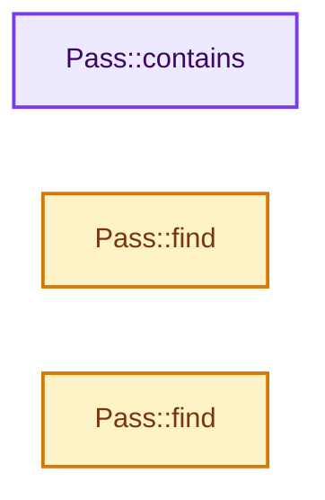
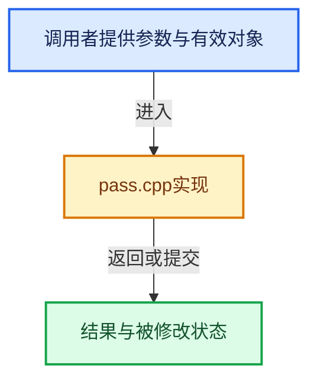

# 实现依赖专题：intern/cycles/scene/pass.cpp

[实现依赖导航](../../../README.md) · [符号索引](../../../../00-课程指南/02-源码与提交索引/符号依赖与实现索引.md)

本专题从正文实际调用进入，集中保存共享实现。函数有稳定锚点，可从调用处直接跳到对应完整函数；递归与互相调用通过回链组织。

## 本文件的实现关系






## 完整成员与函数实现

<a id="f-b14b6e695646a066"></a>

### `Pass::contains`

实现位置：[intern/cycles/scene/pass.cpp](../../../../../../../../intern/cycles/scene/pass.cpp) · L404—L415。

接口参数：

- `const unique_ptr_vector<Pass> &passes`
- `PassType type`

**教学注释版**

<!-- annotated:c6ba797549ec33 -->

```cpp
bool Pass::contains(const unique_ptr_vector<Pass> &passes, PassType type)
{
  for (const Pass *pass : passes) {
    if (pass->get_type() != type) {
      continue;
    }

    return true;
  }

  return false;
}
```

<details>
<summary>核对原始源码：intern/cycles/scene/pass.cpp · L404—L415</summary>

<!-- original:c6ba797549ec33:intern/cycles/scene/pass.cpp:404:415 -->

```cpp
bool Pass::contains(const unique_ptr_vector<Pass> &passes, PassType type)
{
  for (const Pass *pass : passes) {
    if (pass->get_type() != type) {
      continue;
    }

    return true;
  }

  return false;
}
```

</details>

**结果出口**

- `return true;`
- `return false;`

**继续追踪实现**

- `pass->get_type` → [调用协议](../../../../00-课程指南/01-路线与规范/模板宏与动态分派协议.md)：接收对象类型依赖auto、返回值或模板实例；不按同名猜测目标。调用位置L407。

<a id="f-5790211f6a2bccf8"></a>

### `Pass::find`

实现位置：[intern/cycles/scene/pass.cpp](../../../../../../../../intern/cycles/scene/pass.cpp) · L417—L426。

接口参数：

- `const unique_ptr_vector<Pass> &passes`
- `const string &name`

**教学注释版**

<!-- annotated:2c78823f5a1f01 -->

```cpp
const Pass *Pass::find(const unique_ptr_vector<Pass> &passes, const string &name)
{
  for (const Pass *pass : passes) {
    if (pass->get_name() == name) {
      return pass;
    }
  }

  return nullptr;
}
```

<details>
<summary>核对原始源码：intern/cycles/scene/pass.cpp · L417—L426</summary>

<!-- original:2c78823f5a1f01:intern/cycles/scene/pass.cpp:417:426 -->

```cpp
const Pass *Pass::find(const unique_ptr_vector<Pass> &passes, const string &name)
{
  for (const Pass *pass : passes) {
    if (pass->get_name() == name) {
      return pass;
    }
  }

  return nullptr;
}
```

</details>

**结果出口**

- `return pass;`
- `return nullptr;`

**继续追踪实现**

- `pass->get_name` → [调用协议](../../../../00-课程指南/01-路线与规范/模板宏与动态分派协议.md)：接收对象类型依赖auto、返回值或模板实例；不按同名猜测目标。调用位置L420。

<a id="f-67d38f50d42f7e97"></a>

### `Pass::find`

实现位置：[intern/cycles/scene/pass.cpp](../../../../../../../../intern/cycles/scene/pass.cpp) · L428—L443。

接口参数：

- `const unique_ptr_vector<Pass> &passes`
- `PassType type`
- `PassMode mode`
- `const ustring &lightgroup`

**教学注释版**

<!-- annotated:8ad6d0f3ca1b97 -->

```cpp
const Pass *Pass::find(const unique_ptr_vector<Pass> &passes,
                       PassType type,
                       PassMode mode,
                       const ustring &lightgroup)
{
  for (const Pass *pass : passes) {
    if (pass->get_type() != type || pass->get_mode() != mode ||
        pass->get_lightgroup() != lightgroup)
    {
      continue;
    }
    return pass;
  }

  return nullptr;
}
```

<details>
<summary>核对原始源码：intern/cycles/scene/pass.cpp · L428—L443</summary>

<!-- original:8ad6d0f3ca1b97:intern/cycles/scene/pass.cpp:428:443 -->

```cpp
const Pass *Pass::find(const unique_ptr_vector<Pass> &passes,
                       PassType type,
                       PassMode mode,
                       const ustring &lightgroup)
{
  for (const Pass *pass : passes) {
    if (pass->get_type() != type || pass->get_mode() != mode ||
        pass->get_lightgroup() != lightgroup)
    {
      continue;
    }
    return pass;
  }

  return nullptr;
}
```

</details>

**结果出口**

- `return pass;`
- `return nullptr;`

**继续追踪实现**

- `pass->get_type` → [调用协议](../../../../00-课程指南/01-路线与规范/模板宏与动态分派协议.md)：接收对象类型依赖auto、返回值或模板实例；不按同名猜测目标。调用位置L434。
- `pass->get_mode` → [调用协议](../../../../00-课程指南/01-路线与规范/模板宏与动态分派协议.md)：接收对象类型依赖auto、返回值或模板实例；不按同名猜测目标。调用位置L434。
- `pass->get_lightgroup` → [调用协议](../../../../00-课程指南/01-路线与规范/模板宏与动态分派协议.md)：接收对象类型依赖auto、返回值或模板实例；不按同名猜测目标。调用位置L435。
