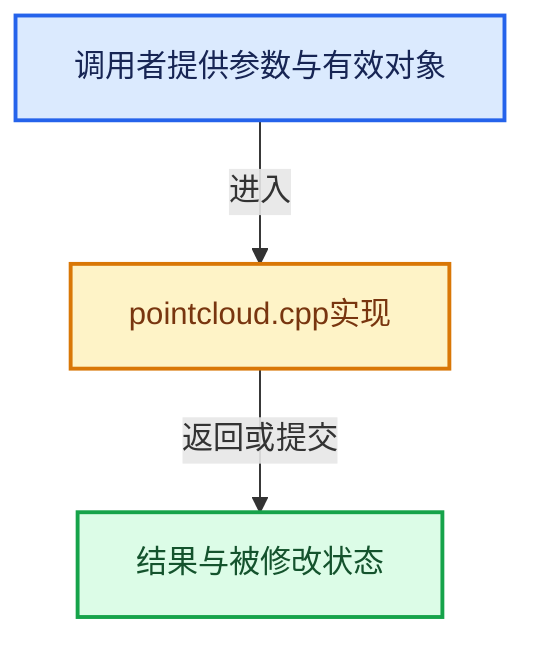

# 实现依赖专题：intern/cycles/scene/pointcloud.cpp

[实现依赖导航](../../../README.md) · [符号索引](../../../../00-课程指南/02-源码与提交索引/符号依赖与实现索引.md)

本专题从正文实际调用进入，集中保存共享实现。函数有稳定锚点，可从调用处直接跳到对应完整函数；递归与互相调用通过回链组织。

## 本文件的实现关系





## 完整成员与函数实现

<a id="f-2bb9cba64d026563"></a>

### `PointCloud::resize`

实现位置：[intern/cycles/scene/pointcloud.cpp](../../../../../../../../intern/cycles/scene/pointcloud.cpp) · L98—L110。

接口参数：

- `const int numpoints`

**教学注释版**

<!-- annotated:069ef27e08ae8c -->

```cpp
void PointCloud::resize(const int numpoints)
{
  Attribute *attr_P = attributes.add(ATTR_STD_POSITION);
  attr_P->resize(numpoints);
  Attribute *attr_R = attributes.add(ATTR_STD_RADIUS);
  attr_R->resize(numpoints);
  shader.resize(numpoints);
  attributes.resize();

  tag_position_modified();
  tag_radius_modified();
  tag_shader_modified();
}
```

<details>
<summary>核对原始源码：intern/cycles/scene/pointcloud.cpp · L98—L110</summary>

<!-- original:069ef27e08ae8c:intern/cycles/scene/pointcloud.cpp:98:110 -->

```cpp
void PointCloud::resize(const int numpoints)
{
  Attribute *attr_P = attributes.add(ATTR_STD_POSITION);
  attr_P->resize(numpoints);
  Attribute *attr_R = attributes.add(ATTR_STD_RADIUS);
  attr_R->resize(numpoints);
  shader.resize(numpoints);
  attributes.resize();

  tag_position_modified();
  tag_radius_modified();
  tag_shader_modified();
}
```

</details>

**继续追踪实现**

- `attributes.add` → [调用协议](../../../../00-课程指南/01-路线与规范/模板宏与动态分派协议.md)：接收对象类型依赖auto、返回值或模板实例；不按同名猜测目标。调用位置L100。
- `attr_P->resize` → [Attribute::resize · L122](attribute.cpp.md#f-62b6dd96d32875c0)；[Attribute::resize · L129](attribute.cpp.md#f-048dccdac3da2b83)。同名重载需按实参类型选择。
- `attr_R->resize` → [Attribute::resize · L122](attribute.cpp.md#f-62b6dd96d32875c0)；[Attribute::resize · L129](attribute.cpp.md#f-048dccdac3da2b83)。同名重载需按实参类型选择。
- `shader.resize` → [调用协议](../../../../00-课程指南/01-路线与规范/模板宏与动态分派协议.md)：接收对象类型依赖auto、返回值或模板实例；不按同名猜测目标。调用位置L104。
- `attributes.resize` → [调用协议](../../../../00-课程指南/01-路线与规范/模板宏与动态分派协议.md)：接收对象类型依赖auto、返回值或模板实例；不按同名猜测目标。调用位置L105。
- `tag_position_modified` → [Geometry::tag_position_modified · L98](geometry.cpp.md#f-fc4e7a818da1a4f6)。
- `tag_radius_modified` → [Geometry::tag_radius_modified · L125](geometry.cpp.md#f-35c30575efa7505d)。
- `tag_shader_modified` → [调用协议](../../../../00-课程指南/01-路线与规范/模板宏与动态分派协议.md)：函数指针、局部可调用对象或未展开的宏；必须结合调用者环境。调用位置L109。
