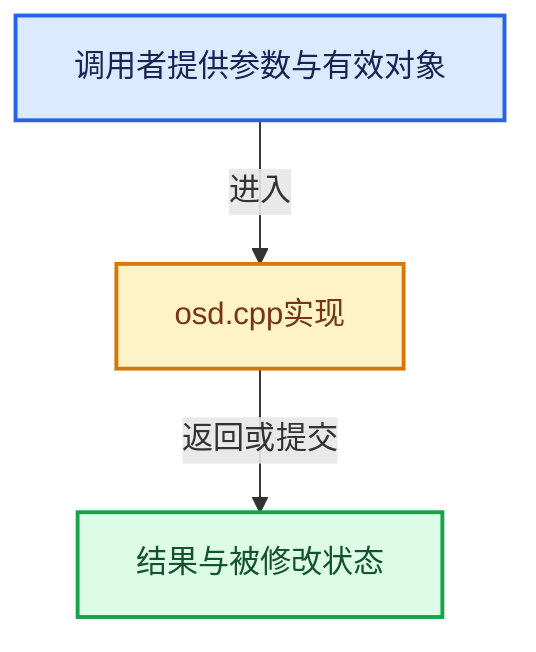

# 实现依赖专题：intern/cycles/subd/osd.cpp

[实现依赖导航](../../../README.md) · [符号索引](../../../../00-课程指南/02-源码与提交索引/符号依赖与实现索引.md)

本专题从正文实际调用进入，集中保存共享实现。函数有稳定锚点，可从调用处直接跳到对应完整函数；递归与互相调用通过回链组织。

## 本文件的实现关系

```mermaid
flowchart LR
  F0["OsdPatch::eval"]:::abstraction
  classDef input fill:#DBEAFE,stroke:#2563EB,color:#172554,stroke-width:2px;
  classDef data fill:#CFFAFE,stroke:#0891B2,color:#164E63,stroke-width:2px;
  classDef abstraction fill:#EDE9FE,stroke:#7C3AED,color:#3B0764,stroke-width:2px;
  classDef compute fill:#FEF3C7,stroke:#D97706,color:#78350F,stroke-width:2px;
  classDef result fill:#DCFCE7,stroke:#16A34A,color:#14532D,stroke-width:2px;
  classDef error fill:#FEE2E2,stroke:#DC2626,color:#7F1D1D,stroke-width:2px;
```






## 完整成员与函数实现

<a id="f-56535a40cc9e477e"></a>

### `OsdPatch::eval`

实现位置：[intern/cycles/subd/osd.cpp](../../../../../../../../intern/cycles/subd/osd.cpp) · L366—L402。

接口参数：

- `float3 *P`
- `float3 *dPdu`
- `float3 *dPdv`
- `float3 *N`
- `const float u`
- `const float v`

**教学注释版**

<!-- annotated:0c4d5fb5c88284 -->

```cpp
void OsdPatch::eval(
    float3 *P, float3 *dPdu, float3 *dPdv, float3 *N, const float u, const float v) const
{
  const Far::PatchTable::PatchHandle &handle = *osd_data.patch_map->FindPatch(
      patch_index, (double)u, (double)v);

  float p_weights[20], du_weights[20], dv_weights[20];
  osd_data.patch_table->EvaluateBasis(handle, u, v, p_weights, du_weights, dv_weights);

  const Far::ConstIndexArray cv = osd_data.patch_table->GetPatchVertices(handle);

  if (P) {
    *P = zero_float3();
  }
  float3 du = zero_float3();
  float3 dv = zero_float3();

  for (int i = 0; i < cv.size(); i++) {
    const float3 p = osd_data.refined_verts[cv[i]].value;

    if (P) {
      *P += p * p_weights[i];
    }
    du += p * du_weights[i];
    dv += p * dv_weights[i];
  }

  if (dPdu) {
    *dPdu = du;
  }
  if (dPdv) {
    *dPdv = dv;
  }
  if (N) {
    *N = safe_normalize_fallback(cross(du, dv), make_float3(0.0f, 0.0f, 1.0f));
  }
}
```

<details>
<summary>核对原始源码：intern/cycles/subd/osd.cpp · L366—L402</summary>

<!-- original:0c4d5fb5c88284:intern/cycles/subd/osd.cpp:366:402 -->

```cpp
void OsdPatch::eval(
    float3 *P, float3 *dPdu, float3 *dPdv, float3 *N, const float u, const float v) const
{
  const Far::PatchTable::PatchHandle &handle = *osd_data.patch_map->FindPatch(
      patch_index, (double)u, (double)v);

  float p_weights[20], du_weights[20], dv_weights[20];
  osd_data.patch_table->EvaluateBasis(handle, u, v, p_weights, du_weights, dv_weights);

  const Far::ConstIndexArray cv = osd_data.patch_table->GetPatchVertices(handle);

  if (P) {
    *P = zero_float3();
  }
  float3 du = zero_float3();
  float3 dv = zero_float3();

  for (int i = 0; i < cv.size(); i++) {
    const float3 p = osd_data.refined_verts[cv[i]].value;

    if (P) {
      *P += p * p_weights[i];
    }
    du += p * du_weights[i];
    dv += p * dv_weights[i];
  }

  if (dPdu) {
    *dPdu = du;
  }
  if (dPdv) {
    *dPdv = dv;
  }
  if (N) {
    *N = safe_normalize_fallback(cross(du, dv), make_float3(0.0f, 0.0f, 1.0f));
  }
}
```

</details>

**沿实际写入检查状态**

- `du += p * du_weights[i];`
- `dv += p * dv_weights[i];`

**继续追踪实现**

- `osd_data.patch_map->FindPatch` → [调用协议](../../../../00-课程指南/01-路线与规范/模板宏与动态分派协议.md)：接收对象类型依赖auto、返回值或模板实例；不按同名猜测目标。调用位置L369。
- `osd_data.patch_table->EvaluateBasis` → [调用协议](../../../../00-课程指南/01-路线与规范/模板宏与动态分派协议.md)：接收对象类型依赖auto、返回值或模板实例；不按同名猜测目标。调用位置L373。
- `osd_data.patch_table->GetPatchVertices` → [调用协议](../../../../00-课程指南/01-路线与规范/模板宏与动态分派协议.md)：接收对象类型依赖auto、返回值或模板实例；不按同名猜测目标。调用位置L375。
- `zero_float3` → [zero_float3 · L15](../util/math_float3.h.md#f-0c16d9302091a334)。
- `cv.size` → [size · L64](../util/unique_ptr_vector.h.md#f-d3b2dd87c6f8a696)；[size · L196](../util/array.h.md#f-5c1d85869b1a39ff)；[AttributeRequestSet::size · L1350](../scene/attribute.cpp.md#f-3bc2ce0e765ca68d)；[size · L1450](../../../08-其他Blender模块/draw/intern/DRW_gpu_wrapper.hh.md#f-82bf5ab482066826)；[SocketType::size · L30](../graph/node_type.cpp.md#f-07d22bce254c9492)。同名重载需按实参类型选择。
- `safe_normalize_fallback` → [safe_normalize_fallback · L533](../util/math_float3.h.md#f-25df7a685dcb5e61)。
- `cross` → [cross · L436](../util/math_float4.h.md#f-47c1848f44fe4b56)；[cross · L319](../util/math_float3.h.md#f-a89959ab21db0804)；[cross · L200](../util/math_float2.h.md#f-d4cf827d2d4b9025)；[cross · L284](../util/math_dual.h.md#f-8c812fdff783548f)；[cross · L291](../util/math_dual.h.md#f-fb4619a5864c3edc)；[cross · L296](../util/math_dual.h.md#f-d9964e9b2e1f70ab)。同名重载需按实参类型选择。
- `make_float3` → [make_float3 · L366](../../sky/source/sky_math.h.md#f-3f851295afb2572d)；[make_float3 · L108](../util/types_float4.h.md#f-f432d3f8358c1253)；[make_float3 · L77](../util/types_float3.h.md#f-a4d1c171bbd08a48)；[make_float3 · L90](../util/types_float3.h.md#f-ed934d00b79bfb67)；[make_float3 · L101](../util/types_float3.h.md#f-809d35d4555a4889)；[make_float3 · L106](../util/types_float3.h.md#f-5e61500b5e24e806)；[make_float3 · L111](../util/types_float3.h.md#f-a032cc39a6db84a8)；[make_float3 · L120](../util/types_float3.h.md#f-894b0e42a98a9c25)；[make_float3 · L153](../util/types_dual.h.md#f-f1b4dcf796f629d2)；[make_float3 · L160](../util/types_dual.h.md#f-bd8866e955c896b4)；[make_float3 · L80](../util/math_quaternion.h.md#f-c614570b864bdc58)；[make_float3 · L80](../kernel/integrator/guiding.h.md#f-66dfcb6693fffff8)；[make_float3 · L206](../kernel/device/metal/compat.h.md#f-b8a1b1e293e9ec03)。同名重载需按实参类型选择。
