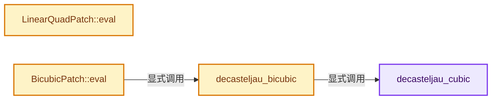
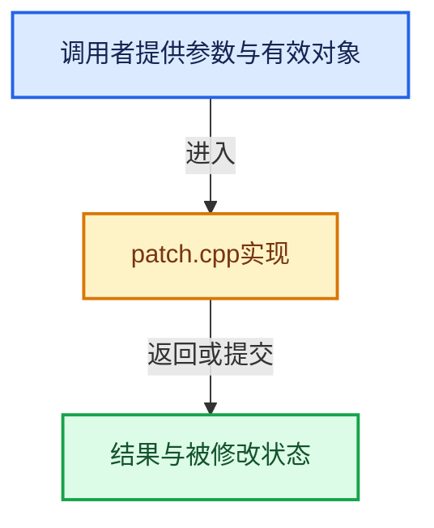

# 实现依赖专题：intern/cycles/subd/patch.cpp

[实现依赖导航](../../../README.md) · [符号索引](../../../../00-课程指南/02-源码与提交索引/符号依赖与实现索引.md)

本专题从正文实际调用进入，集中保存共享实现。函数有稳定锚点，可从调用处直接跳到对应完整函数；递归与互相调用通过回链组织。

## 本文件的实现关系






## 完整成员与函数实现

<a id="f-236b6c11fb417d76"></a>

### `decasteljau_cubic`

实现位置：[intern/cycles/subd/patch.cpp](../../../../../../../../intern/cycles/subd/patch.cpp) · L12—L29。

接口参数：

- `float3 *P`
- `float3 *dt`
- `const float t`
- `const float3 cp[4]`

**教学注释版**

<!-- annotated:f1c2aafe8daf93 -->

```cpp
CCL_NAMESPACE_BEGIN

/* De Casteljau Evaluation */

static void decasteljau_cubic(float3 *P, float3 *dt, const float t, const float3 cp[4])
{
  float3 d0 = cp[0] + t * (cp[1] - cp[0]);
  float3 d1 = cp[1] + t * (cp[2] - cp[1]);
  const float3 d2 = cp[2] + t * (cp[3] - cp[2]);

  d0 += t * (d1 - d0);
  d1 += t * (d2 - d1);

  *P = d0 + t * (d1 - d0);
  if (dt) {
    *dt = d1 - d0;
  }
}
```

<details>
<summary>核对原始源码：intern/cycles/subd/patch.cpp · L12—L29</summary>

<!-- original:f1c2aafe8daf93:intern/cycles/subd/patch.cpp:12:29 -->

```cpp
CCL_NAMESPACE_BEGIN

/* De Casteljau Evaluation */

static void decasteljau_cubic(float3 *P, float3 *dt, const float t, const float3 cp[4])
{
  float3 d0 = cp[0] + t * (cp[1] - cp[0]);
  float3 d1 = cp[1] + t * (cp[2] - cp[1]);
  const float3 d2 = cp[2] + t * (cp[3] - cp[2]);

  d0 += t * (d1 - d0);
  d1 += t * (d2 - d1);

  *P = d0 + t * (d1 - d0);
  if (dt) {
    *dt = d1 - d0;
  }
}
```

</details>

**沿实际写入检查状态**

- `d0 += t * (d1 - d0);`
- `d1 += t * (d2 - d1);`

**继续追踪实现**

本实现没有需要继续展开的显式调用；检查返回表达式、对象转换和调用者前置条件。

<a id="f-4f1ed62206d967ca"></a>

### `decasteljau_bicubic`

实现位置：[intern/cycles/subd/patch.cpp](../../../../../../../../intern/cycles/subd/patch.cpp) · L31—L48。

接口参数：

- `float3 *P`
- `float3 *du`
- `float3 *dv`
- `const float3 cp[16]`
- `float u`
- `const float v`

**教学注释版**

<!-- annotated:84b59e78cecc21 -->

```cpp
static void decasteljau_bicubic(
    float3 *P, float3 *du, float3 *dv, const float3 cp[16], float u, const float v)
{
  float3 ucp[4];
  float3 utn[4];

  /* interpolate over u */
  decasteljau_cubic(ucp + 0, utn + 0, u, cp);
  decasteljau_cubic(ucp + 1, utn + 1, u, cp + 4);
  decasteljau_cubic(ucp + 2, utn + 2, u, cp + 8);
  decasteljau_cubic(ucp + 3, utn + 3, u, cp + 12);

  /* interpolate over v */
  decasteljau_cubic(P, dv, v, ucp);
  if (du) {
    decasteljau_cubic(du, nullptr, v, utn);
  }
}
```

<details>
<summary>核对原始源码：intern/cycles/subd/patch.cpp · L31—L48</summary>

<!-- original:84b59e78cecc21:intern/cycles/subd/patch.cpp:31:48 -->

```cpp
static void decasteljau_bicubic(
    float3 *P, float3 *du, float3 *dv, const float3 cp[16], float u, const float v)
{
  float3 ucp[4];
  float3 utn[4];

  /* interpolate over u */
  decasteljau_cubic(ucp + 0, utn + 0, u, cp);
  decasteljau_cubic(ucp + 1, utn + 1, u, cp + 4);
  decasteljau_cubic(ucp + 2, utn + 2, u, cp + 8);
  decasteljau_cubic(ucp + 3, utn + 3, u, cp + 12);

  /* interpolate over v */
  decasteljau_cubic(P, dv, v, ucp);
  if (du) {
    decasteljau_cubic(du, nullptr, v, utn);
  }
}
```

</details>

**继续追踪实现**

- `decasteljau_cubic` → [decasteljau_cubic · L12](patch.cpp.md#f-236b6c11fb417d76)。

<a id="f-79ab1e763912b04a"></a>

### `LinearQuadPatch::eval`

实现位置：[intern/cycles/subd/patch.cpp](../../../../../../../../intern/cycles/subd/patch.cpp) · L52—L73。

接口参数：

- `float3 *P`
- `float3 *dPdu`
- `float3 *dPdv`
- `float3 *N`
- `const float u`
- `float v`

**教学注释版**

<!-- annotated:cb89fa17925167 -->

```cpp
void LinearQuadPatch::eval(
    float3 *P, float3 *dPdu, float3 *dPdv, float3 *N, const float u, float v) const
{
  const float3 d0 = interp(hull[0], hull[1], u);
  const float3 d1 = interp(hull[2], hull[3], u);

  *P = interp(d0, d1, v);

  if (N || (dPdu && dPdv)) {
    const float3 dPdu_ = interp(hull[1] - hull[0], hull[3] - hull[2], v);
    const float3 dPdv_ = interp(hull[2] - hull[0], hull[3] - hull[1], u);

    if (dPdu && dPdv) {
      *dPdu = dPdu_;
      *dPdv = dPdv_;
    }

    if (N) {
      *N = normalize(cross(dPdu_, dPdv_));
    }
  }
}
```

<details>
<summary>核对原始源码：intern/cycles/subd/patch.cpp · L52—L73</summary>

<!-- original:cb89fa17925167:intern/cycles/subd/patch.cpp:52:73 -->

```cpp
void LinearQuadPatch::eval(
    float3 *P, float3 *dPdu, float3 *dPdv, float3 *N, const float u, float v) const
{
  const float3 d0 = interp(hull[0], hull[1], u);
  const float3 d1 = interp(hull[2], hull[3], u);

  *P = interp(d0, d1, v);

  if (N || (dPdu && dPdv)) {
    const float3 dPdu_ = interp(hull[1] - hull[0], hull[3] - hull[2], v);
    const float3 dPdv_ = interp(hull[2] - hull[0], hull[3] - hull[1], u);

    if (dPdu && dPdv) {
      *dPdu = dPdu_;
      *dPdv = dPdv_;
    }

    if (N) {
      *N = normalize(cross(dPdu_, dPdv_));
    }
  }
}
```

</details>

**继续追踪实现**

- `interp` → [interp · L638](../util/math_float4.h.md#f-8f39108ecb93668d)；[interp · L557](../util/math_float3.h.md#f-819a62b72e3bc6a1)；[interp · L246](../util/math_float2.h.md#f-4b938685df05b6fa)；[interp · L549](../util/math_base.h.md#f-c4d2373616f78322)。同名重载需按实参类型选择。
- `normalize` → [normalize · L109](../../iksolver/intern/IK_Math.h.md#f-1a1c851a5bd44fba)；[normalize · L77](../../dualcon/intern/Projections.cpp.md#f-15577af6ac05b036)；[normalize · L460](../util/math_float4.h.md#f-25d06efa592ab5f5)；[normalize · L332](../util/math_float3.h.md#f-baa4b4b062d3b43f)；[normalize · L205](../util/math_float2.h.md#f-2a4866a4240a6727)；[normalize · L308](../util/math_dual.h.md#f-e2039e1856df8255)；[normalize · L16](../../../08-其他Blender模块/gpu/shaders/common/gpu_shader_math_matrix_normalize.bsl.hh.md#f-c7ae20a29ab4da76)；[normalize · L20](../../../08-其他Blender模块/gpu/shaders/common/gpu_shader_math_matrix_normalize.bsl.hh.md#f-058e4a05bbb6b503)；[normalize · L24](../../../08-其他Blender模块/gpu/shaders/common/gpu_shader_math_matrix_normalize.bsl.hh.md#f-14dbdba2c67d0e8b)；[normalize · L34](../../../08-其他Blender模块/gpu/shaders/common/gpu_shader_math_matrix_normalize.bsl.hh.md#f-625d4bad43dffd9c)；[normalize · L41](../../../08-其他Blender模块/gpu/shaders/common/gpu_shader_math_matrix_normalize.bsl.hh.md#f-d55b4ac328dde4cb)；[normalize · L48](../../../08-其他Blender模块/gpu/shaders/common/gpu_shader_math_matrix_normalize.bsl.hh.md#f-8a8b0bd437b339c5)；[normalize · L55](../../../08-其他Blender模块/gpu/shaders/common/gpu_shader_math_matrix_normalize.bsl.hh.md#f-64d092bea6e62c87)；[normalize · L64](../../../08-其他Blender模块/gpu/shaders/common/gpu_shader_math_matrix_normalize.bsl.hh.md#f-5e2d66321c5b1c64)；[normalize · L73](../../../08-其他Blender模块/gpu/shaders/common/gpu_shader_math_matrix_normalize.bsl.hh.md#f-678c05ab6e94ffc2)；[normalize · L81](../../../08-其他Blender模块/gpu/shaders/common/gpu_shader_math_matrix_normalize.bsl.hh.md#f-693795be99ff0d63)；[normalize · L90](../../../08-其他Blender模块/gpu/shaders/common/gpu_shader_math_matrix_normalize.bsl.hh.md#f-e7110cf1e4527133)；[normalize · L100](../../../08-其他Blender模块/gpu/shaders/common/gpu_shader_math_matrix_normalize.bsl.hh.md#f-c074535e46937142)。同名重载需按实参类型选择。
- `cross` → [cross · L436](../util/math_float4.h.md#f-47c1848f44fe4b56)；[cross · L319](../util/math_float3.h.md#f-a89959ab21db0804)；[cross · L200](../util/math_float2.h.md#f-d4cf827d2d4b9025)；[cross · L284](../util/math_dual.h.md#f-8c812fdff783548f)；[cross · L291](../util/math_dual.h.md#f-fb4619a5864c3edc)；[cross · L296](../util/math_dual.h.md#f-d9964e9b2e1f70ab)。同名重载需按实参类型选择。

<a id="f-66a2b15808c8c4d1"></a>

### `BicubicPatch::eval`

实现位置：[intern/cycles/subd/patch.cpp](../../../../../../../../intern/cycles/subd/patch.cpp) · L88—L106。

接口参数：

- `float3 *P`
- `float3 *dPdu`
- `float3 *dPdv`
- `float3 *N`
- `const float u`
- `const float v`

**教学注释版**

<!-- annotated:33ea2c38ea3b42 -->

```cpp
void BicubicPatch::eval(
    float3 *P, float3 *dPdu, float3 *dPdv, float3 *N, const float u, const float v) const
{
  if (N) {
    float3 dPdu_;
    float3 dPdv_;
    decasteljau_bicubic(P, &dPdu_, &dPdv_, hull, u, v);

    if (dPdu && dPdv) {
      *dPdu = dPdu_;
      *dPdv = dPdv_;
    }

    *N = normalize(cross(dPdu_, dPdv_));
  }
  else {
    decasteljau_bicubic(P, dPdu, dPdv, hull, u, v);
  }
}
```

<details>
<summary>核对原始源码：intern/cycles/subd/patch.cpp · L88—L106</summary>

<!-- original:33ea2c38ea3b42:intern/cycles/subd/patch.cpp:88:106 -->

```cpp
void BicubicPatch::eval(
    float3 *P, float3 *dPdu, float3 *dPdv, float3 *N, const float u, const float v) const
{
  if (N) {
    float3 dPdu_;
    float3 dPdv_;
    decasteljau_bicubic(P, &dPdu_, &dPdv_, hull, u, v);

    if (dPdu && dPdv) {
      *dPdu = dPdu_;
      *dPdv = dPdv_;
    }

    *N = normalize(cross(dPdu_, dPdv_));
  }
  else {
    decasteljau_bicubic(P, dPdu, dPdv, hull, u, v);
  }
}
```

</details>

**继续追踪实现**

- `decasteljau_bicubic` → [decasteljau_bicubic · L31](patch.cpp.md#f-4f1ed62206d967ca)。
- `normalize` → [normalize · L109](../../iksolver/intern/IK_Math.h.md#f-1a1c851a5bd44fba)；[normalize · L77](../../dualcon/intern/Projections.cpp.md#f-15577af6ac05b036)；[normalize · L460](../util/math_float4.h.md#f-25d06efa592ab5f5)；[normalize · L332](../util/math_float3.h.md#f-baa4b4b062d3b43f)；[normalize · L205](../util/math_float2.h.md#f-2a4866a4240a6727)；[normalize · L308](../util/math_dual.h.md#f-e2039e1856df8255)；[normalize · L16](../../../08-其他Blender模块/gpu/shaders/common/gpu_shader_math_matrix_normalize.bsl.hh.md#f-c7ae20a29ab4da76)；[normalize · L20](../../../08-其他Blender模块/gpu/shaders/common/gpu_shader_math_matrix_normalize.bsl.hh.md#f-058e4a05bbb6b503)；[normalize · L24](../../../08-其他Blender模块/gpu/shaders/common/gpu_shader_math_matrix_normalize.bsl.hh.md#f-14dbdba2c67d0e8b)；[normalize · L34](../../../08-其他Blender模块/gpu/shaders/common/gpu_shader_math_matrix_normalize.bsl.hh.md#f-625d4bad43dffd9c)；[normalize · L41](../../../08-其他Blender模块/gpu/shaders/common/gpu_shader_math_matrix_normalize.bsl.hh.md#f-d55b4ac328dde4cb)；[normalize · L48](../../../08-其他Blender模块/gpu/shaders/common/gpu_shader_math_matrix_normalize.bsl.hh.md#f-8a8b0bd437b339c5)；[normalize · L55](../../../08-其他Blender模块/gpu/shaders/common/gpu_shader_math_matrix_normalize.bsl.hh.md#f-64d092bea6e62c87)；[normalize · L64](../../../08-其他Blender模块/gpu/shaders/common/gpu_shader_math_matrix_normalize.bsl.hh.md#f-5e2d66321c5b1c64)；[normalize · L73](../../../08-其他Blender模块/gpu/shaders/common/gpu_shader_math_matrix_normalize.bsl.hh.md#f-678c05ab6e94ffc2)；[normalize · L81](../../../08-其他Blender模块/gpu/shaders/common/gpu_shader_math_matrix_normalize.bsl.hh.md#f-693795be99ff0d63)；[normalize · L90](../../../08-其他Blender模块/gpu/shaders/common/gpu_shader_math_matrix_normalize.bsl.hh.md#f-e7110cf1e4527133)；[normalize · L100](../../../08-其他Blender模块/gpu/shaders/common/gpu_shader_math_matrix_normalize.bsl.hh.md#f-c074535e46937142)。同名重载需按实参类型选择。
- `cross` → [cross · L436](../util/math_float4.h.md#f-47c1848f44fe4b56)；[cross · L319](../util/math_float3.h.md#f-a89959ab21db0804)；[cross · L200](../util/math_float2.h.md#f-d4cf827d2d4b9025)；[cross · L284](../util/math_dual.h.md#f-8c812fdff783548f)；[cross · L291](../util/math_dual.h.md#f-fb4619a5864c3edc)；[cross · L296](../util/math_dual.h.md#f-d9964e9b2e1f70ab)。同名重载需按实参类型选择。
