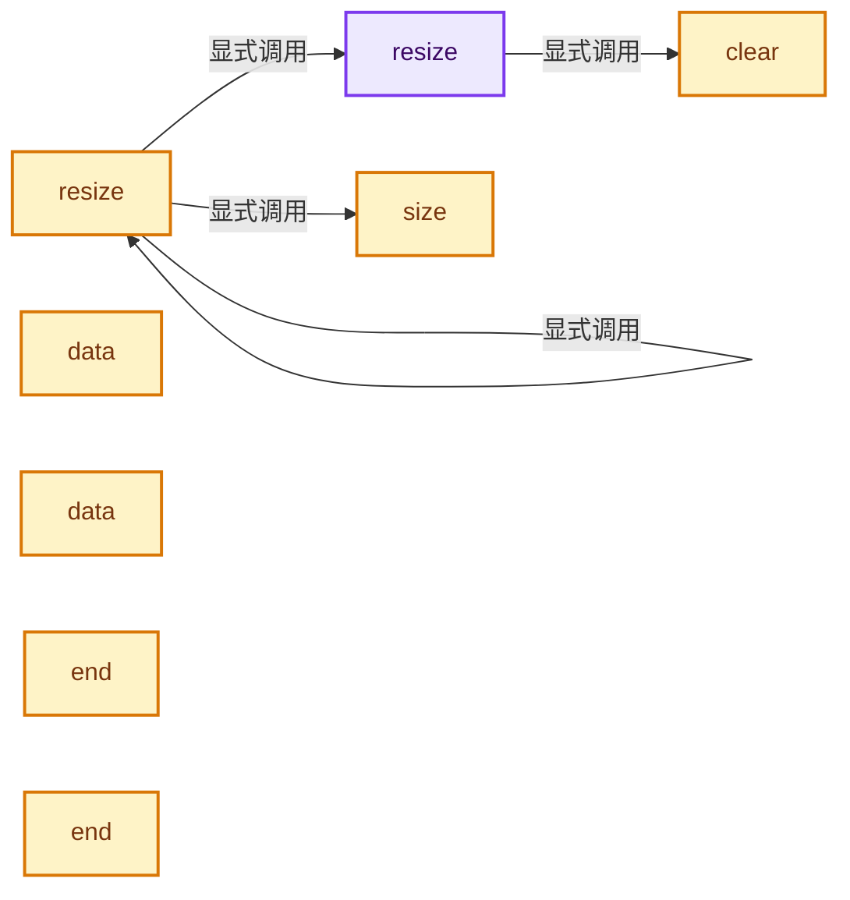
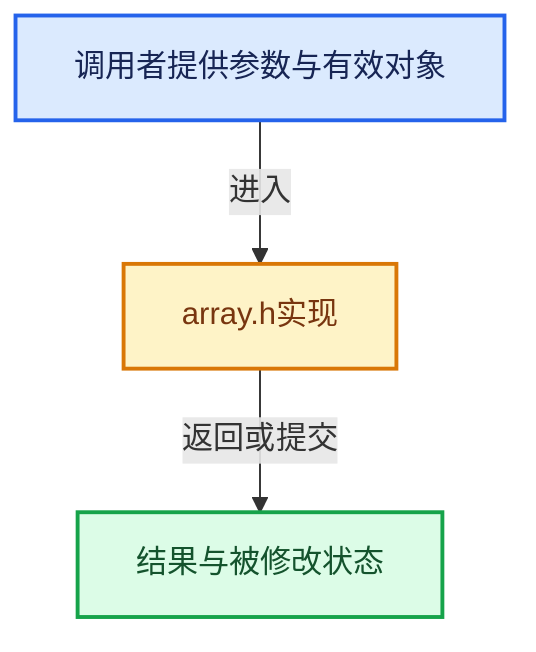

# 实现依赖专题：intern/cycles/util/array.h

[实现依赖导航](../../../README.md) · [符号索引](../../../../00-课程指南/02-源码与提交索引/符号依赖与实现索引.md)

本专题从正文实际调用进入，集中保存共享实现。函数有稳定锚点，可从调用处直接跳到对应完整函数；递归与互相调用通过回链组织。

## 本文件的实现关系






## 完整成员与函数实现

<a id="f-a03f6991f6088933"></a>

### `resize`

实现位置：[intern/cycles/util/array.h](../../../../../../../../intern/cycles/util/array.h) · L144—L167。

接口参数：

- `const size_t newsize`

**教学注释版**

<!-- annotated:40be3c6a136a1b -->

```cpp
  T *resize(const size_t newsize)
  {
    if (newsize == 0) {
      clear();
    }
    else if (newsize != datasize_) {
      if (newsize > capacity_) {
        T *newdata = mem_allocate(newsize);
        if (newdata == nullptr) {
          /* Allocation failed, likely out of memory. */
          clear();
          return nullptr;
        }
        if (data_ != nullptr) {
          mem_copy(newdata, data_, ((datasize_ < newsize) ? datasize_ : newsize));
          mem_free(data_, capacity_);
        }
        data_ = newdata;
        capacity_ = newsize;
      }
      datasize_ = newsize;
    }
    return data_;
  }
```

<details>
<summary>核对原始源码：intern/cycles/util/array.h · L144—L167</summary>

<!-- original:40be3c6a136a1b:intern/cycles/util/array.h:144:167 -->

```cpp
  T *resize(const size_t newsize)
  {
    if (newsize == 0) {
      clear();
    }
    else if (newsize != datasize_) {
      if (newsize > capacity_) {
        T *newdata = mem_allocate(newsize);
        if (newdata == nullptr) {
          /* Allocation failed, likely out of memory. */
          clear();
          return nullptr;
        }
        if (data_ != nullptr) {
          mem_copy(newdata, data_, ((datasize_ < newsize) ? datasize_ : newsize));
          mem_free(data_, capacity_);
        }
        data_ = newdata;
        capacity_ = newsize;
      }
      datasize_ = newsize;
    }
    return data_;
  }
```

</details>

**沿实际写入检查状态**

- `data_ = newdata;`
- `capacity_ = newsize;`
- `datasize_ = newsize;`

**结果出口**

- `return nullptr;`
- `return data_;`

**继续追踪实现**

- `clear` → [clear · L181](array.h.md#f-30545f05058eaf4e)。
- `mem_allocate` → [调用协议](../../../../00-课程指南/01-路线与规范/模板宏与动态分派协议.md)：函数指针、局部可调用对象或未展开的宏；必须结合调用者环境。调用位置L151。
- `mem_copy` → [mem_copy · L300](array.h.md#f-7087097910ee93e9)。
- `mem_free` → [mem_free · L293](array.h.md#f-269c5f0834dec898)。

<a id="f-031c578bb8c60c70"></a>

### `resize`

实现位置：[intern/cycles/util/array.h](../../../../../../../../intern/cycles/util/array.h) · L169—L179。

接口参数：

- `const size_t newsize`
- `const T &value`

**教学注释版**

<!-- annotated:91dd33e42fc371 -->

```cpp
  T *resize(const size_t newsize, const T &value)
  {
    size_t oldsize = size();
    resize(newsize);

    for (size_t i = oldsize; i < size(); i++) {
      data_[i] = value;
    }

    return data_;
  }
```

<details>
<summary>核对原始源码：intern/cycles/util/array.h · L169—L179</summary>

<!-- original:91dd33e42fc371:intern/cycles/util/array.h:169:179 -->

```cpp
  T *resize(const size_t newsize, const T &value)
  {
    size_t oldsize = size();
    resize(newsize);

    for (size_t i = oldsize; i < size(); i++) {
      data_[i] = value;
    }

    return data_;
  }
```

</details>

**沿实际写入检查状态**

- `data_[i] = value;`

**结果出口**

- `return data_;`

**继续追踪实现**

- `size` → [size · L196](array.h.md#f-5c1d85869b1a39ff)。
- `resize` → [resize · L144](array.h.md#f-a03f6991f6088933)；[resize · L169](array.h.md#f-031c578bb8c60c70)。同名重载需按实参类型选择。

<a id="f-30545f05058eaf4e"></a>

### `clear`

实现位置：[intern/cycles/util/array.h](../../../../../../../../intern/cycles/util/array.h) · L181—L189。

**教学注释版**

<!-- annotated:4d630a284cd196 -->

```cpp
  void clear()
  {
    if (data_ != nullptr) {
      mem_free(data_, capacity_);
      data_ = nullptr;
    }
    datasize_ = 0;
    capacity_ = 0;
  }
```

<details>
<summary>核对原始源码：intern/cycles/util/array.h · L181—L189</summary>

<!-- original:4d630a284cd196:intern/cycles/util/array.h:181:189 -->

```cpp
  void clear()
  {
    if (data_ != nullptr) {
      mem_free(data_, capacity_);
      data_ = nullptr;
    }
    datasize_ = 0;
    capacity_ = 0;
  }
```

</details>

**沿实际写入检查状态**

- `data_ = nullptr;`
- `datasize_ = 0;`
- `capacity_ = 0;`

**继续追踪实现**

- `mem_free` → [mem_free · L293](array.h.md#f-269c5f0834dec898)。

<a id="f-5c1d85869b1a39ff"></a>

### `size`

实现位置：[intern/cycles/util/array.h](../../../../../../../../intern/cycles/util/array.h) · L196—L199。

**教学注释版**

<!-- annotated:c2d2af7a901de5 -->

```cpp
  size_t size() const
  {
    return datasize_;
  }
```

<details>
<summary>核对原始源码：intern/cycles/util/array.h · L196—L199</summary>

<!-- original:c2d2af7a901de5:intern/cycles/util/array.h:196:199 -->

```cpp
  size_t size() const
  {
    return datasize_;
  }
```

</details>

**结果出口**

- `return datasize_;`

**继续追踪实现**

本实现没有需要继续展开的显式调用；检查返回表达式、对象转换和调用者前置条件。

<a id="f-39af3495ae01b907"></a>

### `data`

实现位置：[intern/cycles/util/array.h](../../../../../../../../intern/cycles/util/array.h) · L201—L204。

**教学注释版**

<!-- annotated:d5047b39415508 -->

```cpp
  T *data()
  {
    return data_;
  }
```

<details>
<summary>核对原始源码：intern/cycles/util/array.h · L201—L204</summary>

<!-- original:d5047b39415508:intern/cycles/util/array.h:201:204 -->

```cpp
  T *data()
  {
    return data_;
  }
```

</details>

**结果出口**

- `return data_;`

**继续追踪实现**

本实现没有需要继续展开的显式调用；检查返回表达式、对象转换和调用者前置条件。

<a id="f-5d3c70b7e27b7334"></a>

### `data`

实现位置：[intern/cycles/util/array.h](../../../../../../../../intern/cycles/util/array.h) · L206—L209。

**教学注释版**

<!-- annotated:5c3bc4300c9c6e -->

```cpp
  const T *data() const
  {
    return data_;
  }
```

<details>
<summary>核对原始源码：intern/cycles/util/array.h · L206—L209</summary>

<!-- original:5c3bc4300c9c6e:intern/cycles/util/array.h:206:209 -->

```cpp
  const T *data() const
  {
    return data_;
  }
```

</details>

**结果出口**

- `return data_;`

**继续追踪实现**

本实现没有需要继续展开的显式调用；检查返回表达式、对象转换和调用者前置条件。

<a id="f-0a7815a247dbb24f"></a>

### `end`

实现位置：[intern/cycles/util/array.h](../../../../../../../../intern/cycles/util/array.h) · L227—L230。

**教学注释版**

<!-- annotated:78416d3476d89f -->

```cpp
  T *end()
  {
    return data_ + datasize_;
  }
```

<details>
<summary>核对原始源码：intern/cycles/util/array.h · L227—L230</summary>

<!-- original:78416d3476d89f:intern/cycles/util/array.h:227:230 -->

```cpp
  T *end()
  {
    return data_ + datasize_;
  }
```

</details>

**结果出口**

- `return data_ + datasize_;`

**继续追踪实现**

本实现没有需要继续展开的显式调用；检查返回表达式、对象转换和调用者前置条件。

<a id="f-2e2d778e188980ab"></a>

### `end`

实现位置：[intern/cycles/util/array.h](../../../../../../../../intern/cycles/util/array.h) · L232—L235。

**教学注释版**

<!-- annotated:7a75f941b4974c -->

```cpp
  const T *end() const
  {
    return data_ + datasize_;
  }
```

<details>
<summary>核对原始源码：intern/cycles/util/array.h · L232—L235</summary>

<!-- original:7a75f941b4974c:intern/cycles/util/array.h:232:235 -->

```cpp
  const T *end() const
  {
    return data_ + datasize_;
  }
```

</details>

**结果出口**

- `return data_ + datasize_;`

**继续追踪实现**

本实现没有需要继续展开的显式调用；检查返回表达式、对象转换和调用者前置条件。

<a id="f-b22b8cdc40d77c4f"></a>

### `reserve`

实现位置：[intern/cycles/util/array.h](../../../../../../../../intern/cycles/util/array.h) · L237—L248。

接口参数：

- `const size_t newcapacity`

**教学注释版**

<!-- annotated:a14fbb81a33483 -->

```cpp
  void reserve(const size_t newcapacity)
  {
    if (newcapacity > capacity_) {
      T *newdata = mem_allocate(newcapacity);
      if (data_ != nullptr) {
        mem_copy(newdata, data_, ((datasize_ < newcapacity) ? datasize_ : newcapacity));
        mem_free(data_, capacity_);
      }
      data_ = newdata;
      capacity_ = newcapacity;
    }
  }
```

<details>
<summary>核对原始源码：intern/cycles/util/array.h · L237—L248</summary>

<!-- original:a14fbb81a33483:intern/cycles/util/array.h:237:248 -->

```cpp
  void reserve(const size_t newcapacity)
  {
    if (newcapacity > capacity_) {
      T *newdata = mem_allocate(newcapacity);
      if (data_ != nullptr) {
        mem_copy(newdata, data_, ((datasize_ < newcapacity) ? datasize_ : newcapacity));
        mem_free(data_, capacity_);
      }
      data_ = newdata;
      capacity_ = newcapacity;
    }
  }
```

</details>

**沿实际写入检查状态**

- `data_ = newdata;`
- `capacity_ = newcapacity;`

**继续追踪实现**

- `mem_allocate` → [调用协议](../../../../00-课程指南/01-路线与规范/模板宏与动态分派协议.md)：函数指针、局部可调用对象或未展开的宏；必须结合调用者环境。调用位置L240。
- `mem_copy` → [mem_copy · L300](array.h.md#f-7087097910ee93e9)。
- `mem_free` → [mem_free · L293](array.h.md#f-269c5f0834dec898)。

<a id="f-269c5f0834dec898"></a>

### `mem_free`

实现位置：[intern/cycles/util/array.h](../../../../../../../../intern/cycles/util/array.h) · L293—L298。

接口参数：

- `T *mem`
- `const size_t N`

**教学注释版**

<!-- annotated:ad222e0226f6a1 -->

```cpp
  void mem_free(T *mem, const size_t N)
  {
    if (mem != nullptr) {
      util_aligned_free(mem, sizeof(T) * N);
    }
  }
```

<details>
<summary>核对原始源码：intern/cycles/util/array.h · L293—L298</summary>

<!-- original:ad222e0226f6a1:intern/cycles/util/array.h:293:298 -->

```cpp
  void mem_free(T *mem, const size_t N)
  {
    if (mem != nullptr) {
      util_aligned_free(mem, sizeof(T) * N);
    }
  }
```

</details>

**继续追踪实现**

- `util_aligned_free` → [util_aligned_free · L96](aligned_malloc.cpp.md#f-f52803d920df7aa1)。

<a id="f-7087097910ee93e9"></a>

### `mem_copy`

实现位置：[intern/cycles/util/array.h](../../../../../../../../intern/cycles/util/array.h) · L300—L303。

接口参数：

- `T *mem_to`
- `const T *mem_from`
- `const size_t N`

**教学注释版**

<!-- annotated:99015add50c643 -->

```cpp
  void mem_copy(T *mem_to, const T *mem_from, const size_t N)
  {
    // [讲解] memcpy：复制字节，源与目标不应重叠。类型生命周期、对齐和可复制表示须由调用者证明，不是任意对象的复制构造。
    memcpy((void *)mem_to, mem_from, sizeof(T) * N);
  }
```

<details>
<summary>核对原始源码：intern/cycles/util/array.h · L300—L303</summary>

<!-- original:99015add50c643:intern/cycles/util/array.h:300:303 -->

```cpp
  void mem_copy(T *mem_to, const T *mem_from, const size_t N)
  {
    memcpy((void *)mem_to, mem_from, sizeof(T) * N);
  }
```

</details>

**继续追踪实现**

- `memcpy` → [外部契约](https://eel.is/c++draft/cstring.syn)：复制字节，源与目标不应重叠。类型生命周期、对齐和可复制表示须由调用者证明，不是任意对象的复制构造。
