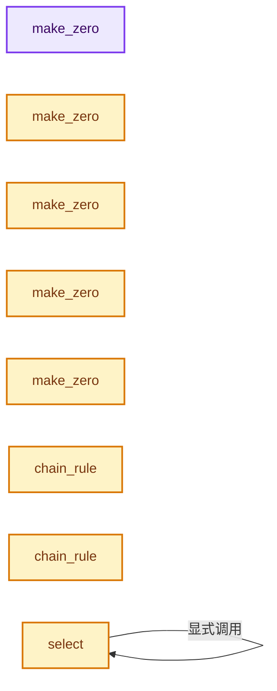
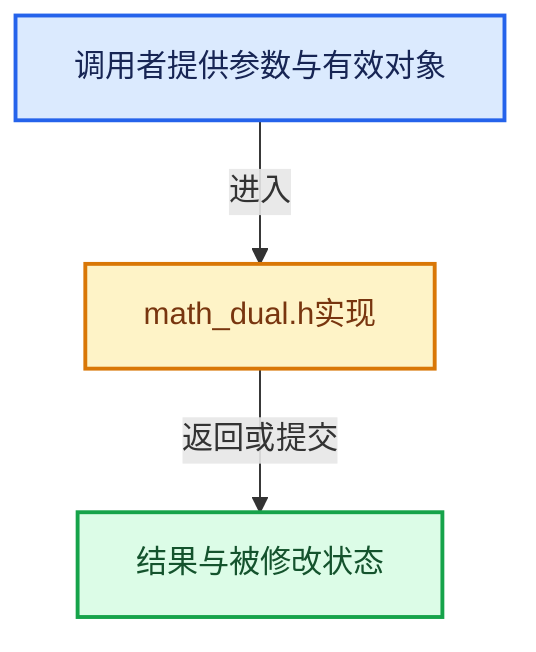

# 实现依赖专题：intern/cycles/util/math_dual.h

[实现依赖导航](../../../README.md) · [符号索引](../../../../00-课程指南/02-源码与提交索引/符号依赖与实现索引.md)

本专题从正文实际调用进入，集中保存共享实现。函数有稳定锚点，可从调用处直接跳到对应完整函数；递归与互相调用通过回链组织。

## 本文件的实现关系






## 完整成员与函数实现

<a id="f-fa0f8cdcdc35cb8e"></a>

### `make_zero`

实现位置：[intern/cycles/util/math_dual.h](../../../../../../../../intern/cycles/util/math_dual.h) · L13—L18。

**教学注释版**

<!-- annotated:41c3e4a3f7f7e0 -->

```cpp
CCL_NAMESPACE_BEGIN

ccl_device_template_spec dual1 make_zero()
{
  return dual1();
}
```

<details>
<summary>核对原始源码：intern/cycles/util/math_dual.h · L13—L18</summary>

<!-- original:41c3e4a3f7f7e0:intern/cycles/util/math_dual.h:13:18 -->

```cpp
CCL_NAMESPACE_BEGIN

ccl_device_template_spec dual1 make_zero()
{
  return dual1();
}
```

</details>

**结果出口**

- `return dual1();`

**继续追踪实现**

- `dual1` → [调用协议](../../../../00-课程指南/01-路线与规范/模板宏与动态分派协议.md)：函数指针、局部可调用对象或未展开的宏；必须结合调用者环境。调用位置L17。

<a id="f-59d6456793ac1878"></a>

### `make_zero`

实现位置：[intern/cycles/util/math_dual.h](../../../../../../../../intern/cycles/util/math_dual.h) · L20—L23。

**教学注释版**

<!-- annotated:2215a668dee702 -->

```cpp
ccl_device_template_spec dual2 make_zero()
{
  return dual2();
}
```

<details>
<summary>核对原始源码：intern/cycles/util/math_dual.h · L20—L23</summary>

<!-- original:2215a668dee702:intern/cycles/util/math_dual.h:20:23 -->

```cpp
ccl_device_template_spec dual2 make_zero()
{
  return dual2();
}
```

</details>

**结果出口**

- `return dual2();`

**继续追踪实现**

- `dual2` → [调用协议](../../../../00-课程指南/01-路线与规范/模板宏与动态分派协议.md)：函数指针、局部可调用对象或未展开的宏；必须结合调用者环境。调用位置L22。

<a id="f-826c42fc937debcb"></a>

### `make_zero`

实现位置：[intern/cycles/util/math_dual.h](../../../../../../../../intern/cycles/util/math_dual.h) · L25—L28。

**教学注释版**

<!-- annotated:18032a50efa6ee -->

```cpp
ccl_device_template_spec dual3 make_zero()
{
  return dual3();
}
```

<details>
<summary>核对原始源码：intern/cycles/util/math_dual.h · L25—L28</summary>

<!-- original:18032a50efa6ee:intern/cycles/util/math_dual.h:25:28 -->

```cpp
ccl_device_template_spec dual3 make_zero()
{
  return dual3();
}
```

</details>

**结果出口**

- `return dual3();`

**继续追踪实现**

- `dual3` → [调用协议](../../../../00-课程指南/01-路线与规范/模板宏与动态分派协议.md)：函数指针、局部可调用对象或未展开的宏；必须结合调用者环境。调用位置L27。

<a id="f-b0031a5f05547045"></a>

### `make_zero`

实现位置：[intern/cycles/util/math_dual.h](../../../../../../../../intern/cycles/util/math_dual.h) · L30—L33。

**教学注释版**

<!-- annotated:dfe3b7a3a16210 -->

```cpp
ccl_device_template_spec dual4 make_zero()
{
  return dual4();
}
```

<details>
<summary>核对原始源码：intern/cycles/util/math_dual.h · L30—L33</summary>

<!-- original:dfe3b7a3a16210:intern/cycles/util/math_dual.h:30:33 -->

```cpp
ccl_device_template_spec dual4 make_zero()
{
  return dual4();
}
```

</details>

**结果出口**

- `return dual4();`

**继续追踪实现**

- `dual4` → [调用协议](../../../../00-课程指南/01-路线与规范/模板宏与动态分派协议.md)：函数指针、局部可调用对象或未展开的宏；必须结合调用者环境。调用位置L32。

<a id="f-0cbb1a5dbf7dda33"></a>

### `make_zero`

实现位置：[intern/cycles/util/math_dual.h](../../../../../../../../intern/cycles/util/math_dual.h) · L35—L38。

**教学注释版**

<!-- annotated:0ab6ea4004c1fb -->

```cpp
ccl_device_template_spec dual<Quaternion> make_zero()
{
  return dual<Quaternion>();
}
```

<details>
<summary>核对原始源码：intern/cycles/util/math_dual.h · L35—L38</summary>

<!-- original:0ab6ea4004c1fb:intern/cycles/util/math_dual.h:35:38 -->

```cpp
ccl_device_template_spec dual<Quaternion> make_zero()
{
  return dual<Quaternion>();
}
```

</details>

**结果出口**

- `return dual<Quaternion>();`

**继续追踪实现**

- `dual<Quaternion>` → [dual · L24](types_dual.h.md#f-7b33f6d2723bfef8)；[dual · L25](types_dual.h.md#f-172e0ef18298158f)。同名重载需按实参类型选择。

<a id="f-7bc8e009a9d75461"></a>

### `chain_rule`

实现位置：[intern/cycles/util/math_dual.h](../../../../../../../../intern/cycles/util/math_dual.h) · L138—L144。

接口参数：

- `const ccl_private dual<T> &u`
- `const ccl_private T &f`
- `const ccl_private T &dfdu`

**教学注释版**

<!-- annotated:caabe2e4aabf5a -->

```cpp
template<class T>
ccl_device_inline dual<T> chain_rule(const ccl_private dual<T> &u,
                                     const ccl_private T &f,
                                     const ccl_private T &dfdu)
{
  return {f, dfdu * u.dx, dfdu * u.dy};
}
```

<details>
<summary>核对原始源码：intern/cycles/util/math_dual.h · L138—L144</summary>

<!-- original:caabe2e4aabf5a:intern/cycles/util/math_dual.h:138:144 -->

```cpp
template<class T>
ccl_device_inline dual<T> chain_rule(const ccl_private dual<T> &u,
                                     const ccl_private T &f,
                                     const ccl_private T &dfdu)
{
  return {f, dfdu * u.dx, dfdu * u.dy};
}
```

</details>

**结果出口**

- `return {f, dfdu * u.dx, dfdu * u.dy};`

**继续追踪实现**

本实现没有需要继续展开的显式调用；检查返回表达式、对象转换和调用者前置条件。

<a id="f-6f82749b2acf17af"></a>

### `chain_rule`

实现位置：[intern/cycles/util/math_dual.h](../../../../../../../../intern/cycles/util/math_dual.h) · L147—L155。

接口参数：

- `const ccl_private dual<T> &u`
- `const ccl_private dual<T> &v`
- `const ccl_private T &f`
- `const ccl_private T &dfdu`
- `const ccl_private T &dfdv`

**教学注释版**

<!-- annotated:39e1d4dde81089 -->

```cpp
template<class T>
ccl_device_inline dual<T> chain_rule(const ccl_private dual<T> &u,
                                     const ccl_private dual<T> &v,
                                     const ccl_private T &f,
                                     const ccl_private T &dfdu,
                                     const ccl_private T &dfdv)
{
  return {f, dfdu * u.dx + dfdv * v.dx, dfdu * u.dy + dfdv * v.dy};
}
```

<details>
<summary>核对原始源码：intern/cycles/util/math_dual.h · L147—L155</summary>

<!-- original:39e1d4dde81089:intern/cycles/util/math_dual.h:147:155 -->

```cpp
template<class T>
ccl_device_inline dual<T> chain_rule(const ccl_private dual<T> &u,
                                     const ccl_private dual<T> &v,
                                     const ccl_private T &f,
                                     const ccl_private T &dfdu,
                                     const ccl_private T &dfdv)
{
  return {f, dfdu * u.dx + dfdv * v.dx, dfdu * u.dy + dfdv * v.dy};
}
```

</details>

**结果出口**

- `return {f, dfdu * u.dx + dfdv * v.dx, dfdu * u.dy + dfdv * v.dy};`

**继续追踪实现**

本实现没有需要继续展开的显式调用；检查返回表达式、对象转换和调用者前置条件。

<a id="f-d646fad21b4702eb"></a>

### `select`

实现位置：[intern/cycles/util/math_dual.h](../../../../../../../../intern/cycles/util/math_dual.h) · L157—L180。

接口参数：

- `const MaskType mask`
- `const dual3 a`
- `const dual3 b`

**教学注释版**

<!-- annotated:8db383bd533c72 -->

```cpp
template<class MaskType>
ccl_device_inline dual3 select(const MaskType mask, const dual3 a, const dual3 b)
{
#if defined(__KERNEL_METAL__)
  const bool3 mask_ = bool3(mask);
  return {metal::select(b.val, a.val, mask_),
          metal::select(b.dx, a.dx, mask_),
          metal::select(b.dy, a.dy, mask_)};
#elif defined(__KERNEL_SSE__)
#  ifdef __KERNEL_SSE42__
  const auto mask_ = _mm_castsi128_ps(mask.m128);
  return {float3(_mm_blendv_ps(b.val.m128, a.val.m128, mask_)),
          float3(_mm_blendv_ps(b.dx.m128, a.dx.m128, mask_)),
          float3(_mm_blendv_ps(b.dy.m128, a.dy.m128, mask_))};
#  else
  const auto mask_ = _mm_castsi128_ps(mask);
  return {float3(_mm_or_ps(_mm_and_ps(mask_, a.val), _mm_andnot_ps(mask_, b.val))),
          float3(_mm_or_ps(_mm_and_ps(mask_, a.dx), _mm_andnot_ps(mask_, b.dx))),
          float3(_mm_or_ps(_mm_and_ps(mask_, a.dy), _mm_andnot_ps(mask_, b.dy)))};
#  endif
#else
  return make_float3(mask.x ? a.x() : b.x(), mask.y ? a.y() : b.y(), mask.z ? a.z() : b.z());
#endif
}
```

<details>
<summary>核对原始源码：intern/cycles/util/math_dual.h · L157—L180</summary>

<!-- original:8db383bd533c72:intern/cycles/util/math_dual.h:157:180 -->

```cpp
template<class MaskType>
ccl_device_inline dual3 select(const MaskType mask, const dual3 a, const dual3 b)
{
#if defined(__KERNEL_METAL__)
  const bool3 mask_ = bool3(mask);
  return {metal::select(b.val, a.val, mask_),
          metal::select(b.dx, a.dx, mask_),
          metal::select(b.dy, a.dy, mask_)};
#elif defined(__KERNEL_SSE__)
#  ifdef __KERNEL_SSE42__
  const auto mask_ = _mm_castsi128_ps(mask.m128);
  return {float3(_mm_blendv_ps(b.val.m128, a.val.m128, mask_)),
          float3(_mm_blendv_ps(b.dx.m128, a.dx.m128, mask_)),
          float3(_mm_blendv_ps(b.dy.m128, a.dy.m128, mask_))};
#  else
  const auto mask_ = _mm_castsi128_ps(mask);
  return {float3(_mm_or_ps(_mm_and_ps(mask_, a.val), _mm_andnot_ps(mask_, b.val))),
          float3(_mm_or_ps(_mm_and_ps(mask_, a.dx), _mm_andnot_ps(mask_, b.dx))),
          float3(_mm_or_ps(_mm_and_ps(mask_, a.dy), _mm_andnot_ps(mask_, b.dy)))};
#  endif
#else
  return make_float3(mask.x ? a.x() : b.x(), mask.y ? a.y() : b.y(), mask.z ? a.z() : b.z());
#endif
}
```

</details>

**结果出口**

- `return {metal::select(b.val, a.val, mask_),`
- `return {float3(_mm_blendv_ps(b.val.m128, a.val.m128, mask_)),`
- `return {float3(_mm_or_ps(_mm_and_ps(mask_, a.val), _mm_andnot_ps(mask_, b.val))),`
- `return make_float3(mask.x ? a.x() : b.x(), mask.y ? a.y() : b.y(), mask.z ? a.z() : b.z());`

**继续追踪实现**

- `bool3` → [bool3 · L647](../../../08-其他Blender模块/compositor/algorithms/intern/smaa.cc.md#m-cb10c8f0220e)。宏定义由构建条件选择。
- `metal::select` → [select · L157](math_dual.h.md#f-d646fad21b4702eb)。
- `_mm_castsi128_ps` → [调用协议](../../../../00-课程指南/01-路线与规范/模板宏与动态分派协议.md)：函数指针、局部可调用对象或未展开的宏；必须结合调用者环境。调用位置L167。
- `float3` → [float3 · L41](types_float3.h.md#f-7da2e52c0fb766ec)；[float3 · L42](types_float3.h.md#f-4c476b25be347939)；[float3 · L43](types_float3.h.md#f-776e8df31bde8162)。同名重载需按实参类型选择。
- `_mm_blendv_ps` → [调用协议](../../../../00-课程指南/01-路线与规范/模板宏与动态分派协议.md)：函数指针、局部可调用对象或未展开的宏；必须结合调用者环境。调用位置L168。
- `_mm_or_ps` → [调用协议](../../../../00-课程指南/01-路线与规范/模板宏与动态分派协议.md)：函数指针、局部可调用对象或未展开的宏；必须结合调用者环境。调用位置L173。
- `_mm_and_ps` → [调用协议](../../../../00-课程指南/01-路线与规范/模板宏与动态分派协议.md)：函数指针、局部可调用对象或未展开的宏；必须结合调用者环境。调用位置L173。
- `_mm_andnot_ps` → [调用协议](../../../../00-课程指南/01-路线与规范/模板宏与动态分派协议.md)：函数指针、局部可调用对象或未展开的宏；必须结合调用者环境。调用位置L173。
- `make_float3` → [make_float3 · L108](types_float4.h.md#f-f432d3f8358c1253)；[make_float3 · L77](types_float3.h.md#f-a4d1c171bbd08a48)；[make_float3 · L90](types_float3.h.md#f-ed934d00b79bfb67)；[make_float3 · L101](types_float3.h.md#f-809d35d4555a4889)；[make_float3 · L106](types_float3.h.md#f-5e61500b5e24e806)；[make_float3 · L111](types_float3.h.md#f-a032cc39a6db84a8)；[make_float3 · L120](types_float3.h.md#f-894b0e42a98a9c25)；[make_float3 · L153](types_dual.h.md#f-f1b4dcf796f629d2)；[make_float3 · L160](types_dual.h.md#f-bd8866e955c896b4)；[make_float3 · L80](math_quaternion.h.md#f-c614570b864bdc58)。同名重载需按实参类型选择。
- `a.x` → [调用协议](../../../../00-课程指南/01-路线与规范/模板宏与动态分派协议.md)：由接收对象具体类型或运行时策略提供实现。调用位置L178。
- `b.x` → [调用协议](../../../../00-课程指南/01-路线与规范/模板宏与动态分派协议.md)：由接收对象具体类型或运行时策略提供实现。调用位置L178。
- `a.y` → [调用协议](../../../../00-课程指南/01-路线与规范/模板宏与动态分派协议.md)：由接收对象具体类型或运行时策略提供实现。调用位置L178。
- `b.y` → [调用协议](../../../../00-课程指南/01-路线与规范/模板宏与动态分派协议.md)：由接收对象具体类型或运行时策略提供实现。调用位置L178。
- `a.z` → [调用协议](../../../../00-课程指南/01-路线与规范/模板宏与动态分派协议.md)：由接收对象具体类型或运行时策略提供实现。调用位置L178。
- `b.z` → [调用协议](../../../../00-课程指南/01-路线与规范/模板宏与动态分派协议.md)：由接收对象具体类型或运行时策略提供实现。调用位置L178。

<a id="f-48fc1e26ff134399"></a>

### `safe_divide`

实现位置：[intern/cycles/util/math_dual.h](../../../../../../../../intern/cycles/util/math_dual.h) · L209—L212。

接口参数：

- `const dual<T> f`
- `const T g`

**教学注释版**

<!-- annotated:54fe8e4dadf2c2 -->

```cpp
template<class T> ccl_device_inline dual<T> safe_divide(const dual<T> f, const T g)
{
  return select(component_is_zero(g), make_zero<dual<T>>(), f / g);
}
```

<details>
<summary>核对原始源码：intern/cycles/util/math_dual.h · L209—L212</summary>

<!-- original:54fe8e4dadf2c2:intern/cycles/util/math_dual.h:209:212 -->

```cpp
template<class T> ccl_device_inline dual<T> safe_divide(const dual<T> f, const T g)
{
  return select(component_is_zero(g), make_zero<dual<T>>(), f / g);
}
```

</details>

**结果出口**

- `return select(component_is_zero(g), make_zero<dual<T>>(), f / g);`

**继续追踪实现**

- `select` → [select · L157](math_dual.h.md#f-d646fad21b4702eb)。
- `component_is_zero` → [component_is_zero · L668](math_float3.h.md#f-2801eb162b468384)。
- `make_zero<dual<T>>` → [make_zero · L13](math_dual.h.md#f-fa0f8cdcdc35cb8e)；[make_zero · L20](math_dual.h.md#f-59d6456793ac1878)；[make_zero · L25](math_dual.h.md#f-826c42fc937debcb)；[make_zero · L30](math_dual.h.md#f-b0031a5f05547045)；[make_zero · L35](math_dual.h.md#f-0cbb1a5dbf7dda33)。同名重载需按实参类型选择。

<a id="f-b148cfd17ae2328f"></a>

### `safe_divide`

实现位置：[intern/cycles/util/math_dual.h](../../../../../../../../intern/cycles/util/math_dual.h) · L214—L218。

接口参数：

- `const ccl_private dual<T> &f`
- `const ccl_private dual<T> &g`

**教学注释版**

<!-- annotated:c56fa11d098f55 -->

```cpp
template<class T>
ccl_device_inline dual<T> safe_divide(const ccl_private dual<T> &f, const ccl_private dual<T> &g)
{
  return select(component_is_zero(g.val), make_zero<dual<T>>(), f / g);
}
```

<details>
<summary>核对原始源码：intern/cycles/util/math_dual.h · L214—L218</summary>

<!-- original:c56fa11d098f55:intern/cycles/util/math_dual.h:214:218 -->

```cpp
template<class T>
ccl_device_inline dual<T> safe_divide(const ccl_private dual<T> &f, const ccl_private dual<T> &g)
{
  return select(component_is_zero(g.val), make_zero<dual<T>>(), f / g);
}
```

</details>

**结果出口**

- `return select(component_is_zero(g.val), make_zero<dual<T>>(), f / g);`

**继续追踪实现**

- `select` → [select · L157](math_dual.h.md#f-d646fad21b4702eb)。
- `component_is_zero` → [component_is_zero · L668](math_float3.h.md#f-2801eb162b468384)。
- `make_zero<dual<T>>` → [make_zero · L13](math_dual.h.md#f-fa0f8cdcdc35cb8e)；[make_zero · L20](math_dual.h.md#f-59d6456793ac1878)；[make_zero · L25](math_dual.h.md#f-826c42fc937debcb)；[make_zero · L30](math_dual.h.md#f-b0031a5f05547045)；[make_zero · L35](math_dual.h.md#f-0cbb1a5dbf7dda33)。同名重载需按实参类型选择。

<a id="f-e3b16fd88ae5021d"></a>

### `min`

实现位置：[intern/cycles/util/math_dual.h](../../../../../../../../intern/cycles/util/math_dual.h) · L226—L229。

接口参数：

- `const ccl_private dual3 &a`
- `const ccl_private dual3 &b`

**教学注释版**

<!-- annotated:48421094143b0a -->

```cpp
ccl_device_inline dual3 min(const ccl_private dual3 &a, const ccl_private dual3 &b)
{
  return select(a.val < b.val, a, b);
}
```

<details>
<summary>核对原始源码：intern/cycles/util/math_dual.h · L226—L229</summary>

<!-- original:48421094143b0a:intern/cycles/util/math_dual.h:226:229 -->

```cpp
ccl_device_inline dual3 min(const ccl_private dual3 &a, const ccl_private dual3 &b)
{
  return select(a.val < b.val, a, b);
}
```

</details>

**结果出口**

- `return select(a.val < b.val, a, b);`

**继续追踪实现**

- `select` → [select · L157](math_dual.h.md#f-d646fad21b4702eb)。

<a id="f-e03e09c0f68792ab"></a>

### `max`

实现位置：[intern/cycles/util/math_dual.h](../../../../../../../../intern/cycles/util/math_dual.h) · L231—L234。

接口参数：

- `const ccl_private dual3 &a`
- `const ccl_private dual3 &b`

**教学注释版**

<!-- annotated:c8e68efaeb6da4 -->

```cpp
ccl_device_inline dual3 max(const ccl_private dual3 &a, const ccl_private dual3 &b)
{
  return select(a.val > b.val, a, b);
}
```

<details>
<summary>核对原始源码：intern/cycles/util/math_dual.h · L231—L234</summary>

<!-- original:c8e68efaeb6da4:intern/cycles/util/math_dual.h:231:234 -->

```cpp
ccl_device_inline dual3 max(const ccl_private dual3 &a, const ccl_private dual3 &b)
{
  return select(a.val > b.val, a, b);
}
```

</details>

**结果出口**

- `return select(a.val > b.val, a, b);`

**继续追踪实现**

- `select` → [select · L157](math_dual.h.md#f-d646fad21b4702eb)。

<a id="f-efa9d35a2bee4e4e"></a>

### `max`

实现位置：[intern/cycles/util/math_dual.h](../../../../../../../../intern/cycles/util/math_dual.h) · L236—L239。

接口参数：

- `const ccl_private dual1 &a`
- `const ccl_private dual1 &b`

**教学注释版**

<!-- annotated:76e3599874e592 -->

```cpp
ccl_device_inline dual1 max(const ccl_private dual1 &a, const ccl_private dual1 &b)
{
  return a.val > b.val ? a : b;
}
```

<details>
<summary>核对原始源码：intern/cycles/util/math_dual.h · L236—L239</summary>

<!-- original:76e3599874e592:intern/cycles/util/math_dual.h:236:239 -->

```cpp
ccl_device_inline dual1 max(const ccl_private dual1 &a, const ccl_private dual1 &b)
{
  return a.val > b.val ? a : b;
}
```

</details>

**结果出口**

- `return a.val > b.val ? a : b;`

**继续追踪实现**

本实现没有需要继续展开的显式调用；检查返回表达式、对象转换和调用者前置条件。

<a id="f-611f23f8a5f64d04"></a>

### `reduce_add`

实现位置：[intern/cycles/util/math_dual.h](../../../../../../../../intern/cycles/util/math_dual.h) · L251—L254。

接口参数：

- `const dual<T> a`

**教学注释版**

<!-- annotated:acfac406e3ce3f -->

```cpp
template<class T> ccl_device_inline dual1 reduce_add(const dual<T> a)
{
  return {reduce_add(a.val), reduce_add(a.dx), reduce_add(a.dy)};
}
```

<details>
<summary>核对原始源码：intern/cycles/util/math_dual.h · L251—L254</summary>

<!-- original:acfac406e3ce3f:intern/cycles/util/math_dual.h:251:254 -->

```cpp
template<class T> ccl_device_inline dual1 reduce_add(const dual<T> a)
{
  return {reduce_add(a.val), reduce_add(a.dx), reduce_add(a.dy)};
}
```

</details>

**结果出口**

- `return {reduce_add(a.val), reduce_add(a.dx), reduce_add(a.dy)};`

**继续追踪实现**

- `reduce_add` → [reduce_add · L251](math_dual.h.md#f-611f23f8a5f64d04)。

<a id="f-3e89f4758d13a426"></a>

### `len`

实现位置：[intern/cycles/util/math_dual.h](../../../../../../../../intern/cycles/util/math_dual.h) · L263—L266。

接口参数：

- `const ccl_private dual<T> &a`

**教学注释版**

<!-- annotated:907786296b5272 -->

```cpp
template<class T> ccl_device_inline dual1 len(const ccl_private dual<T> &a)
{
  return sqrt(dot(a, a));
}
```

<details>
<summary>核对原始源码：intern/cycles/util/math_dual.h · L263—L266</summary>

<!-- original:907786296b5272:intern/cycles/util/math_dual.h:263:266 -->

```cpp
template<class T> ccl_device_inline dual1 len(const ccl_private dual<T> &a)
{
  return sqrt(dot(a, a));
}
```

</details>

**结果出口**

- `return sqrt(dot(a, a));`

**继续追踪实现**

- `sqrt` → [外部契约](https://eel.is/c++draft/)：这个边界按实际表达式及所属类型核对参数、返回值、寿命与失败行为。这里提供接口入口，不声称已解释该第三方版本的内部实现。
- `dot` → [dot · L268](math_dual.h.md#f-e1745c95ae876efd)。

<a id="f-e1745c95ae876efd"></a>

### `dot`

实现位置：[intern/cycles/util/math_dual.h](../../../../../../../../intern/cycles/util/math_dual.h) · L268—L271。

接口参数：

- `const dual<T1> a`
- `const T2 b`

**教学注释版**

<!-- annotated:d461540bae64f9 -->

```cpp
template<class T1, class T2> ccl_device_inline dual1 dot(const dual<T1> a, const T2 b)
{
  return reduce_add(a * b);
}
```

<details>
<summary>核对原始源码：intern/cycles/util/math_dual.h · L268—L271</summary>

<!-- original:d461540bae64f9:intern/cycles/util/math_dual.h:268:271 -->

```cpp
template<class T1, class T2> ccl_device_inline dual1 dot(const dual<T1> a, const T2 b)
{
  return reduce_add(a * b);
}
```

</details>

**结果出口**

- `return reduce_add(a * b);`

**继续追踪实现**

- `reduce_add` → [reduce_add · L251](math_dual.h.md#f-611f23f8a5f64d04)。

<a id="f-963b61cb8b75c2c1"></a>

### `len_squared`

实现位置：[intern/cycles/util/math_dual.h](../../../../../../../../intern/cycles/util/math_dual.h) · L273—L276。

接口参数：

- `const ccl_private dual<T> &a`

**教学注释版**

<!-- annotated:243cc2e3481f18 -->

```cpp
template<class T> ccl_device_inline dual1 len_squared(const ccl_private dual<T> &a)
{
  return dot(a, a);
}
```

<details>
<summary>核对原始源码：intern/cycles/util/math_dual.h · L273—L276</summary>

<!-- original:243cc2e3481f18:intern/cycles/util/math_dual.h:273:276 -->

```cpp
template<class T> ccl_device_inline dual1 len_squared(const ccl_private dual<T> &a)
{
  return dot(a, a);
}
```

</details>

**结果出口**

- `return dot(a, a);`

**继续追踪实现**

- `dot` → [dot · L268](math_dual.h.md#f-e1745c95ae876efd)。

<a id="f-8c812fdff783548f"></a>

### `cross`

实现位置：[intern/cycles/util/math_dual.h](../../../../../../../../intern/cycles/util/math_dual.h) · L284—L289。

接口参数：

- `const ccl_private dual3 &a`
- `const ccl_private dual3 &b`

**教学注释版**

<!-- annotated:68642dfa5d43ce -->

```cpp
ccl_device_inline dual3 cross(const ccl_private dual3 &a, const ccl_private dual3 &b)
{
  return {cross(a.val, b.val),
          cross(a.val, b.dx) + cross(a.dx, b.val),
          cross(a.val, b.dy) + cross(a.dy, b.val)};
}
```

<details>
<summary>核对原始源码：intern/cycles/util/math_dual.h · L284—L289</summary>

<!-- original:68642dfa5d43ce:intern/cycles/util/math_dual.h:284:289 -->

```cpp
ccl_device_inline dual3 cross(const ccl_private dual3 &a, const ccl_private dual3 &b)
{
  return {cross(a.val, b.val),
          cross(a.val, b.dx) + cross(a.dx, b.val),
          cross(a.val, b.dy) + cross(a.dy, b.val)};
}
```

</details>

**结果出口**

- `return {cross(a.val, b.val),`

**继续追踪实现**

- `cross` → [cross · L284](math_dual.h.md#f-8c812fdff783548f)；[cross · L291](math_dual.h.md#f-fb4619a5864c3edc)；[cross · L296](math_dual.h.md#f-d9964e9b2e1f70ab)。同名重载需按实参类型选择。

<a id="f-fb4619a5864c3edc"></a>

### `cross`

实现位置：[intern/cycles/util/math_dual.h](../../../../../../../../intern/cycles/util/math_dual.h) · L291—L294。

接口参数：

- `const ccl_private dual3 &a`
- `const ccl_private float3 &b`

**教学注释版**

<!-- annotated:071e7d6632b46f -->

```cpp
ccl_device_inline dual3 cross(const ccl_private dual3 &a, const ccl_private float3 &b)
{
  return {cross(a.val, b), cross(a.dx, b), cross(a.dy, b)};
}
```

<details>
<summary>核对原始源码：intern/cycles/util/math_dual.h · L291—L294</summary>

<!-- original:071e7d6632b46f:intern/cycles/util/math_dual.h:291:294 -->

```cpp
ccl_device_inline dual3 cross(const ccl_private dual3 &a, const ccl_private float3 &b)
{
  return {cross(a.val, b), cross(a.dx, b), cross(a.dy, b)};
}
```

</details>

**结果出口**

- `return {cross(a.val, b), cross(a.dx, b), cross(a.dy, b)};`

**继续追踪实现**

- `cross` → [cross · L284](math_dual.h.md#f-8c812fdff783548f)；[cross · L291](math_dual.h.md#f-fb4619a5864c3edc)；[cross · L296](math_dual.h.md#f-d9964e9b2e1f70ab)。同名重载需按实参类型选择。

<a id="f-d9964e9b2e1f70ab"></a>

### `cross`

实现位置：[intern/cycles/util/math_dual.h](../../../../../../../../intern/cycles/util/math_dual.h) · L296—L299。

接口参数：

- `const ccl_private float3 &a`
- `const ccl_private dual3 &b`

**教学注释版**

<!-- annotated:29fb45a233da38 -->

```cpp
ccl_device_inline dual3 cross(const ccl_private float3 &a, const ccl_private dual3 &b)
{
  return -cross(b, a);
}
```

<details>
<summary>核对原始源码：intern/cycles/util/math_dual.h · L296—L299</summary>

<!-- original:29fb45a233da38:intern/cycles/util/math_dual.h:296:299 -->

```cpp
ccl_device_inline dual3 cross(const ccl_private float3 &a, const ccl_private dual3 &b)
{
  return -cross(b, a);
}
```

</details>

**结果出口**

- `return -cross(b, a);`

**继续追踪实现**

- `cross` → [cross · L284](math_dual.h.md#f-8c812fdff783548f)；[cross · L291](math_dual.h.md#f-fb4619a5864c3edc)；[cross · L296](math_dual.h.md#f-d9964e9b2e1f70ab)。同名重载需按实参类型选择。

<a id="f-27f4d70d114d3bd3"></a>

### `inversesqrt`

实现位置：[intern/cycles/util/math_dual.h](../../../../../../../../intern/cycles/util/math_dual.h) · L302—L306。

接口参数：

- `const ccl_private dual1 &u`

**教学注释版**

<!-- annotated:20aa21240d6ca7 -->

```cpp
ccl_device_inline dual1 inversesqrt(const ccl_private dual1 &u)
{
  const float f = inversesqrtf(u.val);
  return chain_rule(u, f, -0.5f * safe_divide(f, u.val));
}
```

<details>
<summary>核对原始源码：intern/cycles/util/math_dual.h · L302—L306</summary>

<!-- original:20aa21240d6ca7:intern/cycles/util/math_dual.h:302:306 -->

```cpp
ccl_device_inline dual1 inversesqrt(const ccl_private dual1 &u)
{
  const float f = inversesqrtf(u.val);
  return chain_rule(u, f, -0.5f * safe_divide(f, u.val));
}
```

</details>

**结果出口**

- `return chain_rule(u, f, -0.5f * safe_divide(f, u.val));`

**继续追踪实现**

- `inversesqrtf` → [inversesqrtf · L576](math_base.h.md#f-9e07315cb86204da)。
- `chain_rule` → [chain_rule · L138](math_dual.h.md#f-7bc8e009a9d75461)；[chain_rule · L147](math_dual.h.md#f-6f82749b2acf17af)。同名重载需按实参类型选择。
- `safe_divide` → [safe_divide · L209](math_dual.h.md#f-48fc1e26ff134399)；[safe_divide · L214](math_dual.h.md#f-b148cfd17ae2328f)。同名重载需按实参类型选择。

<a id="f-e2039e1856df8255"></a>

### `normalize`

实现位置：[intern/cycles/util/math_dual.h](../../../../../../../../intern/cycles/util/math_dual.h) · L308—L311。

接口参数：

- `const ccl_private dual<T> &a`

**教学注释版**

<!-- annotated:b4da7236bfb4f2 -->

```cpp
template<class T> ccl_device_inline dual<T> normalize(const ccl_private dual<T> &a)
{
  return a * inversesqrt(len_squared(a));
}
```

<details>
<summary>核对原始源码：intern/cycles/util/math_dual.h · L308—L311</summary>

<!-- original:b4da7236bfb4f2:intern/cycles/util/math_dual.h:308:311 -->

```cpp
template<class T> ccl_device_inline dual<T> normalize(const ccl_private dual<T> &a)
{
  return a * inversesqrt(len_squared(a));
}
```

</details>

**结果出口**

- `return a * inversesqrt(len_squared(a));`

**继续追踪实现**

- `inversesqrt` → [inversesqrt · L302](math_dual.h.md#f-27f4d70d114d3bd3)。
- `len_squared` → [len_squared · L273](math_dual.h.md#f-963b61cb8b75c2c1)。

<a id="f-cfd87dfdbf43b006"></a>

### `atan2`

实现位置：[intern/cycles/util/math_dual.h](../../../../../../../../intern/cycles/util/math_dual.h) · L322—L328。

接口参数：

- `const ccl_private dual1 &y`
- `const ccl_private dual1 &x`

**教学注释版**

<!-- annotated:f60f694414a196 -->

```cpp
ccl_device_inline dual1 atan2(const ccl_private dual1 &y, const ccl_private dual1 &x)
{
  const float inv_len = safe_divide(1.0f, sqr(x.val) + sqr(y.val));
  const float dfdx = -y.val * inv_len;
  const float dfdy = x.val * inv_len;
  return chain_rule(x, y, atan2f(y.val, x.val), dfdx, dfdy);
}
```

<details>
<summary>核对原始源码：intern/cycles/util/math_dual.h · L322—L328</summary>

<!-- original:f60f694414a196:intern/cycles/util/math_dual.h:322:328 -->

```cpp
ccl_device_inline dual1 atan2(const ccl_private dual1 &y, const ccl_private dual1 &x)
{
  const float inv_len = safe_divide(1.0f, sqr(x.val) + sqr(y.val));
  const float dfdx = -y.val * inv_len;
  const float dfdy = x.val * inv_len;
  return chain_rule(x, y, atan2f(y.val, x.val), dfdx, dfdy);
}
```

</details>

**结果出口**

- `return chain_rule(x, y, atan2f(y.val, x.val), dfdx, dfdy);`

**继续追踪实现**

- `safe_divide` → [safe_divide · L209](math_dual.h.md#f-48fc1e26ff134399)；[safe_divide · L214](math_dual.h.md#f-b148cfd17ae2328f)。同名重载需按实参类型选择。
- `sqr` → [sqr · L187](math_float8.h.md#f-6485e35b797a590d)；[sqr · L416](math_float4.h.md#f-c5f484e2bddaad6f)；[sqr · L562](math_float3.h.md#f-5e1b0f7fb021ec2f)；[sqr · L651](math_base.h.md#f-f87b0bde247c7230)。同名重载需按实参类型选择。
- `chain_rule` → [chain_rule · L138](math_dual.h.md#f-7bc8e009a9d75461)；[chain_rule · L147](math_dual.h.md#f-6f82749b2acf17af)。同名重载需按实参类型选择。
- `atan2f` → [atan2f · L18](../kernel/svm/radial_tiling_shared.h.md#m-a77af3382db2)；[atan2f · L40](../kernel/svm/radial_tiling_shared.h.md#m-cec47b2ce998)；[atan2f · L71](../kernel/svm/radial_tiling_shared.h.md#m-bd31b1779092)；[atan2f · L22](../../../01-BLI基础库/intern/radial_tiling_shared.hh.md#m-9b9c2a707484)；[atan2f · L44](../../../01-BLI基础库/intern/radial_tiling_shared.hh.md#m-63f49b7d81dc)；[atan2f · L75](../../../01-BLI基础库/intern/radial_tiling_shared.hh.md#m-4201e8b4c423)；[atan2f · L18](../kernel/osl/shaders/node_radial_tiling_shared.h.md#m-ec4f8238af32)；[atan2f · L40](../kernel/osl/shaders/node_radial_tiling_shared.h.md#m-980162d675e3)；[atan2f · L71](../kernel/osl/shaders/node_radial_tiling_shared.h.md#m-bcd4c102a83d)；[atan2f · L179](../kernel/device/oneapi/compat.h.md#m-5be26d38bfa7)；[atan2f · L274](../kernel/device/metal/compat.h.md#m-1b9636d3b02f)。宏定义由构建条件选择。

<a id="f-fb6e106caa72ba9c"></a>

### `safe_acos`

实现位置：[intern/cycles/util/math_dual.h](../../../../../../../../intern/cycles/util/math_dual.h) · L336—L340。

接口参数：

- `const ccl_private dual1 &u`

**教学注释版**

<!-- annotated:75a4857f4d3f6f -->

```cpp
ccl_device_inline dual1 safe_acos(const ccl_private dual1 &u)
{
  const float dfdu = (fabsf(u.val) >= 1.0f) ? 0.0f : -inversesqrtf(1.0f - sqr(u.val));
  return chain_rule(u, safe_acosf(u.val), dfdu);
}
```

<details>
<summary>核对原始源码：intern/cycles/util/math_dual.h · L336—L340</summary>

<!-- original:75a4857f4d3f6f:intern/cycles/util/math_dual.h:336:340 -->

```cpp
ccl_device_inline dual1 safe_acos(const ccl_private dual1 &u)
{
  const float dfdu = (fabsf(u.val) >= 1.0f) ? 0.0f : -inversesqrtf(1.0f - sqr(u.val));
  return chain_rule(u, safe_acosf(u.val), dfdu);
}
```

</details>

**结果出口**

- `return chain_rule(u, safe_acosf(u.val), dfdu);`

**继续追踪实现**

- `fabsf` → [fabsf · L21](../kernel/svm/radial_tiling_shared.h.md#m-02cc4c69cfb3)；[fabsf · L43](../kernel/svm/radial_tiling_shared.h.md#m-04effe61803b)；[fabsf · L74](../kernel/svm/radial_tiling_shared.h.md#m-927dd4eba7dc)；[fabsf · L25](../../../01-BLI基础库/intern/radial_tiling_shared.hh.md#m-8348d6b3d08f)；[fabsf · L47](../../../01-BLI基础库/intern/radial_tiling_shared.hh.md#m-13b7e0b6d84f)；[fabsf · L78](../../../01-BLI基础库/intern/radial_tiling_shared.hh.md#m-326c83464a0d)；[fabsf · L21](../kernel/osl/shaders/node_radial_tiling_shared.h.md#m-7c3ee12fc119)；[fabsf · L43](../kernel/osl/shaders/node_radial_tiling_shared.h.md#m-9112db0e2dd1)；[fabsf · L74](../kernel/osl/shaders/node_radial_tiling_shared.h.md#m-ee4e61908a6f)；[fabsf · L167](../kernel/device/oneapi/compat.h.md#m-b039ee6c1601)；[fabsf · L265](../kernel/device/metal/compat.h.md#m-6b21869e9f3f)。宏定义由构建条件选择。
- `inversesqrtf` → [inversesqrtf · L576](math_base.h.md#f-9e07315cb86204da)。
- `sqr` → [sqr · L187](math_float8.h.md#f-6485e35b797a590d)；[sqr · L416](math_float4.h.md#f-c5f484e2bddaad6f)；[sqr · L562](math_float3.h.md#f-5e1b0f7fb021ec2f)；[sqr · L651](math_base.h.md#f-f87b0bde247c7230)。同名重载需按实参类型选择。
- `chain_rule` → [chain_rule · L138](math_dual.h.md#f-7bc8e009a9d75461)；[chain_rule · L147](math_dual.h.md#f-6f82749b2acf17af)。同名重载需按实参类型选择。
- `safe_acosf` → [safe_acosf · L590](math_base.h.md#f-b0596b05c81b9418)。

<a id="f-c5a487ded3424f96"></a>

### `map_to_sphere`

实现位置：[intern/cycles/util/math_dual.h](../../../../../../../../intern/cycles/util/math_dual.h) · L418—L435。

接口参数：

- `const dual3 co`

**教学注释版**

<!-- annotated:05844fd72e6f34 -->

```cpp
ccl_device_inline dual2 map_to_sphere(const dual3 co)
{
  const dual1 l = dot(co, co);
  dual1 u, v;
  if (l.val > 0.0f) {
    if (UNLIKELY(co.val.x == 0.0f && co.val.y == 0.0f)) {
      u = make_zero<dual1>(); /* Otherwise domain error. */
    }
    else {
      u = (0.5f - atan2(co.x(), co.y()) * M_1_2PI_F);
    }
    v = 1.0f - safe_acos(co.z() * inversesqrt(l)) * M_1_PI_F;
  }
  else {
    u = v = make_zero<dual1>();
  }
  return make_float2(u, v);
}
```

<details>
<summary>核对原始源码：intern/cycles/util/math_dual.h · L418—L435</summary>

<!-- original:05844fd72e6f34:intern/cycles/util/math_dual.h:418:435 -->

```cpp
ccl_device_inline dual2 map_to_sphere(const dual3 co)
{
  const dual1 l = dot(co, co);
  dual1 u, v;
  if (l.val > 0.0f) {
    if (UNLIKELY(co.val.x == 0.0f && co.val.y == 0.0f)) {
      u = make_zero<dual1>(); /* Otherwise domain error. */
    }
    else {
      u = (0.5f - atan2(co.x(), co.y()) * M_1_2PI_F);
    }
    v = 1.0f - safe_acos(co.z() * inversesqrt(l)) * M_1_PI_F;
  }
  else {
    u = v = make_zero<dual1>();
  }
  return make_float2(u, v);
}
```

</details>

**沿实际写入检查状态**

- `u = make_zero<dual1>(); /* Otherwise domain error. */`
- `u = (0.5f - atan2(co.x(), co.y()) * M_1_2PI_F);`
- `v = 1.0f - safe_acos(co.z() * inversesqrt(l)) * M_1_PI_F;`
- `u = v = make_zero<dual1>();`

**结果出口**

- `return make_float2(u, v);`

**继续追踪实现**

- `dot` → [dot · L268](math_dual.h.md#f-e1745c95ae876efd)。
- `UNLIKELY` → [UNLIKELY · L52](../../guardedalloc/intern/mallocn_intern.hh.md#m-b66d81651173)；[UNLIKELY · L55](../../guardedalloc/intern/mallocn_intern.hh.md#m-43069123e9fe)；[UNLIKELY · L108](defines.h.md#m-c50729f638e8)；[UNLIKELY · L111](defines.h.md#m-08e633831622)；[UNLIKELY · L25](../../../01-BLI基础库/intern/math_base_inline.cc.md#m-beab6e34c61e)；[UNLIKELY · L27](../../../01-BLI基础库/intern/math_base_inline.cc.md#m-9b279ffdd95b)；[UNLIKELY · L544](../../../01-BLI基础库/BLI_utildefines.hh.md#m-74644b8209a0)；[UNLIKELY · L547](../../../01-BLI基础库/BLI_utildefines.hh.md#m-3a47ebab6298)。宏定义由构建条件选择。
- `make_zero<dual1>` → [make_zero · L13](math_dual.h.md#f-fa0f8cdcdc35cb8e)；[make_zero · L20](math_dual.h.md#f-59d6456793ac1878)；[make_zero · L25](math_dual.h.md#f-826c42fc937debcb)；[make_zero · L30](math_dual.h.md#f-b0031a5f05547045)；[make_zero · L35](math_dual.h.md#f-0cbb1a5dbf7dda33)。同名重载需按实参类型选择。
- `atan2` → [atan2 · L322](math_dual.h.md#f-cfd87dfdbf43b006)。
- `co.x` → [调用协议](../../../../00-课程指南/01-路线与规范/模板宏与动态分派协议.md)：由接收对象具体类型或运行时策略提供实现。调用位置L427。
- `co.y` → [调用协议](../../../../00-课程指南/01-路线与规范/模板宏与动态分派协议.md)：由接收对象具体类型或运行时策略提供实现。调用位置L427。
- `safe_acos` → [safe_acos · L336](math_dual.h.md#f-fb6e106caa72ba9c)。
- `co.z` → [调用协议](../../../../00-课程指南/01-路线与规范/模板宏与动态分派协议.md)：由接收对象具体类型或运行时策略提供实现。调用位置L429。
- `inversesqrt` → [inversesqrt · L302](math_dual.h.md#f-27f4d70d114d3bd3)。
- `make_float2` → [make_float2 · L140](types_float3.h.md#f-77c167316af6fdba)；[make_float2 · L38](types_float2.h.md#f-8a0f238b2e7ed283)；[make_float2 · L45](types_float2.h.md#f-6d599e93fdd2a5fb)；[make_float2 · L50](types_float2.h.md#f-45b44d6e52b1e689)；[make_float2 · L143](types_dual.h.md#f-a5eca16a38192c61)；[make_float2 · L148](types_dual.h.md#f-cc9b7f264b70124c)。同名重载需按实参类型选择。
