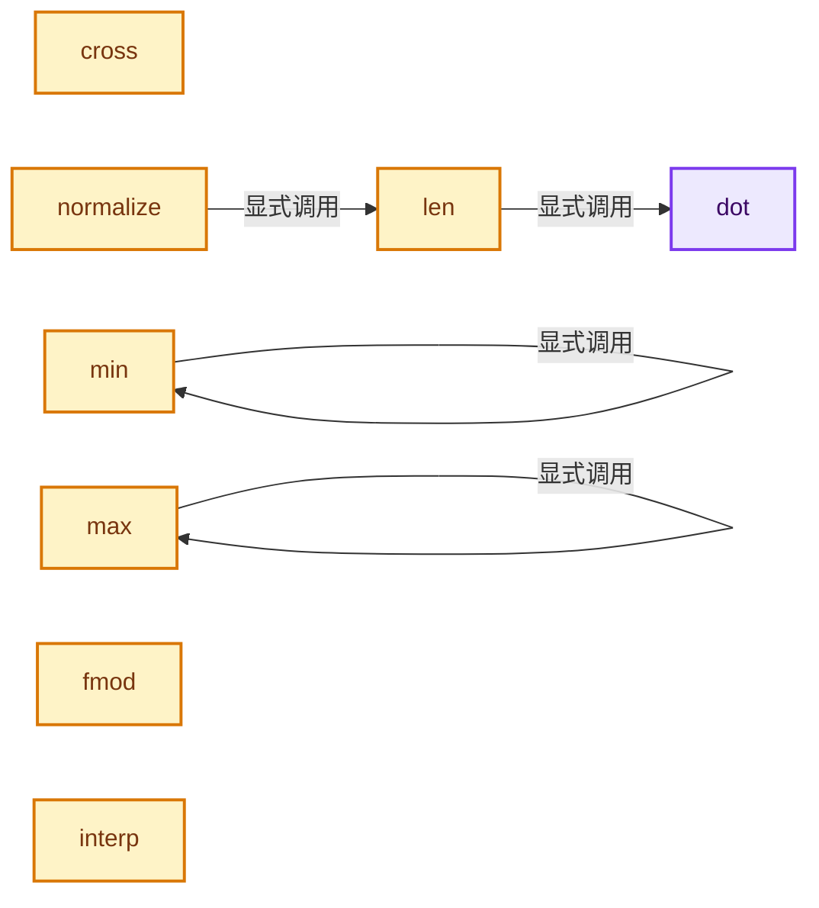
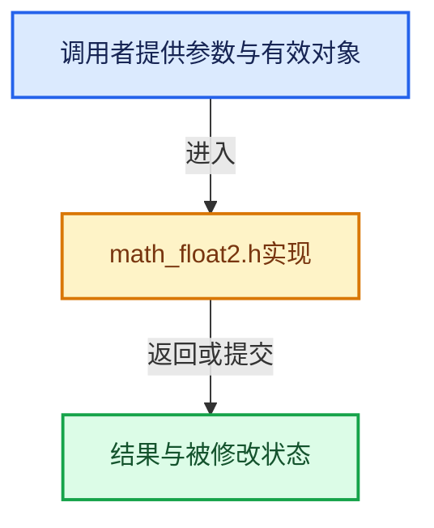

# 实现依赖专题：intern/cycles/util/math_float2.h

[实现依赖导航](../../../README.md) · [符号索引](../../../../00-课程指南/02-源码与提交索引/符号依赖与实现索引.md)

本专题从正文实际调用进入，集中保存共享实现。函数有稳定锚点，可从调用处直接跳到对应完整函数；递归与互相调用通过回链组织。

## 本文件的实现关系






## 完整成员与函数实现

<a id="f-c6c5b4937f8c1456"></a>

### `dot`

实现位置：[intern/cycles/util/math_float2.h](../../../../../../../../intern/cycles/util/math_float2.h) · L131—L134。

接口参数：

- `const float2 a`
- `const float2 b`

**教学注释版**

<!-- annotated:df3a2648b50a46 -->

```cpp
ccl_device_inline float dot(const float2 a, const float2 b)
{
  return a.x * b.x + a.y * b.y;
}
```

<details>
<summary>核对原始源码：intern/cycles/util/math_float2.h · L131—L134</summary>

<!-- original:df3a2648b50a46:intern/cycles/util/math_float2.h:131:134 -->

```cpp
ccl_device_inline float dot(const float2 a, const float2 b)
{
  return a.x * b.x + a.y * b.y;
}
```

</details>

**结果出口**

- `return a.x * b.x + a.y * b.y;`

**继续追踪实现**

本实现没有需要继续展开的显式调用；检查返回表达式、对象转换和调用者前置条件。

<a id="f-98f6c8872834fb9a"></a>

### `len`

实现位置：[intern/cycles/util/math_float2.h](../../../../../../../../intern/cycles/util/math_float2.h) · L163—L166。

接口参数：

- `const float2 a`

**教学注释版**

<!-- annotated:6b91840d02f568 -->

```cpp
ccl_device_inline float len(const float2 a)
{
  return sqrtf(dot(a, a));
}
```

<details>
<summary>核对原始源码：intern/cycles/util/math_float2.h · L163—L166</summary>

<!-- original:6b91840d02f568:intern/cycles/util/math_float2.h:163:166 -->

```cpp
ccl_device_inline float len(const float2 a)
{
  return sqrtf(dot(a, a));
}
```

</details>

**结果出口**

- `return sqrtf(dot(a, a));`

**继续追踪实现**

- `sqrtf` → [外部契约](https://eel.is/c++draft/)：这个边界按实际表达式及所属类型核对参数、返回值、寿命与失败行为。这里提供接口入口，不声称已解释该第三方版本的内部实现。
- `dot` → [dot · L131](math_float2.h.md#f-c6c5b4937f8c1456)。

<a id="f-d4cf827d2d4b9025"></a>

### `cross`

实现位置：[intern/cycles/util/math_float2.h](../../../../../../../../intern/cycles/util/math_float2.h) · L200—L203。

接口参数：

- `const float2 a`
- `const float2 b`

**教学注释版**

<!-- annotated:1e35fd1cace943 -->

```cpp
ccl_device_inline float cross(const float2 a, const float2 b)
{
  return (a.x * b.y - a.y * b.x);
}
```

<details>
<summary>核对原始源码：intern/cycles/util/math_float2.h · L200—L203</summary>

<!-- original:1e35fd1cace943:intern/cycles/util/math_float2.h:200:203 -->

```cpp
ccl_device_inline float cross(const float2 a, const float2 b)
{
  return (a.x * b.y - a.y * b.x);
}
```

</details>

**结果出口**

- `return (a.x * b.y - a.y * b.x);`

**继续追踪实现**

本实现没有需要继续展开的显式调用；检查返回表达式、对象转换和调用者前置条件。

<a id="f-2a4866a4240a6727"></a>

### `normalize`

实现位置：[intern/cycles/util/math_float2.h](../../../../../../../../intern/cycles/util/math_float2.h) · L205—L208。

接口参数：

- `const float2 a`

**教学注释版**

<!-- annotated:9fe51896c09c64 -->

```cpp
ccl_device_inline float2 normalize(const float2 a)
{
  return a / len(a);
}
```

<details>
<summary>核对原始源码：intern/cycles/util/math_float2.h · L205—L208</summary>

<!-- original:9fe51896c09c64:intern/cycles/util/math_float2.h:205:208 -->

```cpp
ccl_device_inline float2 normalize(const float2 a)
{
  return a / len(a);
}
```

</details>

**结果出口**

- `return a / len(a);`

**继续追踪实现**

- `len` → [len · L163](math_float2.h.md#f-98f6c8872834fb9a)。

<a id="f-453657a570c88deb"></a>

### `min`

实现位置：[intern/cycles/util/math_float2.h](../../../../../../../../intern/cycles/util/math_float2.h) · L216—L219。

接口参数：

- `const float2 a`
- `const float2 b`

**教学注释版**

<!-- annotated:2f3fa3c248cb4c -->

```cpp
ccl_device_inline float2 min(const float2 a, const float2 b)
{
  return make_float2(min(a.x, b.x), min(a.y, b.y));
}
```

<details>
<summary>核对原始源码：intern/cycles/util/math_float2.h · L216—L219</summary>

<!-- original:2f3fa3c248cb4c:intern/cycles/util/math_float2.h:216:219 -->

```cpp
ccl_device_inline float2 min(const float2 a, const float2 b)
{
  return make_float2(min(a.x, b.x), min(a.y, b.y));
}
```

</details>

**结果出口**

- `return make_float2(min(a.x, b.x), min(a.y, b.y));`

**继续追踪实现**

- `make_float2` → [make_float2 · L140](types_float3.h.md#f-77c167316af6fdba)；[make_float2 · L38](types_float2.h.md#f-8a0f238b2e7ed283)；[make_float2 · L45](types_float2.h.md#f-6d599e93fdd2a5fb)；[make_float2 · L50](types_float2.h.md#f-45b44d6e52b1e689)；[make_float2 · L143](types_dual.h.md#f-a5eca16a38192c61)；[make_float2 · L148](types_dual.h.md#f-cc9b7f264b70124c)。同名重载需按实参类型选择。
- `min` → [min · L216](math_float2.h.md#f-453657a570c88deb)。

<a id="f-66894c57f4db2ebc"></a>

### `max`

实现位置：[intern/cycles/util/math_float2.h](../../../../../../../../intern/cycles/util/math_float2.h) · L221—L224。

接口参数：

- `const float2 a`
- `const float2 b`

**教学注释版**

<!-- annotated:56aa7c4da6f317 -->

```cpp
ccl_device_inline float2 max(const float2 a, const float2 b)
{
  return make_float2(max(a.x, b.x), max(a.y, b.y));
}
```

<details>
<summary>核对原始源码：intern/cycles/util/math_float2.h · L221—L224</summary>

<!-- original:56aa7c4da6f317:intern/cycles/util/math_float2.h:221:224 -->

```cpp
ccl_device_inline float2 max(const float2 a, const float2 b)
{
  return make_float2(max(a.x, b.x), max(a.y, b.y));
}
```

</details>

**结果出口**

- `return make_float2(max(a.x, b.x), max(a.y, b.y));`

**继续追踪实现**

- `make_float2` → [make_float2 · L140](types_float3.h.md#f-77c167316af6fdba)；[make_float2 · L38](types_float2.h.md#f-8a0f238b2e7ed283)；[make_float2 · L45](types_float2.h.md#f-6d599e93fdd2a5fb)；[make_float2 · L50](types_float2.h.md#f-45b44d6e52b1e689)；[make_float2 · L143](types_dual.h.md#f-a5eca16a38192c61)；[make_float2 · L148](types_dual.h.md#f-cc9b7f264b70124c)。同名重载需按实参类型选择。
- `max` → [max · L221](math_float2.h.md#f-66894c57f4db2ebc)。

<a id="f-9a1d0eb1fe2260e4"></a>

### `fmod`

实现位置：[intern/cycles/util/math_float2.h](../../../../../../../../intern/cycles/util/math_float2.h) · L231—L234。

接口参数：

- `const float2 a`
- `const float b`

**教学注释版**

<!-- annotated:faeed48e6cc7dc -->

```cpp
ccl_device_inline float2 fmod(const float2 a, const float b)
{
  return make_float2(fmodf(a.x, b), fmodf(a.y, b));
}
```

<details>
<summary>核对原始源码：intern/cycles/util/math_float2.h · L231—L234</summary>

<!-- original:faeed48e6cc7dc:intern/cycles/util/math_float2.h:231:234 -->

```cpp
ccl_device_inline float2 fmod(const float2 a, const float b)
{
  return make_float2(fmodf(a.x, b), fmodf(a.y, b));
}
```

</details>

**结果出口**

- `return make_float2(fmodf(a.x, b), fmodf(a.y, b));`

**继续追踪实现**

- `make_float2` → [make_float2 · L140](types_float3.h.md#f-77c167316af6fdba)；[make_float2 · L38](types_float2.h.md#f-8a0f238b2e7ed283)；[make_float2 · L45](types_float2.h.md#f-6d599e93fdd2a5fb)；[make_float2 · L50](types_float2.h.md#f-45b44d6e52b1e689)；[make_float2 · L143](types_dual.h.md#f-a5eca16a38192c61)；[make_float2 · L148](types_dual.h.md#f-cc9b7f264b70124c)。同名重载需按实参类型选择。
- `fmodf` → [fmodf · L182](../kernel/device/oneapi/compat.h.md#m-56e5993ab048)；[fmodf · L277](../kernel/device/metal/compat.h.md#m-d7e7e2616aed)。宏定义由构建条件选择。

<a id="f-4b938685df05b6fa"></a>

### `interp`

实现位置：[intern/cycles/util/math_float2.h](../../../../../../../../intern/cycles/util/math_float2.h) · L246—L249。

接口参数：

- `const float2 a`
- `const float2 b`
- `const float t`

**教学注释版**

<!-- annotated:b100c82e622943 -->

```cpp
ccl_device_inline float2 interp(const float2 a, const float2 b, const float t)
{
  return a + t * (b - a);
}
```

<details>
<summary>核对原始源码：intern/cycles/util/math_float2.h · L246—L249</summary>

<!-- original:b100c82e622943:intern/cycles/util/math_float2.h:246:249 -->

```cpp
ccl_device_inline float2 interp(const float2 a, const float2 b, const float t)
{
  return a + t * (b - a);
}
```

</details>

**结果出口**

- `return a + t * (b - a);`

**继续追踪实现**

本实现没有需要继续展开的显式调用；检查返回表达式、对象转换和调用者前置条件。
