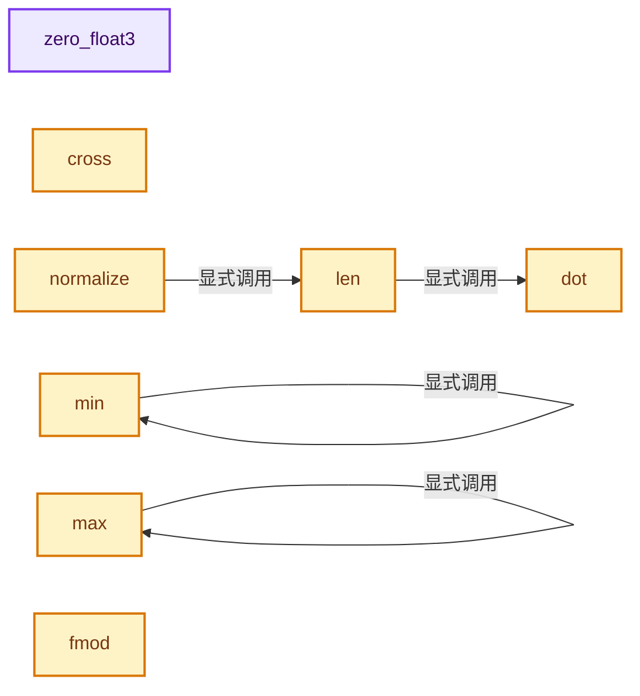
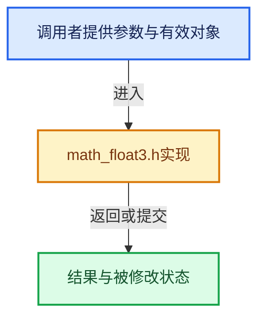

# 实现依赖专题：intern/cycles/util/math_float3.h

[实现依赖导航](../../../README.md) · [符号索引](../../../../00-课程指南/02-源码与提交索引/符号依赖与实现索引.md)

本专题从正文实际调用进入，集中保存共享实现。函数有稳定锚点，可从调用处直接跳到对应完整函数；递归与互相调用通过回链组织。

## 本文件的实现关系






## 完整成员与函数实现

<a id="f-0c16d9302091a334"></a>

### `zero_float3`

实现位置：[intern/cycles/util/math_float3.h](../../../../../../../../intern/cycles/util/math_float3.h) · L15—L24。

**教学注释版**

<!-- annotated:9cbedc363eb04a -->

```cpp
CCL_NAMESPACE_BEGIN

ccl_device_inline float3 zero_float3()
{
#ifdef __KERNEL_SSE__
  return float3(_mm_setzero_ps());
#else
  return make_float3(0.0f, 0.0f, 0.0f);
#endif
}
```

<details>
<summary>核对原始源码：intern/cycles/util/math_float3.h · L15—L24</summary>

<!-- original:9cbedc363eb04a:intern/cycles/util/math_float3.h:15:24 -->

```cpp
CCL_NAMESPACE_BEGIN

ccl_device_inline float3 zero_float3()
{
#ifdef __KERNEL_SSE__
  return float3(_mm_setzero_ps());
#else
  return make_float3(0.0f, 0.0f, 0.0f);
#endif
}
```

</details>

**结果出口**

- `return float3(_mm_setzero_ps());`
- `return make_float3(0.0f, 0.0f, 0.0f);`

**继续追踪实现**

- `float3` → [float3 · L41](types_float3.h.md#f-7da2e52c0fb766ec)；[float3 · L42](types_float3.h.md#f-4c476b25be347939)；[float3 · L43](types_float3.h.md#f-776e8df31bde8162)。同名重载需按实参类型选择。
- `_mm_setzero_ps` → [调用协议](../../../../00-课程指南/01-路线与规范/模板宏与动态分派协议.md)：函数指针、局部可调用对象或未展开的宏；必须结合调用者环境。调用位置L20。
- `make_float3` → [make_float3 · L108](types_float4.h.md#f-f432d3f8358c1253)；[make_float3 · L77](types_float3.h.md#f-a4d1c171bbd08a48)；[make_float3 · L90](types_float3.h.md#f-ed934d00b79bfb67)；[make_float3 · L101](types_float3.h.md#f-809d35d4555a4889)；[make_float3 · L106](types_float3.h.md#f-5e61500b5e24e806)；[make_float3 · L111](types_float3.h.md#f-a032cc39a6db84a8)；[make_float3 · L120](types_float3.h.md#f-894b0e42a98a9c25)；[make_float3 · L153](types_dual.h.md#f-f1b4dcf796f629d2)；[make_float3 · L160](types_dual.h.md#f-bd8866e955c896b4)；[make_float3 · L80](math_quaternion.h.md#f-c614570b864bdc58)。同名重载需按实参类型选择。

<a id="f-1345479cbb5c64a8"></a>

### `dot`

实现位置：[intern/cycles/util/math_float3.h](../../../../../../../../intern/cycles/util/math_float3.h) · L254—L261。

接口参数：

- `const float3 a`
- `const float3 b`

**教学注释版**

<!-- annotated:74c59cbeb141e6 -->

```cpp
ccl_device_inline float dot(const float3 a, const float3 b)
{
#  if defined(__KERNEL_SSE42__) && defined(__KERNEL_SSE__)
  return _mm_cvtss_f32(_mm_dp_ps(a, b, 0x7F));
#  else
  return a.x * b.x + a.y * b.y + a.z * b.z;
#  endif
}
```

<details>
<summary>核对原始源码：intern/cycles/util/math_float3.h · L254—L261</summary>

<!-- original:74c59cbeb141e6:intern/cycles/util/math_float3.h:254:261 -->

```cpp
ccl_device_inline float dot(const float3 a, const float3 b)
{
#  if defined(__KERNEL_SSE42__) && defined(__KERNEL_SSE__)
  return _mm_cvtss_f32(_mm_dp_ps(a, b, 0x7F));
#  else
  return a.x * b.x + a.y * b.y + a.z * b.z;
#  endif
}
```

</details>

**结果出口**

- `return _mm_cvtss_f32(_mm_dp_ps(a, b, 0x7F));`
- `return a.x * b.x + a.y * b.y + a.z * b.z;`

**继续追踪实现**

- `_mm_cvtss_f32` → [调用协议](../../../../00-课程指南/01-路线与规范/模板宏与动态分派协议.md)：函数指针、局部可调用对象或未展开的宏；必须结合调用者环境。调用位置L257。
- `_mm_dp_ps` → [调用协议](../../../../00-课程指南/01-路线与规范/模板宏与动态分派协议.md)：函数指针、局部可调用对象或未展开的宏；必须结合调用者环境。调用位置L257。

<a id="f-d5a256d9bc7d0c11"></a>

### `len`

实现位置：[intern/cycles/util/math_float3.h](../../../../../../../../intern/cycles/util/math_float3.h) · L288—L295。

接口参数：

- `const float3 a`

**教学注释版**

<!-- annotated:976852e29d072e -->

```cpp
ccl_device_inline float len(const float3 a)
{
#if defined(__KERNEL_SSE42__) && defined(__KERNEL_SSE__)
  return _mm_cvtss_f32(_mm_sqrt_ss(_mm_dp_ps(a.m128, a.m128, 0x7F)));
#else
  return sqrtf(dot(a, a));
#endif
}
```

<details>
<summary>核对原始源码：intern/cycles/util/math_float3.h · L288—L295</summary>

<!-- original:976852e29d072e:intern/cycles/util/math_float3.h:288:295 -->

```cpp
ccl_device_inline float len(const float3 a)
{
#if defined(__KERNEL_SSE42__) && defined(__KERNEL_SSE__)
  return _mm_cvtss_f32(_mm_sqrt_ss(_mm_dp_ps(a.m128, a.m128, 0x7F)));
#else
  return sqrtf(dot(a, a));
#endif
}
```

</details>

**结果出口**

- `return _mm_cvtss_f32(_mm_sqrt_ss(_mm_dp_ps(a.m128, a.m128, 0x7F)));`
- `return sqrtf(dot(a, a));`

**继续追踪实现**

- `_mm_cvtss_f32` → [调用协议](../../../../00-课程指南/01-路线与规范/模板宏与动态分派协议.md)：函数指针、局部可调用对象或未展开的宏；必须结合调用者环境。调用位置L291。
- `_mm_sqrt_ss` → [调用协议](../../../../00-课程指南/01-路线与规范/模板宏与动态分派协议.md)：函数指针、局部可调用对象或未展开的宏；必须结合调用者环境。调用位置L291。
- `_mm_dp_ps` → [调用协议](../../../../00-课程指南/01-路线与规范/模板宏与动态分派协议.md)：函数指针、局部可调用对象或未展开的宏；必须结合调用者环境。调用位置L291。
- `sqrtf` → [外部契约](https://eel.is/c++draft/)：这个边界按实际表达式及所属类型核对参数、返回值、寿命与失败行为。这里提供接口入口，不声称已解释该第三方版本的内部实现。
- `dot` → [dot · L254](math_float3.h.md#f-1345479cbb5c64a8)。

<a id="f-a89959ab21db0804"></a>

### `cross`

实现位置：[intern/cycles/util/math_float3.h](../../../../../../../../intern/cycles/util/math_float3.h) · L319—L330。

接口参数：

- `const float3 a`
- `const float3 b`

**教学注释版**

<!-- annotated:4b7d132856d96d -->

```cpp
ccl_device_inline float3 cross(const float3 a, const float3 b)
{
#  ifdef __KERNEL_SSE__
  const float4 x = float4(a.m128);
  const float4 y = shuffle<1, 2, 0, 3>(float4(b.m128));
  const float4 z = float4(_mm_mul_ps(shuffle<1, 2, 0, 3>(float4(a.m128)), float4(b.m128)));

  return float3(shuffle<1, 2, 0, 3>(msub(x, y, z)).m128);
#  else
  return make_float3(a.y * b.z - a.z * b.y, a.z * b.x - a.x * b.z, a.x * b.y - a.y * b.x);
#  endif
}
```

<details>
<summary>核对原始源码：intern/cycles/util/math_float3.h · L319—L330</summary>

<!-- original:4b7d132856d96d:intern/cycles/util/math_float3.h:319:330 -->

```cpp
ccl_device_inline float3 cross(const float3 a, const float3 b)
{
#  ifdef __KERNEL_SSE__
  const float4 x = float4(a.m128);
  const float4 y = shuffle<1, 2, 0, 3>(float4(b.m128));
  const float4 z = float4(_mm_mul_ps(shuffle<1, 2, 0, 3>(float4(a.m128)), float4(b.m128)));

  return float3(shuffle<1, 2, 0, 3>(msub(x, y, z)).m128);
#  else
  return make_float3(a.y * b.z - a.z * b.y, a.z * b.x - a.x * b.z, a.x * b.y - a.y * b.x);
#  endif
}
```

</details>

**结果出口**

- `return float3(shuffle<1, 2, 0, 3>(msub(x, y, z)).m128);`
- `return make_float3(a.y * b.z - a.z * b.y, a.z * b.x - a.x * b.z, a.x * b.y - a.y * b.x);`

**继续追踪实现**

- `float4` → [float4 · L56](../kernel/svm/radial_tiling_shared.h.md#m-f0908e385c5b)；[float4 · L60](../../../01-BLI基础库/intern/radial_tiling_shared.hh.md#m-7962dcdc288b)；[float4 · L56](../kernel/osl/shaders/node_radial_tiling_shared.h.md#m-adb8e9e87775)；[float4 · L642](../../../08-其他Blender模块/compositor/algorithms/intern/smaa.cc.md#m-9362daaa821c)。宏定义由构建条件选择。
- `shuffle<1, 2, 0, 3>` → [shuffle · L307](math_int8.h.md#f-4e96e4a5bb775d9d)；[shuffle · L313](math_int8.h.md#f-1494d2d2828a50ea)；[shuffle · L318](math_int8.h.md#f-dfdd2ebc1f3110d2)；[shuffle · L324](math_int8.h.md#f-307e12847ba5ab8e)；[shuffle · L331](math_int8.h.md#f-435867ee373d570b)；[shuffle · L338](math_int8.h.md#f-826dec998cc2dddb)；[shuffle · L342](math_int8.h.md#f-1e3d1a67200101b1)；[shuffle · L346](math_int8.h.md#f-520189eab29f5c61)；[shuffle · L273](math_int4.h.md#f-5ad20144a94229f8)；[shuffle · L284](math_int4.h.md#f-f72024a6e1e087d9)；[shuffle · L297](math_int4.h.md#f-cad30e076ef9298e)；[shuffle · L418](math_float8.h.md#f-c95fe02d9c11d075)；[shuffle · L435](math_float8.h.md#f-8574912256a80638)；[shuffle · L446](math_float8.h.md#f-567df4545ea6c89d)；[shuffle · L451](math_float8.h.md#f-5a727a570cd96ca6)；[shuffle · L455](math_float8.h.md#f-28e2fda8f470f5f6)；[shuffle · L269](math_float4.h.md#f-482643c1a13b2404)；[shuffle · L280](math_float4.h.md#f-72f031d0b6ec9db3)；[shuffle · L285](math_float4.h.md#f-ce6e8c861185b553)；[shuffle · L291](math_float4.h.md#f-f08ebe2fe109dbb3)；[shuffle · L296](math_float4.h.md#f-841d8c4ce3a0c76d)；[shuffle · L302](math_float4.h.md#f-af5a97263fd9728c)；[shuffle · L312](math_float4.h.md#f-ff1cf2799e9bfd34)；[shuffle · L316](math_float4.h.md#f-2ff695fd13d1a966)；[shuffle · L325](math_float4.h.md#f-7e1c91bb33798733)；[shuffle · L330](math_float4.h.md#f-cc16bc1baed46033)。同名重载需按实参类型选择。
- `_mm_mul_ps` → [调用协议](../../../../00-课程指南/01-路线与规范/模板宏与动态分派协议.md)：函数指针、局部可调用对象或未展开的宏；必须结合调用者环境。调用位置L324。
- `float3` → [float3 · L41](types_float3.h.md#f-7da2e52c0fb766ec)；[float3 · L42](types_float3.h.md#f-4c476b25be347939)；[float3 · L43](types_float3.h.md#f-776e8df31bde8162)。同名重载需按实参类型选择。
- `msub` → [msub · L253](math_float4.h.md#f-c1ee59e753b8cf35)。
- `make_float3` → [make_float3 · L108](types_float4.h.md#f-f432d3f8358c1253)；[make_float3 · L77](types_float3.h.md#f-a4d1c171bbd08a48)；[make_float3 · L90](types_float3.h.md#f-ed934d00b79bfb67)；[make_float3 · L101](types_float3.h.md#f-809d35d4555a4889)；[make_float3 · L106](types_float3.h.md#f-5e61500b5e24e806)；[make_float3 · L111](types_float3.h.md#f-a032cc39a6db84a8)；[make_float3 · L120](types_float3.h.md#f-894b0e42a98a9c25)；[make_float3 · L153](types_dual.h.md#f-f1b4dcf796f629d2)；[make_float3 · L160](types_dual.h.md#f-bd8866e955c896b4)；[make_float3 · L80](math_quaternion.h.md#f-c614570b864bdc58)。同名重载需按实参类型选择。

<a id="f-baa4b4b062d3b43f"></a>

### `normalize`

实现位置：[intern/cycles/util/math_float3.h](../../../../../../../../intern/cycles/util/math_float3.h) · L332—L340。

接口参数：

- `const float3 a`

**教学注释版**

<!-- annotated:9dd8ec1ed41dff -->

```cpp
ccl_device_inline float3 normalize(const float3 a)
{
#  if defined(__KERNEL_SSE42__) && defined(__KERNEL_SSE__)
  const __m128 norm = _mm_sqrt_ps(_mm_dp_ps(a.m128, a.m128, 0x7F));
  return float3(_mm_div_ps(a.m128, norm));
#  else
  return a / len(a);
#  endif
}
```

<details>
<summary>核对原始源码：intern/cycles/util/math_float3.h · L332—L340</summary>

<!-- original:9dd8ec1ed41dff:intern/cycles/util/math_float3.h:332:340 -->

```cpp
ccl_device_inline float3 normalize(const float3 a)
{
#  if defined(__KERNEL_SSE42__) && defined(__KERNEL_SSE__)
  const __m128 norm = _mm_sqrt_ps(_mm_dp_ps(a.m128, a.m128, 0x7F));
  return float3(_mm_div_ps(a.m128, norm));
#  else
  return a / len(a);
#  endif
}
```

</details>

**结果出口**

- `return float3(_mm_div_ps(a.m128, norm));`
- `return a / len(a);`

**继续追踪实现**

- `_mm_sqrt_ps` → [调用协议](../../../../00-课程指南/01-路线与规范/模板宏与动态分派协议.md)：函数指针、局部可调用对象或未展开的宏；必须结合调用者环境。调用位置L335。
- `_mm_dp_ps` → [调用协议](../../../../00-课程指南/01-路线与规范/模板宏与动态分派协议.md)：函数指针、局部可调用对象或未展开的宏；必须结合调用者环境。调用位置L335。
- `float3` → [float3 · L41](types_float3.h.md#f-7da2e52c0fb766ec)；[float3 · L42](types_float3.h.md#f-4c476b25be347939)；[float3 · L43](types_float3.h.md#f-776e8df31bde8162)。同名重载需按实参类型选择。
- `_mm_div_ps` → [调用协议](../../../../00-课程指南/01-路线与规范/模板宏与动态分派协议.md)：函数指针、局部可调用对象或未展开的宏；必须结合调用者环境。调用位置L336。
- `len` → [len · L288](math_float3.h.md#f-d5a256d9bc7d0c11)。

<a id="f-54d32892316f5dc2"></a>

### `min`

实现位置：[intern/cycles/util/math_float3.h](../../../../../../../../intern/cycles/util/math_float3.h) · L342—L349。

接口参数：

- `const float3 a`
- `const float3 b`

**教学注释版**

<!-- annotated:d73eb264e7e883 -->

```cpp
ccl_device_inline float3 min(const float3 a, const float3 b)
{
#  ifdef __KERNEL_SSE__
  return float3(_mm_min_ps(a.m128, b.m128));
#  else
  return make_float3(min(a.x, b.x), min(a.y, b.y), min(a.z, b.z));
#  endif
}
```

<details>
<summary>核对原始源码：intern/cycles/util/math_float3.h · L342—L349</summary>

<!-- original:d73eb264e7e883:intern/cycles/util/math_float3.h:342:349 -->

```cpp
ccl_device_inline float3 min(const float3 a, const float3 b)
{
#  ifdef __KERNEL_SSE__
  return float3(_mm_min_ps(a.m128, b.m128));
#  else
  return make_float3(min(a.x, b.x), min(a.y, b.y), min(a.z, b.z));
#  endif
}
```

</details>

**结果出口**

- `return float3(_mm_min_ps(a.m128, b.m128));`
- `return make_float3(min(a.x, b.x), min(a.y, b.y), min(a.z, b.z));`

**继续追踪实现**

- `float3` → [float3 · L41](types_float3.h.md#f-7da2e52c0fb766ec)；[float3 · L42](types_float3.h.md#f-4c476b25be347939)；[float3 · L43](types_float3.h.md#f-776e8df31bde8162)。同名重载需按实参类型选择。
- `_mm_min_ps` → [调用协议](../../../../00-课程指南/01-路线与规范/模板宏与动态分派协议.md)：函数指针、局部可调用对象或未展开的宏；必须结合调用者环境。调用位置L345。
- `make_float3` → [make_float3 · L108](types_float4.h.md#f-f432d3f8358c1253)；[make_float3 · L77](types_float3.h.md#f-a4d1c171bbd08a48)；[make_float3 · L90](types_float3.h.md#f-ed934d00b79bfb67)；[make_float3 · L101](types_float3.h.md#f-809d35d4555a4889)；[make_float3 · L106](types_float3.h.md#f-5e61500b5e24e806)；[make_float3 · L111](types_float3.h.md#f-a032cc39a6db84a8)；[make_float3 · L120](types_float3.h.md#f-894b0e42a98a9c25)；[make_float3 · L153](types_dual.h.md#f-f1b4dcf796f629d2)；[make_float3 · L160](types_dual.h.md#f-bd8866e955c896b4)；[make_float3 · L80](math_quaternion.h.md#f-c614570b864bdc58)。同名重载需按实参类型选择。
- `min` → [min · L342](math_float3.h.md#f-54d32892316f5dc2)。

<a id="f-49542b78174b3b34"></a>

### `max`

实现位置：[intern/cycles/util/math_float3.h](../../../../../../../../intern/cycles/util/math_float3.h) · L351—L358。

接口参数：

- `const float3 a`
- `const float3 b`

**教学注释版**

<!-- annotated:ae520a40e77c06 -->

```cpp
ccl_device_inline float3 max(const float3 a, const float3 b)
{
#  ifdef __KERNEL_SSE__
  return float3(_mm_max_ps(a.m128, b.m128));
#  else
  return make_float3(max(a.x, b.x), max(a.y, b.y), max(a.z, b.z));
#  endif
}
```

<details>
<summary>核对原始源码：intern/cycles/util/math_float3.h · L351—L358</summary>

<!-- original:ae520a40e77c06:intern/cycles/util/math_float3.h:351:358 -->

```cpp
ccl_device_inline float3 max(const float3 a, const float3 b)
{
#  ifdef __KERNEL_SSE__
  return float3(_mm_max_ps(a.m128, b.m128));
#  else
  return make_float3(max(a.x, b.x), max(a.y, b.y), max(a.z, b.z));
#  endif
}
```

</details>

**结果出口**

- `return float3(_mm_max_ps(a.m128, b.m128));`
- `return make_float3(max(a.x, b.x), max(a.y, b.y), max(a.z, b.z));`

**继续追踪实现**

- `float3` → [float3 · L41](types_float3.h.md#f-7da2e52c0fb766ec)；[float3 · L42](types_float3.h.md#f-4c476b25be347939)；[float3 · L43](types_float3.h.md#f-776e8df31bde8162)。同名重载需按实参类型选择。
- `_mm_max_ps` → [调用协议](../../../../00-课程指南/01-路线与规范/模板宏与动态分派协议.md)：函数指针、局部可调用对象或未展开的宏；必须结合调用者环境。调用位置L354。
- `make_float3` → [make_float3 · L108](types_float4.h.md#f-f432d3f8358c1253)；[make_float3 · L77](types_float3.h.md#f-a4d1c171bbd08a48)；[make_float3 · L90](types_float3.h.md#f-ed934d00b79bfb67)；[make_float3 · L101](types_float3.h.md#f-809d35d4555a4889)；[make_float3 · L106](types_float3.h.md#f-5e61500b5e24e806)；[make_float3 · L111](types_float3.h.md#f-a032cc39a6db84a8)；[make_float3 · L120](types_float3.h.md#f-894b0e42a98a9c25)；[make_float3 · L153](types_dual.h.md#f-f1b4dcf796f629d2)；[make_float3 · L160](types_dual.h.md#f-bd8866e955c896b4)；[make_float3 · L80](math_quaternion.h.md#f-c614570b864bdc58)。同名重载需按实参类型选择。
- `max` → [max · L351](math_float3.h.md#f-49542b78174b3b34)。

<a id="f-752e4b11eb8a06e0"></a>

### `fmod`

实现位置：[intern/cycles/util/math_float3.h](../../../../../../../../intern/cycles/util/math_float3.h) · L383—L397。

接口参数：

- `const float3 a`
- `const float b`

**教学注释版**

<!-- annotated:88210ea23694ee -->

```cpp
ccl_device_inline float3 fmod(const float3 a, const float b)
{
#  if defined(__KERNEL_NEON__)
  /* Use native Neon instructions.
   * The logic is the same as the SSE code below, but on Apple M2 Ultra this seems to be faster.
   * Possibly due to some runtime checks in _mm_round_ps which do not get properly inlined. */
  const float32x4_t iquot = vrndq_f32(a / b);
  return float3(vsubq_f32(a, vmulq_f32(iquot, vdupq_n_f32(b))));
#  elif defined(__KERNEL_SSE42__) && defined(__KERNEL_SSE__)
  const __m128 iquot = _mm_round_ps(a / b, _MM_FROUND_TRUNC);
  return float3(_mm_sub_ps(a, _mm_mul_ps(iquot, _mm_set1_ps(b))));
#  else
  return make_float3(fmodf(a.x, b), fmodf(a.y, b), fmodf(a.z, b));
#  endif
}
```

<details>
<summary>核对原始源码：intern/cycles/util/math_float3.h · L383—L397</summary>

<!-- original:88210ea23694ee:intern/cycles/util/math_float3.h:383:397 -->

```cpp
ccl_device_inline float3 fmod(const float3 a, const float b)
{
#  if defined(__KERNEL_NEON__)
  /* Use native Neon instructions.
   * The logic is the same as the SSE code below, but on Apple M2 Ultra this seems to be faster.
   * Possibly due to some runtime checks in _mm_round_ps which do not get properly inlined. */
  const float32x4_t iquot = vrndq_f32(a / b);
  return float3(vsubq_f32(a, vmulq_f32(iquot, vdupq_n_f32(b))));
#  elif defined(__KERNEL_SSE42__) && defined(__KERNEL_SSE__)
  const __m128 iquot = _mm_round_ps(a / b, _MM_FROUND_TRUNC);
  return float3(_mm_sub_ps(a, _mm_mul_ps(iquot, _mm_set1_ps(b))));
#  else
  return make_float3(fmodf(a.x, b), fmodf(a.y, b), fmodf(a.z, b));
#  endif
}
```

</details>

**结果出口**

- `return float3(vsubq_f32(a, vmulq_f32(iquot, vdupq_n_f32(b))));`
- `return float3(_mm_sub_ps(a, _mm_mul_ps(iquot, _mm_set1_ps(b))));`
- `return make_float3(fmodf(a.x, b), fmodf(a.y, b), fmodf(a.z, b));`

**继续追踪实现**

- `vrndq_f32` → [调用协议](../../../../00-课程指南/01-路线与规范/模板宏与动态分派协议.md)：函数指针、局部可调用对象或未展开的宏；必须结合调用者环境。调用位置L389。
- `float3` → [float3 · L41](types_float3.h.md#f-7da2e52c0fb766ec)；[float3 · L42](types_float3.h.md#f-4c476b25be347939)；[float3 · L43](types_float3.h.md#f-776e8df31bde8162)。同名重载需按实参类型选择。
- `vsubq_f32` → [调用协议](../../../../00-课程指南/01-路线与规范/模板宏与动态分派协议.md)：函数指针、局部可调用对象或未展开的宏；必须结合调用者环境。调用位置L390。
- `vmulq_f32` → [调用协议](../../../../00-课程指南/01-路线与规范/模板宏与动态分派协议.md)：函数指针、局部可调用对象或未展开的宏；必须结合调用者环境。调用位置L390。
- `vdupq_n_f32` → [调用协议](../../../../00-课程指南/01-路线与规范/模板宏与动态分派协议.md)：函数指针、局部可调用对象或未展开的宏；必须结合调用者环境。调用位置L390。
- `_mm_round_ps` → [调用协议](../../../../00-课程指南/01-路线与规范/模板宏与动态分派协议.md)：函数指针、局部可调用对象或未展开的宏；必须结合调用者环境。调用位置L392。
- `_mm_sub_ps` → [调用协议](../../../../00-课程指南/01-路线与规范/模板宏与动态分派协议.md)：函数指针、局部可调用对象或未展开的宏；必须结合调用者环境。调用位置L393。
- `_mm_mul_ps` → [调用协议](../../../../00-课程指南/01-路线与规范/模板宏与动态分派协议.md)：函数指针、局部可调用对象或未展开的宏；必须结合调用者环境。调用位置L393。
- `_mm_set1_ps` → [调用协议](../../../../00-课程指南/01-路线与规范/模板宏与动态分派协议.md)：函数指针、局部可调用对象或未展开的宏；必须结合调用者环境。调用位置L393。
- `make_float3` → [make_float3 · L108](types_float4.h.md#f-f432d3f8358c1253)；[make_float3 · L77](types_float3.h.md#f-a4d1c171bbd08a48)；[make_float3 · L90](types_float3.h.md#f-ed934d00b79bfb67)；[make_float3 · L101](types_float3.h.md#f-809d35d4555a4889)；[make_float3 · L106](types_float3.h.md#f-5e61500b5e24e806)；[make_float3 · L111](types_float3.h.md#f-a032cc39a6db84a8)；[make_float3 · L120](types_float3.h.md#f-894b0e42a98a9c25)；[make_float3 · L153](types_dual.h.md#f-f1b4dcf796f629d2)；[make_float3 · L160](types_dual.h.md#f-bd8866e955c896b4)；[make_float3 · L80](math_quaternion.h.md#f-c614570b864bdc58)。同名重载需按实参类型选择。
- `fmodf` → [fmodf · L182](../kernel/device/oneapi/compat.h.md#m-56e5993ab048)；[fmodf · L277](../kernel/device/metal/compat.h.md#m-d7e7e2616aed)。宏定义由构建条件选择。

<a id="f-cd2eb4989dc0822b"></a>

### `fmod`

实现位置：[intern/cycles/util/math_float3.h](../../../../../../../../intern/cycles/util/math_float3.h) · L399—L411。

接口参数：

- `const float3 a`
- `const float3 b`

**教学注释版**

<!-- annotated:d3bca964f76169 -->

```cpp
ccl_device_inline float3 fmod(const float3 a, const float3 b)
{
#  if defined(__KERNEL_NEON__)
  const float32x4_t iquot = vrndq_f32(vdivq_f32(a.m128, b.m128));
  return float3(vsubq_f32(a, vmulq_f32(iquot, b.m128)));
#  elif defined(__KERNEL_SSE42__) && defined(__KERNEL_SSE__)
  const __m128 div = _mm_div_ps(a.m128, b.m128);
  const __m128 iquot = _mm_round_ps(div, _MM_FROUND_TO_ZERO | _MM_FROUND_NO_EXC);
  return float3(_mm_sub_ps(a.m128, _mm_mul_ps(iquot, b.m128)));
#  else
  return make_float3(fmodf(a.x, b.x), fmodf(a.y, b.y), fmodf(a.z, b.z));
#  endif
}
```

<details>
<summary>核对原始源码：intern/cycles/util/math_float3.h · L399—L411</summary>

<!-- original:d3bca964f76169:intern/cycles/util/math_float3.h:399:411 -->

```cpp
ccl_device_inline float3 fmod(const float3 a, const float3 b)
{
#  if defined(__KERNEL_NEON__)
  const float32x4_t iquot = vrndq_f32(vdivq_f32(a.m128, b.m128));
  return float3(vsubq_f32(a, vmulq_f32(iquot, b.m128)));
#  elif defined(__KERNEL_SSE42__) && defined(__KERNEL_SSE__)
  const __m128 div = _mm_div_ps(a.m128, b.m128);
  const __m128 iquot = _mm_round_ps(div, _MM_FROUND_TO_ZERO | _MM_FROUND_NO_EXC);
  return float3(_mm_sub_ps(a.m128, _mm_mul_ps(iquot, b.m128)));
#  else
  return make_float3(fmodf(a.x, b.x), fmodf(a.y, b.y), fmodf(a.z, b.z));
#  endif
}
```

</details>

**结果出口**

- `return float3(vsubq_f32(a, vmulq_f32(iquot, b.m128)));`
- `return float3(_mm_sub_ps(a.m128, _mm_mul_ps(iquot, b.m128)));`
- `return make_float3(fmodf(a.x, b.x), fmodf(a.y, b.y), fmodf(a.z, b.z));`

**继续追踪实现**

- `vrndq_f32` → [调用协议](../../../../00-课程指南/01-路线与规范/模板宏与动态分派协议.md)：函数指针、局部可调用对象或未展开的宏；必须结合调用者环境。调用位置L402。
- `vdivq_f32` → [调用协议](../../../../00-课程指南/01-路线与规范/模板宏与动态分派协议.md)：函数指针、局部可调用对象或未展开的宏；必须结合调用者环境。调用位置L402。
- `float3` → [float3 · L41](types_float3.h.md#f-7da2e52c0fb766ec)；[float3 · L42](types_float3.h.md#f-4c476b25be347939)；[float3 · L43](types_float3.h.md#f-776e8df31bde8162)。同名重载需按实参类型选择。
- `vsubq_f32` → [调用协议](../../../../00-课程指南/01-路线与规范/模板宏与动态分派协议.md)：函数指针、局部可调用对象或未展开的宏；必须结合调用者环境。调用位置L403。
- `vmulq_f32` → [调用协议](../../../../00-课程指南/01-路线与规范/模板宏与动态分派协议.md)：函数指针、局部可调用对象或未展开的宏；必须结合调用者环境。调用位置L403。
- `_mm_div_ps` → [调用协议](../../../../00-课程指南/01-路线与规范/模板宏与动态分派协议.md)：函数指针、局部可调用对象或未展开的宏；必须结合调用者环境。调用位置L405。
- `_mm_round_ps` → [调用协议](../../../../00-课程指南/01-路线与规范/模板宏与动态分派协议.md)：函数指针、局部可调用对象或未展开的宏；必须结合调用者环境。调用位置L406。
- `_mm_sub_ps` → [调用协议](../../../../00-课程指南/01-路线与规范/模板宏与动态分派协议.md)：函数指针、局部可调用对象或未展开的宏；必须结合调用者环境。调用位置L407。
- `_mm_mul_ps` → [调用协议](../../../../00-课程指南/01-路线与规范/模板宏与动态分派协议.md)：函数指针、局部可调用对象或未展开的宏；必须结合调用者环境。调用位置L407。
- `make_float3` → [make_float3 · L108](types_float4.h.md#f-f432d3f8358c1253)；[make_float3 · L77](types_float3.h.md#f-a4d1c171bbd08a48)；[make_float3 · L90](types_float3.h.md#f-ed934d00b79bfb67)；[make_float3 · L101](types_float3.h.md#f-809d35d4555a4889)；[make_float3 · L106](types_float3.h.md#f-5e61500b5e24e806)；[make_float3 · L111](types_float3.h.md#f-a032cc39a6db84a8)；[make_float3 · L120](types_float3.h.md#f-894b0e42a98a9c25)；[make_float3 · L153](types_dual.h.md#f-f1b4dcf796f629d2)；[make_float3 · L160](types_dual.h.md#f-bd8866e955c896b4)；[make_float3 · L80](math_quaternion.h.md#f-c614570b864bdc58)。同名重载需按实参类型选择。
- `fmodf` → [fmodf · L182](../kernel/device/oneapi/compat.h.md#m-56e5993ab048)；[fmodf · L277](../kernel/device/metal/compat.h.md#m-d7e7e2616aed)。宏定义由构建条件选择。

<a id="f-2c909fab6800292f"></a>

### `round`

实现位置：[intern/cycles/util/math_float3.h](../../../../../../../../intern/cycles/util/math_float3.h) · L422—L431。

接口参数：

- `const float3 a`

**教学注释版**

<!-- annotated:f8b693001d2208 -->

```cpp
ccl_device_inline float3 round(const float3 a)
{
#  if defined(__KERNEL_NEON__)
  return float3(vrndnq_f32(a.m128));
#  elif defined(__KERNEL_SSE__)
  return float3(_mm_round_ps(a.m128, _MM_FROUND_NINT));
#  else
  return make_float3(roundf(a.x), roundf(a.y), roundf(a.z));
#  endif
}
```

<details>
<summary>核对原始源码：intern/cycles/util/math_float3.h · L422—L431</summary>

<!-- original:f8b693001d2208:intern/cycles/util/math_float3.h:422:431 -->

```cpp
ccl_device_inline float3 round(const float3 a)
{
#  if defined(__KERNEL_NEON__)
  return float3(vrndnq_f32(a.m128));
#  elif defined(__KERNEL_SSE__)
  return float3(_mm_round_ps(a.m128, _MM_FROUND_NINT));
#  else
  return make_float3(roundf(a.x), roundf(a.y), roundf(a.z));
#  endif
}
```

</details>

**结果出口**

- `return float3(vrndnq_f32(a.m128));`
- `return float3(_mm_round_ps(a.m128, _MM_FROUND_NINT));`
- `return make_float3(roundf(a.x), roundf(a.y), roundf(a.z));`

**继续追踪实现**

- `float3` → [float3 · L41](types_float3.h.md#f-7da2e52c0fb766ec)；[float3 · L42](types_float3.h.md#f-4c476b25be347939)；[float3 · L43](types_float3.h.md#f-776e8df31bde8162)。同名重载需按实参类型选择。
- `vrndnq_f32` → [调用协议](../../../../00-课程指南/01-路线与规范/模板宏与动态分派协议.md)：函数指针、局部可调用对象或未展开的宏；必须结合调用者环境。调用位置L425。
- `_mm_round_ps` → [调用协议](../../../../00-课程指南/01-路线与规范/模板宏与动态分派协议.md)：函数指针、局部可调用对象或未展开的宏；必须结合调用者环境。调用位置L427。
- `make_float3` → [make_float3 · L108](types_float4.h.md#f-f432d3f8358c1253)；[make_float3 · L77](types_float3.h.md#f-a4d1c171bbd08a48)；[make_float3 · L90](types_float3.h.md#f-ed934d00b79bfb67)；[make_float3 · L101](types_float3.h.md#f-809d35d4555a4889)；[make_float3 · L106](types_float3.h.md#f-5e61500b5e24e806)；[make_float3 · L111](types_float3.h.md#f-a032cc39a6db84a8)；[make_float3 · L120](types_float3.h.md#f-894b0e42a98a9c25)；[make_float3 · L153](types_dual.h.md#f-f1b4dcf796f629d2)；[make_float3 · L160](types_dual.h.md#f-bd8866e955c896b4)；[make_float3 · L80](math_quaternion.h.md#f-c614570b864bdc58)。同名重载需按实参类型选择。
- `roundf` → [roundf · L174](../kernel/device/oneapi/compat.h.md#m-bdf6eb01f4f1)；[roundf · L272](../kernel/device/metal/compat.h.md#m-97b17e1586c9)。宏定义由构建条件选择。

<a id="f-25df7a685dcb5e61"></a>

### `safe_normalize_fallback`

实现位置：[intern/cycles/util/math_float3.h](../../../../../../../../intern/cycles/util/math_float3.h) · L533—L537。

接口参数：

- `const float3 a`
- `const float3 fallback`

**教学注释版**

<!-- annotated:94c0c95072274d -->

```cpp
ccl_device_inline float3 safe_normalize_fallback(const float3 a, const float3 fallback)
{
  const float t = len(a);
  return (t != 0.0f) ? a * (1.0f / t) : fallback;
}
```

<details>
<summary>核对原始源码：intern/cycles/util/math_float3.h · L533—L537</summary>

<!-- original:94c0c95072274d:intern/cycles/util/math_float3.h:533:537 -->

```cpp
ccl_device_inline float3 safe_normalize_fallback(const float3 a, const float3 fallback)
{
  const float t = len(a);
  return (t != 0.0f) ? a * (1.0f / t) : fallback;
}
```

</details>

**结果出口**

- `return (t != 0.0f) ? a * (1.0f / t) : fallback;`

**继续追踪实现**

- `len` → [len · L288](math_float3.h.md#f-d5a256d9bc7d0c11)。

<a id="f-819a62b72e3bc6a1"></a>

### `interp`

实现位置：[intern/cycles/util/math_float3.h](../../../../../../../../intern/cycles/util/math_float3.h) · L557—L560。

接口参数：

- `const float3 a`
- `const float3 b`
- `const float t`

**教学注释版**

<!-- annotated:80c69b7ef66260 -->

```cpp
ccl_device_inline float3 interp(const float3 a, const float3 b, const float t)
{
  return a + t * (b - a);
}
```

<details>
<summary>核对原始源码：intern/cycles/util/math_float3.h · L557—L560</summary>

<!-- original:80c69b7ef66260:intern/cycles/util/math_float3.h:557:560 -->

```cpp
ccl_device_inline float3 interp(const float3 a, const float3 b, const float t)
{
  return a + t * (b - a);
}
```

</details>

**结果出口**

- `return a + t * (b - a);`

**继续追踪实现**

本实现没有需要继续展开的显式调用；检查返回表达式、对象转换和调用者前置条件。

<a id="f-5e1b0f7fb021ec2f"></a>

### `sqr`

实现位置：[intern/cycles/util/math_float3.h](../../../../../../../../intern/cycles/util/math_float3.h) · L562—L565。

接口参数：

- `const float3 a`

**教学注释版**

<!-- annotated:9334b7e67b822a -->

```cpp
ccl_device_inline float3 sqr(const float3 a)
{
  return a * a;
}
```

<details>
<summary>核对原始源码：intern/cycles/util/math_float3.h · L562—L565</summary>

<!-- original:9334b7e67b822a:intern/cycles/util/math_float3.h:562:565 -->

```cpp
ccl_device_inline float3 sqr(const float3 a)
{
  return a * a;
}
```

</details>

**结果出口**

- `return a * a;`

**继续追踪实现**

本实现没有需要继续展开的显式调用；检查返回表达式、对象转换和调用者前置条件。

<a id="f-937ab6d49321741c"></a>

### `component_wise_equal`

实现位置：[intern/cycles/util/math_float3.h](../../../../../../../../intern/cycles/util/math_float3.h) · L655—L666。

接口参数：

- `const float3 a`
- `const float3 b`

**教学注释版**

<!-- annotated:ce2fabd82e7c2d -->

```cpp
ccl_device_inline auto component_wise_equal(const float3 a, const float3 b)
{
#if defined(__KERNEL_METAL__)
  return a == b;
#elif defined __KERNEL_NEON__
  return int3(vreinterpretq_m128i_u32(vceqq_f32(a.m128, b.m128)));
#elif defined(__KERNEL_SSE__)
  return int3(_mm_castps_si128(_mm_cmpeq_ps(a.m128, b.m128)));
#else
  return make_int3(a.x == b.x, a.y == b.y, a.z == b.z);
#endif
}
```

<details>
<summary>核对原始源码：intern/cycles/util/math_float3.h · L655—L666</summary>

<!-- original:ce2fabd82e7c2d:intern/cycles/util/math_float3.h:655:666 -->

```cpp
ccl_device_inline auto component_wise_equal(const float3 a, const float3 b)
{
#if defined(__KERNEL_METAL__)
  return a == b;
#elif defined __KERNEL_NEON__
  return int3(vreinterpretq_m128i_u32(vceqq_f32(a.m128, b.m128)));
#elif defined(__KERNEL_SSE__)
  return int3(_mm_castps_si128(_mm_cmpeq_ps(a.m128, b.m128)));
#else
  return make_int3(a.x == b.x, a.y == b.y, a.z == b.z);
#endif
}
```

</details>

**结果出口**

- `return a == b;`
- `return int3(vreinterpretq_m128i_u32(vceqq_f32(a.m128, b.m128)));`
- `return int3(_mm_castps_si128(_mm_cmpeq_ps(a.m128, b.m128)));`
- `return make_int3(a.x == b.x, a.y == b.y, a.z == b.z);`

**继续追踪实现**

- `int3` → [int3 · L32](types_int3.h.md#f-251a7e4285c59ddb)；[int3 · L33](types_int3.h.md#f-67f7fae256268a81)；[int3 · L34](types_int3.h.md#f-82c16f3f0621f181)。同名重载需按实参类型选择。
- `vreinterpretq_m128i_u32` → [调用协议](../../../../00-课程指南/01-路线与规范/模板宏与动态分派协议.md)：函数指针、局部可调用对象或未展开的宏；必须结合调用者环境。调用位置L660。
- `vceqq_f32` → [调用协议](../../../../00-课程指南/01-路线与规范/模板宏与动态分派协议.md)：函数指针、局部可调用对象或未展开的宏；必须结合调用者环境。调用位置L660。
- `_mm_castps_si128` → [调用协议](../../../../00-课程指南/01-路线与规范/模板宏与动态分派协议.md)：函数指针、局部可调用对象或未展开的宏；必须结合调用者环境。调用位置L662。
- `_mm_cmpeq_ps` → [调用协议](../../../../00-课程指南/01-路线与规范/模板宏与动态分派协议.md)：函数指针、局部可调用对象或未展开的宏；必须结合调用者环境。调用位置L662。
- `make_int3` → [make_int3 · L73](types_int3.h.md#f-3f630390fae242e8)；[make_int3 · L86](types_int3.h.md#f-d25cc5037e7d8fdc)；[make_int3 · L156](types_float3.h.md#f-1a317c8631823b1b)。同名重载需按实参类型选择。

<a id="f-2801eb162b468384"></a>

### `component_is_zero`

实现位置：[intern/cycles/util/math_float3.h](../../../../../../../../intern/cycles/util/math_float3.h) · L668—L671。

接口参数：

- `const float3 a`

**教学注释版**

<!-- annotated:06de5f6be30266 -->

```cpp
ccl_device_inline auto component_is_zero(const float3 a)
{
  return component_wise_equal(a, zero_float3());
}
```

<details>
<summary>核对原始源码：intern/cycles/util/math_float3.h · L668—L671</summary>

<!-- original:06de5f6be30266:intern/cycles/util/math_float3.h:668:671 -->

```cpp
ccl_device_inline auto component_is_zero(const float3 a)
{
  return component_wise_equal(a, zero_float3());
}
```

</details>

**结果出口**

- `return component_wise_equal(a, zero_float3());`

**继续追踪实现**

- `component_wise_equal` → [component_wise_equal · L655](math_float3.h.md#f-937ab6d49321741c)。
- `zero_float3` → [zero_float3 · L15](math_float3.h.md#f-0c16d9302091a334)。

<a id="f-4ab202e36a60d5be"></a>

### `map_to_sphere`

实现位置：[intern/cycles/util/math_float3.h](../../../../../../../../intern/cycles/util/math_float3.h) · L808—L826。

接口参数：

- `const float3 co`

**教学注释版**

<!-- annotated:af82fa2d78b349 -->

```cpp
ccl_device_inline float2 map_to_sphere(const float3 co)
{
  const float l = dot(co, co);
  float u;
  float v;
  if (l > 0.0f) {
    if (UNLIKELY(co.x == 0.0f && co.y == 0.0f)) {
      u = 0.0f; /* Otherwise domain error. */
    }
    else {
      u = (0.5f - atan2f(co.x, co.y) * M_1_2PI_F);
    }
    v = 1.0f - safe_acosf(co.z / sqrtf(l)) * M_1_PI_F;
  }
  else {
    u = v = 0.0f;
  }
  return make_float2(u, v);
}
```

<details>
<summary>核对原始源码：intern/cycles/util/math_float3.h · L808—L826</summary>

<!-- original:af82fa2d78b349:intern/cycles/util/math_float3.h:808:826 -->

```cpp
ccl_device_inline float2 map_to_sphere(const float3 co)
{
  const float l = dot(co, co);
  float u;
  float v;
  if (l > 0.0f) {
    if (UNLIKELY(co.x == 0.0f && co.y == 0.0f)) {
      u = 0.0f; /* Otherwise domain error. */
    }
    else {
      u = (0.5f - atan2f(co.x, co.y) * M_1_2PI_F);
    }
    v = 1.0f - safe_acosf(co.z / sqrtf(l)) * M_1_PI_F;
  }
  else {
    u = v = 0.0f;
  }
  return make_float2(u, v);
}
```

</details>

**沿实际写入检查状态**

- `u = 0.0f; /* Otherwise domain error. */`
- `u = (0.5f - atan2f(co.x, co.y) * M_1_2PI_F);`
- `v = 1.0f - safe_acosf(co.z / sqrtf(l)) * M_1_PI_F;`
- `u = v = 0.0f;`

**结果出口**

- `return make_float2(u, v);`

**继续追踪实现**

- `dot` → [dot · L254](math_float3.h.md#f-1345479cbb5c64a8)。
- `UNLIKELY` → [UNLIKELY · L52](../../guardedalloc/intern/mallocn_intern.hh.md#m-b66d81651173)；[UNLIKELY · L55](../../guardedalloc/intern/mallocn_intern.hh.md#m-43069123e9fe)；[UNLIKELY · L108](defines.h.md#m-c50729f638e8)；[UNLIKELY · L111](defines.h.md#m-08e633831622)；[UNLIKELY · L25](../../../01-BLI基础库/intern/math_base_inline.cc.md#m-beab6e34c61e)；[UNLIKELY · L27](../../../01-BLI基础库/intern/math_base_inline.cc.md#m-9b279ffdd95b)；[UNLIKELY · L544](../../../01-BLI基础库/BLI_utildefines.hh.md#m-74644b8209a0)；[UNLIKELY · L547](../../../01-BLI基础库/BLI_utildefines.hh.md#m-3a47ebab6298)。宏定义由构建条件选择。
- `atan2f` → [atan2f · L18](../kernel/svm/radial_tiling_shared.h.md#m-a77af3382db2)；[atan2f · L40](../kernel/svm/radial_tiling_shared.h.md#m-cec47b2ce998)；[atan2f · L71](../kernel/svm/radial_tiling_shared.h.md#m-bd31b1779092)；[atan2f · L22](../../../01-BLI基础库/intern/radial_tiling_shared.hh.md#m-9b9c2a707484)；[atan2f · L44](../../../01-BLI基础库/intern/radial_tiling_shared.hh.md#m-63f49b7d81dc)；[atan2f · L75](../../../01-BLI基础库/intern/radial_tiling_shared.hh.md#m-4201e8b4c423)；[atan2f · L18](../kernel/osl/shaders/node_radial_tiling_shared.h.md#m-ec4f8238af32)；[atan2f · L40](../kernel/osl/shaders/node_radial_tiling_shared.h.md#m-980162d675e3)；[atan2f · L71](../kernel/osl/shaders/node_radial_tiling_shared.h.md#m-bcd4c102a83d)；[atan2f · L179](../kernel/device/oneapi/compat.h.md#m-5be26d38bfa7)；[atan2f · L274](../kernel/device/metal/compat.h.md#m-1b9636d3b02f)。宏定义由构建条件选择。
- `safe_acosf` → [safe_acosf · L590](math_base.h.md#f-b0596b05c81b9418)。
- `sqrtf` → [外部契约](https://eel.is/c++draft/)：这个边界按实际表达式及所属类型核对参数、返回值、寿命与失败行为。这里提供接口入口，不声称已解释该第三方版本的内部实现。
- `make_float2` → [make_float2 · L140](types_float3.h.md#f-77c167316af6fdba)；[make_float2 · L38](types_float2.h.md#f-8a0f238b2e7ed283)；[make_float2 · L45](types_float2.h.md#f-6d599e93fdd2a5fb)；[make_float2 · L50](types_float2.h.md#f-45b44d6e52b1e689)；[make_float2 · L143](types_dual.h.md#f-a5eca16a38192c61)；[make_float2 · L148](types_dual.h.md#f-cc9b7f264b70124c)。同名重载需按实参类型选择。

<a id="f-5c67e0fefe437332"></a>

### `copy_v3_v3`

实现位置：[intern/cycles/util/math_float3.h](../../../../../../../../intern/cycles/util/math_float3.h) · L828—L833。

接口参数：

- `ccl_private float *r`
- `const float3 val`

**教学注释版**

<!-- annotated:66d0e47319a834 -->

```cpp
ccl_device_inline void copy_v3_v3(ccl_private float *r, const float3 val)
{
  r[0] = val.x;
  r[1] = val.y;
  r[2] = val.z;
}
```

<details>
<summary>核对原始源码：intern/cycles/util/math_float3.h · L828—L833</summary>

<!-- original:66d0e47319a834:intern/cycles/util/math_float3.h:828:833 -->

```cpp
ccl_device_inline void copy_v3_v3(ccl_private float *r, const float3 val)
{
  r[0] = val.x;
  r[1] = val.y;
  r[2] = val.z;
}
```

</details>

**沿实际写入检查状态**

- `r[0] = val.x;`
- `r[1] = val.y;`
- `r[2] = val.z;`

**继续追踪实现**

本实现没有需要继续展开的显式调用；检查返回表达式、对象转换和调用者前置条件。
