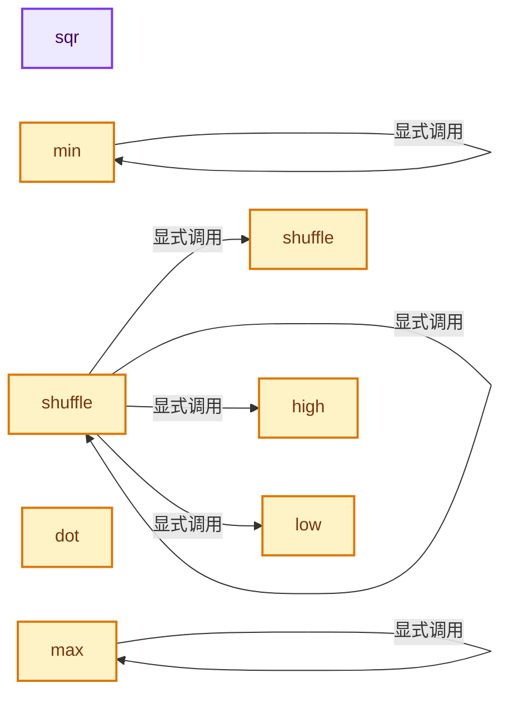
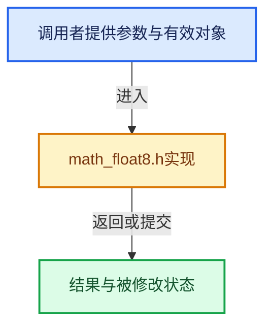

# 实现依赖专题：intern/cycles/util/math_float8.h

[实现依赖导航](../../../README.md) · [符号索引](../../../../00-课程指南/02-源码与提交索引/符号依赖与实现索引.md)

本专题从正文实际调用进入，集中保存共享实现。函数有稳定锚点，可从调用处直接跳到对应完整函数；递归与互相调用通过回链组织。

## 本文件的实现关系






## 完整成员与函数实现

<a id="f-6485e35b797a590d"></a>

### `sqr`

实现位置：[intern/cycles/util/math_float8.h](../../../../../../../../intern/cycles/util/math_float8.h) · L187—L190。

接口参数：

- `const vfloat8 a`

**教学注释版**

<!-- annotated:3d91c2d627c449 -->

```cpp
ccl_device_inline vfloat8 sqr(const vfloat8 a)
{
  return a * a;
}
```

<details>
<summary>核对原始源码：intern/cycles/util/math_float8.h · L187—L190</summary>

<!-- original:3d91c2d627c449:intern/cycles/util/math_float8.h:187:190 -->

```cpp
ccl_device_inline vfloat8 sqr(const vfloat8 a)
{
  return a * a;
}
```

</details>

**结果出口**

- `return a * a;`

**继续追踪实现**

本实现没有需要继续展开的显式调用；检查返回表达式、对象转换和调用者前置条件。

<a id="f-9cd9a897bf18844f"></a>

### `min`

实现位置：[intern/cycles/util/math_float8.h](../../../../../../../../intern/cycles/util/math_float8.h) · L213—L227。

接口参数：

- `const vfloat8 a`
- `const vfloat8 b`

**教学注释版**

<!-- annotated:490a56d3bbb044 -->

```cpp
ccl_device_inline vfloat8 min(const vfloat8 a, const vfloat8 b)
{
#ifdef __KERNEL_AVX__
  return vfloat8(_mm256_min_ps(a.m256, b.m256));
#else
  return make_vfloat8(min(a.a, b.a),
                      min(a.b, b.b),
                      min(a.c, b.c),
                      min(a.d, b.d),
                      min(a.e, b.e),
                      min(a.f, b.f),
                      min(a.g, b.g),
                      min(a.h, b.h));
#endif
}
```

<details>
<summary>核对原始源码：intern/cycles/util/math_float8.h · L213—L227</summary>

<!-- original:490a56d3bbb044:intern/cycles/util/math_float8.h:213:227 -->

```cpp
ccl_device_inline vfloat8 min(const vfloat8 a, const vfloat8 b)
{
#ifdef __KERNEL_AVX__
  return vfloat8(_mm256_min_ps(a.m256, b.m256));
#else
  return make_vfloat8(min(a.a, b.a),
                      min(a.b, b.b),
                      min(a.c, b.c),
                      min(a.d, b.d),
                      min(a.e, b.e),
                      min(a.f, b.f),
                      min(a.g, b.g),
                      min(a.h, b.h));
#endif
}
```

</details>

**结果出口**

- `return vfloat8(_mm256_min_ps(a.m256, b.m256));`
- `return make_vfloat8(min(a.a, b.a),`

**继续追踪实现**

- `vfloat8` → [vfloat8 · L33](types_float8.h.md#f-3da30cc74a545ced)；[vfloat8 · L34](types_float8.h.md#f-42fd7aa6ce019d5b)；[vfloat8 · L35](types_float8.h.md#f-0f7cb095834dd874)。同名重载需按实参类型选择。
- `_mm256_min_ps` → [调用协议](../../../../00-课程指南/01-路线与规范/模板宏与动态分派协议.md)：函数指针、局部可调用对象或未展开的宏；必须结合调用者环境。调用位置L216。
- `make_vfloat8` → [make_vfloat8 · L72](types_float8.h.md#f-e10a776cf4311797)；[make_vfloat8 · L82](types_float8.h.md#f-42d05535b6f6c8f7)；[make_vfloat8 · L99](types_float8.h.md#f-facfa3ac1640ad20)。同名重载需按实参类型选择。
- `min` → [min · L213](math_float8.h.md#f-9cd9a897bf18844f)。

<a id="f-9573fd724ef1191f"></a>

### `max`

实现位置：[intern/cycles/util/math_float8.h](../../../../../../../../intern/cycles/util/math_float8.h) · L229—L243。

接口参数：

- `const vfloat8 a`
- `const vfloat8 b`

**教学注释版**

<!-- annotated:228bf5f53f5b93 -->

```cpp
ccl_device_inline vfloat8 max(const vfloat8 a, const vfloat8 b)
{
#ifdef __KERNEL_AVX__
  return vfloat8(_mm256_max_ps(a.m256, b.m256));
#else
  return make_vfloat8(max(a.a, b.a),
                      max(a.b, b.b),
                      max(a.c, b.c),
                      max(a.d, b.d),
                      max(a.e, b.e),
                      max(a.f, b.f),
                      max(a.g, b.g),
                      max(a.h, b.h));
#endif
}
```

<details>
<summary>核对原始源码：intern/cycles/util/math_float8.h · L229—L243</summary>

<!-- original:228bf5f53f5b93:intern/cycles/util/math_float8.h:229:243 -->

```cpp
ccl_device_inline vfloat8 max(const vfloat8 a, const vfloat8 b)
{
#ifdef __KERNEL_AVX__
  return vfloat8(_mm256_max_ps(a.m256, b.m256));
#else
  return make_vfloat8(max(a.a, b.a),
                      max(a.b, b.b),
                      max(a.c, b.c),
                      max(a.d, b.d),
                      max(a.e, b.e),
                      max(a.f, b.f),
                      max(a.g, b.g),
                      max(a.h, b.h));
#endif
}
```

</details>

**结果出口**

- `return vfloat8(_mm256_max_ps(a.m256, b.m256));`
- `return make_vfloat8(max(a.a, b.a),`

**继续追踪实现**

- `vfloat8` → [vfloat8 · L33](types_float8.h.md#f-3da30cc74a545ced)；[vfloat8 · L34](types_float8.h.md#f-42fd7aa6ce019d5b)；[vfloat8 · L35](types_float8.h.md#f-0f7cb095834dd874)。同名重载需按实参类型选择。
- `_mm256_max_ps` → [调用协议](../../../../00-课程指南/01-路线与规范/模板宏与动态分派协议.md)：函数指针、局部可调用对象或未展开的宏；必须结合调用者环境。调用位置L232。
- `make_vfloat8` → [make_vfloat8 · L72](types_float8.h.md#f-e10a776cf4311797)；[make_vfloat8 · L82](types_float8.h.md#f-42d05535b6f6c8f7)；[make_vfloat8 · L99](types_float8.h.md#f-facfa3ac1640ad20)。同名重载需按实参类型选择。
- `max` → [max · L229](math_float8.h.md#f-9573fd724ef1191f)。

<a id="f-c00ff533ac3dcbbb"></a>

### `dot`

实现位置：[intern/cycles/util/math_float8.h](../../../../../../../../intern/cycles/util/math_float8.h) · L309—L318。

接口参数：

- `const vfloat8 a`
- `const vfloat8 b`

**教学注释版**

<!-- annotated:245739b87976fa -->

```cpp
ccl_device_inline float dot(const vfloat8 a, const vfloat8 b)
{
#ifdef __KERNEL_AVX__
  vfloat8 t(_mm256_dp_ps(a.m256, b.m256, 0xFF));
  return t[0] + t[4];
#else
  return (a.a * b.a) + (a.b * b.b) + (a.c * b.c) + (a.d * b.d) + (a.e * b.e) + (a.f * b.f) +
         (a.g * b.g) + (a.h * b.h);
#endif
}
```

<details>
<summary>核对原始源码：intern/cycles/util/math_float8.h · L309—L318</summary>

<!-- original:245739b87976fa:intern/cycles/util/math_float8.h:309:318 -->

```cpp
ccl_device_inline float dot(const vfloat8 a, const vfloat8 b)
{
#ifdef __KERNEL_AVX__
  vfloat8 t(_mm256_dp_ps(a.m256, b.m256, 0xFF));
  return t[0] + t[4];
#else
  return (a.a * b.a) + (a.b * b.b) + (a.c * b.c) + (a.d * b.d) + (a.e * b.e) + (a.f * b.f) +
         (a.g * b.g) + (a.h * b.h);
#endif
}
```

</details>

**结果出口**

- `return t[0] + t[4];`
- `return (a.a * b.a) + (a.b * b.b) + (a.c * b.c) + (a.d * b.d) + (a.e * b.e) + (a.f * b.f) +`

**继续追踪实现**

- `_mm256_dp_ps` → [调用协议](../../../../00-课程指南/01-路线与规范/模板宏与动态分派协议.md)：函数指针、局部可调用对象或未展开的宏；必须结合调用者环境。调用位置L312。

<a id="f-3994d0d95d823cc7"></a>

### `low`

实现位置：[intern/cycles/util/math_float8.h](../../../../../../../../intern/cycles/util/math_float8.h) · L401—L408。

接口参数：

- `const vfloat8 a`

**教学注释版**

<!-- annotated:534ae119a1babd -->

```cpp
ccl_device_forceinline float4 low(const vfloat8 a)
{
#  ifdef __KERNEL_AVX__
  return float4(_mm256_extractf128_ps(a.m256, 0));
#  else
  return make_float4(a.e, a.f, a.g, a.h);
#  endif
}
```

<details>
<summary>核对原始源码：intern/cycles/util/math_float8.h · L401—L408</summary>

<!-- original:534ae119a1babd:intern/cycles/util/math_float8.h:401:408 -->

```cpp
ccl_device_forceinline float4 low(const vfloat8 a)
{
#  ifdef __KERNEL_AVX__
  return float4(_mm256_extractf128_ps(a.m256, 0));
#  else
  return make_float4(a.e, a.f, a.g, a.h);
#  endif
}
```

</details>

**结果出口**

- `return float4(_mm256_extractf128_ps(a.m256, 0));`
- `return make_float4(a.e, a.f, a.g, a.h);`

**继续追踪实现**

- `float4` → [float4 · L56](../kernel/svm/radial_tiling_shared.h.md#m-f0908e385c5b)；[float4 · L60](../../../01-BLI基础库/intern/radial_tiling_shared.hh.md#m-7962dcdc288b)；[float4 · L56](../kernel/osl/shaders/node_radial_tiling_shared.h.md#m-adb8e9e87775)；[float4 · L642](../../../08-其他Blender模块/compositor/algorithms/intern/smaa.cc.md#m-9362daaa821c)。宏定义由构建条件选择。
- `_mm256_extractf128_ps` → [调用协议](../../../../00-课程指南/01-路线与规范/模板宏与动态分派协议.md)：函数指针、局部可调用对象或未展开的宏；必须结合调用者环境。调用位置L404。
- `make_float4` → [make_float4 · L64](types_float4.h.md#f-f781281b7fbc5189)；[make_float4 · L75](types_float4.h.md#f-2e8408c671c6317a)；[make_float4 · L84](types_float4.h.md#f-ef834c3f77ccb52c)；[make_float4 · L89](types_float4.h.md#f-15e15c112cd5e990)；[make_float4 · L99](types_float4.h.md#f-5220543e0b1ee3d0)；[make_float4 · L165](types_dual.h.md#f-1f8eb02651757016)；[make_float4 · L172](types_dual.h.md#f-5f2db29d80cd0f87)；[make_float4 · L86](math_quaternion.h.md#f-42407d59cf9cb53a)。同名重载需按实参类型选择。

<a id="f-43c8c00e0d35d3fb"></a>

### `high`

实现位置：[intern/cycles/util/math_float8.h](../../../../../../../../intern/cycles/util/math_float8.h) · L409—L416。

接口参数：

- `const vfloat8 a`

**教学注释版**

<!-- annotated:23a2a953ae71d3 -->

```cpp
ccl_device_forceinline float4 high(const vfloat8 a)
{
#  ifdef __KERNEL_AVX__
  return float4(_mm256_extractf128_ps(a.m256, 1));
#  else
  return make_float4(a.a, a.b, a.c, a.d);
#  endif
}
```

<details>
<summary>核对原始源码：intern/cycles/util/math_float8.h · L409—L416</summary>

<!-- original:23a2a953ae71d3:intern/cycles/util/math_float8.h:409:416 -->

```cpp
ccl_device_forceinline float4 high(const vfloat8 a)
{
#  ifdef __KERNEL_AVX__
  return float4(_mm256_extractf128_ps(a.m256, 1));
#  else
  return make_float4(a.a, a.b, a.c, a.d);
#  endif
}
```

</details>

**结果出口**

- `return float4(_mm256_extractf128_ps(a.m256, 1));`
- `return make_float4(a.a, a.b, a.c, a.d);`

**继续追踪实现**

- `float4` → [float4 · L56](../kernel/svm/radial_tiling_shared.h.md#m-f0908e385c5b)；[float4 · L60](../../../01-BLI基础库/intern/radial_tiling_shared.hh.md#m-7962dcdc288b)；[float4 · L56](../kernel/osl/shaders/node_radial_tiling_shared.h.md#m-adb8e9e87775)；[float4 · L642](../../../08-其他Blender模块/compositor/algorithms/intern/smaa.cc.md#m-9362daaa821c)。宏定义由构建条件选择。
- `_mm256_extractf128_ps` → [调用协议](../../../../00-课程指南/01-路线与规范/模板宏与动态分派协议.md)：函数指针、局部可调用对象或未展开的宏；必须结合调用者环境。调用位置L412。
- `make_float4` → [make_float4 · L64](types_float4.h.md#f-f781281b7fbc5189)；[make_float4 · L75](types_float4.h.md#f-2e8408c671c6317a)；[make_float4 · L84](types_float4.h.md#f-ef834c3f77ccb52c)；[make_float4 · L89](types_float4.h.md#f-15e15c112cd5e990)；[make_float4 · L99](types_float4.h.md#f-5220543e0b1ee3d0)；[make_float4 · L165](types_dual.h.md#f-1f8eb02651757016)；[make_float4 · L172](types_dual.h.md#f-5f2db29d80cd0f87)；[make_float4 · L86](math_quaternion.h.md#f-42407d59cf9cb53a)。同名重载需按实参类型选择。

<a id="f-c95fe02d9c11d075"></a>

### `shuffle`

实现位置：[intern/cycles/util/math_float8.h](../../../../../../../../intern/cycles/util/math_float8.h) · L418—L433。

接口参数：

- `const vfloat8 a`

**教学注释版**

<!-- annotated:9728a56f84a816 -->

```cpp
template<int i0,
         const int i1,
         const int i2,
         const int i3,
         const int i4,
         const int i5,
         const int i6,
         const int i7>
ccl_device_forceinline vfloat8 shuffle(const vfloat8 a)
{
#  ifdef __KERNEL_AVX__
  return vfloat8(_mm256_permutevar_ps(a, _mm256_set_epi32(i7, i6, i5, i4, i3, i2, i1, i0)));
#  else
  return make_vfloat8(a[i0], a[i1], a[i2], a[i3], a[i4 + 4], a[i5 + 4], a[i6 + 4], a[i7 + 4]);
#  endif
}
```

<details>
<summary>核对原始源码：intern/cycles/util/math_float8.h · L418—L433</summary>

<!-- original:9728a56f84a816:intern/cycles/util/math_float8.h:418:433 -->

```cpp
template<int i0,
         const int i1,
         const int i2,
         const int i3,
         const int i4,
         const int i5,
         const int i6,
         const int i7>
ccl_device_forceinline vfloat8 shuffle(const vfloat8 a)
{
#  ifdef __KERNEL_AVX__
  return vfloat8(_mm256_permutevar_ps(a, _mm256_set_epi32(i7, i6, i5, i4, i3, i2, i1, i0)));
#  else
  return make_vfloat8(a[i0], a[i1], a[i2], a[i3], a[i4 + 4], a[i5 + 4], a[i6 + 4], a[i7 + 4]);
#  endif
}
```

</details>

**结果出口**

- `return vfloat8(_mm256_permutevar_ps(a, _mm256_set_epi32(i7, i6, i5, i4, i3, i2, i1, i0)));`
- `return make_vfloat8(a[i0], a[i1], a[i2], a[i3], a[i4 + 4], a[i5 + 4], a[i6 + 4], a[i7 + 4]);`

**继续追踪实现**

- `vfloat8` → [vfloat8 · L33](types_float8.h.md#f-3da30cc74a545ced)；[vfloat8 · L34](types_float8.h.md#f-42fd7aa6ce019d5b)；[vfloat8 · L35](types_float8.h.md#f-0f7cb095834dd874)。同名重载需按实参类型选择。
- `_mm256_permutevar_ps` → [调用协议](../../../../00-课程指南/01-路线与规范/模板宏与动态分派协议.md)：函数指针、局部可调用对象或未展开的宏；必须结合调用者环境。调用位置L429。
- `_mm256_set_epi32` → [调用协议](../../../../00-课程指南/01-路线与规范/模板宏与动态分派协议.md)：函数指针、局部可调用对象或未展开的宏；必须结合调用者环境。调用位置L429。
- `make_vfloat8` → [make_vfloat8 · L72](types_float8.h.md#f-e10a776cf4311797)；[make_vfloat8 · L82](types_float8.h.md#f-42d05535b6f6c8f7)；[make_vfloat8 · L99](types_float8.h.md#f-facfa3ac1640ad20)。同名重载需按实参类型选择。

<a id="f-8574912256a80638"></a>

### `shuffle`

实现位置：[intern/cycles/util/math_float8.h](../../../../../../../../intern/cycles/util/math_float8.h) · L435—L444。

接口参数：

- `const vfloat8 a`
- `const vfloat8 b`

**教学注释版**

<!-- annotated:1475401de0d777 -->

```cpp
template<size_t i0, const size_t i1, const size_t i2, const size_t i3>
ccl_device_forceinline vfloat8 shuffle(const vfloat8 a, const vfloat8 b)
{
#  ifdef __KERNEL_AVX__
  return vfloat8(_mm256_shuffle_ps(a, b, _MM_SHUFFLE(i3, i2, i1, i0)));
#  else
  return make_vfloat8(shuffle<i0, i1, i2, i3>(high(a), high(b)),
                      shuffle<i0, i1, i2, i3>(low(a), low(b)));
#  endif
}
```

<details>
<summary>核对原始源码：intern/cycles/util/math_float8.h · L435—L444</summary>

<!-- original:1475401de0d777:intern/cycles/util/math_float8.h:435:444 -->

```cpp
template<size_t i0, const size_t i1, const size_t i2, const size_t i3>
ccl_device_forceinline vfloat8 shuffle(const vfloat8 a, const vfloat8 b)
{
#  ifdef __KERNEL_AVX__
  return vfloat8(_mm256_shuffle_ps(a, b, _MM_SHUFFLE(i3, i2, i1, i0)));
#  else
  return make_vfloat8(shuffle<i0, i1, i2, i3>(high(a), high(b)),
                      shuffle<i0, i1, i2, i3>(low(a), low(b)));
#  endif
}
```

</details>

**结果出口**

- `return vfloat8(_mm256_shuffle_ps(a, b, _MM_SHUFFLE(i3, i2, i1, i0)));`
- `return make_vfloat8(shuffle<i0, i1, i2, i3>(high(a), high(b)),`

**继续追踪实现**

- `vfloat8` → [vfloat8 · L33](types_float8.h.md#f-3da30cc74a545ced)；[vfloat8 · L34](types_float8.h.md#f-42fd7aa6ce019d5b)；[vfloat8 · L35](types_float8.h.md#f-0f7cb095834dd874)。同名重载需按实参类型选择。
- `_mm256_shuffle_ps` → [调用协议](../../../../00-课程指南/01-路线与规范/模板宏与动态分派协议.md)：函数指针、局部可调用对象或未展开的宏；必须结合调用者环境。调用位置L439。
- `_MM_SHUFFLE` → [调用协议](../../../../00-课程指南/01-路线与规范/模板宏与动态分派协议.md)：函数指针、局部可调用对象或未展开的宏；必须结合调用者环境。调用位置L439。
- `make_vfloat8` → [make_vfloat8 · L72](types_float8.h.md#f-e10a776cf4311797)；[make_vfloat8 · L82](types_float8.h.md#f-42d05535b6f6c8f7)；[make_vfloat8 · L99](types_float8.h.md#f-facfa3ac1640ad20)。同名重载需按实参类型选择。
- `shuffle<i0, i1, i2, i3>` → [shuffle · L418](math_float8.h.md#f-c95fe02d9c11d075)；[shuffle · L435](math_float8.h.md#f-8574912256a80638)；[shuffle · L446](math_float8.h.md#f-567df4545ea6c89d)；[shuffle · L451](math_float8.h.md#f-5a727a570cd96ca6)；[shuffle · L455](math_float8.h.md#f-28e2fda8f470f5f6)。同名重载需按实参类型选择。
- `high` → [high · L409](math_float8.h.md#f-43c8c00e0d35d3fb)。
- `low` → [low · L401](math_float8.h.md#f-3994d0d95d823cc7)。

<a id="f-567df4545ea6c89d"></a>

### `shuffle`

实现位置：[intern/cycles/util/math_float8.h](../../../../../../../../intern/cycles/util/math_float8.h) · L446—L450。

接口参数：

- `const vfloat8 a`

**教学注释版**

<!-- annotated:1aa369bfa3f4f8 -->

```cpp
template<size_t i0, const size_t i1, const size_t i2, const size_t i3>
ccl_device_forceinline vfloat8 shuffle(const vfloat8 a)
{
  return shuffle<i0, i1, i2, i3>(a, a);
}
```

<details>
<summary>核对原始源码：intern/cycles/util/math_float8.h · L446—L450</summary>

<!-- original:1aa369bfa3f4f8:intern/cycles/util/math_float8.h:446:450 -->

```cpp
template<size_t i0, const size_t i1, const size_t i2, const size_t i3>
ccl_device_forceinline vfloat8 shuffle(const vfloat8 a)
{
  return shuffle<i0, i1, i2, i3>(a, a);
}
```

</details>

**结果出口**

- `return shuffle<i0, i1, i2, i3>(a, a);`

**继续追踪实现**

- `shuffle<i0, i1, i2, i3>` → [shuffle · L418](math_float8.h.md#f-c95fe02d9c11d075)；[shuffle · L435](math_float8.h.md#f-8574912256a80638)；[shuffle · L446](math_float8.h.md#f-567df4545ea6c89d)；[shuffle · L451](math_float8.h.md#f-5a727a570cd96ca6)；[shuffle · L455](math_float8.h.md#f-28e2fda8f470f5f6)。同名重载需按实参类型选择。

<a id="f-5a727a570cd96ca6"></a>

### `shuffle`

实现位置：[intern/cycles/util/math_float8.h](../../../../../../../../intern/cycles/util/math_float8.h) · L451—L454。

接口参数：

- `const vfloat8 a`
- `const vfloat8 b`

**教学注释版**

<!-- annotated:a926a55ae4abc8 -->

```cpp
template<size_t i0> ccl_device_forceinline vfloat8 shuffle(const vfloat8 a, const vfloat8 b)
{
  return shuffle<i0, i0, i0, i0>(a, b);
}
```

<details>
<summary>核对原始源码：intern/cycles/util/math_float8.h · L451—L454</summary>

<!-- original:a926a55ae4abc8:intern/cycles/util/math_float8.h:451:454 -->

```cpp
template<size_t i0> ccl_device_forceinline vfloat8 shuffle(const vfloat8 a, const vfloat8 b)
{
  return shuffle<i0, i0, i0, i0>(a, b);
}
```

</details>

**结果出口**

- `return shuffle<i0, i0, i0, i0>(a, b);`

**继续追踪实现**

- `shuffle<i0, i0, i0, i0>` → [shuffle · L418](math_float8.h.md#f-c95fe02d9c11d075)；[shuffle · L435](math_float8.h.md#f-8574912256a80638)；[shuffle · L446](math_float8.h.md#f-567df4545ea6c89d)；[shuffle · L451](math_float8.h.md#f-5a727a570cd96ca6)；[shuffle · L455](math_float8.h.md#f-28e2fda8f470f5f6)。同名重载需按实参类型选择。

<a id="f-28e2fda8f470f5f6"></a>

### `shuffle`

实现位置：[intern/cycles/util/math_float8.h](../../../../../../../../intern/cycles/util/math_float8.h) · L455—L458。

接口参数：

- `const vfloat8 a`

**教学注释版**

<!-- annotated:ef04f23b4c6546 -->

```cpp
template<size_t i0> ccl_device_forceinline vfloat8 shuffle(const vfloat8 a)
{
  return shuffle<i0>(a, a);
}
```

<details>
<summary>核对原始源码：intern/cycles/util/math_float8.h · L455—L458</summary>

<!-- original:ef04f23b4c6546:intern/cycles/util/math_float8.h:455:458 -->

```cpp
template<size_t i0> ccl_device_forceinline vfloat8 shuffle(const vfloat8 a)
{
  return shuffle<i0>(a, a);
}
```

</details>

**结果出口**

- `return shuffle<i0>(a, a);`

**继续追踪实现**

- `shuffle<i0>` → [shuffle · L418](math_float8.h.md#f-c95fe02d9c11d075)；[shuffle · L435](math_float8.h.md#f-8574912256a80638)；[shuffle · L446](math_float8.h.md#f-567df4545ea6c89d)；[shuffle · L451](math_float8.h.md#f-5a727a570cd96ca6)；[shuffle · L455](math_float8.h.md#f-28e2fda8f470f5f6)。同名重载需按实参类型选择。
