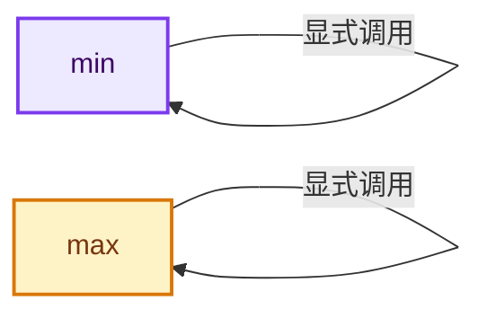
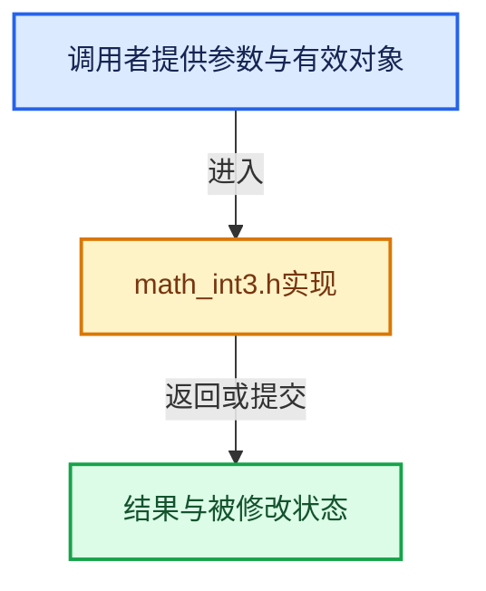

# 实现依赖专题：intern/cycles/util/math_int3.h

[实现依赖导航](../../../README.md) · [符号索引](../../../../00-课程指南/02-源码与提交索引/符号依赖与实现索引.md)

本专题从正文实际调用进入，集中保存共享实现。函数有稳定锚点，可从调用处直接跳到对应完整函数；递归与互相调用通过回链组织。

## 本文件的实现关系






## 完整成员与函数实现

<a id="f-c774467adc8e8250"></a>

### `min`

实现位置：[intern/cycles/util/math_int3.h](../../../../../../../../intern/cycles/util/math_int3.h) · L12—L19。

接口参数：

- `const int3 a`
- `const int3 b`

**教学注释版**

<!-- annotated:b8efa0cce05682 -->

```cpp
ccl_device_inline int3 min(const int3 a, const int3 b)
{
#  if defined(__KERNEL_SSE__) && defined(__KERNEL_SSE42__)
  return int3(_mm_min_epi32(a.m128, b.m128));
#  else
  return make_int3(min(a.x, b.x), min(a.y, b.y), min(a.z, b.z));
#  endif
}
```

<details>
<summary>核对原始源码：intern/cycles/util/math_int3.h · L12—L19</summary>

<!-- original:b8efa0cce05682:intern/cycles/util/math_int3.h:12:19 -->

```cpp
ccl_device_inline int3 min(const int3 a, const int3 b)
{
#  if defined(__KERNEL_SSE__) && defined(__KERNEL_SSE42__)
  return int3(_mm_min_epi32(a.m128, b.m128));
#  else
  return make_int3(min(a.x, b.x), min(a.y, b.y), min(a.z, b.z));
#  endif
}
```

</details>

**结果出口**

- `return int3(_mm_min_epi32(a.m128, b.m128));`
- `return make_int3(min(a.x, b.x), min(a.y, b.y), min(a.z, b.z));`

**继续追踪实现**

- `int3` → [int3 · L32](types_int3.h.md#f-251a7e4285c59ddb)；[int3 · L33](types_int3.h.md#f-67f7fae256268a81)；[int3 · L34](types_int3.h.md#f-82c16f3f0621f181)。同名重载需按实参类型选择。
- `_mm_min_epi32` → [调用协议](../../../../00-课程指南/01-路线与规范/模板宏与动态分派协议.md)：函数指针、局部可调用对象或未展开的宏；必须结合调用者环境。调用位置L15。
- `make_int3` → [make_int3 · L73](types_int3.h.md#f-3f630390fae242e8)；[make_int3 · L86](types_int3.h.md#f-d25cc5037e7d8fdc)；[make_int3 · L156](types_float3.h.md#f-1a317c8631823b1b)。同名重载需按实参类型选择。
- `min` → [min · L12](math_int3.h.md#f-c774467adc8e8250)。

<a id="f-bf8b53c372ff2488"></a>

### `max`

实现位置：[intern/cycles/util/math_int3.h](../../../../../../../../intern/cycles/util/math_int3.h) · L21—L28。

接口参数：

- `const int3 a`
- `const int3 b`

**教学注释版**

<!-- annotated:e4253bb489767c -->

```cpp
ccl_device_inline int3 max(const int3 a, const int3 b)
{
#  if defined(__KERNEL_SSE__) && defined(__KERNEL_SSE42__)
  return int3(_mm_max_epi32(a.m128, b.m128));
#  else
  return make_int3(max(a.x, b.x), max(a.y, b.y), max(a.z, b.z));
#  endif
}
```

<details>
<summary>核对原始源码：intern/cycles/util/math_int3.h · L21—L28</summary>

<!-- original:e4253bb489767c:intern/cycles/util/math_int3.h:21:28 -->

```cpp
ccl_device_inline int3 max(const int3 a, const int3 b)
{
#  if defined(__KERNEL_SSE__) && defined(__KERNEL_SSE42__)
  return int3(_mm_max_epi32(a.m128, b.m128));
#  else
  return make_int3(max(a.x, b.x), max(a.y, b.y), max(a.z, b.z));
#  endif
}
```

</details>

**结果出口**

- `return int3(_mm_max_epi32(a.m128, b.m128));`
- `return make_int3(max(a.x, b.x), max(a.y, b.y), max(a.z, b.z));`

**继续追踪实现**

- `int3` → [int3 · L32](types_int3.h.md#f-251a7e4285c59ddb)；[int3 · L33](types_int3.h.md#f-67f7fae256268a81)；[int3 · L34](types_int3.h.md#f-82c16f3f0621f181)。同名重载需按实参类型选择。
- `_mm_max_epi32` → [调用协议](../../../../00-课程指南/01-路线与规范/模板宏与动态分派协议.md)：函数指针、局部可调用对象或未展开的宏；必须结合调用者环境。调用位置L24。
- `make_int3` → [make_int3 · L73](types_int3.h.md#f-3f630390fae242e8)；[make_int3 · L86](types_int3.h.md#f-d25cc5037e7d8fdc)；[make_int3 · L156](types_float3.h.md#f-1a317c8631823b1b)。同名重载需按实参类型选择。
- `max` → [max · L21](math_int3.h.md#f-bf8b53c372ff2488)。
