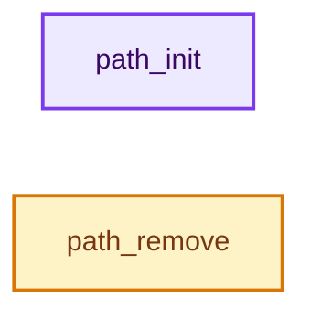
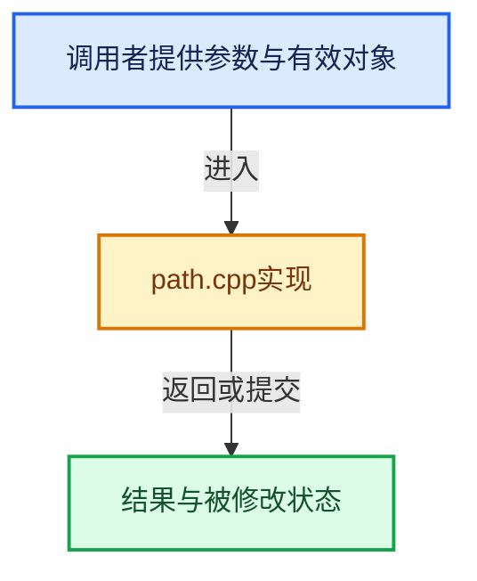

# 实现依赖专题：intern/cycles/util/path.cpp

[实现依赖导航](../../../README.md) · [符号索引](../../../../00-课程指南/02-源码与提交索引/符号依赖与实现索引.md)

本专题从正文实际调用进入，集中保存共享实现。函数有稳定锚点，可从调用处直接跳到对应完整函数；递归与互相调用通过回链组织。

## 本文件的实现关系






## 相关类型布局与成员入口

<a id="t-353b468dec58"></a>

### `stat`

原始声明：[intern/cycles/util/path.cpp](../../../../../../../../intern/cycles/util/path.cpp) · L58—L58。

以下保留类的数据声明与编译条件，成员函数实现通过后面的精确链接阅读。

<!-- annotated:35f1043e9193f5 -->

```cpp
using path_stat_t = struct stat;
```

<details>
<summary>核对原始源码：intern/cycles/util/path.cpp · L58—L58</summary>

<!-- original:35f1043e9193f5:intern/cycles/util/path.cpp:58:58 -->

```cpp
using path_stat_t = struct stat;
```

</details>


<a id="m-a2912a12b5f6"></a>

## 宏 `S_ISDIR`

<!-- annotated:3b749a88f0ccd9 -->

```cpp
#    define S_ISDIR(x) (((x) & _S_IFDIR) == _S_IFDIR)
#  endif
```

<details>
<summary>核对原始源码：intern/cycles/util/path.cpp · L55—L56</summary>

<!-- original:3b749a88f0ccd9:intern/cycles/util/path.cpp:55:56 -->

```cpp
#    define S_ISDIR(x) (((x) & _S_IFDIR) == _S_IFDIR)
#  endif
```

</details>

宏在预处理阶段展开，参数替换、重复求值和条件编译应直接从该定义检查。与普通函数不同，宏不会自动提供参数类型检查；构建配置选择哪个定义需结合外围条件。

## 完整成员与函数实现

<a id="f-f8e2d36bd45cdb0b"></a>

### `path_init`

实现位置：[intern/cycles/util/path.cpp](../../../../../../../../intern/cycles/util/path.cpp) · L343—L354。

接口参数：

- `const string &path`
- `const string &user_path`

**教学注释版**

<!-- annotated:baccdee754b6d7 -->

```cpp
void path_init(const string &path, const string &user_path)
{
  cached_path = path;
  cached_user_path = user_path;

#ifdef _MSC_VER
  // workaround for https://svn.boost.org/trac/boost/ticket/6320
  // indirectly init boost codec here since it's not thread safe, and can
  // cause crashes when it happens in multithreaded image load
  OIIO::Filesystem::exists(path);
#endif
}
```

<details>
<summary>核对原始源码：intern/cycles/util/path.cpp · L343—L354</summary>

<!-- original:baccdee754b6d7:intern/cycles/util/path.cpp:343:354 -->

```cpp
void path_init(const string &path, const string &user_path)
{
  cached_path = path;
  cached_user_path = user_path;

#ifdef _MSC_VER
  // workaround for https://svn.boost.org/trac/boost/ticket/6320
  // indirectly init boost codec here since it's not thread safe, and can
  // cause crashes when it happens in multithreaded image load
  OIIO::Filesystem::exists(path);
#endif
}
```

</details>

**沿实际写入检查状态**

- `cached_path = path;`
- `cached_user_path = user_path;`

**继续追踪实现**

- `OIIO::Filesystem::exists` → [调用协议](../../../../00-课程指南/01-路线与规范/模板宏与动态分派协议.md)：函数指针、局部可调用对象或未展开的宏；必须结合调用者环境。调用位置L352。

<a id="f-4a2f92d956f46315"></a>

### `path_remove`

实现位置：[intern/cycles/util/path.cpp](../../../../../../../../intern/cycles/util/path.cpp) · L825—L828。

接口参数：

- `const string &path`

**教学注释版**

<!-- annotated:41bd2249274576 -->

```cpp
bool path_remove(const string &path)
{
  return remove(path.c_str()) == 0;
}
```

<details>
<summary>核对原始源码：intern/cycles/util/path.cpp · L825—L828</summary>

<!-- original:41bd2249274576:intern/cycles/util/path.cpp:825:828 -->

```cpp
bool path_remove(const string &path)
{
  return remove(path.c_str()) == 0;
}
```

</details>

**结果出口**

- `return remove(path.c_str()) == 0;`

**继续追踪实现**

- `remove` → [AttributeSet::remove · L744](../scene/attribute.cpp.md#f-e7809a902379e487)；[AttributeSet::remove · L1055](../scene/attribute.cpp.md#f-d1a5b52a4dea2740)；[AttributeSet::remove · L1101](../scene/attribute.cpp.md#f-66c22b749c0db7b8)；[AttributeSet::remove · L1111](../scene/attribute.cpp.md#f-e4a76eeae8bf3b07)。同名重载需按实参类型选择。
- `path.c_str` → [调用协议](../../../../00-课程指南/01-路线与规范/模板宏与动态分派协议.md)：由接收对象具体类型或运行时策略提供实现。调用位置L827。
