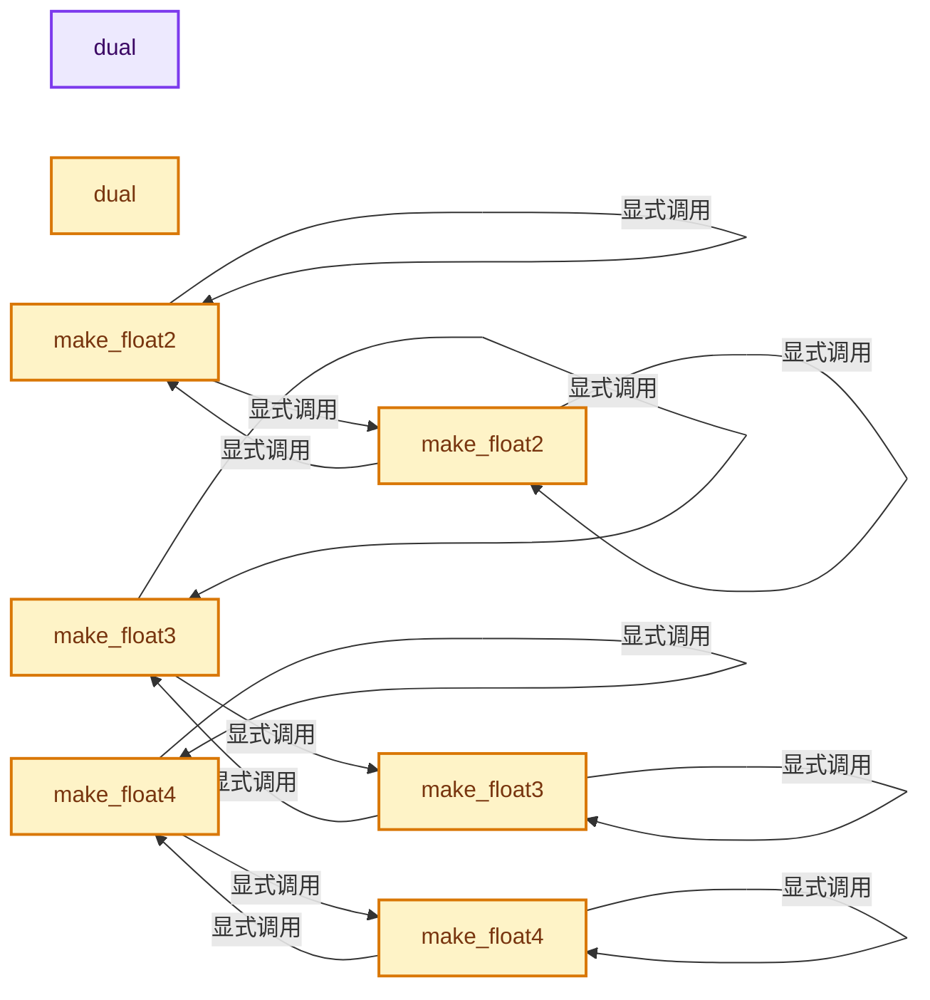
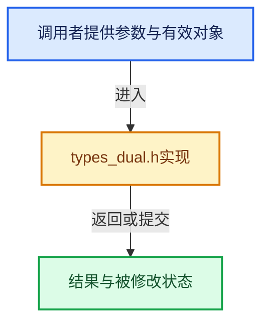

# 实现依赖专题：intern/cycles/util/types_dual.h

[实现依赖导航](../../../README.md) · [符号索引](../../../../00-课程指南/02-源码与提交索引/符号依赖与实现索引.md)

本专题从正文实际调用进入，集中保存共享实现。函数有稳定锚点，可从调用处直接跳到对应完整函数；递归与互相调用通过回链组织。

## 本文件的实现关系






## 完整成员与函数实现

<a id="f-7b33f6d2723bfef8"></a>

### `dual`

实现位置：[intern/cycles/util/types_dual.h](../../../../../../../../intern/cycles/util/types_dual.h) · L24—L24。

**教学注释版**

<!-- annotated:06c08f1652431c -->

```cpp
  dual() = default;
```

<details>
<summary>核对原始源码：intern/cycles/util/types_dual.h · L24—L24</summary>

<!-- original:06c08f1652431c:intern/cycles/util/types_dual.h:24:24 -->

```cpp
  dual() = default;
```

</details>

**继续追踪实现**

本实现没有需要继续展开的显式调用；检查返回表达式、对象转换和调用者前置条件。

<a id="f-172e0ef18298158f"></a>

### `dual`

实现位置：[intern/cycles/util/types_dual.h](../../../../../../../../intern/cycles/util/types_dual.h) · L25—L25。

接口参数：

- `const float val`

**教学注释版**

<!-- annotated:b2dceeff1a1dc2 -->

```cpp
  ccl_device_inline_method explicit dual(const float val) : val(val) {}
```

<details>
<summary>核对原始源码：intern/cycles/util/types_dual.h · L25—L25</summary>

<!-- original:b2dceeff1a1dc2:intern/cycles/util/types_dual.h:25:25 -->

```cpp
  ccl_device_inline_method explicit dual(const float val) : val(val) {}
```

</details>

**继续追踪实现**

本实现没有需要继续展开的显式调用；检查返回表达式、对象转换和调用者前置条件。

<a id="f-a5eca16a38192c61"></a>

### `make_float2`

实现位置：[intern/cycles/util/types_dual.h](../../../../../../../../intern/cycles/util/types_dual.h) · L143—L146。

接口参数：

- `const dual3 a`

**教学注释版**

<!-- annotated:823eb586500bdc -->

```cpp
ccl_device_inline dual2 make_float2(const dual3 a)
{
  return {make_float2(a.val), make_float2(a.dx), make_float2(a.dy)};
}
```

<details>
<summary>核对原始源码：intern/cycles/util/types_dual.h · L143—L146</summary>

<!-- original:823eb586500bdc:intern/cycles/util/types_dual.h:143:146 -->

```cpp
ccl_device_inline dual2 make_float2(const dual3 a)
{
  return {make_float2(a.val), make_float2(a.dx), make_float2(a.dy)};
}
```

</details>

**结果出口**

- `return {make_float2(a.val), make_float2(a.dx), make_float2(a.dy)};`

**继续追踪实现**

- `make_float2` → [make_float2 · L143](types_dual.h.md#f-a5eca16a38192c61)；[make_float2 · L148](types_dual.h.md#f-cc9b7f264b70124c)。同名重载需按实参类型选择。

<a id="f-cc9b7f264b70124c"></a>

### `make_float2`

实现位置：[intern/cycles/util/types_dual.h](../../../../../../../../intern/cycles/util/types_dual.h) · L148—L151。

接口参数：

- `const dual1 a`
- `const dual1 b`

**教学注释版**

<!-- annotated:34bba18981de7b -->

```cpp
ccl_device_inline dual2 make_float2(const dual1 a, const dual1 b)
{
  return {make_float2(a.val, b.val), make_float2(a.dx, b.dx), make_float2(a.dy, b.dy)};
}
```

<details>
<summary>核对原始源码：intern/cycles/util/types_dual.h · L148—L151</summary>

<!-- original:34bba18981de7b:intern/cycles/util/types_dual.h:148:151 -->

```cpp
ccl_device_inline dual2 make_float2(const dual1 a, const dual1 b)
{
  return {make_float2(a.val, b.val), make_float2(a.dx, b.dx), make_float2(a.dy, b.dy)};
}
```

</details>

**结果出口**

- `return {make_float2(a.val, b.val), make_float2(a.dx, b.dx), make_float2(a.dy, b.dy)};`

**继续追踪实现**

- `make_float2` → [make_float2 · L143](types_dual.h.md#f-a5eca16a38192c61)；[make_float2 · L148](types_dual.h.md#f-cc9b7f264b70124c)。同名重载需按实参类型选择。

<a id="f-f1b4dcf796f629d2"></a>

### `make_float3`

实现位置：[intern/cycles/util/types_dual.h](../../../../../../../../intern/cycles/util/types_dual.h) · L153—L158。

接口参数：

- `const dual1 a`
- `const dual1 b`
- `const dual1 c`

**教学注释版**

<!-- annotated:f2da471d00a30b -->

```cpp
ccl_device_inline dual3 make_float3(const dual1 a, const dual1 b, const dual1 c)
{
  return {make_float3(a.val, b.val, c.val),
          make_float3(a.dx, b.dx, c.dx),
          make_float3(a.dy, b.dy, c.dy)};
}
```

<details>
<summary>核对原始源码：intern/cycles/util/types_dual.h · L153—L158</summary>

<!-- original:f2da471d00a30b:intern/cycles/util/types_dual.h:153:158 -->

```cpp
ccl_device_inline dual3 make_float3(const dual1 a, const dual1 b, const dual1 c)
{
  return {make_float3(a.val, b.val, c.val),
          make_float3(a.dx, b.dx, c.dx),
          make_float3(a.dy, b.dy, c.dy)};
}
```

</details>

**结果出口**

- `return {make_float3(a.val, b.val, c.val),`

**继续追踪实现**

- `make_float3` → [make_float3 · L153](types_dual.h.md#f-f1b4dcf796f629d2)；[make_float3 · L160](types_dual.h.md#f-bd8866e955c896b4)。同名重载需按实参类型选择。

<a id="f-bd8866e955c896b4"></a>

### `make_float3`

实现位置：[intern/cycles/util/types_dual.h](../../../../../../../../intern/cycles/util/types_dual.h) · L160—L163。

接口参数：

- `const ccl_private dual<T> &a`

**教学注释版**

<!-- annotated:3f776754855559 -->

```cpp
template<class T> ccl_device_inline dual3 make_float3(const ccl_private dual<T> &a)
{
  return {make_float3(a.val), make_float3(a.dx), make_float3(a.dy)};
}
```

<details>
<summary>核对原始源码：intern/cycles/util/types_dual.h · L160—L163</summary>

<!-- original:3f776754855559:intern/cycles/util/types_dual.h:160:163 -->

```cpp
template<class T> ccl_device_inline dual3 make_float3(const ccl_private dual<T> &a)
{
  return {make_float3(a.val), make_float3(a.dx), make_float3(a.dy)};
}
```

</details>

**结果出口**

- `return {make_float3(a.val), make_float3(a.dx), make_float3(a.dy)};`

**继续追踪实现**

- `make_float3` → [make_float3 · L153](types_dual.h.md#f-f1b4dcf796f629d2)；[make_float3 · L160](types_dual.h.md#f-bd8866e955c896b4)。同名重载需按实参类型选择。

<a id="f-1f8eb02651757016"></a>

### `make_float4`

实现位置：[intern/cycles/util/types_dual.h](../../../../../../../../intern/cycles/util/types_dual.h) · L165—L170。

接口参数：

- `const dual1 a`
- `const dual1 b`
- `const dual1 c`
- `const dual1 d`

**教学注释版**

<!-- annotated:d21d873252020b -->

```cpp
ccl_device_inline dual4 make_float4(const dual1 a, const dual1 b, const dual1 c, const dual1 d)
{
  return {make_float4(a.val, b.val, c.val, d.val),
          make_float4(a.dx, b.dx, c.dx, d.dx),
          make_float4(a.dy, b.dy, c.dy, d.dy)};
}
```

<details>
<summary>核对原始源码：intern/cycles/util/types_dual.h · L165—L170</summary>

<!-- original:d21d873252020b:intern/cycles/util/types_dual.h:165:170 -->

```cpp
ccl_device_inline dual4 make_float4(const dual1 a, const dual1 b, const dual1 c, const dual1 d)
{
  return {make_float4(a.val, b.val, c.val, d.val),
          make_float4(a.dx, b.dx, c.dx, d.dx),
          make_float4(a.dy, b.dy, c.dy, d.dy)};
}
```

</details>

**结果出口**

- `return {make_float4(a.val, b.val, c.val, d.val),`

**继续追踪实现**

- `make_float4` → [make_float4 · L165](types_dual.h.md#f-1f8eb02651757016)；[make_float4 · L172](types_dual.h.md#f-5f2db29d80cd0f87)。同名重载需按实参类型选择。

<a id="f-5f2db29d80cd0f87"></a>

### `make_float4`

实现位置：[intern/cycles/util/types_dual.h](../../../../../../../../intern/cycles/util/types_dual.h) · L172—L175。

接口参数：

- `const dual3 a`

**教学注释版**

<!-- annotated:ba07bd2dd38b8f -->

```cpp
ccl_device_inline dual4 make_float4(const dual3 a)
{
  return {make_float4(a.val), make_float4(a.dx, 0.0f), make_float4(a.dy, 0.0f)};
}
```

<details>
<summary>核对原始源码：intern/cycles/util/types_dual.h · L172—L175</summary>

<!-- original:ba07bd2dd38b8f:intern/cycles/util/types_dual.h:172:175 -->

```cpp
ccl_device_inline dual4 make_float4(const dual3 a)
{
  return {make_float4(a.val), make_float4(a.dx, 0.0f), make_float4(a.dy, 0.0f)};
}
```

</details>

**结果出口**

- `return {make_float4(a.val), make_float4(a.dx, 0.0f), make_float4(a.dy, 0.0f)};`

**继续追踪实现**

- `make_float4` → [make_float4 · L165](types_dual.h.md#f-1f8eb02651757016)；[make_float4 · L172](types_dual.h.md#f-5f2db29d80cd0f87)。同名重载需按实参类型选择。

<a id="f-4bcc90cf8a3c0fa2"></a>

### `make_homogeneous`

实现位置：[intern/cycles/util/types_dual.h](../../../../../../../../intern/cycles/util/types_dual.h) · L177—L180。

接口参数：

- `const dual3 a`

**教学注释版**

<!-- annotated:9d46114adb29a1 -->

```cpp
ccl_device_inline dual4 make_homogeneous(const dual3 a)
{
  return {make_float4(a.val, 1.0f), make_float4(a.dx, 0.0f), make_float4(a.dy, 0.0f)};
}
```

<details>
<summary>核对原始源码：intern/cycles/util/types_dual.h · L177—L180</summary>

<!-- original:9d46114adb29a1:intern/cycles/util/types_dual.h:177:180 -->

```cpp
ccl_device_inline dual4 make_homogeneous(const dual3 a)
{
  return {make_float4(a.val, 1.0f), make_float4(a.dx, 0.0f), make_float4(a.dy, 0.0f)};
}
```

</details>

**结果出口**

- `return {make_float4(a.val, 1.0f), make_float4(a.dx, 0.0f), make_float4(a.dy, 0.0f)};`

**继续追踪实现**

- `make_float4` → [make_float4 · L165](types_dual.h.md#f-1f8eb02651757016)；[make_float4 · L172](types_dual.h.md#f-5f2db29d80cd0f87)。同名重载需按实参类型选择。
