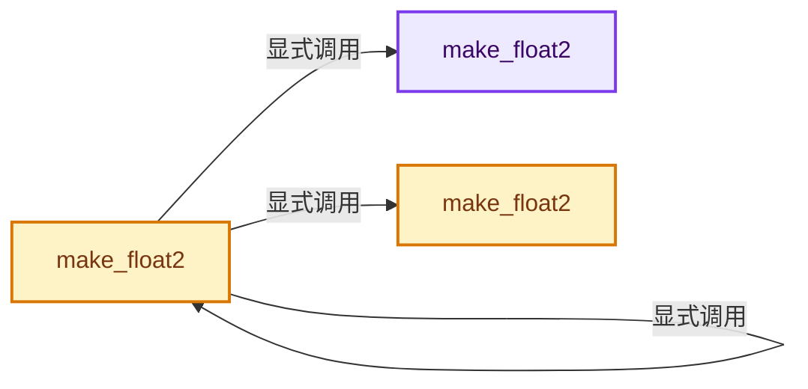
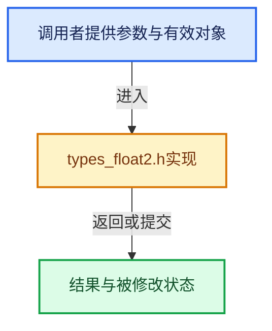

# 实现依赖专题：intern/cycles/util/types_float2.h

[实现依赖导航](../../../README.md) · [符号索引](../../../../00-课程指南/02-源码与提交索引/符号依赖与实现索引.md)

本专题从正文实际调用进入，集中保存共享实现。函数有稳定锚点，可从调用处直接跳到对应完整函数；递归与互相调用通过回链组织。

## 本文件的实现关系






## 完整成员与函数实现

<a id="f-8a0f238b2e7ed283"></a>

### `make_float2`

实现位置：[intern/cycles/util/types_float2.h](../../../../../../../../intern/cycles/util/types_float2.h) · L38—L42。

接口参数：

- `const float x`
- `const float y`

**教学注释版**

<!-- annotated:964c24b56bb387 -->

```cpp
ccl_device_inline float2 make_float2(const float x, const float y)
{
  float2 a = {x, y};
  return a;
}
```

<details>
<summary>核对原始源码：intern/cycles/util/types_float2.h · L38—L42</summary>

<!-- original:964c24b56bb387:intern/cycles/util/types_float2.h:38:42 -->

```cpp
ccl_device_inline float2 make_float2(const float x, const float y)
{
  float2 a = {x, y};
  return a;
}
```

</details>

**结果出口**

- `return a;`

**继续追踪实现**

本实现没有需要继续展开的显式调用；检查返回表达式、对象转换和调用者前置条件。

<a id="f-6d599e93fdd2a5fb"></a>

### `make_float2`

实现位置：[intern/cycles/util/types_float2.h](../../../../../../../../intern/cycles/util/types_float2.h) · L45—L48。

接口参数：

- `const float f`

**教学注释版**

<!-- annotated:0d402f7182db67 -->

```cpp
ccl_device_inline float2 make_float2(const float f)
{
  return {f, f};
}
```

<details>
<summary>核对原始源码：intern/cycles/util/types_float2.h · L45—L48</summary>

<!-- original:0d402f7182db67:intern/cycles/util/types_float2.h:45:48 -->

```cpp
ccl_device_inline float2 make_float2(const float f)
{
  return {f, f};
}
```

</details>

**结果出口**

- `return {f, f};`

**继续追踪实现**

本实现没有需要继续展开的显式调用；检查返回表达式、对象转换和调用者前置条件。

<a id="f-45b44d6e52b1e689"></a>

### `make_float2`

实现位置：[intern/cycles/util/types_float2.h](../../../../../../../../intern/cycles/util/types_float2.h) · L50—L53。

接口参数：

- `const int2 i`

**教学注释版**

<!-- annotated:c7988e2a70f277 -->

```cpp
ccl_device_inline float2 make_float2(const int2 i)
{
  return make_float2((float)i.x, (float)i.y);
}
```

<details>
<summary>核对原始源码：intern/cycles/util/types_float2.h · L50—L53</summary>

<!-- original:c7988e2a70f277:intern/cycles/util/types_float2.h:50:53 -->

```cpp
ccl_device_inline float2 make_float2(const int2 i)
{
  return make_float2((float)i.x, (float)i.y);
}
```

</details>

**结果出口**

- `return make_float2((float)i.x, (float)i.y);`

**继续追踪实现**

- `make_float2` → [make_float2 · L38](types_float2.h.md#f-8a0f238b2e7ed283)；[make_float2 · L45](types_float2.h.md#f-6d599e93fdd2a5fb)；[make_float2 · L50](types_float2.h.md#f-45b44d6e52b1e689)。同名重载需按实参类型选择。
