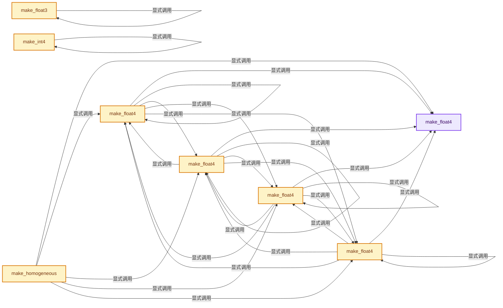
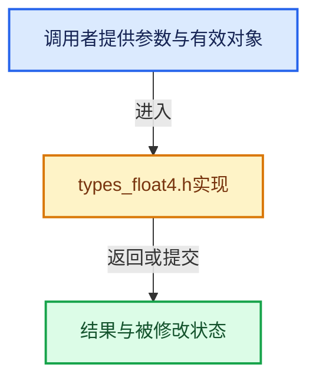

# 实现依赖专题：intern/cycles/util/types_float4.h

[实现依赖导航](../../../README.md) · [符号索引](../../../../00-课程指南/02-源码与提交索引/符号依赖与实现索引.md)

本专题从正文实际调用进入，集中保存共享实现。函数有稳定锚点，可从调用处直接跳到对应完整函数；递归与互相调用通过回链组织。

## 本文件的实现关系






## 完整成员与函数实现

<a id="f-f781281b7fbc5189"></a>

### `make_float4`

实现位置：[intern/cycles/util/types_float4.h](../../../../../../../../intern/cycles/util/types_float4.h) · L64—L71。

接口参数：

- `const float x`
- `const float y`
- `float z`
- `const float w`

**教学注释版**

<!-- annotated:415cf2e1dc7202 -->

```cpp
ccl_device_inline float4 make_float4(const float x, const float y, float z, const float w)
{
#  ifdef __KERNEL_SSE__
  return float4(_mm_set_ps(w, z, y, x));
#  else
  return {x, y, z, w};
#  endif
}
```

<details>
<summary>核对原始源码：intern/cycles/util/types_float4.h · L64—L71</summary>

<!-- original:415cf2e1dc7202:intern/cycles/util/types_float4.h:64:71 -->

```cpp
ccl_device_inline float4 make_float4(const float x, const float y, float z, const float w)
{
#  ifdef __KERNEL_SSE__
  return float4(_mm_set_ps(w, z, y, x));
#  else
  return {x, y, z, w};
#  endif
}
```

</details>

**结果出口**

- `return float4(_mm_set_ps(w, z, y, x));`
- `return {x, y, z, w};`

**继续追踪实现**

- `float4` → [packed_float4::float4 · L147](types_float4.h.md#f-3f64fb05b71409fd)。
- `_mm_set_ps` → [调用协议](../../../../00-课程指南/01-路线与规范/模板宏与动态分派协议.md)：函数指针、局部可调用对象或未展开的宏；必须结合调用者环境。调用位置L67。

<a id="f-2e8408c671c6317a"></a>

### `make_float4`

实现位置：[intern/cycles/util/types_float4.h](../../../../../../../../intern/cycles/util/types_float4.h) · L75—L82。

接口参数：

- `const float f`

**教学注释版**

<!-- annotated:6009c1bcf2725a -->

```cpp
ccl_device_inline float4 make_float4(const float f)
{
#ifdef __KERNEL_SSE__
  return float4(_mm_set1_ps(f));
#else
  return make_float4(f, f, f, f);
#endif
}
```

<details>
<summary>核对原始源码：intern/cycles/util/types_float4.h · L75—L82</summary>

<!-- original:6009c1bcf2725a:intern/cycles/util/types_float4.h:75:82 -->

```cpp
ccl_device_inline float4 make_float4(const float f)
{
#ifdef __KERNEL_SSE__
  return float4(_mm_set1_ps(f));
#else
  return make_float4(f, f, f, f);
#endif
}
```

</details>

**结果出口**

- `return float4(_mm_set1_ps(f));`
- `return make_float4(f, f, f, f);`

**继续追踪实现**

- `float4` → [packed_float4::float4 · L147](types_float4.h.md#f-3f64fb05b71409fd)。
- `_mm_set1_ps` → [调用协议](../../../../00-课程指南/01-路线与规范/模板宏与动态分派协议.md)：函数指针、局部可调用对象或未展开的宏；必须结合调用者环境。调用位置L78。
- `make_float4` → [make_float4 · L64](types_float4.h.md#f-f781281b7fbc5189)；[make_float4 · L75](types_float4.h.md#f-2e8408c671c6317a)；[make_float4 · L84](types_float4.h.md#f-ef834c3f77ccb52c)；[make_float4 · L89](types_float4.h.md#f-15e15c112cd5e990)；[make_float4 · L99](types_float4.h.md#f-5220543e0b1ee3d0)。同名重载需按实参类型选择。

<a id="f-ef834c3f77ccb52c"></a>

### `make_float4`

实现位置：[intern/cycles/util/types_float4.h](../../../../../../../../intern/cycles/util/types_float4.h) · L84—L87。

接口参数：

- `const float3 a`
- `const float b`

**教学注释版**

<!-- annotated:22c410b8412e43 -->

```cpp
ccl_device_inline float4 make_float4(const float3 a, const float b)
{
  return make_float4(a.x, a.y, a.z, b);
}
```

<details>
<summary>核对原始源码：intern/cycles/util/types_float4.h · L84—L87</summary>

<!-- original:22c410b8412e43:intern/cycles/util/types_float4.h:84:87 -->

```cpp
ccl_device_inline float4 make_float4(const float3 a, const float b)
{
  return make_float4(a.x, a.y, a.z, b);
}
```

</details>

**结果出口**

- `return make_float4(a.x, a.y, a.z, b);`

**继续追踪实现**

- `make_float4` → [make_float4 · L64](types_float4.h.md#f-f781281b7fbc5189)；[make_float4 · L75](types_float4.h.md#f-2e8408c671c6317a)；[make_float4 · L84](types_float4.h.md#f-ef834c3f77ccb52c)；[make_float4 · L89](types_float4.h.md#f-15e15c112cd5e990)；[make_float4 · L99](types_float4.h.md#f-5220543e0b1ee3d0)。同名重载需按实参类型选择。

<a id="f-15e15c112cd5e990"></a>

### `make_float4`

实现位置：[intern/cycles/util/types_float4.h](../../../../../../../../intern/cycles/util/types_float4.h) · L89—L92。

接口参数：

- `const float3 a`

**教学注释版**

<!-- annotated:eb81857df3e398 -->

```cpp
ccl_device_inline float4 make_float4(const float3 a)
{
  return make_float4(a.x, a.y, a.z, 1.0f);
}
```

<details>
<summary>核对原始源码：intern/cycles/util/types_float4.h · L89—L92</summary>

<!-- original:eb81857df3e398:intern/cycles/util/types_float4.h:89:92 -->

```cpp
ccl_device_inline float4 make_float4(const float3 a)
{
  return make_float4(a.x, a.y, a.z, 1.0f);
}
```

</details>

**结果出口**

- `return make_float4(a.x, a.y, a.z, 1.0f);`

**继续追踪实现**

- `make_float4` → [make_float4 · L64](types_float4.h.md#f-f781281b7fbc5189)；[make_float4 · L75](types_float4.h.md#f-2e8408c671c6317a)；[make_float4 · L84](types_float4.h.md#f-ef834c3f77ccb52c)；[make_float4 · L89](types_float4.h.md#f-15e15c112cd5e990)；[make_float4 · L99](types_float4.h.md#f-5220543e0b1ee3d0)。同名重载需按实参类型选择。

<a id="f-eb74ad80a2945077"></a>

### `make_homogeneous`

实现位置：[intern/cycles/util/types_float4.h](../../../../../../../../intern/cycles/util/types_float4.h) · L94—L97。

接口参数：

- `const float3 a`

**教学注释版**

<!-- annotated:93e13995373f74 -->

```cpp
ccl_device_inline float4 make_homogeneous(const float3 a)
{
  return make_float4(a.x, a.y, a.z, 1.0f);
}
```

<details>
<summary>核对原始源码：intern/cycles/util/types_float4.h · L94—L97</summary>

<!-- original:93e13995373f74:intern/cycles/util/types_float4.h:94:97 -->

```cpp
ccl_device_inline float4 make_homogeneous(const float3 a)
{
  return make_float4(a.x, a.y, a.z, 1.0f);
}
```

</details>

**结果出口**

- `return make_float4(a.x, a.y, a.z, 1.0f);`

**继续追踪实现**

- `make_float4` → [make_float4 · L64](types_float4.h.md#f-f781281b7fbc5189)；[make_float4 · L75](types_float4.h.md#f-2e8408c671c6317a)；[make_float4 · L84](types_float4.h.md#f-ef834c3f77ccb52c)；[make_float4 · L89](types_float4.h.md#f-15e15c112cd5e990)；[make_float4 · L99](types_float4.h.md#f-5220543e0b1ee3d0)。同名重载需按实参类型选择。

<a id="f-5220543e0b1ee3d0"></a>

### `make_float4`

实现位置：[intern/cycles/util/types_float4.h](../../../../../../../../intern/cycles/util/types_float4.h) · L99—L106。

接口参数：

- `const int4 i`

**教学注释版**

<!-- annotated:b36b63ef6470cf -->

```cpp
ccl_device_inline float4 make_float4(const int4 i)
{
#ifdef __KERNEL_SSE__
  return float4(_mm_cvtepi32_ps(i.m128));
#else
  return make_float4((float)i.x, (float)i.y, (float)i.z, (float)i.w);
#endif
}
```

<details>
<summary>核对原始源码：intern/cycles/util/types_float4.h · L99—L106</summary>

<!-- original:b36b63ef6470cf:intern/cycles/util/types_float4.h:99:106 -->

```cpp
ccl_device_inline float4 make_float4(const int4 i)
{
#ifdef __KERNEL_SSE__
  return float4(_mm_cvtepi32_ps(i.m128));
#else
  return make_float4((float)i.x, (float)i.y, (float)i.z, (float)i.w);
#endif
}
```

</details>

**结果出口**

- `return float4(_mm_cvtepi32_ps(i.m128));`
- `return make_float4((float)i.x, (float)i.y, (float)i.z, (float)i.w);`

**继续追踪实现**

- `float4` → [packed_float4::float4 · L147](types_float4.h.md#f-3f64fb05b71409fd)。
- `_mm_cvtepi32_ps` → [调用协议](../../../../00-课程指南/01-路线与规范/模板宏与动态分派协议.md)：函数指针、局部可调用对象或未展开的宏；必须结合调用者环境。调用位置L102。
- `make_float4` → [make_float4 · L64](types_float4.h.md#f-f781281b7fbc5189)；[make_float4 · L75](types_float4.h.md#f-2e8408c671c6317a)；[make_float4 · L84](types_float4.h.md#f-ef834c3f77ccb52c)；[make_float4 · L89](types_float4.h.md#f-15e15c112cd5e990)；[make_float4 · L99](types_float4.h.md#f-5220543e0b1ee3d0)。同名重载需按实参类型选择。

<a id="f-f432d3f8358c1253"></a>

### `make_float3`

实现位置：[intern/cycles/util/types_float4.h](../../../../../../../../intern/cycles/util/types_float4.h) · L108—L111。

接口参数：

- `const float4 a`

**教学注释版**

<!-- annotated:940de5a14dac1a -->

```cpp
ccl_device_inline float3 make_float3(const float4 a)
{
  return make_float3(a.x, a.y, a.z);
}
```

<details>
<summary>核对原始源码：intern/cycles/util/types_float4.h · L108—L111</summary>

<!-- original:940de5a14dac1a:intern/cycles/util/types_float4.h:108:111 -->

```cpp
ccl_device_inline float3 make_float3(const float4 a)
{
  return make_float3(a.x, a.y, a.z);
}
```

</details>

**结果出口**

- `return make_float3(a.x, a.y, a.z);`

**继续追踪实现**

- `make_float3` → [make_float3 · L108](types_float4.h.md#f-f432d3f8358c1253)。

<a id="f-28d168ed52f4eb21"></a>

### `make_int4`

实现位置：[intern/cycles/util/types_float4.h](../../../../../../../../intern/cycles/util/types_float4.h) · L113—L120。

接口参数：

- `const float4 f`

**教学注释版**

<!-- annotated:e0932451c2143a -->

```cpp
ccl_device_inline int4 make_int4(const float4 f)
{
#ifdef __KERNEL_SSE__
  return int4(_mm_cvtps_epi32(f.m128));
#else
  return make_int4((int)f.x, (int)f.y, (int)f.z, (int)f.w);
#endif
}
```

<details>
<summary>核对原始源码：intern/cycles/util/types_float4.h · L113—L120</summary>

<!-- original:e0932451c2143a:intern/cycles/util/types_float4.h:113:120 -->

```cpp
ccl_device_inline int4 make_int4(const float4 f)
{
#ifdef __KERNEL_SSE__
  return int4(_mm_cvtps_epi32(f.m128));
#else
  return make_int4((int)f.x, (int)f.y, (int)f.z, (int)f.w);
#endif
}
```

</details>

**结果出口**

- `return int4(_mm_cvtps_epi32(f.m128));`
- `return make_int4((int)f.x, (int)f.y, (int)f.z, (int)f.w);`

**继续追踪实现**

- `int4` → [int4 · L645](../../../08-其他Blender模块/compositor/algorithms/intern/smaa.cc.md#m-98b3207edab6)。宏定义由构建条件选择。
- `_mm_cvtps_epi32` → [调用协议](../../../../00-课程指南/01-路线与规范/模板宏与动态分派协议.md)：函数指针、局部可调用对象或未展开的宏；必须结合调用者环境。调用位置L116。
- `make_int4` → [make_int4 · L113](types_float4.h.md#f-28d168ed52f4eb21)。

<a id="f-3f64fb05b71409fd"></a>

### `packed_float4::float4`

实现位置：[intern/cycles/util/types_float4.h](../../../../../../../../intern/cycles/util/types_float4.h) · L147—L150。

**教学注释版**

<!-- annotated:0616dc807cd77f -->

```cpp
  ccl_device_inline_method operator float4() const
  {
    return make_float4(x, y, z, w);
  }
```

<details>
<summary>核对原始源码：intern/cycles/util/types_float4.h · L147—L150</summary>

<!-- original:0616dc807cd77f:intern/cycles/util/types_float4.h:147:150 -->

```cpp
  ccl_device_inline_method operator float4() const
  {
    return make_float4(x, y, z, w);
  }
```

</details>

**结果出口**

- `return make_float4(x, y, z, w);`

**继续追踪实现**

- `make_float4` → [make_float4 · L64](types_float4.h.md#f-f781281b7fbc5189)；[make_float4 · L75](types_float4.h.md#f-2e8408c671c6317a)；[make_float4 · L84](types_float4.h.md#f-ef834c3f77ccb52c)；[make_float4 · L89](types_float4.h.md#f-15e15c112cd5e990)；[make_float4 · L99](types_float4.h.md#f-5220543e0b1ee3d0)。同名重载需按实参类型选择。
