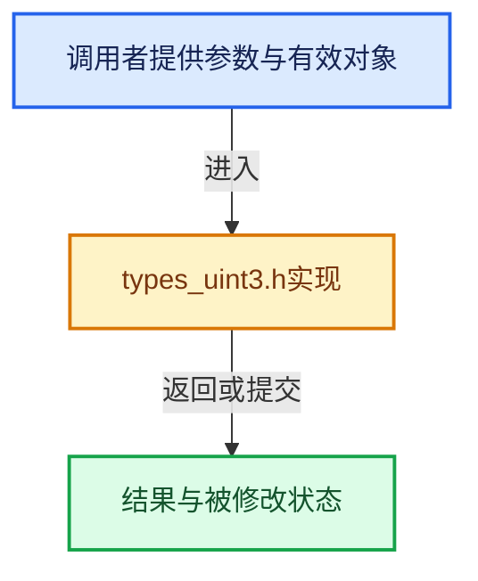

# 实现依赖专题：intern/cycles/util/types_uint3.h

[实现依赖导航](../../../README.md) · [符号索引](../../../../00-课程指南/02-源码与提交索引/符号依赖与实现索引.md)

本专题从正文实际调用进入，集中保存共享实现。函数有稳定锚点，可从调用处直接跳到对应完整函数；递归与互相调用通过回链组织。

## 本文件的实现关系





## 完整成员与函数实现

<a id="f-5a26482d0db7fe8f"></a>

### `make_uint3`

实现位置：[intern/cycles/util/types_uint3.h](../../../../../../../../intern/cycles/util/types_uint3.h) · L30—L34。

接口参数：

- `const uint x`
- `const uint y`
- `uint z`

**教学注释版**

<!-- annotated:9832c3113f974c -->

```cpp
ccl_device_inline uint3 make_uint3(const uint x, const uint y, uint z)
{
  uint3 a = {x, y, z};
  return a;
}
```

<details>
<summary>核对原始源码：intern/cycles/util/types_uint3.h · L30—L34</summary>

<!-- original:9832c3113f974c:intern/cycles/util/types_uint3.h:30:34 -->

```cpp
ccl_device_inline uint3 make_uint3(const uint x, const uint y, uint z)
{
  uint3 a = {x, y, z};
  return a;
}
```

</details>

**结果出口**

- `return a;`

**继续追踪实现**

本实现没有需要继续展开的显式调用；检查返回表达式、对象转换和调用者前置条件。

<a id="f-54e21cc96f356e94"></a>

### `packed_uint3::uint3`

实现位置：[intern/cycles/util/types_uint3.h](../../../../../../../../intern/cycles/util/types_uint3.h) · L54—L57。

**教学注释版**

<!-- annotated:237b4ec82f9145 -->

```cpp
  ccl_device_inline_method operator uint3() const
  {
    return make_uint3(x, y, z);
  }
```

<details>
<summary>核对原始源码：intern/cycles/util/types_uint3.h · L54—L57</summary>

<!-- original:237b4ec82f9145:intern/cycles/util/types_uint3.h:54:57 -->

```cpp
  ccl_device_inline_method operator uint3() const
  {
    return make_uint3(x, y, z);
  }
```

</details>

**结果出口**

- `return make_uint3(x, y, z);`

**继续追踪实现**

- `make_uint3` → [make_uint3 · L30](types_uint3.h.md#f-5a26482d0db7fe8f)。
