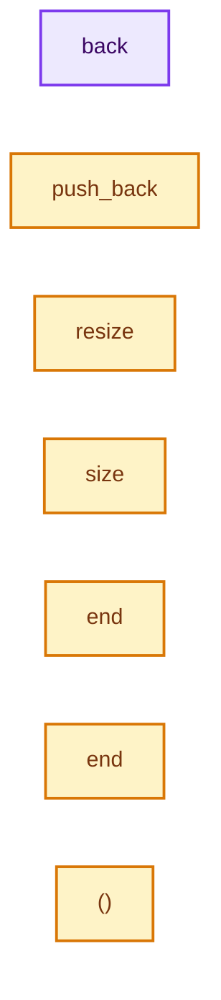

# 实现依赖专题：intern/cycles/util/unique_ptr_vector.h

[实现依赖导航](../../../README.md) · [符号索引](../../../../00-课程指南/02-源码与提交索引/符号依赖与实现索引.md)

本专题从正文实际调用进入，集中保存共享实现。函数有稳定锚点，可从调用处直接跳到对应完整函数；递归与互相调用通过回链组织。

## 本文件的实现关系




## 完整成员与函数实现

<a id="f-ce755fddac0430d0"></a>

### `back`

实现位置：[intern/cycles/util/unique_ptr_vector.h](../../../../../../../../intern/cycles/util/unique_ptr_vector.h) · L39—L42。

**教学注释版**

<!-- annotated:20bb59243e371e -->

```cpp
  T *back() const
  {
    return data.back().get();
  }
```

<details>
<summary>核对原始源码：intern/cycles/util/unique_ptr_vector.h · L39—L42</summary>

<!-- original:20bb59243e371e:intern/cycles/util/unique_ptr_vector.h:39:42 -->

```cpp
  T *back() const
  {
    return data.back().get();
  }
```

</details>

**结果出口**

- `return data.back().get();`

**继续追踪实现**

- `data.back().get` → [调用协议](../../../../00-课程指南/01-路线与规范/模板宏与动态分派协议.md)：接收对象类型依赖auto、返回值或模板实例；不按同名猜测目标。调用位置L41。
- `data.back` → [调用协议](../../../../00-课程指南/01-路线与规范/模板宏与动态分派协议.md)：接收对象类型依赖auto、返回值或模板实例；不按同名猜测目标。调用位置L41。

<a id="f-0a2bec05306e34a5"></a>

### `push_back`

实现位置：[intern/cycles/util/unique_ptr_vector.h](../../../../../../../../intern/cycles/util/unique_ptr_vector.h) · L44—L47。

接口参数：

- `unique_ptr<T> &&value`

**教学注释版**

<!-- annotated:7bc0afc9bd4daa -->

```cpp
  void push_back(unique_ptr<T> &&value)
  {
    // [讲解] std::move：把表达式转换成可供移动重载选择的值类别；不保证真的移动，不结束源对象寿命，对const值可能选择复制。
    data.push_back(std::move(value));
  }
```

<details>
<summary>核对原始源码：intern/cycles/util/unique_ptr_vector.h · L44—L47</summary>

<!-- original:7bc0afc9bd4daa:intern/cycles/util/unique_ptr_vector.h:44:47 -->

```cpp
  void push_back(unique_ptr<T> &&value)
  {
    data.push_back(std::move(value));
  }
```

</details>

**继续追踪实现**

- `data.push_back` → [调用协议](../../../../00-课程指南/01-路线与规范/模板宏与动态分派协议.md)：接收对象类型依赖auto、返回值或模板实例；不按同名猜测目标。调用位置L46。
- `std::move` → [外部契约](https://eel.is/c++draft/utility.forward)：把表达式转换成可供移动重载选择的值类别；不保证真的移动，不结束源对象寿命，对const值可能选择复制。

<a id="f-3743c33da4ec7c8a"></a>

### `resize`

实现位置：[intern/cycles/util/unique_ptr_vector.h](../../../../../../../../intern/cycles/util/unique_ptr_vector.h) · L54—L57。

接口参数：

- `const size_t new_size`

**教学注释版**

<!-- annotated:9c83c56cb08959 -->

```cpp
  void resize(const size_t new_size)
  {
    data.resize(new_size);
  }
```

<details>
<summary>核对原始源码：intern/cycles/util/unique_ptr_vector.h · L54—L57</summary>

<!-- original:9c83c56cb08959:intern/cycles/util/unique_ptr_vector.h:54:57 -->

```cpp
  void resize(const size_t new_size)
  {
    data.resize(new_size);
  }
```

</details>

**继续追踪实现**

- `data.resize` → [调用协议](../../../../00-课程指南/01-路线与规范/模板宏与动态分派协议.md)：接收对象类型依赖auto、返回值或模板实例；不按同名猜测目标。调用位置L56。

<a id="f-d3b2dd87c6f8a696"></a>

### `size`

实现位置：[intern/cycles/util/unique_ptr_vector.h](../../../../../../../../intern/cycles/util/unique_ptr_vector.h) · L64—L67。

**教学注释版**

<!-- annotated:98fb625dc882e6 -->

```cpp
  size_t size() const
  {
    return data.size();
  }
```

<details>
<summary>核对原始源码：intern/cycles/util/unique_ptr_vector.h · L64—L67</summary>

<!-- original:98fb625dc882e6:intern/cycles/util/unique_ptr_vector.h:64:67 -->

```cpp
  size_t size() const
  {
    return data.size();
  }
```

</details>

**结果出口**

- `return data.size();`

**继续追踪实现**

- `data.size` → [调用协议](../../../../00-课程指南/01-路线与规范/模板宏与动态分派协议.md)：接收对象类型依赖auto、返回值或模板实例；不按同名猜测目标。调用位置L66。

<a id="f-821633e1e75716b0"></a>

### `end`

实现位置：[intern/cycles/util/unique_ptr_vector.h](../../../../../../../../intern/cycles/util/unique_ptr_vector.h) · L166—L169。

**教学注释版**

<!-- annotated:78859074a4e10d -->

```cpp
  ConstIterator end() const
  {
    return ConstIterator{data.end()};
  }
```

<details>
<summary>核对原始源码：intern/cycles/util/unique_ptr_vector.h · L166—L169</summary>

<!-- original:78859074a4e10d:intern/cycles/util/unique_ptr_vector.h:166:169 -->

```cpp
  ConstIterator end() const
  {
    return ConstIterator{data.end()};
  }
```

</details>

**结果出口**

- `return ConstIterator{data.end()};`

**继续追踪实现**

- `data.end` → [调用协议](../../../../00-课程指南/01-路线与规范/模板宏与动态分派协议.md)：接收对象类型依赖auto、返回值或模板实例；不按同名猜测目标。调用位置L168。

<a id="f-d5b287498edefa0c"></a>

### `end`

实现位置：[intern/cycles/util/unique_ptr_vector.h](../../../../../../../../intern/cycles/util/unique_ptr_vector.h) · L198—L201。

**教学注释版**

<!-- annotated:a56f6c5dde0c7b -->

```cpp
  Iterator end()
  {
    return Iterator{data.end()};
  }
```

<details>
<summary>核对原始源码：intern/cycles/util/unique_ptr_vector.h · L198—L201</summary>

<!-- original:a56f6c5dde0c7b:intern/cycles/util/unique_ptr_vector.h:198:201 -->

```cpp
  Iterator end()
  {
    return Iterator{data.end()};
  }
```

</details>

**结果出口**

- `return Iterator{data.end()};`

**继续追踪实现**

- `data.end` → [调用协议](../../../../00-课程指南/01-路线与规范/模板宏与动态分派协议.md)：接收对象类型依赖auto、返回值或模板实例；不按同名猜测目标。调用位置L200。

<a id="f-d9003f52ce0d3e97"></a>

### `()`

实现位置：[intern/cycles/util/unique_ptr_vector.h](../../../../../../../../intern/cycles/util/unique_ptr_vector.h) · L252—L256。

**教学注释版**

<!-- annotated:0d64647b7f710b -->

```cpp
  operator const vector<T *> &()
  {
    static_assert(sizeof(unique_ptr<T>) == sizeof(T *));
    return reinterpret_cast<vector<T *> &>(*this);
  }
```

<details>
<summary>核对原始源码：intern/cycles/util/unique_ptr_vector.h · L252—L256</summary>

<!-- original:0d64647b7f710b:intern/cycles/util/unique_ptr_vector.h:252:256 -->

```cpp
  operator const vector<T *> &()
  {
    static_assert(sizeof(unique_ptr<T>) == sizeof(T *));
    return reinterpret_cast<vector<T *> &>(*this);
  }
```

</details>

**结果出口**

- `return reinterpret_cast<vector<T *> &>(*this);`

**继续追踪实现**

本实现没有需要继续展开的显式调用；检查返回表达式、对象转换和调用者前置条件。
