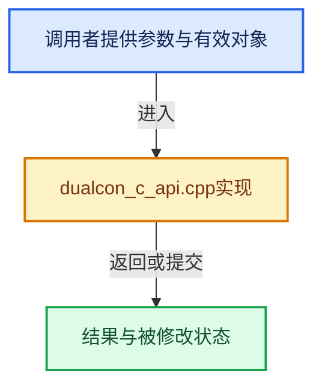

# 实现依赖专题：intern/dualcon/intern/dualcon_c_api.cpp

[实现依赖导航](../../../README.md) · [符号索引](../../../../00-课程指南/02-源码与提交索引/符号依赖与实现索引.md)

本专题从正文实际调用进入，集中保存共享实现。函数有稳定锚点，可从调用处直接跳到对应完整函数；递归与互相调用通过回链组织。

## 本文件的实现关系





## 完整成员与函数实现

<a id="f-5368118f05498460"></a>

### `dualcon`

实现位置：[intern/dualcon/intern/dualcon_c_api.cpp](../../../../../../../../intern/dualcon/intern/dualcon_c_api.cpp) · L144—L161。

接口参数：

- `const DualConInput *input_mesh`
- `DualConAllocOutput alloc_output`
- `DualConAddVert add_vert`
- `DualConAddQuad add_quad`
- `DualConFlags flags`
- `DualConMode mode`
- `float threshold`
- `float hermite_num`
- `float scale`
- `int depth`

**教学注释版**

<!-- annotated:c095b1b6ce14f1 -->

```cpp
void *dualcon(const DualConInput *input_mesh,
              /* callbacks for output */
              DualConAllocOutput alloc_output,
              DualConAddVert add_vert,
              DualConAddQuad add_quad,

              DualConFlags flags,
              DualConMode mode,
              float threshold,
              float hermite_num,
              float scale,
              int depth)
{
  DualConInputReader r(input_mesh, scale);
  Octree o(&r, alloc_output, add_vert, add_quad, flags, mode, depth, threshold, hermite_num);
  o.scanConvert();
  return o.getOutputMesh();
}
```

<details>
<summary>核对原始源码：intern/dualcon/intern/dualcon_c_api.cpp · L144—L161</summary>

<!-- original:c095b1b6ce14f1:intern/dualcon/intern/dualcon_c_api.cpp:144:161 -->

```cpp
void *dualcon(const DualConInput *input_mesh,
              /* callbacks for output */
              DualConAllocOutput alloc_output,
              DualConAddVert add_vert,
              DualConAddQuad add_quad,

              DualConFlags flags,
              DualConMode mode,
              float threshold,
              float hermite_num,
              float scale,
              int depth)
{
  DualConInputReader r(input_mesh, scale);
  Octree o(&r, alloc_output, add_vert, add_quad, flags, mode, depth, threshold, hermite_num);
  o.scanConvert();
  return o.getOutputMesh();
}
```

</details>

**结果出口**

- `return o.getOutputMesh();`

**继续追踪实现**

- `o.scanConvert` → [Octree::scanConvert · L97](octree.cpp.md#f-37a8c526eb3297e7)。
- `o.getOutputMesh` → [Octree::getOutputMesh · L279](octree.h.md#f-40b7872ee42b46ff)。
