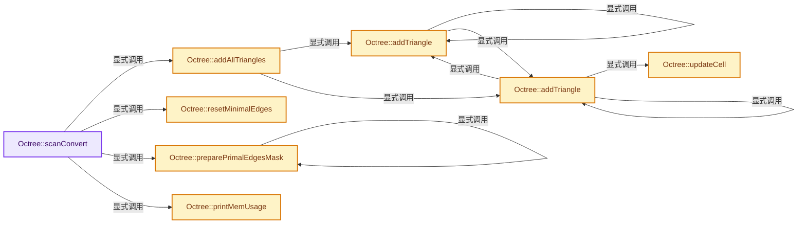
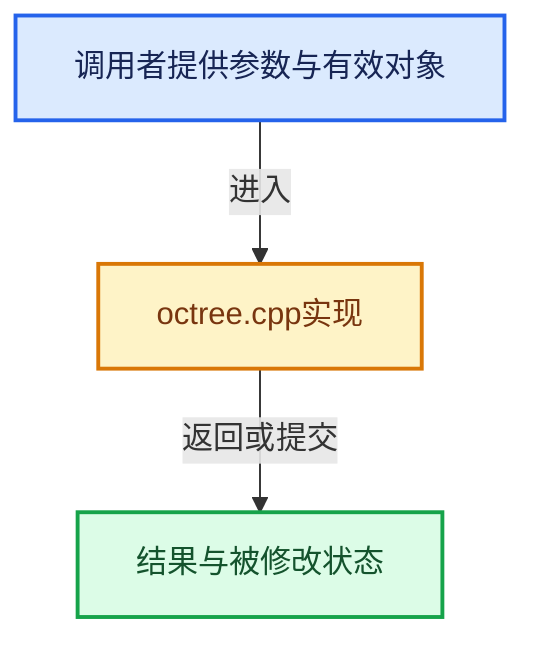

# 实现依赖专题：intern/dualcon/intern/octree.cpp

[实现依赖导航](../../../README.md) · [符号索引](../../../../00-课程指南/02-源码与提交索引/符号依赖与实现索引.md)

本专题从正文实际调用进入，集中保存共享实现。函数有稳定锚点，可从调用处直接跳到对应完整函数；递归与互相调用通过回链组织。

## 本文件的实现关系






<a id="m-246190802c65"></a>

## 宏 `dc_printf`

<!-- annotated:999f1b1c937a12 -->

```cpp
#  define dc_printf printf
#else
```

<details>
<summary>核对原始源码：intern/dualcon/intern/octree.cpp · L23—L24</summary>

<!-- original:999f1b1c937a12:intern/dualcon/intern/octree.cpp:23:24 -->

```cpp
#  define dc_printf printf
#else
```

</details>

宏在预处理阶段展开，参数替换、重复求值和条件编译应直接从该定义检查。与普通函数不同，宏不会自动提供参数类型检查；构建配置选择哪个定义需结合外围条件。

<a id="m-4c41f475d867"></a>

## 宏 `dc_printf`

<!-- annotated:069df7fa43124d -->

```cpp
#  define dc_printf(...) \
    do { \
    } while (0)
#endif
```

<details>
<summary>核对原始源码：intern/dualcon/intern/octree.cpp · L26—L29</summary>

<!-- original:069df7fa43124d:intern/dualcon/intern/octree.cpp:26:29 -->

```cpp
#  define dc_printf(...) \
    do { \
    } while (0)
#endif
```

</details>

宏在预处理阶段展开，参数替换、重复求值和条件编译应直接从该定义检查。与普通函数不同，宏不会自动提供参数类型检查；构建配置选择哪个定义需结合外围条件。

## 完整成员与函数实现

<a id="f-37a8c526eb3297e7"></a>

### `Octree::scanConvert`

实现位置：[intern/dualcon/intern/octree.cpp](../../../../../../../../intern/dualcon/intern/octree.cpp) · L97—L192。

**教学注释版**

<!-- annotated:5d6c910e2dad6e -->

```cpp
void Octree::scanConvert()
{
  // Scan triangles
#if DC_DEBUG
  clock_t start, finish;
  start = clock();
#endif

  addAllTriangles();
  resetMinimalEdges();
  preparePrimalEdgesMask(&root->internal);

#if DC_DEBUG
  finish = clock();
  dc_printf("Time taken: %f seconds                   \n",
            (double)(finish - start) / CLOCKS_PER_SEC);
#endif

  // Generate signs
  // Find holes
#if DC_DEBUG
  dc_printf("Patching...\n");
  start = clock();
#endif
  trace();
#if DC_DEBUG
  finish = clock();
  dc_printf("Time taken: %f seconds \n", (double)(finish - start) / CLOCKS_PER_SEC);
#  ifdef IN_VERBOSE_MODE
  dc_printf("Holes: %d Average Length: %f Max Length: %d \n",
            numRings,
            (float)totRingLengths / (float)numRings,
            maxRingLength);
#  endif
#endif

  // Check again
  int tnumRings = numRings;
  trace();
#ifdef IN_VERBOSE_MODE
  dc_printf("Holes after patching: %d \n", numRings);
#endif
  numRings = tnumRings;

#if DC_DEBUG
  dc_printf("Building signs...\n");
  start = clock();
#endif
  buildSigns();
#if DC_DEBUG
  finish = clock();
  dc_printf("Time taken: %f seconds \n", (double)(finish - start) / CLOCKS_PER_SEC);
#endif

  if (use_flood_fill) {
    /*
       start = clock();
       floodFill();
       // Check again
       tnumRings = numRings;
       trace();
       dc_printf("Holes after filling: %d \n", numRings);
       numRings = tnumRings;
       buildSigns();
       finish = clock();
       dc_printf("Time taken: %f seconds \n",   (double)(finish - start) / CLOCKS_PER_SEC);
     */
#if DC_DEBUG
    start = clock();
    dc_printf("Removing components...\n");
#endif
    floodFill();
    buildSigns();
    //  dc_printf("Checking...\n");
    //  floodFill();
#if DC_DEBUG
    finish = clock();
    dc_printf("Time taken: %f seconds \n", (double)(finish - start) / CLOCKS_PER_SEC);
#endif
  }

  // Output
#if DC_DEBUG
  start = clock();
#endif
  writeOut();
#if DC_DEBUG
  finish = clock();
#endif
  // dc_printf("Time taken: %f seconds \n",   (double)(finish - start) / CLOCKS_PER_SEC);

  // Print info
#ifdef IN_VERBOSE_MODE
  printMemUsage();
#endif
}
```

<details>
<summary>核对原始源码：intern/dualcon/intern/octree.cpp · L97—L192</summary>

<!-- original:5d6c910e2dad6e:intern/dualcon/intern/octree.cpp:97:192 -->

```cpp
void Octree::scanConvert()
{
  // Scan triangles
#if DC_DEBUG
  clock_t start, finish;
  start = clock();
#endif

  addAllTriangles();
  resetMinimalEdges();
  preparePrimalEdgesMask(&root->internal);

#if DC_DEBUG
  finish = clock();
  dc_printf("Time taken: %f seconds                   \n",
            (double)(finish - start) / CLOCKS_PER_SEC);
#endif

  // Generate signs
  // Find holes
#if DC_DEBUG
  dc_printf("Patching...\n");
  start = clock();
#endif
  trace();
#if DC_DEBUG
  finish = clock();
  dc_printf("Time taken: %f seconds \n", (double)(finish - start) / CLOCKS_PER_SEC);
#  ifdef IN_VERBOSE_MODE
  dc_printf("Holes: %d Average Length: %f Max Length: %d \n",
            numRings,
            (float)totRingLengths / (float)numRings,
            maxRingLength);
#  endif
#endif

  // Check again
  int tnumRings = numRings;
  trace();
#ifdef IN_VERBOSE_MODE
  dc_printf("Holes after patching: %d \n", numRings);
#endif
  numRings = tnumRings;

#if DC_DEBUG
  dc_printf("Building signs...\n");
  start = clock();
#endif
  buildSigns();
#if DC_DEBUG
  finish = clock();
  dc_printf("Time taken: %f seconds \n", (double)(finish - start) / CLOCKS_PER_SEC);
#endif

  if (use_flood_fill) {
    /*
       start = clock();
       floodFill();
       // Check again
       tnumRings = numRings;
       trace();
       dc_printf("Holes after filling: %d \n", numRings);
       numRings = tnumRings;
       buildSigns();
       finish = clock();
       dc_printf("Time taken: %f seconds \n",   (double)(finish - start) / CLOCKS_PER_SEC);
     */
#if DC_DEBUG
    start = clock();
    dc_printf("Removing components...\n");
#endif
    floodFill();
    buildSigns();
    //  dc_printf("Checking...\n");
    //  floodFill();
#if DC_DEBUG
    finish = clock();
    dc_printf("Time taken: %f seconds \n", (double)(finish - start) / CLOCKS_PER_SEC);
#endif
  }

  // Output
#if DC_DEBUG
  start = clock();
#endif
  writeOut();
#if DC_DEBUG
  finish = clock();
#endif
  // dc_printf("Time taken: %f seconds \n",   (double)(finish - start) / CLOCKS_PER_SEC);

  // Print info
#ifdef IN_VERBOSE_MODE
  printMemUsage();
#endif
}
```

</details>

**沿实际写入检查状态**

- `start = clock();`
- `finish = clock();`
- `numRings = tnumRings;`
- `tnumRings = numRings;`

**继续追踪实现**

- `clock` → [调用协议](../../../../00-课程指南/01-路线与规范/模板宏与动态分派协议.md)：函数指针、局部可调用对象或未展开的宏；必须结合调用者环境。调用位置L102。
- `addAllTriangles` → [Octree::addAllTriangles · L256](octree.cpp.md#f-f35da25b085e8822)。
- `resetMinimalEdges` → [Octree::resetMinimalEdges · L251](octree.cpp.md#f-f93299ff7f5321ac)。
- `preparePrimalEdgesMask` → [Octree::preparePrimalEdgesMask · L449](octree.cpp.md#f-2cfeadb43d3767ea)。
- `dc_printf` → [dc_printf · L23](octree.cpp.md#m-246190802c65)；[dc_printf · L26](octree.cpp.md#m-4c41f475d867)。宏定义由构建条件选择。
- `trace` → [Octree::trace · L466](octree.cpp.md#f-7bb26fa1b383faf8)；[Octree::trace · L486](octree.cpp.md#f-f63d2d49f22de56d)。同名重载需按实参类型选择。
- `buildSigns` → [Octree::buildSigns · L1768](octree.cpp.md#f-28c8dabb9de67ef0)；[Octree::buildSigns · L1795](octree.cpp.md#f-eeaea18cbc0adccc)。同名重载需按实参类型选择。
- `floodFill` → [Octree::floodFill · L1832](octree.cpp.md#f-56385d6927dd454d)；[Octree::floodFill · L1874](octree.cpp.md#f-632269d7addf08dd)；[Octree::floodFill · L2100](octree.cpp.md#f-648f4d78e5f9ea08)。同名重载需按实参类型选择。
- `writeOut` → [Octree::writeOut · L2129](octree.cpp.md#f-eef4b80c65c6ff30)。
- `printMemUsage` → [Octree::printMemUsage · L225](octree.cpp.md#f-b2d68d087fd0d183)。

<a id="f-b2d68d087fd0d183"></a>

### `Octree::printMemUsage`

实现位置：[intern/dualcon/intern/octree.cpp](../../../../../../../../intern/dualcon/intern/octree.cpp) · L225—L249。

**教学注释版**

<!-- annotated:617bd525ebf803 -->

```cpp
void Octree::printMemUsage()
{
  int totalbytes = 0;
  dc_printf("********* Internal nodes: \n");
  for (int i = 0; i < 9; i++) {
    alloc[i]->printInfo();

    totalbytes += alloc[i]->getAll() * alloc[i]->getBytes();
  }
  dc_printf("********* Leaf nodes: \n");
  int totalLeafs = 0;
  for (int i = 0; i < 4; i++) {
    leafalloc[i]->printInfo();

    totalbytes += leafalloc[i]->getAll() * leafalloc[i]->getBytes();
    totalLeafs += leafalloc[i]->getAllocated();
  }

  dc_printf("Total allocated bytes on disk: %d \n", totalbytes);
  dc_printf("Total leaf nodes: %d\n", totalLeafs);

  /* Unused when not debuggining. */
  (void)totalbytes;
  (void)totalLeafs;
}
```

<details>
<summary>核对原始源码：intern/dualcon/intern/octree.cpp · L225—L249</summary>

<!-- original:617bd525ebf803:intern/dualcon/intern/octree.cpp:225:249 -->

```cpp
void Octree::printMemUsage()
{
  int totalbytes = 0;
  dc_printf("********* Internal nodes: \n");
  for (int i = 0; i < 9; i++) {
    alloc[i]->printInfo();

    totalbytes += alloc[i]->getAll() * alloc[i]->getBytes();
  }
  dc_printf("********* Leaf nodes: \n");
  int totalLeafs = 0;
  for (int i = 0; i < 4; i++) {
    leafalloc[i]->printInfo();

    totalbytes += leafalloc[i]->getAll() * leafalloc[i]->getBytes();
    totalLeafs += leafalloc[i]->getAllocated();
  }

  dc_printf("Total allocated bytes on disk: %d \n", totalbytes);
  dc_printf("Total leaf nodes: %d\n", totalLeafs);

  /* Unused when not debuggining. */
  (void)totalbytes;
  (void)totalLeafs;
}
```

</details>

**沿实际写入检查状态**

- `totalbytes += alloc[i]->getAll() * alloc[i]->getBytes();`
- `totalbytes += leafalloc[i]->getAll() * leafalloc[i]->getBytes();`
- `totalLeafs += leafalloc[i]->getAllocated();`

**继续追踪实现**

- `dc_printf` → [dc_printf · L23](octree.cpp.md#m-246190802c65)；[dc_printf · L26](octree.cpp.md#m-4c41f475d867)。宏定义由构建条件选择。
- `alloc[i]->printInfo` → [调用协议](../../../../00-课程指南/01-路线与规范/模板宏与动态分派协议.md)：接收对象类型依赖auto、返回值或模板实例；不按同名猜测目标。调用位置L230。
- `alloc[i]->getAll` → [调用协议](../../../../00-课程指南/01-路线与规范/模板宏与动态分派协议.md)：接收对象类型依赖auto、返回值或模板实例；不按同名猜测目标。调用位置L232。
- `alloc[i]->getBytes` → [调用协议](../../../../00-课程指南/01-路线与规范/模板宏与动态分派协议.md)：接收对象类型依赖auto、返回值或模板实例；不按同名猜测目标。调用位置L232。
- `leafalloc[i]->printInfo` → [调用协议](../../../../00-课程指南/01-路线与规范/模板宏与动态分派协议.md)：接收对象类型依赖auto、返回值或模板实例；不按同名猜测目标。调用位置L237。
- `leafalloc[i]->getAll` → [调用协议](../../../../00-课程指南/01-路线与规范/模板宏与动态分派协议.md)：接收对象类型依赖auto、返回值或模板实例；不按同名猜测目标。调用位置L239。
- `leafalloc[i]->getBytes` → [调用协议](../../../../00-课程指南/01-路线与规范/模板宏与动态分派协议.md)：接收对象类型依赖auto、返回值或模板实例；不按同名猜测目标。调用位置L239。
- `leafalloc[i]->getAllocated` → [调用协议](../../../../00-课程指南/01-路线与规范/模板宏与动态分派协议.md)：接收对象类型依赖auto、返回值或模板实例；不按同名猜测目标。调用位置L240。

<a id="f-f93299ff7f5321ac"></a>

### `Octree::resetMinimalEdges`

实现位置：[intern/dualcon/intern/octree.cpp](../../../../../../../../intern/dualcon/intern/octree.cpp) · L251—L254。

**教学注释版**

<!-- annotated:0cd90047c62df7 -->

```cpp
void Octree::resetMinimalEdges()
{
  cellProcParity(root, 0, maxDepth);
}
```

<details>
<summary>核对原始源码：intern/dualcon/intern/octree.cpp · L251—L254</summary>

<!-- original:0cd90047c62df7:intern/dualcon/intern/octree.cpp:251:254 -->

```cpp
void Octree::resetMinimalEdges()
{
  cellProcParity(root, 0, maxDepth);
}
```

</details>

**继续追踪实现**

- `cellProcParity` → [Octree::cellProcParity · L2771](octree.cpp.md#f-7f8b1c4b63f6b78d)。

<a id="f-f35da25b085e8822"></a>

### `Octree::addAllTriangles`

实现位置：[intern/dualcon/intern/octree.cpp](../../../../../../../../intern/dualcon/intern/octree.cpp) · L256—L316。

**教学注释版**

<!-- annotated:66f83e0e36c648 -->

```cpp
void Octree::addAllTriangles()
{
  Triangle *trian;
  int count = 0;

#if DC_DEBUG
  int total = reader->getNumTriangles();
  int unitcount = 1000;
  dc_printf("\nScan converting to depth %d...\n", maxDepth);
#endif

  srand(0);

  while ((trian = reader->getNextTriangle()) != nullptr) {
    // Drop triangles
    {
      addTriangle(trian, count);
    }
    delete trian;

    count++;

#if DC_DEBUG
    if (count % unitcount == 0) {
      putchar(13);

      switch ((count / unitcount) % 4) {
        case 0:
          dc_printf("-");
          break;
        case 1:
          dc_printf("/");
          break;
        case 2:
          dc_printf("|");
          break;
        case 3:
          dc_printf("\\");
          break;
      }

      float percent = (float)count / total;

      /*
         int totbars = 50;
         int bars =(int)(percent * totbars);
         for(int i = 0; i < bars; i ++) {
          putchar(219);
         }
         for(i = bars; i < totbars; i ++) {
          putchar(176);
         }
       */

      dc_printf(" %d triangles: ", count);
      dc_printf(" %f%% complete.", 100 * percent);
    }
#endif
  }
  putchar(13);
}
```

<details>
<summary>核对原始源码：intern/dualcon/intern/octree.cpp · L256—L316</summary>

<!-- original:66f83e0e36c648:intern/dualcon/intern/octree.cpp:256:316 -->

```cpp
void Octree::addAllTriangles()
{
  Triangle *trian;
  int count = 0;

#if DC_DEBUG
  int total = reader->getNumTriangles();
  int unitcount = 1000;
  dc_printf("\nScan converting to depth %d...\n", maxDepth);
#endif

  srand(0);

  while ((trian = reader->getNextTriangle()) != nullptr) {
    // Drop triangles
    {
      addTriangle(trian, count);
    }
    delete trian;

    count++;

#if DC_DEBUG
    if (count % unitcount == 0) {
      putchar(13);

      switch ((count / unitcount) % 4) {
        case 0:
          dc_printf("-");
          break;
        case 1:
          dc_printf("/");
          break;
        case 2:
          dc_printf("|");
          break;
        case 3:
          dc_printf("\\");
          break;
      }

      float percent = (float)count / total;

      /*
         int totbars = 50;
         int bars =(int)(percent * totbars);
         for(int i = 0; i < bars; i ++) {
          putchar(219);
         }
         for(i = bars; i < totbars; i ++) {
          putchar(176);
         }
       */

      dc_printf(" %d triangles: ", count);
      dc_printf(" %f%% complete.", 100 * percent);
    }
#endif
  }
  putchar(13);
}
```

</details>

**继续追踪实现**

- `reader->getNumTriangles` → [调用协议](../../../../00-课程指南/01-路线与规范/模板宏与动态分派协议.md)：接收对象类型依赖auto、返回值或模板实例；不按同名猜测目标。调用位置L262。
- `dc_printf` → [dc_printf · L23](octree.cpp.md#m-246190802c65)；[dc_printf · L26](octree.cpp.md#m-4c41f475d867)。宏定义由构建条件选择。
- `srand` → [调用协议](../../../../00-课程指南/01-路线与规范/模板宏与动态分派协议.md)：函数指针、局部可调用对象或未展开的宏；必须结合调用者环境。调用位置L267。
- `reader->getNextTriangle` → [调用协议](../../../../00-课程指南/01-路线与规范/模板宏与动态分派协议.md)：接收对象类型依赖auto、返回值或模板实例；不按同名猜测目标。调用位置L269。
- `addTriangle` → [Octree::addTriangle · L320](octree.cpp.md#f-a41232470da12b2e)；[Octree::addTriangle · L358](octree.cpp.md#f-9474e225e2f03145)。同名重载需按实参类型选择。
- `putchar` → [调用协议](../../../../00-课程指南/01-路线与规范/模板宏与动态分派协议.md)：函数指针、局部可调用对象或未展开的宏；必须结合调用者环境。调用位置L280。

<a id="f-a41232470da12b2e"></a>

### `Octree::addTriangle`

实现位置：[intern/dualcon/intern/octree.cpp](../../../../../../../../intern/dualcon/intern/octree.cpp) · L320—L347。

接口参数：

- `Triangle *trian`
- `int triind`

**教学注释版**

<!-- annotated:d15b293701f24b -->

```cpp
void Octree::addTriangle(Triangle *trian, int triind)
{
  int i, j;

  /* Project the triangle's coordinates into the grid */
  for (i = 0; i < 3; i++) {
    for (j = 0; j < 3; j++) {
      trian->vt[i][j] = dimen * (trian->vt[i][j] - origin[j]) / range;
    }
  }

  /* Generate projections */
  int64_t cube[2][3] = {{0, 0, 0}, {dimen, dimen, dimen}};
  int64_t trig[3][3];
  for (i = 0; i < 3; i++) {
    for (j = 0; j < 3; j++) {
      trig[i][j] = (int64_t)(trian->vt[i][j]);
    }
  }

  /* Add triangle to the octree */
  int64_t errorvec = (int64_t)(0);
  CubeTriangleIsect *proj = new CubeTriangleIsect(cube, trig, errorvec, triind);
  root = (Node *)addTriangle(&root->internal, proj, maxDepth);

  delete proj->inherit;
  delete proj;
}
```

<details>
<summary>核对原始源码：intern/dualcon/intern/octree.cpp · L320—L347</summary>

<!-- original:d15b293701f24b:intern/dualcon/intern/octree.cpp:320:347 -->

```cpp
void Octree::addTriangle(Triangle *trian, int triind)
{
  int i, j;

  /* Project the triangle's coordinates into the grid */
  for (i = 0; i < 3; i++) {
    for (j = 0; j < 3; j++) {
      trian->vt[i][j] = dimen * (trian->vt[i][j] - origin[j]) / range;
    }
  }

  /* Generate projections */
  int64_t cube[2][3] = {{0, 0, 0}, {dimen, dimen, dimen}};
  int64_t trig[3][3];
  for (i = 0; i < 3; i++) {
    for (j = 0; j < 3; j++) {
      trig[i][j] = (int64_t)(trian->vt[i][j]);
    }
  }

  /* Add triangle to the octree */
  int64_t errorvec = (int64_t)(0);
  CubeTriangleIsect *proj = new CubeTriangleIsect(cube, trig, errorvec, triind);
  root = (Node *)addTriangle(&root->internal, proj, maxDepth);

  delete proj->inherit;
  delete proj;
}
```

</details>

**沿实际写入检查状态**

- `trian->vt[i][j] = dimen * (trian->vt[i][j] - origin[j]) / range;`
- `trig[i][j] = (int64_t)(trian->vt[i][j]);`
- `root = (Node *)addTriangle(&root->internal, proj, maxDepth);`

**继续追踪实现**

- `addTriangle` → [Octree::addTriangle · L320](octree.cpp.md#f-a41232470da12b2e)；[Octree::addTriangle · L358](octree.cpp.md#f-9474e225e2f03145)。同名重载需按实参类型选择。

<a id="f-9474e225e2f03145"></a>

### `Octree::addTriangle`

实现位置：[intern/dualcon/intern/octree.cpp](../../../../../../../../intern/dualcon/intern/octree.cpp) · L358—L409。

接口参数：

- `InternalNode *node`
- `CubeTriangleIsect *p`
- `int height`

**教学注释版**

<!-- annotated:3cb25927de0393 -->

```cpp
InternalNode *Octree::addTriangle(InternalNode *node, CubeTriangleIsect *p, int height)
{
  int i;
  const int vertdiff[8][3] = {
      {0, 0, 0}, {0, 0, 1}, {0, 1, -1}, {0, 0, 1}, {1, -1, -1}, {0, 0, 1}, {0, 1, -1}, {0, 0, 1}};
  unsigned char boxmask = p->getBoxMask();
  CubeTriangleIsect *subp = new CubeTriangleIsect(p);

  int count = 0;
  int tempdiff[3] = {0, 0, 0};

  /* Check triangle against each of the input node's children */
  for (i = 0; i < 8; i++) {
    tempdiff[0] += vertdiff[i][0];
    tempdiff[1] += vertdiff[i][1];
    tempdiff[2] += vertdiff[i][2];

    /* Quick pruning using bounding box */
    if (boxmask & (1 << i)) {
      subp->shift(tempdiff);
      tempdiff[0] = tempdiff[1] = tempdiff[2] = 0;

      /* Pruning using intersection test */
      if (subp->isIntersecting()) {
        if (!node->has_child(i)) {
          if (height == 1) {
            node = addLeafChild(node, i, count, createLeaf(0));
          }
          else {
            node = addInternalChild(node, i, count, createInternal(0));
          }
        }
        Node *chd = node->get_child(count);

        if (node->is_child_leaf(i)) {
          node->set_child(count, (Node *)updateCell(&chd->leaf, subp));
        }
        else {
          node->set_child(count, (Node *)addTriangle(&chd->internal, subp, height - 1));
        }
      }
    }

    if (node->has_child(i)) {
      count++;
    }
  }

  delete subp;

  return node;
}
```

<details>
<summary>核对原始源码：intern/dualcon/intern/octree.cpp · L358—L409</summary>

<!-- original:3cb25927de0393:intern/dualcon/intern/octree.cpp:358:409 -->

```cpp
InternalNode *Octree::addTriangle(InternalNode *node, CubeTriangleIsect *p, int height)
{
  int i;
  const int vertdiff[8][3] = {
      {0, 0, 0}, {0, 0, 1}, {0, 1, -1}, {0, 0, 1}, {1, -1, -1}, {0, 0, 1}, {0, 1, -1}, {0, 0, 1}};
  unsigned char boxmask = p->getBoxMask();
  CubeTriangleIsect *subp = new CubeTriangleIsect(p);

  int count = 0;
  int tempdiff[3] = {0, 0, 0};

  /* Check triangle against each of the input node's children */
  for (i = 0; i < 8; i++) {
    tempdiff[0] += vertdiff[i][0];
    tempdiff[1] += vertdiff[i][1];
    tempdiff[2] += vertdiff[i][2];

    /* Quick pruning using bounding box */
    if (boxmask & (1 << i)) {
      subp->shift(tempdiff);
      tempdiff[0] = tempdiff[1] = tempdiff[2] = 0;

      /* Pruning using intersection test */
      if (subp->isIntersecting()) {
        if (!node->has_child(i)) {
          if (height == 1) {
            node = addLeafChild(node, i, count, createLeaf(0));
          }
          else {
            node = addInternalChild(node, i, count, createInternal(0));
          }
        }
        Node *chd = node->get_child(count);

        if (node->is_child_leaf(i)) {
          node->set_child(count, (Node *)updateCell(&chd->leaf, subp));
        }
        else {
          node->set_child(count, (Node *)addTriangle(&chd->internal, subp, height - 1));
        }
      }
    }

    if (node->has_child(i)) {
      count++;
    }
  }

  delete subp;

  return node;
}
```

</details>

**沿实际写入检查状态**

- `tempdiff[0] += vertdiff[i][0];`
- `tempdiff[1] += vertdiff[i][1];`
- `tempdiff[2] += vertdiff[i][2];`
- `tempdiff[0] = tempdiff[1] = tempdiff[2] = 0;`
- `node = addLeafChild(node, i, count, createLeaf(0));`
- `node = addInternalChild(node, i, count, createInternal(0));`

**结果出口**

- `return node;`

**继续追踪实现**

- `p->getBoxMask` → [CubeTriangleIsect::getBoxMask · L228](Projections.cpp.md#f-81fbaccbda72e1c2)。
- `subp->shift` → [CubeTriangleIsect::shift · L265](Projections.cpp.md#f-61ec5095ddb964b3)。
- `subp->isIntersecting` → [CubeTriangleIsect::isIntersecting · L276](Projections.cpp.md#f-539fe055ee329b02)。
- `node->has_child` → [InternalNode::has_child · L61](octree.h.md#f-a0966d972255c04a)。
- `addLeafChild` → [Octree::addLeafChild · L1339](octree.h.md#f-967710f30dae5e19)。
- `createLeaf` → [Octree::createLeaf · L1315](octree.h.md#f-9057d9c26089a2db)。
- `addInternalChild` → [Octree::addInternalChild · L1363](octree.h.md#f-b3d7e82827f303ce)。
- `createInternal` → [Octree::createInternal · L1307](octree.h.md#f-0dc00249da24d62a)。
- `node->get_child` → [InternalNode::get_child · L67](octree.h.md#f-45e0172f8cbb094b)；[InternalNode::get_child · L72](octree.h.md#f-2855ce7f3ad00a2a)。同名重载需按实参类型选择。
- `node->is_child_leaf` → [InternalNode::is_child_leaf · L55](octree.h.md#f-2904b082af29a286)。
- `node->set_child` → [InternalNode::set_child · L115](octree.h.md#f-981836a79259c460)。
- `updateCell` → [Octree::updateCell · L411](octree.cpp.md#f-7f7f6c535761c4e9)。
- `addTriangle` → [Octree::addTriangle · L320](octree.cpp.md#f-a41232470da12b2e)；[Octree::addTriangle · L358](octree.cpp.md#f-9474e225e2f03145)。同名重载需按实参类型选择。

<a id="f-7f7f6c535761c4e9"></a>

### `Octree::updateCell`

实现位置：[intern/dualcon/intern/octree.cpp](../../../../../../../../intern/dualcon/intern/octree.cpp) · L411—L447。

接口参数：

- `LeafNode *node`
- `CubeTriangleIsect *p`

**教学注释版**

<!-- annotated:28e176c708f9d4 -->

```cpp
LeafNode *Octree::updateCell(LeafNode *node, CubeTriangleIsect *p)
{
  int i;

  // Edge connectivity
  int mask[3] = {0, 4, 8};
  int oldc = 0, newc = 0;
  float offs[3];
  float a[3], b[3], c[3];

  for (i = 0; i < 3; i++) {
    if (!getEdgeParity(node, mask[i])) {
      if (p->isIntersectingPrimary(i)) {
        // actualQuads ++;
        setEdge(node, mask[i]);
        offs[newc] = p->getIntersectionPrimary(i);
        a[newc] = (float)p->inherit->norm[0];
        b[newc] = (float)p->inherit->norm[1];
        c[newc] = (float)p->inherit->norm[2];
        newc++;
      }
    }
    else {
      offs[newc] = getEdgeOffsetNormal(node, oldc, a[newc], b[newc], c[newc]);

      oldc++;
      newc++;
    }
  }

  if (newc > oldc) {
    // New offsets added, update this node
    node = updateEdgeOffsetsNormals(node, oldc, newc, offs, a, b, c);
  }

  return node;
}
```

<details>
<summary>核对原始源码：intern/dualcon/intern/octree.cpp · L411—L447</summary>

<!-- original:28e176c708f9d4:intern/dualcon/intern/octree.cpp:411:447 -->

```cpp
LeafNode *Octree::updateCell(LeafNode *node, CubeTriangleIsect *p)
{
  int i;

  // Edge connectivity
  int mask[3] = {0, 4, 8};
  int oldc = 0, newc = 0;
  float offs[3];
  float a[3], b[3], c[3];

  for (i = 0; i < 3; i++) {
    if (!getEdgeParity(node, mask[i])) {
      if (p->isIntersectingPrimary(i)) {
        // actualQuads ++;
        setEdge(node, mask[i]);
        offs[newc] = p->getIntersectionPrimary(i);
        a[newc] = (float)p->inherit->norm[0];
        b[newc] = (float)p->inherit->norm[1];
        c[newc] = (float)p->inherit->norm[2];
        newc++;
      }
    }
    else {
      offs[newc] = getEdgeOffsetNormal(node, oldc, a[newc], b[newc], c[newc]);

      oldc++;
      newc++;
    }
  }

  if (newc > oldc) {
    // New offsets added, update this node
    node = updateEdgeOffsetsNormals(node, oldc, newc, offs, a, b, c);
  }

  return node;
}
```

</details>

**沿实际写入检查状态**

- `offs[newc] = p->getIntersectionPrimary(i);`
- `a[newc] = (float)p->inherit->norm[0];`
- `b[newc] = (float)p->inherit->norm[1];`
- `c[newc] = (float)p->inherit->norm[2];`
- `offs[newc] = getEdgeOffsetNormal(node, oldc, a[newc], b[newc], c[newc]);`
- `node = updateEdgeOffsetsNormals(node, oldc, newc, offs, a, b, c);`

**结果出口**

- `return node;`

**继续追踪实现**

- `getEdgeParity` → [Octree::getEdgeParity · L624](octree.h.md#f-ac7ecc1d5aadfc24)。
- `p->isIntersectingPrimary` → [CubeTriangleIsect::isIntersectingPrimary · L301](Projections.cpp.md#f-7473559faf219bdc)。
- `setEdge` → [Octree::setEdge · L654](octree.h.md#f-9af1a6d6ed009e7c)。
- `p->getIntersectionPrimary` → [CubeTriangleIsect::getIntersectionPrimary · L324](Projections.cpp.md#f-0f092e184405cafe)。
- `getEdgeOffsetNormal` → [Octree::getEdgeOffsetNormal · L887](octree.h.md#f-7cf6597033010962)。
- `updateEdgeOffsetsNormals` → [Octree::updateEdgeOffsetsNormals · L1156](octree.h.md#f-0d34237e3f319ea5)。

<a id="f-2cfeadb43d3767ea"></a>

### `Octree::preparePrimalEdgesMask`

实现位置：[intern/dualcon/intern/octree.cpp](../../../../../../../../intern/dualcon/intern/octree.cpp) · L449—L464。

接口参数：

- `InternalNode *node`

**教学注释版**

<!-- annotated:81de26ec724596 -->

```cpp
void Octree::preparePrimalEdgesMask(InternalNode *node)
{
  int count = 0;
  for (int i = 0; i < 8; i++) {
    if (node->has_child(i)) {
      if (node->is_child_leaf(i)) {
        createPrimalEdgesMask(&node->get_child(count)->leaf);
      }
      else {
        preparePrimalEdgesMask(&node->get_child(count)->internal);
      }

      count++;
    }
  }
}
```

<details>
<summary>核对原始源码：intern/dualcon/intern/octree.cpp · L449—L464</summary>

<!-- original:81de26ec724596:intern/dualcon/intern/octree.cpp:449:464 -->

```cpp
void Octree::preparePrimalEdgesMask(InternalNode *node)
{
  int count = 0;
  for (int i = 0; i < 8; i++) {
    if (node->has_child(i)) {
      if (node->is_child_leaf(i)) {
        createPrimalEdgesMask(&node->get_child(count)->leaf);
      }
      else {
        preparePrimalEdgesMask(&node->get_child(count)->internal);
      }

      count++;
    }
  }
}
```

</details>

**继续追踪实现**

- `node->has_child` → [InternalNode::has_child · L61](octree.h.md#f-a0966d972255c04a)。
- `node->is_child_leaf` → [InternalNode::is_child_leaf · L55](octree.h.md#f-2904b082af29a286)。
- `createPrimalEdgesMask` → [Octree::createPrimalEdgesMask · L670](octree.h.md#f-38f09a776c28a983)。
- `node->get_child` → [InternalNode::get_child · L67](octree.h.md#f-45e0172f8cbb094b)；[InternalNode::get_child · L72](octree.h.md#f-2855ce7f3ad00a2a)。同名重载需按实参类型选择。
- `preparePrimalEdgesMask` → [Octree::preparePrimalEdgesMask · L449](octree.cpp.md#f-2cfeadb43d3767ea)。

<a id="f-7bb26fa1b383faf8"></a>

### `Octree::trace`

实现位置：[intern/dualcon/intern/octree.cpp](../../../../../../../../intern/dualcon/intern/octree.cpp) · L466—L484。

**教学注释版**

<!-- annotated:7272774e921565 -->

```cpp
void Octree::trace()
{
  int st[3] = {
      0,
      0,
      0,
  };
  numRings = 0;
  totRingLengths = 0;
  maxRingLength = 0;

  PathList *chdpath = nullptr;
  root = trace(root, st, dimen, maxDepth, chdpath);

  if (chdpath != nullptr) {
    dc_printf("there are incomplete rings.\n");
    printPaths(chdpath);
  }
}
```

<details>
<summary>核对原始源码：intern/dualcon/intern/octree.cpp · L466—L484</summary>

<!-- original:7272774e921565:intern/dualcon/intern/octree.cpp:466:484 -->

```cpp
void Octree::trace()
{
  int st[3] = {
      0,
      0,
      0,
  };
  numRings = 0;
  totRingLengths = 0;
  maxRingLength = 0;

  PathList *chdpath = nullptr;
  root = trace(root, st, dimen, maxDepth, chdpath);

  if (chdpath != nullptr) {
    dc_printf("there are incomplete rings.\n");
    printPaths(chdpath);
  }
}
```

</details>

**沿实际写入检查状态**

- `numRings = 0;`
- `totRingLengths = 0;`
- `maxRingLength = 0;`
- `root = trace(root, st, dimen, maxDepth, chdpath);`

**继续追踪实现**

- `trace` → [Octree::trace · L466](octree.cpp.md#f-7bb26fa1b383faf8)；[Octree::trace · L486](octree.cpp.md#f-f63d2d49f22de56d)。同名重载需按实参类型选择。
- `dc_printf` → [dc_printf · L23](octree.cpp.md#m-246190802c65)；[dc_printf · L26](octree.cpp.md#m-4c41f475d867)。宏定义由构建条件选择。
- `printPaths` → [Octree::printPaths · L916](octree.cpp.md#f-682149b7b67db920)。

<a id="f-f63d2d49f22de56d"></a>

### `Octree::trace`

实现位置：[intern/dualcon/intern/octree.cpp](../../../../../../../../intern/dualcon/intern/octree.cpp) · L486—L580。

接口参数：

- `Node *newnode`
- `int *st`
- `int len`
- `int depth`
- `PathList *&paths`

**教学注释版**

<!-- annotated:db087eb0a202f1 -->

```cpp
Node *Octree::trace(Node *newnode, int *st, int len, int depth, PathList *&paths)
{
  len >>= 1;
  PathList *chdpaths[8];
  Node *chd[8];
  int nst[8][3];
  int i, j;

  // Get children paths
  int chdleaf[8];
  newnode->internal.fill_children(chd, chdleaf);

  // int count = 0;
  for (i = 0; i < 8; i++) {
    for (j = 0; j < 3; j++) {
      nst[i][j] = st[j] + len * vertmap[i][j];
    }

    if (chd[i] == nullptr || newnode->internal.is_child_leaf(i)) {
      chdpaths[i] = nullptr;
    }
    else {
      trace(chd[i], nst[i], len, depth - 1, chdpaths[i]);
    }
  }

  // Get connectors on the faces
  PathList *conn[12];
  Node *nf[2];
  int lf[2];
  int df[2] = {depth - 1, depth - 1};
  int *nstf[2];

  newnode->internal.fill_children(chd, chdleaf);

  for (i = 0; i < 12; i++) {
    int c[2] = {cellProcFaceMask[i][0], cellProcFaceMask[i][1]};

    for (int j = 0; j < 2; j++) {
      lf[j] = chdleaf[c[j]];
      nf[j] = chd[c[j]];
      nstf[j] = nst[c[j]];
    }

    conn[i] = nullptr;

    findPaths((Node **)nf, lf, df, nstf, depth - 1, cellProcFaceMask[i][2], conn[i]);

#if 0
    if (conn[i]) {
      printPath(conn[i]);
    }
#endif
  }

  // Connect paths
  PathList *rings = nullptr;
  combinePaths(chdpaths[0], chdpaths[1], conn[8], rings);
  combinePaths(chdpaths[2], chdpaths[3], conn[9], rings);
  combinePaths(chdpaths[4], chdpaths[5], conn[10], rings);
  combinePaths(chdpaths[6], chdpaths[7], conn[11], rings);

  combinePaths(chdpaths[0], chdpaths[2], conn[4], rings);
  combinePaths(chdpaths[4], chdpaths[6], conn[5], rings);
  combinePaths(chdpaths[0], nullptr, conn[6], rings);
  combinePaths(chdpaths[4], nullptr, conn[7], rings);

  combinePaths(chdpaths[0], chdpaths[4], conn[0], rings);
  combinePaths(chdpaths[0], nullptr, conn[1], rings);
  combinePaths(chdpaths[0], nullptr, conn[2], rings);
  combinePaths(chdpaths[0], nullptr, conn[3], rings);

  // By now, only chdpaths[0] and rings have contents

  // Process rings
  if (rings) {
    // printPath(rings);

    /* Let's count first */
    PathList *trings = rings;
    while (trings) {
      numRings++;
      totRingLengths += trings->length;
      // [讲解] std::max：按比较关系选取较大值。本讲解中的增长公式同时满足最低请求和几何增长；若保存返回引用，还需注意实参寿命。
      maxRingLength = std::max(trings->length, maxRingLength);
      trings = trings->next;
    }

    // printPath(rings);
    newnode = patch(newnode, st, (len << 1), rings);
  }

  // Return incomplete paths
  paths = chdpaths[0];
  return newnode;
}
```

<details>
<summary>核对原始源码：intern/dualcon/intern/octree.cpp · L486—L580</summary>

<!-- original:db087eb0a202f1:intern/dualcon/intern/octree.cpp:486:580 -->

```cpp
Node *Octree::trace(Node *newnode, int *st, int len, int depth, PathList *&paths)
{
  len >>= 1;
  PathList *chdpaths[8];
  Node *chd[8];
  int nst[8][3];
  int i, j;

  // Get children paths
  int chdleaf[8];
  newnode->internal.fill_children(chd, chdleaf);

  // int count = 0;
  for (i = 0; i < 8; i++) {
    for (j = 0; j < 3; j++) {
      nst[i][j] = st[j] + len * vertmap[i][j];
    }

    if (chd[i] == nullptr || newnode->internal.is_child_leaf(i)) {
      chdpaths[i] = nullptr;
    }
    else {
      trace(chd[i], nst[i], len, depth - 1, chdpaths[i]);
    }
  }

  // Get connectors on the faces
  PathList *conn[12];
  Node *nf[2];
  int lf[2];
  int df[2] = {depth - 1, depth - 1};
  int *nstf[2];

  newnode->internal.fill_children(chd, chdleaf);

  for (i = 0; i < 12; i++) {
    int c[2] = {cellProcFaceMask[i][0], cellProcFaceMask[i][1]};

    for (int j = 0; j < 2; j++) {
      lf[j] = chdleaf[c[j]];
      nf[j] = chd[c[j]];
      nstf[j] = nst[c[j]];
    }

    conn[i] = nullptr;

    findPaths((Node **)nf, lf, df, nstf, depth - 1, cellProcFaceMask[i][2], conn[i]);

#if 0
    if (conn[i]) {
      printPath(conn[i]);
    }
#endif
  }

  // Connect paths
  PathList *rings = nullptr;
  combinePaths(chdpaths[0], chdpaths[1], conn[8], rings);
  combinePaths(chdpaths[2], chdpaths[3], conn[9], rings);
  combinePaths(chdpaths[4], chdpaths[5], conn[10], rings);
  combinePaths(chdpaths[6], chdpaths[7], conn[11], rings);

  combinePaths(chdpaths[0], chdpaths[2], conn[4], rings);
  combinePaths(chdpaths[4], chdpaths[6], conn[5], rings);
  combinePaths(chdpaths[0], nullptr, conn[6], rings);
  combinePaths(chdpaths[4], nullptr, conn[7], rings);

  combinePaths(chdpaths[0], chdpaths[4], conn[0], rings);
  combinePaths(chdpaths[0], nullptr, conn[1], rings);
  combinePaths(chdpaths[0], nullptr, conn[2], rings);
  combinePaths(chdpaths[0], nullptr, conn[3], rings);

  // By now, only chdpaths[0] and rings have contents

  // Process rings
  if (rings) {
    // printPath(rings);

    /* Let's count first */
    PathList *trings = rings;
    while (trings) {
      numRings++;
      totRingLengths += trings->length;
      maxRingLength = std::max(trings->length, maxRingLength);
      trings = trings->next;
    }

    // printPath(rings);
    newnode = patch(newnode, st, (len << 1), rings);
  }

  // Return incomplete paths
  paths = chdpaths[0];
  return newnode;
}
```

</details>

**沿实际写入检查状态**

- `nst[i][j] = st[j] + len * vertmap[i][j];`
- `chdpaths[i] = nullptr;`
- `lf[j] = chdleaf[c[j]];`
- `nf[j] = chd[c[j]];`
- `nstf[j] = nst[c[j]];`
- `conn[i] = nullptr;`
- `totRingLengths += trings->length;`
- `maxRingLength = std::max(trings->length, maxRingLength);`
- `trings = trings->next;`
- `newnode = patch(newnode, st, (len << 1), rings);`
- `paths = chdpaths[0];`

**结果出口**

- `return newnode;`

**继续追踪实现**

- `newnode->internal.fill_children` → [调用协议](../../../../00-课程指南/01-路线与规范/模板宏与动态分派协议.md)：接收对象类型依赖auto、返回值或模板实例；不按同名猜测目标。调用位置L496。
- `newnode->internal.is_child_leaf` → [调用协议](../../../../00-课程指南/01-路线与规范/模板宏与动态分派协议.md)：接收对象类型依赖auto、返回值或模板实例；不按同名猜测目标。调用位置L504。
- `trace` → [Octree::trace · L466](octree.cpp.md#f-7bb26fa1b383faf8)；[Octree::trace · L486](octree.cpp.md#f-f63d2d49f22de56d)。同名重载需按实参类型选择。
- `findPaths` → [Octree::findPaths · L582](octree.cpp.md#f-46720f0a8da286a0)。
- `printPath` → [Octree::printPath · L873](octree.cpp.md#f-d32e873eef5bf1b7)；[Octree::printPath · L895](octree.cpp.md#f-9a5aabd080adaee4)。同名重载需按实参类型选择。
- `combinePaths` → [Octree::combinePaths · L672](octree.cpp.md#f-011d66bdeb3767a8)。
- `std::max` → [外部契约](https://eel.is/c++draft/alg.min.max)：按比较关系选取较大值。本讲解中的增长公式同时满足最低请求和几何增长；若保存返回引用，还需注意实参寿命。
- `patch` → [Octree::patch · L926](octree.cpp.md#f-d19553cff86298bc)。

<a id="f-46720f0a8da286a0"></a>

### `Octree::findPaths`

实现位置：[intern/dualcon/intern/octree.cpp](../../../../../../../../intern/dualcon/intern/octree.cpp) · L582—L670。

接口参数：

- `Node *node[2]`
- `const int leaf[2]`
- `const int depth[2]`
- `int *st[2]`
- `int maxdep`
- `int dir`
- `PathList *&paths`

**教学注释版**

<!-- annotated:823f768ee760dc -->

```cpp
void Octree::findPaths(Node *node[2],
                       const int leaf[2],
                       const int depth[2],
                       int *st[2],
                       int maxdep,
                       int dir,
                       PathList *&paths)
{
  if (!(node[0] && node[1])) {
    return;
  }

  if (!(leaf[0] && leaf[1])) {
    // Not at the bottom, recur

    // Fill children nodes
    int i, j;
    Node *chd[2][8];
    int chdleaf[2][8];
    int nst[2][8][3];

    for (j = 0; j < 2; j++) {
      if (!leaf[j]) {
        node[j]->internal.fill_children(chd[j], chdleaf[j]);

        int len = (dimen >> (maxDepth - depth[j] + 1));
        for (i = 0; i < 8; i++) {
          for (int k = 0; k < 3; k++) {
            nst[j][i][k] = st[j][k] + len * vertmap[i][k];
          }
        }
      }
    }

    // 4 face calls
    Node *nf[2];
    int df[2];
    int lf[2];
    int *nstf[2];
    for (i = 0; i < 4; i++) {
      int c[2] = {faceProcFaceMask[dir][i][0], faceProcFaceMask[dir][i][1]};
      for (int j = 0; j < 2; j++) {
        if (leaf[j]) {
          lf[j] = leaf[j];
          nf[j] = node[j];
          df[j] = depth[j];
          nstf[j] = st[j];
        }
        else {
          lf[j] = chdleaf[j][c[j]];
          nf[j] = chd[j][c[j]];
          df[j] = depth[j] - 1;
          nstf[j] = nst[j][c[j]];
        }
      }
      findPaths(nf, lf, df, nstf, maxdep - 1, faceProcFaceMask[dir][i][2], paths);
    }
  }
  else {
    // At the bottom, check this face
    int ind = (depth[0] == maxdep ? 0 : 1);
    int fcind = 2 * dir + (1 - ind);
    if (getFaceParity((LeafNode *)node[ind], fcind)) {
      // Add into path
      PathElement *ele1 = new PathElement;
      PathElement *ele2 = new PathElement;

      ele1->pos[0] = st[0][0];
      ele1->pos[1] = st[0][1];
      ele1->pos[2] = st[0][2];

      ele2->pos[0] = st[1][0];
      ele2->pos[1] = st[1][1];
      ele2->pos[2] = st[1][2];

      ele1->next = ele2;
      ele2->next = nullptr;

      PathList *lst = new PathList;
      lst->head = ele1;
      lst->tail = ele2;
      lst->length = 2;
      lst->next = paths;
      paths = lst;

      // int l =(dimen >> maxDepth);
    }
  }
}
```

<details>
<summary>核对原始源码：intern/dualcon/intern/octree.cpp · L582—L670</summary>

<!-- original:823f768ee760dc:intern/dualcon/intern/octree.cpp:582:670 -->

```cpp
void Octree::findPaths(Node *node[2],
                       const int leaf[2],
                       const int depth[2],
                       int *st[2],
                       int maxdep,
                       int dir,
                       PathList *&paths)
{
  if (!(node[0] && node[1])) {
    return;
  }

  if (!(leaf[0] && leaf[1])) {
    // Not at the bottom, recur

    // Fill children nodes
    int i, j;
    Node *chd[2][8];
    int chdleaf[2][8];
    int nst[2][8][3];

    for (j = 0; j < 2; j++) {
      if (!leaf[j]) {
        node[j]->internal.fill_children(chd[j], chdleaf[j]);

        int len = (dimen >> (maxDepth - depth[j] + 1));
        for (i = 0; i < 8; i++) {
          for (int k = 0; k < 3; k++) {
            nst[j][i][k] = st[j][k] + len * vertmap[i][k];
          }
        }
      }
    }

    // 4 face calls
    Node *nf[2];
    int df[2];
    int lf[2];
    int *nstf[2];
    for (i = 0; i < 4; i++) {
      int c[2] = {faceProcFaceMask[dir][i][0], faceProcFaceMask[dir][i][1]};
      for (int j = 0; j < 2; j++) {
        if (leaf[j]) {
          lf[j] = leaf[j];
          nf[j] = node[j];
          df[j] = depth[j];
          nstf[j] = st[j];
        }
        else {
          lf[j] = chdleaf[j][c[j]];
          nf[j] = chd[j][c[j]];
          df[j] = depth[j] - 1;
          nstf[j] = nst[j][c[j]];
        }
      }
      findPaths(nf, lf, df, nstf, maxdep - 1, faceProcFaceMask[dir][i][2], paths);
    }
  }
  else {
    // At the bottom, check this face
    int ind = (depth[0] == maxdep ? 0 : 1);
    int fcind = 2 * dir + (1 - ind);
    if (getFaceParity((LeafNode *)node[ind], fcind)) {
      // Add into path
      PathElement *ele1 = new PathElement;
      PathElement *ele2 = new PathElement;

      ele1->pos[0] = st[0][0];
      ele1->pos[1] = st[0][1];
      ele1->pos[2] = st[0][2];

      ele2->pos[0] = st[1][0];
      ele2->pos[1] = st[1][1];
      ele2->pos[2] = st[1][2];

      ele1->next = ele2;
      ele2->next = nullptr;

      PathList *lst = new PathList;
      lst->head = ele1;
      lst->tail = ele2;
      lst->length = 2;
      lst->next = paths;
      paths = lst;

      // int l =(dimen >> maxDepth);
    }
  }
}
```

</details>

**沿实际写入检查状态**

- `nst[j][i][k] = st[j][k] + len * vertmap[i][k];`
- `lf[j] = leaf[j];`
- `nf[j] = node[j];`
- `df[j] = depth[j];`
- `nstf[j] = st[j];`
- `lf[j] = chdleaf[j][c[j]];`
- `nf[j] = chd[j][c[j]];`
- `df[j] = depth[j] - 1;`
- `nstf[j] = nst[j][c[j]];`
- `ele1->pos[0] = st[0][0];`
- `ele1->pos[1] = st[0][1];`
- `ele1->pos[2] = st[0][2];`
- `ele2->pos[0] = st[1][0];`
- `ele2->pos[1] = st[1][1];`
- `ele2->pos[2] = st[1][2];`
- `ele1->next = ele2;`
- `ele2->next = nullptr;`
- `lst->head = ele1;`
- `lst->tail = ele2;`
- `lst->length = 2;`
- `lst->next = paths;`
- `paths = lst;`

**继续追踪实现**

- `node[j]->internal.fill_children` → [调用协议](../../../../00-课程指南/01-路线与规范/模板宏与动态分派协议.md)：接收对象类型依赖auto、返回值或模板实例；不按同名猜测目标。调用位置L605。
- `findPaths` → [Octree::findPaths · L582](octree.cpp.md#f-46720f0a8da286a0)。
- `getFaceParity` → [Octree::getFaceParity · L632](octree.h.md#f-9a6a9633d776f790)。

<a id="f-011d66bdeb3767a8"></a>

### `Octree::combinePaths`

实现位置：[intern/dualcon/intern/octree.cpp](../../../../../../../../intern/dualcon/intern/octree.cpp) · L672—L768。

接口参数：

- `PathList *&list1`
- `PathList *list2`
- `PathList *paths`
- `PathList *&rings`

**教学注释版**

<!-- annotated:d10976a380a336 -->

```cpp
void Octree::combinePaths(PathList *&list1, PathList *list2, PathList *paths, PathList *&rings)
{
  // Make new list of paths
  PathList *nlist = nullptr;

  // Search for each connectors in paths
  PathList *tpaths = paths;
  PathList *tlist, *pre;
  while (tpaths) {
    PathList *singlist = tpaths;
    PathList *templist;
    tpaths = tpaths->next;
    singlist->next = nullptr;

    // Look for hookup in list1
    tlist = list1;
    pre = nullptr;
    while (tlist) {
      if ((templist = combineSinglePath(list1, pre, tlist, singlist, nullptr, singlist)) !=
          nullptr)
      {
        singlist = templist;
        continue;
      }
      pre = tlist;
      tlist = tlist->next;
    }

    // Look for hookup in list2
    tlist = list2;
    pre = nullptr;
    while (tlist) {
      if ((templist = combineSinglePath(list2, pre, tlist, singlist, nullptr, singlist)) !=
          nullptr)
      {
        singlist = templist;
        continue;
      }
      pre = tlist;
      tlist = tlist->next;
    }

    // Look for hookup in nlist
    tlist = nlist;
    pre = nullptr;
    while (tlist) {
      if ((templist = combineSinglePath(nlist, pre, tlist, singlist, nullptr, singlist)) !=
          nullptr)
      {
        singlist = templist;
        continue;
      }
      pre = tlist;
      tlist = tlist->next;
    }

    // Add to nlist or rings
    if (isEqual(singlist->head, singlist->tail)) {
      PathElement *temp = singlist->head;
      singlist->head = temp->next;
      delete temp;
      singlist->length--;
      singlist->tail->next = singlist->head;

      singlist->next = rings;
      rings = singlist;
    }
    else {
      singlist->next = nlist;
      nlist = singlist;
    }
  }

  // Append list2 and nlist to the end of list1
  tlist = list1;
  if (tlist != nullptr) {
    while (tlist->next != nullptr) {
      tlist = tlist->next;
    }
    tlist->next = list2;
  }
  else {
    tlist = list2;
    list1 = list2;
  }

  if (tlist != nullptr) {
    while (tlist->next != nullptr) {
      tlist = tlist->next;
    }
    tlist->next = nlist;
  }
  else {
    tlist = nlist;
    list1 = nlist;
  }
}
```

<details>
<summary>核对原始源码：intern/dualcon/intern/octree.cpp · L672—L768</summary>

<!-- original:d10976a380a336:intern/dualcon/intern/octree.cpp:672:768 -->

```cpp
void Octree::combinePaths(PathList *&list1, PathList *list2, PathList *paths, PathList *&rings)
{
  // Make new list of paths
  PathList *nlist = nullptr;

  // Search for each connectors in paths
  PathList *tpaths = paths;
  PathList *tlist, *pre;
  while (tpaths) {
    PathList *singlist = tpaths;
    PathList *templist;
    tpaths = tpaths->next;
    singlist->next = nullptr;

    // Look for hookup in list1
    tlist = list1;
    pre = nullptr;
    while (tlist) {
      if ((templist = combineSinglePath(list1, pre, tlist, singlist, nullptr, singlist)) !=
          nullptr)
      {
        singlist = templist;
        continue;
      }
      pre = tlist;
      tlist = tlist->next;
    }

    // Look for hookup in list2
    tlist = list2;
    pre = nullptr;
    while (tlist) {
      if ((templist = combineSinglePath(list2, pre, tlist, singlist, nullptr, singlist)) !=
          nullptr)
      {
        singlist = templist;
        continue;
      }
      pre = tlist;
      tlist = tlist->next;
    }

    // Look for hookup in nlist
    tlist = nlist;
    pre = nullptr;
    while (tlist) {
      if ((templist = combineSinglePath(nlist, pre, tlist, singlist, nullptr, singlist)) !=
          nullptr)
      {
        singlist = templist;
        continue;
      }
      pre = tlist;
      tlist = tlist->next;
    }

    // Add to nlist or rings
    if (isEqual(singlist->head, singlist->tail)) {
      PathElement *temp = singlist->head;
      singlist->head = temp->next;
      delete temp;
      singlist->length--;
      singlist->tail->next = singlist->head;

      singlist->next = rings;
      rings = singlist;
    }
    else {
      singlist->next = nlist;
      nlist = singlist;
    }
  }

  // Append list2 and nlist to the end of list1
  tlist = list1;
  if (tlist != nullptr) {
    while (tlist->next != nullptr) {
      tlist = tlist->next;
    }
    tlist->next = list2;
  }
  else {
    tlist = list2;
    list1 = list2;
  }

  if (tlist != nullptr) {
    while (tlist->next != nullptr) {
      tlist = tlist->next;
    }
    tlist->next = nlist;
  }
  else {
    tlist = nlist;
    list1 = nlist;
  }
}
```

</details>

**沿实际写入检查状态**

- `tpaths = tpaths->next;`
- `singlist->next = nullptr;`
- `tlist = list1;`
- `pre = nullptr;`
- `singlist = templist;`
- `pre = tlist;`
- `tlist = tlist->next;`
- `tlist = list2;`
- `tlist = nlist;`
- `singlist->head = temp->next;`
- `singlist->tail->next = singlist->head;`
- `singlist->next = rings;`
- `rings = singlist;`
- `singlist->next = nlist;`
- `nlist = singlist;`
- `tlist->next = list2;`
- `list1 = list2;`
- `tlist->next = nlist;`
- `list1 = nlist;`

**继续追踪实现**

- `combineSinglePath` → [Octree::combineSinglePath · L770](octree.cpp.md#f-108cf0b83850fbeb)。
- `isEqual` → [Octree::isEqual · L1713](octree.cpp.md#f-0825e05fcb392007)。

<a id="f-108cf0b83850fbeb"></a>

### `Octree::combineSinglePath`

实现位置：[intern/dualcon/intern/octree.cpp](../../../../../../../../intern/dualcon/intern/octree.cpp) · L770—L850。

接口参数：

- `PathList *&head1`
- `PathList *pre1`
- `PathList *&list1`
- `PathList *&head2`
- `PathList *pre2`
- `PathList *&list2`

**教学注释版**

<!-- annotated:7fcf88eeb8cdee -->

```cpp
PathList *Octree::combineSinglePath(PathList *&head1,
                                    PathList *pre1,
                                    PathList *&list1,
                                    PathList *&head2,
                                    PathList *pre2,
                                    PathList *&list2)
{
  if (isEqual(list1->head, list2->head) || isEqual(list1->tail, list2->tail)) {
    // Reverse the list
    if (list1->length < list2->length) {
      // Reverse list1
      PathElement *prev = list1->head;
      PathElement *next = prev->next;
      prev->next = nullptr;
      while (next != nullptr) {
        PathElement *tnext = next->next;
        next->next = prev;

        prev = next;
        next = tnext;
      }

      list1->tail = list1->head;
      list1->head = prev;
    }
    else {
      // Reverse list2
      PathElement *prev = list2->head;
      PathElement *next = prev->next;
      prev->next = nullptr;
      while (next != nullptr) {
        PathElement *tnext = next->next;
        next->next = prev;

        prev = next;
        next = tnext;
      }

      list2->tail = list2->head;
      list2->head = prev;
    }
  }

  if (isEqual(list1->head, list2->tail)) {

    // Easy case
    PathElement *temp = list1->head->next;
    delete list1->head;
    list2->tail->next = temp;

    PathList *nlist = new PathList;
    nlist->length = list1->length + list2->length - 1;
    nlist->head = list2->head;
    nlist->tail = list1->tail;
    nlist->next = nullptr;

    deletePath(head1, pre1, list1);
    deletePath(head2, pre2, list2);

    return nlist;
  }
  if (isEqual(list1->tail, list2->head)) {
    // Easy case
    PathElement *temp = list2->head->next;
    delete list2->head;
    list1->tail->next = temp;

    PathList *nlist = new PathList;
    nlist->length = list1->length + list2->length - 1;
    nlist->head = list1->head;
    nlist->tail = list2->tail;
    nlist->next = nullptr;

    deletePath(head1, pre1, list1);
    deletePath(head2, pre2, list2);

    return nlist;
  }

  return nullptr;
}
```

<details>
<summary>核对原始源码：intern/dualcon/intern/octree.cpp · L770—L850</summary>

<!-- original:7fcf88eeb8cdee:intern/dualcon/intern/octree.cpp:770:850 -->

```cpp
PathList *Octree::combineSinglePath(PathList *&head1,
                                    PathList *pre1,
                                    PathList *&list1,
                                    PathList *&head2,
                                    PathList *pre2,
                                    PathList *&list2)
{
  if (isEqual(list1->head, list2->head) || isEqual(list1->tail, list2->tail)) {
    // Reverse the list
    if (list1->length < list2->length) {
      // Reverse list1
      PathElement *prev = list1->head;
      PathElement *next = prev->next;
      prev->next = nullptr;
      while (next != nullptr) {
        PathElement *tnext = next->next;
        next->next = prev;

        prev = next;
        next = tnext;
      }

      list1->tail = list1->head;
      list1->head = prev;
    }
    else {
      // Reverse list2
      PathElement *prev = list2->head;
      PathElement *next = prev->next;
      prev->next = nullptr;
      while (next != nullptr) {
        PathElement *tnext = next->next;
        next->next = prev;

        prev = next;
        next = tnext;
      }

      list2->tail = list2->head;
      list2->head = prev;
    }
  }

  if (isEqual(list1->head, list2->tail)) {

    // Easy case
    PathElement *temp = list1->head->next;
    delete list1->head;
    list2->tail->next = temp;

    PathList *nlist = new PathList;
    nlist->length = list1->length + list2->length - 1;
    nlist->head = list2->head;
    nlist->tail = list1->tail;
    nlist->next = nullptr;

    deletePath(head1, pre1, list1);
    deletePath(head2, pre2, list2);

    return nlist;
  }
  if (isEqual(list1->tail, list2->head)) {
    // Easy case
    PathElement *temp = list2->head->next;
    delete list2->head;
    list1->tail->next = temp;

    PathList *nlist = new PathList;
    nlist->length = list1->length + list2->length - 1;
    nlist->head = list1->head;
    nlist->tail = list2->tail;
    nlist->next = nullptr;

    deletePath(head1, pre1, list1);
    deletePath(head2, pre2, list2);

    return nlist;
  }

  return nullptr;
}
```

</details>

**沿实际写入检查状态**

- `prev->next = nullptr;`
- `next->next = prev;`
- `prev = next;`
- `next = tnext;`
- `list1->tail = list1->head;`
- `list1->head = prev;`
- `list2->tail = list2->head;`
- `list2->head = prev;`
- `list2->tail->next = temp;`
- `nlist->length = list1->length + list2->length - 1;`
- `nlist->head = list2->head;`
- `nlist->tail = list1->tail;`
- `nlist->next = nullptr;`
- `list1->tail->next = temp;`
- `nlist->head = list1->head;`
- `nlist->tail = list2->tail;`

**结果出口**

- `return nlist;`
- `return nullptr;`

**继续追踪实现**

- `isEqual` → [Octree::isEqual · L1713](octree.cpp.md#f-0825e05fcb392007)。
- `deletePath` → [Octree::deletePath · L852](octree.cpp.md#f-c7db083a0754e5b7)。

<a id="f-c7db083a0754e5b7"></a>

### `Octree::deletePath`

实现位置：[intern/dualcon/intern/octree.cpp](../../../../../../../../intern/dualcon/intern/octree.cpp) · L852—L864。

接口参数：

- `PathList *&head`
- `PathList *pre`
- `PathList *&curr`

**教学注释版**

<!-- annotated:0f79be132ef6a0 -->

```cpp
void Octree::deletePath(PathList *&head, PathList *pre, PathList *&curr)
{
  PathList *temp = curr;
  curr = temp->next;
  delete temp;

  if (pre == nullptr) {
    head = curr;
  }
  else {
    pre->next = curr;
  }
}
```

<details>
<summary>核对原始源码：intern/dualcon/intern/octree.cpp · L852—L864</summary>

<!-- original:0f79be132ef6a0:intern/dualcon/intern/octree.cpp:852:864 -->

```cpp
void Octree::deletePath(PathList *&head, PathList *pre, PathList *&curr)
{
  PathList *temp = curr;
  curr = temp->next;
  delete temp;

  if (pre == nullptr) {
    head = curr;
  }
  else {
    pre->next = curr;
  }
}
```

</details>

**沿实际写入检查状态**

- `curr = temp->next;`
- `head = curr;`
- `pre->next = curr;`

**继续追踪实现**

本实现没有需要继续展开的显式调用；检查返回表达式、对象转换和调用者前置条件。

<a id="f-d32e873eef5bf1b7"></a>

### `Octree::printPath`

实现位置：[intern/dualcon/intern/octree.cpp](../../../../../../../../intern/dualcon/intern/octree.cpp) · L873—L893。

接口参数：

- `PathList *path`

**教学注释版**

<!-- annotated:9b0bc2631c00c8 -->

```cpp
void Octree::printPath(PathList *path)
{
  PathElement *n = path->head;
  int same = 0;

#if DC_DEBUG
  int len = (dimen >> maxDepth);
#endif
  while (n && (same == 0 || n != path->head)) {
    same++;
    dc_printf("(%d %d %d)", n->pos[0] / len, n->pos[1] / len, n->pos[2] / len);
    n = n->next;
  }

  if (n == path->head) {
    dc_printf(" Ring!\n");
  }
  else {
    dc_printf(" %p end!\n", n);
  }
}
```

<details>
<summary>核对原始源码：intern/dualcon/intern/octree.cpp · L873—L893</summary>

<!-- original:9b0bc2631c00c8:intern/dualcon/intern/octree.cpp:873:893 -->

```cpp
void Octree::printPath(PathList *path)
{
  PathElement *n = path->head;
  int same = 0;

#if DC_DEBUG
  int len = (dimen >> maxDepth);
#endif
  while (n && (same == 0 || n != path->head)) {
    same++;
    dc_printf("(%d %d %d)", n->pos[0] / len, n->pos[1] / len, n->pos[2] / len);
    n = n->next;
  }

  if (n == path->head) {
    dc_printf(" Ring!\n");
  }
  else {
    dc_printf(" %p end!\n", n);
  }
}
```

</details>

**沿实际写入检查状态**

- `n = n->next;`

**继续追踪实现**

- `dc_printf` → [dc_printf · L23](octree.cpp.md#m-246190802c65)；[dc_printf · L26](octree.cpp.md#m-4c41f475d867)。宏定义由构建条件选择。

<a id="f-9a5aabd080adaee4"></a>

### `Octree::printPath`

实现位置：[intern/dualcon/intern/octree.cpp](../../../../../../../../intern/dualcon/intern/octree.cpp) · L895—L914。

接口参数：

- `PathElement *path`

**教学注释版**

<!-- annotated:4ef511424b8ed2 -->

```cpp
void Octree::printPath(PathElement *path)
{
  PathElement *n = path;
  int same = 0;
#if DC_DEBUG
  int len = (dimen >> maxDepth);
#endif
  while (n && (same == 0 || n != path)) {
    same++;
    dc_printf("(%d %d %d)", n->pos[0] / len, n->pos[1] / len, n->pos[2] / len);
    n = n->next;
  }

  if (n == path) {
    dc_printf(" Ring!\n");
  }
  else {
    dc_printf(" %p end!\n", n);
  }
}
```

<details>
<summary>核对原始源码：intern/dualcon/intern/octree.cpp · L895—L914</summary>

<!-- original:4ef511424b8ed2:intern/dualcon/intern/octree.cpp:895:914 -->

```cpp
void Octree::printPath(PathElement *path)
{
  PathElement *n = path;
  int same = 0;
#if DC_DEBUG
  int len = (dimen >> maxDepth);
#endif
  while (n && (same == 0 || n != path)) {
    same++;
    dc_printf("(%d %d %d)", n->pos[0] / len, n->pos[1] / len, n->pos[2] / len);
    n = n->next;
  }

  if (n == path) {
    dc_printf(" Ring!\n");
  }
  else {
    dc_printf(" %p end!\n", n);
  }
}
```

</details>

**沿实际写入检查状态**

- `n = n->next;`

**继续追踪实现**

- `dc_printf` → [dc_printf · L23](octree.cpp.md#m-246190802c65)；[dc_printf · L26](octree.cpp.md#m-4c41f475d867)。宏定义由构建条件选择。

<a id="f-682149b7b67db920"></a>

### `Octree::printPaths`

实现位置：[intern/dualcon/intern/octree.cpp](../../../../../../../../intern/dualcon/intern/octree.cpp) · L916—L924。

接口参数：

- `PathList *path`

**教学注释版**

<!-- annotated:74d5059d25f8ff -->

```cpp
void Octree::printPaths(PathList *path)
{
  PathList *iter = path;
  while (iter != nullptr) {
    dc_printf("Path %d:\n", i);
    printPath(iter);
    iter = iter->next;
  }
}
```

<details>
<summary>核对原始源码：intern/dualcon/intern/octree.cpp · L916—L924</summary>

<!-- original:74d5059d25f8ff:intern/dualcon/intern/octree.cpp:916:924 -->

```cpp
void Octree::printPaths(PathList *path)
{
  PathList *iter = path;
  while (iter != nullptr) {
    dc_printf("Path %d:\n", i);
    printPath(iter);
    iter = iter->next;
  }
}
```

</details>

**沿实际写入检查状态**

- `iter = iter->next;`

**继续追踪实现**

- `dc_printf` → [dc_printf · L23](octree.cpp.md#m-246190802c65)；[dc_printf · L26](octree.cpp.md#m-4c41f475d867)。宏定义由构建条件选择。
- `printPath` → [Octree::printPath · L873](octree.cpp.md#f-d32e873eef5bf1b7)；[Octree::printPath · L895](octree.cpp.md#f-9a5aabd080adaee4)。同名重载需按实参类型选择。

<a id="f-d19553cff86298bc"></a>

### `Octree::patch`

实现位置：[intern/dualcon/intern/octree.cpp](../../../../../../../../intern/dualcon/intern/octree.cpp) · L926—L990。

接口参数：

- `Node *newnode`
- `int st[3]`
- `int len`
- `PathList *rings`

**教学注释版**

<!-- annotated:223dde33b6cae8 -->

```cpp
Node *Octree::patch(Node *newnode, int st[3], int len, PathList *rings)
{
#ifdef IN_DEBUG_MODE
  dc_printf("Call to PATCH with rings: \n");
  printPaths(rings);
#endif

  /* Do nothing but couting
     PathList* tlist = rings;
     PathList* ttlist;
     PathElement* telem, * ttelem;
     while(tlist!= nullptr) {
      // printPath(tlist);
      numRings ++;
      totRingLengths += tlist->length;
      if(tlist->length > maxRingLength) {
          maxRingLength = tlist->length;
      }
      ttlist = tlist;
      tlist = tlist->next;
     }
     return node;
   */

  /* Pass onto separate calls in each direction */
  if (len == mindimen) {
    dc_printf("Error! should have no list by now.\n");
    exit(0);
  }

  // YZ plane
  PathList *xlists[2];
  newnode = patchSplit(newnode, st, len, rings, 0, xlists[0], xlists[1]);

  // XZ plane
  PathList *ylists[4];
  newnode = patchSplit(newnode, st, len, xlists[0], 1, ylists[0], ylists[1]);
  newnode = patchSplit(newnode, st, len, xlists[1], 1, ylists[2], ylists[3]);

  // XY plane
  PathList *zlists[8];
  newnode = patchSplit(newnode, st, len, ylists[0], 2, zlists[0], zlists[1]);
  newnode = patchSplit(newnode, st, len, ylists[1], 2, zlists[2], zlists[3]);
  newnode = patchSplit(newnode, st, len, ylists[2], 2, zlists[4], zlists[5]);
  newnode = patchSplit(newnode, st, len, ylists[3], 2, zlists[6], zlists[7]);

  // Recur
  len >>= 1;
  int count = 0;
  for (int i = 0; i < 8; i++) {
    if (zlists[i] != nullptr) {
      int nori[3] = {
          st[0] + len * vertmap[i][0], st[1] + len * vertmap[i][1], st[2] + len * vertmap[i][2]};
      patch(newnode->internal.get_child(count), nori, len, zlists[i]);
    }

    if (newnode->internal.has_child(i)) {
      count++;
    }
  }
#ifdef IN_DEBUG_MODE
  dc_printf("Return from PATCH\n");
#endif
  return newnode;
}
```

<details>
<summary>核对原始源码：intern/dualcon/intern/octree.cpp · L926—L990</summary>

<!-- original:223dde33b6cae8:intern/dualcon/intern/octree.cpp:926:990 -->

```cpp
Node *Octree::patch(Node *newnode, int st[3], int len, PathList *rings)
{
#ifdef IN_DEBUG_MODE
  dc_printf("Call to PATCH with rings: \n");
  printPaths(rings);
#endif

  /* Do nothing but couting
     PathList* tlist = rings;
     PathList* ttlist;
     PathElement* telem, * ttelem;
     while(tlist!= nullptr) {
      // printPath(tlist);
      numRings ++;
      totRingLengths += tlist->length;
      if(tlist->length > maxRingLength) {
          maxRingLength = tlist->length;
      }
      ttlist = tlist;
      tlist = tlist->next;
     }
     return node;
   */

  /* Pass onto separate calls in each direction */
  if (len == mindimen) {
    dc_printf("Error! should have no list by now.\n");
    exit(0);
  }

  // YZ plane
  PathList *xlists[2];
  newnode = patchSplit(newnode, st, len, rings, 0, xlists[0], xlists[1]);

  // XZ plane
  PathList *ylists[4];
  newnode = patchSplit(newnode, st, len, xlists[0], 1, ylists[0], ylists[1]);
  newnode = patchSplit(newnode, st, len, xlists[1], 1, ylists[2], ylists[3]);

  // XY plane
  PathList *zlists[8];
  newnode = patchSplit(newnode, st, len, ylists[0], 2, zlists[0], zlists[1]);
  newnode = patchSplit(newnode, st, len, ylists[1], 2, zlists[2], zlists[3]);
  newnode = patchSplit(newnode, st, len, ylists[2], 2, zlists[4], zlists[5]);
  newnode = patchSplit(newnode, st, len, ylists[3], 2, zlists[6], zlists[7]);

  // Recur
  len >>= 1;
  int count = 0;
  for (int i = 0; i < 8; i++) {
    if (zlists[i] != nullptr) {
      int nori[3] = {
          st[0] + len * vertmap[i][0], st[1] + len * vertmap[i][1], st[2] + len * vertmap[i][2]};
      patch(newnode->internal.get_child(count), nori, len, zlists[i]);
    }

    if (newnode->internal.has_child(i)) {
      count++;
    }
  }
#ifdef IN_DEBUG_MODE
  dc_printf("Return from PATCH\n");
#endif
  return newnode;
}
```

</details>

**沿实际写入检查状态**

- `totRingLengths += tlist->length;`
- `maxRingLength = tlist->length;`
- `ttlist = tlist;`
- `tlist = tlist->next;`
- `newnode = patchSplit(newnode, st, len, rings, 0, xlists[0], xlists[1]);`
- `newnode = patchSplit(newnode, st, len, xlists[0], 1, ylists[0], ylists[1]);`
- `newnode = patchSplit(newnode, st, len, xlists[1], 1, ylists[2], ylists[3]);`
- `newnode = patchSplit(newnode, st, len, ylists[0], 2, zlists[0], zlists[1]);`
- `newnode = patchSplit(newnode, st, len, ylists[1], 2, zlists[2], zlists[3]);`
- `newnode = patchSplit(newnode, st, len, ylists[2], 2, zlists[4], zlists[5]);`
- `newnode = patchSplit(newnode, st, len, ylists[3], 2, zlists[6], zlists[7]);`

**结果出口**

- `return node;`
- `return newnode;`

**继续追踪实现**

- `dc_printf` → [dc_printf · L23](octree.cpp.md#m-246190802c65)；[dc_printf · L26](octree.cpp.md#m-4c41f475d867)。宏定义由构建条件选择。
- `printPaths` → [Octree::printPaths · L916](octree.cpp.md#f-682149b7b67db920)。
- `exit` → [外部契约](https://eel.is/c++draft/)：这个边界按实际表达式及所属类型核对参数、返回值、寿命与失败行为。这里提供接口入口，不声称已解释该第三方版本的内部实现。
- `patchSplit` → [Octree::patchSplit · L992](octree.cpp.md#f-af705f4479d324fe)。
- `patch` → [Octree::patch · L926](octree.cpp.md#f-d19553cff86298bc)。
- `newnode->internal.get_child` → [调用协议](../../../../00-课程指南/01-路线与规范/模板宏与动态分派协议.md)：接收对象类型依赖auto、返回值或模板实例；不按同名猜测目标。调用位置L979。
- `newnode->internal.has_child` → [调用协议](../../../../00-课程指南/01-路线与规范/模板宏与动态分派协议.md)：接收对象类型依赖auto、返回值或模板实例；不按同名猜测目标。调用位置L982。

<a id="f-af705f4479d324fe"></a>

### `Octree::patchSplit`

实现位置：[intern/dualcon/intern/octree.cpp](../../../../../../../../intern/dualcon/intern/octree.cpp) · L992—L1027。

接口参数：

- `Node *newnode`
- `int st[3]`
- `int len`
- `PathList *rings`
- `int dir`
- `PathList *&nrings1`
- `PathList *&nrings2`

**教学注释版**

<!-- annotated:3246313944389f -->

```cpp
Node *Octree::patchSplit(Node *newnode,
                         int st[3],
                         int len,
                         PathList *rings,
                         int dir,
                         PathList *&nrings1,
                         PathList *&nrings2)
{
#ifdef IN_DEBUG_MODE
  dc_printf("Call to PATCHSPLIT with direction %d and rings: \n", dir);
  printPaths(rings);
#endif

  nrings1 = nullptr;
  nrings2 = nullptr;
  PathList *tmp;
  while (rings != nullptr) {
    // Process this ring
    newnode = patchSplitSingle(newnode, st, len, rings->head, dir, nrings1, nrings2);

    // Delete this ring from the group
    tmp = rings;
    rings = rings->next;
    delete tmp;
  }

#ifdef IN_DEBUG_MODE
  dc_printf("Return from PATCHSPLIT with \n");
  dc_printf("Rings group 1:\n");
  printPaths(nrings1);
  dc_printf("Rings group 2:\n");
  printPaths(nrings2);
#endif

  return newnode;
}
```

<details>
<summary>核对原始源码：intern/dualcon/intern/octree.cpp · L992—L1027</summary>

<!-- original:3246313944389f:intern/dualcon/intern/octree.cpp:992:1027 -->

```cpp
Node *Octree::patchSplit(Node *newnode,
                         int st[3],
                         int len,
                         PathList *rings,
                         int dir,
                         PathList *&nrings1,
                         PathList *&nrings2)
{
#ifdef IN_DEBUG_MODE
  dc_printf("Call to PATCHSPLIT with direction %d and rings: \n", dir);
  printPaths(rings);
#endif

  nrings1 = nullptr;
  nrings2 = nullptr;
  PathList *tmp;
  while (rings != nullptr) {
    // Process this ring
    newnode = patchSplitSingle(newnode, st, len, rings->head, dir, nrings1, nrings2);

    // Delete this ring from the group
    tmp = rings;
    rings = rings->next;
    delete tmp;
  }

#ifdef IN_DEBUG_MODE
  dc_printf("Return from PATCHSPLIT with \n");
  dc_printf("Rings group 1:\n");
  printPaths(nrings1);
  dc_printf("Rings group 2:\n");
  printPaths(nrings2);
#endif

  return newnode;
}
```

</details>

**沿实际写入检查状态**

- `nrings1 = nullptr;`
- `nrings2 = nullptr;`
- `newnode = patchSplitSingle(newnode, st, len, rings->head, dir, nrings1, nrings2);`
- `tmp = rings;`
- `rings = rings->next;`

**结果出口**

- `return newnode;`

**继续追踪实现**

- `dc_printf` → [dc_printf · L23](octree.cpp.md#m-246190802c65)；[dc_printf · L26](octree.cpp.md#m-4c41f475d867)。宏定义由构建条件选择。
- `printPaths` → [Octree::printPaths · L916](octree.cpp.md#f-682149b7b67db920)。
- `patchSplitSingle` → [Octree::patchSplitSingle · L1029](octree.cpp.md#f-135ca869d608f315)。

<a id="f-135ca869d608f315"></a>

### `Octree::patchSplitSingle`

实现位置：[intern/dualcon/intern/octree.cpp](../../../../../../../../intern/dualcon/intern/octree.cpp) · L1029—L1133。

接口参数：

- `Node *newnode`
- `int st[3]`
- `int len`
- `PathElement *head`
- `int dir`
- `PathList *&nrings1`
- `PathList *&nrings2`

**教学注释版**

<!-- annotated:e3bf2ec2bb4c55 -->

```cpp
Node *Octree::patchSplitSingle(Node *newnode,
                               int st[3],
                               int len,
                               PathElement *head,
                               int dir,
                               PathList *&nrings1,
                               PathList *&nrings2)
{
#ifdef IN_DEBUG_MODE
  dc_printf("Call to PATCHSPLITSINGLE with direction %d and path: \n", dir);
  printPath(head);
#endif

  if (head == nullptr) {
#ifdef IN_DEBUG_MODE
    dc_printf("Return from PATCHSPLITSINGLE with head==nullptr.\n");
#endif
    return newnode;
  }

  // printPath(head);

  // Walk along the ring to find pair of intersections
  PathElement *pre1 = nullptr;
  PathElement *pre2 = nullptr;
  int side = findPair(head, st[dir] + len / 2, dir, pre1, pre2);

#if 0
  if (pre1 == pre2) {
    int edgelen = (dimen >> maxDepth);
    dc_printf("Location: %d %d %d Direction: %d Reso: %d\n",
              st[0] / edgelen,
              st[1] / edgelen,
              st[2] / edgelen,
              dir,
              len / edgelen);
    printPath(head);
    exit(0);
  }
#endif

  if (side) {
    // Entirely on one side
    PathList *nring = new PathList();
    nring->head = head;

    if (side == -1) {
      nring->next = nrings1;
      nrings1 = nring;
    }
    else {
      nring->next = nrings2;
      nrings2 = nring;
    }
  }
  else {
    // Break into two parts
    PathElement *nxt1 = pre1->next;
    PathElement *nxt2 = pre2->next;
    pre1->next = nxt2;
    pre2->next = nxt1;

    newnode = connectFace(newnode, st, len, dir, pre1, pre2);

    if (isEqual(pre1, pre1->next)) {
      if (pre1 == pre1->next) {
        delete pre1;
        pre1 = nullptr;
      }
      else {
        PathElement *temp = pre1->next;
        pre1->next = temp->next;
        delete temp;
      }
    }
    if (isEqual(pre2, pre2->next)) {
      if (pre2 == pre2->next) {
        delete pre2;
        pre2 = nullptr;
      }
      else {
        PathElement *temp = pre2->next;
        pre2->next = temp->next;
        delete temp;
      }
    }

    compressRing(pre1);
    compressRing(pre2);

    // Recur
    newnode = patchSplitSingle(newnode, st, len, pre1, dir, nrings1, nrings2);
    newnode = patchSplitSingle(newnode, st, len, pre2, dir, nrings1, nrings2);
  }

#ifdef IN_DEBUG_MODE
  dc_printf("Return from PATCHSPLITSINGLE with \n");
  dc_printf("Rings group 1:\n");
  printPaths(nrings1);
  dc_printf("Rings group 2:\n");
  printPaths(nrings2);
#endif

  return newnode;
}
```

<details>
<summary>核对原始源码：intern/dualcon/intern/octree.cpp · L1029—L1133</summary>

<!-- original:e3bf2ec2bb4c55:intern/dualcon/intern/octree.cpp:1029:1133 -->

```cpp
Node *Octree::patchSplitSingle(Node *newnode,
                               int st[3],
                               int len,
                               PathElement *head,
                               int dir,
                               PathList *&nrings1,
                               PathList *&nrings2)
{
#ifdef IN_DEBUG_MODE
  dc_printf("Call to PATCHSPLITSINGLE with direction %d and path: \n", dir);
  printPath(head);
#endif

  if (head == nullptr) {
#ifdef IN_DEBUG_MODE
    dc_printf("Return from PATCHSPLITSINGLE with head==nullptr.\n");
#endif
    return newnode;
  }

  // printPath(head);

  // Walk along the ring to find pair of intersections
  PathElement *pre1 = nullptr;
  PathElement *pre2 = nullptr;
  int side = findPair(head, st[dir] + len / 2, dir, pre1, pre2);

#if 0
  if (pre1 == pre2) {
    int edgelen = (dimen >> maxDepth);
    dc_printf("Location: %d %d %d Direction: %d Reso: %d\n",
              st[0] / edgelen,
              st[1] / edgelen,
              st[2] / edgelen,
              dir,
              len / edgelen);
    printPath(head);
    exit(0);
  }
#endif

  if (side) {
    // Entirely on one side
    PathList *nring = new PathList();
    nring->head = head;

    if (side == -1) {
      nring->next = nrings1;
      nrings1 = nring;
    }
    else {
      nring->next = nrings2;
      nrings2 = nring;
    }
  }
  else {
    // Break into two parts
    PathElement *nxt1 = pre1->next;
    PathElement *nxt2 = pre2->next;
    pre1->next = nxt2;
    pre2->next = nxt1;

    newnode = connectFace(newnode, st, len, dir, pre1, pre2);

    if (isEqual(pre1, pre1->next)) {
      if (pre1 == pre1->next) {
        delete pre1;
        pre1 = nullptr;
      }
      else {
        PathElement *temp = pre1->next;
        pre1->next = temp->next;
        delete temp;
      }
    }
    if (isEqual(pre2, pre2->next)) {
      if (pre2 == pre2->next) {
        delete pre2;
        pre2 = nullptr;
      }
      else {
        PathElement *temp = pre2->next;
        pre2->next = temp->next;
        delete temp;
      }
    }

    compressRing(pre1);
    compressRing(pre2);

    // Recur
    newnode = patchSplitSingle(newnode, st, len, pre1, dir, nrings1, nrings2);
    newnode = patchSplitSingle(newnode, st, len, pre2, dir, nrings1, nrings2);
  }

#ifdef IN_DEBUG_MODE
  dc_printf("Return from PATCHSPLITSINGLE with \n");
  dc_printf("Rings group 1:\n");
  printPaths(nrings1);
  dc_printf("Rings group 2:\n");
  printPaths(nrings2);
#endif

  return newnode;
}
```

</details>

**沿实际写入检查状态**

- `nring->head = head;`
- `nring->next = nrings1;`
- `nrings1 = nring;`
- `nring->next = nrings2;`
- `nrings2 = nring;`
- `pre1->next = nxt2;`
- `pre2->next = nxt1;`
- `newnode = connectFace(newnode, st, len, dir, pre1, pre2);`
- `pre1 = nullptr;`
- `pre1->next = temp->next;`
- `pre2 = nullptr;`
- `pre2->next = temp->next;`
- `newnode = patchSplitSingle(newnode, st, len, pre1, dir, nrings1, nrings2);`
- `newnode = patchSplitSingle(newnode, st, len, pre2, dir, nrings1, nrings2);`

**结果出口**

- `return newnode;`

**继续追踪实现**

- `dc_printf` → [dc_printf · L23](octree.cpp.md#m-246190802c65)；[dc_printf · L26](octree.cpp.md#m-4c41f475d867)。宏定义由构建条件选择。
- `printPath` → [Octree::printPath · L873](octree.cpp.md#f-d32e873eef5bf1b7)；[Octree::printPath · L895](octree.cpp.md#f-9a5aabd080adaee4)。同名重载需按实参类型选择。
- `findPair` → [Octree::findPair · L1667](octree.cpp.md#f-b65b7dde1c3425d7)。
- `exit` → [外部契约](https://eel.is/c++draft/)：这个边界按实际表达式及所属类型核对参数、返回值、寿命与失败行为。这里提供接口入口，不声称已解释该第三方版本的内部实现。
- `connectFace` → [Octree::connectFace · L1135](octree.cpp.md#f-abc721b6ff32e85b)。
- `isEqual` → [Octree::isEqual · L1713](octree.cpp.md#f-0825e05fcb392007)。
- `compressRing` → [Octree::compressRing · L1718](octree.cpp.md#f-24d8e0b66a696967)。
- `patchSplitSingle` → [Octree::patchSplitSingle · L1029](octree.cpp.md#f-135ca869d608f315)。
- `printPaths` → [Octree::printPaths · L916](octree.cpp.md#f-682149b7b67db920)。

<a id="f-abc721b6ff32e85b"></a>

### `Octree::connectFace`

实现位置：[intern/dualcon/intern/octree.cpp](../../../../../../../../intern/dualcon/intern/octree.cpp) · L1135—L1354。

接口参数：

- `Node *newnode`
- `int st[3]`
- `int len`
- `int dir`
- `PathElement *f1`
- `PathElement *f2`

**教学注释版**

<!-- annotated:ec8005a565b586 -->

```cpp
Node *Octree::connectFace(
    Node *newnode, int st[3], int len, int dir, PathElement *f1, PathElement *f2)
{
#ifdef IN_DEBUG_MODE
  dc_printf("Call to CONNECTFACE with direction %d and length %d path: \n", dir, len);
  dc_printf("Path(low side): \n");
  printPath(f1);
  //  checkPath(f1);
  dc_printf("Path(high side): \n");
  printPath(f2);
//  checkPath(f2);
#endif

  // Setup 2D
  int pos = st[dir] + len / 2;
  int xdir = (dir + 1) % 3;
  int ydir = (dir + 2) % 3;

  // Use existing intersections on f1 and f2
  int x1, y1, x2, y2;
  float p1, q1, p2, q2;

  getFacePoint(f2->next, dir, x1, y1, p1, q1);
  getFacePoint(f2, dir, x2, y2, p2, q2);

  float dx = x2 + p2 - x1 - p1;
  float dy = y2 + q2 - y1 - q1;

  // Do adapted Bresenham line drawing
  float rx = p1, ry = q1;
  int incx = 1, incy = 1;
  int lx = x1, ly = y1;
  int hx = x2, hy = y2;
  int choice;
  if (x2 < x1) {
    incx = -1;
    rx = 1 - rx;
    lx = x2;
    hx = x1;
  }
  if (y2 < y1) {
    incy = -1;
    ry = 1 - ry;
    ly = y2;
    hy = y1;
  }

  float sx = dx * incx;
  float sy = dy * incy;

  int ori[3];
  ori[dir] = pos / mindimen;
  ori[xdir] = x1;
  ori[ydir] = y1;
  int walkdir;
  int inc;
  float alpha;

  PathElement *curEleN = f1;
  PathElement *curEleP = f2->next;
  Node *nodeN = nullptr, *nodeP = nullptr;
  LeafNode *curN = locateLeaf(&newnode->internal, len, f1->pos);
  LeafNode *curP = locateLeaf(&newnode->internal, len, f2->next->pos);
  if (curN == nullptr || curP == nullptr) {
    exit(0);
  }
  int stN[3], stP[3];
  int lenN, lenP;

  /* Unused code, leaving for posterity

     float stpt[3], edpt[3];
     stpt[dir] = edpt[dir] =(float) pos;
     stpt[xdir] =(x1 + p1) * mindimen;
     stpt[ydir] =(y1 + q1) * mindimen;
     edpt[xdir] =(x2 + p2) * mindimen;
     edpt[ydir] =(y2 + q2) * mindimen;
   */
  while (ori[xdir] != x2 || ori[ydir] != y2) {
    int next;
    if (sy * (1 - rx) > sx * (1 - ry)) {
      choice = 1;
      next = ori[ydir] + incy;
      if (next < ly || next > hy) {
        choice = 4;
        next = ori[xdir] + incx;
      }
    }
    else {
      choice = 2;
      next = ori[xdir] + incx;
      if (next < lx || next > hx) {
        choice = 3;
        next = ori[ydir] + incy;
      }
    }

    if (choice & 1) {
      ori[ydir] = next;
      if (choice == 1) {
        rx += (sy == 0 ? 0 : (1 - ry) * sx / sy);
        ry = 0;
      }

      walkdir = 2;
      inc = incy;
      alpha = x2 < x1 ? 1 - rx : rx;
    }
    else {
      ori[xdir] = next;
      if (choice == 2) {
        ry += (sx == 0 ? 0 : (1 - rx) * sy / sx);
        rx = 0;
      }

      walkdir = 1;
      inc = incx;
      alpha = y2 < y1 ? 1 - ry : ry;
    }

    // Get the exact location of the marcher
    int nori[3] = {ori[0] * mindimen, ori[1] * mindimen, ori[2] * mindimen};
    float spt[3] = {(float)nori[0], (float)nori[1], (float)nori[2]};
    spt[(dir + (3 - walkdir)) % 3] += alpha * mindimen;
    if (inc < 0) {
      spt[(dir + walkdir) % 3] += mindimen;
    }

#if 0
    dc_printf("new x,y: %d %d\n", ori[xdir] / edgelen, ori[ydir] / edgelen);
    dc_printf("nori: %d %d %d alpha: %f walkdir: %d\n", nori[0], nori[1], nori[2], alpha, walkdir);
    dc_printf("%f %f %f\n", spt[0], spt[1], spt[2]);
#endif

    // Locate the current cells on both sides
    newnode = locateCell(&newnode->internal, st, len, nori, dir, 1, nodeN, stN, lenN);
    newnode = locateCell(&newnode->internal, st, len, nori, dir, 0, nodeP, stP, lenP);

    updateParent(&newnode->internal, len, st);

    // Add the cells to the rings and fill in the patch
    PathElement *newEleN;
    if (curEleN->pos[0] != stN[0] || curEleN->pos[1] != stN[1] || curEleN->pos[2] != stN[2]) {
      if (curEleN->next->pos[0] != stN[0] || curEleN->next->pos[1] != stN[1] ||
          curEleN->next->pos[2] != stN[2])
      {
        newEleN = new PathElement;
        newEleN->next = curEleN->next;
        newEleN->pos[0] = stN[0];
        newEleN->pos[1] = stN[1];
        newEleN->pos[2] = stN[2];

        curEleN->next = newEleN;
      }
      else {
        newEleN = curEleN->next;
      }
      curN = patchAdjacent(&newnode->internal,
                           len,
                           curEleN->pos,
                           curN,
                           newEleN->pos,
                           (LeafNode *)nodeN,
                           walkdir,
                           inc,
                           dir,
                           1,
                           alpha);

      curEleN = newEleN;
    }

    PathElement *newEleP;
    if (curEleP->pos[0] != stP[0] || curEleP->pos[1] != stP[1] || curEleP->pos[2] != stP[2]) {
      if (f2->pos[0] != stP[0] || f2->pos[1] != stP[1] || f2->pos[2] != stP[2]) {
        newEleP = new PathElement;
        newEleP->next = curEleP;
        newEleP->pos[0] = stP[0];
        newEleP->pos[1] = stP[1];
        newEleP->pos[2] = stP[2];

        f2->next = newEleP;
      }
      else {
        newEleP = f2;
      }
      curP = patchAdjacent(&newnode->internal,
                           len,
                           curEleP->pos,
                           curP,
                           newEleP->pos,
                           (LeafNode *)nodeP,
                           walkdir,
                           inc,
                           dir,
                           0,
                           alpha);

      curEleP = newEleP;
    }

    /*
       if(flag == 0) {
        dc_printf("error: non-synchronized patching! at \n");
       }
     */
  }

#ifdef IN_DEBUG_MODE
  dc_printf("Return from CONNECTFACE with \n");
  dc_printf("Path(low side):\n");
  printPath(f1);
  checkPath(f1);
  dc_printf("Path(high side):\n");
  printPath(f2);
  checkPath(f2);
#endif

  return newnode;
}
```

<details>
<summary>核对原始源码：intern/dualcon/intern/octree.cpp · L1135—L1354</summary>

<!-- original:ec8005a565b586:intern/dualcon/intern/octree.cpp:1135:1354 -->

```cpp
Node *Octree::connectFace(
    Node *newnode, int st[3], int len, int dir, PathElement *f1, PathElement *f2)
{
#ifdef IN_DEBUG_MODE
  dc_printf("Call to CONNECTFACE with direction %d and length %d path: \n", dir, len);
  dc_printf("Path(low side): \n");
  printPath(f1);
  //  checkPath(f1);
  dc_printf("Path(high side): \n");
  printPath(f2);
//  checkPath(f2);
#endif

  // Setup 2D
  int pos = st[dir] + len / 2;
  int xdir = (dir + 1) % 3;
  int ydir = (dir + 2) % 3;

  // Use existing intersections on f1 and f2
  int x1, y1, x2, y2;
  float p1, q1, p2, q2;

  getFacePoint(f2->next, dir, x1, y1, p1, q1);
  getFacePoint(f2, dir, x2, y2, p2, q2);

  float dx = x2 + p2 - x1 - p1;
  float dy = y2 + q2 - y1 - q1;

  // Do adapted Bresenham line drawing
  float rx = p1, ry = q1;
  int incx = 1, incy = 1;
  int lx = x1, ly = y1;
  int hx = x2, hy = y2;
  int choice;
  if (x2 < x1) {
    incx = -1;
    rx = 1 - rx;
    lx = x2;
    hx = x1;
  }
  if (y2 < y1) {
    incy = -1;
    ry = 1 - ry;
    ly = y2;
    hy = y1;
  }

  float sx = dx * incx;
  float sy = dy * incy;

  int ori[3];
  ori[dir] = pos / mindimen;
  ori[xdir] = x1;
  ori[ydir] = y1;
  int walkdir;
  int inc;
  float alpha;

  PathElement *curEleN = f1;
  PathElement *curEleP = f2->next;
  Node *nodeN = nullptr, *nodeP = nullptr;
  LeafNode *curN = locateLeaf(&newnode->internal, len, f1->pos);
  LeafNode *curP = locateLeaf(&newnode->internal, len, f2->next->pos);
  if (curN == nullptr || curP == nullptr) {
    exit(0);
  }
  int stN[3], stP[3];
  int lenN, lenP;

  /* Unused code, leaving for posterity

     float stpt[3], edpt[3];
     stpt[dir] = edpt[dir] =(float) pos;
     stpt[xdir] =(x1 + p1) * mindimen;
     stpt[ydir] =(y1 + q1) * mindimen;
     edpt[xdir] =(x2 + p2) * mindimen;
     edpt[ydir] =(y2 + q2) * mindimen;
   */
  while (ori[xdir] != x2 || ori[ydir] != y2) {
    int next;
    if (sy * (1 - rx) > sx * (1 - ry)) {
      choice = 1;
      next = ori[ydir] + incy;
      if (next < ly || next > hy) {
        choice = 4;
        next = ori[xdir] + incx;
      }
    }
    else {
      choice = 2;
      next = ori[xdir] + incx;
      if (next < lx || next > hx) {
        choice = 3;
        next = ori[ydir] + incy;
      }
    }

    if (choice & 1) {
      ori[ydir] = next;
      if (choice == 1) {
        rx += (sy == 0 ? 0 : (1 - ry) * sx / sy);
        ry = 0;
      }

      walkdir = 2;
      inc = incy;
      alpha = x2 < x1 ? 1 - rx : rx;
    }
    else {
      ori[xdir] = next;
      if (choice == 2) {
        ry += (sx == 0 ? 0 : (1 - rx) * sy / sx);
        rx = 0;
      }

      walkdir = 1;
      inc = incx;
      alpha = y2 < y1 ? 1 - ry : ry;
    }

    // Get the exact location of the marcher
    int nori[3] = {ori[0] * mindimen, ori[1] * mindimen, ori[2] * mindimen};
    float spt[3] = {(float)nori[0], (float)nori[1], (float)nori[2]};
    spt[(dir + (3 - walkdir)) % 3] += alpha * mindimen;
    if (inc < 0) {
      spt[(dir + walkdir) % 3] += mindimen;
    }

#if 0
    dc_printf("new x,y: %d %d\n", ori[xdir] / edgelen, ori[ydir] / edgelen);
    dc_printf("nori: %d %d %d alpha: %f walkdir: %d\n", nori[0], nori[1], nori[2], alpha, walkdir);
    dc_printf("%f %f %f\n", spt[0], spt[1], spt[2]);
#endif

    // Locate the current cells on both sides
    newnode = locateCell(&newnode->internal, st, len, nori, dir, 1, nodeN, stN, lenN);
    newnode = locateCell(&newnode->internal, st, len, nori, dir, 0, nodeP, stP, lenP);

    updateParent(&newnode->internal, len, st);

    // Add the cells to the rings and fill in the patch
    PathElement *newEleN;
    if (curEleN->pos[0] != stN[0] || curEleN->pos[1] != stN[1] || curEleN->pos[2] != stN[2]) {
      if (curEleN->next->pos[0] != stN[0] || curEleN->next->pos[1] != stN[1] ||
          curEleN->next->pos[2] != stN[2])
      {
        newEleN = new PathElement;
        newEleN->next = curEleN->next;
        newEleN->pos[0] = stN[0];
        newEleN->pos[1] = stN[1];
        newEleN->pos[2] = stN[2];

        curEleN->next = newEleN;
      }
      else {
        newEleN = curEleN->next;
      }
      curN = patchAdjacent(&newnode->internal,
                           len,
                           curEleN->pos,
                           curN,
                           newEleN->pos,
                           (LeafNode *)nodeN,
                           walkdir,
                           inc,
                           dir,
                           1,
                           alpha);

      curEleN = newEleN;
    }

    PathElement *newEleP;
    if (curEleP->pos[0] != stP[0] || curEleP->pos[1] != stP[1] || curEleP->pos[2] != stP[2]) {
      if (f2->pos[0] != stP[0] || f2->pos[1] != stP[1] || f2->pos[2] != stP[2]) {
        newEleP = new PathElement;
        newEleP->next = curEleP;
        newEleP->pos[0] = stP[0];
        newEleP->pos[1] = stP[1];
        newEleP->pos[2] = stP[2];

        f2->next = newEleP;
      }
      else {
        newEleP = f2;
      }
      curP = patchAdjacent(&newnode->internal,
                           len,
                           curEleP->pos,
                           curP,
                           newEleP->pos,
                           (LeafNode *)nodeP,
                           walkdir,
                           inc,
                           dir,
                           0,
                           alpha);

      curEleP = newEleP;
    }

    /*
       if(flag == 0) {
        dc_printf("error: non-synchronized patching! at \n");
       }
     */
  }

#ifdef IN_DEBUG_MODE
  dc_printf("Return from CONNECTFACE with \n");
  dc_printf("Path(low side):\n");
  printPath(f1);
  checkPath(f1);
  dc_printf("Path(high side):\n");
  printPath(f2);
  checkPath(f2);
#endif

  return newnode;
}
```

</details>

**沿实际写入检查状态**

- `incx = -1;`
- `rx = 1 - rx;`
- `lx = x2;`
- `hx = x1;`
- `incy = -1;`
- `ry = 1 - ry;`
- `ly = y2;`
- `hy = y1;`
- `ori[dir] = pos / mindimen;`
- `ori[xdir] = x1;`
- `ori[ydir] = y1;`
- `stpt[dir] = edpt[dir] =(float) pos;`
- `stpt[xdir] =(x1 + p1) * mindimen;`
- `stpt[ydir] =(y1 + q1) * mindimen;`
- `edpt[xdir] =(x2 + p2) * mindimen;`
- `edpt[ydir] =(y2 + q2) * mindimen;`
- `choice = 1;`
- `next = ori[ydir] + incy;`
- `choice = 4;`
- `next = ori[xdir] + incx;`
- `choice = 2;`
- `choice = 3;`
- `ori[ydir] = next;`
- `rx += (sy == 0 ? 0 : (1 - ry) * sx / sy);`
- `ry = 0;`
- `walkdir = 2;`
- `inc = incy;`
- `alpha = x2 < x1 ? 1 - rx : rx;`
- `ori[xdir] = next;`
- `ry += (sx == 0 ? 0 : (1 - rx) * sy / sx);`
- `rx = 0;`
- `walkdir = 1;`
- `inc = incx;`
- `alpha = y2 < y1 ? 1 - ry : ry;`
- `newnode = locateCell(&newnode->internal, st, len, nori, dir, 1, nodeN, stN, lenN);`
- `newnode = locateCell(&newnode->internal, st, len, nori, dir, 0, nodeP, stP, lenP);`
- `newEleN = new PathElement;`
- `newEleN->next = curEleN->next;`
- `newEleN->pos[0] = stN[0];`
- `newEleN->pos[1] = stN[1];`
- `newEleN->pos[2] = stN[2];`
- `curEleN->next = newEleN;`
- `newEleN = curEleN->next;`
- `curN = patchAdjacent(&newnode->internal,`
- `curEleN = newEleN;`
- `newEleP = new PathElement;`
- `newEleP->next = curEleP;`
- `newEleP->pos[0] = stP[0];`
- `newEleP->pos[1] = stP[1];`
- `newEleP->pos[2] = stP[2];`
- `f2->next = newEleP;`
- `newEleP = f2;`
- `curP = patchAdjacent(&newnode->internal,`
- `curEleP = newEleP;`

**结果出口**

- `return newnode;`

**继续追踪实现**

- `dc_printf` → [dc_printf · L23](octree.cpp.md#m-246190802c65)；[dc_printf · L26](octree.cpp.md#m-4c41f475d867)。宏定义由构建条件选择。
- `printPath` → [Octree::printPath · L873](octree.cpp.md#f-d32e873eef5bf1b7)；[Octree::printPath · L895](octree.cpp.md#f-9a5aabd080adaee4)。同名重载需按实参类型选择。
- `getFacePoint` → [Octree::getFacePoint · L1553](octree.cpp.md#f-7539edd1a8abc3d4)。
- `locateLeaf` → [Octree::locateLeaf · L1176](octree.h.md#f-0695c0501720b309)；[Octree::locateLeaf · L1187](octree.h.md#f-b32875173c433c71)；[Octree::locateLeaf · L1198](octree.h.md#f-bfd97e7bac7db6fc)。同名重载需按实参类型选择。
- `exit` → [外部契约](https://eel.is/c++draft/)：这个边界按实际表达式及所属类型核对参数、返回值、寿命与失败行为。这里提供接口入口，不声称已解释该第三方版本的内部实现。
- `locateCell` → [Octree::locateCell · L1423](octree.cpp.md#f-dfeabe4df51f9db4)。
- `updateParent` → [Octree::updateParent · L729](octree.h.md#f-06e46cacb1cbd6e5)；[Octree::updateParent · L739](octree.h.md#f-05014d88823085cf)。同名重载需按实参类型选择。
- `patchAdjacent` → [Octree::patchAdjacent · L1356](octree.cpp.md#f-98b73696ee20b6c3)。
- `checkPath` → [Octree::checkPath · L1520](octree.cpp.md#f-e7b08c9f2dd809fd)。

<a id="f-98b73696ee20b6c3"></a>

### `Octree::patchAdjacent`

实现位置：[intern/dualcon/intern/octree.cpp](../../../../../../../../intern/dualcon/intern/octree.cpp) · L1356—L1421。

接口参数：

- `InternalNode *node`
- `int len`
- `int st1[3]`
- `LeafNode *leaf1`
- `int st2[3]`
- `LeafNode *leaf2`
- `int walkdir`
- `int inc`
- `int dir`
- `int side`
- `float alpha`

**教学注释版**

<!-- annotated:42403033c8762f -->

```cpp
LeafNode *Octree::patchAdjacent(InternalNode *node,
                                int len,
                                int st1[3],
                                LeafNode *leaf1,
                                int st2[3],
                                LeafNode *leaf2,
                                int walkdir,
                                int inc,
                                int dir,
                                int side,
                                float alpha)
{
#ifdef IN_DEBUG_MODE
  dc_printf("Before patching.\n");
  printInfo(st1);
  printInfo(st2);
  dc_printf(
      "-----------------%d %d %d; %d %d %d\n", st1[0], st2[1], st1[2], st2[0], st2[1], st2[2]);
#endif

  // Get edge index on each leaf
  int edgedir = (dir + (3 - walkdir)) % 3;
  int incdir = (dir + walkdir) % 3;
  int ind1 = (edgedir == 1 ? (dir + 3 - edgedir) % 3 - 1 : 2 - (dir + 3 - edgedir) % 3);
  int ind2 = (edgedir == 1 ? (incdir + 3 - edgedir) % 3 - 1 : 2 - (incdir + 3 - edgedir) % 3);

  int eind1 = ((edgedir << 2) | (side << ind1) | ((inc > 0 ? 1 : 0) << ind2));
  int eind2 = ((edgedir << 2) | (side << ind1) | ((inc > 0 ? 0 : 1) << ind2));

#ifdef IN_DEBUG_MODE
  dc_printf("Index 1: %d Alpha 1: %f Index 2: %d Alpha 2: %f\n", eind1, alpha, eind2, alpha);
  /*
     if(alpha < 0 || alpha > 1) {
      dc_printf("Index 1: %d Alpha 1: %f Index 2: %d Alpha 2: %f\n", eind1, alpha, eind2, alpha);
      printInfo(st1);
      printInfo(st2);
     }
   */
#endif

  // Flip edge parity
  LeafNode *nleaf1 = flipEdge(leaf1, eind1, alpha);
  LeafNode *nleaf2 = flipEdge(leaf2, eind2, alpha);

  // Update parent link
  updateParent(node, len, st1, nleaf1);
  updateParent(node, len, st2, nleaf2);
  // updateParent(nleaf1, mindimen, st1);
  // updateParent(nleaf2, mindimen, st2);

  /*
     float m[3];
     dc_printf("Adding new point: %f %f %f\n", spt[0], spt[1], spt[2]);
     getMinimizer(leaf1, m);
     dc_printf("Cell %d now has minimizer %f %f %f\n", leaf1, m[0], m[1], m[2]);
     getMinimizer(leaf2, m);
     dc_printf("Cell %d now has minimizer %f %f %f\n", leaf2, m[0], m[1], m[2]);
   */

#ifdef IN_DEBUG_MODE
  dc_printf("After patching.\n");
  printInfo(st1);
  printInfo(st2);
#endif
  return nleaf2;
}
```

<details>
<summary>核对原始源码：intern/dualcon/intern/octree.cpp · L1356—L1421</summary>

<!-- original:42403033c8762f:intern/dualcon/intern/octree.cpp:1356:1421 -->

```cpp
LeafNode *Octree::patchAdjacent(InternalNode *node,
                                int len,
                                int st1[3],
                                LeafNode *leaf1,
                                int st2[3],
                                LeafNode *leaf2,
                                int walkdir,
                                int inc,
                                int dir,
                                int side,
                                float alpha)
{
#ifdef IN_DEBUG_MODE
  dc_printf("Before patching.\n");
  printInfo(st1);
  printInfo(st2);
  dc_printf(
      "-----------------%d %d %d; %d %d %d\n", st1[0], st2[1], st1[2], st2[0], st2[1], st2[2]);
#endif

  // Get edge index on each leaf
  int edgedir = (dir + (3 - walkdir)) % 3;
  int incdir = (dir + walkdir) % 3;
  int ind1 = (edgedir == 1 ? (dir + 3 - edgedir) % 3 - 1 : 2 - (dir + 3 - edgedir) % 3);
  int ind2 = (edgedir == 1 ? (incdir + 3 - edgedir) % 3 - 1 : 2 - (incdir + 3 - edgedir) % 3);

  int eind1 = ((edgedir << 2) | (side << ind1) | ((inc > 0 ? 1 : 0) << ind2));
  int eind2 = ((edgedir << 2) | (side << ind1) | ((inc > 0 ? 0 : 1) << ind2));

#ifdef IN_DEBUG_MODE
  dc_printf("Index 1: %d Alpha 1: %f Index 2: %d Alpha 2: %f\n", eind1, alpha, eind2, alpha);
  /*
     if(alpha < 0 || alpha > 1) {
      dc_printf("Index 1: %d Alpha 1: %f Index 2: %d Alpha 2: %f\n", eind1, alpha, eind2, alpha);
      printInfo(st1);
      printInfo(st2);
     }
   */
#endif

  // Flip edge parity
  LeafNode *nleaf1 = flipEdge(leaf1, eind1, alpha);
  LeafNode *nleaf2 = flipEdge(leaf2, eind2, alpha);

  // Update parent link
  updateParent(node, len, st1, nleaf1);
  updateParent(node, len, st2, nleaf2);
  // updateParent(nleaf1, mindimen, st1);
  // updateParent(nleaf2, mindimen, st2);

  /*
     float m[3];
     dc_printf("Adding new point: %f %f %f\n", spt[0], spt[1], spt[2]);
     getMinimizer(leaf1, m);
     dc_printf("Cell %d now has minimizer %f %f %f\n", leaf1, m[0], m[1], m[2]);
     getMinimizer(leaf2, m);
     dc_printf("Cell %d now has minimizer %f %f %f\n", leaf2, m[0], m[1], m[2]);
   */

#ifdef IN_DEBUG_MODE
  dc_printf("After patching.\n");
  printInfo(st1);
  printInfo(st2);
#endif
  return nleaf2;
}
```

</details>

**结果出口**

- `return nleaf2;`

**继续追踪实现**

- `dc_printf` → [dc_printf · L23](octree.cpp.md#m-246190802c65)；[dc_printf · L26](octree.cpp.md#m-4c41f475d867)。宏定义由构建条件选择。
- `printInfo` → [调用协议](../../../../00-课程指南/01-路线与规范/模板宏与动态分派协议.md)：函数指针、局部可调用对象或未展开的宏；必须结合调用者环境。调用位置L1370。
- `flipEdge` → [Octree::flipEdge · L646](octree.h.md#f-03578e7a0fa7aadc)；[Octree::flipEdge · L689](octree.h.md#f-309677ed62c6ace4)。同名重载需按实参类型选择。
- `updateParent` → [Octree::updateParent · L729](octree.h.md#f-06e46cacb1cbd6e5)；[Octree::updateParent · L739](octree.h.md#f-05014d88823085cf)。同名重载需按实参类型选择。

<a id="f-dfeabe4df51f9db4"></a>

### `Octree::locateCell`

实现位置：[intern/dualcon/intern/octree.cpp](../../../../../../../../intern/dualcon/intern/octree.cpp) · L1423—L1505。

接口参数：

- `InternalNode *node`
- `const int st[3]`
- `int len`
- `int ori[3]`
- `int dir`
- `int side`
- `Node *&rleaf`
- `int rst[3]`
- `int &rlen`

**教学注释版**

<!-- annotated:2c34bdfb56ae96 -->

```cpp
Node *Octree::locateCell(InternalNode *node,
                         const int st[3],
                         int len,
                         int ori[3],
                         int dir,
                         int side,
                         Node *&rleaf,
                         int rst[3],
                         int &rlen)
{
#ifdef IN_DEBUG_MODE
  // dc_printf("Call to LOCATECELL with node ");
  // printNode(node);
#endif

  int i;
  len >>= 1;
  int ind = 0;
  for (i = 0; i < 3; i++) {
    ind <<= 1;
    if (i == dir && side == 1) {
      ind |= (ori[i] <= (st[i] + len) ? 0 : 1);
    }
    else {
      ind |= (ori[i] < (st[i] + len) ? 0 : 1);
    }
  }

#ifdef IN_DEBUG_MODE
#  if 0
  dc_printf(
      "In LOCATECELL index of ori(%d %d %d) with dir %d side %d in st(%d %d %d, %d) is: %d\n",
      ori[0],
      ori[1],
      ori[2],
      dir,
      side,
      st[0],
      st[1],
      st[2],
      len,
      ind);
#  endif
#endif

  rst[0] = st[0] + vertmap[ind][0] * len;
  rst[1] = st[1] + vertmap[ind][1] * len;
  rst[2] = st[2] + vertmap[ind][2] * len;

  if (node->has_child(ind)) {
    int count = node->get_child_count(ind);
    Node *chd = node->get_child(count);
    if (node->is_child_leaf(ind)) {
      rleaf = chd;
      rlen = len;
    }
    else {
      // Recur
      node->set_child(count,
                      locateCell(&chd->internal, rst, len, ori, dir, side, rleaf, rst, rlen));
    }
  }
  else {
    // Create a new child here
    if (len == mindimen) {
      LeafNode *chd = createLeaf(0);
      node = addChild(node, ind, (Node *)chd, 1);
      rleaf = (Node *)chd;
      rlen = len;
    }
    else {
      // Subdivide the empty cube
      InternalNode *chd = createInternal(0);
      node = addChild(node, ind, locateCell(chd, rst, len, ori, dir, side, rleaf, rst, rlen), 0);
    }
  }

#ifdef IN_DEBUG_MODE
  // dc_printf("Return from LOCATECELL with node ");
  // printNode(newnode);
#endif
  return (Node *)node;
}
```

<details>
<summary>核对原始源码：intern/dualcon/intern/octree.cpp · L1423—L1505</summary>

<!-- original:2c34bdfb56ae96:intern/dualcon/intern/octree.cpp:1423:1505 -->

```cpp
Node *Octree::locateCell(InternalNode *node,
                         const int st[3],
                         int len,
                         int ori[3],
                         int dir,
                         int side,
                         Node *&rleaf,
                         int rst[3],
                         int &rlen)
{
#ifdef IN_DEBUG_MODE
  // dc_printf("Call to LOCATECELL with node ");
  // printNode(node);
#endif

  int i;
  len >>= 1;
  int ind = 0;
  for (i = 0; i < 3; i++) {
    ind <<= 1;
    if (i == dir && side == 1) {
      ind |= (ori[i] <= (st[i] + len) ? 0 : 1);
    }
    else {
      ind |= (ori[i] < (st[i] + len) ? 0 : 1);
    }
  }

#ifdef IN_DEBUG_MODE
#  if 0
  dc_printf(
      "In LOCATECELL index of ori(%d %d %d) with dir %d side %d in st(%d %d %d, %d) is: %d\n",
      ori[0],
      ori[1],
      ori[2],
      dir,
      side,
      st[0],
      st[1],
      st[2],
      len,
      ind);
#  endif
#endif

  rst[0] = st[0] + vertmap[ind][0] * len;
  rst[1] = st[1] + vertmap[ind][1] * len;
  rst[2] = st[2] + vertmap[ind][2] * len;

  if (node->has_child(ind)) {
    int count = node->get_child_count(ind);
    Node *chd = node->get_child(count);
    if (node->is_child_leaf(ind)) {
      rleaf = chd;
      rlen = len;
    }
    else {
      // Recur
      node->set_child(count,
                      locateCell(&chd->internal, rst, len, ori, dir, side, rleaf, rst, rlen));
    }
  }
  else {
    // Create a new child here
    if (len == mindimen) {
      LeafNode *chd = createLeaf(0);
      node = addChild(node, ind, (Node *)chd, 1);
      rleaf = (Node *)chd;
      rlen = len;
    }
    else {
      // Subdivide the empty cube
      InternalNode *chd = createInternal(0);
      node = addChild(node, ind, locateCell(chd, rst, len, ori, dir, side, rleaf, rst, rlen), 0);
    }
  }

#ifdef IN_DEBUG_MODE
  // dc_printf("Return from LOCATECELL with node ");
  // printNode(newnode);
#endif
  return (Node *)node;
}
```

</details>

**沿实际写入检查状态**

- `ind |= (ori[i] <= (st[i] + len) ? 0 : 1);`
- `ind |= (ori[i] < (st[i] + len) ? 0 : 1);`
- `rst[0] = st[0] + vertmap[ind][0] * len;`
- `rst[1] = st[1] + vertmap[ind][1] * len;`
- `rst[2] = st[2] + vertmap[ind][2] * len;`
- `rleaf = chd;`
- `rlen = len;`
- `node = addChild(node, ind, (Node *)chd, 1);`
- `rleaf = (Node *)chd;`
- `node = addChild(node, ind, locateCell(chd, rst, len, ori, dir, side, rleaf, rst, rlen), 0);`

**结果出口**

- `return (Node *)node;`

**继续追踪实现**

- `dc_printf` → [dc_printf · L23](octree.cpp.md#m-246190802c65)；[dc_printf · L26](octree.cpp.md#m-4c41f475d867)。宏定义由构建条件选择。
- `node->has_child` → [InternalNode::has_child · L61](octree.h.md#f-a0966d972255c04a)。
- `node->get_child_count` → [InternalNode::get_child_count · L84](octree.h.md#f-ac0642fa5125380b)。
- `node->get_child` → [InternalNode::get_child · L67](octree.h.md#f-45e0172f8cbb094b)；[InternalNode::get_child · L72](octree.h.md#f-2855ce7f3ad00a2a)。同名重载需按实参类型选择。
- `node->is_child_leaf` → [InternalNode::is_child_leaf · L55](octree.h.md#f-2904b082af29a286)。
- `node->set_child` → [InternalNode::set_child · L115](octree.h.md#f-981836a79259c460)。
- `locateCell` → [Octree::locateCell · L1423](octree.cpp.md#f-dfeabe4df51f9db4)。
- `createLeaf` → [Octree::createLeaf · L1315](octree.h.md#f-9057d9c26089a2db)。
- `addChild` → [Octree::addChild · L1271](octree.h.md#f-05358c203aeb58b3)。
- `createInternal` → [Octree::createInternal · L1307](octree.h.md#f-0dc00249da24d62a)。

<a id="f-a373ec4a51326ee7"></a>

### `Octree::checkElement`

实现位置：[intern/dualcon/intern/octree.cpp](../../../../../../../../intern/dualcon/intern/octree.cpp) · L1507—L1518。

接口参数：

- `PathElement *`

**教学注释版**

<!-- annotated:c4b767541e0457 -->

```cpp
void Octree::checkElement(PathElement * /*ele*/)
{
#if 0
  if (ele != nullptr && locateLeafCheck(ele->pos) != ele->node) {
    dc_printf("Screwed! at pos: %d %d %d\n",
              ele->pos[0] >> minshift,
              ele->pos[1] >> minshift,
              ele->pos[2] >> minshift);
    exit(0);
  }
#endif
}
```

<details>
<summary>核对原始源码：intern/dualcon/intern/octree.cpp · L1507—L1518</summary>

<!-- original:c4b767541e0457:intern/dualcon/intern/octree.cpp:1507:1518 -->

```cpp
void Octree::checkElement(PathElement * /*ele*/)
{
#if 0
  if (ele != nullptr && locateLeafCheck(ele->pos) != ele->node) {
    dc_printf("Screwed! at pos: %d %d %d\n",
              ele->pos[0] >> minshift,
              ele->pos[1] >> minshift,
              ele->pos[2] >> minshift);
    exit(0);
  }
#endif
}
```

</details>

**继续追踪实现**

- `locateLeafCheck` → [Octree::locateLeafCheck · L1210](octree.h.md#f-a36cd931a9eb8fcc)；[Octree::locateLeafCheck · L1224](octree.h.md#f-d7e2a32f962ef346)。同名重载需按实参类型选择。
- `dc_printf` → [dc_printf · L23](octree.cpp.md#m-246190802c65)；[dc_printf · L26](octree.cpp.md#m-4c41f475d867)。宏定义由构建条件选择。
- `exit` → [外部契约](https://eel.is/c++draft/)：这个边界按实际表达式及所属类型核对参数、返回值、寿命与失败行为。这里提供接口入口，不声称已解释该第三方版本的内部实现。

<a id="f-e7b08c9f2dd809fd"></a>

### `Octree::checkPath`

实现位置：[intern/dualcon/intern/octree.cpp](../../../../../../../../intern/dualcon/intern/octree.cpp) · L1520—L1529。

接口参数：

- `PathElement *path`

**教学注释版**

<!-- annotated:686a0df65fb9b3 -->

```cpp
void Octree::checkPath(PathElement *path)
{
  PathElement *n = path;
  int same = 0;
  while (n && (same == 0 || n != path)) {
    same++;
    checkElement(n);
    n = n->next;
  }
}
```

<details>
<summary>核对原始源码：intern/dualcon/intern/octree.cpp · L1520—L1529</summary>

<!-- original:686a0df65fb9b3:intern/dualcon/intern/octree.cpp:1520:1529 -->

```cpp
void Octree::checkPath(PathElement *path)
{
  PathElement *n = path;
  int same = 0;
  while (n && (same == 0 || n != path)) {
    same++;
    checkElement(n);
    n = n->next;
  }
}
```

</details>

**沿实际写入检查状态**

- `n = n->next;`

**继续追踪实现**

- `checkElement` → [Octree::checkElement · L1507](octree.cpp.md#f-a373ec4a51326ee7)。

<a id="f-7539edd1a8abc3d4"></a>

### `Octree::getFacePoint`

实现位置：[intern/dualcon/intern/octree.cpp](../../../../../../../../intern/dualcon/intern/octree.cpp) · L1553—L1665。

接口参数：

- `PathElement *leaf`
- `int dir`
- `int &x`
- `int &y`
- `float &p`
- `float &q`

**教学注释版**

<!-- annotated:218a5712cbf605 -->

```cpp
void Octree::getFacePoint(PathElement *leaf, int dir, int &x, int &y, float &p, float &q)
{
  // Find average intersections
  float avg[3] = {0, 0, 0};
  float off[3];
  int num = 0, num2 = 0;

  (void)num2;  // Unused in release builds.

  LeafNode *leafnode = locateLeaf(leaf->pos);
  for (int i = 0; i < 4; i++) {
    int edgeind = faceMap[dir * 2][i];
    int nst[3];
    for (int j = 0; j < 3; j++) {
      nst[j] = leaf->pos[j] + mindimen * vertmap[edgemap[edgeind][0]][j];
    }

    if (getEdgeIntersectionByIndex(nst, edgeind / 4, off, 1)) {
      avg[0] += off[0];
      avg[1] += off[1];
      avg[2] += off[2];
      num++;
    }
    if (getEdgeParity(leafnode, edgeind)) {
      num2++;
    }
  }
  if (num == 0) {
    dc_printf("Wrong! dir: %d pos: %d %d %d num: %d\n",
              dir,
              leaf->pos[0] >> minshift,
              leaf->pos[1] >> minshift,
              leaf->pos[2] >> minshift,
              num2);
    avg[0] = (float)leaf->pos[0];
    avg[1] = (float)leaf->pos[1];
    avg[2] = (float)leaf->pos[2];
  }
  else {

    avg[0] /= num;
    avg[1] /= num;
    avg[2] /= num;

    // avg[0] =(float) leaf->pos[0];
    // avg[1] =(float) leaf->pos[1];
    // avg[2] =(float) leaf->pos[2];
  }

  int xdir = (dir + 1) % 3;
  int ydir = (dir + 2) % 3;

  float xf = avg[xdir];
  float yf = avg[ydir];

#ifdef IN_DEBUG_MODE
  // Is it outside?
  // PathElement* leaf = leaf1->len < leaf2->len ? leaf1 : leaf2;
#  if 0
  float *m = (leaf == leaf1 ? m1 : m2);
  if (xf < leaf->pos[xdir] || yf < leaf->pos[ydir] || xf > leaf->pos[xdir] + leaf->len ||
      yf > leaf->pos[ydir] + leaf->len) {
    dc_printf("Outside cube(%d %d %d), %d : %d %d %f %f\n",
              leaf->pos[0],
              leaf->pos[1],
              leaf->pos[2],
              leaf->len,
              pos,
              dir,
              xf,
              yf);

    // For now, snap to cell
    xf = m[xdir];
    yf = m[ydir];
  }
#  endif

#  if 0
  if (alpha < 0 || alpha > 1 || xf < leaf->pos[xdir] || xf > leaf->pos[xdir] + leaf->len ||
      yf < leaf->pos[ydir] || yf > leaf->pos[ydir] + leaf->len) {
    dc_printf("Alpha: %f Address: %d and %d\n", alpha, leaf1->node, leaf2->node);
    dc_printf("GETFACEPOINT result:(%d %d %d) %d min:(%f %f %f);(%d %d %d) %d min:(%f %f %f).\n",
              leaf1->pos[0],
              leaf1->pos[1],
              leaf1->pos[2],
              leaf1->len,
              m1[0],
              m1[1],
              m1[2],
              leaf2->pos[0],
              leaf2->pos[1],
              leaf2->pos[2],
              leaf2->len,
              m2[0],
              m2[1],
              m2[2]);
    dc_printf("Face point at dir %d pos %d: %f %f\n", dir, pos, xf, yf);
  }
#  endif
#endif

  // Get the integer and float part
  x = ((leaf->pos[xdir]) >> minshift);
  y = ((leaf->pos[ydir]) >> minshift);

  p = (xf - leaf->pos[xdir]) / mindimen;
  q = (yf - leaf->pos[ydir]) / mindimen;

#ifdef IN_DEBUG_MODE
  dc_printf("Face point at dir %d : %f %f\n", dir, xf, yf);
#endif
}
```

<details>
<summary>核对原始源码：intern/dualcon/intern/octree.cpp · L1553—L1665</summary>

<!-- original:218a5712cbf605:intern/dualcon/intern/octree.cpp:1553:1665 -->

```cpp
void Octree::getFacePoint(PathElement *leaf, int dir, int &x, int &y, float &p, float &q)
{
  // Find average intersections
  float avg[3] = {0, 0, 0};
  float off[3];
  int num = 0, num2 = 0;

  (void)num2;  // Unused in release builds.

  LeafNode *leafnode = locateLeaf(leaf->pos);
  for (int i = 0; i < 4; i++) {
    int edgeind = faceMap[dir * 2][i];
    int nst[3];
    for (int j = 0; j < 3; j++) {
      nst[j] = leaf->pos[j] + mindimen * vertmap[edgemap[edgeind][0]][j];
    }

    if (getEdgeIntersectionByIndex(nst, edgeind / 4, off, 1)) {
      avg[0] += off[0];
      avg[1] += off[1];
      avg[2] += off[2];
      num++;
    }
    if (getEdgeParity(leafnode, edgeind)) {
      num2++;
    }
  }
  if (num == 0) {
    dc_printf("Wrong! dir: %d pos: %d %d %d num: %d\n",
              dir,
              leaf->pos[0] >> minshift,
              leaf->pos[1] >> minshift,
              leaf->pos[2] >> minshift,
              num2);
    avg[0] = (float)leaf->pos[0];
    avg[1] = (float)leaf->pos[1];
    avg[2] = (float)leaf->pos[2];
  }
  else {

    avg[0] /= num;
    avg[1] /= num;
    avg[2] /= num;

    // avg[0] =(float) leaf->pos[0];
    // avg[1] =(float) leaf->pos[1];
    // avg[2] =(float) leaf->pos[2];
  }

  int xdir = (dir + 1) % 3;
  int ydir = (dir + 2) % 3;

  float xf = avg[xdir];
  float yf = avg[ydir];

#ifdef IN_DEBUG_MODE
  // Is it outside?
  // PathElement* leaf = leaf1->len < leaf2->len ? leaf1 : leaf2;
#  if 0
  float *m = (leaf == leaf1 ? m1 : m2);
  if (xf < leaf->pos[xdir] || yf < leaf->pos[ydir] || xf > leaf->pos[xdir] + leaf->len ||
      yf > leaf->pos[ydir] + leaf->len) {
    dc_printf("Outside cube(%d %d %d), %d : %d %d %f %f\n",
              leaf->pos[0],
              leaf->pos[1],
              leaf->pos[2],
              leaf->len,
              pos,
              dir,
              xf,
              yf);

    // For now, snap to cell
    xf = m[xdir];
    yf = m[ydir];
  }
#  endif

#  if 0
  if (alpha < 0 || alpha > 1 || xf < leaf->pos[xdir] || xf > leaf->pos[xdir] + leaf->len ||
      yf < leaf->pos[ydir] || yf > leaf->pos[ydir] + leaf->len) {
    dc_printf("Alpha: %f Address: %d and %d\n", alpha, leaf1->node, leaf2->node);
    dc_printf("GETFACEPOINT result:(%d %d %d) %d min:(%f %f %f);(%d %d %d) %d min:(%f %f %f).\n",
              leaf1->pos[0],
              leaf1->pos[1],
              leaf1->pos[2],
              leaf1->len,
              m1[0],
              m1[1],
              m1[2],
              leaf2->pos[0],
              leaf2->pos[1],
              leaf2->pos[2],
              leaf2->len,
              m2[0],
              m2[1],
              m2[2]);
    dc_printf("Face point at dir %d pos %d: %f %f\n", dir, pos, xf, yf);
  }
#  endif
#endif

  // Get the integer and float part
  x = ((leaf->pos[xdir]) >> minshift);
  y = ((leaf->pos[ydir]) >> minshift);

  p = (xf - leaf->pos[xdir]) / mindimen;
  q = (yf - leaf->pos[ydir]) / mindimen;

#ifdef IN_DEBUG_MODE
  dc_printf("Face point at dir %d : %f %f\n", dir, xf, yf);
#endif
}
```

</details>

**沿实际写入检查状态**

- `nst[j] = leaf->pos[j] + mindimen * vertmap[edgemap[edgeind][0]][j];`
- `avg[0] += off[0];`
- `avg[1] += off[1];`
- `avg[2] += off[2];`
- `avg[0] = (float)leaf->pos[0];`
- `avg[1] = (float)leaf->pos[1];`
- `avg[2] = (float)leaf->pos[2];`
- `xf = m[xdir];`
- `yf = m[ydir];`
- `x = ((leaf->pos[xdir]) >> minshift);`
- `y = ((leaf->pos[ydir]) >> minshift);`
- `p = (xf - leaf->pos[xdir]) / mindimen;`
- `q = (yf - leaf->pos[ydir]) / mindimen;`

**继续追踪实现**

- `locateLeaf` → [Octree::locateLeaf · L1176](octree.h.md#f-0695c0501720b309)；[Octree::locateLeaf · L1187](octree.h.md#f-b32875173c433c71)；[Octree::locateLeaf · L1198](octree.h.md#f-bfd97e7bac7db6fc)。同名重载需按实参类型选择。
- `getEdgeIntersectionByIndex` → [Octree::getEdgeIntersectionByIndex · L755](octree.h.md#f-3348f0a8533145b3)；[Octree::getEdgeIntersectionByIndex · L913](octree.h.md#f-5820f2a6df2a5eb8)。同名重载需按实参类型选择。
- `getEdgeParity` → [Octree::getEdgeParity · L624](octree.h.md#f-ac7ecc1d5aadfc24)。
- `dc_printf` → [dc_printf · L23](octree.cpp.md#m-246190802c65)；[dc_printf · L26](octree.cpp.md#m-4c41f475d867)。宏定义由构建条件选择。

<a id="f-b65b7dde1c3425d7"></a>

### `Octree::findPair`

实现位置：[intern/dualcon/intern/octree.cpp](../../../../../../../../intern/dualcon/intern/octree.cpp) · L1667—L1706。

接口参数：

- `PathElement *head`
- `int pos`
- `int dir`
- `PathElement *&pre1`
- `PathElement *&pre2`

**教学注释版**

<!-- annotated:6e24b0d7789c3b -->

```cpp
int Octree::findPair(PathElement *head, int pos, int dir, PathElement *&pre1, PathElement *&pre2)
{
  int side = getSide(head, pos, dir);
  PathElement *cur = head;
  PathElement *anchor;
  PathElement *ppre1, *ppre2;

  // Start from this face, find a pair
  anchor = cur;
  ppre1 = cur;
  cur = cur->next;
  while (cur != anchor && (getSide(cur, pos, dir) == side)) {
    ppre1 = cur;
    cur = cur->next;
  }
  if (cur == anchor) {
    // No pair found
    return side;
  }

  side = getSide(cur, pos, dir);
  ppre2 = cur;
  cur = cur->next;
  while (getSide(cur, pos, dir) == side) {
    ppre2 = cur;
    cur = cur->next;
  }

  // Switch pre1 and pre2 if we start from the higher side
  if (side == -1) {
    cur = ppre1;
    ppre1 = ppre2;
    ppre2 = cur;
  }

  pre1 = ppre1;
  pre2 = ppre2;

  return 0;
}
```

<details>
<summary>核对原始源码：intern/dualcon/intern/octree.cpp · L1667—L1706</summary>

<!-- original:6e24b0d7789c3b:intern/dualcon/intern/octree.cpp:1667:1706 -->

```cpp
int Octree::findPair(PathElement *head, int pos, int dir, PathElement *&pre1, PathElement *&pre2)
{
  int side = getSide(head, pos, dir);
  PathElement *cur = head;
  PathElement *anchor;
  PathElement *ppre1, *ppre2;

  // Start from this face, find a pair
  anchor = cur;
  ppre1 = cur;
  cur = cur->next;
  while (cur != anchor && (getSide(cur, pos, dir) == side)) {
    ppre1 = cur;
    cur = cur->next;
  }
  if (cur == anchor) {
    // No pair found
    return side;
  }

  side = getSide(cur, pos, dir);
  ppre2 = cur;
  cur = cur->next;
  while (getSide(cur, pos, dir) == side) {
    ppre2 = cur;
    cur = cur->next;
  }

  // Switch pre1 and pre2 if we start from the higher side
  if (side == -1) {
    cur = ppre1;
    ppre1 = ppre2;
    ppre2 = cur;
  }

  pre1 = ppre1;
  pre2 = ppre2;

  return 0;
}
```

</details>

**沿实际写入检查状态**

- `anchor = cur;`
- `ppre1 = cur;`
- `cur = cur->next;`
- `side = getSide(cur, pos, dir);`
- `ppre2 = cur;`
- `cur = ppre1;`
- `ppre1 = ppre2;`
- `pre1 = ppre1;`
- `pre2 = ppre2;`

**结果出口**

- `return side;`
- `return 0;`

**继续追踪实现**

- `getSide` → [Octree::getSide · L1708](octree.cpp.md#f-a4f379f8cf59b34c)。

<a id="f-a4f379f8cf59b34c"></a>

### `Octree::getSide`

实现位置：[intern/dualcon/intern/octree.cpp](../../../../../../../../intern/dualcon/intern/octree.cpp) · L1708—L1711。

接口参数：

- `PathElement *e`
- `int pos`
- `int dir`

**教学注释版**

<!-- annotated:408c99a02b92bb -->

```cpp
int Octree::getSide(PathElement *e, int pos, int dir)
{
  return (e->pos[dir] < pos ? -1 : 1);
}
```

<details>
<summary>核对原始源码：intern/dualcon/intern/octree.cpp · L1708—L1711</summary>

<!-- original:408c99a02b92bb:intern/dualcon/intern/octree.cpp:1708:1711 -->

```cpp
int Octree::getSide(PathElement *e, int pos, int dir)
{
  return (e->pos[dir] < pos ? -1 : 1);
}
```

</details>

**结果出口**

- `return (e->pos[dir] < pos ? -1 : 1);`

**继续追踪实现**

本实现没有需要继续展开的显式调用；检查返回表达式、对象转换和调用者前置条件。

<a id="f-0825e05fcb392007"></a>

### `Octree::isEqual`

实现位置：[intern/dualcon/intern/octree.cpp](../../../../../../../../intern/dualcon/intern/octree.cpp) · L1713—L1716。

接口参数：

- `PathElement *e1`
- `PathElement *e2`

**教学注释版**

<!-- annotated:18e44cb9af514e -->

```cpp
int Octree::isEqual(PathElement *e1, PathElement *e2)
{
  return (e1->pos[0] == e2->pos[0] && e1->pos[1] == e2->pos[1] && e1->pos[2] == e2->pos[2]);
}
```

<details>
<summary>核对原始源码：intern/dualcon/intern/octree.cpp · L1713—L1716</summary>

<!-- original:18e44cb9af514e:intern/dualcon/intern/octree.cpp:1713:1716 -->

```cpp
int Octree::isEqual(PathElement *e1, PathElement *e2)
{
  return (e1->pos[0] == e2->pos[0] && e1->pos[1] == e2->pos[1] && e1->pos[2] == e2->pos[2]);
}
```

</details>

**结果出口**

- `return (e1->pos[0] == e2->pos[0] && e1->pos[1] == e2->pos[1] && e1->pos[2] == e2->pos[2]);`

**继续追踪实现**

本实现没有需要继续展开的显式调用；检查返回表达式、对象转换和调用者前置条件。

<a id="f-24d8e0b66a696967"></a>

### `Octree::compressRing`

实现位置：[intern/dualcon/intern/octree.cpp](../../../../../../../../intern/dualcon/intern/octree.cpp) · L1718—L1766。

接口参数：

- `PathElement *&ring`

**教学注释版**

<!-- annotated:019977bff647a8 -->

```cpp
void Octree::compressRing(PathElement *&ring)
{
  if (ring == nullptr) {
    return;
  }
#ifdef IN_DEBUG_MODE
  dc_printf("Call to COMPRESSRING with path: \n");
  printPath(ring);
#endif

  PathElement *cur = ring->next->next;
  PathElement *pre = ring->next;
  PathElement *prepre = ring;
  PathElement *anchor = prepre;

  do {
    while (isEqual(cur, prepre)) {
      // Delete
      if (cur == prepre) {
        // The ring has shrinked to a point
        delete pre;
        delete cur;
        anchor = nullptr;
        break;
      }
      prepre->next = cur->next;
      delete pre;
      delete cur;
      pre = prepre->next;
      cur = pre->next;
      anchor = prepre;
    }

    if (anchor == nullptr) {
      break;
    }

    prepre = pre;
    pre = cur;
    cur = cur->next;
  } while (prepre != anchor);

  ring = anchor;

#ifdef IN_DEBUG_MODE
  dc_printf("Return from COMPRESSRING with path: \n");
  printPath(ring);
#endif
}
```

<details>
<summary>核对原始源码：intern/dualcon/intern/octree.cpp · L1718—L1766</summary>

<!-- original:019977bff647a8:intern/dualcon/intern/octree.cpp:1718:1766 -->

```cpp
void Octree::compressRing(PathElement *&ring)
{
  if (ring == nullptr) {
    return;
  }
#ifdef IN_DEBUG_MODE
  dc_printf("Call to COMPRESSRING with path: \n");
  printPath(ring);
#endif

  PathElement *cur = ring->next->next;
  PathElement *pre = ring->next;
  PathElement *prepre = ring;
  PathElement *anchor = prepre;

  do {
    while (isEqual(cur, prepre)) {
      // Delete
      if (cur == prepre) {
        // The ring has shrinked to a point
        delete pre;
        delete cur;
        anchor = nullptr;
        break;
      }
      prepre->next = cur->next;
      delete pre;
      delete cur;
      pre = prepre->next;
      cur = pre->next;
      anchor = prepre;
    }

    if (anchor == nullptr) {
      break;
    }

    prepre = pre;
    pre = cur;
    cur = cur->next;
  } while (prepre != anchor);

  ring = anchor;

#ifdef IN_DEBUG_MODE
  dc_printf("Return from COMPRESSRING with path: \n");
  printPath(ring);
#endif
}
```

</details>

**沿实际写入检查状态**

- `anchor = nullptr;`
- `prepre->next = cur->next;`
- `pre = prepre->next;`
- `cur = pre->next;`
- `anchor = prepre;`
- `prepre = pre;`
- `pre = cur;`
- `cur = cur->next;`
- `ring = anchor;`

**继续追踪实现**

- `dc_printf` → [dc_printf · L23](octree.cpp.md#m-246190802c65)；[dc_printf · L26](octree.cpp.md#m-4c41f475d867)。宏定义由构建条件选择。
- `printPath` → [Octree::printPath · L873](octree.cpp.md#f-d32e873eef5bf1b7)；[Octree::printPath · L895](octree.cpp.md#f-9a5aabd080adaee4)。同名重载需按实参类型选择。
- `isEqual` → [Octree::isEqual · L1713](octree.cpp.md#f-0825e05fcb392007)。

<a id="f-28c8dabb9de67ef0"></a>

### `Octree::buildSigns`

实现位置：[intern/dualcon/intern/octree.cpp](../../../../../../../../intern/dualcon/intern/octree.cpp) · L1768—L1793。

**教学注释版**

<!-- annotated:61bea4570ad37a -->

```cpp
void Octree::buildSigns()
{
  // First build a lookup table
  // dc_printf("Building up look up table...\n");
  int size = 1 << 12;
  unsigned char table[1 << 12];
  for (int i = 0; i < size; i++) {
    table[i] = 0;
  }
  for (int i = 0; i < 256; i++) {
    int ind = 0;
    for (int j = 11; j >= 0; j--) {
      ind <<= 1;
      if (((i >> edgemap[j][0]) & 1) ^ ((i >> edgemap[j][1]) & 1)) {
        ind |= 1;
      }
    }

    table[ind] = i;
  }

  // Next, traverse the grid
  int sg = 1;
  int cube[8];
  buildSigns(table, root, 0, sg, cube);
}
```

<details>
<summary>核对原始源码：intern/dualcon/intern/octree.cpp · L1768—L1793</summary>

<!-- original:61bea4570ad37a:intern/dualcon/intern/octree.cpp:1768:1793 -->

```cpp
void Octree::buildSigns()
{
  // First build a lookup table
  // dc_printf("Building up look up table...\n");
  int size = 1 << 12;
  unsigned char table[1 << 12];
  for (int i = 0; i < size; i++) {
    table[i] = 0;
  }
  for (int i = 0; i < 256; i++) {
    int ind = 0;
    for (int j = 11; j >= 0; j--) {
      ind <<= 1;
      if (((i >> edgemap[j][0]) & 1) ^ ((i >> edgemap[j][1]) & 1)) {
        ind |= 1;
      }
    }

    table[ind] = i;
  }

  // Next, traverse the grid
  int sg = 1;
  int cube[8];
  buildSigns(table, root, 0, sg, cube);
}
```

</details>

**沿实际写入检查状态**

- `table[i] = 0;`
- `ind |= 1;`
- `table[ind] = i;`

**继续追踪实现**

- `buildSigns` → [Octree::buildSigns · L1768](octree.cpp.md#f-28c8dabb9de67ef0)；[Octree::buildSigns · L1795](octree.cpp.md#f-eeaea18cbc0adccc)。同名重载需按实参类型选择。

<a id="f-eeaea18cbc0adccc"></a>

### `Octree::buildSigns`

实现位置：[intern/dualcon/intern/octree.cpp](../../../../../../../../intern/dualcon/intern/octree.cpp) · L1795—L1830。

接口参数：

- `unsigned char table[]`
- `Node *node`
- `int isLeaf`
- `int sg`
- `int rvalue[8]`

**教学注释版**

<!-- annotated:d6bbbf0428e460 -->

```cpp
void Octree::buildSigns(unsigned char table[], Node *node, int isLeaf, int sg, int rvalue[8])
{
  if (node == nullptr) {
    for (int i = 0; i < 8; i++) {
      rvalue[i] = sg;
    }
    return;
  }

  if (isLeaf == 0) {
    // Internal node
    Node *chd[8];
    int leaf[8];
    node->internal.fill_children(chd, leaf);

    // Get the signs at the corners of the first cube
    rvalue[0] = sg;
    int oris[8];
    buildSigns(table, chd[0], leaf[0], sg, oris);

    // Get the rest
    int cube[8];
    for (int i = 1; i < 8; i++) {
      buildSigns(table, chd[i], leaf[i], oris[i], cube);
      rvalue[i] = cube[i];
    }
  }
  else {
    // Leaf node
    generateSigns(&node->leaf, table, sg);

    for (int i = 0; i < 8; i++) {
      rvalue[i] = getSign(&node->leaf, i);
    }
  }
}
```

<details>
<summary>核对原始源码：intern/dualcon/intern/octree.cpp · L1795—L1830</summary>

<!-- original:d6bbbf0428e460:intern/dualcon/intern/octree.cpp:1795:1830 -->

```cpp
void Octree::buildSigns(unsigned char table[], Node *node, int isLeaf, int sg, int rvalue[8])
{
  if (node == nullptr) {
    for (int i = 0; i < 8; i++) {
      rvalue[i] = sg;
    }
    return;
  }

  if (isLeaf == 0) {
    // Internal node
    Node *chd[8];
    int leaf[8];
    node->internal.fill_children(chd, leaf);

    // Get the signs at the corners of the first cube
    rvalue[0] = sg;
    int oris[8];
    buildSigns(table, chd[0], leaf[0], sg, oris);

    // Get the rest
    int cube[8];
    for (int i = 1; i < 8; i++) {
      buildSigns(table, chd[i], leaf[i], oris[i], cube);
      rvalue[i] = cube[i];
    }
  }
  else {
    // Leaf node
    generateSigns(&node->leaf, table, sg);

    for (int i = 0; i < 8; i++) {
      rvalue[i] = getSign(&node->leaf, i);
    }
  }
}
```

</details>

**沿实际写入检查状态**

- `rvalue[i] = sg;`
- `rvalue[0] = sg;`
- `rvalue[i] = cube[i];`
- `rvalue[i] = getSign(&node->leaf, i);`

**继续追踪实现**

- `node->internal.fill_children` → [调用协议](../../../../00-课程指南/01-路线与规范/模板宏与动态分派协议.md)：接收对象类型依赖auto、返回值或模板实例；不按同名猜测目标。调用位置L1808。
- `buildSigns` → [Octree::buildSigns · L1768](octree.cpp.md#f-28c8dabb9de67ef0)；[Octree::buildSigns · L1795](octree.cpp.md#f-eeaea18cbc0adccc)。同名重载需按实参类型选择。
- `generateSigns` → [Octree::generateSigns · L614](octree.h.md#f-d234cf05b0032509)。
- `getSign` → [Octree::getSign · L490](octree.h.md#f-1ca0151e3f515f30)；[Octree::getSign · L540](octree.h.md#f-65b3d12a2ad8962a)。同名重载需按实参类型选择。

<a id="f-56385d6927dd454d"></a>

### `Octree::floodFill`

实现位置：[intern/dualcon/intern/octree.cpp](../../../../../../../../intern/dualcon/intern/octree.cpp) · L1832—L1850。

**教学注释版**

<!-- annotated:b09e14d4a1f8af -->

```cpp
void Octree::floodFill()
{
  // int threshold =(int)((dimen/mindimen) *(dimen/mindimen) * 0.5f);
  int st[3] = {0, 0, 0};

  // First, check for largest component
  // size stored in -threshold
  clearProcessBits(root, maxDepth);
  int threshold = floodFill(root, st, dimen, maxDepth, 0);

  // Next remove
  dc_printf("Largest component: %d\n", threshold);
  threshold *= thresh;
  dc_printf("Removing all components smaller than %d\n", threshold);

  int st2[3] = {0, 0, 0};
  clearProcessBits(root, maxDepth);
  floodFill(root, st2, dimen, maxDepth, threshold);
}
```

<details>
<summary>核对原始源码：intern/dualcon/intern/octree.cpp · L1832—L1850</summary>

<!-- original:b09e14d4a1f8af:intern/dualcon/intern/octree.cpp:1832:1850 -->

```cpp
void Octree::floodFill()
{
  // int threshold =(int)((dimen/mindimen) *(dimen/mindimen) * 0.5f);
  int st[3] = {0, 0, 0};

  // First, check for largest component
  // size stored in -threshold
  clearProcessBits(root, maxDepth);
  int threshold = floodFill(root, st, dimen, maxDepth, 0);

  // Next remove
  dc_printf("Largest component: %d\n", threshold);
  threshold *= thresh;
  dc_printf("Removing all components smaller than %d\n", threshold);

  int st2[3] = {0, 0, 0};
  clearProcessBits(root, maxDepth);
  floodFill(root, st2, dimen, maxDepth, threshold);
}
```

</details>

**沿实际写入检查状态**

- `threshold *= thresh;`

**继续追踪实现**

- `clearProcessBits` → [Octree::clearProcessBits · L1852](octree.cpp.md#f-0ed69d7f7da8229f)。
- `floodFill` → [Octree::floodFill · L1832](octree.cpp.md#f-56385d6927dd454d)；[Octree::floodFill · L1874](octree.cpp.md#f-632269d7addf08dd)；[Octree::floodFill · L2100](octree.cpp.md#f-648f4d78e5f9ea08)。同名重载需按实参类型选择。
- `dc_printf` → [dc_printf · L23](octree.cpp.md#m-246190802c65)；[dc_printf · L26](octree.cpp.md#m-4c41f475d867)。宏定义由构建条件选择。

<a id="f-0ed69d7f7da8229f"></a>

### `Octree::clearProcessBits`

实现位置：[intern/dualcon/intern/octree.cpp](../../../../../../../../intern/dualcon/intern/octree.cpp) · L1852—L1872。

接口参数：

- `Node *node`
- `int height`

**教学注释版**

<!-- annotated:15db6c1e4b0045 -->

```cpp
void Octree::clearProcessBits(Node *node, int height)
{
  int i;

  if (height == 0) {
    // Leaf cell,
    for (i = 0; i < 12; i++) {
      setOutProcess(&node->leaf, i);
    }
  }
  else {
    // Internal cell, recur
    int count = 0;
    for (i = 0; i < 8; i++) {
      if (node->internal.has_child(i)) {
        clearProcessBits(node->internal.get_child(count), height - 1);
        count++;
      }
    }
  }
}
```

<details>
<summary>核对原始源码：intern/dualcon/intern/octree.cpp · L1852—L1872</summary>

<!-- original:15db6c1e4b0045:intern/dualcon/intern/octree.cpp:1852:1872 -->

```cpp
void Octree::clearProcessBits(Node *node, int height)
{
  int i;

  if (height == 0) {
    // Leaf cell,
    for (i = 0; i < 12; i++) {
      setOutProcess(&node->leaf, i);
    }
  }
  else {
    // Internal cell, recur
    int count = 0;
    for (i = 0; i < 8; i++) {
      if (node->internal.has_child(i)) {
        clearProcessBits(node->internal.get_child(count), height - 1);
        count++;
      }
    }
  }
}
```

</details>

**继续追踪实现**

- `setOutProcess` → [Octree::setOutProcess · L599](octree.h.md#f-4287ef050899a2b4)。
- `node->internal.has_child` → [调用协议](../../../../00-课程指南/01-路线与规范/模板宏与动态分派协议.md)：接收对象类型依赖auto、返回值或模板实例；不按同名猜测目标。调用位置L1866。
- `clearProcessBits` → [Octree::clearProcessBits · L1852](octree.cpp.md#f-0ed69d7f7da8229f)。
- `node->internal.get_child` → [调用协议](../../../../00-课程指南/01-路线与规范/模板宏与动态分派协议.md)：接收对象类型依赖auto、返回值或模板实例；不按同名猜测目标。调用位置L1867。

<a id="f-632269d7addf08dd"></a>

### `Octree::floodFill`

实现位置：[intern/dualcon/intern/octree.cpp](../../../../../../../../intern/dualcon/intern/octree.cpp) · L1874—L2098。

接口参数：

- `LeafNode *leaf`
- `const int st[3]`
- `int len`
- `int`
- `int threshold`

**教学注释版**

<!-- annotated:bd615f3b7e186f -->

```cpp
int Octree::floodFill(LeafNode *leaf, const int st[3], int len, int /*height*/, int threshold)
{
  int i, j;
  int maxtotal = 0;

  // Leaf cell,
  int par, inp;

  // Test if the leaf has intersection edges
  for (i = 0; i < 12; i++) {
    par = getEdgeParity(leaf, i);
    inp = isInProcess(leaf, i);

    if (par == 1 && inp == 0) {
      // Intersection edge, hasn't been processed
      // Let's start filling
      GridQueue *queue = new GridQueue();
      int total = 1;

      // Set to in process
      int mst[3];
      mst[0] = st[0] + vertmap[edgemap[i][0]][0] * len;
      mst[1] = st[1] + vertmap[edgemap[i][0]][1] * len;
      mst[2] = st[2] + vertmap[edgemap[i][0]][2] * len;
      int mdir = i / 4;
      setInProcessAll(mst, mdir);

      // Put this edge into queue
      queue->pushQueue(mst, mdir);

      // Queue processing
      int nst[3], dir;
      while (queue->popQueue(nst, dir) == 1) {
#if 0
        dc_printf("nst: %d %d %d, dir: %d\n",
                  nst[0] / mindimen,
                  nst[1] / mindimen,
                  nst[2] / mindimen,
                  dir);
#endif
        // locations
        int stMask[3][3] = {{0, 0 - len, 0 - len}, {0 - len, 0, 0 - len}, {0 - len, 0 - len, 0}};
        int cst[2][3];
        for (j = 0; j < 3; j++) {
          cst[0][j] = nst[j];
          cst[1][j] = nst[j] + stMask[dir][j];
        }

        // cells
        LeafNode *cs[2];
        for (j = 0; j < 2; j++) {
          cs[j] = locateLeaf(cst[j]);
        }

        // Middle sign
        int s = getSign(cs[0], 0);

        // Masks
        int fcCells[4] = {1, 0, 1, 0};
        int fcEdges[3][4][3] = {{{9, 2, 11}, {8, 1, 10}, {5, 1, 7}, {4, 2, 6}},
                                {{10, 6, 11}, {8, 5, 9}, {1, 5, 3}, {0, 6, 2}},
                                {{6, 10, 7}, {4, 9, 5}, {2, 9, 3}, {0, 10, 1}}};

        // Search for neighboring connected intersection edges
        for (int find = 0; find < 4; find++) {
          int cind = fcCells[find];
          int eind, edge;
          if (s == 0) {
            // Original order
            for (eind = 0; eind < 3; eind++) {
              edge = fcEdges[dir][find][eind];
              if (getEdgeParity(cs[cind], edge) == 1) {
                break;
              }
            }
          }
          else {
            // Inverse order
            for (eind = 2; eind >= 0; eind--) {
              edge = fcEdges[dir][find][eind];
              if (getEdgeParity(cs[cind], edge) == 1) {
                break;
              }
            }
          }

          if (eind == 3 || eind == -1) {
            dc_printf("Wrong! this is not a consistent sign. %d\n", eind);
          }
          else {
            int est[3];
            est[0] = cst[cind][0] + vertmap[edgemap[edge][0]][0] * len;
            est[1] = cst[cind][1] + vertmap[edgemap[edge][0]][1] * len;
            est[2] = cst[cind][2] + vertmap[edgemap[edge][0]][2] * len;
            int edir = edge / 4;

            if (isInProcess(cs[cind], edge) == 0) {
              setInProcessAll(est, edir);
              queue->pushQueue(est, edir);
#if 0
              dc_printf("Pushed: est: %d %d %d, edir: %d\n",
                        est[0] / len,
                        est[1] / len,
                        est[2] / len,
                        edir);
#endif
              total++;
            }
          }
        }
      }

      dc_printf("Size of component: %d ", total);

      if (threshold == 0) {
        // Measuring stage
        // [讲解] std::max：按比较关系选取较大值。本讲解中的增长公式同时满足最低请求和几何增长；若保存返回引用，还需注意实参寿命。
        maxtotal = std::max(total, maxtotal);
        dc_printf(".\n");
        delete queue;
        continue;
      }

      if (total >= threshold) {
        dc_printf("Maintained.\n");
        delete queue;
        continue;
      }
      dc_printf("Less than %d, removing...\n", threshold);

      // We have to remove this noise

      // Flip parity
      // setOutProcessAll(mst, mdir);
      flipParityAll(mst, mdir);

      // Put this edge into queue
      queue->pushQueue(mst, mdir);

      // Queue processing
      while (queue->popQueue(nst, dir) == 1) {
#if 0
        dc_printf("nst: %d %d %d, dir: %d\n",
                  nst[0] / mindimen,
                  nst[1] / mindimen,
                  nst[2] / mindimen,
                  dir);
#endif
        // locations
        int stMask[3][3] = {{0, 0 - len, 0 - len}, {0 - len, 0, 0 - len}, {0 - len, 0 - len, 0}};
        int cst[2][3];
        for (j = 0; j < 3; j++) {
          cst[0][j] = nst[j];
          cst[1][j] = nst[j] + stMask[dir][j];
        }

        // cells
        LeafNode *cs[2];
        for (j = 0; j < 2; j++) {
          cs[j] = locateLeaf(cst[j]);
        }

        // Middle sign
        int s = getSign(cs[0], 0);

        // Masks
        int fcCells[4] = {1, 0, 1, 0};
        int fcEdges[3][4][3] = {{{9, 2, 11}, {8, 1, 10}, {5, 1, 7}, {4, 2, 6}},
                                {{10, 6, 11}, {8, 5, 9}, {1, 5, 3}, {0, 6, 2}},
                                {{6, 10, 7}, {4, 9, 5}, {2, 9, 3}, {0, 10, 1}}};

        // Search for neighboring connected intersection edges
        for (int find = 0; find < 4; find++) {
          int cind = fcCells[find];
          int eind, edge;
          if (s == 0) {
            // Original order
            for (eind = 0; eind < 3; eind++) {
              edge = fcEdges[dir][find][eind];
              if (isInProcess(cs[cind], edge) == 1) {
                break;
              }
            }
          }
          else {
            // Inverse order
            for (eind = 2; eind >= 0; eind--) {
              edge = fcEdges[dir][find][eind];
              if (isInProcess(cs[cind], edge) == 1) {
                break;
              }
            }
          }

          if (eind == 3 || eind == -1) {
            dc_printf("Wrong! this is not a consistent sign. %d\n", eind);
          }
          else {
            int est[3];
            est[0] = cst[cind][0] + vertmap[edgemap[edge][0]][0] * len;
            est[1] = cst[cind][1] + vertmap[edgemap[edge][0]][1] * len;
            est[2] = cst[cind][2] + vertmap[edgemap[edge][0]][2] * len;
            int edir = edge / 4;

            if (getEdgeParity(cs[cind], edge) == 1) {
              flipParityAll(est, edir);
              queue->pushQueue(est, edir);
#if 0
              dc_printf("Pushed: est: %d %d %d, edir: %d\n",
                        est[0] / len,
                        est[1] / len,
                        est[2] / len,
                        edir);
#endif
              total++;
            }
          }
        }
      }

      delete queue;
    }
  }

  return maxtotal;
}
```

<details>
<summary>核对原始源码：intern/dualcon/intern/octree.cpp · L1874—L2098</summary>

<!-- original:bd615f3b7e186f:intern/dualcon/intern/octree.cpp:1874:2098 -->

```cpp
int Octree::floodFill(LeafNode *leaf, const int st[3], int len, int /*height*/, int threshold)
{
  int i, j;
  int maxtotal = 0;

  // Leaf cell,
  int par, inp;

  // Test if the leaf has intersection edges
  for (i = 0; i < 12; i++) {
    par = getEdgeParity(leaf, i);
    inp = isInProcess(leaf, i);

    if (par == 1 && inp == 0) {
      // Intersection edge, hasn't been processed
      // Let's start filling
      GridQueue *queue = new GridQueue();
      int total = 1;

      // Set to in process
      int mst[3];
      mst[0] = st[0] + vertmap[edgemap[i][0]][0] * len;
      mst[1] = st[1] + vertmap[edgemap[i][0]][1] * len;
      mst[2] = st[2] + vertmap[edgemap[i][0]][2] * len;
      int mdir = i / 4;
      setInProcessAll(mst, mdir);

      // Put this edge into queue
      queue->pushQueue(mst, mdir);

      // Queue processing
      int nst[3], dir;
      while (queue->popQueue(nst, dir) == 1) {
#if 0
        dc_printf("nst: %d %d %d, dir: %d\n",
                  nst[0] / mindimen,
                  nst[1] / mindimen,
                  nst[2] / mindimen,
                  dir);
#endif
        // locations
        int stMask[3][3] = {{0, 0 - len, 0 - len}, {0 - len, 0, 0 - len}, {0 - len, 0 - len, 0}};
        int cst[2][3];
        for (j = 0; j < 3; j++) {
          cst[0][j] = nst[j];
          cst[1][j] = nst[j] + stMask[dir][j];
        }

        // cells
        LeafNode *cs[2];
        for (j = 0; j < 2; j++) {
          cs[j] = locateLeaf(cst[j]);
        }

        // Middle sign
        int s = getSign(cs[0], 0);

        // Masks
        int fcCells[4] = {1, 0, 1, 0};
        int fcEdges[3][4][3] = {{{9, 2, 11}, {8, 1, 10}, {5, 1, 7}, {4, 2, 6}},
                                {{10, 6, 11}, {8, 5, 9}, {1, 5, 3}, {0, 6, 2}},
                                {{6, 10, 7}, {4, 9, 5}, {2, 9, 3}, {0, 10, 1}}};

        // Search for neighboring connected intersection edges
        for (int find = 0; find < 4; find++) {
          int cind = fcCells[find];
          int eind, edge;
          if (s == 0) {
            // Original order
            for (eind = 0; eind < 3; eind++) {
              edge = fcEdges[dir][find][eind];
              if (getEdgeParity(cs[cind], edge) == 1) {
                break;
              }
            }
          }
          else {
            // Inverse order
            for (eind = 2; eind >= 0; eind--) {
              edge = fcEdges[dir][find][eind];
              if (getEdgeParity(cs[cind], edge) == 1) {
                break;
              }
            }
          }

          if (eind == 3 || eind == -1) {
            dc_printf("Wrong! this is not a consistent sign. %d\n", eind);
          }
          else {
            int est[3];
            est[0] = cst[cind][0] + vertmap[edgemap[edge][0]][0] * len;
            est[1] = cst[cind][1] + vertmap[edgemap[edge][0]][1] * len;
            est[2] = cst[cind][2] + vertmap[edgemap[edge][0]][2] * len;
            int edir = edge / 4;

            if (isInProcess(cs[cind], edge) == 0) {
              setInProcessAll(est, edir);
              queue->pushQueue(est, edir);
#if 0
              dc_printf("Pushed: est: %d %d %d, edir: %d\n",
                        est[0] / len,
                        est[1] / len,
                        est[2] / len,
                        edir);
#endif
              total++;
            }
          }
        }
      }

      dc_printf("Size of component: %d ", total);

      if (threshold == 0) {
        // Measuring stage
        maxtotal = std::max(total, maxtotal);
        dc_printf(".\n");
        delete queue;
        continue;
      }

      if (total >= threshold) {
        dc_printf("Maintained.\n");
        delete queue;
        continue;
      }
      dc_printf("Less than %d, removing...\n", threshold);

      // We have to remove this noise

      // Flip parity
      // setOutProcessAll(mst, mdir);
      flipParityAll(mst, mdir);

      // Put this edge into queue
      queue->pushQueue(mst, mdir);

      // Queue processing
      while (queue->popQueue(nst, dir) == 1) {
#if 0
        dc_printf("nst: %d %d %d, dir: %d\n",
                  nst[0] / mindimen,
                  nst[1] / mindimen,
                  nst[2] / mindimen,
                  dir);
#endif
        // locations
        int stMask[3][3] = {{0, 0 - len, 0 - len}, {0 - len, 0, 0 - len}, {0 - len, 0 - len, 0}};
        int cst[2][3];
        for (j = 0; j < 3; j++) {
          cst[0][j] = nst[j];
          cst[1][j] = nst[j] + stMask[dir][j];
        }

        // cells
        LeafNode *cs[2];
        for (j = 0; j < 2; j++) {
          cs[j] = locateLeaf(cst[j]);
        }

        // Middle sign
        int s = getSign(cs[0], 0);

        // Masks
        int fcCells[4] = {1, 0, 1, 0};
        int fcEdges[3][4][3] = {{{9, 2, 11}, {8, 1, 10}, {5, 1, 7}, {4, 2, 6}},
                                {{10, 6, 11}, {8, 5, 9}, {1, 5, 3}, {0, 6, 2}},
                                {{6, 10, 7}, {4, 9, 5}, {2, 9, 3}, {0, 10, 1}}};

        // Search for neighboring connected intersection edges
        for (int find = 0; find < 4; find++) {
          int cind = fcCells[find];
          int eind, edge;
          if (s == 0) {
            // Original order
            for (eind = 0; eind < 3; eind++) {
              edge = fcEdges[dir][find][eind];
              if (isInProcess(cs[cind], edge) == 1) {
                break;
              }
            }
          }
          else {
            // Inverse order
            for (eind = 2; eind >= 0; eind--) {
              edge = fcEdges[dir][find][eind];
              if (isInProcess(cs[cind], edge) == 1) {
                break;
              }
            }
          }

          if (eind == 3 || eind == -1) {
            dc_printf("Wrong! this is not a consistent sign. %d\n", eind);
          }
          else {
            int est[3];
            est[0] = cst[cind][0] + vertmap[edgemap[edge][0]][0] * len;
            est[1] = cst[cind][1] + vertmap[edgemap[edge][0]][1] * len;
            est[2] = cst[cind][2] + vertmap[edgemap[edge][0]][2] * len;
            int edir = edge / 4;

            if (getEdgeParity(cs[cind], edge) == 1) {
              flipParityAll(est, edir);
              queue->pushQueue(est, edir);
#if 0
              dc_printf("Pushed: est: %d %d %d, edir: %d\n",
                        est[0] / len,
                        est[1] / len,
                        est[2] / len,
                        edir);
#endif
              total++;
            }
          }
        }
      }

      delete queue;
    }
  }

  return maxtotal;
}
```

</details>

**沿实际写入检查状态**

- `par = getEdgeParity(leaf, i);`
- `inp = isInProcess(leaf, i);`
- `mst[0] = st[0] + vertmap[edgemap[i][0]][0] * len;`
- `mst[1] = st[1] + vertmap[edgemap[i][0]][1] * len;`
- `mst[2] = st[2] + vertmap[edgemap[i][0]][2] * len;`
- `cst[0][j] = nst[j];`
- `cst[1][j] = nst[j] + stMask[dir][j];`
- `cs[j] = locateLeaf(cst[j]);`
- `edge = fcEdges[dir][find][eind];`
- `est[0] = cst[cind][0] + vertmap[edgemap[edge][0]][0] * len;`
- `est[1] = cst[cind][1] + vertmap[edgemap[edge][0]][1] * len;`
- `est[2] = cst[cind][2] + vertmap[edgemap[edge][0]][2] * len;`
- `maxtotal = std::max(total, maxtotal);`

**结果出口**

- `return maxtotal;`

**继续追踪实现**

- `getEdgeParity` → [Octree::getEdgeParity · L624](octree.h.md#f-ac7ecc1d5aadfc24)。
- `isInProcess` → [Octree::isInProcess · L606](octree.h.md#f-88df765fdb5a5a2c)。
- `setInProcessAll` → [Octree::setInProcessAll · L562](octree.h.md#f-6aa2ea7764849867)。
- `queue->pushQueue` → [GridQueue::pushQueue · L39](Queue.h.md#f-9ed1a584697f6a2e)。
- `queue->popQueue` → [GridQueue::popQueue · L57](Queue.h.md#f-2f54958d8a327b85)。
- `dc_printf` → [dc_printf · L23](octree.cpp.md#m-246190802c65)；[dc_printf · L26](octree.cpp.md#m-4c41f475d867)。宏定义由构建条件选择。
- `locateLeaf` → [Octree::locateLeaf · L1176](octree.h.md#f-0695c0501720b309)；[Octree::locateLeaf · L1187](octree.h.md#f-b32875173c433c71)；[Octree::locateLeaf · L1198](octree.h.md#f-bfd97e7bac7db6fc)。同名重载需按实参类型选择。
- `getSign` → [Octree::getSign · L490](octree.h.md#f-1ca0151e3f515f30)；[Octree::getSign · L540](octree.h.md#f-65b3d12a2ad8962a)。同名重载需按实参类型选择。
- `std::max` → [外部契约](https://eel.is/c++draft/alg.min.max)：按比较关系选取较大值。本讲解中的增长公式同时满足最低请求和几何增长；若保存返回引用，还需注意实参寿命。
- `flipParityAll` → [Octree::flipParityAll · L578](octree.h.md#f-c86d9392cb8b22a6)。

<a id="f-648f4d78e5f9ea08"></a>

### `Octree::floodFill`

实现位置：[intern/dualcon/intern/octree.cpp](../../../../../../../../intern/dualcon/intern/octree.cpp) · L2100—L2127。

接口参数：

- `Node *node`
- `int st[3]`
- `int len`
- `int height`
- `int threshold`

**教学注释版**

<!-- annotated:3a99612280b37c -->

```cpp
int Octree::floodFill(Node *node, int st[3], int len, int height, int threshold)
{
  int i;
  int maxtotal = 0;

  if (height == 0) {
    maxtotal = floodFill(&node->leaf, st, len, height, threshold);
  }
  else {
    // Internal cell, recur
    int count = 0;
    len >>= 1;
    for (i = 0; i < 8; i++) {
      if (node->internal.has_child(i)) {
        int nst[3];
        nst[0] = st[0] + vertmap[i][0] * len;
        nst[1] = st[1] + vertmap[i][1] * len;
        nst[2] = st[2] + vertmap[i][2] * len;

        int d = floodFill(node->internal.get_child(count), nst, len, height - 1, threshold);
        // [讲解] std::max：按比较关系选取较大值。本讲解中的增长公式同时满足最低请求和几何增长；若保存返回引用，还需注意实参寿命。
        maxtotal = std::max(d, maxtotal);
        count++;
      }
    }
  }

  return maxtotal;
}
```

<details>
<summary>核对原始源码：intern/dualcon/intern/octree.cpp · L2100—L2127</summary>

<!-- original:3a99612280b37c:intern/dualcon/intern/octree.cpp:2100:2127 -->

```cpp
int Octree::floodFill(Node *node, int st[3], int len, int height, int threshold)
{
  int i;
  int maxtotal = 0;

  if (height == 0) {
    maxtotal = floodFill(&node->leaf, st, len, height, threshold);
  }
  else {
    // Internal cell, recur
    int count = 0;
    len >>= 1;
    for (i = 0; i < 8; i++) {
      if (node->internal.has_child(i)) {
        int nst[3];
        nst[0] = st[0] + vertmap[i][0] * len;
        nst[1] = st[1] + vertmap[i][1] * len;
        nst[2] = st[2] + vertmap[i][2] * len;

        int d = floodFill(node->internal.get_child(count), nst, len, height - 1, threshold);
        maxtotal = std::max(d, maxtotal);
        count++;
      }
    }
  }

  return maxtotal;
}
```

</details>

**沿实际写入检查状态**

- `maxtotal = floodFill(&node->leaf, st, len, height, threshold);`
- `nst[0] = st[0] + vertmap[i][0] * len;`
- `nst[1] = st[1] + vertmap[i][1] * len;`
- `nst[2] = st[2] + vertmap[i][2] * len;`
- `maxtotal = std::max(d, maxtotal);`

**结果出口**

- `return maxtotal;`

**继续追踪实现**

- `floodFill` → [Octree::floodFill · L1832](octree.cpp.md#f-56385d6927dd454d)；[Octree::floodFill · L1874](octree.cpp.md#f-632269d7addf08dd)；[Octree::floodFill · L2100](octree.cpp.md#f-648f4d78e5f9ea08)。同名重载需按实参类型选择。
- `node->internal.has_child` → [调用协议](../../../../00-课程指南/01-路线与规范/模板宏与动态分派协议.md)：接收对象类型依赖auto、返回值或模板实例；不按同名猜测目标。调用位置L2113。
- `node->internal.get_child` → [调用协议](../../../../00-课程指南/01-路线与规范/模板宏与动态分派协议.md)：接收对象类型依赖auto、返回值或模板实例；不按同名猜测目标。调用位置L2119。
- `std::max` → [外部契约](https://eel.is/c++draft/alg.min.max)：按比较关系选取较大值。本讲解中的增长公式同时满足最低请求和几何增长；若保存返回引用，还需注意实参寿命。

<a id="f-eef4b80c65c6ff30"></a>

### `Octree::writeOut`

实现位置：[intern/dualcon/intern/octree.cpp](../../../../../../../../intern/dualcon/intern/octree.cpp) · L2129—L2150。

**教学注释版**

<!-- annotated:e1f8d639ded1c2 -->

```cpp
void Octree::writeOut()
{
  int numQuads = 0;
  int numVertices = 0;
  int numEdges = 0;

  countIntersection(root, maxDepth, numQuads, numVertices, numEdges);

  dc_printf("Vertices counted: %d Polys counted: %d \n", numVertices, numQuads);
  output_mesh = alloc_output(numVertices, numQuads);
  int offset = 0;
  int st[3] = {0, 0, 0};

  // First, output vertices
  offset = 0;
  actualVerts = 0;
  actualQuads = 0;

  generateMinimizer(root, st, dimen, maxDepth, offset);
  cellProcContour(root, 0, maxDepth);
  dc_printf("Vertices written: %d Quads written: %d \n", offset, actualQuads);
}
```

<details>
<summary>核对原始源码：intern/dualcon/intern/octree.cpp · L2129—L2150</summary>

<!-- original:e1f8d639ded1c2:intern/dualcon/intern/octree.cpp:2129:2150 -->

```cpp
void Octree::writeOut()
{
  int numQuads = 0;
  int numVertices = 0;
  int numEdges = 0;

  countIntersection(root, maxDepth, numQuads, numVertices, numEdges);

  dc_printf("Vertices counted: %d Polys counted: %d \n", numVertices, numQuads);
  output_mesh = alloc_output(numVertices, numQuads);
  int offset = 0;
  int st[3] = {0, 0, 0};

  // First, output vertices
  offset = 0;
  actualVerts = 0;
  actualQuads = 0;

  generateMinimizer(root, st, dimen, maxDepth, offset);
  cellProcContour(root, 0, maxDepth);
  dc_printf("Vertices written: %d Quads written: %d \n", offset, actualQuads);
}
```

</details>

**沿实际写入检查状态**

- `output_mesh = alloc_output(numVertices, numQuads);`
- `offset = 0;`
- `actualVerts = 0;`
- `actualQuads = 0;`

**继续追踪实现**

- `countIntersection` → [Octree::countIntersection · L2152](octree.cpp.md#f-26beaf6ac9d031cd)。
- `dc_printf` → [dc_printf · L23](octree.cpp.md#m-246190802c65)；[dc_printf · L26](octree.cpp.md#m-4c41f475d867)。宏定义由构建条件选择。
- `alloc_output` → [调用协议](../../../../00-课程指南/01-路线与规范/模板宏与动态分派协议.md)：函数指针、局部可调用对象或未展开的宏；必须结合调用者环境。调用位置L2138。
- `generateMinimizer` → [Octree::generateMinimizer · L2333](octree.cpp.md#f-468b6d11def0a8a2)。
- `cellProcContour` → [Octree::cellProcContour · L2571](octree.cpp.md#f-6aa48e8c50a409e9)。

<a id="f-26beaf6ac9d031cd"></a>

### `Octree::countIntersection`

实现位置：[intern/dualcon/intern/octree.cpp](../../../../../../../../intern/dualcon/intern/octree.cpp) · L2152—L2181。

接口参数：

- `Node *node`
- `int height`
- `int &nedge`
- `int &ncell`
- `int &nface`

**教学注释版**

<!-- annotated:1fa308051cc090 -->

```cpp
void Octree::countIntersection(Node *node, int height, int &nedge, int &ncell, int &nface)
{
  if (height > 0) {
    int total = node->internal.get_num_children();
    for (int i = 0; i < total; i++) {
      countIntersection(node->internal.get_child(i), height - 1, nedge, ncell, nface);
    }
  }
  else {
    nedge += getNumEdges2(&node->leaf);

    int smask = getSignMask(&node->leaf);

    if (use_manifold) {
      int comps = manifold_table[smask].comps;
      ncell += comps;
    }
    else {
      if (smask > 0 && smask < 255) {
        ncell++;
      }
    }

    for (int i = 0; i < 3; i++) {
      if (getFaceEdgeNum(&node->leaf, i * 2)) {
        nface++;
      }
    }
  }
}
```

<details>
<summary>核对原始源码：intern/dualcon/intern/octree.cpp · L2152—L2181</summary>

<!-- original:1fa308051cc090:intern/dualcon/intern/octree.cpp:2152:2181 -->

```cpp
void Octree::countIntersection(Node *node, int height, int &nedge, int &ncell, int &nface)
{
  if (height > 0) {
    int total = node->internal.get_num_children();
    for (int i = 0; i < total; i++) {
      countIntersection(node->internal.get_child(i), height - 1, nedge, ncell, nface);
    }
  }
  else {
    nedge += getNumEdges2(&node->leaf);

    int smask = getSignMask(&node->leaf);

    if (use_manifold) {
      int comps = manifold_table[smask].comps;
      ncell += comps;
    }
    else {
      if (smask > 0 && smask < 255) {
        ncell++;
      }
    }

    for (int i = 0; i < 3; i++) {
      if (getFaceEdgeNum(&node->leaf, i * 2)) {
        nface++;
      }
    }
  }
}
```

</details>

**沿实际写入检查状态**

- `nedge += getNumEdges2(&node->leaf);`
- `ncell += comps;`

**继续追踪实现**

- `node->internal.get_num_children` → [调用协议](../../../../00-课程指南/01-路线与规范/模板宏与动态分派协议.md)：接收对象类型依赖auto、返回值或模板实例；不按同名猜测目标。调用位置L2155。
- `countIntersection` → [Octree::countIntersection · L2152](octree.cpp.md#f-26beaf6ac9d031cd)。
- `node->internal.get_child` → [调用协议](../../../../00-课程指南/01-路线与规范/模板宏与动态分派协议.md)：接收对象类型依赖auto、返回值或模板实例；不按同名猜测目标。调用位置L2157。
- `getNumEdges2` → [Octree::getNumEdges2 · L800](octree.h.md#f-c4d5895cb186f74b)。
- `getSignMask` → [Octree::getSignMask · L557](octree.h.md#f-6a9c19fe617bdf0e)。
- `getFaceEdgeNum` → [Octree::getFaceEdgeNum · L638](octree.h.md#f-3976b59299c91cb1)。

<a id="f-c97421169adb7b1b"></a>

### `pseudoInverse`

实现位置：[intern/dualcon/intern/octree.cpp](../../../../../../../../intern/dualcon/intern/octree.cpp) · L2184—L2194。

接口参数：

- `const Eigen::Matrix3f &a`
- `Eigen::Matrix3f &result`
- `float tolerance`

**教学注释版**

<!-- annotated:7d5da7928e5204 -->

```cpp
static void pseudoInverse(const Eigen::Matrix3f &a, Eigen::Matrix3f &result, float tolerance)
{
  const int Options = Eigen::ComputeFullU | Eigen::ComputeFullV;
  Eigen::JacobiSVD<Eigen::Matrix3f, Options> svd = a.jacobiSvd<Options>();

  result = svd.matrixV() *
           Eigen::Vector3f((svd.singularValues().array().abs() > tolerance)
                               .select(svd.singularValues().array().inverse(), 0))
               .asDiagonal() *
           svd.matrixU().adjoint();
}
```

<details>
<summary>核对原始源码：intern/dualcon/intern/octree.cpp · L2184—L2194</summary>

<!-- original:7d5da7928e5204:intern/dualcon/intern/octree.cpp:2184:2194 -->

```cpp
static void pseudoInverse(const Eigen::Matrix3f &a, Eigen::Matrix3f &result, float tolerance)
{
  const int Options = Eigen::ComputeFullU | Eigen::ComputeFullV;
  Eigen::JacobiSVD<Eigen::Matrix3f, Options> svd = a.jacobiSvd<Options>();

  result = svd.matrixV() *
           Eigen::Vector3f((svd.singularValues().array().abs() > tolerance)
                               .select(svd.singularValues().array().inverse(), 0))
               .asDiagonal() *
           svd.matrixU().adjoint();
}
```

</details>

**沿实际写入检查状态**

- `result = svd.matrixV() *`

**继续追踪实现**

- `a.jacobiSvd<Options>` → [调用协议](../../../../00-课程指南/01-路线与规范/模板宏与动态分派协议.md)：由接收对象具体类型或运行时策略提供实现。调用位置L2187。
- `svd.matrixV` → [调用协议](../../../../00-课程指南/01-路线与规范/模板宏与动态分派协议.md)：由接收对象具体类型或运行时策略提供实现。调用位置L2189。
- `Eigen::Vector3f((svd.singularValues().array().abs() > tolerance) .select(svd.singularValues().array().inverse(), 0)) .asDiagonal` → [外部契约](https://eel.is/c++draft/)：这个边界按实际表达式及所属类型核对参数、返回值、寿命与失败行为。这里提供接口入口，不声称已解释该第三方版本的内部实现。
- `Eigen::Vector3f` → [外部契约](https://eel.is/c++draft/)：这个边界按实际表达式及所属类型核对参数、返回值、寿命与失败行为。这里提供接口入口，不声称已解释该第三方版本的内部实现。
- `(svd.singularValues().array().abs() > tolerance) .select` → [调用协议](../../../../00-课程指南/01-路线与规范/模板宏与动态分派协议.md)：接收对象类型依赖auto、返回值或模板实例；不按同名猜测目标。调用位置L2190。
- `svd.singularValues().array().abs` → [调用协议](../../../../00-课程指南/01-路线与规范/模板宏与动态分派协议.md)：接收对象类型依赖auto、返回值或模板实例；不按同名猜测目标。调用位置L2190。
- `svd.singularValues().array` → [调用协议](../../../../00-课程指南/01-路线与规范/模板宏与动态分派协议.md)：接收对象类型依赖auto、返回值或模板实例；不按同名猜测目标。调用位置L2190。
- `svd.singularValues` → [调用协议](../../../../00-课程指南/01-路线与规范/模板宏与动态分派协议.md)：由接收对象具体类型或运行时策略提供实现。调用位置L2190。
- `svd.singularValues().array().inverse` → [调用协议](../../../../00-课程指南/01-路线与规范/模板宏与动态分派协议.md)：接收对象类型依赖auto、返回值或模板实例；不按同名猜测目标。调用位置L2191。
- `svd.matrixU().adjoint` → [调用协议](../../../../00-课程指南/01-路线与规范/模板宏与动态分派协议.md)：接收对象类型依赖auto、返回值或模板实例；不按同名猜测目标。调用位置L2193。
- `svd.matrixU` → [调用协议](../../../../00-课程指南/01-路线与规范/模板宏与动态分派协议.md)：由接收对象具体类型或运行时策略提供实现。调用位置L2193。

<a id="f-b0687cf4b9d0169e"></a>

### `solve_least_squares`

实现位置：[intern/dualcon/intern/octree.cpp](../../../../../../../../intern/dualcon/intern/octree.cpp) · L2196—L2213。

接口参数：

- `const float halfA[]`
- `const float b[]`
- `const float midpoint[]`
- `float rvalue[]`

**教学注释版**

<!-- annotated:efc813abaff250 -->

```cpp
static void solve_least_squares(const float halfA[],
                                const float b[],
                                const float midpoint[],
                                float rvalue[])
{
  /* calculate pseudo-inverse */
  Eigen::Matrix3f A, pinv;
  A << halfA[0], halfA[1], halfA[2], halfA[1], halfA[3], halfA[4], halfA[2], halfA[4], halfA[5];
  pseudoInverse(A, pinv, 0.1f);

  Eigen::Vector3f b2(b), mp(midpoint), result;
  b2 = b2 + A * -mp;
  result = pinv * b2 + mp;

  for (int i = 0; i < 3; i++) {
    rvalue[i] = result(i);
  }
}
```

<details>
<summary>核对原始源码：intern/dualcon/intern/octree.cpp · L2196—L2213</summary>

<!-- original:efc813abaff250:intern/dualcon/intern/octree.cpp:2196:2213 -->

```cpp
static void solve_least_squares(const float halfA[],
                                const float b[],
                                const float midpoint[],
                                float rvalue[])
{
  /* calculate pseudo-inverse */
  Eigen::Matrix3f A, pinv;
  A << halfA[0], halfA[1], halfA[2], halfA[1], halfA[3], halfA[4], halfA[2], halfA[4], halfA[5];
  pseudoInverse(A, pinv, 0.1f);

  Eigen::Vector3f b2(b), mp(midpoint), result;
  b2 = b2 + A * -mp;
  result = pinv * b2 + mp;

  for (int i = 0; i < 3; i++) {
    rvalue[i] = result(i);
  }
}
```

</details>

**沿实际写入检查状态**

- `b2 = b2 + A * -mp;`
- `result = pinv * b2 + mp;`
- `rvalue[i] = result(i);`

**继续追踪实现**

- `pseudoInverse` → [pseudoInverse · L2184](octree.cpp.md#f-c97421169adb7b1b)。
- `result` → [调用协议](../../../../00-课程指南/01-路线与规范/模板宏与动态分派协议.md)：函数指针、局部可调用对象或未展开的宏；必须结合调用者环境。调用位置L2211。

<a id="f-a878244a56fc3c46"></a>

### `mass_point`

实现位置：[intern/dualcon/intern/octree.cpp](../../../../../../../../intern/dualcon/intern/octree.cpp) · L2215—L2237。

接口参数：

- `float mp[3]`
- `const float pts[12][3]`
- `const int parity[12]`

**教学注释版**

<!-- annotated:0d736c425a8c28 -->

```cpp
static void mass_point(float mp[3], const float pts[12][3], const int parity[12])
{
  int ec = 0;

  for (int i = 0; i < 12; i++) {
    if (parity[i]) {
      const float *p = pts[i];

      mp[0] += p[0];
      mp[1] += p[1];
      mp[2] += p[2];

      ec++;
    }
  }

  if (ec == 0) {
    return;
  }
  mp[0] /= ec;
  mp[1] /= ec;
  mp[2] /= ec;
}
```

<details>
<summary>核对原始源码：intern/dualcon/intern/octree.cpp · L2215—L2237</summary>

<!-- original:0d736c425a8c28:intern/dualcon/intern/octree.cpp:2215:2237 -->

```cpp
static void mass_point(float mp[3], const float pts[12][3], const int parity[12])
{
  int ec = 0;

  for (int i = 0; i < 12; i++) {
    if (parity[i]) {
      const float *p = pts[i];

      mp[0] += p[0];
      mp[1] += p[1];
      mp[2] += p[2];

      ec++;
    }
  }

  if (ec == 0) {
    return;
  }
  mp[0] /= ec;
  mp[1] /= ec;
  mp[2] /= ec;
}
```

</details>

**沿实际写入检查状态**

- `mp[0] += p[0];`
- `mp[1] += p[1];`
- `mp[2] += p[2];`

**继续追踪实现**

本实现没有需要继续展开的显式调用；检查返回表达式、对象转换和调用者前置条件。

<a id="f-83e1f73541b7aacb"></a>

### `minimize`

实现位置：[intern/dualcon/intern/octree.cpp](../../../../../../../../intern/dualcon/intern/octree.cpp) · L2239—L2287。

接口参数：

- `float rvalue[3]`
- `float mp[3]`
- `const float pts[12][3]`
- `const float norms[12][3]`
- `const int parity[12]`

**教学注释版**

<!-- annotated:f442fe7c1be61c -->

```cpp
static void minimize(float rvalue[3],
                     float mp[3],
                     const float pts[12][3],
                     const float norms[12][3],
                     const int parity[12])
{
  float ata[6] = {0, 0, 0, 0, 0, 0};
  float atb[3] = {0, 0, 0};
  int ec = 0;

  for (int i = 0; i < 12; i++) {
    // if(getEdgeParity(leaf, i))
    if (parity[i]) {
      const float *norm = norms[i];
      const float *p = pts[i];

      // QEF
      ata[0] += (float)(norm[0] * norm[0]);
      ata[1] += (float)(norm[0] * norm[1]);
      ata[2] += (float)(norm[0] * norm[2]);
      ata[3] += (float)(norm[1] * norm[1]);
      ata[4] += (float)(norm[1] * norm[2]);
      ata[5] += (float)(norm[2] * norm[2]);

      const float pn = p[0] * norm[0] + p[1] * norm[1] + p[2] * norm[2];

      atb[0] += (float)(norm[0] * pn);
      atb[1] += (float)(norm[1] * pn);
      atb[2] += (float)(norm[2] * pn);

      // Minimizer
      mp[0] += p[0];
      mp[1] += p[1];
      mp[2] += p[2];

      ec++;
    }
  }

  if (ec == 0) {
    return;
  }
  mp[0] /= ec;
  mp[1] /= ec;
  mp[2] /= ec;

  // Solve least squares
  solve_least_squares(ata, atb, mp, rvalue);
}
```

<details>
<summary>核对原始源码：intern/dualcon/intern/octree.cpp · L2239—L2287</summary>

<!-- original:f442fe7c1be61c:intern/dualcon/intern/octree.cpp:2239:2287 -->

```cpp
static void minimize(float rvalue[3],
                     float mp[3],
                     const float pts[12][3],
                     const float norms[12][3],
                     const int parity[12])
{
  float ata[6] = {0, 0, 0, 0, 0, 0};
  float atb[3] = {0, 0, 0};
  int ec = 0;

  for (int i = 0; i < 12; i++) {
    // if(getEdgeParity(leaf, i))
    if (parity[i]) {
      const float *norm = norms[i];
      const float *p = pts[i];

      // QEF
      ata[0] += (float)(norm[0] * norm[0]);
      ata[1] += (float)(norm[0] * norm[1]);
      ata[2] += (float)(norm[0] * norm[2]);
      ata[3] += (float)(norm[1] * norm[1]);
      ata[4] += (float)(norm[1] * norm[2]);
      ata[5] += (float)(norm[2] * norm[2]);

      const float pn = p[0] * norm[0] + p[1] * norm[1] + p[2] * norm[2];

      atb[0] += (float)(norm[0] * pn);
      atb[1] += (float)(norm[1] * pn);
      atb[2] += (float)(norm[2] * pn);

      // Minimizer
      mp[0] += p[0];
      mp[1] += p[1];
      mp[2] += p[2];

      ec++;
    }
  }

  if (ec == 0) {
    return;
  }
  mp[0] /= ec;
  mp[1] /= ec;
  mp[2] /= ec;

  // Solve least squares
  solve_least_squares(ata, atb, mp, rvalue);
}
```

</details>

**沿实际写入检查状态**

- `ata[0] += (float)(norm[0] * norm[0]);`
- `ata[1] += (float)(norm[0] * norm[1]);`
- `ata[2] += (float)(norm[0] * norm[2]);`
- `ata[3] += (float)(norm[1] * norm[1]);`
- `ata[4] += (float)(norm[1] * norm[2]);`
- `ata[5] += (float)(norm[2] * norm[2]);`
- `atb[0] += (float)(norm[0] * pn);`
- `atb[1] += (float)(norm[1] * pn);`
- `atb[2] += (float)(norm[2] * pn);`
- `mp[0] += p[0];`
- `mp[1] += p[1];`
- `mp[2] += p[2];`

**继续追踪实现**

- `solve_least_squares` → [solve_least_squares · L2196](octree.cpp.md#f-b0687cf4b9d0169e)。

<a id="f-f16b1d4c7c50ad78"></a>

### `Octree::computeMinimizer`

实现位置：[intern/dualcon/intern/octree.cpp](../../../../../../../../intern/dualcon/intern/octree.cpp) · L2289—L2331。

接口参数：

- `const LeafNode *leaf`
- `int st[3]`
- `int len`
- `float rvalue[3]`

**教学注释版**

<!-- annotated:093b889705feb7 -->

```cpp
void Octree::computeMinimizer(const LeafNode *leaf, int st[3], int len, float rvalue[3]) const
{
  // First, gather all edge intersections
  float pts[12][3], norms[12][3];
  int parity[12];
  fillEdgeIntersections(leaf, st, len, pts, norms, parity);

  switch (mode) {
    case DUALCON_CENTROID:
      rvalue[0] = (float)st[0] + len / 2;
      rvalue[1] = (float)st[1] + len / 2;
      rvalue[2] = (float)st[2] + len / 2;
      break;

    case DUALCON_MASS_POINT:
      rvalue[0] = rvalue[1] = rvalue[2] = 0;
      mass_point(rvalue, pts, parity);
      break;

    default: {
      // Sharp features */

      // construct QEF and minimizer
      float mp[3] = {0, 0, 0};
      minimize(rvalue, mp, pts, norms, parity);

      /* Restraining the location of the minimizer */
      float nh1 = hermite_num * len;
      float nh2 = (1 + hermite_num) * len;

      if (rvalue[0] < st[0] - nh1 || rvalue[1] < st[1] - nh1 || rvalue[2] < st[2] - nh1 ||

          rvalue[0] > st[0] + nh2 || rvalue[1] > st[1] + nh2 || rvalue[2] > st[2] + nh2)
      {
        // Use mass point instead
        rvalue[0] = mp[0];
        rvalue[1] = mp[1];
        rvalue[2] = mp[2];
      }
      break;
    }
  }
}
```

<details>
<summary>核对原始源码：intern/dualcon/intern/octree.cpp · L2289—L2331</summary>

<!-- original:093b889705feb7:intern/dualcon/intern/octree.cpp:2289:2331 -->

```cpp
void Octree::computeMinimizer(const LeafNode *leaf, int st[3], int len, float rvalue[3]) const
{
  // First, gather all edge intersections
  float pts[12][3], norms[12][3];
  int parity[12];
  fillEdgeIntersections(leaf, st, len, pts, norms, parity);

  switch (mode) {
    case DUALCON_CENTROID:
      rvalue[0] = (float)st[0] + len / 2;
      rvalue[1] = (float)st[1] + len / 2;
      rvalue[2] = (float)st[2] + len / 2;
      break;

    case DUALCON_MASS_POINT:
      rvalue[0] = rvalue[1] = rvalue[2] = 0;
      mass_point(rvalue, pts, parity);
      break;

    default: {
      // Sharp features */

      // construct QEF and minimizer
      float mp[3] = {0, 0, 0};
      minimize(rvalue, mp, pts, norms, parity);

      /* Restraining the location of the minimizer */
      float nh1 = hermite_num * len;
      float nh2 = (1 + hermite_num) * len;

      if (rvalue[0] < st[0] - nh1 || rvalue[1] < st[1] - nh1 || rvalue[2] < st[2] - nh1 ||

          rvalue[0] > st[0] + nh2 || rvalue[1] > st[1] + nh2 || rvalue[2] > st[2] + nh2)
      {
        // Use mass point instead
        rvalue[0] = mp[0];
        rvalue[1] = mp[1];
        rvalue[2] = mp[2];
      }
      break;
    }
  }
}
```

</details>

**沿实际写入检查状态**

- `rvalue[0] = (float)st[0] + len / 2;`
- `rvalue[1] = (float)st[1] + len / 2;`
- `rvalue[2] = (float)st[2] + len / 2;`
- `rvalue[0] = rvalue[1] = rvalue[2] = 0;`
- `rvalue[0] = mp[0];`
- `rvalue[1] = mp[1];`
- `rvalue[2] = mp[2];`

**继续追踪实现**

- `fillEdgeIntersections` → [Octree::fillEdgeIntersections · L945](octree.h.md#f-d183f99358988b71)；[Octree::fillEdgeIntersections · L1005](octree.h.md#f-c8e7f1e44bd9f5d2)。同名重载需按实参类型选择。
- `mass_point` → [mass_point · L2215](octree.cpp.md#f-a878244a56fc3c46)。
- `minimize` → [minimize · L2239](octree.cpp.md#f-83e1f73541b7aacb)。

<a id="f-468b6d11def0a8a2"></a>

### `Octree::generateMinimizer`

实现位置：[intern/dualcon/intern/octree.cpp](../../../../../../../../intern/dualcon/intern/octree.cpp) · L2333—L2390。

接口参数：

- `Node *node`
- `int st[3]`
- `int len`
- `int height`
- `int &offset`

**教学注释版**

<!-- annotated:279474366d4435 -->

```cpp
void Octree::generateMinimizer(Node *node, int st[3], int len, int height, int &offset)
{
  int i, j;

  if (height == 0) {
    // Leaf cell, generate

    // First, find minimizer
    float rvalue[3];
    rvalue[0] = (float)st[0] + len / 2;
    rvalue[1] = (float)st[1] + len / 2;
    rvalue[2] = (float)st[2] + len / 2;
    computeMinimizer(&node->leaf, st, len, rvalue);

    // Update
    // float fnst[3];
    for (j = 0; j < 3; j++) {
      rvalue[j] = rvalue[j] * range / dimen + origin[j];
      // fnst[j] = st[j] * range / dimen + origin[j];
    }

    int mult = 0, smask = getSignMask(&node->leaf);

    if (use_manifold) {
      mult = manifold_table[smask].comps;
    }
    else {
      if (smask > 0 && smask < 255) {
        mult = 1;
      }
    }

    for (j = 0; j < mult; j++) {
      add_vert(output_mesh, rvalue);
    }

    // Store the index
    setMinimizerIndex(&node->leaf, offset);

    offset += mult;
  }
  else {
    // Internal cell, recur
    int count = 0;
    len >>= 1;
    for (i = 0; i < 8; i++) {
      if (node->internal.has_child(i)) {
        int nst[3];
        nst[0] = st[0] + vertmap[i][0] * len;
        nst[1] = st[1] + vertmap[i][1] * len;
        nst[2] = st[2] + vertmap[i][2] * len;

        generateMinimizer(node->internal.get_child(count), nst, len, height - 1, offset);
        count++;
      }
    }
  }
}
```

<details>
<summary>核对原始源码：intern/dualcon/intern/octree.cpp · L2333—L2390</summary>

<!-- original:279474366d4435:intern/dualcon/intern/octree.cpp:2333:2390 -->

```cpp
void Octree::generateMinimizer(Node *node, int st[3], int len, int height, int &offset)
{
  int i, j;

  if (height == 0) {
    // Leaf cell, generate

    // First, find minimizer
    float rvalue[3];
    rvalue[0] = (float)st[0] + len / 2;
    rvalue[1] = (float)st[1] + len / 2;
    rvalue[2] = (float)st[2] + len / 2;
    computeMinimizer(&node->leaf, st, len, rvalue);

    // Update
    // float fnst[3];
    for (j = 0; j < 3; j++) {
      rvalue[j] = rvalue[j] * range / dimen + origin[j];
      // fnst[j] = st[j] * range / dimen + origin[j];
    }

    int mult = 0, smask = getSignMask(&node->leaf);

    if (use_manifold) {
      mult = manifold_table[smask].comps;
    }
    else {
      if (smask > 0 && smask < 255) {
        mult = 1;
      }
    }

    for (j = 0; j < mult; j++) {
      add_vert(output_mesh, rvalue);
    }

    // Store the index
    setMinimizerIndex(&node->leaf, offset);

    offset += mult;
  }
  else {
    // Internal cell, recur
    int count = 0;
    len >>= 1;
    for (i = 0; i < 8; i++) {
      if (node->internal.has_child(i)) {
        int nst[3];
        nst[0] = st[0] + vertmap[i][0] * len;
        nst[1] = st[1] + vertmap[i][1] * len;
        nst[2] = st[2] + vertmap[i][2] * len;

        generateMinimizer(node->internal.get_child(count), nst, len, height - 1, offset);
        count++;
      }
    }
  }
}
```

</details>

**沿实际写入检查状态**

- `rvalue[0] = (float)st[0] + len / 2;`
- `rvalue[1] = (float)st[1] + len / 2;`
- `rvalue[2] = (float)st[2] + len / 2;`
- `rvalue[j] = rvalue[j] * range / dimen + origin[j];`
- `mult = manifold_table[smask].comps;`
- `mult = 1;`
- `offset += mult;`
- `nst[0] = st[0] + vertmap[i][0] * len;`
- `nst[1] = st[1] + vertmap[i][1] * len;`
- `nst[2] = st[2] + vertmap[i][2] * len;`

**继续追踪实现**

- `computeMinimizer` → [Octree::computeMinimizer · L2289](octree.cpp.md#f-f16b1d4c7c50ad78)。
- `getSignMask` → [Octree::getSignMask · L557](octree.h.md#f-6a9c19fe617bdf0e)。
- `add_vert` → [blender::meshintersect::CDTVert<T> *CDTArrangement<T>::add_vert · L894](../../../01-BLI基础库/intern/delaunay_2d.cc.md#f-e0290a57b392d13f)。
- `setMinimizerIndex` → [Octree::setMinimizerIndex · L847](octree.h.md#f-2ade6f2a3ab096a6)。
- `node->internal.has_child` → [调用协议](../../../../00-课程指南/01-路线与规范/模板宏与动态分派协议.md)：接收对象类型依赖auto、返回值或模板实例；不按同名猜测目标。调用位置L2379。
- `generateMinimizer` → [Octree::generateMinimizer · L2333](octree.cpp.md#f-468b6d11def0a8a2)。
- `node->internal.get_child` → [调用协议](../../../../00-课程指南/01-路线与规范/模板宏与动态分派协议.md)：接收对象类型依赖auto、返回值或模板实例；不按同名猜测目标。调用位置L2385。

<a id="f-1b36c52efb0f8209"></a>

### `Octree::processEdgeWrite`

实现位置：[intern/dualcon/intern/octree.cpp](../../../../../../../../intern/dualcon/intern/octree.cpp) · L2392—L2451。

接口参数：

- `Node *node[4]`
- `int /*depth*/[4]`
- `int`
- `int dir`

**教学注释版**

<!-- annotated:675f9ff9795f74 -->

```cpp
void Octree::processEdgeWrite(Node *node[4], int /*depth*/[4], int /*maxdep*/, int dir)
{
  // int color = 0;

  int i = 3;
  {
    if (getEdgeParity((LeafNode *)(node[i]), processEdgeMask[dir][i])) {
      int flip = 0;
      int edgeind = processEdgeMask[dir][i];
      if (getSign((LeafNode *)node[i], edgemap[edgeind][1]) > 0) {
        flip = 1;
      }

      int num = 0;
      {
        int ind[8];
        if (use_manifold) {
          int vind[2];
          int seq[4] = {0, 1, 3, 2};
          for (int k = 0; k < 4; k++) {
            getMinimizerIndices((LeafNode *)(node[seq[k]]), processEdgeMask[dir][seq[k]], vind);
            ind[num] = vind[0];
            num++;

            if (vind[1] != -1) {
              ind[num] = vind[1];
              num++;
              if (flip == 0) {
                ind[num - 1] = vind[0];
                ind[num - 2] = vind[1];
              }
            }
          }

          /* we don't use the manifold option, but if it is
             ever enabled again note that it can output
             non-quads */
        }
        else {
          if (flip) {
            ind[0] = getMinimizerIndex((LeafNode *)(node[2]));
            ind[1] = getMinimizerIndex((LeafNode *)(node[3]));
            ind[2] = getMinimizerIndex((LeafNode *)(node[1]));
            ind[3] = getMinimizerIndex((LeafNode *)(node[0]));
          }
          else {
            ind[0] = getMinimizerIndex((LeafNode *)(node[0]));
            ind[1] = getMinimizerIndex((LeafNode *)(node[1]));
            ind[2] = getMinimizerIndex((LeafNode *)(node[3]));
            ind[3] = getMinimizerIndex((LeafNode *)(node[2]));
          }

          add_quad(output_mesh, ind);
        }
      }
      return;
    }
    return;
  }
}
```

<details>
<summary>核对原始源码：intern/dualcon/intern/octree.cpp · L2392—L2451</summary>

<!-- original:675f9ff9795f74:intern/dualcon/intern/octree.cpp:2392:2451 -->

```cpp
void Octree::processEdgeWrite(Node *node[4], int /*depth*/[4], int /*maxdep*/, int dir)
{
  // int color = 0;

  int i = 3;
  {
    if (getEdgeParity((LeafNode *)(node[i]), processEdgeMask[dir][i])) {
      int flip = 0;
      int edgeind = processEdgeMask[dir][i];
      if (getSign((LeafNode *)node[i], edgemap[edgeind][1]) > 0) {
        flip = 1;
      }

      int num = 0;
      {
        int ind[8];
        if (use_manifold) {
          int vind[2];
          int seq[4] = {0, 1, 3, 2};
          for (int k = 0; k < 4; k++) {
            getMinimizerIndices((LeafNode *)(node[seq[k]]), processEdgeMask[dir][seq[k]], vind);
            ind[num] = vind[0];
            num++;

            if (vind[1] != -1) {
              ind[num] = vind[1];
              num++;
              if (flip == 0) {
                ind[num - 1] = vind[0];
                ind[num - 2] = vind[1];
              }
            }
          }

          /* we don't use the manifold option, but if it is
             ever enabled again note that it can output
             non-quads */
        }
        else {
          if (flip) {
            ind[0] = getMinimizerIndex((LeafNode *)(node[2]));
            ind[1] = getMinimizerIndex((LeafNode *)(node[3]));
            ind[2] = getMinimizerIndex((LeafNode *)(node[1]));
            ind[3] = getMinimizerIndex((LeafNode *)(node[0]));
          }
          else {
            ind[0] = getMinimizerIndex((LeafNode *)(node[0]));
            ind[1] = getMinimizerIndex((LeafNode *)(node[1]));
            ind[2] = getMinimizerIndex((LeafNode *)(node[3]));
            ind[3] = getMinimizerIndex((LeafNode *)(node[2]));
          }

          add_quad(output_mesh, ind);
        }
      }
      return;
    }
    return;
  }
}
```

</details>

**沿实际写入检查状态**

- `flip = 1;`
- `ind[num] = vind[0];`
- `ind[num] = vind[1];`
- `ind[0] = getMinimizerIndex((LeafNode *)(node[2]));`
- `ind[1] = getMinimizerIndex((LeafNode *)(node[3]));`
- `ind[2] = getMinimizerIndex((LeafNode *)(node[1]));`
- `ind[3] = getMinimizerIndex((LeafNode *)(node[0]));`
- `ind[0] = getMinimizerIndex((LeafNode *)(node[0]));`
- `ind[1] = getMinimizerIndex((LeafNode *)(node[1]));`
- `ind[2] = getMinimizerIndex((LeafNode *)(node[3]));`
- `ind[3] = getMinimizerIndex((LeafNode *)(node[2]));`

**继续追踪实现**

- `getEdgeParity` → [Octree::getEdgeParity · L624](octree.h.md#f-ac7ecc1d5aadfc24)。
- `getSign` → [Octree::getSign · L490](octree.h.md#f-1ca0151e3f515f30)；[Octree::getSign · L540](octree.h.md#f-65b3d12a2ad8962a)。同名重载需按实参类型选择。
- `getMinimizerIndices` → [Octree::getMinimizerIndices · L865](octree.h.md#f-781e71d268a285c1)。
- `getMinimizerIndex` → [Octree::getMinimizerIndex · L853](octree.h.md#f-f03bee569486687f)；[Octree::getMinimizerIndex · L858](octree.h.md#f-c5a9cb850aacf58f)。同名重载需按实参类型选择。
- `add_quad` → [blender::ed::vse::SeqQuadsBatch::add_quad · L41](../../../08-其他Blender模块/editors/space_sequencer/sequencer_quads_batch.hh.md#f-2e8ac61d5a32adfb)；[blender::ed::vse::SeqQuadsBatch::add_quad · L46](../../../08-其他Blender模块/editors/space_sequencer/sequencer_quads_batch.hh.md#f-514c59e2224fe61c)；[blender::ed::vse::SeqQuadsBatch::add_quad · L90](../../../08-其他Blender模块/editors/space_sequencer/sequencer_quads_batch.cc.md#f-5a9e67bc5ed846f0)。同名重载需按实参类型选择。

<a id="f-46bed13c34857cd1"></a>

### `Octree::edgeProcContour`

实现位置：[intern/dualcon/intern/octree.cpp](../../../../../../../../intern/dualcon/intern/octree.cpp) · L2453—L2498。

接口参数：

- `Node *node[4]`
- `const int leaf[4]`
- `int depth[4]`
- `int maxdep`
- `int dir`

**教学注释版**

<!-- annotated:1e95895d753fab -->

```cpp
void Octree::edgeProcContour(Node *node[4], const int leaf[4], int depth[4], int maxdep, int dir)
{
  if (!(node[0] && node[1] && node[2] && node[3])) {
    return;
  }
  if (leaf[0] && leaf[1] && leaf[2] && leaf[3]) {
    processEdgeWrite(node, depth, maxdep, dir);
  }
  else {
    int i, j;
    Node *chd[4][8];
    for (j = 0; j < 4; j++) {
      for (i = 0; i < 8; i++) {
        chd[j][i] = ((!leaf[j]) && node[j]->internal.has_child(i)) ?
                        node[j]->internal.get_child(node[j]->internal.get_child_count(i)) :
                        nullptr;
      }
    }

    // 2 edge calls
    Node *ne[4];
    int le[4];
    int de[4];
    for (i = 0; i < 2; i++) {
      int c[4] = {edgeProcEdgeMask[dir][i][0],
                  edgeProcEdgeMask[dir][i][1],
                  edgeProcEdgeMask[dir][i][2],
                  edgeProcEdgeMask[dir][i][3]};

      for (int j = 0; j < 4; j++) {
        if (leaf[j]) {
          le[j] = leaf[j];
          ne[j] = node[j];
          de[j] = depth[j];
        }
        else {
          le[j] = node[j]->internal.is_child_leaf(c[j]);
          ne[j] = chd[j][c[j]];
          de[j] = depth[j] - 1;
        }
      }

      edgeProcContour(ne, le, de, maxdep - 1, edgeProcEdgeMask[dir][i][4]);
    }
  }
}
```

<details>
<summary>核对原始源码：intern/dualcon/intern/octree.cpp · L2453—L2498</summary>

<!-- original:1e95895d753fab:intern/dualcon/intern/octree.cpp:2453:2498 -->

```cpp
void Octree::edgeProcContour(Node *node[4], const int leaf[4], int depth[4], int maxdep, int dir)
{
  if (!(node[0] && node[1] && node[2] && node[3])) {
    return;
  }
  if (leaf[0] && leaf[1] && leaf[2] && leaf[3]) {
    processEdgeWrite(node, depth, maxdep, dir);
  }
  else {
    int i, j;
    Node *chd[4][8];
    for (j = 0; j < 4; j++) {
      for (i = 0; i < 8; i++) {
        chd[j][i] = ((!leaf[j]) && node[j]->internal.has_child(i)) ?
                        node[j]->internal.get_child(node[j]->internal.get_child_count(i)) :
                        nullptr;
      }
    }

    // 2 edge calls
    Node *ne[4];
    int le[4];
    int de[4];
    for (i = 0; i < 2; i++) {
      int c[4] = {edgeProcEdgeMask[dir][i][0],
                  edgeProcEdgeMask[dir][i][1],
                  edgeProcEdgeMask[dir][i][2],
                  edgeProcEdgeMask[dir][i][3]};

      for (int j = 0; j < 4; j++) {
        if (leaf[j]) {
          le[j] = leaf[j];
          ne[j] = node[j];
          de[j] = depth[j];
        }
        else {
          le[j] = node[j]->internal.is_child_leaf(c[j]);
          ne[j] = chd[j][c[j]];
          de[j] = depth[j] - 1;
        }
      }

      edgeProcContour(ne, le, de, maxdep - 1, edgeProcEdgeMask[dir][i][4]);
    }
  }
}
```

</details>

**沿实际写入检查状态**

- `chd[j][i] = ((!leaf[j]) && node[j]->internal.has_child(i)) ?`
- `le[j] = leaf[j];`
- `ne[j] = node[j];`
- `de[j] = depth[j];`
- `le[j] = node[j]->internal.is_child_leaf(c[j]);`
- `ne[j] = chd[j][c[j]];`
- `de[j] = depth[j] - 1;`

**继续追踪实现**

- `processEdgeWrite` → [Octree::processEdgeWrite · L2392](octree.cpp.md#f-1b36c52efb0f8209)。
- `node[j]->internal.has_child` → [调用协议](../../../../00-课程指南/01-路线与规范/模板宏与动态分派协议.md)：接收对象类型依赖auto、返回值或模板实例；不按同名猜测目标。调用位置L2466。
- `node[j]->internal.get_child` → [调用协议](../../../../00-课程指南/01-路线与规范/模板宏与动态分派协议.md)：接收对象类型依赖auto、返回值或模板实例；不按同名猜测目标。调用位置L2467。
- `node[j]->internal.get_child_count` → [调用协议](../../../../00-课程指南/01-路线与规范/模板宏与动态分派协议.md)：接收对象类型依赖auto、返回值或模板实例；不按同名猜测目标。调用位置L2467。
- `node[j]->internal.is_child_leaf` → [调用协议](../../../../00-课程指南/01-路线与规范/模板宏与动态分派协议.md)：接收对象类型依赖auto、返回值或模板实例；不按同名猜测目标。调用位置L2489。
- `edgeProcContour` → [Octree::edgeProcContour · L2453](octree.cpp.md#f-46bed13c34857cd1)。

<a id="f-c2cace3856c0b978"></a>

### `Octree::faceProcContour`

实现位置：[intern/dualcon/intern/octree.cpp](../../../../../../../../intern/dualcon/intern/octree.cpp) · L2500—L2569。

接口参数：

- `Node *node[2]`
- `const int leaf[2]`
- `const int depth[2]`
- `int maxdep`
- `int dir`

**教学注释版**

<!-- annotated:9ec7dc2500449f -->

```cpp
void Octree::faceProcContour(
    Node *node[2], const int leaf[2], const int depth[2], int maxdep, int dir)
{
  if (!(node[0] && node[1])) {
    return;
  }

  if (!(leaf[0] && leaf[1])) {
    int i, j;
    // Fill children nodes
    Node *chd[2][8];
    for (j = 0; j < 2; j++) {
      for (i = 0; i < 8; i++) {
        chd[j][i] = ((!leaf[j]) && node[j]->internal.has_child(i)) ?
                        node[j]->internal.get_child(node[j]->internal.get_child_count(i)) :
                        nullptr;
      }
    }

    // 4 face calls
    Node *nf[2];
    int df[2];
    int lf[2];
    for (i = 0; i < 4; i++) {
      int c[2] = {faceProcFaceMask[dir][i][0], faceProcFaceMask[dir][i][1]};
      for (int j = 0; j < 2; j++) {
        if (leaf[j]) {
          lf[j] = leaf[j];
          nf[j] = node[j];
          df[j] = depth[j];
        }
        else {
          lf[j] = node[j]->internal.is_child_leaf(c[j]);
          nf[j] = chd[j][c[j]];
          df[j] = depth[j] - 1;
        }
      }
      faceProcContour(nf, lf, df, maxdep - 1, faceProcFaceMask[dir][i][2]);
    }

    // 4 edge calls
    int orders[2][4] = {{0, 0, 1, 1}, {0, 1, 0, 1}};
    Node *ne[4];
    int le[4];
    int de[4];

    for (i = 0; i < 4; i++) {
      int c[4] = {faceProcEdgeMask[dir][i][1],
                  faceProcEdgeMask[dir][i][2],
                  faceProcEdgeMask[dir][i][3],
                  faceProcEdgeMask[dir][i][4]};
      int *order = orders[faceProcEdgeMask[dir][i][0]];

      for (int j = 0; j < 4; j++) {
        if (leaf[order[j]]) {
          le[j] = leaf[order[j]];
          ne[j] = node[order[j]];
          de[j] = depth[order[j]];
        }
        else {
          le[j] = node[order[j]]->internal.is_child_leaf(c[j]);
          ne[j] = chd[order[j]][c[j]];
          de[j] = depth[order[j]] - 1;
        }
      }

      edgeProcContour(ne, le, de, maxdep - 1, faceProcEdgeMask[dir][i][5]);
    }
  }
}
```

<details>
<summary>核对原始源码：intern/dualcon/intern/octree.cpp · L2500—L2569</summary>

<!-- original:9ec7dc2500449f:intern/dualcon/intern/octree.cpp:2500:2569 -->

```cpp
void Octree::faceProcContour(
    Node *node[2], const int leaf[2], const int depth[2], int maxdep, int dir)
{
  if (!(node[0] && node[1])) {
    return;
  }

  if (!(leaf[0] && leaf[1])) {
    int i, j;
    // Fill children nodes
    Node *chd[2][8];
    for (j = 0; j < 2; j++) {
      for (i = 0; i < 8; i++) {
        chd[j][i] = ((!leaf[j]) && node[j]->internal.has_child(i)) ?
                        node[j]->internal.get_child(node[j]->internal.get_child_count(i)) :
                        nullptr;
      }
    }

    // 4 face calls
    Node *nf[2];
    int df[2];
    int lf[2];
    for (i = 0; i < 4; i++) {
      int c[2] = {faceProcFaceMask[dir][i][0], faceProcFaceMask[dir][i][1]};
      for (int j = 0; j < 2; j++) {
        if (leaf[j]) {
          lf[j] = leaf[j];
          nf[j] = node[j];
          df[j] = depth[j];
        }
        else {
          lf[j] = node[j]->internal.is_child_leaf(c[j]);
          nf[j] = chd[j][c[j]];
          df[j] = depth[j] - 1;
        }
      }
      faceProcContour(nf, lf, df, maxdep - 1, faceProcFaceMask[dir][i][2]);
    }

    // 4 edge calls
    int orders[2][4] = {{0, 0, 1, 1}, {0, 1, 0, 1}};
    Node *ne[4];
    int le[4];
    int de[4];

    for (i = 0; i < 4; i++) {
      int c[4] = {faceProcEdgeMask[dir][i][1],
                  faceProcEdgeMask[dir][i][2],
                  faceProcEdgeMask[dir][i][3],
                  faceProcEdgeMask[dir][i][4]};
      int *order = orders[faceProcEdgeMask[dir][i][0]];

      for (int j = 0; j < 4; j++) {
        if (leaf[order[j]]) {
          le[j] = leaf[order[j]];
          ne[j] = node[order[j]];
          de[j] = depth[order[j]];
        }
        else {
          le[j] = node[order[j]]->internal.is_child_leaf(c[j]);
          ne[j] = chd[order[j]][c[j]];
          de[j] = depth[order[j]] - 1;
        }
      }

      edgeProcContour(ne, le, de, maxdep - 1, faceProcEdgeMask[dir][i][5]);
    }
  }
}
```

</details>

**沿实际写入检查状态**

- `chd[j][i] = ((!leaf[j]) && node[j]->internal.has_child(i)) ?`
- `lf[j] = leaf[j];`
- `nf[j] = node[j];`
- `df[j] = depth[j];`
- `lf[j] = node[j]->internal.is_child_leaf(c[j]);`
- `nf[j] = chd[j][c[j]];`
- `df[j] = depth[j] - 1;`
- `le[j] = leaf[order[j]];`
- `ne[j] = node[order[j]];`
- `de[j] = depth[order[j]];`
- `le[j] = node[order[j]]->internal.is_child_leaf(c[j]);`
- `ne[j] = chd[order[j]][c[j]];`
- `de[j] = depth[order[j]] - 1;`

**继续追踪实现**

- `node[j]->internal.has_child` → [调用协议](../../../../00-课程指南/01-路线与规范/模板宏与动态分派协议.md)：接收对象类型依赖auto、返回值或模板实例；不按同名猜测目标。调用位置L2513。
- `node[j]->internal.get_child` → [调用协议](../../../../00-课程指南/01-路线与规范/模板宏与动态分派协议.md)：接收对象类型依赖auto、返回值或模板实例；不按同名猜测目标。调用位置L2514。
- `node[j]->internal.get_child_count` → [调用协议](../../../../00-课程指南/01-路线与规范/模板宏与动态分派协议.md)：接收对象类型依赖auto、返回值或模板实例；不按同名猜测目标。调用位置L2514。
- `node[j]->internal.is_child_leaf` → [调用协议](../../../../00-课程指南/01-路线与规范/模板宏与动态分派协议.md)：接收对象类型依赖auto、返回值或模板实例；不按同名猜测目标。调用位置L2532。
- `faceProcContour` → [Octree::faceProcContour · L2500](octree.cpp.md#f-c2cace3856c0b978)。
- `node[order[j]]->internal.is_child_leaf` → [调用协议](../../../../00-课程指南/01-路线与规范/模板宏与动态分派协议.md)：接收对象类型依赖auto、返回值或模板实例；不按同名猜测目标。调用位置L2560。
- `edgeProcContour` → [Octree::edgeProcContour · L2453](octree.cpp.md#f-46bed13c34857cd1)。

<a id="f-6aa48e8c50a409e9"></a>

### `Octree::cellProcContour`

实现位置：[intern/dualcon/intern/octree.cpp](../../../../../../../../intern/dualcon/intern/octree.cpp) · L2571—L2627。

接口参数：

- `Node *node`
- `int leaf`
- `int depth`

**教学注释版**

<!-- annotated:79b6b988c22d4a -->

```cpp
void Octree::cellProcContour(Node *node, int leaf, int depth)
{
  if (node == nullptr) {
    return;
  }

  if (!leaf) {
    int i;

    // Fill children nodes
    Node *chd[8];
    for (i = 0; i < 8; i++) {
      chd[i] = ((!leaf) && node->internal.has_child(i)) ?
                   node->internal.get_child(node->internal.get_child_count(i)) :
                   nullptr;
    }

    // 8 Cell calls
    for (i = 0; i < 8; i++) {
      cellProcContour(chd[i], node->internal.is_child_leaf(i), depth - 1);
    }

    // 12 face calls
    Node *nf[2];
    int lf[2];
    int df[2] = {depth - 1, depth - 1};
    for (i = 0; i < 12; i++) {
      int c[2] = {cellProcFaceMask[i][0], cellProcFaceMask[i][1]};

      lf[0] = node->internal.is_child_leaf(c[0]);
      lf[1] = node->internal.is_child_leaf(c[1]);

      nf[0] = chd[c[0]];
      nf[1] = chd[c[1]];

      faceProcContour(nf, lf, df, depth - 1, cellProcFaceMask[i][2]);
    }

    // 6 edge calls
    Node *ne[4];
    int le[4];
    int de[4] = {depth - 1, depth - 1, depth - 1, depth - 1};
    for (i = 0; i < 6; i++) {
      int c[4] = {cellProcEdgeMask[i][0],
                  cellProcEdgeMask[i][1],
                  cellProcEdgeMask[i][2],
                  cellProcEdgeMask[i][3]};

      for (int j = 0; j < 4; j++) {
        le[j] = node->internal.is_child_leaf(c[j]);
        ne[j] = chd[c[j]];
      }

      edgeProcContour(ne, le, de, depth - 1, cellProcEdgeMask[i][4]);
    }
  }
}
```

<details>
<summary>核对原始源码：intern/dualcon/intern/octree.cpp · L2571—L2627</summary>

<!-- original:79b6b988c22d4a:intern/dualcon/intern/octree.cpp:2571:2627 -->

```cpp
void Octree::cellProcContour(Node *node, int leaf, int depth)
{
  if (node == nullptr) {
    return;
  }

  if (!leaf) {
    int i;

    // Fill children nodes
    Node *chd[8];
    for (i = 0; i < 8; i++) {
      chd[i] = ((!leaf) && node->internal.has_child(i)) ?
                   node->internal.get_child(node->internal.get_child_count(i)) :
                   nullptr;
    }

    // 8 Cell calls
    for (i = 0; i < 8; i++) {
      cellProcContour(chd[i], node->internal.is_child_leaf(i), depth - 1);
    }

    // 12 face calls
    Node *nf[2];
    int lf[2];
    int df[2] = {depth - 1, depth - 1};
    for (i = 0; i < 12; i++) {
      int c[2] = {cellProcFaceMask[i][0], cellProcFaceMask[i][1]};

      lf[0] = node->internal.is_child_leaf(c[0]);
      lf[1] = node->internal.is_child_leaf(c[1]);

      nf[0] = chd[c[0]];
      nf[1] = chd[c[1]];

      faceProcContour(nf, lf, df, depth - 1, cellProcFaceMask[i][2]);
    }

    // 6 edge calls
    Node *ne[4];
    int le[4];
    int de[4] = {depth - 1, depth - 1, depth - 1, depth - 1};
    for (i = 0; i < 6; i++) {
      int c[4] = {cellProcEdgeMask[i][0],
                  cellProcEdgeMask[i][1],
                  cellProcEdgeMask[i][2],
                  cellProcEdgeMask[i][3]};

      for (int j = 0; j < 4; j++) {
        le[j] = node->internal.is_child_leaf(c[j]);
        ne[j] = chd[c[j]];
      }

      edgeProcContour(ne, le, de, depth - 1, cellProcEdgeMask[i][4]);
    }
  }
}
```

</details>

**沿实际写入检查状态**

- `chd[i] = ((!leaf) && node->internal.has_child(i)) ?`
- `lf[0] = node->internal.is_child_leaf(c[0]);`
- `lf[1] = node->internal.is_child_leaf(c[1]);`
- `nf[0] = chd[c[0]];`
- `nf[1] = chd[c[1]];`
- `le[j] = node->internal.is_child_leaf(c[j]);`
- `ne[j] = chd[c[j]];`

**继续追踪实现**

- `node->internal.has_child` → [调用协议](../../../../00-课程指南/01-路线与规范/模板宏与动态分派协议.md)：接收对象类型依赖auto、返回值或模板实例；不按同名猜测目标。调用位置L2583。
- `node->internal.get_child` → [调用协议](../../../../00-课程指南/01-路线与规范/模板宏与动态分派协议.md)：接收对象类型依赖auto、返回值或模板实例；不按同名猜测目标。调用位置L2584。
- `node->internal.get_child_count` → [调用协议](../../../../00-课程指南/01-路线与规范/模板宏与动态分派协议.md)：接收对象类型依赖auto、返回值或模板实例；不按同名猜测目标。调用位置L2584。
- `cellProcContour` → [Octree::cellProcContour · L2571](octree.cpp.md#f-6aa48e8c50a409e9)。
- `node->internal.is_child_leaf` → [调用协议](../../../../00-课程指南/01-路线与规范/模板宏与动态分派协议.md)：接收对象类型依赖auto、返回值或模板实例；不按同名猜测目标。调用位置L2590。
- `faceProcContour` → [Octree::faceProcContour · L2500](octree.cpp.md#f-c2cace3856c0b978)。
- `edgeProcContour` → [Octree::edgeProcContour · L2453](octree.cpp.md#f-46bed13c34857cd1)。

<a id="f-337572a4cac73d4c"></a>

### `Octree::processEdgeParity`

实现位置：[intern/dualcon/intern/octree.cpp](../../../../../../../../intern/dualcon/intern/octree.cpp) · L2629—L2648。

接口参数：

- `LeafNode *node[4]`
- `const int /*depth*/[4]`
- `int`
- `int dir`

**教学注释版**

<!-- annotated:e840a8fe357244 -->

```cpp
void Octree::processEdgeParity(LeafNode *node[4], const int /*depth*/[4], int /*maxdep*/, int dir)
{
  int con = 0;
  for (int i = 0; i < 4; i++) {
    // Minimal cell
    // if(op == 0)
    {
      if (getEdgeParity(node[i], processEdgeMask[dir][i])) {
        con = 1;
        break;
      }
    }
  }

  if (con == 1) {
    for (int i = 0; i < 4; i++) {
      setEdge(node[i], processEdgeMask[dir][i]);
    }
  }
}
```

<details>
<summary>核对原始源码：intern/dualcon/intern/octree.cpp · L2629—L2648</summary>

<!-- original:e840a8fe357244:intern/dualcon/intern/octree.cpp:2629:2648 -->

```cpp
void Octree::processEdgeParity(LeafNode *node[4], const int /*depth*/[4], int /*maxdep*/, int dir)
{
  int con = 0;
  for (int i = 0; i < 4; i++) {
    // Minimal cell
    // if(op == 0)
    {
      if (getEdgeParity(node[i], processEdgeMask[dir][i])) {
        con = 1;
        break;
      }
    }
  }

  if (con == 1) {
    for (int i = 0; i < 4; i++) {
      setEdge(node[i], processEdgeMask[dir][i]);
    }
  }
}
```

</details>

**沿实际写入检查状态**

- `con = 1;`

**继续追踪实现**

- `getEdgeParity` → [Octree::getEdgeParity · L624](octree.h.md#f-ac7ecc1d5aadfc24)。
- `setEdge` → [Octree::setEdge · L654](octree.h.md#f-9af1a6d6ed009e7c)。

<a id="f-249805fb8fc068c2"></a>

### `Octree::edgeProcParity`

实现位置：[intern/dualcon/intern/octree.cpp](../../../../../../../../intern/dualcon/intern/octree.cpp) · L2650—L2698。

接口参数：

- `Node *node[4]`
- `const int leaf[4]`
- `const int depth[4]`
- `int maxdep`
- `int dir`

**教学注释版**

<!-- annotated:6cce305ff11fc0 -->

```cpp
void Octree::edgeProcParity(
    Node *node[4], const int leaf[4], const int depth[4], int maxdep, int dir)
{
  if (!(node[0] && node[1] && node[2] && node[3])) {
    return;
  }
  if (leaf[0] && leaf[1] && leaf[2] && leaf[3]) {
    processEdgeParity((LeafNode **)node, depth, maxdep, dir);
  }
  else {
    int i, j;
    Node *chd[4][8];
    for (j = 0; j < 4; j++) {
      for (i = 0; i < 8; i++) {
        chd[j][i] = ((!leaf[j]) && node[j]->internal.has_child(i)) ?
                        node[j]->internal.get_child(node[j]->internal.get_child_count(i)) :
                        nullptr;
      }
    }

    // 2 edge calls
    Node *ne[4];
    int le[4];
    int de[4];
    for (i = 0; i < 2; i++) {
      int c[4] = {edgeProcEdgeMask[dir][i][0],
                  edgeProcEdgeMask[dir][i][1],
                  edgeProcEdgeMask[dir][i][2],
                  edgeProcEdgeMask[dir][i][3]};

      // int allleaf = 1;
      for (int j = 0; j < 4; j++) {

        if (leaf[j]) {
          le[j] = leaf[j];
          ne[j] = node[j];
          de[j] = depth[j];
        }
        else {
          le[j] = node[j]->internal.is_child_leaf(c[j]);
          ne[j] = chd[j][c[j]];
          de[j] = depth[j] - 1;
        }
      }

      edgeProcParity(ne, le, de, maxdep - 1, edgeProcEdgeMask[dir][i][4]);
    }
  }
}
```

<details>
<summary>核对原始源码：intern/dualcon/intern/octree.cpp · L2650—L2698</summary>

<!-- original:6cce305ff11fc0:intern/dualcon/intern/octree.cpp:2650:2698 -->

```cpp
void Octree::edgeProcParity(
    Node *node[4], const int leaf[4], const int depth[4], int maxdep, int dir)
{
  if (!(node[0] && node[1] && node[2] && node[3])) {
    return;
  }
  if (leaf[0] && leaf[1] && leaf[2] && leaf[3]) {
    processEdgeParity((LeafNode **)node, depth, maxdep, dir);
  }
  else {
    int i, j;
    Node *chd[4][8];
    for (j = 0; j < 4; j++) {
      for (i = 0; i < 8; i++) {
        chd[j][i] = ((!leaf[j]) && node[j]->internal.has_child(i)) ?
                        node[j]->internal.get_child(node[j]->internal.get_child_count(i)) :
                        nullptr;
      }
    }

    // 2 edge calls
    Node *ne[4];
    int le[4];
    int de[4];
    for (i = 0; i < 2; i++) {
      int c[4] = {edgeProcEdgeMask[dir][i][0],
                  edgeProcEdgeMask[dir][i][1],
                  edgeProcEdgeMask[dir][i][2],
                  edgeProcEdgeMask[dir][i][3]};

      // int allleaf = 1;
      for (int j = 0; j < 4; j++) {

        if (leaf[j]) {
          le[j] = leaf[j];
          ne[j] = node[j];
          de[j] = depth[j];
        }
        else {
          le[j] = node[j]->internal.is_child_leaf(c[j]);
          ne[j] = chd[j][c[j]];
          de[j] = depth[j] - 1;
        }
      }

      edgeProcParity(ne, le, de, maxdep - 1, edgeProcEdgeMask[dir][i][4]);
    }
  }
}
```

</details>

**沿实际写入检查状态**

- `chd[j][i] = ((!leaf[j]) && node[j]->internal.has_child(i)) ?`
- `le[j] = leaf[j];`
- `ne[j] = node[j];`
- `de[j] = depth[j];`
- `le[j] = node[j]->internal.is_child_leaf(c[j]);`
- `ne[j] = chd[j][c[j]];`
- `de[j] = depth[j] - 1;`

**继续追踪实现**

- `processEdgeParity` → [Octree::processEdgeParity · L2629](octree.cpp.md#f-337572a4cac73d4c)。
- `node[j]->internal.has_child` → [调用协议](../../../../00-课程指南/01-路线与规范/模板宏与动态分派协议.md)：接收对象类型依赖auto、返回值或模板实例；不按同名猜测目标。调用位置L2664。
- `node[j]->internal.get_child` → [调用协议](../../../../00-课程指南/01-路线与规范/模板宏与动态分派协议.md)：接收对象类型依赖auto、返回值或模板实例；不按同名猜测目标。调用位置L2665。
- `node[j]->internal.get_child_count` → [调用协议](../../../../00-课程指南/01-路线与规范/模板宏与动态分派协议.md)：接收对象类型依赖auto、返回值或模板实例；不按同名猜测目标。调用位置L2665。
- `node[j]->internal.is_child_leaf` → [调用协议](../../../../00-课程指南/01-路线与规范/模板宏与动态分派协议.md)：接收对象类型依赖auto、返回值或模板实例；不按同名猜测目标。调用位置L2689。
- `edgeProcParity` → [Octree::edgeProcParity · L2650](octree.cpp.md#f-249805fb8fc068c2)。

<a id="f-45730b671187670d"></a>

### `Octree::faceProcParity`

实现位置：[intern/dualcon/intern/octree.cpp](../../../../../../../../intern/dualcon/intern/octree.cpp) · L2700—L2769。

接口参数：

- `Node *node[2]`
- `const int leaf[2]`
- `const int depth[2]`
- `int maxdep`
- `int dir`

**教学注释版**

<!-- annotated:58e442a6ba1739 -->

```cpp
void Octree::faceProcParity(
    Node *node[2], const int leaf[2], const int depth[2], int maxdep, int dir)
{
  if (!(node[0] && node[1])) {
    return;
  }

  if (!(leaf[0] && leaf[1])) {
    int i, j;
    // Fill children nodes
    Node *chd[2][8];
    for (j = 0; j < 2; j++) {
      for (i = 0; i < 8; i++) {
        chd[j][i] = ((!leaf[j]) && node[j]->internal.has_child(i)) ?
                        node[j]->internal.get_child(node[j]->internal.get_child_count(i)) :
                        nullptr;
      }
    }

    // 4 face calls
    Node *nf[2];
    int df[2];
    int lf[2];
    for (i = 0; i < 4; i++) {
      int c[2] = {faceProcFaceMask[dir][i][0], faceProcFaceMask[dir][i][1]};
      for (int j = 0; j < 2; j++) {
        if (leaf[j]) {
          lf[j] = leaf[j];
          nf[j] = node[j];
          df[j] = depth[j];
        }
        else {
          lf[j] = node[j]->internal.is_child_leaf(c[j]);
          nf[j] = chd[j][c[j]];
          df[j] = depth[j] - 1;
        }
      }
      faceProcParity(nf, lf, df, maxdep - 1, faceProcFaceMask[dir][i][2]);
    }

    // 4 edge calls
    int orders[2][4] = {{0, 0, 1, 1}, {0, 1, 0, 1}};
    Node *ne[4];
    int le[4];
    int de[4];

    for (i = 0; i < 4; i++) {
      int c[4] = {faceProcEdgeMask[dir][i][1],
                  faceProcEdgeMask[dir][i][2],
                  faceProcEdgeMask[dir][i][3],
                  faceProcEdgeMask[dir][i][4]};
      int *order = orders[faceProcEdgeMask[dir][i][0]];

      for (int j = 0; j < 4; j++) {
        if (leaf[order[j]]) {
          le[j] = leaf[order[j]];
          ne[j] = node[order[j]];
          de[j] = depth[order[j]];
        }
        else {
          le[j] = node[order[j]]->internal.is_child_leaf(c[j]);
          ne[j] = chd[order[j]][c[j]];
          de[j] = depth[order[j]] - 1;
        }
      }

      edgeProcParity(ne, le, de, maxdep - 1, faceProcEdgeMask[dir][i][5]);
    }
  }
}
```

<details>
<summary>核对原始源码：intern/dualcon/intern/octree.cpp · L2700—L2769</summary>

<!-- original:58e442a6ba1739:intern/dualcon/intern/octree.cpp:2700:2769 -->

```cpp
void Octree::faceProcParity(
    Node *node[2], const int leaf[2], const int depth[2], int maxdep, int dir)
{
  if (!(node[0] && node[1])) {
    return;
  }

  if (!(leaf[0] && leaf[1])) {
    int i, j;
    // Fill children nodes
    Node *chd[2][8];
    for (j = 0; j < 2; j++) {
      for (i = 0; i < 8; i++) {
        chd[j][i] = ((!leaf[j]) && node[j]->internal.has_child(i)) ?
                        node[j]->internal.get_child(node[j]->internal.get_child_count(i)) :
                        nullptr;
      }
    }

    // 4 face calls
    Node *nf[2];
    int df[2];
    int lf[2];
    for (i = 0; i < 4; i++) {
      int c[2] = {faceProcFaceMask[dir][i][0], faceProcFaceMask[dir][i][1]};
      for (int j = 0; j < 2; j++) {
        if (leaf[j]) {
          lf[j] = leaf[j];
          nf[j] = node[j];
          df[j] = depth[j];
        }
        else {
          lf[j] = node[j]->internal.is_child_leaf(c[j]);
          nf[j] = chd[j][c[j]];
          df[j] = depth[j] - 1;
        }
      }
      faceProcParity(nf, lf, df, maxdep - 1, faceProcFaceMask[dir][i][2]);
    }

    // 4 edge calls
    int orders[2][4] = {{0, 0, 1, 1}, {0, 1, 0, 1}};
    Node *ne[4];
    int le[4];
    int de[4];

    for (i = 0; i < 4; i++) {
      int c[4] = {faceProcEdgeMask[dir][i][1],
                  faceProcEdgeMask[dir][i][2],
                  faceProcEdgeMask[dir][i][3],
                  faceProcEdgeMask[dir][i][4]};
      int *order = orders[faceProcEdgeMask[dir][i][0]];

      for (int j = 0; j < 4; j++) {
        if (leaf[order[j]]) {
          le[j] = leaf[order[j]];
          ne[j] = node[order[j]];
          de[j] = depth[order[j]];
        }
        else {
          le[j] = node[order[j]]->internal.is_child_leaf(c[j]);
          ne[j] = chd[order[j]][c[j]];
          de[j] = depth[order[j]] - 1;
        }
      }

      edgeProcParity(ne, le, de, maxdep - 1, faceProcEdgeMask[dir][i][5]);
    }
  }
}
```

</details>

**沿实际写入检查状态**

- `chd[j][i] = ((!leaf[j]) && node[j]->internal.has_child(i)) ?`
- `lf[j] = leaf[j];`
- `nf[j] = node[j];`
- `df[j] = depth[j];`
- `lf[j] = node[j]->internal.is_child_leaf(c[j]);`
- `nf[j] = chd[j][c[j]];`
- `df[j] = depth[j] - 1;`
- `le[j] = leaf[order[j]];`
- `ne[j] = node[order[j]];`
- `de[j] = depth[order[j]];`
- `le[j] = node[order[j]]->internal.is_child_leaf(c[j]);`
- `ne[j] = chd[order[j]][c[j]];`
- `de[j] = depth[order[j]] - 1;`

**继续追踪实现**

- `node[j]->internal.has_child` → [调用协议](../../../../00-课程指南/01-路线与规范/模板宏与动态分派协议.md)：接收对象类型依赖auto、返回值或模板实例；不按同名猜测目标。调用位置L2713。
- `node[j]->internal.get_child` → [调用协议](../../../../00-课程指南/01-路线与规范/模板宏与动态分派协议.md)：接收对象类型依赖auto、返回值或模板实例；不按同名猜测目标。调用位置L2714。
- `node[j]->internal.get_child_count` → [调用协议](../../../../00-课程指南/01-路线与规范/模板宏与动态分派协议.md)：接收对象类型依赖auto、返回值或模板实例；不按同名猜测目标。调用位置L2714。
- `node[j]->internal.is_child_leaf` → [调用协议](../../../../00-课程指南/01-路线与规范/模板宏与动态分派协议.md)：接收对象类型依赖auto、返回值或模板实例；不按同名猜测目标。调用位置L2732。
- `faceProcParity` → [Octree::faceProcParity · L2700](octree.cpp.md#f-45730b671187670d)。
- `node[order[j]]->internal.is_child_leaf` → [调用协议](../../../../00-课程指南/01-路线与规范/模板宏与动态分派协议.md)：接收对象类型依赖auto、返回值或模板实例；不按同名猜测目标。调用位置L2760。
- `edgeProcParity` → [Octree::edgeProcParity · L2650](octree.cpp.md#f-249805fb8fc068c2)。

<a id="f-7f8b1c4b63f6b78d"></a>

### `Octree::cellProcParity`

实现位置：[intern/dualcon/intern/octree.cpp](../../../../../../../../intern/dualcon/intern/octree.cpp) · L2771—L2827。

接口参数：

- `Node *node`
- `int leaf`
- `int depth`

**教学注释版**

<!-- annotated:a48908aaf8bc14 -->

```cpp
void Octree::cellProcParity(Node *node, int leaf, int depth)
{
  if (node == nullptr) {
    return;
  }

  if (!leaf) {
    int i;

    // Fill children nodes
    Node *chd[8];
    for (i = 0; i < 8; i++) {
      chd[i] = ((!leaf) && node->internal.has_child(i)) ?
                   node->internal.get_child(node->internal.get_child_count(i)) :
                   nullptr;
    }

    // 8 Cell calls
    for (i = 0; i < 8; i++) {
      cellProcParity(chd[i], node->internal.is_child_leaf(i), depth - 1);
    }

    // 12 face calls
    Node *nf[2];
    int lf[2];
    int df[2] = {depth - 1, depth - 1};
    for (i = 0; i < 12; i++) {
      int c[2] = {cellProcFaceMask[i][0], cellProcFaceMask[i][1]};

      lf[0] = node->internal.is_child_leaf(c[0]);
      lf[1] = node->internal.is_child_leaf(c[1]);

      nf[0] = chd[c[0]];
      nf[1] = chd[c[1]];

      faceProcParity(nf, lf, df, depth - 1, cellProcFaceMask[i][2]);
    }

    // 6 edge calls
    Node *ne[4];
    int le[4];
    int de[4] = {depth - 1, depth - 1, depth - 1, depth - 1};
    for (i = 0; i < 6; i++) {
      int c[4] = {cellProcEdgeMask[i][0],
                  cellProcEdgeMask[i][1],
                  cellProcEdgeMask[i][2],
                  cellProcEdgeMask[i][3]};

      for (int j = 0; j < 4; j++) {
        le[j] = node->internal.is_child_leaf(c[j]);
        ne[j] = chd[c[j]];
      }

      edgeProcParity(ne, le, de, depth - 1, cellProcEdgeMask[i][4]);
    }
  }
}
```

<details>
<summary>核对原始源码：intern/dualcon/intern/octree.cpp · L2771—L2827</summary>

<!-- original:a48908aaf8bc14:intern/dualcon/intern/octree.cpp:2771:2827 -->

```cpp
void Octree::cellProcParity(Node *node, int leaf, int depth)
{
  if (node == nullptr) {
    return;
  }

  if (!leaf) {
    int i;

    // Fill children nodes
    Node *chd[8];
    for (i = 0; i < 8; i++) {
      chd[i] = ((!leaf) && node->internal.has_child(i)) ?
                   node->internal.get_child(node->internal.get_child_count(i)) :
                   nullptr;
    }

    // 8 Cell calls
    for (i = 0; i < 8; i++) {
      cellProcParity(chd[i], node->internal.is_child_leaf(i), depth - 1);
    }

    // 12 face calls
    Node *nf[2];
    int lf[2];
    int df[2] = {depth - 1, depth - 1};
    for (i = 0; i < 12; i++) {
      int c[2] = {cellProcFaceMask[i][0], cellProcFaceMask[i][1]};

      lf[0] = node->internal.is_child_leaf(c[0]);
      lf[1] = node->internal.is_child_leaf(c[1]);

      nf[0] = chd[c[0]];
      nf[1] = chd[c[1]];

      faceProcParity(nf, lf, df, depth - 1, cellProcFaceMask[i][2]);
    }

    // 6 edge calls
    Node *ne[4];
    int le[4];
    int de[4] = {depth - 1, depth - 1, depth - 1, depth - 1};
    for (i = 0; i < 6; i++) {
      int c[4] = {cellProcEdgeMask[i][0],
                  cellProcEdgeMask[i][1],
                  cellProcEdgeMask[i][2],
                  cellProcEdgeMask[i][3]};

      for (int j = 0; j < 4; j++) {
        le[j] = node->internal.is_child_leaf(c[j]);
        ne[j] = chd[c[j]];
      }

      edgeProcParity(ne, le, de, depth - 1, cellProcEdgeMask[i][4]);
    }
  }
}
```

</details>

**沿实际写入检查状态**

- `chd[i] = ((!leaf) && node->internal.has_child(i)) ?`
- `lf[0] = node->internal.is_child_leaf(c[0]);`
- `lf[1] = node->internal.is_child_leaf(c[1]);`
- `nf[0] = chd[c[0]];`
- `nf[1] = chd[c[1]];`
- `le[j] = node->internal.is_child_leaf(c[j]);`
- `ne[j] = chd[c[j]];`

**继续追踪实现**

- `node->internal.has_child` → [调用协议](../../../../00-课程指南/01-路线与规范/模板宏与动态分派协议.md)：接收对象类型依赖auto、返回值或模板实例；不按同名猜测目标。调用位置L2783。
- `node->internal.get_child` → [调用协议](../../../../00-课程指南/01-路线与规范/模板宏与动态分派协议.md)：接收对象类型依赖auto、返回值或模板实例；不按同名猜测目标。调用位置L2784。
- `node->internal.get_child_count` → [调用协议](../../../../00-课程指南/01-路线与规范/模板宏与动态分派协议.md)：接收对象类型依赖auto、返回值或模板实例；不按同名猜测目标。调用位置L2784。
- `cellProcParity` → [Octree::cellProcParity · L2771](octree.cpp.md#f-7f8b1c4b63f6b78d)。
- `node->internal.is_child_leaf` → [调用协议](../../../../00-课程指南/01-路线与规范/模板宏与动态分派协议.md)：接收对象类型依赖auto、返回值或模板实例；不按同名猜测目标。调用位置L2790。
- `faceProcParity` → [Octree::faceProcParity · L2700](octree.cpp.md#f-45730b671187670d)。
- `edgeProcParity` → [Octree::edgeProcParity · L2650](octree.cpp.md#f-249805fb8fc068c2)。
