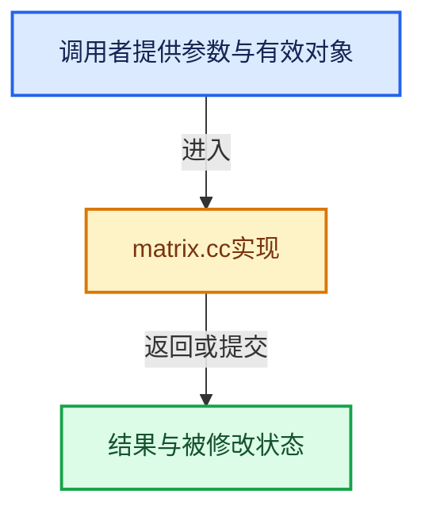

# 实现依赖专题：intern/eigen/intern/matrix.cc

[实现依赖导航](../../../README.md) · [符号索引](../../../../00-课程指南/02-源码与提交索引/符号依赖与实现索引.md)

本专题从正文实际调用进入，集中保存共享实现。函数有稳定锚点，可从调用处直接跳到对应完整函数；递归与互相调用通过回链组织。

## 本文件的实现关系





## 完整成员与函数实现

<a id="f-eeef8315daaccba2"></a>

### `EIG_invert_m4_m4`

实现位置：[intern/eigen/intern/matrix.cc](../../../../../../../../intern/eigen/intern/matrix.cc) · L29—L40。

接口参数：

- `float inverse[4][4]`
- `const float matrix[4][4]`

**教学注释版**

<!-- annotated:7a113e96a48176 -->

```cpp
bool EIG_invert_m4_m4(float inverse[4][4], const float matrix[4][4])
{
  Map<Matrix4f> M = Map<Matrix4f>((float *)matrix);
  Matrix4f R;
  bool invertible = true;
  M.computeInverseWithCheck(R, invertible, 0.0f);
  if (!invertible) {
    R = Matrix4f::Zero();
  }
  // [讲解] memcpy：复制字节，源与目标不应重叠。类型生命周期、对齐和可复制表示须由调用者证明，不是任意对象的复制构造。
  memcpy(inverse, R.data(), sizeof(float) * 4 * 4);
  return invertible;
}
```

<details>
<summary>核对原始源码：intern/eigen/intern/matrix.cc · L29—L40</summary>

<!-- original:7a113e96a48176:intern/eigen/intern/matrix.cc:29:40 -->

```cpp
bool EIG_invert_m4_m4(float inverse[4][4], const float matrix[4][4])
{
  Map<Matrix4f> M = Map<Matrix4f>((float *)matrix);
  Matrix4f R;
  bool invertible = true;
  M.computeInverseWithCheck(R, invertible, 0.0f);
  if (!invertible) {
    R = Matrix4f::Zero();
  }
  memcpy(inverse, R.data(), sizeof(float) * 4 * 4);
  return invertible;
}
```

</details>

**沿实际写入检查状态**

- `R = Matrix4f::Zero();`

**结果出口**

- `return invertible;`

**继续追踪实现**

- `Map<Matrix4f>` → [HdCyclesRenderBuffer::Map · L70](../../cycles/hydra/render_buffer.cpp.md#f-612f36a470bea05f)。
- `M.computeInverseWithCheck` → [调用协议](../../../../00-课程指南/01-路线与规范/模板宏与动态分派协议.md)：由接收对象具体类型或运行时策略提供实现。调用位置L34。
- `Matrix4f::Zero` → [调用协议](../../../../00-课程指南/01-路线与规范/模板宏与动态分派协议.md)：函数指针、局部可调用对象或未展开的宏；必须结合调用者环境。调用位置L36。
- `memcpy` → [外部契约](https://eel.is/c++draft/cstring.syn)：复制字节，源与目标不应重叠。类型生命周期、对齐和可复制表示须由调用者证明，不是任意对象的复制构造。
- `R.data` → [data · L201](../../cycles/util/array.h.md#f-39af3495ae01b907)；[data · L206](../../cycles/util/array.h.md#f-5d3c70b7e27b7334)。同名重载需按实参类型选择。
