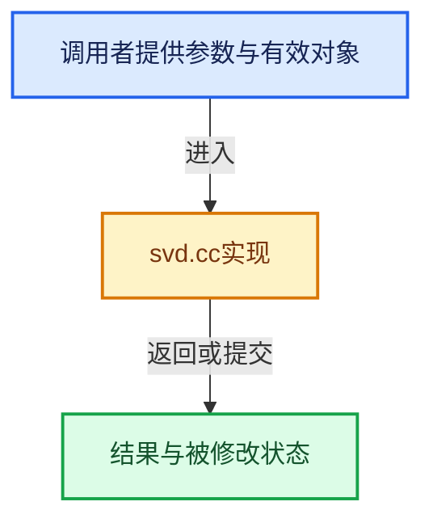

# 实现依赖专题：intern/eigen/intern/svd.cc

[实现依赖导航](../../../README.md) · [符号索引](../../../../00-课程指南/02-源码与提交索引/符号依赖与实现索引.md)

本专题从正文实际调用进入，集中保存共享实现。函数有稳定锚点，可从调用处直接跳到对应完整函数；递归与互相调用通过回链组织。

## 本文件的实现关系





## 完整成员与函数实现

<a id="f-37211379a59aaf7f"></a>

### `EIG_svd_square_matrix`

实现位置：[intern/eigen/intern/svd.cc](../../../../../../../../intern/eigen/intern/svd.cc) · L40—L59。

接口参数：

- `const int size`
- `const float *matrix`
- `float *r_U`
- `float *r_S`
- `float *r_V`

**教学注释版**

<!-- annotated:fae1ea872f0d1d -->

```cpp
void EIG_svd_square_matrix(const int size, const float *matrix, float *r_U, float *r_S, float *r_V)
{
  /* Since our matrix is squared, we can use thinU/V. */
  unsigned int flags = (r_U ? ComputeThinU : 0) | (r_V ? ComputeThinV : 0);

  /* Blender and Eigen matrices are both column-major. */
  JacobiSVD<MatrixXf, NoQRPreconditioner> svd(Map<MatrixXf>((float *)matrix, size, size), flags);

  if (r_U) {
    Map<MatrixXf>(r_U, size, size) = svd.matrixU();
  }

  if (r_S) {
    Map<VectorXf>(r_S, size) = svd.singularValues();
  }

  if (r_V) {
    Map<MatrixXf>(r_V, size, size) = svd.matrixV();
  }
}
```

<details>
<summary>核对原始源码：intern/eigen/intern/svd.cc · L40—L59</summary>

<!-- original:fae1ea872f0d1d:intern/eigen/intern/svd.cc:40:59 -->

```cpp
void EIG_svd_square_matrix(const int size, const float *matrix, float *r_U, float *r_S, float *r_V)
{
  /* Since our matrix is squared, we can use thinU/V. */
  unsigned int flags = (r_U ? ComputeThinU : 0) | (r_V ? ComputeThinV : 0);

  /* Blender and Eigen matrices are both column-major. */
  JacobiSVD<MatrixXf, NoQRPreconditioner> svd(Map<MatrixXf>((float *)matrix, size, size), flags);

  if (r_U) {
    Map<MatrixXf>(r_U, size, size) = svd.matrixU();
  }

  if (r_S) {
    Map<VectorXf>(r_S, size) = svd.singularValues();
  }

  if (r_V) {
    Map<MatrixXf>(r_V, size, size) = svd.matrixV();
  }
}
```

</details>

**继续追踪实现**

- `Map<MatrixXf>` → [HdCyclesRenderBuffer::Map · L70](../../cycles/hydra/render_buffer.cpp.md#f-612f36a470bea05f)。
- `svd.matrixU` → [调用协议](../../../../00-课程指南/01-路线与规范/模板宏与动态分派协议.md)：由接收对象具体类型或运行时策略提供实现。调用位置L49。
- `Map<VectorXf>` → [HdCyclesRenderBuffer::Map · L70](../../cycles/hydra/render_buffer.cpp.md#f-612f36a470bea05f)。
- `svd.singularValues` → [调用协议](../../../../00-课程指南/01-路线与规范/模板宏与动态分派协议.md)：由接收对象具体类型或运行时策略提供实现。调用位置L53。
- `svd.matrixV` → [调用协议](../../../../00-课程指南/01-路线与规范/模板宏与动态分派协议.md)：由接收对象具体类型或运行时策略提供实现。调用位置L57。
