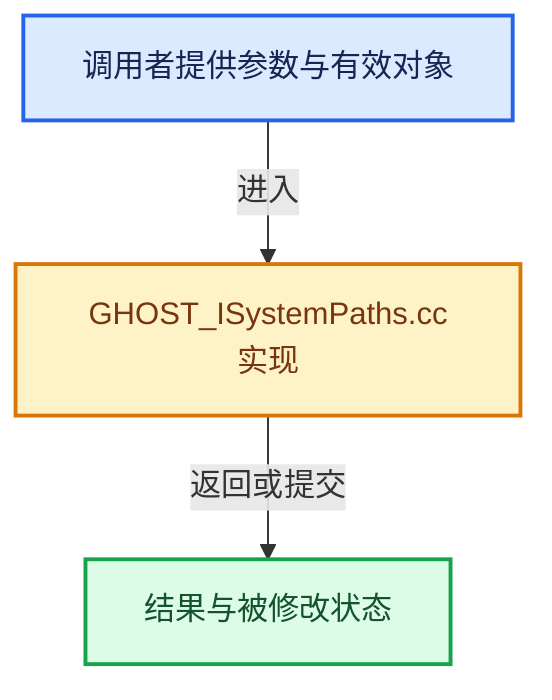

# 实现依赖专题：intern/ghost/intern/GHOST_ISystemPaths.cc

[实现依赖导航](../../../README.md) · [符号索引](../../../../00-课程指南/02-源码与提交索引/符号依赖与实现索引.md)

本专题从正文实际调用进入，集中保存共享实现。函数有稳定锚点，可从调用处直接跳到对应完整函数；递归与互相调用通过回链组织。

## 本文件的实现关系





## 完整成员与函数实现

<a id="f-674f7a18cf0c203c"></a>

### `GHOST_ISystemPaths::create`

实现位置：[intern/ghost/intern/GHOST_ISystemPaths.cc](../../../../../../../../intern/ghost/intern/GHOST_ISystemPaths.cc) · L27—L46。

**教学注释版**

<!-- annotated:4b107b0659cb68 -->

```cpp
GHOST_TSuccess GHOST_ISystemPaths::create()
{
  GHOST_TSuccess success;
  if (!system_paths_) {
#ifdef WIN32
    system_paths_ = new GHOST_SystemPathsWin32();
#else
#  ifdef __APPLE__
    system_paths_ = new GHOST_SystemPathsCocoa();
#  else
    system_paths_ = new GHOST_SystemPathsUnix();
#  endif
#endif
    success = system_paths_ != nullptr ? GHOST_kSuccess : GHOST_kFailure;
  }
  else {
    success = GHOST_kFailure;
  }
  return success;
}
```

<details>
<summary>核对原始源码：intern/ghost/intern/GHOST_ISystemPaths.cc · L27—L46</summary>

<!-- original:4b107b0659cb68:intern/ghost/intern/GHOST_ISystemPaths.cc:27:46 -->

```cpp
GHOST_TSuccess GHOST_ISystemPaths::create()
{
  GHOST_TSuccess success;
  if (!system_paths_) {
#ifdef WIN32
    system_paths_ = new GHOST_SystemPathsWin32();
#else
#  ifdef __APPLE__
    system_paths_ = new GHOST_SystemPathsCocoa();
#  else
    system_paths_ = new GHOST_SystemPathsUnix();
#  endif
#endif
    success = system_paths_ != nullptr ? GHOST_kSuccess : GHOST_kFailure;
  }
  else {
    success = GHOST_kFailure;
  }
  return success;
}
```

</details>

**沿实际写入检查状态**

- `system_paths_ = new GHOST_SystemPathsWin32();`
- `system_paths_ = new GHOST_SystemPathsCocoa();`
- `system_paths_ = new GHOST_SystemPathsUnix();`
- `success = system_paths_ != nullptr ? GHOST_kSuccess : GHOST_kFailure;`
- `success = GHOST_kFailure;`

**结果出口**

- `return success;`

**继续追踪实现**

本实现没有需要继续展开的显式调用；检查返回表达式、对象转换和调用者前置条件。

<a id="f-4673f48779fff2ef"></a>

### `GHOST_ISystemPaths::get`

实现位置：[intern/ghost/intern/GHOST_ISystemPaths.cc](../../../../../../../../intern/ghost/intern/GHOST_ISystemPaths.cc) · L61—L67。

**教学注释版**

<!-- annotated:9e2fe7a648c543 -->

```cpp
GHOST_ISystemPaths *GHOST_ISystemPaths::get()
{
  if (!system_paths_) {
    create();
  }
  return system_paths_;
}
```

<details>
<summary>核对原始源码：intern/ghost/intern/GHOST_ISystemPaths.cc · L61—L67</summary>

<!-- original:9e2fe7a648c543:intern/ghost/intern/GHOST_ISystemPaths.cc:61:67 -->

```cpp
GHOST_ISystemPaths *GHOST_ISystemPaths::get()
{
  if (!system_paths_) {
    create();
  }
  return system_paths_;
}
```

</details>

**结果出口**

- `return system_paths_;`

**继续追踪实现**

- `create` → [GHOST_ISystemPaths::create · L27](GHOST_ISystemPaths.cc.md#f-674f7a18cf0c203c)。
