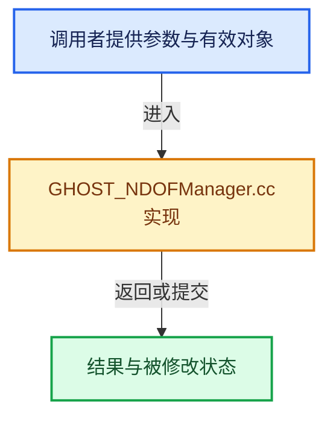

# 实现依赖专题：intern/ghost/intern/GHOST_NDOFManager.cc

[实现依赖导航](../../../README.md) · [符号索引](../../../../00-课程指南/02-源码与提交索引/符号依赖与实现索引.md)

本专题从正文实际调用进入，集中保存共享实现。函数有稳定锚点，可从调用处直接跳到对应完整函数；递归与互相调用通过回链组织。

## 本文件的实现关系





## 完整成员与函数实现

<a id="f-0954689c15759e9e"></a>

### `GHOST_NDOFManager::setDevice`

实现位置：[intern/ghost/intern/GHOST_NDOFManager.cc](../../../../../../../../intern/ghost/intern/GHOST_NDOFManager.cc) · L236—L366。

接口参数：

- `ushort vendor_id`
- `ushort product_id`

**教学注释版**

<!-- annotated:edcdd0161f4091 -->

```cpp
bool GHOST_NDOFManager::setDevice(ushort vendor_id, ushort product_id)
{
  /* Call this function until it returns true
   * it's a good idea to stop calling it after that, as it will "forget"
   * whichever device it already found. */

  /* Default to safe generic behavior for "unknown" devices
   * unidentified devices will emit motion events like normal
   * rogue buttons do nothing by default, but can be customized by the user. */

  device_type_ = NDOF_UnknownDevice;
  hid_map_ = ndof_HID_map_Generic;
  hid_map_button_num_ = genericButtonCount;
  hid_map_button_mask_ = 0;

  /* "mystery device" owners can help build a HID_map for their hardware
   * A few users have already contributed information about several older devices
   * that I don't have access to. Thanks! */

  switch (vendor_id) {
    case 0x046D: /* Logitech (3Dconnexion was a subsidiary). */
      switch (product_id) {
        /* -- current devices -- */
        case 0xC626: /* Full-size SpaceNavigator. */
        case 0xC628: /* The "for Notebooks" one. */
        {
          device_type_ = NDOF_SpaceNavigator;
          hid_map_button_num_ = 2;
          hid_map_ = ndof_HID_map_Shared3Dx;
          break;
        }
        case 0xC627: {
          device_type_ = NDOF_SpaceExplorer;
          hid_map_button_num_ = 15;
          hid_map_ = ndof_HID_map_SpaceExplorer;
          break;
        }
        case 0xC629: {
          device_type_ = NDOF_SpacePilotPro;
          hid_map_button_num_ = 31;
          hid_map_ = ndof_HID_map_Shared3Dx;
          break;
        }
        case 0xC62B: {
          device_type_ = NDOF_SpaceMousePro;
          hid_map_button_num_ = 27; /* 15 physical buttons, but HID codes range from 0 to 26. */
          hid_map_button_mask_ = 0x07C0F137;
          hid_map_ = ndof_HID_map_Shared3Dx;
          break;
        }

        /* -- older devices -- */
        case 0xC625: {
          device_type_ = NDOF_SpacePilot;
          hid_map_button_num_ = 21;
          hid_map_ = ndof_HID_map_SpacePilot;
          break;
        }
        case 0xC621: {
          device_type_ = NDOF_Spaceball5000;
          hid_map_button_num_ = 12;
          break;
        }
        case 0xC623: {
          device_type_ = NDOF_SpaceTraveler;
          hid_map_button_num_ = 8;
          break;
        }
        default: {
          CLOG_INFO(&LOG, "Unknown Logitech product %04hx", product_id);
        }
      }
      break;
    case 0x256F: /* 3Dconnexion. */
      switch (product_id) {
        case 0xC62E: /* SpaceMouse Wireless (cabled). */
        case 0xC62F: /* SpaceMouse Wireless Receiver. */
        case 0xC658: /* Wireless (3DConnexion Universal Wireless Receiver in WIN32), see #82412. */
        {
          device_type_ = NDOF_SpaceMouseWireless;
          hid_map_button_num_ = 2;
          hid_map_ = ndof_HID_map_Shared3Dx;
          break;
        }
        case 0xC631: /* SpaceMouse Pro Wireless (cabled). */
        case 0xC632: /* SpaceMouse Pro Wireless Receiver. */
        case 0xC638: /* SpaceMouse Pro Wireless BT (cabled), see #116393.
                      * 3Dconnexion docs describe this as "Wireless BT", but it is cabled. */
        case 0xC652: /* Universal Receiver. */
        {
          device_type_ = NDOF_SpaceMouseProWireless;
          hid_map_button_num_ = 27; /* 15 physical buttons, but HID codes range from 0 to 26. */
          hid_map_button_mask_ = 0x07C0F137;
          hid_map_ = ndof_HID_map_Shared3Dx;
          break;
        }
        case 0xC633: /* Newer devices don't need to use button mappings. */
        {
          device_type_ = NDOF_SpaceMouseEnterprise;
          break;
        }
        case 0xC664:
        case 0xC668: {
          device_type_ = NDOF_KeyboardPro;
          break;
        }
        case 0xC665: {
          device_type_ = NDOF_NumpadPro;
          break;
        }
        default: {
          CLOG_INFO(&LOG, "Unknown 3Dconnexion product %04hx", product_id);
        }
      }
      break;
    default:
      CLOG_INFO(&LOG, "Unknown device %04hx:%04hx", vendor_id, product_id);
  }

  if (device_type_ != NDOF_UnknownDevice) {
    CLOG_INFO(&LOG, "Using %s", ndof_device_names[device_type_]);
  }

  if (hid_map_button_mask_ == 0) {
    hid_map_button_mask_ = int(~(UINT_MAX << hid_map_button_num_));
  }

  CLOG_DEBUG(&LOG, "Device %d buttons -> hex:%X", hid_map_button_num_, uint(hid_map_button_mask_));

  return device_type_ != NDOF_UnknownDevice;
}
```

<details>
<summary>核对原始源码：intern/ghost/intern/GHOST_NDOFManager.cc · L236—L366</summary>

<!-- original:edcdd0161f4091:intern/ghost/intern/GHOST_NDOFManager.cc:236:366 -->

```cpp
bool GHOST_NDOFManager::setDevice(ushort vendor_id, ushort product_id)
{
  /* Call this function until it returns true
   * it's a good idea to stop calling it after that, as it will "forget"
   * whichever device it already found. */

  /* Default to safe generic behavior for "unknown" devices
   * unidentified devices will emit motion events like normal
   * rogue buttons do nothing by default, but can be customized by the user. */

  device_type_ = NDOF_UnknownDevice;
  hid_map_ = ndof_HID_map_Generic;
  hid_map_button_num_ = genericButtonCount;
  hid_map_button_mask_ = 0;

  /* "mystery device" owners can help build a HID_map for their hardware
   * A few users have already contributed information about several older devices
   * that I don't have access to. Thanks! */

  switch (vendor_id) {
    case 0x046D: /* Logitech (3Dconnexion was a subsidiary). */
      switch (product_id) {
        /* -- current devices -- */
        case 0xC626: /* Full-size SpaceNavigator. */
        case 0xC628: /* The "for Notebooks" one. */
        {
          device_type_ = NDOF_SpaceNavigator;
          hid_map_button_num_ = 2;
          hid_map_ = ndof_HID_map_Shared3Dx;
          break;
        }
        case 0xC627: {
          device_type_ = NDOF_SpaceExplorer;
          hid_map_button_num_ = 15;
          hid_map_ = ndof_HID_map_SpaceExplorer;
          break;
        }
        case 0xC629: {
          device_type_ = NDOF_SpacePilotPro;
          hid_map_button_num_ = 31;
          hid_map_ = ndof_HID_map_Shared3Dx;
          break;
        }
        case 0xC62B: {
          device_type_ = NDOF_SpaceMousePro;
          hid_map_button_num_ = 27; /* 15 physical buttons, but HID codes range from 0 to 26. */
          hid_map_button_mask_ = 0x07C0F137;
          hid_map_ = ndof_HID_map_Shared3Dx;
          break;
        }

        /* -- older devices -- */
        case 0xC625: {
          device_type_ = NDOF_SpacePilot;
          hid_map_button_num_ = 21;
          hid_map_ = ndof_HID_map_SpacePilot;
          break;
        }
        case 0xC621: {
          device_type_ = NDOF_Spaceball5000;
          hid_map_button_num_ = 12;
          break;
        }
        case 0xC623: {
          device_type_ = NDOF_SpaceTraveler;
          hid_map_button_num_ = 8;
          break;
        }
        default: {
          CLOG_INFO(&LOG, "Unknown Logitech product %04hx", product_id);
        }
      }
      break;
    case 0x256F: /* 3Dconnexion. */
      switch (product_id) {
        case 0xC62E: /* SpaceMouse Wireless (cabled). */
        case 0xC62F: /* SpaceMouse Wireless Receiver. */
        case 0xC658: /* Wireless (3DConnexion Universal Wireless Receiver in WIN32), see #82412. */
        {
          device_type_ = NDOF_SpaceMouseWireless;
          hid_map_button_num_ = 2;
          hid_map_ = ndof_HID_map_Shared3Dx;
          break;
        }
        case 0xC631: /* SpaceMouse Pro Wireless (cabled). */
        case 0xC632: /* SpaceMouse Pro Wireless Receiver. */
        case 0xC638: /* SpaceMouse Pro Wireless BT (cabled), see #116393.
                      * 3Dconnexion docs describe this as "Wireless BT", but it is cabled. */
        case 0xC652: /* Universal Receiver. */
        {
          device_type_ = NDOF_SpaceMouseProWireless;
          hid_map_button_num_ = 27; /* 15 physical buttons, but HID codes range from 0 to 26. */
          hid_map_button_mask_ = 0x07C0F137;
          hid_map_ = ndof_HID_map_Shared3Dx;
          break;
        }
        case 0xC633: /* Newer devices don't need to use button mappings. */
        {
          device_type_ = NDOF_SpaceMouseEnterprise;
          break;
        }
        case 0xC664:
        case 0xC668: {
          device_type_ = NDOF_KeyboardPro;
          break;
        }
        case 0xC665: {
          device_type_ = NDOF_NumpadPro;
          break;
        }
        default: {
          CLOG_INFO(&LOG, "Unknown 3Dconnexion product %04hx", product_id);
        }
      }
      break;
    default:
      CLOG_INFO(&LOG, "Unknown device %04hx:%04hx", vendor_id, product_id);
  }

  if (device_type_ != NDOF_UnknownDevice) {
    CLOG_INFO(&LOG, "Using %s", ndof_device_names[device_type_]);
  }

  if (hid_map_button_mask_ == 0) {
    hid_map_button_mask_ = int(~(UINT_MAX << hid_map_button_num_));
  }

  CLOG_DEBUG(&LOG, "Device %d buttons -> hex:%X", hid_map_button_num_, uint(hid_map_button_mask_));

  return device_type_ != NDOF_UnknownDevice;
}
```

</details>

**沿实际写入检查状态**

- `device_type_ = NDOF_UnknownDevice;`
- `hid_map_ = ndof_HID_map_Generic;`
- `hid_map_button_num_ = genericButtonCount;`
- `hid_map_button_mask_ = 0;`
- `device_type_ = NDOF_SpaceNavigator;`
- `hid_map_button_num_ = 2;`
- `hid_map_ = ndof_HID_map_Shared3Dx;`
- `device_type_ = NDOF_SpaceExplorer;`
- `hid_map_button_num_ = 15;`
- `hid_map_ = ndof_HID_map_SpaceExplorer;`
- `device_type_ = NDOF_SpacePilotPro;`
- `hid_map_button_num_ = 31;`
- `device_type_ = NDOF_SpaceMousePro;`
- `hid_map_button_num_ = 27; /* 15 physical buttons, but HID codes range from 0 to 26. */`
- `hid_map_button_mask_ = 0x07C0F137;`
- `device_type_ = NDOF_SpacePilot;`
- `hid_map_button_num_ = 21;`
- `hid_map_ = ndof_HID_map_SpacePilot;`
- `device_type_ = NDOF_Spaceball5000;`
- `hid_map_button_num_ = 12;`
- `device_type_ = NDOF_SpaceTraveler;`
- `hid_map_button_num_ = 8;`
- `device_type_ = NDOF_SpaceMouseWireless;`
- `device_type_ = NDOF_SpaceMouseProWireless;`
- `device_type_ = NDOF_SpaceMouseEnterprise;`
- `device_type_ = NDOF_KeyboardPro;`
- `device_type_ = NDOF_NumpadPro;`
- `hid_map_button_mask_ = int(~(UINT_MAX << hid_map_button_num_));`

**结果出口**

- `return device_type_ != NDOF_UnknownDevice;`

**继续追踪实现**

- `CLOG_INFO` → [CLOG_INFO · L190](../../clog/CLG_log.h.md#m-f8b5efdfcc0f)。宏定义由构建条件选择。
- `CLOG_DEBUG` → [CLOG_DEBUG · L191](../../clog/CLG_log.h.md#m-e062f5f17675)。宏定义由构建条件选择。
