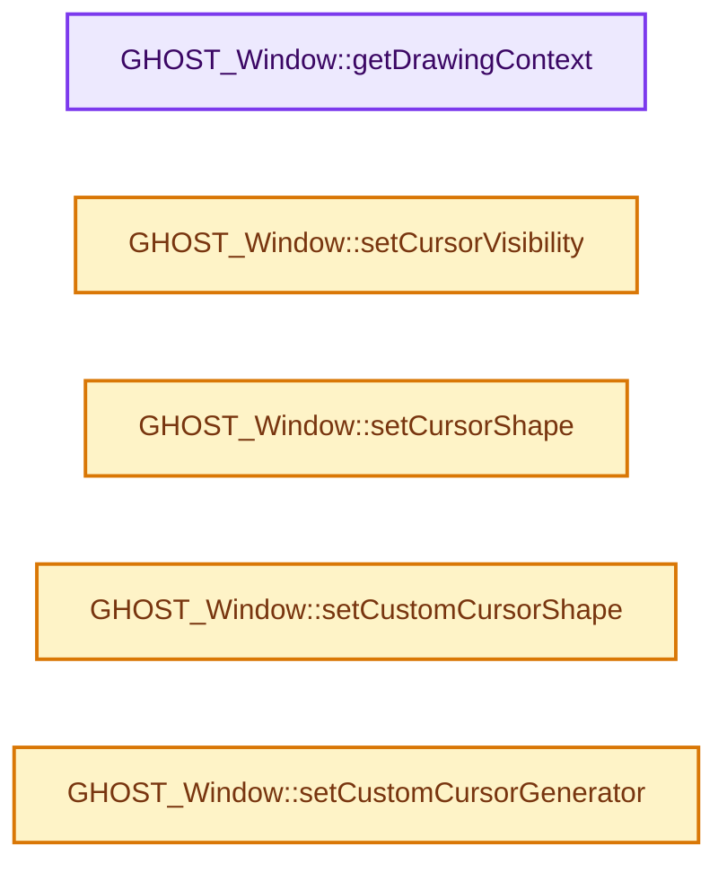
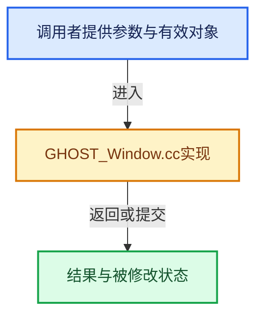

# 实现依赖专题：intern/ghost/intern/GHOST_Window.cc

[实现依赖导航](../../../README.md) · [符号索引](../../../../00-课程指南/02-源码与提交索引/符号依赖与实现索引.md)

本专题从正文实际调用进入，集中保存共享实现。函数有稳定锚点，可从调用处直接跳到对应完整函数；递归与互相调用通过回链组织。

## 本文件的实现关系






## 完整成员与函数实现

<a id="f-c396ce148c6b8b60"></a>

### `GHOST_Window::getDrawingContext`

实现位置：[intern/ghost/intern/GHOST_Window.cc](../../../../../../../../intern/ghost/intern/GHOST_Window.cc) · L102—L105。

**教学注释版**

<!-- annotated:e98b3bc1a68746 -->

```cpp
GHOST_IContext *GHOST_Window::getDrawingContext()
{
  return context_;
}
```

<details>
<summary>核对原始源码：intern/ghost/intern/GHOST_Window.cc · L102—L105</summary>

<!-- original:e98b3bc1a68746:intern/ghost/intern/GHOST_Window.cc:102:105 -->

```cpp
GHOST_IContext *GHOST_Window::getDrawingContext()
{
  return context_;
}
```

</details>

**结果出口**

- `return context_;`

**继续追踪实现**

本实现没有需要继续展开的显式调用；检查返回表达式、对象转换和调用者前置条件。

<a id="f-5017c7a3e787926a"></a>

### `GHOST_Window::setCursorVisibility`

实现位置：[intern/ghost/intern/GHOST_Window.cc](../../../../../../../../intern/ghost/intern/GHOST_Window.cc) · L163—L170。

接口参数：

- `bool visible`

**教学注释版**

<!-- annotated:85c96b1f6eaa9e -->

```cpp
GHOST_TSuccess GHOST_Window::setCursorVisibility(bool visible)
{
  if (setWindowCursorVisibility(visible)) {
    cursor_visible_ = visible;
    return GHOST_kSuccess;
  }
  return GHOST_kFailure;
}
```

<details>
<summary>核对原始源码：intern/ghost/intern/GHOST_Window.cc · L163—L170</summary>

<!-- original:85c96b1f6eaa9e:intern/ghost/intern/GHOST_Window.cc:163:170 -->

```cpp
GHOST_TSuccess GHOST_Window::setCursorVisibility(bool visible)
{
  if (setWindowCursorVisibility(visible)) {
    cursor_visible_ = visible;
    return GHOST_kSuccess;
  }
  return GHOST_kFailure;
}
```

</details>

**沿实际写入检查状态**

- `cursor_visible_ = visible;`

**结果出口**

- `return GHOST_kSuccess;`
- `return GHOST_kFailure;`

**继续追踪实现**

- `setWindowCursorVisibility` → [GHOST_WindowX11::setWindowCursorVisibility · L1380](GHOST_WindowX11.cc.md#f-8cb89809af54155f)；[GHOST_WindowWin32::setWindowCursorVisibility · L795](GHOST_WindowWin32.cc.md#f-52c9d3d6b134a83a)；[GHOST_WindowWayland::setWindowCursorVisibility · L2478](GHOST_WindowWayland.cc.md#f-84a4ae30512c5192)；[GHOST_WindowSDL::setWindowCursorVisibility · L668](GHOST_WindowSDL.cc.md#f-29657eb361cb4cf0)。同名重载需按实参类型选择。

<a id="f-fe9b6ddc96b62c16"></a>

### `GHOST_Window::setCursorShape`

实现位置：[intern/ghost/intern/GHOST_Window.cc](../../../../../../../../intern/ghost/intern/GHOST_Window.cc) · L241—L248。

接口参数：

- `GHOST_TStandardCursor cursor_shape`

**教学注释版**

<!-- annotated:06c466caa514d4 -->

```cpp
GHOST_TSuccess GHOST_Window::setCursorShape(GHOST_TStandardCursor cursor_shape)
{
  if (setWindowCursorShape(cursor_shape)) {
    cursor_shape_ = cursor_shape;
    return GHOST_kSuccess;
  }
  return GHOST_kFailure;
}
```

<details>
<summary>核对原始源码：intern/ghost/intern/GHOST_Window.cc · L241—L248</summary>

<!-- original:06c466caa514d4:intern/ghost/intern/GHOST_Window.cc:241:248 -->

```cpp
GHOST_TSuccess GHOST_Window::setCursorShape(GHOST_TStandardCursor cursor_shape)
{
  if (setWindowCursorShape(cursor_shape)) {
    cursor_shape_ = cursor_shape;
    return GHOST_kSuccess;
  }
  return GHOST_kFailure;
}
```

</details>

**沿实际写入检查状态**

- `cursor_shape_ = cursor_shape;`

**结果出口**

- `return GHOST_kSuccess;`
- `return GHOST_kFailure;`

**继续追踪实现**

- `setWindowCursorShape` → [GHOST_WindowX11::setWindowCursorShape · L1468](GHOST_WindowX11.cc.md#f-23522fed582b2b9b)；[GHOST_WindowWin32::setWindowCursorShape · L841](GHOST_WindowWin32.cc.md#f-c75e6e6628e42eca)；[GHOST_WindowWayland::setWindowCursorShape · L2276](GHOST_WindowWayland.cc.md#f-fefa10890e48ebc7)；[GHOST_WindowSDL::setWindowCursorShape · L635](GHOST_WindowSDL.cc.md#f-81e0d10d17b4ed16)。同名重载需按实参类型选择。

<a id="f-eac94e3d7dc35df0"></a>

### `GHOST_Window::setCustomCursorShape`

实现位置：[intern/ghost/intern/GHOST_Window.cc](../../../../../../../../intern/ghost/intern/GHOST_Window.cc) · L250—L261。

接口参数：

- `const uint8_t *bitmap`
- `const uint8_t *mask`
- `const int size[2]`
- `const int hot_spot[2]`
- `bool can_invert_color`

**教学注释版**

<!-- annotated:1318c990fd9a1b -->

```cpp
GHOST_TSuccess GHOST_Window::setCustomCursorShape(const uint8_t *bitmap,
                                                  const uint8_t *mask,
                                                  const int size[2],
                                                  const int hot_spot[2],
                                                  bool can_invert_color)
{
  if (setWindowCustomCursorShape(bitmap, mask, size, hot_spot, can_invert_color)) {
    cursor_shape_ = GHOST_kStandardCursorCustom;
    return GHOST_kSuccess;
  }
  return GHOST_kFailure;
}
```

<details>
<summary>核对原始源码：intern/ghost/intern/GHOST_Window.cc · L250—L261</summary>

<!-- original:1318c990fd9a1b:intern/ghost/intern/GHOST_Window.cc:250:261 -->

```cpp
GHOST_TSuccess GHOST_Window::setCustomCursorShape(const uint8_t *bitmap,
                                                  const uint8_t *mask,
                                                  const int size[2],
                                                  const int hot_spot[2],
                                                  bool can_invert_color)
{
  if (setWindowCustomCursorShape(bitmap, mask, size, hot_spot, can_invert_color)) {
    cursor_shape_ = GHOST_kStandardCursorCustom;
    return GHOST_kSuccess;
  }
  return GHOST_kFailure;
}
```

</details>

**沿实际写入检查状态**

- `cursor_shape_ = GHOST_kStandardCursorCustom;`

**结果出口**

- `return GHOST_kSuccess;`
- `return GHOST_kFailure;`

**继续追踪实现**

- `setWindowCustomCursorShape` → [GHOST_WindowX11::setWindowCustomCursorShape · L1489](GHOST_WindowX11.cc.md#f-114b0378ea22b301)；[GHOST_WindowWin32::setWindowCustomCursorShape · L1076](GHOST_WindowWin32.cc.md#f-2a191f59548648b9)；[GHOST_WindowWayland::setWindowCustomCursorShape · L2355](GHOST_WindowWayland.cc.md#f-ce50675321f1bdbd)；[GHOST_WindowSDL::setWindowCustomCursorShape · L651](GHOST_WindowSDL.cc.md#f-5db67d43d4ca3717)。同名重载需按实参类型选择。

<a id="f-7c5d59f6e41ab7d1"></a>

### `GHOST_Window::setCustomCursorGenerator`

实现位置：[intern/ghost/intern/GHOST_Window.cc](../../../../../../../../intern/ghost/intern/GHOST_Window.cc) · L263—L270。

接口参数：

- `GHOST_CursorGenerator *cursor_generator`

**教学注释版**

<!-- annotated:cf0d774b312759 -->

```cpp
GHOST_TSuccess GHOST_Window::setCustomCursorGenerator(GHOST_CursorGenerator *cursor_generator)
{
  if (setWindowCustomCursorGenerator(cursor_generator)) {
    cursor_shape_ = GHOST_kStandardCursorCustom;
    return GHOST_kSuccess;
  }
  return GHOST_kFailure;
}
```

<details>
<summary>核对原始源码：intern/ghost/intern/GHOST_Window.cc · L263—L270</summary>

<!-- original:cf0d774b312759:intern/ghost/intern/GHOST_Window.cc:263:270 -->

```cpp
GHOST_TSuccess GHOST_Window::setCustomCursorGenerator(GHOST_CursorGenerator *cursor_generator)
{
  if (setWindowCustomCursorGenerator(cursor_generator)) {
    cursor_shape_ = GHOST_kStandardCursorCustom;
    return GHOST_kSuccess;
  }
  return GHOST_kFailure;
}
```

</details>

**沿实际写入检查状态**

- `cursor_shape_ = GHOST_kStandardCursorCustom;`

**结果出口**

- `return GHOST_kSuccess;`
- `return GHOST_kFailure;`

**继续追踪实现**

- `setWindowCustomCursorGenerator` → [GHOST_WindowWayland::setWindowCustomCursorGenerator · L2328](GHOST_WindowWayland.cc.md#f-3cacc676b0ee1296)。
