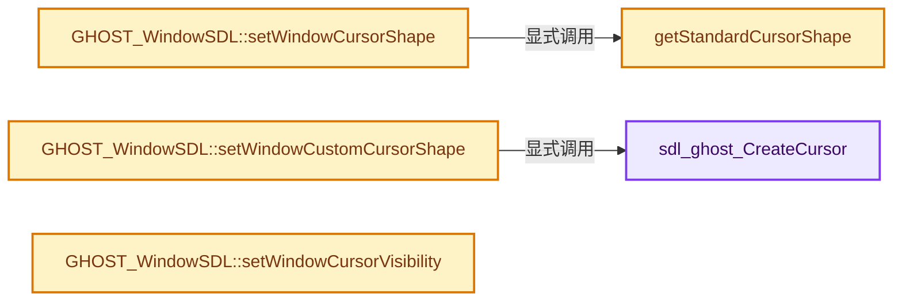
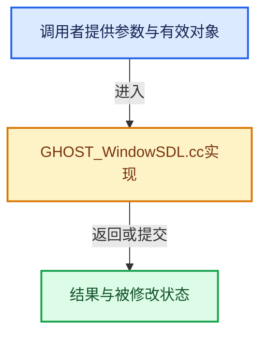

# 实现依赖专题：intern/ghost/intern/GHOST_WindowSDL.cc

[实现依赖导航](../../../README.md) · [符号索引](../../../../00-课程指南/02-源码与提交索引/符号依赖与实现索引.md)

本专题从正文实际调用进入，集中保存共享实现。函数有稳定锚点，可从调用处直接跳到对应完整函数；递归与互相调用通过回链组织。

## 本文件的实现关系






## 完整成员与函数实现

<a id="f-7f88a1f9edf1e556"></a>

### `sdl_ghost_CreateCursor`

实现位置：[intern/ghost/intern/GHOST_WindowSDL.cc](../../../../../../../../intern/ghost/intern/GHOST_WindowSDL.cc) · L536—L583。

接口参数：

- `const uint8_t *data`
- `const uint8_t *mask`
- `int w`
- `int h`
- `int hot_x`
- `int hot_y`

**教学注释版**

<!-- annotated:5cc275cd843157 -->

```cpp
static SDL_Cursor *sdl_ghost_CreateCursor(
    const uint8_t *data, const uint8_t *mask, int w, int h, int hot_x, int hot_y)
{
  SDL_Surface *surface;
  SDL_Cursor *cursor;
  int x, y;
  Uint32 *pixel;
  Uint8 datab = 0, maskb = 0;
  const Uint32 black = 0xFF000000;
  const Uint32 white = 0xFFFFFFFF;
  const Uint32 transparent = 0x00000000;

  /* Make sure the width is a multiple of 8 */
  w = ((w + 7) & ~7);

  /* Create the surface from a bitmap */
  surface = SDL_CreateSurface(w, h, SDL_PIXELFORMAT_ARGB8888);
  if (!surface) {
    return nullptr;
  }
  for (y = 0; y < h; ++y) {
    pixel = (Uint32 *)((Uint8 *)surface->pixels + y * surface->pitch);
    for (x = 0; x < w; ++x) {
      if ((x % 8) == 0) {
        datab = *data++;
        maskb = *mask++;

        /* reverse bit order */
        datab = (datab * 0x0202020202ULL & 0x010884422010ULL) % 1023;
        maskb = (maskb * 0x0202020202ULL & 0x010884422010ULL) % 1023;
      }
      if (maskb & 0x80) {
        *pixel++ = (datab & 0x80) ? white : black;
      }
      else {
        *pixel++ = (datab & 0x80) ? white : transparent;
      }
      datab <<= 1;
      maskb <<= 1;
    }
  }

  cursor = SDL_CreateColorCursor(surface, hot_x, hot_y);

  SDL_DestroySurface(surface);

  return cursor;
}
```

<details>
<summary>核对原始源码：intern/ghost/intern/GHOST_WindowSDL.cc · L536—L583</summary>

<!-- original:5cc275cd843157:intern/ghost/intern/GHOST_WindowSDL.cc:536:583 -->

```cpp
static SDL_Cursor *sdl_ghost_CreateCursor(
    const uint8_t *data, const uint8_t *mask, int w, int h, int hot_x, int hot_y)
{
  SDL_Surface *surface;
  SDL_Cursor *cursor;
  int x, y;
  Uint32 *pixel;
  Uint8 datab = 0, maskb = 0;
  const Uint32 black = 0xFF000000;
  const Uint32 white = 0xFFFFFFFF;
  const Uint32 transparent = 0x00000000;

  /* Make sure the width is a multiple of 8 */
  w = ((w + 7) & ~7);

  /* Create the surface from a bitmap */
  surface = SDL_CreateSurface(w, h, SDL_PIXELFORMAT_ARGB8888);
  if (!surface) {
    return nullptr;
  }
  for (y = 0; y < h; ++y) {
    pixel = (Uint32 *)((Uint8 *)surface->pixels + y * surface->pitch);
    for (x = 0; x < w; ++x) {
      if ((x % 8) == 0) {
        datab = *data++;
        maskb = *mask++;

        /* reverse bit order */
        datab = (datab * 0x0202020202ULL & 0x010884422010ULL) % 1023;
        maskb = (maskb * 0x0202020202ULL & 0x010884422010ULL) % 1023;
      }
      if (maskb & 0x80) {
        *pixel++ = (datab & 0x80) ? white : black;
      }
      else {
        *pixel++ = (datab & 0x80) ? white : transparent;
      }
      datab <<= 1;
      maskb <<= 1;
    }
  }

  cursor = SDL_CreateColorCursor(surface, hot_x, hot_y);

  SDL_DestroySurface(surface);

  return cursor;
}
```

</details>

**沿实际写入检查状态**

- `w = ((w + 7) & ~7);`
- `surface = SDL_CreateSurface(w, h, SDL_PIXELFORMAT_ARGB8888);`
- `pixel = (Uint32 *)((Uint8 *)surface->pixels + y * surface->pitch);`
- `datab = *data++;`
- `maskb = *mask++;`
- `datab = (datab * 0x0202020202ULL & 0x010884422010ULL) % 1023;`
- `maskb = (maskb * 0x0202020202ULL & 0x010884422010ULL) % 1023;`
- `cursor = SDL_CreateColorCursor(surface, hot_x, hot_y);`

**结果出口**

- `return nullptr;`
- `return cursor;`

**继续追踪实现**

- `SDL_CreateSurface` → [调用协议](../../../../00-课程指南/01-路线与规范/模板宏与动态分派协议.md)：函数指针、局部可调用对象或未展开的宏；必须结合调用者环境。调用位置L552。
- `SDL_CreateColorCursor` → [调用协议](../../../../00-课程指南/01-路线与规范/模板宏与动态分派协议.md)：函数指针、局部可调用对象或未展开的宏；必须结合调用者环境。调用位置L578。
- `SDL_DestroySurface` → [调用协议](../../../../00-课程指南/01-路线与规范/模板宏与动态分派协议.md)：函数指针、局部可调用对象或未展开的宏；必须结合调用者环境。调用位置L580。

<a id="f-834f5314769acfef"></a>

### `getStandardCursorShape`

实现位置：[intern/ghost/intern/GHOST_WindowSDL.cc](../../../../../../../../intern/ghost/intern/GHOST_WindowSDL.cc) · L586—L628。

接口参数：

- `GHOST_TStandardCursor shape`

**教学注释版**

<!-- annotated:adde67ee3e0eca -->

```cpp
static SDL_Cursor *getStandardCursorShape(GHOST_TStandardCursor shape)
{
  if (sdl_std_cursor_array[0] == nullptr) {
#define DEF_CURSOR(name, ind) \
  { \
    sdl_std_cursor_array[int(ind)] = sdl_ghost_CreateCursor( \
        sdl_std_cursor_##name, \
        sdl_std_cursor_mask_##name, \
        sdl_std_cursor_WIDTH_##name, \
        sdl_std_cursor_HEIGHT_##name, \
        (sdl_std_cursor_WIDTH_##name + (sdl_std_cursor_HOT_X_##name)) - 1, \
        (sdl_std_cursor_HEIGHT_##name + (sdl_std_cursor_HOT_Y_##name)) - 1); \
    assert(sdl_std_cursor_array[int(ind)] != nullptr); \
  } \
  (void)0

    DEF_CURSOR(left_ptr, GHOST_kStandardCursorDefault);
    DEF_CURSOR(right_ptr, GHOST_kStandardCursorRightArrow);
    DEF_CURSOR(left_ptr, GHOST_kStandardCursorLeftArrow);
    DEF_CURSOR(umbrella, GHOST_kStandardCursorInfo); /* TODO: replace this one. */
    DEF_CURSOR(pirate, GHOST_kStandardCursorDestroy);
    DEF_CURSOR(question_arrow, GHOST_kStandardCursorHelp);
    DEF_CURSOR(watch, GHOST_kStandardCursorWait);
    DEF_CURSOR(xterm, GHOST_kStandardCursorText);
    DEF_CURSOR(crosshair, GHOST_kStandardCursorCrosshair);
    DEF_CURSOR(sb_v_double_arrow, GHOST_kStandardCursorUpDown);
    DEF_CURSOR(sb_h_double_arrow, GHOST_kStandardCursorLeftRight);
    DEF_CURSOR(top_side, GHOST_kStandardCursorTopSide);
    DEF_CURSOR(bottom_side, GHOST_kStandardCursorBottomSide);
    DEF_CURSOR(left_side, GHOST_kStandardCursorLeftSide);
    DEF_CURSOR(right_side, GHOST_kStandardCursorRightSide);
    DEF_CURSOR(top_left_corner, GHOST_kStandardCursorTopLeftCorner);
    DEF_CURSOR(top_right_corner, GHOST_kStandardCursorTopRightCorner);
    DEF_CURSOR(bottom_right_corner, GHOST_kStandardCursorBottomRightCorner);
    DEF_CURSOR(bottom_left_corner, GHOST_kStandardCursorBottomLeftCorner);
    DEF_CURSOR(arrow, GHOST_kStandardCursorCopy);
    // DEF_CURSOR(arrow, GHOST_kStandardCursorCustom);
    DEF_CURSOR(arrow, GHOST_kStandardCursorPencil);
#undef DEF_CURSOR
  }

  return sdl_std_cursor_array[int(shape)];
}
```

<details>
<summary>核对原始源码：intern/ghost/intern/GHOST_WindowSDL.cc · L586—L628</summary>

<!-- original:adde67ee3e0eca:intern/ghost/intern/GHOST_WindowSDL.cc:586:628 -->

```cpp
static SDL_Cursor *getStandardCursorShape(GHOST_TStandardCursor shape)
{
  if (sdl_std_cursor_array[0] == nullptr) {
#define DEF_CURSOR(name, ind) \
  { \
    sdl_std_cursor_array[int(ind)] = sdl_ghost_CreateCursor( \
        sdl_std_cursor_##name, \
        sdl_std_cursor_mask_##name, \
        sdl_std_cursor_WIDTH_##name, \
        sdl_std_cursor_HEIGHT_##name, \
        (sdl_std_cursor_WIDTH_##name + (sdl_std_cursor_HOT_X_##name)) - 1, \
        (sdl_std_cursor_HEIGHT_##name + (sdl_std_cursor_HOT_Y_##name)) - 1); \
    assert(sdl_std_cursor_array[int(ind)] != nullptr); \
  } \
  (void)0

    DEF_CURSOR(left_ptr, GHOST_kStandardCursorDefault);
    DEF_CURSOR(right_ptr, GHOST_kStandardCursorRightArrow);
    DEF_CURSOR(left_ptr, GHOST_kStandardCursorLeftArrow);
    DEF_CURSOR(umbrella, GHOST_kStandardCursorInfo); /* TODO: replace this one. */
    DEF_CURSOR(pirate, GHOST_kStandardCursorDestroy);
    DEF_CURSOR(question_arrow, GHOST_kStandardCursorHelp);
    DEF_CURSOR(watch, GHOST_kStandardCursorWait);
    DEF_CURSOR(xterm, GHOST_kStandardCursorText);
    DEF_CURSOR(crosshair, GHOST_kStandardCursorCrosshair);
    DEF_CURSOR(sb_v_double_arrow, GHOST_kStandardCursorUpDown);
    DEF_CURSOR(sb_h_double_arrow, GHOST_kStandardCursorLeftRight);
    DEF_CURSOR(top_side, GHOST_kStandardCursorTopSide);
    DEF_CURSOR(bottom_side, GHOST_kStandardCursorBottomSide);
    DEF_CURSOR(left_side, GHOST_kStandardCursorLeftSide);
    DEF_CURSOR(right_side, GHOST_kStandardCursorRightSide);
    DEF_CURSOR(top_left_corner, GHOST_kStandardCursorTopLeftCorner);
    DEF_CURSOR(top_right_corner, GHOST_kStandardCursorTopRightCorner);
    DEF_CURSOR(bottom_right_corner, GHOST_kStandardCursorBottomRightCorner);
    DEF_CURSOR(bottom_left_corner, GHOST_kStandardCursorBottomLeftCorner);
    DEF_CURSOR(arrow, GHOST_kStandardCursorCopy);
    // DEF_CURSOR(arrow, GHOST_kStandardCursorCustom);
    DEF_CURSOR(arrow, GHOST_kStandardCursorPencil);
#undef DEF_CURSOR
  }

  return sdl_std_cursor_array[int(shape)];
}
```

</details>

**结果出口**

- `return sdl_std_cursor_array[int(shape)];`

**继续追踪实现**

- `DEF_CURSOR` → [调用协议](../../../../00-课程指南/01-路线与规范/模板宏与动态分派协议.md)：函数指针、局部可调用对象或未展开的宏；必须结合调用者环境。调用位置L602。

<a id="f-81e0d10d17b4ed16"></a>

### `GHOST_WindowSDL::setWindowCursorShape`

实现位置：[intern/ghost/intern/GHOST_WindowSDL.cc](../../../../../../../../intern/ghost/intern/GHOST_WindowSDL.cc) · L635—L644。

接口参数：

- `GHOST_TStandardCursor shape`

**教学注释版**

<!-- annotated:c2c6afdbbc69ee -->

```cpp
GHOST_TSuccess GHOST_WindowSDL::setWindowCursorShape(GHOST_TStandardCursor shape)
{
  SDL_Cursor *cursor = getStandardCursorShape(shape);
  if (cursor == nullptr) {
    cursor = getStandardCursorShape(GHOST_kStandardCursorDefault);
  }

  SDL_SetCursor(cursor);
  return GHOST_kSuccess;
}
```

<details>
<summary>核对原始源码：intern/ghost/intern/GHOST_WindowSDL.cc · L635—L644</summary>

<!-- original:c2c6afdbbc69ee:intern/ghost/intern/GHOST_WindowSDL.cc:635:644 -->

```cpp
GHOST_TSuccess GHOST_WindowSDL::setWindowCursorShape(GHOST_TStandardCursor shape)
{
  SDL_Cursor *cursor = getStandardCursorShape(shape);
  if (cursor == nullptr) {
    cursor = getStandardCursorShape(GHOST_kStandardCursorDefault);
  }

  SDL_SetCursor(cursor);
  return GHOST_kSuccess;
}
```

</details>

**沿实际写入检查状态**

- `cursor = getStandardCursorShape(GHOST_kStandardCursorDefault);`

**结果出口**

- `return GHOST_kSuccess;`

**继续追踪实现**

- `getStandardCursorShape` → [getStandardCursorShape · L586](GHOST_WindowSDL.cc.md#f-834f5314769acfef)。
- `SDL_SetCursor` → [调用协议](../../../../00-课程指南/01-路线与规范/模板宏与动态分派协议.md)：函数指针、局部可调用对象或未展开的宏；必须结合调用者环境。调用位置L642。

<a id="f-5db67d43d4ca3717"></a>

### `GHOST_WindowSDL::setWindowCustomCursorShape`

实现位置：[intern/ghost/intern/GHOST_WindowSDL.cc](../../../../../../../../intern/ghost/intern/GHOST_WindowSDL.cc) · L651—L666。

接口参数：

- `const uint8_t *bitmap`
- `const uint8_t *mask`
- `const int size[2]`
- `const int hot_spot[2]`
- `bool`

**教学注释版**

<!-- annotated:6721afc1e5b3cb -->

```cpp
GHOST_TSuccess GHOST_WindowSDL::setWindowCustomCursorShape(const uint8_t *bitmap,
                                                           const uint8_t *mask,
                                                           const int size[2],
                                                           const int hot_spot[2],
                                                           bool /*can_invert_color*/)
{
  if (sdl_custom_cursor_) {
    SDL_DestroyCursor(sdl_custom_cursor_);
  }

  sdl_custom_cursor_ = sdl_ghost_CreateCursor(
      bitmap, mask, size[0], size[1], hot_spot[0], hot_spot[1]);

  SDL_SetCursor(sdl_custom_cursor_);
  return GHOST_kSuccess;
}
```

<details>
<summary>核对原始源码：intern/ghost/intern/GHOST_WindowSDL.cc · L651—L666</summary>

<!-- original:6721afc1e5b3cb:intern/ghost/intern/GHOST_WindowSDL.cc:651:666 -->

```cpp
GHOST_TSuccess GHOST_WindowSDL::setWindowCustomCursorShape(const uint8_t *bitmap,
                                                           const uint8_t *mask,
                                                           const int size[2],
                                                           const int hot_spot[2],
                                                           bool /*can_invert_color*/)
{
  if (sdl_custom_cursor_) {
    SDL_DestroyCursor(sdl_custom_cursor_);
  }

  sdl_custom_cursor_ = sdl_ghost_CreateCursor(
      bitmap, mask, size[0], size[1], hot_spot[0], hot_spot[1]);

  SDL_SetCursor(sdl_custom_cursor_);
  return GHOST_kSuccess;
}
```

</details>

**沿实际写入检查状态**

- `sdl_custom_cursor_ = sdl_ghost_CreateCursor(`

**结果出口**

- `return GHOST_kSuccess;`

**继续追踪实现**

- `SDL_DestroyCursor` → [调用协议](../../../../00-课程指南/01-路线与规范/模板宏与动态分派协议.md)：函数指针、局部可调用对象或未展开的宏；必须结合调用者环境。调用位置L658。
- `sdl_ghost_CreateCursor` → [sdl_ghost_CreateCursor · L536](GHOST_WindowSDL.cc.md#f-7f88a1f9edf1e556)。
- `SDL_SetCursor` → [调用协议](../../../../00-课程指南/01-路线与规范/模板宏与动态分派协议.md)：函数指针、局部可调用对象或未展开的宏；必须结合调用者环境。调用位置L664。

<a id="f-29657eb361cb4cf0"></a>

### `GHOST_WindowSDL::setWindowCursorVisibility`

实现位置：[intern/ghost/intern/GHOST_WindowSDL.cc](../../../../../../../../intern/ghost/intern/GHOST_WindowSDL.cc) · L668—L677。

接口参数：

- `bool visible`

**教学注释版**

<!-- annotated:1047c52ca44cef -->

```cpp
GHOST_TSuccess GHOST_WindowSDL::setWindowCursorVisibility(bool visible)
{
  if (visible) {
    SDL_ShowCursor();
  }
  else {
    SDL_HideCursor();
  }
  return GHOST_kSuccess;
}
```

<details>
<summary>核对原始源码：intern/ghost/intern/GHOST_WindowSDL.cc · L668—L677</summary>

<!-- original:1047c52ca44cef:intern/ghost/intern/GHOST_WindowSDL.cc:668:677 -->

```cpp
GHOST_TSuccess GHOST_WindowSDL::setWindowCursorVisibility(bool visible)
{
  if (visible) {
    SDL_ShowCursor();
  }
  else {
    SDL_HideCursor();
  }
  return GHOST_kSuccess;
}
```

</details>

**结果出口**

- `return GHOST_kSuccess;`

**继续追踪实现**

- `SDL_ShowCursor` → [调用协议](../../../../00-课程指南/01-路线与规范/模板宏与动态分派协议.md)：函数指针、局部可调用对象或未展开的宏；必须结合调用者环境。调用位置L671。
- `SDL_HideCursor` → [调用协议](../../../../00-课程指南/01-路线与规范/模板宏与动态分派协议.md)：函数指针、局部可调用对象或未展开的宏；必须结合调用者环境。调用位置L674。
