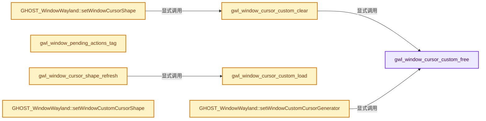
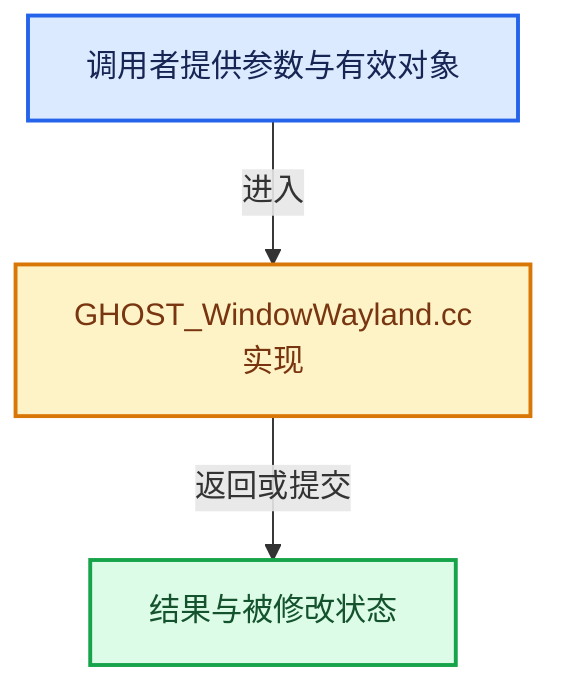

# 实现依赖专题：intern/ghost/intern/GHOST_WindowWayland.cc

[实现依赖导航](../../../README.md) · [符号索引](../../../../00-课程指南/02-源码与提交索引/符号依赖与实现索引.md)

本专题从正文实际调用进入，集中保存共享实现。函数有稳定锚点，可从调用处直接跳到对应完整函数；递归与互相调用通过回链组织。

## 本文件的实现关系






## 完整成员与函数实现

<a id="f-5d8b558d19d18782"></a>

### `gwl_window_cursor_custom_free`

实现位置：[intern/ghost/intern/GHOST_WindowWayland.cc](../../../../../../../../intern/ghost/intern/GHOST_WindowWayland.cc) · L237—L240。

接口参数：

- `GHOST_CursorGenerator *cg`

**教学注释版**

<!-- annotated:7e2b397ad26393 -->

```cpp
static void gwl_window_cursor_custom_free(GHOST_CursorGenerator *cg)
{
  cg->free_fn(cg);
}
```

<details>
<summary>核对原始源码：intern/ghost/intern/GHOST_WindowWayland.cc · L237—L240</summary>

<!-- original:7e2b397ad26393:intern/ghost/intern/GHOST_WindowWayland.cc:237:240 -->

```cpp
static void gwl_window_cursor_custom_free(GHOST_CursorGenerator *cg)
{
  cg->free_fn(cg);
}
```

</details>

**继续追踪实现**

- `cg->free_fn` → [调用协议](../../../../00-课程指南/01-路线与规范/模板宏与动态分派协议.md)：由接收对象具体类型或运行时策略提供实现。调用位置L239。

<a id="f-e89f5c104a899328"></a>

### `gwl_window_cursor_custom_clear`

实现位置：[intern/ghost/intern/GHOST_WindowWayland.cc](../../../../../../../../intern/ghost/intern/GHOST_WindowWayland.cc) · L242—L249。

接口参数：

- `GHOST_CursorGenerator **cg`

**教学注释版**

<!-- annotated:6b3e8538602f9f -->

```cpp
static void gwl_window_cursor_custom_clear(GHOST_CursorGenerator **cg)
{
  if (*cg == nullptr) {
    return;
  }
  gwl_window_cursor_custom_free(*cg);
  *cg = nullptr;
}
```

<details>
<summary>核对原始源码：intern/ghost/intern/GHOST_WindowWayland.cc · L242—L249</summary>

<!-- original:6b3e8538602f9f:intern/ghost/intern/GHOST_WindowWayland.cc:242:249 -->

```cpp
static void gwl_window_cursor_custom_clear(GHOST_CursorGenerator **cg)
{
  if (*cg == nullptr) {
    return;
  }
  gwl_window_cursor_custom_free(*cg);
  *cg = nullptr;
}
```

</details>

**继续追踪实现**

- `gwl_window_cursor_custom_free` → [gwl_window_cursor_custom_free · L237](GHOST_WindowWayland.cc.md#f-5d8b558d19d18782)。

<a id="f-3fd1e8ad71868787"></a>

### `gwl_window_cursor_custom_load`

实现位置：[intern/ghost/intern/GHOST_WindowWayland.cc](../../../../../../../../intern/ghost/intern/GHOST_WindowWayland.cc) · L251—L255。

接口参数：

- `const GHOST_CursorGenerator &cg`
- `GHOST_SystemWayland *system`

**教学注释版**

<!-- annotated:d950654236ed38 -->

```cpp
[[nodiscard]] static GHOST_TSuccess gwl_window_cursor_custom_load(const GHOST_CursorGenerator &cg,
                                                                  GHOST_SystemWayland *system)
{
  return system->cursor_shape_custom_set(cg);
}
```

<details>
<summary>核对原始源码：intern/ghost/intern/GHOST_WindowWayland.cc · L251—L255</summary>

<!-- original:d950654236ed38:intern/ghost/intern/GHOST_WindowWayland.cc:251:255 -->

```cpp
[[nodiscard]] static GHOST_TSuccess gwl_window_cursor_custom_load(const GHOST_CursorGenerator &cg,
                                                                  GHOST_SystemWayland *system)
{
  return system->cursor_shape_custom_set(cg);
}
```

</details>

**结果出口**

- `return system->cursor_shape_custom_set(cg);`

**继续追踪实现**

- `system->cursor_shape_custom_set` → [GHOST_SystemWayland::cursor_shape_custom_set · L10395](GHOST_SystemWayland.cc.md#f-aae9dfec8033cf19)。

<a id="f-7565fee3f68acee2"></a>

### `gwl_window_cursor_shape_refresh`

实现位置：[intern/ghost/intern/GHOST_WindowWayland.cc](../../../../../../../../intern/ghost/intern/GHOST_WindowWayland.cc) · L257—L275。

接口参数：

- `GHOST_TStandardCursor shape`
- `const GHOST_CursorGenerator *cg`
- `GHOST_SystemWayland *system`

**教学注释版**

<!-- annotated:898c9f45704a7e -->

```cpp
[[nodiscard]] static GHOST_TSuccess gwl_window_cursor_shape_refresh(
    GHOST_TStandardCursor shape, const GHOST_CursorGenerator *cg, GHOST_SystemWayland *system)
{
#ifdef USE_EVENT_BACKGROUND_THREAD
  GHOST_ASSERT(system->main_thread_id == std::this_thread::get_id(), "Only from main thread!");
#endif

  if (shape == GHOST_kStandardCursorCustom) {
    const GHOST_TSuccess ok = gwl_window_cursor_custom_load(*cg, system);
    if (ok == GHOST_kSuccess) {
      return ok;
    }
    shape = GHOST_kStandardCursorDefault;
    system->cursor_shape_set(shape);
    return GHOST_kFailure;
  }

  return system->cursor_shape_set(shape);
}
```

<details>
<summary>核对原始源码：intern/ghost/intern/GHOST_WindowWayland.cc · L257—L275</summary>

<!-- original:898c9f45704a7e:intern/ghost/intern/GHOST_WindowWayland.cc:257:275 -->

```cpp
[[nodiscard]] static GHOST_TSuccess gwl_window_cursor_shape_refresh(
    GHOST_TStandardCursor shape, const GHOST_CursorGenerator *cg, GHOST_SystemWayland *system)
{
#ifdef USE_EVENT_BACKGROUND_THREAD
  GHOST_ASSERT(system->main_thread_id == std::this_thread::get_id(), "Only from main thread!");
#endif

  if (shape == GHOST_kStandardCursorCustom) {
    const GHOST_TSuccess ok = gwl_window_cursor_custom_load(*cg, system);
    if (ok == GHOST_kSuccess) {
      return ok;
    }
    shape = GHOST_kStandardCursorDefault;
    system->cursor_shape_set(shape);
    return GHOST_kFailure;
  }

  return system->cursor_shape_set(shape);
}
```

</details>

**沿实际写入检查状态**

- `shape = GHOST_kStandardCursorDefault;`

**结果出口**

- `return ok;`
- `return GHOST_kFailure;`
- `return system->cursor_shape_set(shape);`

**继续追踪实现**

- `GHOST_ASSERT` → [GHOST_ASSERT · L56](GHOST_Debug.hh.md#m-e1ca7e811752)；[GHOST_ASSERT · L68](GHOST_Debug.hh.md#m-deec761cb532)；[GHOST_ASSERT · L79](GHOST_Debug.hh.md#m-3f4c4d5110a9)。宏定义由构建条件选择。
- `std::this_thread::get_id` → [外部契约](https://eel.is/c++draft/)：这个边界按实际表达式及所属类型核对参数、返回值、寿命与失败行为。这里提供接口入口，不声称已解释该第三方版本的内部实现。
- `gwl_window_cursor_custom_load` → [gwl_window_cursor_custom_load · L251](GHOST_WindowWayland.cc.md#f-3fd1e8ad71868787)。
- `system->cursor_shape_set` → [GHOST_SystemWayland::cursor_shape_set · L10212](GHOST_SystemWayland.cc.md#f-b10e104690f6f683)。

<a id="f-3835c6d75b47426e"></a>

### `gwl_window_pending_actions_tag`

实现位置：[intern/ghost/intern/GHOST_WindowWayland.cc](../../../../../../../../intern/ghost/intern/GHOST_WindowWayland.cc) · L826—L830。

接口参数：

- `GWL_Window *win`
- `enum eGWL_PendingWindowActions type`

**教学注释版**

<!-- annotated:1e6705e767aebe -->

```cpp
static void gwl_window_pending_actions_tag(GWL_Window *win, enum eGWL_PendingWindowActions type)
{
  win->pending_actions[int(type)].store(true);
  win->ghost_system->has_pending_actions_for_window.store(true);
}
```

<details>
<summary>核对原始源码：intern/ghost/intern/GHOST_WindowWayland.cc · L826—L830</summary>

<!-- original:1e6705e767aebe:intern/ghost/intern/GHOST_WindowWayland.cc:826:830 -->

```cpp
static void gwl_window_pending_actions_tag(GWL_Window *win, enum eGWL_PendingWindowActions type)
{
  win->pending_actions[int(type)].store(true);
  win->ghost_system->has_pending_actions_for_window.store(true);
}
```

</details>

**继续追踪实现**

- `win->pending_actions[int(type)].store` → [调用协议](../../../../00-课程指南/01-路线与规范/模板宏与动态分派协议.md)：接收对象类型依赖auto、返回值或模板实例；不按同名猜测目标。调用位置L828。
- `win->ghost_system->has_pending_actions_for_window.store` → [调用协议](../../../../00-课程指南/01-路线与规范/模板宏与动态分派协议.md)：接收对象类型依赖auto、返回值或模板实例；不按同名猜测目标。调用位置L829。

<a id="f-fefa10890e48ebc7"></a>

### `GHOST_WindowWayland::setWindowCursorShape`

实现位置：[intern/ghost/intern/GHOST_WindowWayland.cc](../../../../../../../../intern/ghost/intern/GHOST_WindowWayland.cc) · L2276—L2318。

接口参数：

- `GHOST_TStandardCursor shape`

**教学注释版**

<!-- annotated:e72e5c11b098a0 -->

```cpp
GHOST_TSuccess GHOST_WindowWayland::setWindowCursorShape(GHOST_TStandardCursor shape)
{
#ifdef USE_EVENT_BACKGROUND_THREAD
  std::lock_guard lock_server_guard{*system_->server_mutex};
#endif

  const bool is_active = this == static_cast<const GHOST_WindowWayland *>(
                                     system_->getWindowManager()->getActiveWindow());
  gwl_window_cursor_custom_clear(&window_->cursor_generator);
  cursor_shape_ = shape;

  GHOST_TSuccess ok;
  if (is_active) {
    ok = system_->cursor_shape_set(cursor_shape_);
    GHOST_TSuccess ok_test = ok;
    if (ok == GHOST_kFailure) {
      /* Failed, try again with the default cursor. */
      cursor_shape_ = GHOST_kStandardCursorDefault;
      ok_test = system_->cursor_shape_set(cursor_shape_);
    }

    wl_display *display = system_->wl_display_get();
#ifdef USE_CURSOR_IMMEDIATE_DISPATCH
    if (ok == GHOST_kSuccess || ok_test == GHOST_kSuccess) {
      wl_display_flush(display);
      wl_display_dispatch_pending(display);
    }
    else
#endif /* USE_CURSOR_IMMEDIATE_DISPATCH */
      if (ok_test == GHOST_kFailure) {
        /* For the cursor to display when the event queue isn't being handled. */
        wl_display_flush(display);
      }
  }
  else {
    /* Set later when activating the window. */
    ok = system_->cursor_shape_check(shape);
    if (ok == GHOST_kFailure) {
      cursor_shape_ = GHOST_kStandardCursorDefault;
    }
  }
  return ok;
}
```

<details>
<summary>核对原始源码：intern/ghost/intern/GHOST_WindowWayland.cc · L2276—L2318</summary>

<!-- original:e72e5c11b098a0:intern/ghost/intern/GHOST_WindowWayland.cc:2276:2318 -->

```cpp
GHOST_TSuccess GHOST_WindowWayland::setWindowCursorShape(GHOST_TStandardCursor shape)
{
#ifdef USE_EVENT_BACKGROUND_THREAD
  std::lock_guard lock_server_guard{*system_->server_mutex};
#endif

  const bool is_active = this == static_cast<const GHOST_WindowWayland *>(
                                     system_->getWindowManager()->getActiveWindow());
  gwl_window_cursor_custom_clear(&window_->cursor_generator);
  cursor_shape_ = shape;

  GHOST_TSuccess ok;
  if (is_active) {
    ok = system_->cursor_shape_set(cursor_shape_);
    GHOST_TSuccess ok_test = ok;
    if (ok == GHOST_kFailure) {
      /* Failed, try again with the default cursor. */
      cursor_shape_ = GHOST_kStandardCursorDefault;
      ok_test = system_->cursor_shape_set(cursor_shape_);
    }

    wl_display *display = system_->wl_display_get();
#ifdef USE_CURSOR_IMMEDIATE_DISPATCH
    if (ok == GHOST_kSuccess || ok_test == GHOST_kSuccess) {
      wl_display_flush(display);
      wl_display_dispatch_pending(display);
    }
    else
#endif /* USE_CURSOR_IMMEDIATE_DISPATCH */
      if (ok_test == GHOST_kFailure) {
        /* For the cursor to display when the event queue isn't being handled. */
        wl_display_flush(display);
      }
  }
  else {
    /* Set later when activating the window. */
    ok = system_->cursor_shape_check(shape);
    if (ok == GHOST_kFailure) {
      cursor_shape_ = GHOST_kStandardCursorDefault;
    }
  }
  return ok;
}
```

</details>

**沿实际写入检查状态**

- `cursor_shape_ = shape;`
- `ok = system_->cursor_shape_set(cursor_shape_);`
- `cursor_shape_ = GHOST_kStandardCursorDefault;`
- `ok_test = system_->cursor_shape_set(cursor_shape_);`
- `ok = system_->cursor_shape_check(shape);`

**结果出口**

- `return ok;`

**继续追踪实现**

- `system_->getWindowManager()->getActiveWindow` → [调用协议](../../../../00-课程指南/01-路线与规范/模板宏与动态分派协议.md)：接收对象类型依赖auto、返回值或模板实例；不按同名猜测目标。调用位置L2283。
- `system_->getWindowManager` → [调用协议](../../../../00-课程指南/01-路线与规范/模板宏与动态分派协议.md)：接收对象类型依赖auto、返回值或模板实例；不按同名猜测目标。调用位置L2283。
- `gwl_window_cursor_custom_clear` → [gwl_window_cursor_custom_clear · L242](GHOST_WindowWayland.cc.md#f-e89f5c104a899328)。
- `system_->cursor_shape_set` → [调用协议](../../../../00-课程指南/01-路线与规范/模板宏与动态分派协议.md)：接收对象类型依赖auto、返回值或模板实例；不按同名猜测目标。调用位置L2289。
- `system_->wl_display_get` → [调用协议](../../../../00-课程指南/01-路线与规范/模板宏与动态分派协议.md)：接收对象类型依赖auto、返回值或模板实例；不按同名猜测目标。调用位置L2297。
- `wl_display_flush` → [wl_display_flush · L164](../../wayland_dynload/extern/wayland_dynload_client.h.md#m-8fe7d488d31c)。宏定义由构建条件选择。
- `wl_display_dispatch_pending` → [wl_display_dispatch_pending · L144](../../wayland_dynload/extern/wayland_dynload_client.h.md#m-7c3ee199efc0)。宏定义由构建条件选择。
- `system_->cursor_shape_check` → [调用协议](../../../../00-课程指南/01-路线与规范/模板宏与动态分派协议.md)：接收对象类型依赖auto、返回值或模板实例；不按同名猜测目标。调用位置L2312。

<a id="f-3cacc676b0ee1296"></a>

### `GHOST_WindowWayland::setWindowCustomCursorGenerator`

实现位置：[intern/ghost/intern/GHOST_WindowWayland.cc](../../../../../../../../intern/ghost/intern/GHOST_WindowWayland.cc) · L2328—L2353。

接口参数：

- `GHOST_CursorGenerator *cursor_generator`

**教学注释版**

<!-- annotated:179a17fd60b405 -->

```cpp
GHOST_TSuccess GHOST_WindowWayland::setWindowCustomCursorGenerator(
    GHOST_CursorGenerator *cursor_generator)
{
  /* Before this, all logic is just setting up the cursor. */
#ifdef USE_EVENT_BACKGROUND_THREAD
  std::lock_guard lock_server_guard{*system_->server_mutex};
#endif
  cursor_shape_ = GHOST_kStandardCursorCustom;
  if (window_->cursor_generator) {
    gwl_window_cursor_custom_free(window_->cursor_generator);
  }
  window_->cursor_generator = cursor_generator;

  GHOST_TSuccess success = cursor_shape_refresh();

  /* Let refresh handle applying the changes. */
  if (success == GHOST_kSuccess) {
    wl_display *display = system_->wl_display_get();
    /* For the cursor to display when the event queue isn't being handled. */
    wl_display_flush(display);
#ifdef USE_CURSOR_IMMEDIATE_DISPATCH
    wl_display_dispatch_pending(display);
#endif
  }
  return success;
}
```

<details>
<summary>核对原始源码：intern/ghost/intern/GHOST_WindowWayland.cc · L2328—L2353</summary>

<!-- original:179a17fd60b405:intern/ghost/intern/GHOST_WindowWayland.cc:2328:2353 -->

```cpp
GHOST_TSuccess GHOST_WindowWayland::setWindowCustomCursorGenerator(
    GHOST_CursorGenerator *cursor_generator)
{
  /* Before this, all logic is just setting up the cursor. */
#ifdef USE_EVENT_BACKGROUND_THREAD
  std::lock_guard lock_server_guard{*system_->server_mutex};
#endif
  cursor_shape_ = GHOST_kStandardCursorCustom;
  if (window_->cursor_generator) {
    gwl_window_cursor_custom_free(window_->cursor_generator);
  }
  window_->cursor_generator = cursor_generator;

  GHOST_TSuccess success = cursor_shape_refresh();

  /* Let refresh handle applying the changes. */
  if (success == GHOST_kSuccess) {
    wl_display *display = system_->wl_display_get();
    /* For the cursor to display when the event queue isn't being handled. */
    wl_display_flush(display);
#ifdef USE_CURSOR_IMMEDIATE_DISPATCH
    wl_display_dispatch_pending(display);
#endif
  }
  return success;
}
```

</details>

**沿实际写入检查状态**

- `cursor_shape_ = GHOST_kStandardCursorCustom;`
- `window_->cursor_generator = cursor_generator;`

**结果出口**

- `return success;`

**继续追踪实现**

- `gwl_window_cursor_custom_free` → [gwl_window_cursor_custom_free · L237](GHOST_WindowWayland.cc.md#f-5d8b558d19d18782)。
- `cursor_shape_refresh` → [GHOST_WindowWayland::cursor_shape_refresh · L2751](GHOST_WindowWayland.cc.md#f-595f2474199cba05)。
- `system_->wl_display_get` → [调用协议](../../../../00-课程指南/01-路线与规范/模板宏与动态分派协议.md)：接收对象类型依赖auto、返回值或模板实例；不按同名猜测目标。调用位置L2345。
- `wl_display_flush` → [wl_display_flush · L164](../../wayland_dynload/extern/wayland_dynload_client.h.md#m-8fe7d488d31c)。宏定义由构建条件选择。
- `wl_display_dispatch_pending` → [wl_display_dispatch_pending · L144](../../wayland_dynload/extern/wayland_dynload_client.h.md#m-7c3ee199efc0)。宏定义由构建条件选择。

<a id="f-ce50675321f1bdbd"></a>

### `GHOST_WindowWayland::setWindowCustomCursorShape`

实现位置：[intern/ghost/intern/GHOST_WindowWayland.cc](../../../../../../../../intern/ghost/intern/GHOST_WindowWayland.cc) · L2355—L2370。

接口参数：

- `const uint8_t *bitmap`
- `const uint8_t *mask`
- `const int size[2]`
- `const int hot_spot[2]`
- `const bool can_invert_color`

**教学注释版**

<!-- annotated:aaa26bd98162e2 -->

```cpp
GHOST_TSuccess GHOST_WindowWayland::setWindowCustomCursorShape(const uint8_t *bitmap,
                                                               const uint8_t *mask,
                                                               const int size[2],
                                                               const int hot_spot[2],
                                                               const bool can_invert_color)
{
  /* This is no longer needed as all cursors are generated on demand. */
  GHOST_ASSERT(false, "All cursors must be generated!");
  (void)bitmap;
  (void)mask;
  (void)size;
  (void)hot_spot;
  (void)can_invert_color;

  return GHOST_kFailure;
}
```

<details>
<summary>核对原始源码：intern/ghost/intern/GHOST_WindowWayland.cc · L2355—L2370</summary>

<!-- original:aaa26bd98162e2:intern/ghost/intern/GHOST_WindowWayland.cc:2355:2370 -->

```cpp
GHOST_TSuccess GHOST_WindowWayland::setWindowCustomCursorShape(const uint8_t *bitmap,
                                                               const uint8_t *mask,
                                                               const int size[2],
                                                               const int hot_spot[2],
                                                               const bool can_invert_color)
{
  /* This is no longer needed as all cursors are generated on demand. */
  GHOST_ASSERT(false, "All cursors must be generated!");
  (void)bitmap;
  (void)mask;
  (void)size;
  (void)hot_spot;
  (void)can_invert_color;

  return GHOST_kFailure;
}
```

</details>

**结果出口**

- `return GHOST_kFailure;`

**继续追踪实现**

- `GHOST_ASSERT` → [GHOST_ASSERT · L56](GHOST_Debug.hh.md#m-e1ca7e811752)；[GHOST_ASSERT · L68](GHOST_Debug.hh.md#m-deec761cb532)；[GHOST_ASSERT · L79](GHOST_Debug.hh.md#m-3f4c4d5110a9)。宏定义由构建条件选择。

<a id="f-84a4ae30512c5192"></a>

### `GHOST_WindowWayland::setWindowCursorVisibility`

实现位置：[intern/ghost/intern/GHOST_WindowWayland.cc](../../../../../../../../intern/ghost/intern/GHOST_WindowWayland.cc) · L2478—L2493。

接口参数：

- `const bool visible`

**教学注释版**

<!-- annotated:4ec5d70388704d -->

```cpp
GHOST_TSuccess GHOST_WindowWayland::setWindowCursorVisibility(const bool visible)
{
#ifdef USE_EVENT_BACKGROUND_THREAD
  std::lock_guard lock_server_guard{*system_->server_mutex};
#endif
  const GHOST_TSuccess ok = system_->cursor_visibility_set(visible);
  if (ok == GHOST_kSuccess) {
    wl_display *display = system_->wl_display_get();
    /* For the cursor to display when the event queue isn't being handled. */
    wl_display_flush(display);
#ifdef USE_CURSOR_IMMEDIATE_DISPATCH
    wl_display_dispatch_pending(display);
#endif
  }
  return ok;
}
```

<details>
<summary>核对原始源码：intern/ghost/intern/GHOST_WindowWayland.cc · L2478—L2493</summary>

<!-- original:4ec5d70388704d:intern/ghost/intern/GHOST_WindowWayland.cc:2478:2493 -->

```cpp
GHOST_TSuccess GHOST_WindowWayland::setWindowCursorVisibility(const bool visible)
{
#ifdef USE_EVENT_BACKGROUND_THREAD
  std::lock_guard lock_server_guard{*system_->server_mutex};
#endif
  const GHOST_TSuccess ok = system_->cursor_visibility_set(visible);
  if (ok == GHOST_kSuccess) {
    wl_display *display = system_->wl_display_get();
    /* For the cursor to display when the event queue isn't being handled. */
    wl_display_flush(display);
#ifdef USE_CURSOR_IMMEDIATE_DISPATCH
    wl_display_dispatch_pending(display);
#endif
  }
  return ok;
}
```

</details>

**结果出口**

- `return ok;`

**继续追踪实现**

- `system_->cursor_visibility_set` → [调用协议](../../../../00-课程指南/01-路线与规范/模板宏与动态分派协议.md)：接收对象类型依赖auto、返回值或模板实例；不按同名猜测目标。调用位置L2483。
- `system_->wl_display_get` → [调用协议](../../../../00-课程指南/01-路线与规范/模板宏与动态分派协议.md)：接收对象类型依赖auto、返回值或模板实例；不按同名猜测目标。调用位置L2485。
- `wl_display_flush` → [wl_display_flush · L164](../../wayland_dynload/extern/wayland_dynload_client.h.md#m-8fe7d488d31c)。宏定义由构建条件选择。
- `wl_display_dispatch_pending` → [wl_display_dispatch_pending · L144](../../wayland_dynload/extern/wayland_dynload_client.h.md#m-7c3ee199efc0)。宏定义由构建条件选择。

<a id="f-af96c798a02e85ed"></a>

### `GHOST_WindowWayland::close`

实现位置：[intern/ghost/intern/GHOST_WindowWayland.cc](../../../../../../../../intern/ghost/intern/GHOST_WindowWayland.cc) · L2682—L2686。

**教学注释版**

<!-- annotated:8da7882096c998 -->

```cpp
GHOST_TSuccess GHOST_WindowWayland::close()
{
  return system_->pushEvent_maybe_pending(
      // [讲解] std::make_unique<GHOST_Event>：创建独占拥有的对象，拥有关系可移动，get返回的借用指针不自动延长寿命。
      std::make_unique<GHOST_Event>(system_->getMilliSeconds(), GHOST_kEventWindowClose, this));
}
```

<details>
<summary>核对原始源码：intern/ghost/intern/GHOST_WindowWayland.cc · L2682—L2686</summary>

<!-- original:8da7882096c998:intern/ghost/intern/GHOST_WindowWayland.cc:2682:2686 -->

```cpp
GHOST_TSuccess GHOST_WindowWayland::close()
{
  return system_->pushEvent_maybe_pending(
      std::make_unique<GHOST_Event>(system_->getMilliSeconds(), GHOST_kEventWindowClose, this));
}
```

</details>

**结果出口**

- `return system_->pushEvent_maybe_pending(`

**继续追踪实现**

- `system_->pushEvent_maybe_pending` → [调用协议](../../../../00-课程指南/01-路线与规范/模板宏与动态分派协议.md)：接收对象类型依赖auto、返回值或模板实例；不按同名猜测目标。调用位置L2684。
- `std::make_unique<GHOST_Event>` → [外部契约](https://eel.is/c++draft/unique.ptr.create)：创建独占拥有的对象，拥有关系可移动，get返回的借用指针不自动延长寿命。
- `system_->getMilliSeconds` → [调用协议](../../../../00-课程指南/01-路线与规范/模板宏与动态分派协议.md)：接收对象类型依赖auto、返回值或模板实例；不按同名猜测目标。调用位置L2685。

<a id="f-595f2474199cba05"></a>

### `GHOST_WindowWayland::cursor_shape_refresh`

实现位置：[intern/ghost/intern/GHOST_WindowWayland.cc](../../../../../../../../intern/ghost/intern/GHOST_WindowWayland.cc) · L2751—L2760。

**教学注释版**

<!-- annotated:d461cdffd9a13d -->

```cpp
GHOST_TSuccess GHOST_WindowWayland::cursor_shape_refresh()
{
#ifdef USE_EVENT_BACKGROUND_THREAD
  if (system_->main_thread_id != std::this_thread::get_id()) {
    gwl_window_pending_actions_tag(window_, PENDING_WINDOW_CURSOR_SHAPE_REFRESH);
    return GHOST_kSuccess;
  }
#endif
  return gwl_window_cursor_shape_refresh(cursor_shape_, window_->cursor_generator, system_);
}
```

<details>
<summary>核对原始源码：intern/ghost/intern/GHOST_WindowWayland.cc · L2751—L2760</summary>

<!-- original:d461cdffd9a13d:intern/ghost/intern/GHOST_WindowWayland.cc:2751:2760 -->

```cpp
GHOST_TSuccess GHOST_WindowWayland::cursor_shape_refresh()
{
#ifdef USE_EVENT_BACKGROUND_THREAD
  if (system_->main_thread_id != std::this_thread::get_id()) {
    gwl_window_pending_actions_tag(window_, PENDING_WINDOW_CURSOR_SHAPE_REFRESH);
    return GHOST_kSuccess;
  }
#endif
  return gwl_window_cursor_shape_refresh(cursor_shape_, window_->cursor_generator, system_);
}
```

</details>

**结果出口**

- `return GHOST_kSuccess;`
- `return gwl_window_cursor_shape_refresh(cursor_shape_, window_->cursor_generator, system_);`

**继续追踪实现**

- `std::this_thread::get_id` → [外部契约](https://eel.is/c++draft/)：这个边界按实际表达式及所属类型核对参数、返回值、寿命与失败行为。这里提供接口入口，不声称已解释该第三方版本的内部实现。
- `gwl_window_pending_actions_tag` → [gwl_window_pending_actions_tag · L826](GHOST_WindowWayland.cc.md#f-3835c6d75b47426e)。
- `gwl_window_cursor_shape_refresh` → [gwl_window_cursor_shape_refresh · L257](GHOST_WindowWayland.cc.md#f-7565fee3f68acee2)。
